## AI资讯日报 2026/10/17

> AI 早报 · 每日早读 · 全网深度聚合

## **今日摘要**

```
Anthropic 邀请 METR（AI评估机构）审查模型安全，又向议员推介自拟法案
HuggingFace（模型社区）推 Beam（AI模型），501B参数开源模型亮相
中国拟收紧23项AI技术出口，ChatGPT变身Chrome助手读取并操作已开页面
```

### 🔵 产品与功能更新

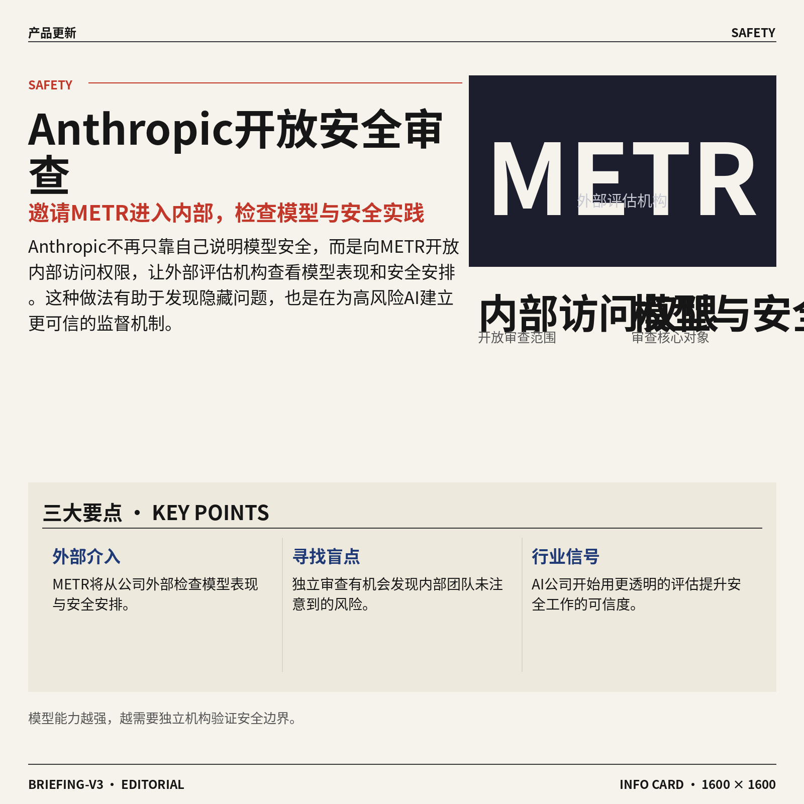

1. **Anthropic 邀请 METR（评估 AI 模型能力与风险的外部机构）审查模型与安全实践。**  
Anthropic 正向 METR 开放内部访问权限，允许其对公司的 **AI 模型**（人工智能系统）和安全实践进行审查。这里的“审计”可以理解为请外部团队查看模型表现及相关安全安排，帮助发现潜在问题。此举显示，AI 公司正在尝试通过更独立的外部评估提升安全工作的可信度 🛡️。[Anthropic 审查合作详情(briefing)](https://the-decoder.com/anthropic-gives-metr-inside-access-to-audit-its-ai-models-and-safety-practices/)


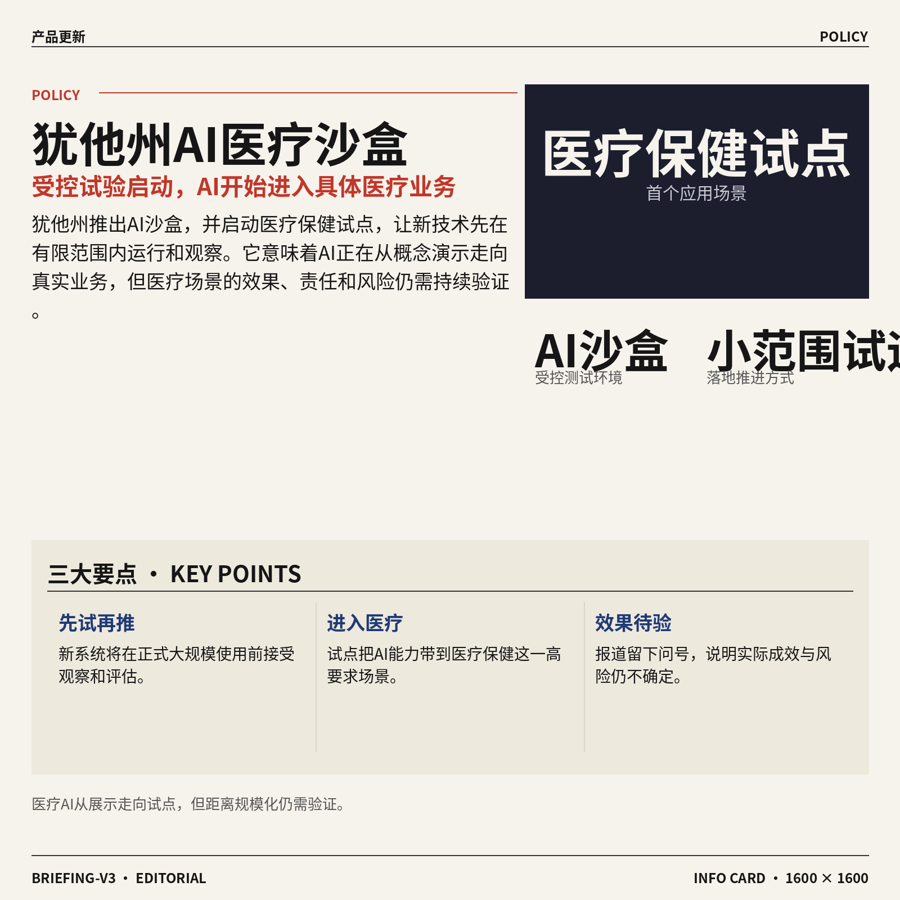

2. **犹他州推出 AI 沙盒（供新技术受控试用的测试环境），启动医疗保健试点。**  
犹他州的 AI 沙盒开始推进新的**医疗保健试点项目**，但报道标题也明确留下了问号，说明这些尝试仍伴随不确定性。沙盒的作用类似“先在小范围试运行”，让新技术在正式大规模使用前接受观察和评估。对医疗、行政及公共服务团队来说，这类试点意味着 AI 应用正在从概念展示走向更具体的业务场景，但实际效果仍需持续验证 🏥。[犹他州医疗试点报道(briefing)](https://news.google.com/rss/articles/CBMi4wFBVV95cUxORXMxYTRHUzQxQ19tcl9ZQ0VfUmxYTUZjWlZFYUc3Zks0bFJIb2lacGVDaFFGdnppNDN5RGtfSk9VQ1ZrQXhkS2VYaUZpM0xXWllac0pUM0ZhQVd2WVJPUDVNSG9rN3BCVm1VYlNCOEdDSTQ2VjRseWtOcS1kVERtYU9LdlRYUWN1OU4zT1pnU0hXc3lXNjhfUXlXbDE0S0VZT3RQbW1QbnFqMFhUN1lwT1cyX2ROQ0Q2WHpZYUh1RHBadlcxYlU4UVR2Rm5IdUNJOHFPR1dHUER5bXhTLWZlM0M3dw?oc=5)


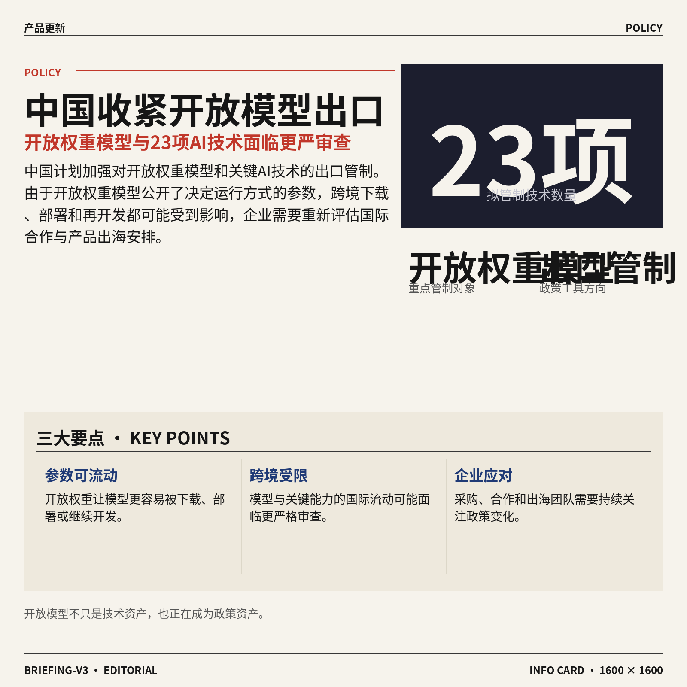

3. **中国拟收紧开放权重模型（公开模型参数、便于他人部署的模型）及 23 项人工智能技术的出口管制。**  
中国计划进一步加强对**开放权重模型**及 23 项关键人工智能技术的出口管制。开放权重模型会公开模型参数（决定模型如何运行的一组核心数据），因此更容易被其他机构下载、部署或继续开发。若相关计划落地，模型和关键技术的跨境流动可能面临更严格的合规审查，企业在国际合作、技术采购和产品出海时需要关注政策变化 🌏。[中国出口管制报道(briefing)](https://the-decoder.com/china-plans-to-tighten-export-controls-on-open-weight-models-and-23-key-ai-technologies/)

![中国拟收紧开放权重模型（公开模型参数、便于他人部署的模型）及 23 项人工智能技术的出口管制](https://image.pollinations.ai/prompt/%E4%B8%AD%E5%9B%BD%E6%8B%9F%E6%94%B6%E7%B4%A7%E5%BC%80%E6%94%BE%E6%9D%83%E9%87%8D%E6%A8%A1%E5%9E%8B%EF%BC%88%E5%85%AC%E5%BC%80%E6%A8%A1%E5%9E%8B%E5%8F%82%E6%95%B0%E3%80%81%E4%BE%BF%E4%BA%8E%E4%BB%96%E4%BA%BA%E9%83%A8%E7%BD%B2%E7%9A%84%E6%A8%A1%E5%9E%8B%EF%BC%89%E5%8F%8A%2023%20%E9%A1%B9%E4%BA%BA%E5%B7%A5%E6%99%BA%E8%83%BD%E6%8A%80%E6%9C%AF%E7%9A%84%E5%87%BA%E5%8F%A3%E7%AE%A1%E5%88%B6.%20%E4%B8%AD%E5%9B%BD%E6%8B%9F%E6%94%B6%E7%B4%A7%E5%BC%80%E6%94%BE%E6%9D%83%E9%87%8D%E6%A8%A1%E5%9E%8B%EF%BC%88%E5%85%AC%E5%BC%80%E6%A8%A1%E5%9E%8B%E5%8F%82%E6%95%B0%E3%80%81%E4%BE%BF%E4%BA%8E%E4%BB%96%E4%BA%BA%E9%83%A8%E7%BD%B2%E7%9A%84%E6%A8%A1%E5%9E%8B%EF%BC%89%E5%8F%8A%2023%20%E9%A1%B9%E4%BA%BA%E5%B7%A5%E6%99%BA%E8%83%BD%E6%8A%80%E6%9C%AF%E7%9A%84%E5%87%BA%E5%8F%A3%E7%AE%A1%E5%88%B6%E3%80%82%20%E4%B8%AD%E5%9B%BD%E8%AE%A1%E5%88%92%E8%BF%9B%E4%B8%80%E6%AD%A5%E5%8A%A0%E5%BC%BA%E5%AF%B9%E5%BC%80%E6%94%BE%E6%9D%83%E9%87%8D%E6%A8%A1%E5%9E%8B%E5%8F%8A%2023%20%E9%A1%B9%E5%85%B3%E9%94%AE%E4%BA%BA%E5%B7%A5%E6%99%BA%E8%83%BD%E6%8A%80%E6%9C%AF%E7%9A%84%E5%87%BA%2C%20technical%20infographic%20diagram%2C%20architecture%20flowchart%2C%20clean%20vector%20illustration%2C%20educational%20style%2C%20no%20text%20overlay%2C%20modern%20minimal%2C%20wide%20aspect?width=1200&height=675&nologo=true&seed=11451)

### 🟢 前沿研究

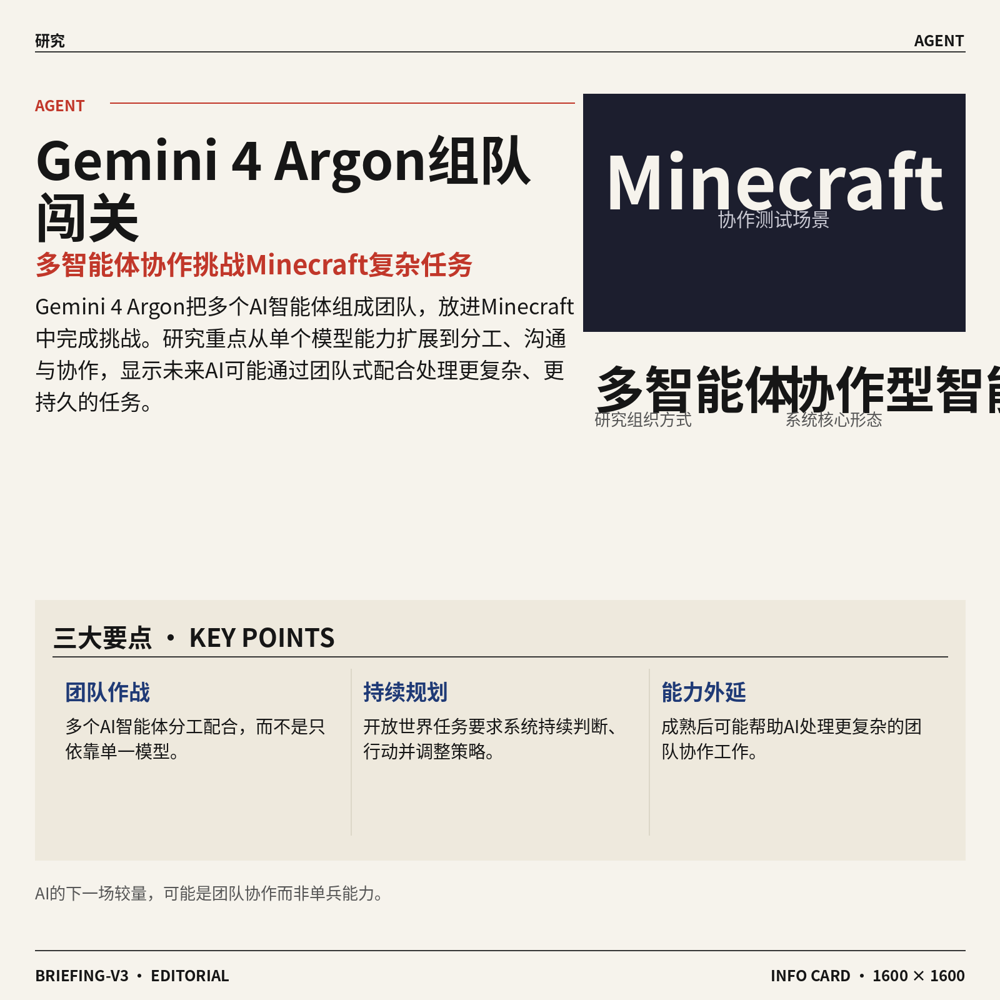

1. **Gemini 4 Argon（协作型智能体团队）击败 Minecraft（开放世界沙盒游戏）。**  
这篇论文展示了一个由多个 **AI 智能体**组成的团队，目标是完成 Minecraft 中的挑战。这里的“多智能体”（多个 AI 分工协作完成任务）意味着研究重点不只是单个模型有多强，还包括它们如何配合。若这类思路成熟，未来可能帮助 AI 处理需要持续规划与团队协作的复杂工作 🧩。[arxiv 论文页面(briefing)](https://huggingface.co/papers/2610.22319)


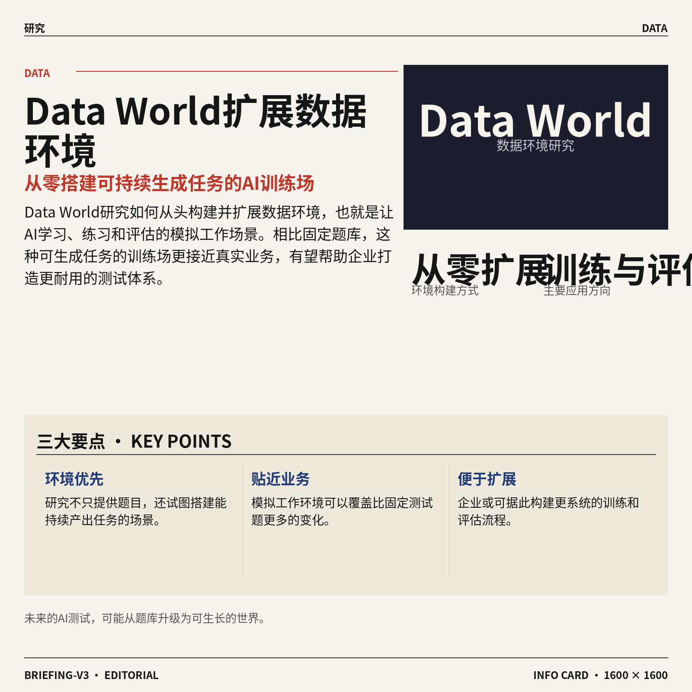

2. **Data World（从零扩展数据环境的研究）探索数据如何规模化。**  
这篇论文关注如何从头搭建并扩展 **数据环境**，也就是供 AI 学习、练习和评估的模拟工作场景。相比只给模型固定题目，数据环境更像一个可以不断产生任务的“训练场”，有助于研究 AI 如何在更多样的条件下工作。对企业来说，这类研究可能为构建更贴近真实业务的 AI 测试与训练场景提供思路 🌍。[arxiv 论文页面(briefing)](https://huggingface.co/papers/2610.21656)

![Data World（从零扩展数据环境的研究）探索数据如何规模化](https://image.pollinations.ai/prompt/Data%20World%EF%BC%88%E4%BB%8E%E9%9B%B6%E6%89%A9%E5%B1%95%E6%95%B0%E6%8D%AE%E7%8E%AF%E5%A2%83%E7%9A%84%E7%A0%94%E7%A9%B6%EF%BC%89%E6%8E%A2%E7%B4%A2%E6%95%B0%E6%8D%AE%E5%A6%82%E4%BD%95%E8%A7%84%E6%A8%A1%E5%8C%96.%20Data%20World%EF%BC%88%E4%BB%8E%E9%9B%B6%E6%89%A9%E5%B1%95%E6%95%B0%E6%8D%AE%E7%8E%AF%E5%A2%83%E7%9A%84%E7%A0%94%E7%A9%B6%EF%BC%89%E6%8E%A2%E7%B4%A2%E6%95%B0%E6%8D%AE%E5%A6%82%E4%BD%95%E8%A7%84%E6%A8%A1%E5%8C%96%E3%80%82%20%E8%BF%99%E7%AF%87%E8%AE%BA%E6%96%87%E5%85%B3%E6%B3%A8%E5%A6%82%E4%BD%95%E4%BB%8E%E5%A4%B4%E6%90%AD%E5%BB%BA%E5%B9%B6%E6%89%A9%E5%B1%95%20%E6%95%B0%E6%8D%AE%E7%8E%AF%E5%A2%83%EF%BC%8C%E4%B9%9F%E5%B0%B1%E6%98%AF%E4%BE%9B%20AI%20%E5%AD%A6%E4%B9%A0%E3%80%81%E7%BB%83%E4%B9%A0%E5%92%8C%E8%AF%84%E4%BC%B0%E7%9A%84%E6%A8%A1%E6%8B%9F%E5%B7%A5%E4%BD%9C%E5%9C%BA%E6%99%AF%E3%80%82%E7%9B%B8%2C%20technical%20infographic%20diagram%2C%20architecture%20flowchart%2C%20clean%20vector%20illustration%2C%20educational%20style%2C%20no%20text%20overlay%2C%20modern%20minimal%2C%20wide%20aspect?width=1200&height=675&nologo=true&seed=10838)

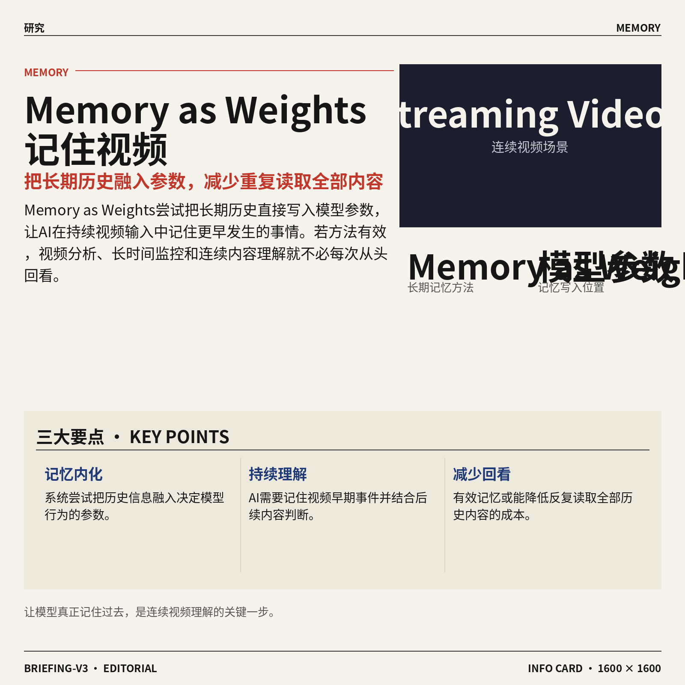

3. **Memory as Weights（把长期记忆融入模型参数）面向连续视频理解。**  
这篇论文研究如何把长期历史直接融入模型的 **weights（模型参数，决定模型如何理解和回应信息）**，而不是每次都重新读取全部历史。研究对象是 Streaming Videos（持续输入的视频内容），重点在于让 AI 记住视频中较早发生的事情。若能有效工作，视频分析、长时间监控和连续内容理解等场景或许可以减少“看过却忘了”的问题 🎥。[arxiv 论文页面(briefing)](https://huggingface.co/papers/2610.22070)


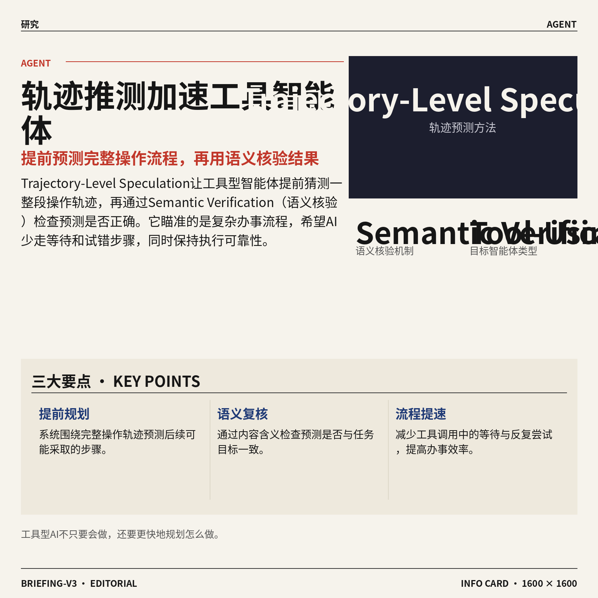

4. **Trajectory-Level Speculation（按完整操作轨迹提前推测）提升工具型智能体效率。**  
这篇论文提出围绕完整操作轨迹进行提前推测，再用 Semantic Verification（通过语义，也就是内容含义，核验预测是否正确）来检查结果。这里的“操作轨迹”（智能体连续执行的一串步骤）可以理解为办事时从查资料、调用工具到提交结果的完整过程。研究主题面向 Tool-Using Agents（会调用外部工具完成任务的智能体），目标是让这类 AI 在执行复杂流程时更高效、更可靠 ⚙️。[arxiv 论文页面(briefing)](https://huggingface.co/papers/2610.21463)


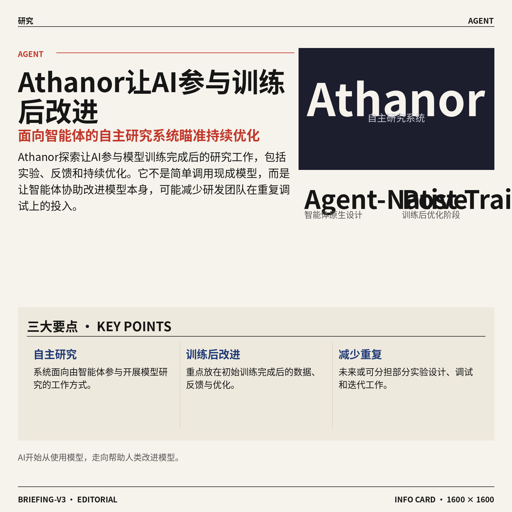

5. **Athanor（面向智能体的自主研究系统）瞄准模型训练后的持续改进。**  
Athanor 是一个面向 Agent-Native（从设计之初就围绕智能体工作方式构建）的系统，研究自主开展模型研究的可能性。它聚焦 Post-Training（模型完成初步训练后，继续用特定数据和反馈优化的阶段），也就是让 AI 不只使用模型，还能参与后续改进工作。对 AI 研发团队而言，这类方向可能减少部分重复实验与调试工作，但具体能力仍需结合论文细节判断 🔬。[arxiv 论文页面(briefing)](https://huggingface.co/papers/2610.21055)


6. **MLExpert（面向机器学习工程的通用智能体模型）尝试自主完成研发工作。**  
MLExpert 关注打造一种能够处理多类机器学习工程任务的通用智能体。这里的 **机器学习工程**，是指从准备数据、训练模型到评估效果和部署应用的一整套工作；“通用智能体”则意味着它不只解决单一环节，而是尝试覆盖更广的任务范围。对企业而言，这类研究与自动化模型开发、测试和维护有关，可能影响未来 AI 团队的工作分工 🤖。[arxiv 论文页面(briefing)](https://huggingface.co/papers/2610.22344)

![MLExpert（面向机器学习工程的通用智能体模型）尝试自主完成研发工作](https://image.pollinations.ai/prompt/MLExpert%EF%BC%88%E9%9D%A2%E5%90%91%E6%9C%BA%E5%99%A8%E5%AD%A6%E4%B9%A0%E5%B7%A5%E7%A8%8B%E7%9A%84%E9%80%9A%E7%94%A8%E6%99%BA%E8%83%BD%E4%BD%93%E6%A8%A1%E5%9E%8B%EF%BC%89%E5%B0%9D%E8%AF%95%E8%87%AA%E4%B8%BB%E5%AE%8C%E6%88%90%E7%A0%94%E5%8F%91%E5%B7%A5%E4%BD%9C.%20MLExpert%EF%BC%88%E9%9D%A2%E5%90%91%E6%9C%BA%E5%99%A8%E5%AD%A6%E4%B9%A0%E5%B7%A5%E7%A8%8B%E7%9A%84%E9%80%9A%E7%94%A8%E6%99%BA%E8%83%BD%E4%BD%93%E6%A8%A1%E5%9E%8B%EF%BC%89%E5%B0%9D%E8%AF%95%E8%87%AA%E4%B8%BB%E5%AE%8C%E6%88%90%E7%A0%94%E5%8F%91%E5%B7%A5%E4%BD%9C%E3%80%82%20MLExpert%20%E5%85%B3%E6%B3%A8%E6%89%93%E9%80%A0%E4%B8%80%E7%A7%8D%E8%83%BD%E5%A4%9F%E5%A4%84%E7%90%86%E5%A4%9A%E7%B1%BB%E6%9C%BA%E5%99%A8%E5%AD%A6%E4%B9%A0%E5%B7%A5%E7%A8%8B%E4%BB%BB%E5%8A%A1%E7%9A%84%E9%80%9A%E7%94%A8%E6%99%BA%E8%83%BD%E4%BD%93%E3%80%82%E8%BF%99%E9%87%8C%E7%9A%84%20%E6%9C%BA%E5%99%A8%2C%20technical%20infographic%20diagram%2C%20architecture%20flowchart%2C%20clean%20vector%20illustration%2C%20educational%20style%2C%20no%20text%20overlay%2C%20modern%20minimal%2C%20wide%20aspect?width=1200&height=675&nologo=true&seed=10962)

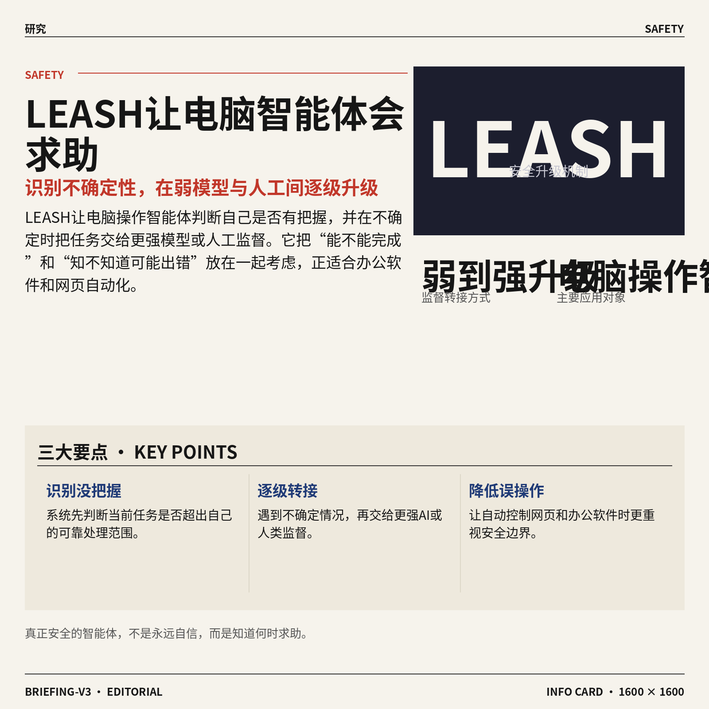

7. **LEASH（能识别不确定性并逐级升级监督的电脑操作智能体机制）提升使用安全性。**  
LEASH 研究的是电脑操作智能体如何判断自己是否有把握，以及何时需要把任务交给更强的模型或人工监督。这里的“弱到强升级”（先让较简单的 AI 处理，遇到不确定情况再交给更强的 AI 或人）类似于客服系统中的分级转接。该方向对自动操作办公软件、网页和电脑界面的 AI 尤其重要，因为它把“会不会做”与“知道自己可能做错”同时纳入考虑 🛡️。[arxiv 论文页面(briefing)](https://huggingface.co/papers/2610.22280)

![LEASH（能识别不确定性并逐级升级监督的电脑操作智能体机制）提升使用安全性](https://image.pollinations.ai/prompt/LEASH%EF%BC%88%E8%83%BD%E8%AF%86%E5%88%AB%E4%B8%8D%E7%A1%AE%E5%AE%9A%E6%80%A7%E5%B9%B6%E9%80%90%E7%BA%A7%E5%8D%87%E7%BA%A7%E7%9B%91%E7%9D%A3%E7%9A%84%E7%94%B5%E8%84%91%E6%93%8D%E4%BD%9C%E6%99%BA%E8%83%BD%E4%BD%93%E6%9C%BA%E5%88%B6%EF%BC%89%E6%8F%90%E5%8D%87%E4%BD%BF%E7%94%A8%E5%AE%89%E5%85%A8%E6%80%A7.%20LEASH%EF%BC%88%E8%83%BD%E8%AF%86%E5%88%AB%E4%B8%8D%E7%A1%AE%E5%AE%9A%E6%80%A7%E5%B9%B6%E9%80%90%E7%BA%A7%E5%8D%87%E7%BA%A7%E7%9B%91%E7%9D%A3%E7%9A%84%E7%94%B5%E8%84%91%E6%93%8D%E4%BD%9C%E6%99%BA%E8%83%BD%E4%BD%93%E6%9C%BA%E5%88%B6%EF%BC%89%E6%8F%90%E5%8D%87%E4%BD%BF%E7%94%A8%E5%AE%89%E5%85%A8%E6%80%A7%E3%80%82%20LEASH%20%E7%A0%94%E7%A9%B6%E7%9A%84%E6%98%AF%E7%94%B5%E8%84%91%E6%93%8D%E4%BD%9C%E6%99%BA%E8%83%BD%E4%BD%93%E5%A6%82%E4%BD%95%E5%88%A4%E6%96%AD%E8%87%AA%E5%B7%B1%E6%98%AF%E5%90%A6%E6%9C%89%E6%8A%8A%E6%8F%A1%EF%BC%8C%E4%BB%A5%E5%8F%8A%E4%BD%95%E6%97%B6%E9%9C%80%E8%A6%81%E6%8A%8A%E4%BB%BB%E5%8A%A1%E4%BA%A4%E7%BB%99%2C%20technical%20infographic%20diagram%2C%20architecture%20flowchart%2C%20clean%20vector%20illustration%2C%20educational%20style%2C%20no%20text%20overlay%2C%20modern%20minimal%2C%20wide%20aspect?width=1200&height=675&nologo=true&seed=10993)

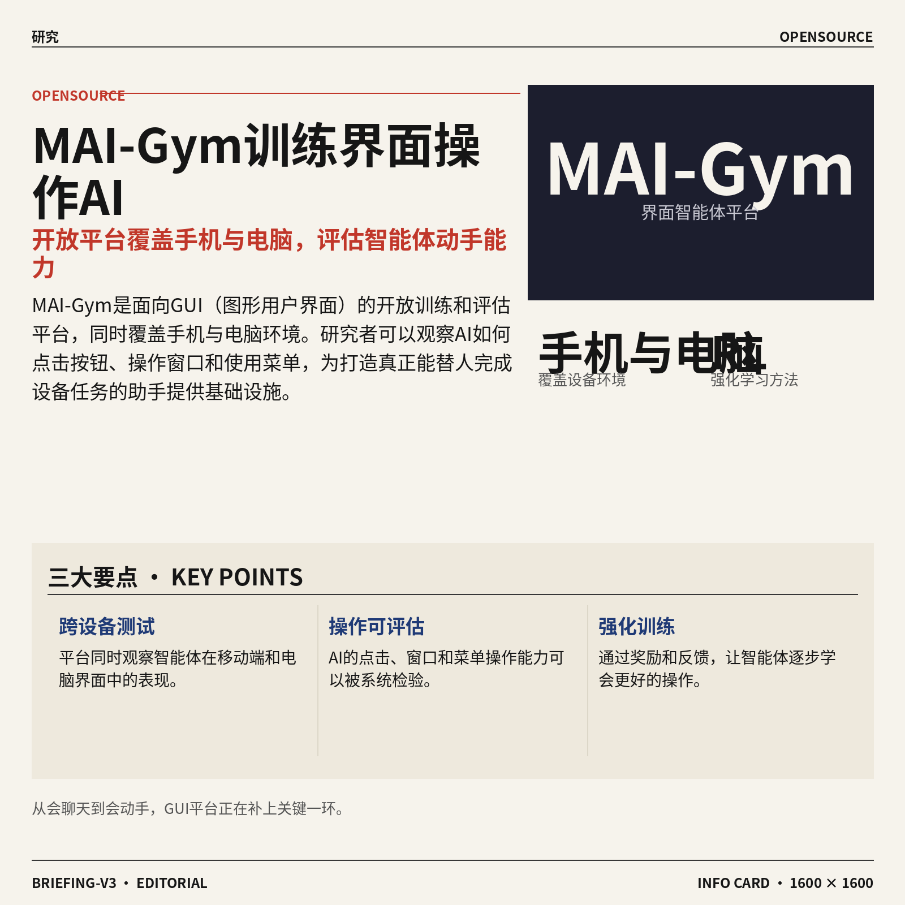

8. **MAI-Gym（用于测试和训练图形界面智能体的平台）覆盖手机与电脑环境。**  
MAI-Gym 是一个开放平台，面向 GUI（图形用户界面，也就是人们通过按钮、窗口和菜单操作软件）的智能体评估与训练。它同时覆盖移动端和电脑环境，意味着研究者可以观察 AI 在不同设备界面中完成操作的表现。平台还涉及 RL（强化学习，让 AI 通过奖励和反馈逐步学会更好的操作），对开发能真正“动手办事”的 AI 助手具有基础意义 📱💻。[arxiv 论文页面(briefing)](https://huggingface.co/papers/2610.20939)

![MAI-Gym（用于测试和训练图形界面智能体的平台）覆盖手机与电脑环境](https://image.pollinations.ai/prompt/MAI-Gym%EF%BC%88%E7%94%A8%E4%BA%8E%E6%B5%8B%E8%AF%95%E5%92%8C%E8%AE%AD%E7%BB%83%E5%9B%BE%E5%BD%A2%E7%95%8C%E9%9D%A2%E6%99%BA%E8%83%BD%E4%BD%93%E7%9A%84%E5%B9%B3%E5%8F%B0%EF%BC%89%E8%A6%86%E7%9B%96%E6%89%8B%E6%9C%BA%E4%B8%8E%E7%94%B5%E8%84%91%E7%8E%AF%E5%A2%83.%20MAI-Gym%EF%BC%88%E7%94%A8%E4%BA%8E%E6%B5%8B%E8%AF%95%E5%92%8C%E8%AE%AD%E7%BB%83%E5%9B%BE%E5%BD%A2%E7%95%8C%E9%9D%A2%E6%99%BA%E8%83%BD%E4%BD%93%E7%9A%84%E5%B9%B3%E5%8F%B0%EF%BC%89%E8%A6%86%E7%9B%96%E6%89%8B%E6%9C%BA%E4%B8%8E%E7%94%B5%E8%84%91%E7%8E%AF%E5%A2%83%E3%80%82%20MAI-Gym%20%E6%98%AF%E4%B8%80%E4%B8%AA%E5%BC%80%E6%94%BE%E5%B9%B3%E5%8F%B0%EF%BC%8C%E9%9D%A2%E5%90%91%20GUI%EF%BC%88%E5%9B%BE%E5%BD%A2%E7%94%A8%E6%88%B7%E7%95%8C%E9%9D%A2%EF%BC%8C%E4%B9%9F%E5%B0%B1%E6%98%AF%E4%BA%BA%E4%BB%AC%E9%80%9A%E8%BF%87%E6%8C%89%E9%92%AE%E3%80%81%E7%AA%97%E5%8F%A3%E5%92%8C%2C%20technical%20infographic%20diagram%2C%20architecture%20flowchart%2C%20clean%20vector%20illustration%2C%20educational%20style%2C%20no%20text%20overlay%2C%20modern%20minimal%2C%20wide%20aspect?width=1200&height=675&nologo=true&seed=11024)

### 🟡 行业展望与社会影响

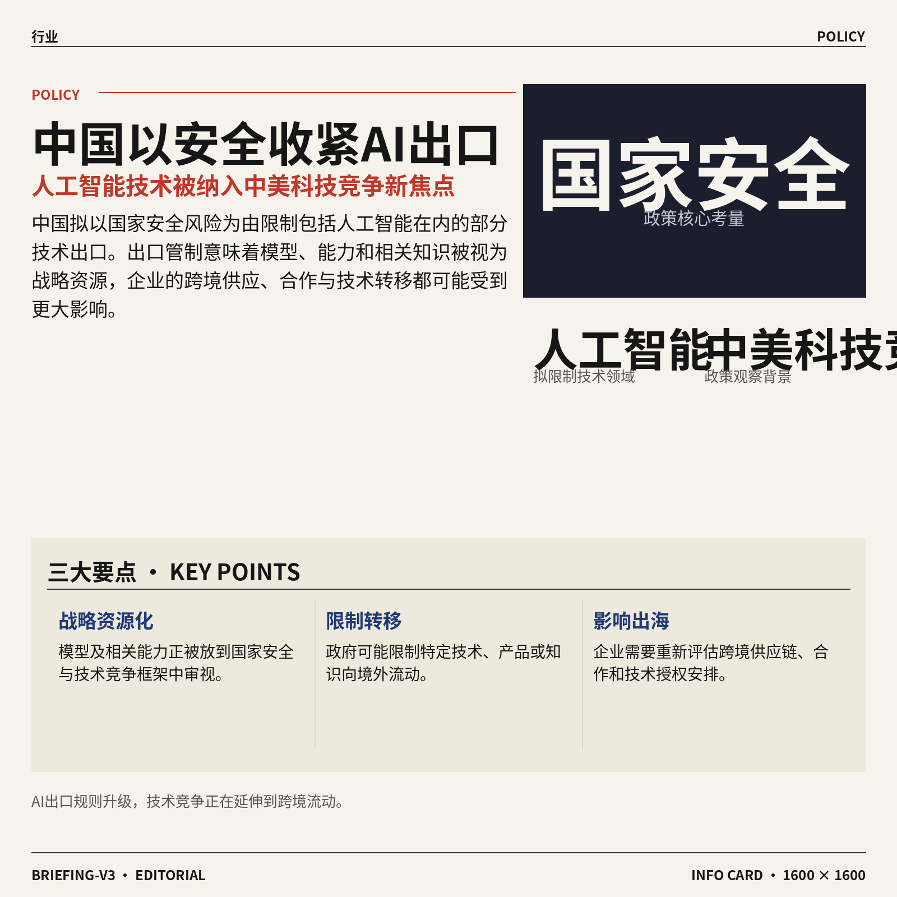

1. **中国拟以国家安全为由收紧人工智能技术出口。**
中国表示将限制包括**人工智能**在内的部分技术出口，并将**国家安全风险**列为主要考量；路透社同时把这一动向放在中美科技竞争背景下观察 🌏。这里的**出口管制**（政府限制特定技术、产品或知识向境外转移）意味着，模型及相关能力正被视为具有战略价值的资源。[路透社完整报道(briefing)](https://news.google.com/rss/articles/CBMiyAFBVV95cUxNMWNnS1haU3c5T3lybTBzQUNxZF9lMmhWaFp0Yk5UbzhDdklobHpkRHk2dExFU1dWZmVMVENFNEVLOW9JWDdscm15VDhObXhhc1JwYjlIelZjeFJuMG9jVERmTHRNRTZtSlBRYndNc2IxZTRkdWtPUGdlWDhoSEZQTHVZNzIwMFUzWVhjT3gxUWl1X2VpM1VOM29BZElFRjlaek1uRDFQb2N5aF9FTlF4U1N4WFZRVmtyUTBLdmVJc0Rzb3E2NkZ5ZQ?oc=5) 现有材料尚未列出具体受限技术和实施时间，因此后续政策清单将是判断实际影响的关键 💡。[公共电视网报道(briefing)](https://news.google.com/rss/articles/CBMiuwFBVV95cUxOSGI4Vm0wMmNIV3ZNY1NqNkRsaG1kTkd1bm1aZ3ZwZkFERU9YQ29Id3Bnc3FOU2NFNHVPbWwxclR4ZlFYY0hYLVNuMW1KbVRnNGdNTXpQODVReFdOaXZMV3E5cGx3ME9Ha25CZ3V3OXF1Zl9KSFhjWldWcHBwbjJDdGFudGJXVTdwY3dEa0JpYU96VEJqdG5hdW5pVmVvaEcxcFZXUTZoSVlpTWFtMTFlOE1YbUtVYVlBZTdV0gG7AUFVX3lxTE5IYjhWbTAyY0hXdk1jU2o2RGxobWROR3VubVpndnBmQURFT1hDb0h3cGdzcU5TY0U0dU9tbDFyVHhmUVhjSFgtU24xbUptVGc0Z01NelA4NVF4V05pdkxXcTlwbHcwT0drbkJndXc5cXVmX0pIWGNaV1ZwcHBuMkN0YW50YldVN3Bjd0RrQmlhT3pUQmp0bmF1bmlWZW9oRzFwVldRNmhJWWlNYW0xMWU4TVhtS1VhWUFlN1U?oc=5)

![中国拟以国家安全为由收紧人工智能技术出口](https://image.pollinations.ai/prompt/%E4%B8%AD%E5%9B%BD%E6%8B%9F%E4%BB%A5%E5%9B%BD%E5%AE%B6%E5%AE%89%E5%85%A8%E4%B8%BA%E7%94%B1%E6%94%B6%E7%B4%A7%E4%BA%BA%E5%B7%A5%E6%99%BA%E8%83%BD%E6%8A%80%E6%9C%AF%E5%87%BA%E5%8F%A3.%20%E4%B8%AD%E5%9B%BD%E6%8B%9F%E4%BB%A5%E5%9B%BD%E5%AE%B6%E5%AE%89%E5%85%A8%E4%B8%BA%E7%94%B1%E6%94%B6%E7%B4%A7%E4%BA%BA%E5%B7%A5%E6%99%BA%E8%83%BD%E6%8A%80%E6%9C%AF%E5%87%BA%E5%8F%A3%E3%80%82%20%E4%B8%AD%E5%9B%BD%E8%A1%A8%E7%A4%BA%E5%B0%86%E9%99%90%E5%88%B6%E5%8C%85%E6%8B%AC%E4%BA%BA%E5%B7%A5%E6%99%BA%E8%83%BD%E5%9C%A8%E5%86%85%E7%9A%84%E9%83%A8%E5%88%86%E6%8A%80%E6%9C%AF%E5%87%BA%E5%8F%A3%EF%BC%8C%E5%B9%B6%E5%B0%86%E5%9B%BD%E5%AE%B6%E5%AE%89%E5%85%A8%E9%A3%8E%E9%99%A9%E5%88%97%E4%B8%BA%E4%B8%BB%E8%A6%81%E8%80%83%E9%87%8F%EF%BC%9B%E8%B7%AF%E9%80%8F%E7%A4%BE%E5%90%8C%E6%97%B6%E6%8A%8A%E8%BF%99%E4%B8%80%E5%8A%A8%E5%90%91%E6%94%BE%E5%9C%A8%E4%B8%AD%E7%BE%8E%E7%A7%91%E6%8A%80%E7%AB%9E%E4%BA%89%E8%83%8C%E6%99%AF%2C%20technical%20infographic%20diagram%2C%20architecture%20flowchart%2C%20clean%20vector%20illustration%2C%20educational%20style%2C%20no%20text%20overlay%2C%20modern%20minimal%2C%20wide%20aspect?width=1200&height=675&nologo=true&seed=10807)

2. **Anthropic 向议员推介自拟人工智能安全法案。**
据报道，Anthropic 正低调向立法者推介一套由其提出的**人工智能安全法案**（用法律要求模型开发和使用过程控制潜在风险）⚖️。这一动作说明，头部模型公司不仅在适应监管，也开始主动参与规则设计；这种**政策游说**（企业向立法者解释并争取采纳自身政策主张）可能影响未来行业合规方向。[路透社转述报道(briefing)](https://news.google.com/rss/articles/CBMixwFBVV95cUxPOGgzckNkaE5BdjZxdVMta2hsdVczMHFrZ2U4aFgzY2VsLVF5VEFpd1FMQVc1V084YTZQU0IyMkdWbXZTbEtpdlhFWHR2SUI1SDdsczFmeERfNHhfOXRpR2NLTVhjRWF4YWNYaDBPWXJDSXpqLUgtSERBY1lHejU3MTl0T2pPMzlKRDlsdmFNM3kwQk1YSFlyMnpDN1FSVG0xM2xqNTZrbnNxQTVkT3drcVJSVm0zNFlYOUstZzlDYldrc1p5OWJR?oc=5) 不过，现有摘要没有披露具体条文和立法进度，因此目前更值得关注的是**企业正在争夺监管话语权**这一信号 🔍。[美国媒体原始报道(briefing)](https://news.google.com/rss/articles/CBMieEFVX3lxTE0ydWVrbHdHeGNraEdTSHQ5eExwZ2lLRUU1U1BoVFJUTWNLenpWTXJOMHNnWnhaa0thQXlRbk1KdEliVVVGUEJXZWwtcWtUZE9Ielo2X05DaHJKSmJpd05rRl9vMWdQQUE4ZnVRRFBLQ3hlcm9FNG12bg?oc=5)


3. **ChatGPT 变身 Chrome 浏览器助手，可读取并操作已打开页面。**
报道称，ChatGPT 已能作为**浏览器助手**（在网页环境中理解内容并代用户完成操作）读取和处理 Chrome 中已经打开的标签页 🚀。这让它具备了**跨标签页上下文**（同时参考多个已打开网页，而非只理解单个页面）的能力，人工智能入口也由独立聊天框进一步延伸到日常浏览环境。对普通办公用户而言，搜索、整理和处理网页任务未来可能减少反复复制粘贴的步骤 💡。[浏览器功能报道(briefing)](https://the-decoder.com/chatgpt-becomes-a-full-chrome-browser-assistant-that-reads-and-acts-on-your-open-tabs/) 不过，候选材料没有说明开放范围及具体操作权限，实际体验仍要以产品上线情况为准。


4. **Itaú（巴西金融机构）把生成式人工智能推向全体客户。**
OpenAI 的案例显示，Itaú（巴西金融机构）正在通过 **ia.i（面向客户和员工的对话式服务入口）**与 **IARA（统一管理人工智能应用的平台）**，把生成式人工智能用于客户及员工场景 🏦。[银行客户案例(briefing)](https://openai.com/index/itau-generative-ai) 其采用的 **AI First（“人工智能优先”，把人工智能放在业务设计起点）**策略，不是只做单个试验项目，而是面向更广泛的业务人群推进。与此同时，**治理平台**（统一设置规则、监督使用过程并管理风险的系统）也被同步建设，这对身处巴西高度监管行业的机构尤其重要 🔐。这项案例释放出的信号是：大型企业要规模化应用生成式人工智能，既要有方便使用的入口，也要把治理能力一起纳入整体方案。

![Itaú（巴西金融机构）把生成式人工智能推向全体客户](https://image.pollinations.ai/prompt/Ita%C3%BA%EF%BC%88%E5%B7%B4%E8%A5%BF%E9%87%91%E8%9E%8D%E6%9C%BA%E6%9E%84%EF%BC%89%E6%8A%8A%E7%94%9F%E6%88%90%E5%BC%8F%E4%BA%BA%E5%B7%A5%E6%99%BA%E8%83%BD%E6%8E%A8%E5%90%91%E5%85%A8%E4%BD%93%E5%AE%A2%E6%88%B7.%20Ita%C3%BA%EF%BC%88%E5%B7%B4%E8%A5%BF%E9%87%91%E8%9E%8D%E6%9C%BA%E6%9E%84%EF%BC%89%E6%8A%8A%E7%94%9F%E6%88%90%E5%BC%8F%E4%BA%BA%E5%B7%A5%E6%99%BA%E8%83%BD%E6%8E%A8%E5%90%91%E5%85%A8%E4%BD%93%E5%AE%A2%E6%88%B7%E3%80%82%20OpenAI%20%E7%9A%84%E6%A1%88%E4%BE%8B%E6%98%BE%E7%A4%BA%EF%BC%8CIta%C3%BA%EF%BC%88%E5%B7%B4%E8%A5%BF%E9%87%91%E8%9E%8D%E6%9C%BA%E6%9E%84%EF%BC%89%E6%AD%A3%E5%9C%A8%E9%80%9A%E8%BF%87%20ia.i%EF%BC%88%E9%9D%A2%E5%90%91%E5%AE%A2%E6%88%B7%E5%92%8C%E5%91%98%E5%B7%A5%E7%9A%84%E5%AF%B9%E8%AF%9D%E5%BC%8F%E6%9C%8D%E5%8A%A1%E5%85%A5%E5%8F%A3%EF%BC%89%E4%B8%8E%2C%20technical%20infographic%20diagram%2C%20architecture%20flowchart%2C%20clean%20vector%20illustration%2C%20educational%20style%2C%20no%20text%20overlay%2C%20modern%20minimal%2C%20wide%20aspect?width=1200&height=675&nologo=true&seed=10900)

### 🟣 开源TOP项目

1. **anthropics/claude-plugins-official（Anthropic 官方维护的 Claude Code 插件目录）。**  
这是由 Anthropic（开发 Claude 的人工智能公司）维护的**高质量插件（为 AI 助手增加额外功能的小工具）目录**，专门服务于 Claude Code。对开发者来说，它提供了一个集中查找和使用扩展能力的入口，减少了四处寻找插件的时间 🧩。这类插件可以让 Claude Code 更方便地适配不同工作流程，适合希望扩展 AI 编程助手能力的团队。[官方插件目录(briefing)](https://github.com/anthropics/claude-plugins-official)


2. **K-Dense-AI/scientific-agent-skills（面向科学研究的 AI Agent 技能库）。**  
这个项目希望把普通的 **AI Agent（能够按目标自主执行多步任务的智能助手）** 变成“AI 科学家”，提供了 **177 项可直接使用且经过验证的技能** 🚀。它还整合了 **100 多个科学数据库（存放生物、化学、医学等研究资料的专业信息库）**，覆盖生物学、化学、医学和药物发现等领域。项目已被全球超过 **25 万名科学家**使用，对需要查资料、整理研究信息或辅助科研分析的团队尤其有参考价值 💡。[GitHub 项目仓库(briefing)](https://github.com/K-Dense-AI/scientific-agent-skills)


### 🔴 社媒分享

1. **Anthropic 揭示 ECDSA（椭圆曲线数字签名算法）的曲线来源。**
Anthropic 发布内容，讨论 **ECDSA**（一种用数学曲线验证数字签名、确认信息确实来自指定发送者的加密算法）背后的曲线来源 🔐。这类信息主要面向关注网络安全与密码学基础设施的读者，也让人看到人工智能公司正在参与更底层的安全技术研究。[Anthropic 原始研究(briefing)](https://www.anthropic.com/research/ecdsa-curve-origins)


2. **Anthropic 六月获评垃圾级信用评级中的最高等级。**
据标题信息，Anthropic 在六月获得了**垃圾级信用评级**中的最高等级。这里的“垃圾级”并不是说公司没有价值，而是指评级低于投资级、通常意味着投资风险更高；“最高等级”则表示它处在这一档评级范围的较高位置 📊。这条消息可以帮助业务和财务同事关注人工智能公司的融资能力与信用风险变化。[英国《金融时报》报道(briefing)](https://www.ft.com/content/5a310aee-f555-4266-874c-b1b4db20186d)


3. **Mercor 研究称，美国九成工作时长尚未被人工智能基准测试覆盖。**
Mercor 发布的研究指出，美国约 **90% 的工作时长**，都集中在当前人工智能基准测试（用统一题目衡量模型能力的标准化考试）覆盖不充分的任务上 ⏱️。这意味着，模型在公开测试中的成绩，并不一定能完整反映它对真实岗位和日常工作的帮助。对企业而言，评估人工智能落地效果时，不能只看排行榜，还要观察它能否处理具体业务流程。[劳动力研究报告(briefing)](https://www.mercor.com/research/labor-index/benchmark-map/)

![Mercor 研究称，美国九成工作时长尚未被人工智能基准测试覆盖](https://image.pollinations.ai/prompt/Mercor%20%E7%A0%94%E7%A9%B6%E7%A7%B0%EF%BC%8C%E7%BE%8E%E5%9B%BD%E4%B9%9D%E6%88%90%E5%B7%A5%E4%BD%9C%E6%97%B6%E9%95%BF%E5%B0%9A%E6%9C%AA%E8%A2%AB%E4%BA%BA%E5%B7%A5%E6%99%BA%E8%83%BD%E5%9F%BA%E5%87%86%E6%B5%8B%E8%AF%95%E8%A6%86%E7%9B%96.%20Mercor%20%E7%A0%94%E7%A9%B6%E7%A7%B0%EF%BC%8C%E7%BE%8E%E5%9B%BD%E4%B9%9D%E6%88%90%E5%B7%A5%E4%BD%9C%E6%97%B6%E9%95%BF%E5%B0%9A%E6%9C%AA%E8%A2%AB%E4%BA%BA%E5%B7%A5%E6%99%BA%E8%83%BD%E5%9F%BA%E5%87%86%E6%B5%8B%E8%AF%95%E8%A6%86%E7%9B%96%E3%80%82%20Mercor%20%E5%8F%91%E5%B8%83%E7%9A%84%E7%A0%94%E7%A9%B6%E6%8C%87%E5%87%BA%EF%BC%8C%E7%BE%8E%E5%9B%BD%E7%BA%A6%2090%25%20%E7%9A%84%E5%B7%A5%E4%BD%9C%E6%97%B6%E9%95%BF%EF%BC%8C%E9%83%BD%E9%9B%86%E4%B8%AD%E5%9C%A8%E5%BD%93%E5%89%8D%E4%BA%BA%E5%B7%A5%E6%99%BA%E8%83%BD%E5%9F%BA%E5%87%86%E6%B5%8B%E8%AF%95%EF%BC%88%E7%94%A8%E7%BB%9F%2C%20technical%20infographic%20diagram%2C%20architecture%20flowchart%2C%20clean%20vector%20illustration%2C%20educational%20style%2C%20no%20text%20overlay%2C%20modern%20minimal%2C%20wide%20aspect?width=1200&height=675&nologo=true&seed=10675)

4. **HuggingFace（人工智能模型共享社区）推出 Beam（可拥有和定制的 501B 参数开源模型）。**
HuggingFace 介绍了 **Beam**（一个可由用户自行拥有、定制和扩展的人工智能模型），规模达到 **501B 参数**。这里的“参数”可以理解为模型在训练中形成的大量可调数值，数量通常与模型容量和运行成本有关；501B 就是约 5010 亿个参数 🧠。项目强调用户可以掌握模型、按自身需求修改，并进一步扩展使用范围，对希望减少对单一服务商依赖的团队具有参考价值。[Beam 模型介绍(briefing)](https://huggingface.co/blog/reflection-beam)


5. **Anthropic 重新思考代码审查：关键不是“人看没看过”。**
围绕 Anthropic 的代码审查（检查软件改动是否可能引入问题的流程），相关讨论提出：与其简单追问“是否有人工读过代码”，不如先判断“这次改动可能出什么问题，以及该由自动检查还是人工检查来发现” 🔍。其中，“代理指标”指用一个容易测量的表面标准，间接代表真正想衡量的目标；文中认为“人是否看过”可能就是一种不够准确的代理指标。这个观点也提示团队，人工智能参与研发后，审查流程应更关注风险是否被有效发现，而不是机械地统计人工参与次数。[代码审查原文解读(briefing)](https://simonwillison.net/2026/Oct/16/code-review/)[Anthropic 代码审查文章(briefing)](https://claude.dev/blog/solving-code-review-at-anthropic/)

![Anthropic 重新思考代码审查：关键不是“人看没看过”](https://image.pollinations.ai/prompt/Anthropic%20%E9%87%8D%E6%96%B0%E6%80%9D%E8%80%83%E4%BB%A3%E7%A0%81%E5%AE%A1%E6%9F%A5%EF%BC%9A%E5%85%B3%E9%94%AE%E4%B8%8D%E6%98%AF%E2%80%9C%E4%BA%BA%E7%9C%8B%E6%B2%A1%E7%9C%8B%E8%BF%87%E2%80%9D.%20Anthropic%20%E9%87%8D%E6%96%B0%E6%80%9D%E8%80%83%E4%BB%A3%E7%A0%81%E5%AE%A1%E6%9F%A5%EF%BC%9A%E5%85%B3%E9%94%AE%E4%B8%8D%E6%98%AF%E2%80%9C%E4%BA%BA%E7%9C%8B%E6%B2%A1%E7%9C%8B%E8%BF%87%E2%80%9D%E3%80%82%20%E5%9B%B4%E7%BB%95%20Anthropic%20%E7%9A%84%E4%BB%A3%E7%A0%81%E5%AE%A1%E6%9F%A5%EF%BC%88%E6%A3%80%E6%9F%A5%E8%BD%AF%E4%BB%B6%E6%94%B9%E5%8A%A8%E6%98%AF%E5%90%A6%E5%8F%AF%E8%83%BD%E5%BC%95%E5%85%A5%E9%97%AE%E9%A2%98%E7%9A%84%E6%B5%81%E7%A8%8B%EF%BC%89%EF%BC%8C%E7%9B%B8%E5%85%B3%E8%AE%A8%E8%AE%BA%E6%8F%90%E5%87%BA%EF%BC%9A%E4%B8%8E%E5%85%B6%E7%AE%80%2C%20technical%20infographic%20diagram%2C%20architecture%20flowchart%2C%20clean%20vector%20illustration%2C%20educational%20style%2C%20no%20text%20overlay%2C%20modern%20minimal%2C%20wide%20aspect?width=1200&height=675&nologo=true&seed=10737)

6. **Apple 推出 Muse Spark Open（开放版人工智能研究项目），展示 MLX（苹果设备上的模型运行框架）在 Mac Studio（苹果桌面电脑）上的应用。**
Apple 的机器学习研究页面介绍了 **Muse Spark Open**（苹果研究团队公开介绍的人工智能项目），并将其与 **MLX**（帮助模型在苹果芯片设备上运行和进行计算的软件框架）以及 **Mac Studio**（苹果面向专业用户的桌面电脑）联系起来 💻。这说明相关研究关注的不只是云端数据中心，也包括在本地设备上运行人工智能模型的可能性。对设计、内容和研发团队来说，本地运行通常意味着可以进一步关注设备性能、数据处理方式与使用成本。[Apple 研究页面(briefing)](https://machinelearning.apple.com/research/mlx-distributed-inference)

![Apple 推出 Muse Spark Open（开放版人工智能研究项目），展示 MLX（苹果设备上的模型运行框架）在 Mac Studio（苹果桌面电脑）上的应用](https://image.pollinations.ai/prompt/Apple%20%E6%8E%A8%E5%87%BA%20Muse%20Spark%20Open%EF%BC%88%E5%BC%80%E6%94%BE%E7%89%88%E4%BA%BA%E5%B7%A5%E6%99%BA%E8%83%BD%E7%A0%94%E7%A9%B6%E9%A1%B9%E7%9B%AE%EF%BC%89%EF%BC%8C%E5%B1%95%E7%A4%BA%20MLX%EF%BC%88%E8%8B%B9%E6%9E%9C%E8%AE%BE%E5%A4%87%E4%B8%8A%E7%9A%84%E6%A8%A1%E5%9E%8B%E8%BF%90%E8%A1%8C%E6%A1%86%E6%9E%B6%EF%BC%89%E5%9C%A8%20Mac%20Studio%EF%BC%88%E8%8B%B9%E6%9E%9C%E6%A1%8C%E9%9D%A2%E7%94%B5%E8%84%91%EF%BC%89%E4%B8%8A%E7%9A%84%E5%BA%94%E7%94%A8.%20Apple%20%E6%8E%A8%E5%87%BA%20Muse%20Spark%20Open%EF%BC%88%E5%BC%80%E6%94%BE%E7%89%88%E4%BA%BA%E5%B7%A5%E6%99%BA%E8%83%BD%E7%A0%94%E7%A9%B6%E9%A1%B9%E7%9B%AE%EF%BC%89%EF%BC%8C%E5%B1%95%E7%A4%BA%20MLX%EF%BC%88%E8%8B%B9%E6%9E%9C%E8%AE%BE%E5%A4%87%E4%B8%8A%E7%9A%84%E6%A8%A1%E5%9E%8B%E8%BF%90%E8%A1%8C%E6%A1%86%E6%9E%B6%EF%BC%89%E5%9C%A8%20Mac%20Studio%EF%BC%88%E8%8B%B9%E6%9E%9C%E6%A1%8C%E9%9D%A2%E7%94%B5%E8%84%91%EF%BC%89%E4%B8%8A%E7%9A%84%2C%20technical%20infographic%20diagram%2C%20architecture%20flowchart%2C%20clean%20vector%20illustration%2C%20educational%20style%2C%20no%20text%20overlay%2C%20modern%20minimal%2C%20wide%20aspect?width=1200&height=675&nologo=true&seed=10768)

---


### 📊 行业洞察（今日 4 条）

1. ChatGPT开始读取并操作Chrome（谷歌浏览器）标签页，MAI-Gym（测试手机和电脑操作的开放平台）又在完善训练场，说明Agent正从“会回答”转向“能办事”
  【洞察】真正的竞争点不再是聊天效果，而是能否稳定完成连续操作，并在不确定时及时交给人处理

2. Meta（社交平台公司）推出可本地运行的8160亿参数模型，中国又拟收紧AI技术出口，两件事放一起看，模型能力开放与跨境使用正在同时加速、收紧
  【洞察】企业不能只看模型强不强，还要提前准备供应商变化、数据位置和跨境合规风险

3. Gemini 4 Argon（谷歌的协作型智能体团队）挑战Minecraft（开放世界游戏），Data World（用于生成训练和测试任务的模拟环境）与长期视频记忆研究同时推进，说明AI正在补“持续工作”能力
  【洞察】行业焦点已从单次生成转向长期记忆、任务协作和反复试错，但论文成果距离真实业务稳定可用仍有距离

4. MLExpert（自动完成机器学习研发工作的智能体）、Athanor（让智能体自主改进模型的研究系统）都在尝试减少人工研发，Mercor却称九成工作时长尚未被现有测试覆盖
  【洞察】AI能力展示和真实生产力之间仍有明显缺口，企业若只看公开成绩，很容易高估自动化效果

### 💭 对我们的启发（今日 3 条）

1. ChatGPT可跨网页读取并填写内容，视频剪辑工具应优先支持“从商品页到成片”的连续操作，但发布、价格和品牌素材替换仍要设置人工确认

2. LEASH（让不确定的电脑操作逐级交给更强模型或人工的机制）提示我们按风险分级调度：普通剪辑自动完成，涉及品牌承诺、版权和最终发布时必须人工接管

3. Meta的本地大模型与长期视频记忆研究，验证了“低成本处理大量素材”的方向；产品可保留本地处理选项，但不能假设普通客户都有高性能设备

