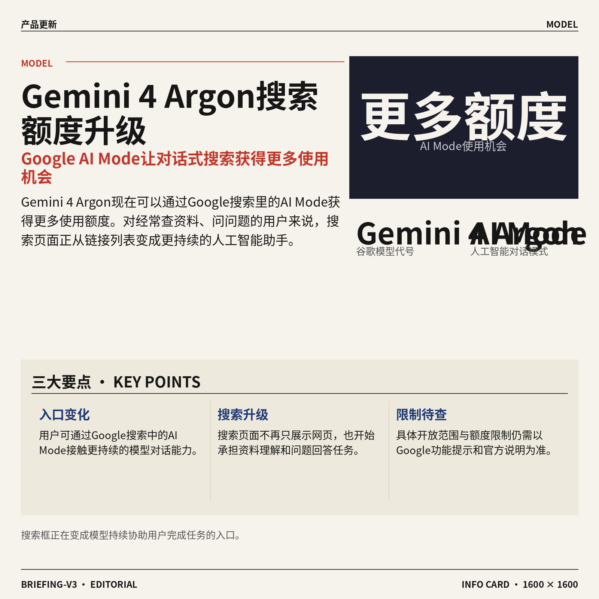
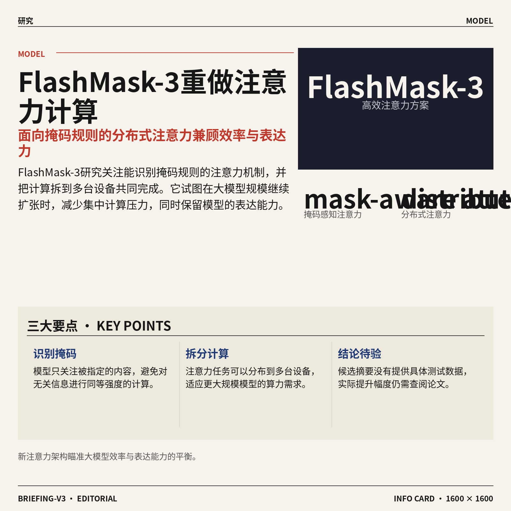
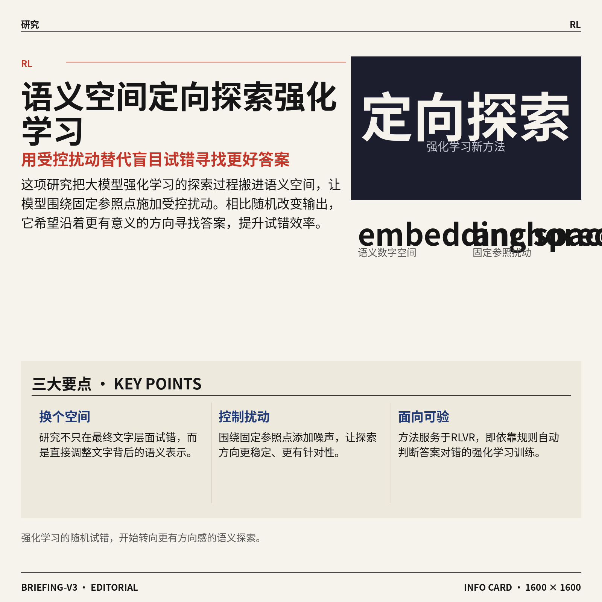
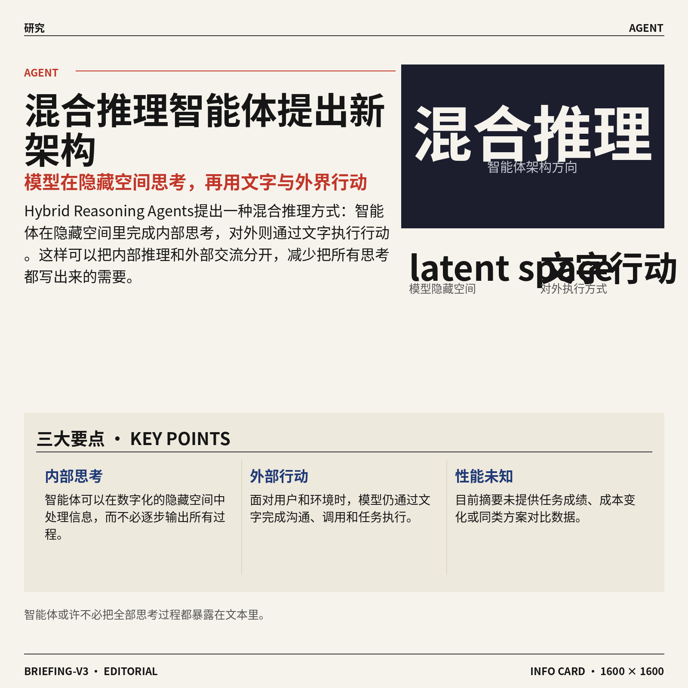
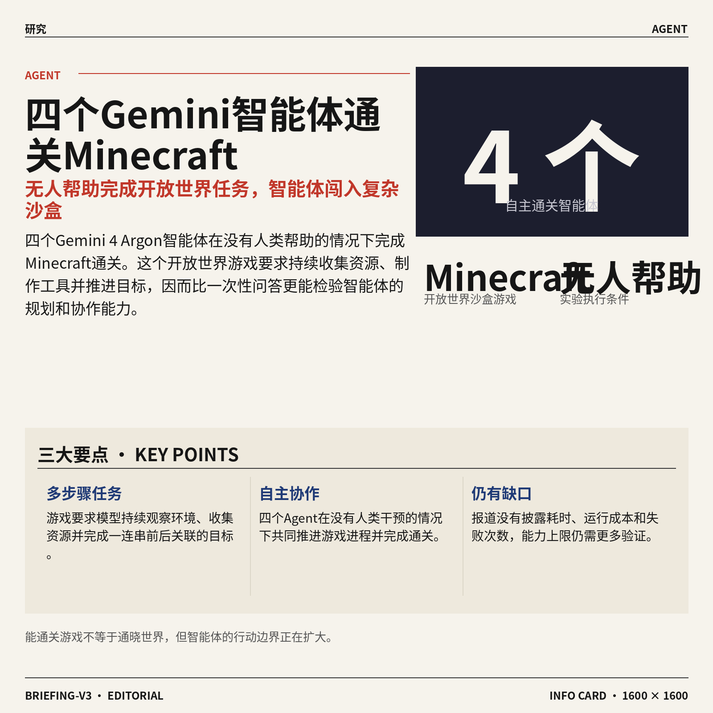
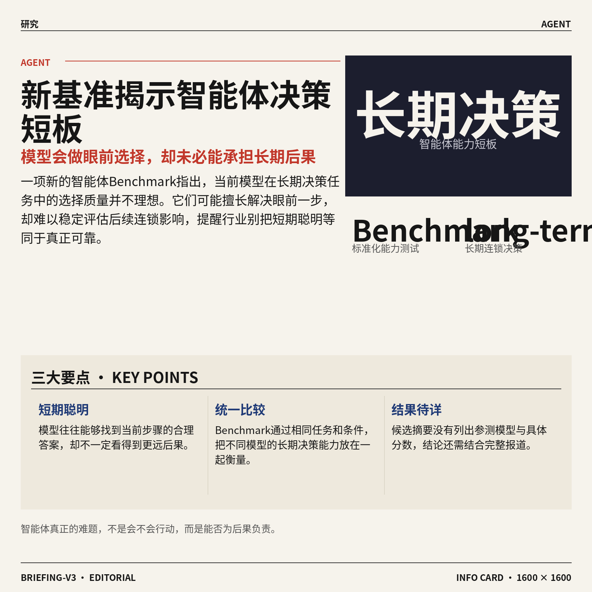
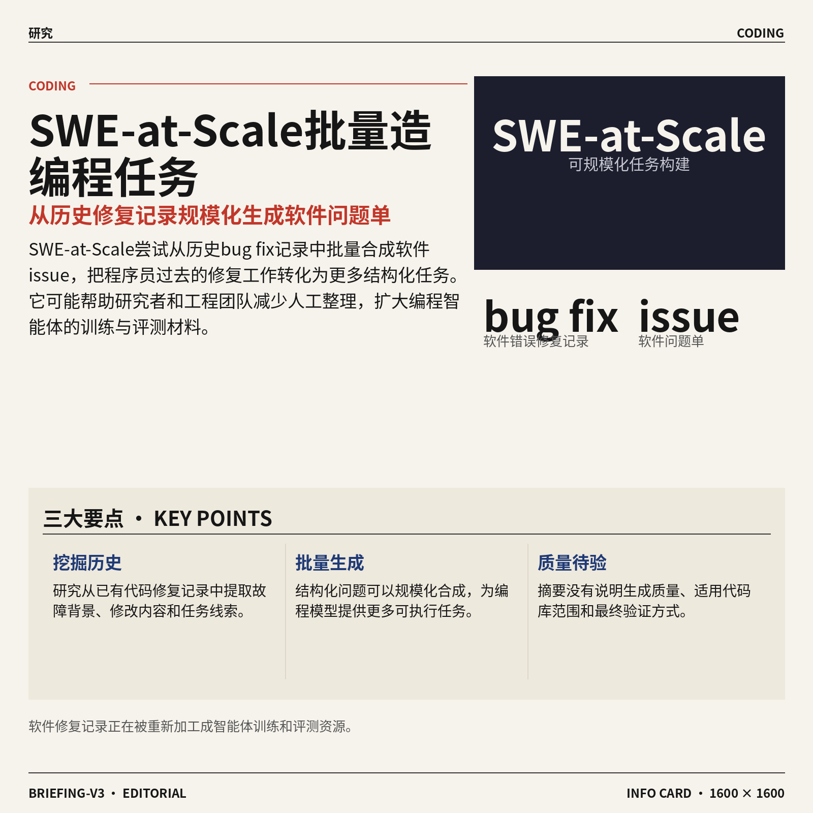
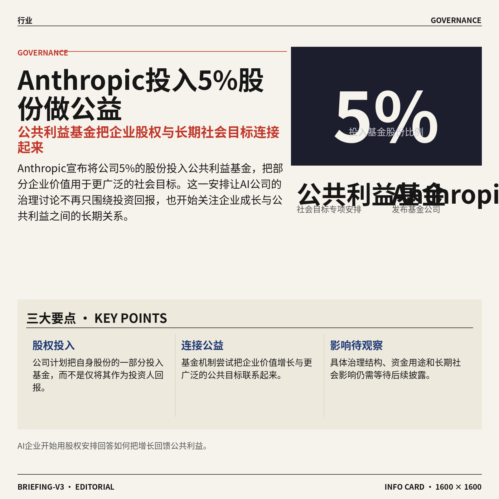

## AI资讯日报 2026/10/19

> AI 早报 · 每日早读 · 全网深度聚合

## **今日摘要**

```
Anthropic 几乎停招初级员工，AI代理工作量达六倍，自我复制蠕虫令其担忧
Gemini 4 Argon（谷歌模型）四个智能体无人通关Minecraft，AI能力突袭沙盒极限
DeepSeek 搜索抓取服务上线，1000次成功请求收费仅0.75美元屠低调用成本
```

### 🔵 产品与功能更新



1. **Gemini 4 Argon（谷歌模型代号）可通过 Google 搜索中的 AI Mode（人工智能对话模式）获得更多使用额度。**  
这则提示介绍了一种通过 Google 搜索里的 **AI Mode（人工智能对话模式）**，增加 Gemini 4 Argon 使用机会的方式 🔍。对经常使用人工智能工具查资料、问问题的同事来说，这意味着搜索页面可能不只是展示网页，也能提供更持续的对话式协助。具体操作与限制仍应以[相关功能提示(briefing)](https://news.google.com/rss/articles/CBMitAFBVV95cUxOS1QxNTlvM0M1MUFPSi1RYWV3bmxZUzBiRVcxM2NpUDhnX29INUFzVzh1blhVbVJU?oc=5)为准。

![Gemini 4 Argon（谷歌模型代号）可通过 Google 搜索中的 AI Mode（人工智能对话模式）获得更多使用额度](https://image.pollinations.ai/prompt/Gemini%204%20Argon%EF%BC%88%E8%B0%B7%E6%AD%8C%E6%A8%A1%E5%9E%8B%E4%BB%A3%E5%8F%B7%EF%BC%89%E5%8F%AF%E9%80%9A%E8%BF%87%20Google%20%E6%90%9C%E7%B4%A2%E4%B8%AD%E7%9A%84%20AI%20Mode%EF%BC%88%E4%BA%BA%E5%B7%A5%E6%99%BA%E8%83%BD%E5%AF%B9%E8%AF%9D%E6%A8%A1%E5%BC%8F%EF%BC%89%E8%8E%B7%E5%BE%97%E6%9B%B4%E5%A4%9A%E4%BD%BF%E7%94%A8%E9%A2%9D%E5%BA%A6.%20Gemini%204%20Argon%EF%BC%88%E8%B0%B7%E6%AD%8C%E6%A8%A1%E5%9E%8B%E4%BB%A3%E5%8F%B7%EF%BC%89%E5%8F%AF%E9%80%9A%E8%BF%87%20Google%20%E6%90%9C%E7%B4%A2%E4%B8%AD%E7%9A%84%20AI%20Mode%EF%BC%88%E4%BA%BA%E5%B7%A5%E6%99%BA%E8%83%BD%E5%AF%B9%E8%AF%9D%E6%A8%A1%E5%BC%8F%EF%BC%89%E8%8E%B7%E5%BE%97%E6%9B%B4%E5%A4%9A%E4%BD%BF%E7%94%A8%E9%A2%9D%E5%BA%A6%E3%80%82%20%E8%BF%99%E5%88%99%E6%8F%90%E7%A4%BA%E4%BB%8B%E7%BB%8D%E4%BA%86%E4%B8%80%E7%A7%8D%E9%80%9A%E8%BF%87%20Goo%2C%20technical%20infographic%20diagram%2C%20architecture%20flowchart%2C%20clean%20vector%20illustration%2C%20educational%20style%2C%20no%20text%20overlay%2C%20modern%20minimal%2C%20wide%20aspect?width=1200&height=675&nologo=true&seed=11389)


2. **Samsara（实体运营管理平台）推出 Agent Studio（无代码人工智能工作流工具）。**  
Samsara 发布了 Agent Studio，主打让用户不用编程，就能搭建面向**实体运营**的人工智能流程 🚚。这里的**工作流（按规则自动串联多步任务的流程）**，可以理解为把日常运营中的重复步骤整理成一条自动执行的流水线。对物流、运输及其他线下运营团队而言，这类**无代码工具（不需要编写程序即可配置功能）**有望降低使用人工智能的门槛，具体信息可见[产品发布报道(briefing)](https://news.google.com/rss/articles/CBMiqgFBVV95cUxQRldQXzRrT3B5UE56Vllscm9HRlhDN2I0cXNxWXhwYkgwRlNfd2VzMFBtcm1weERpdUlweS0xd0o4eG1OOUtmTUIzMUtqa1FCOWZ5VS1DcTEyS2hscHg4OXZXNTVsV05vcFpCVS1WNFdaVEN1UGc0M3ZJc2JVYzZEdm1oVS1xM05jbnJZQmZzZDhLSDZvUkF3NWlRUHF5b0VqVElyZ0kxaDNCZw?oc=5)。


3. **Violoop（通过鼠标和键盘操作电脑的人工智能设备）以 399 美元上市。**  
Violoop 被介绍为一款能够使用电脑**鼠标和键盘**的人工智能盒子，售价为 **399 美元** 🖱️。这类产品的核心思路，是让人工智能直接通过常见的电脑操作方式完成任务，而不是只停留在聊天窗口里。对希望把人工智能用于桌面操作自动化（让软件按步骤代替人完成重复操作）的用户来说，它提供了另一种产品形态，详情见[设备发布报道(briefing)](https://news.google.com/rss/articles/CBMilgFBVV95cUxPOUdyU0FIbGkzaExFVnZvT1Zld1hkWGlyS0hkQ2VxWjkyQmVQaEEtc2VNdTdLTDJsYU9NNjNFTkk5M2l0d0dGTUJGN2NFX0RsYXQ4OEt3d3R4SWtDbmxHdEFXUmpoZzI2OEgweUptcmtzcW00OHZ5d3A2X01NOHhWOGNEUlFWN19LYVJoZGR0TFJpRjlRMVE?oc=5)。

![Violoop（通过鼠标和键盘操作电脑的人工智能设备）以 399 美元上市](https://image.pollinations.ai/prompt/Violoop%EF%BC%88%E9%80%9A%E8%BF%87%E9%BC%A0%E6%A0%87%E5%92%8C%E9%94%AE%E7%9B%98%E6%93%8D%E4%BD%9C%E7%94%B5%E8%84%91%E7%9A%84%E4%BA%BA%E5%B7%A5%E6%99%BA%E8%83%BD%E8%AE%BE%E5%A4%87%EF%BC%89%E4%BB%A5%20399%20%E7%BE%8E%E5%85%83%E4%B8%8A%E5%B8%82.%20Violoop%EF%BC%88%E9%80%9A%E8%BF%87%E9%BC%A0%E6%A0%87%E5%92%8C%E9%94%AE%E7%9B%98%E6%93%8D%E4%BD%9C%E7%94%B5%E8%84%91%E7%9A%84%E4%BA%BA%E5%B7%A5%E6%99%BA%E8%83%BD%E8%AE%BE%E5%A4%87%EF%BC%89%E4%BB%A5%20399%20%E7%BE%8E%E5%85%83%E4%B8%8A%E5%B8%82%E3%80%82%20Violoop%20%E8%A2%AB%E4%BB%8B%E7%BB%8D%E4%B8%BA%E4%B8%80%E6%AC%BE%E8%83%BD%E5%A4%9F%E4%BD%BF%E7%94%A8%E7%94%B5%E8%84%91%E9%BC%A0%E6%A0%87%E5%92%8C%E9%94%AE%E7%9B%98%E7%9A%84%E4%BA%BA%E5%B7%A5%E6%99%BA%E8%83%BD%E7%9B%92%E5%AD%90%EF%BC%8C%E5%94%AE%E4%BB%B7%E4%B8%BA%20399%2C%20technical%20infographic%20diagram%2C%20architecture%20flowchart%2C%20clean%20vector%20illustration%2C%20educational%20style%2C%20no%20text%20overlay%2C%20modern%20minimal%2C%20wide%20aspect?width=1200&height=675&nologo=true&seed=11451)

### 🟢 前沿研究



1. **FlashMask-3（面向掩码规则的分布式注意力方案）提升大模型计算效率。**
这项研究聚焦 **mask-aware attention（能识别掩码规则、只关注指定内容的注意力计算）**，希望兼顾计算效率与表达能力 🚀。它还面向 **distributed attention（把注意力计算拆到多台设备共同完成）**，对应大模型规模扩大后计算任务越来越难集中处理的问题。论文标题强调“高效”和“更强表达力”，但候选摘要未提供具体测试数据，实际提升幅度仍需以论文内容为准。[论文介绍页(briefing)](https://huggingface.co/papers/2610.17901)




2. **Embedding-Space Directional Exploration（在语义空间中定向探索的方法）尝试改进大模型强化学习。**
研究将探索过程从传统的 **policy rollout（让模型按当前策略反复生成答案并试错）**，转向 **embedding space（把文字表示成数字坐标的语义空间）** 💡。其核心线索是加入 **anchored noise（围绕固定参照点施加受控扰动）**，让探索不只是随机改变输出，而是沿特定方向寻找可能更好的答案。论文面向 **RLVR（依靠可验证奖励训练模型，例如答案能被规则自动判对错）**，但候选摘要没有披露实验结果与适用边界。[论文介绍页(briefing)](https://huggingface.co/papers/2610.16105)




3. **Hybrid Reasoning Agents（在隐藏空间思考、用文字行动的混合推理智能体）提出新架构。**
这项研究提出一类 **混合推理智能体**：内部在 **latent space（模型用数字表示信息的隐藏空间）** 中进行思考，对外则通过文字执行行动 🤖。这种设计把“内部推理方式”和“外部交流方式”区分开来，让智能体不必把所有思考过程都写成文本。论文标题给出了架构方向，但现有摘要没有提供任务成绩、成本变化或与其他方案的对比，结论还需结合完整论文判断。[arxiv 论文页面(briefing)](https://arxiv.org/abs/2610.18861)

![Hybrid Reasoning Agents（在隐藏空间思考、用文字行动的混合推理智能体）提出新架构](https://image.pollinations.ai/prompt/Hybrid%20Reasoning%20Agents%EF%BC%88%E5%9C%A8%E9%9A%90%E8%97%8F%E7%A9%BA%E9%97%B4%E6%80%9D%E8%80%83%E3%80%81%E7%94%A8%E6%96%87%E5%AD%97%E8%A1%8C%E5%8A%A8%E7%9A%84%E6%B7%B7%E5%90%88%E6%8E%A8%E7%90%86%E6%99%BA%E8%83%BD%E4%BD%93%EF%BC%89%E6%8F%90%E5%87%BA%E6%96%B0%E6%9E%B6%E6%9E%84.%20Hybrid%20Reasoning%20Agents%EF%BC%88%E5%9C%A8%E9%9A%90%E8%97%8F%E7%A9%BA%E9%97%B4%E6%80%9D%E8%80%83%E3%80%81%E7%94%A8%E6%96%87%E5%AD%97%E8%A1%8C%E5%8A%A8%E7%9A%84%E6%B7%B7%E5%90%88%E6%8E%A8%E7%90%86%E6%99%BA%E8%83%BD%E4%BD%93%EF%BC%89%E6%8F%90%E5%87%BA%E6%96%B0%E6%9E%B6%E6%9E%84%E3%80%82%20%E8%BF%99%E9%A1%B9%E7%A0%94%E7%A9%B6%E6%8F%90%E5%87%BA%E4%B8%80%E7%B1%BB%20%E6%B7%B7%E5%90%88%E6%8E%A8%E7%90%86%E6%99%BA%E8%83%BD%E4%BD%93%EF%BC%9A%E5%86%85%E9%83%A8%E5%9C%A8%20latent%2C%20technical%20infographic%20diagram%2C%20architecture%20flowchart%2C%20clean%20vector%20illustration%2C%20educational%20style%2C%20no%20text%20overlay%2C%20modern%20minimal%2C%20wide%20aspect?width=1200&height=675&nologo=true&seed=10869)



4. **四个 Gemini 4 Argon（Gemini 系列中的智能体模型）在无人帮助下通关 Minecraft（开放世界沙盒游戏）。**
报道显示，四个 **Agent（能够自主观察、规划并执行任务的人工智能程序）** 在没有人类帮助的情况下完成了游戏通关 🎮。Minecraft（玩家需要收集资源、制作工具并推进目标的沙盒游戏）可用于观察智能体能否持续执行由多个步骤组成的任务，而不只是回答一次性问题。这次结果体现了多智能体自主完成复杂目标的可能性，但候选材料未提供耗时、运行成本和失败次数等细节。[完整实验报道(briefing)](https://the-decoder.com/four-gemini-4-argon-agents-beat-minecraft-without-any-human-help/)


5. **Velox（利用空间记忆提高效率的世界模型）让环境模拟更省计算。**
Velox 的重点是为 **world model（让人工智能在内部模拟环境及其变化规律的模型）** 引入 **spatial memory（记录位置、布局及空间关系的记忆机制）** 🗺️。简单理解，它希望模型像人记住房间布局一样保留空间信息，避免每次处理环境时都从头理解。论文标题明确指向效率改善，不过候选摘要没有给出速度、资源消耗或准确率方面的具体数字。[论文介绍页(briefing)](https://huggingface.co/papers/2610.22311)

![Velox（利用空间记忆提高效率的世界模型）让环境模拟更省计算](https://image.pollinations.ai/prompt/Velox%EF%BC%88%E5%88%A9%E7%94%A8%E7%A9%BA%E9%97%B4%E8%AE%B0%E5%BF%86%E6%8F%90%E9%AB%98%E6%95%88%E7%8E%87%E7%9A%84%E4%B8%96%E7%95%8C%E6%A8%A1%E5%9E%8B%EF%BC%89%E8%AE%A9%E7%8E%AF%E5%A2%83%E6%A8%A1%E6%8B%9F%E6%9B%B4%E7%9C%81%E8%AE%A1%E7%AE%97.%20Velox%EF%BC%88%E5%88%A9%E7%94%A8%E7%A9%BA%E9%97%B4%E8%AE%B0%E5%BF%86%E6%8F%90%E9%AB%98%E6%95%88%E7%8E%87%E7%9A%84%E4%B8%96%E7%95%8C%E6%A8%A1%E5%9E%8B%EF%BC%89%E8%AE%A9%E7%8E%AF%E5%A2%83%E6%A8%A1%E6%8B%9F%E6%9B%B4%E7%9C%81%E8%AE%A1%E7%AE%97%E3%80%82%20Velox%20%E7%9A%84%E9%87%8D%E7%82%B9%E6%98%AF%E4%B8%BA%20world%20model%EF%BC%88%E8%AE%A9%E4%BA%BA%E5%B7%A5%E6%99%BA%E8%83%BD%E5%9C%A8%E5%86%85%E9%83%A8%E6%A8%A1%E6%8B%9F%E7%8E%AF%E5%A2%83%E5%8F%8A%E5%85%B6%E5%8F%98%E5%8C%96%E8%A7%84%E5%BE%8B%E7%9A%84%E6%A8%A1%E5%9E%8B%EF%BC%89%2C%20technical%20infographic%20diagram%2C%20architecture%20flowchart%2C%20clean%20vector%20illustration%2C%20educational%20style%2C%20no%20text%20overlay%2C%20modern%20minimal%2C%20wide%20aspect?width=1200&height=675&nologo=true&seed=10931)



6. **新 Benchmark（用统一任务衡量模型能力的标准化测试）指出智能体不擅长长期决策。**
报道介绍了一项针对人工智能智能体的长期决策测试，并认为当前模型在这类任务中的选择质量并不理想 📉。这里的 **long-term decisions（需要考虑后续连锁影响的长期决策）**，不同于只追求眼前一步正确的简单问答；而 Benchmark（让不同模型在相同条件下接受比较的测试集）则负责把这种差距量化呈现。这意味着智能体即使短期表现聪明，也不等于能稳定作出长期合理的选择，但候选摘要没有列出参测模型和具体分数。[完整研究报道(briefing)](https://the-decoder.com/ai-agents-have-bad-taste-in-long-term-decisions-and-a-new-benchmark-proves-it/)

![新 Benchmark（用统一任务衡量模型能力的标准化测试）指出智能体不擅长长期决策](https://image.pollinations.ai/prompt/%E6%96%B0%20Benchmark%EF%BC%88%E7%94%A8%E7%BB%9F%E4%B8%80%E4%BB%BB%E5%8A%A1%E8%A1%A1%E9%87%8F%E6%A8%A1%E5%9E%8B%E8%83%BD%E5%8A%9B%E7%9A%84%E6%A0%87%E5%87%86%E5%8C%96%E6%B5%8B%E8%AF%95%EF%BC%89%E6%8C%87%E5%87%BA%E6%99%BA%E8%83%BD%E4%BD%93%E4%B8%8D%E6%93%85%E9%95%BF%E9%95%BF%E6%9C%9F%E5%86%B3%E7%AD%96.%20%E6%96%B0%20Benchmark%EF%BC%88%E7%94%A8%E7%BB%9F%E4%B8%80%E4%BB%BB%E5%8A%A1%E8%A1%A1%E9%87%8F%E6%A8%A1%E5%9E%8B%E8%83%BD%E5%8A%9B%E7%9A%84%E6%A0%87%E5%87%86%E5%8C%96%E6%B5%8B%E8%AF%95%EF%BC%89%E6%8C%87%E5%87%BA%E6%99%BA%E8%83%BD%E4%BD%93%E4%B8%8D%E6%93%85%E9%95%BF%E9%95%BF%E6%9C%9F%E5%86%B3%E7%AD%96%E3%80%82%20%E6%8A%A5%E9%81%93%E4%BB%8B%E7%BB%8D%E4%BA%86%E4%B8%80%E9%A1%B9%E9%92%88%E5%AF%B9%E4%BA%BA%E5%B7%A5%E6%99%BA%E8%83%BD%E6%99%BA%E8%83%BD%E4%BD%93%E7%9A%84%E9%95%BF%E6%9C%9F%E5%86%B3%E7%AD%96%E6%B5%8B%E8%AF%95%EF%BC%8C%E5%B9%B6%E8%AE%A4%E4%B8%BA%E5%BD%93%E5%89%8D%E6%A8%A1%E5%9E%8B%E5%9C%A8%E8%BF%99%E7%B1%BB%E4%BB%BB%E5%8A%A1%2C%20technical%20infographic%20diagram%2C%20architecture%20flowchart%2C%20clean%20vector%20illustration%2C%20educational%20style%2C%20no%20text%20overlay%2C%20modern%20minimal%2C%20wide%20aspect?width=1200&height=675&nologo=true&seed=10962)


7. **DeltaStreamer（面向连续视频理解的智能体模型）尝试像人一样边看边理解。**
这项研究聚焦 **streaming video understanding（视频播放过程中持续接收画面并实时理解）**，而不是等整段视频结束后再统一分析 📹。标题中的 **agentic（不仅识别内容，还能围绕任务主动判断和行动）** 表明，研究目标不止是给画面贴标签，而是让模型持续处理视频信息。论文把目标描述为接近人类式理解，但候选摘要尚未给出延迟、准确率或具体应用场景。[论文介绍页(briefing)](https://huggingface.co/papers/2610.19849)




8. **SWE-at-Scale（从历史修复记录批量生成软件问题的项目）扩展编程任务构建。**
该研究尝试从历史 **bug fix（程序员修复软件错误的代码记录）** 中，规模化合成 **issue（描述程序故障、改进需求或待办事项的问题单）** 🛠️。它关注的是如何把已有修复记录转化为更多结构化的软件问题，从而减少逐条人工整理的负担。标题强调 **scalable（数据量增大时仍能持续批量处理）**，但候选摘要没有说明生成质量、适用代码库或验证方式。[论文介绍页(briefing)](https://huggingface.co/papers/2610.21359)

![SWE-at-Scale（从历史修复记录批量生成软件问题的项目）扩展编程任务构建](https://image.pollinations.ai/prompt/SWE-at-Scale%EF%BC%88%E4%BB%8E%E5%8E%86%E5%8F%B2%E4%BF%AE%E5%A4%8D%E8%AE%B0%E5%BD%95%E6%89%B9%E9%87%8F%E7%94%9F%E6%88%90%E8%BD%AF%E4%BB%B6%E9%97%AE%E9%A2%98%E7%9A%84%E9%A1%B9%E7%9B%AE%EF%BC%89%E6%89%A9%E5%B1%95%E7%BC%96%E7%A8%8B%E4%BB%BB%E5%8A%A1%E6%9E%84%E5%BB%BA.%20SWE-at-Scale%EF%BC%88%E4%BB%8E%E5%8E%86%E5%8F%B2%E4%BF%AE%E5%A4%8D%E8%AE%B0%E5%BD%95%E6%89%B9%E9%87%8F%E7%94%9F%E6%88%90%E8%BD%AF%E4%BB%B6%E9%97%AE%E9%A2%98%E7%9A%84%E9%A1%B9%E7%9B%AE%EF%BC%89%E6%89%A9%E5%B1%95%E7%BC%96%E7%A8%8B%E4%BB%BB%E5%8A%A1%E6%9E%84%E5%BB%BA%E3%80%82%20%E8%AF%A5%E7%A0%94%E7%A9%B6%E5%B0%9D%E8%AF%95%E4%BB%8E%E5%8E%86%E5%8F%B2%20bug%20fix%EF%BC%88%E7%A8%8B%E5%BA%8F%E5%91%98%E4%BF%AE%E5%A4%8D%E8%BD%AF%E4%BB%B6%E9%94%99%E8%AF%AF%E7%9A%84%E4%BB%A3%E7%A0%81%E8%AE%B0%E5%BD%95%EF%BC%89%20%E4%B8%AD%EF%BC%8C%E8%A7%84%E6%A8%A1%E5%8C%96%2C%20technical%20infographic%20diagram%2C%20architecture%20flowchart%2C%20clean%20vector%20illustration%2C%20educational%20style%2C%20no%20text%20overlay%2C%20modern%20minimal%2C%20wide%20aspect?width=1200&height=675&nologo=true&seed=11024)

### 🟡 行业展望与社会影响



1. **Anthropic 将 5% 股份投入公共利益基金。**  
Anthropic 表示，将把公司 **5% 的股份**投入公共利益基金（把公司价值的一部分用于公共目标的专项资金安排）💡。这意味着公司正在探索一种把企业股权与更广泛社会利益连接起来的做法，而不只是把股份视为投资人的回报工具。相关安排已由 Anthropic 官方发布，也获得媒体跟进报道，具体影响仍有待后续观察 🚀。[官方基金公告(briefing)](https://www.anthropic.com/news/public-benefit-fund) [媒体报道详情(briefing)](https://techcrunch.com/2026/10/18/anthropic-says-its-committing-5-of-its-shares-to-a-public-benefit-fund/)


2. **Disney 将接收 Character.AI（AI 角色对话平台）大部分员工。**  
Disney 已同意聘用 Character.AI 大多数员工，文件显示，获得工作邀请的员工中“绝大多数”已经接受。该交易目前属于试探性收购报价（先提出一份可执行的报价，但仍可能被其他公司以更高价格取代），因此并非最终板上钉钉的结果。对员工而言，这显示 AI 产品团队的人才与经验正成为大型娱乐公司的重要资产 🎬。[收购与聘用进展(briefing)](https://techcrunch.com/2026/10/18/disney-agrees-to-hire-the-majority-of-character-ais-workforce/)


3. **Anthropic 几乎停止招聘初级员工，人工智能代理的工作量已达六倍。**  
报道称，Anthropic 几乎停止招聘初级员工，并将这一变化与人工智能代理（能够自主执行多步骤任务的软件）如今可以承担约六倍工作时长联系起来。这里的“工作时长”并不是说员工每天工作六倍，而是指这些代理能够持续运行、完成更多任务。若这一趋势延续，AI 公司的人才结构可能会从大量初级岗位，转向更依赖少数能够设计、管理和检查 AI 工作流程的人员 ⚙️。[相关报道全文(briefing)](https://the-decoder.com/anthropic-has-nearly-stopped-hiring-junior-staff-because-ai-agents-now-work-six-times-as-many-hours/)


4. **Anthropic 正与律所制定 AI 代理谈判规范。**  
Anthropic 正咨询多家律所，希望在人工智能代理（能代表用户执行多步操作的软件）开始参与谈判、甚至“达成交易”之前，先建立相对公平的协商规范。对企业来说，这类规范可能涉及代理能代表谁、可以提出什么条件，以及出现争议时由谁负责。它反映出 AI 的应用边界正在从内容生成扩展到商业谈判，法律和治理问题也因此提前进入产品设计阶段 ⚖️。[谈判规范报道(briefing)](https://the-decoder.com/anthropic-consults-law-firms-to-set-fair-negotiation-norms-before-ai-agents-start-cutting-deals/)


5. **“会自我复制的人工智能蠕虫”引发 Anthropic 担忧。**  
《卫报》讨论了自我复制的人工智能蠕虫这一概念：蠕虫（能够自行复制并扩散的程序）如果与人工智能能力结合，可能带来不同于普通软件漏洞的安全问题。报道重点关注 Anthropic 为什么对此感到担忧，也提醒企业不能只把 AI 当作聊天工具，还要考虑它在网络环境中自动行动和扩散的风险。对非技术团队而言，核心启示是：未来部署 AI 时，权限范围、联网能力和自动执行边界都需要被认真管理 🛡️。[人工智能蠕虫解读(briefing)](https://news.google.com/rss/articles/CBMiggFBVV95cUxPVjB4YWJlM1piXzhhQzJFa1ZMWXh1dC1lZHJpaUJhVFhoZGdZbkwxUzRmeUdXdktLU2M5eFdRTG04am5UNDdtYlMwZWxLVW0zejBZWWtTTlExMTRTUlpnY3NUZGdZV1JsMVlVY0RTWVdVQUhvWU0xZWdzNEgwdFJzQmdR?oc=5)

![“会自我复制的人工智能蠕虫”引发 Anthropic 担忧](https://image.pollinations.ai/prompt/%E2%80%9C%E4%BC%9A%E8%87%AA%E6%88%91%E5%A4%8D%E5%88%B6%E7%9A%84%E4%BA%BA%E5%B7%A5%E6%99%BA%E8%83%BD%E8%A0%95%E8%99%AB%E2%80%9D%E5%BC%95%E5%8F%91%20Anthropic%20%E6%8B%85%E5%BF%A7.%20%E2%80%9C%E4%BC%9A%E8%87%AA%E6%88%91%E5%A4%8D%E5%88%B6%E7%9A%84%E4%BA%BA%E5%B7%A5%E6%99%BA%E8%83%BD%E8%A0%95%E8%99%AB%E2%80%9D%E5%BC%95%E5%8F%91%20Anthropic%20%E6%8B%85%E5%BF%A7%E3%80%82%20%E3%80%8A%E5%8D%AB%E6%8A%A5%E3%80%8B%E8%AE%A8%E8%AE%BA%E4%BA%86%E8%87%AA%E6%88%91%E5%A4%8D%E5%88%B6%E7%9A%84%E4%BA%BA%E5%B7%A5%E6%99%BA%E8%83%BD%E8%A0%95%E8%99%AB%E8%BF%99%E4%B8%80%E6%A6%82%E5%BF%B5%EF%BC%9A%E8%A0%95%E8%99%AB%EF%BC%88%E8%83%BD%E5%A4%9F%E8%87%AA%E8%A1%8C%E5%A4%8D%E5%88%B6%E5%B9%B6%E6%89%A9%E6%95%A3%E7%9A%84%E7%A8%8B%E5%BA%8F%EF%BC%89%E5%A6%82%E6%9E%9C%E4%B8%8E%E4%BA%BA%E5%B7%A5%E6%99%BA%E8%83%BD%E8%83%BD%E5%8A%9B%E7%BB%93%2C%20technical%20infographic%20diagram%2C%20architecture%20flowchart%2C%20clean%20vector%20illustration%2C%20educational%20style%2C%20no%20text%20overlay%2C%20modern%20minimal%2C%20wide%20aspect?width=1200&height=675&nologo=true&seed=10931)

6. **两家德国法院认定 Google 需为 AI Overviews（搜索结果摘要功能）承担责任。**  
报道指出，两家德国法院已经认定 Google 需要对 AI Overviews（根据用户问题自动生成搜索摘要的功能）所呈现的内容承担责任。这个进展意味着，搜索平台不能简单把人工智能生成的回答视为“仅供参考”，错误或不当信息可能带来现实的法律后果。对企业而言，凡是把生成式 AI（能够根据问题自动组织答案的人工智能）用于对外展示，都需要重视内容审核、来源追踪和责任归属 📌。[德国法院判决报道(briefing)](https://the-decoder.com/two-german-courts-now-hold-google-liable-for-what-its-ai-overviews-say/)


### 🟣 开源TOP项目

1. **ComfyUI（模块化扩散模型工作台）开源登场。**  
ComfyUI 是一套面向**扩散模型（通过逐步去噪生成图片等内容的模型）**的图形化界面、应用接口和后端工具。它采用**节点式工作流（把不同处理步骤像积木一样连接起来）**，方便用户自由组合生成流程 🧩。项目还强调本地 **inference（推理，让训练好的模型在电脑上实际生成内容）** 的速度，适合希望在本机运行和调整 AI 内容生成流程的用户。[ComfyUI GitHub 仓库(briefing)](https://github.com/Comfy-Org/ComfyUI)


2. **llm-course（大语言模型学习课程）提供从入门到实践的路线图。**  
这个开源课程面向想学习**大语言模型（LLM，能够理解和生成文字的 AI 模型）**的人，整理了循序渐进的学习路线 🗺️。课程还配套 **Colab（可在浏览器中运行代码的云端笔记本）**，让学习者可以边看资料边动手实验。对于非技术团队来说，它更像一份从基础概念走向实际操作的学习导航，帮助大家建立对大模型开发流程的整体认识。[llm-course GitHub 仓库(briefing)](https://github.com/mlabonne/llm-course)


3. **Jasna（视频画面修复工具）开源，专注改善旧视频质量。**  
Jasna 是一款**视频修复工具**，用于处理视频画面的恢复工作 🎞️。项目本身定位简洁，重点放在让用户借助 AI 处理视频素材，而不是提供复杂的通用开发框架。对于需要整理历史影像、优化旧素材或进行视频内容维护的团队，它可能成为一个值得关注的开源选择。[Jasna GitHub 项目(briefing)](https://github.com/Kruk2/jasna)


### 🔴 社媒分享

1. **DeepSeek 推出搜索与抓取服务，每 1000 次成功请求收费 0.75 美元。**  
DeepSeek 发布了面向开发者的**搜索与抓取接口**，按成功完成的请求计费 💡。价格为每 1000 次成功请求 0.75 美元，适合需要让软件自动获取信息的场景。这里的 API（让不同软件彼此调用功能的接口）定价，也为企业评估自动化信息采集成本提供了参考。[DeepSeek 官方接口文档(briefing)](https://api-docs.deepseek.com/guides/search/)


2. **llm-echo 0.5（用于测试大模型调用的工具）发布。**  
llm-echo 0.5 已经发布，作者 Simon Willison 表示，自己在推进新版本 LLM（大语言模型）工具时，因为测试 PR（代码变更提案）重新关注了这个项目。它的定位与大模型开发测试有关，可帮助开发者验证相关改动是否正常 🔧。这类工具对经常调整 AI 应用的技术团队尤其有用，能减少发布前反复手工检查的工作量。[llm-echo 版本发布页(briefing)](https://github.com/simonw/llm-echo/releases/tag/0.5) [作者更新说明(briefing)](https://simonwillison.net/2026/Oct/18/llm-echo/)


3. **Sphinx（上线前检查开发者是否理解代码的工具）为 AI 编程流程加入“考试”。**  
Sphinx 是一款 FOSS（自由开源软件，任何人都可以查看和改进其代码）工具，能够接入现有的 AI 编程流程。每当用户准备把代码推向生产环境时，它会弹出问卷，检查使用者是否真正理解即将发布的代码 🧠。这种 hook（在特定操作发生时自动触发的小程序）把“代码能不能运行”进一步扩展成“开发者是否知道自己发布了什么”，为 AI 辅助编程增加了一道上线前的理解确认环节。[Sphinx 项目页面(briefing)](https://sphinx-six-theta.vercel.app/)

![Sphinx（上线前检查开发者是否理解代码的工具）为 AI 编程流程加入“考试”](https://image.pollinations.ai/prompt/Sphinx%EF%BC%88%E4%B8%8A%E7%BA%BF%E5%89%8D%E6%A3%80%E6%9F%A5%E5%BC%80%E5%8F%91%E8%80%85%E6%98%AF%E5%90%A6%E7%90%86%E8%A7%A3%E4%BB%A3%E7%A0%81%E7%9A%84%E5%B7%A5%E5%85%B7%EF%BC%89%E4%B8%BA%20AI%20%E7%BC%96%E7%A8%8B%E6%B5%81%E7%A8%8B%E5%8A%A0%E5%85%A5%E2%80%9C%E8%80%83%E8%AF%95%E2%80%9D.%20Sphinx%EF%BC%88%E4%B8%8A%E7%BA%BF%E5%89%8D%E6%A3%80%E6%9F%A5%E5%BC%80%E5%8F%91%E8%80%85%E6%98%AF%E5%90%A6%E7%90%86%E8%A7%A3%E4%BB%A3%E7%A0%81%E7%9A%84%E5%B7%A5%E5%85%B7%EF%BC%89%E4%B8%BA%20AI%20%E7%BC%96%E7%A8%8B%E6%B5%81%E7%A8%8B%E5%8A%A0%E5%85%A5%E2%80%9C%E8%80%83%E8%AF%95%E2%80%9D%E3%80%82%20Sphinx%20%E6%98%AF%E4%B8%80%E6%AC%BE%20FOSS%EF%BC%88%E8%87%AA%E7%94%B1%E5%BC%80%E6%BA%90%E8%BD%AF%E4%BB%B6%EF%BC%8C%E4%BB%BB%E4%BD%95%E4%BA%BA%E9%83%BD%E5%8F%AF%E4%BB%A5%E6%9F%A5%E7%9C%8B%E5%92%8C%E6%94%B9%E8%BF%9B%E5%85%B6%E4%BB%A3%E7%A0%81%EF%BC%89%2C%20technical%20infographic%20diagram%2C%20architecture%20flowchart%2C%20clean%20vector%20illustration%2C%20educational%20style%2C%20no%20text%20overlay%2C%20modern%20minimal%2C%20wide%20aspect?width=1200&height=675&nologo=true&seed=10675)

---


### 📊 行业洞察（今日 4 条）

1. Gemini 4 Argon（谷歌新一代模型）四个 Agent（能自主完成多步任务的软件）通关 Minecraft（开放世界沙盒游戏），但花费1620美元、死亡605次  
  【洞察】AI已能长时间自主行动，却还远没到稳定便宜；“能完成”与“值得商用”之间仍隔着成本和失败率

2. Samsara（实体运营管理平台）推出无代码 Agent Studio（不用编程搭建自动流程），Violoop（能操作电脑鼠标键盘的人工智能设备）也开始售卖  
  【洞察】AI正在从聊天窗口进入真实软件和业务流程，产品竞争点会从模型能力转向谁更容易配置、控制和接手

3. Anthropic一边为AI代理谈判制定规则，另一边担心会自我复制的人工智能蠕虫；德国法院则认定Google要为AI搜索摘要负责  
  【洞察】AI越能替人行动，责任、权限和安全就越不是附加功能，而是决定企业敢不敢用的核心门槛

4. ComfyUI（把生成步骤像积木一样连接的开源工具）、Jasna（修复旧视频画面的开源工具）和DeltaStreamer（边看边理解视频的研究项目）同时出现  
  【洞察】视频AI正从“单次生成”走向本地处理、画面修复和持续理解，剪辑软件的价值会越来越依赖完整工作流，而非单个特效

### 💭 对我们的启发（今日 3 条）

1. Gemini四个 Agent 通关却花费1620美元、失败605次，剪辑流程不能默认全自动，应按风险分段执行，关键发布环节保留人工确认。

2. Samsara的无代码 Agent Studio 和 ComfyUI 都强调可配置流程，我们可把剪辑任务拆成可调整的步骤，让运营人员不用反复写提示词。

3. Google因 AI 搜索摘要承担责任，提醒我们为自动生成的视频保留素材来源、修改记录和人工审核入口，出了问题能追溯、能接管。

