## AI资讯日报 2026/10/20

> AI 早报 · 每日早读 · 全网深度聚合

## **今日摘要**

```
重磅，Nscale（算力服务商）与Anthropic据报洽谈第二笔450亿美元算力交易
英伟达收购Modal（AI初创公司），算力版图从GPU杀向新一代中央处理器
Microsoft警告Agent（多步任务助手）如同“内部威胁”，前沿大模型仍不可盲信
```

### 🔵 产品与功能更新

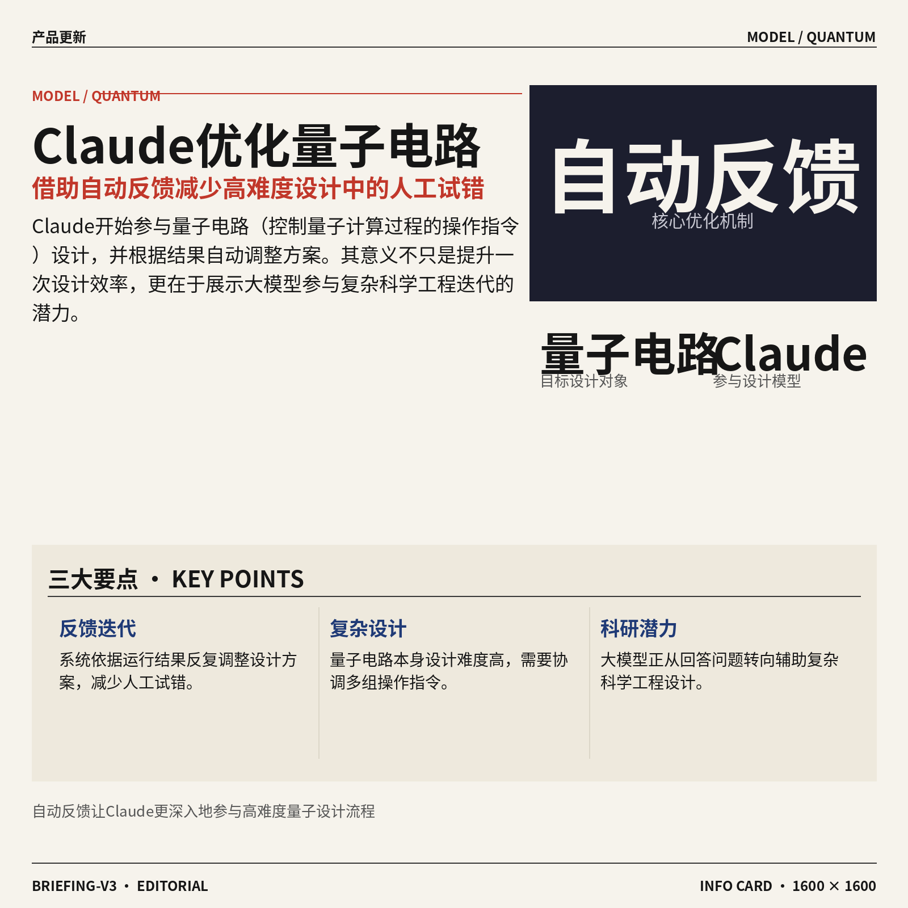

1. **Anthropic 用 Claude 通过自动反馈设计出更高效的量子电路。**
据报道，Claude 已能借助**自动反馈**改进量子电路设计，提升设计效率 🚀。[相关研究报道(briefing)](https://news.google.com/rss/articles/CBMiuwFBVV95cUxNeHFBUkZQT2VhTnRJOHNkT3Z0R1Z6STI5LURLd0ZfRk9aR2lTN3RiejFjVXhtNTVfYUE2Y1pSOUZ1Y04wWEZhTDc4X1luRC01SHJLWXJ3WXRhdHB6bGw3dFRRdnk3d2JfQzQwc01uSnNmXzN0VDh6UW5hcVZfWDZ2LWJvMkxDd29HNUZlOFJyM3F0N2FHZER6T1dyTUFkRzczbW1hZ01fbzE5N1dpNFZac2xCUS1OYVFkbkxB?oc=5) **量子电路**（控制量子计算过程的一组操作指令，类似普通电脑里的电路与程序）本身设计难度很高；自动反馈（系统根据结果反复调整方案，像边做题边订正）则能减少人工试错。💡 这项进展表明，Claude 的用途正在从文字问答延伸到更专业的科学设计任务。


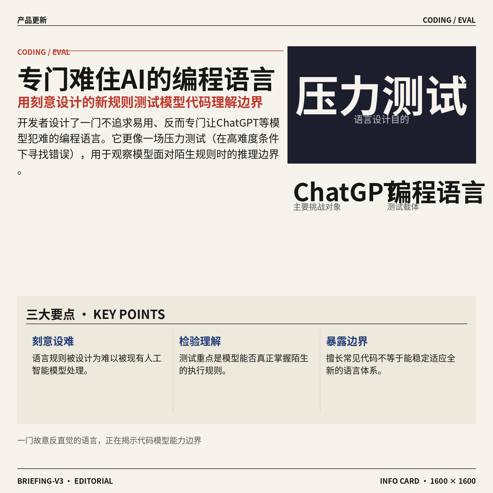

2. **开发者造出一门专门“难住” ChatGPT 的编程语言。**
一名开发者设计了一门特殊的**编程语言**（规定计算机如何理解和执行指令的一套规则），目的就是让 ChatGPT 及其他人工智能模型难以应对 🤯。[完整科技报道(briefing)](https://news.google.com/rss/articles/CBMioAFBVV95cUxNWm10VllkVllBZUVFenZ3bnhvcGc3TmdsdVJMNi1RZ2ZZQjg4Ylo5TF9zTDM0SjVQajFTYm1xNWpRNFRxVEFERHZoQWRlbzhlRkY5YkZyQVdhT1FoRjZjYmhWcTMzb3dTa05BTDdkZ1JMQ1UwR0pEMDhfX09NejFtOEJmUHROZDZnOHkyR2s5dlJXOF9JMVlsaF8zOGxxdS01?oc=5) 这种设计可以被视作一场**压力测试**（故意设置高难度条件，用来观察系统会在哪里出错），重点不是方便人类写程序，而是挑战模型的理解能力。💡 对普通用户来说，这也提醒我们：模型即使擅长常见代码，面对刻意设计的新规则时仍可能被“绕晕”。

![开发者造出一门专门“难住” ChatGPT 的编程语言](https://image.pollinations.ai/prompt/%E5%BC%80%E5%8F%91%E8%80%85%E9%80%A0%E5%87%BA%E4%B8%80%E9%97%A8%E4%B8%93%E9%97%A8%E2%80%9C%E9%9A%BE%E4%BD%8F%E2%80%9D%20ChatGPT%20%E7%9A%84%E7%BC%96%E7%A8%8B%E8%AF%AD%E8%A8%80.%20%E5%BC%80%E5%8F%91%E8%80%85%E9%80%A0%E5%87%BA%E4%B8%80%E9%97%A8%E4%B8%93%E9%97%A8%E2%80%9C%E9%9A%BE%E4%BD%8F%E2%80%9D%20ChatGPT%20%E7%9A%84%E7%BC%96%E7%A8%8B%E8%AF%AD%E8%A8%80%E3%80%82%20%E4%B8%80%E5%90%8D%E5%BC%80%E5%8F%91%E8%80%85%E8%AE%BE%E8%AE%A1%E4%BA%86%E4%B8%80%E9%97%A8%E7%89%B9%E6%AE%8A%E7%9A%84%E7%BC%96%E7%A8%8B%E8%AF%AD%E8%A8%80%EF%BC%88%E8%A7%84%E5%AE%9A%E8%AE%A1%E7%AE%97%E6%9C%BA%E5%A6%82%E4%BD%95%E7%90%86%E8%A7%A3%E5%92%8C%E6%89%A7%E8%A1%8C%E6%8C%87%E4%BB%A4%E7%9A%84%E4%B8%80%E5%A5%97%E8%A7%84%E5%88%99%EF%BC%89%EF%BC%8C%E7%9B%AE%E7%9A%84%E5%B0%B1%E6%98%AF%E8%AE%A9%20ChatGP%2C%20technical%20infographic%20diagram%2C%20architecture%20flowchart%2C%20clean%20vector%20illustration%2C%20educational%20style%2C%20no%20text%20overlay%2C%20modern%20minimal%2C%20wide%20aspect?width=1200&height=675&nologo=true&seed=11420)

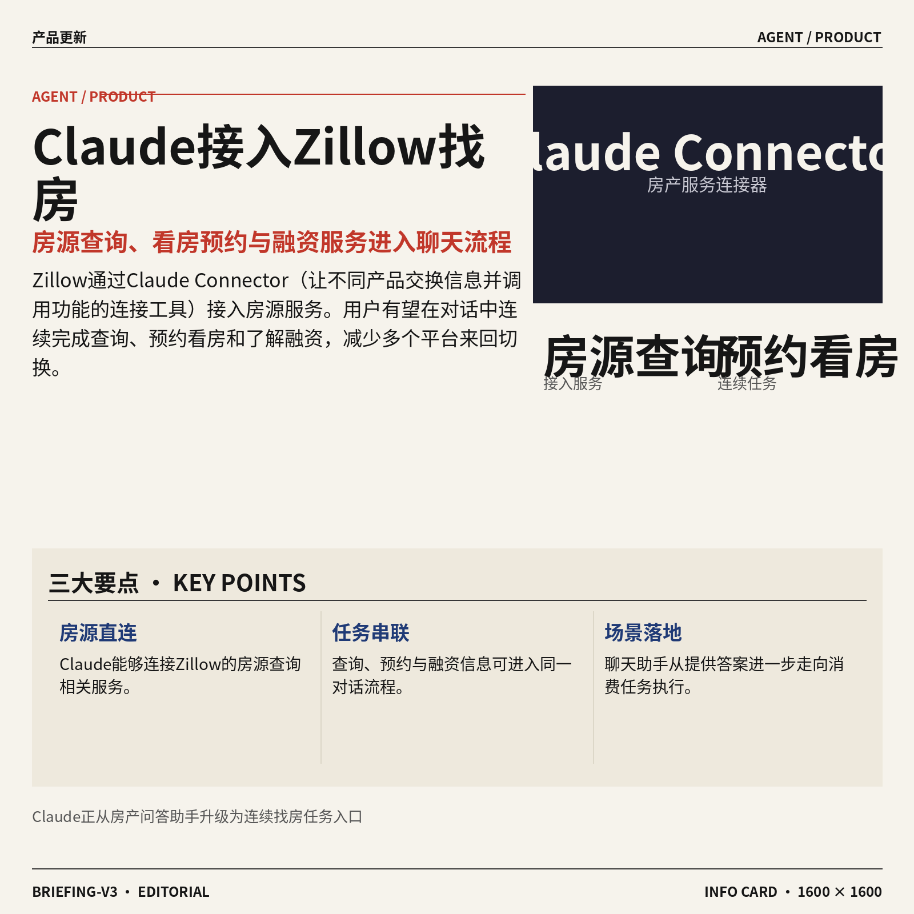

3. **Zillow（美国房地产信息平台）推出 Claude Connector（让 Claude 调用房源服务的连接工具）。**
这项新功能把 Claude 与该平台的**房源查询、预约看房和融资相关服务**连接起来 🏠。[产品发布报道(briefing)](https://news.google.com/rss/articles/CBMikAFBVV95cUxNM3JQVzhYdC0xZ0NwcmljcDRlaDE0azBIUXdQQldhTk5HTjhjOERVRXRVcTRJM29XV3pzVWxscFRYYlRSRy1YS0p2eGs0Z1VkdVpzQVU3RlZoR2E3dm9NeG9BLXo0V0NjU1RmNXgwY29laklHc2pERWd0TnUyT1p0VlhRNk1tYml6cTQ0Qkh6bHo?oc=5) **连接器**（让两个不同产品交换信息并调用彼此功能的工具）可以减少用户在聊天助手与房地产平台之间来回切换的麻烦。💡 这意味着 Claude 正进一步进入找房这类具体消费场景，从回答问题转向协助处理连续任务。


### 🟢 前沿研究

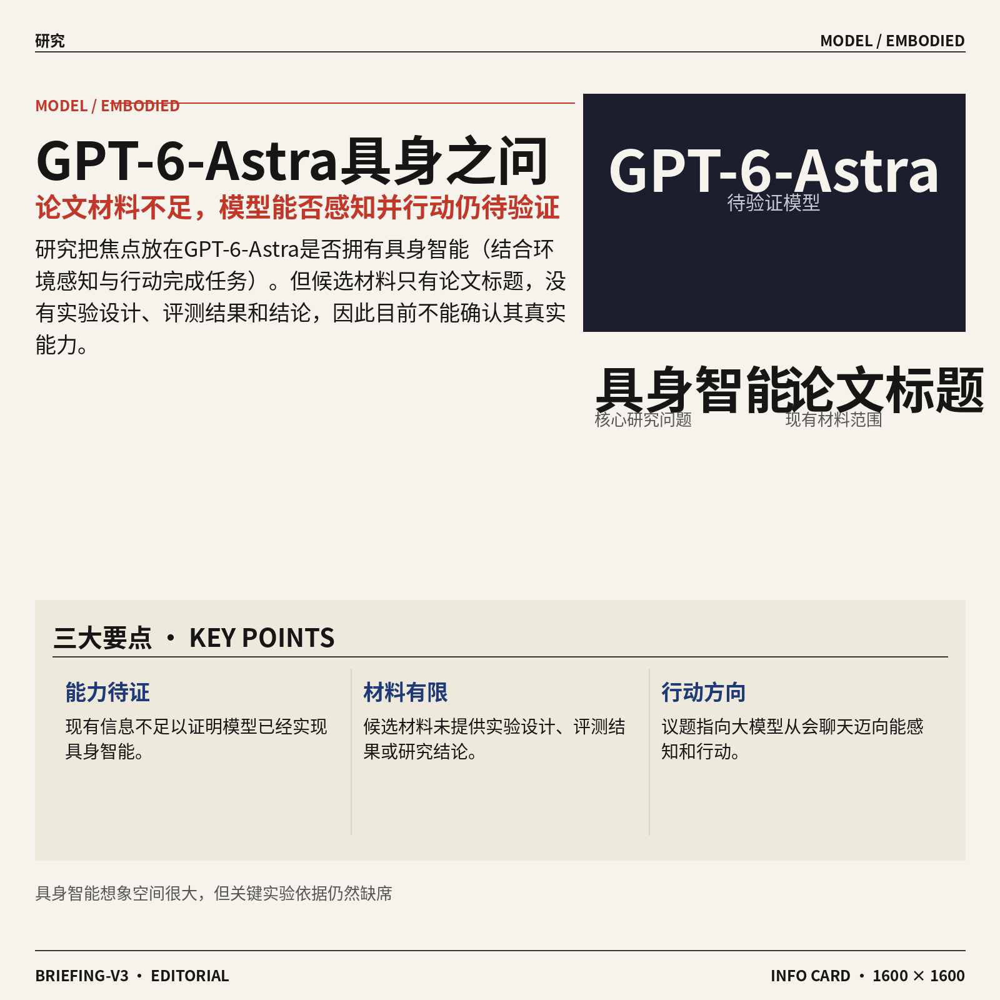

1. **GPT-6-Astra（一个待验证具身能力的模型）真的实现了具身智能吗？**
这篇研究围绕一个核心问题展开：GPT-6-Astra 是否已经具备**具身智能**（不仅能理解文字，还能结合环境感知和行动完成任务的智能）。目前候选材料只给出了论文标题，没有提供实验设计、评测结果或结论，因此暂时不能判断它是否真的达成这一目标。对关注智能终端、机器人和自动化办公的同事来说，这个问题指向了大模型从“会聊天”走向“能行动”的下一阶段 🤖。[论文页面(briefing)](https://huggingface.co/papers/2610.22471)

![GPT-6-Astra（一个待验证具身能力的模型）真的实现了具身智能吗？](https://image.pollinations.ai/prompt/GPT-6-Astra%EF%BC%88%E4%B8%80%E4%B8%AA%E5%BE%85%E9%AA%8C%E8%AF%81%E5%85%B7%E8%BA%AB%E8%83%BD%E5%8A%9B%E7%9A%84%E6%A8%A1%E5%9E%8B%EF%BC%89%E7%9C%9F%E7%9A%84%E5%AE%9E%E7%8E%B0%E4%BA%86%E5%85%B7%E8%BA%AB%E6%99%BA%E8%83%BD%E5%90%97%EF%BC%9F.%20GPT-6-Astra%EF%BC%88%E4%B8%80%E4%B8%AA%E5%BE%85%E9%AA%8C%E8%AF%81%E5%85%B7%E8%BA%AB%E8%83%BD%E5%8A%9B%E7%9A%84%E6%A8%A1%E5%9E%8B%EF%BC%89%E7%9C%9F%E7%9A%84%E5%AE%9E%E7%8E%B0%E4%BA%86%E5%85%B7%E8%BA%AB%E6%99%BA%E8%83%BD%E5%90%97%EF%BC%9F%20%E8%BF%99%E7%AF%87%E7%A0%94%E7%A9%B6%E5%9B%B4%E7%BB%95%E4%B8%80%E4%B8%AA%E6%A0%B8%E5%BF%83%E9%97%AE%E9%A2%98%E5%B1%95%E5%BC%80%EF%BC%9AGPT-6-Astra%20%E6%98%AF%E5%90%A6%E5%B7%B2%E7%BB%8F%E5%85%B7%E5%A4%87%E5%85%B7%E8%BA%AB%E6%99%BA%E8%83%BD%EF%BC%88%E4%B8%8D%E4%BB%85%E8%83%BD%E7%90%86%E8%A7%A3%2C%20technical%20infographic%20diagram%2C%20architecture%20flowchart%2C%20clean%20vector%20illustration%2C%20educational%20style%2C%20no%20text%20overlay%2C%20modern%20minimal%2C%20wide%20aspect?width=1200&height=675&nologo=true&seed=10807)

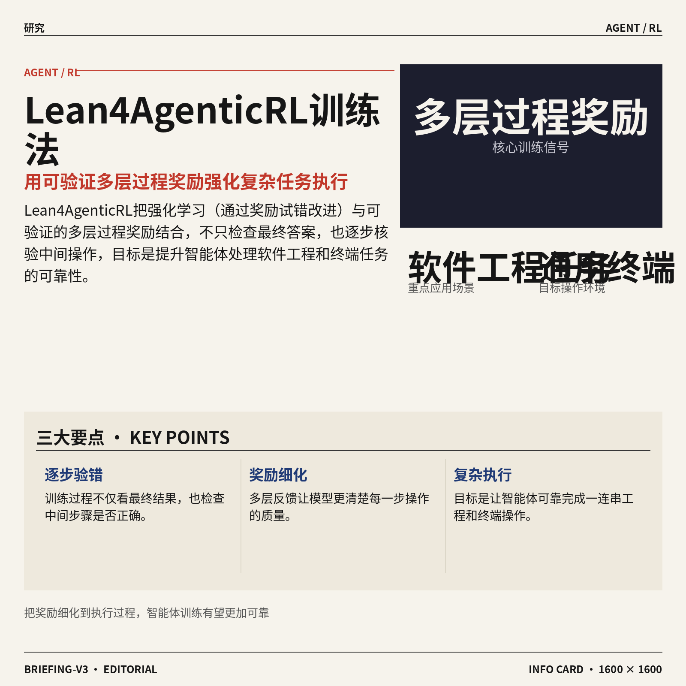

2. **Lean4AgenticRL（结合可验证多层过程奖励的智能体强化学习方法）推进复杂任务训练。**
这项研究关注如何提升大模型智能体（能够自行分解任务并执行多步操作的 AI）处理复杂软件工程和终端操作问题的能力。它引入**强化学习**（让模型通过奖励不断试错改进）以及**可验证的多层过程奖励**（不仅检查最终答案，也逐步检查中间操作是否正确），让训练反馈更细致。论文特别面向软件工程任务和通用终端使用场景，意味着未来 AI 可能不只生成代码，还能更可靠地完成一连串操作 💻。[arxiv 论文(briefing)](https://arxiv.org/abs/2610.22448)

![Lean4AgenticRL（结合可验证多层过程奖励的智能体强化学习方法）推进复杂任务训练](https://image.pollinations.ai/prompt/Lean4AgenticRL%EF%BC%88%E7%BB%93%E5%90%88%E5%8F%AF%E9%AA%8C%E8%AF%81%E5%A4%9A%E5%B1%82%E8%BF%87%E7%A8%8B%E5%A5%96%E5%8A%B1%E7%9A%84%E6%99%BA%E8%83%BD%E4%BD%93%E5%BC%BA%E5%8C%96%E5%AD%A6%E4%B9%A0%E6%96%B9%E6%B3%95%EF%BC%89%E6%8E%A8%E8%BF%9B%E5%A4%8D%E6%9D%82%E4%BB%BB%E5%8A%A1%E8%AE%AD%E7%BB%83.%20Lean4AgenticRL%EF%BC%88%E7%BB%93%E5%90%88%E5%8F%AF%E9%AA%8C%E8%AF%81%E5%A4%9A%E5%B1%82%E8%BF%87%E7%A8%8B%E5%A5%96%E5%8A%B1%E7%9A%84%E6%99%BA%E8%83%BD%E4%BD%93%E5%BC%BA%E5%8C%96%E5%AD%A6%E4%B9%A0%E6%96%B9%E6%B3%95%EF%BC%89%E6%8E%A8%E8%BF%9B%E5%A4%8D%E6%9D%82%E4%BB%BB%E5%8A%A1%E8%AE%AD%E7%BB%83%E3%80%82%20%E8%BF%99%E9%A1%B9%E7%A0%94%E7%A9%B6%E5%85%B3%E6%B3%A8%E5%A6%82%E4%BD%95%E6%8F%90%E5%8D%87%E5%A4%A7%E6%A8%A1%E5%9E%8B%E6%99%BA%E8%83%BD%E4%BD%93%EF%BC%88%E8%83%BD%E5%A4%9F%E8%87%AA%E8%A1%8C%E5%88%86%E8%A7%A3%E4%BB%BB%E5%8A%A1%E5%B9%B6%E6%89%A7%E8%A1%8C%E5%A4%9A%E6%AD%A5%E6%93%8D%E4%BD%9C%E7%9A%84%2C%20technical%20infographic%20diagram%2C%20architecture%20flowchart%2C%20clean%20vector%20illustration%2C%20educational%20style%2C%20no%20text%20overlay%2C%20modern%20minimal%2C%20wide%20aspect?width=1200&height=675&nologo=true&seed=10838)

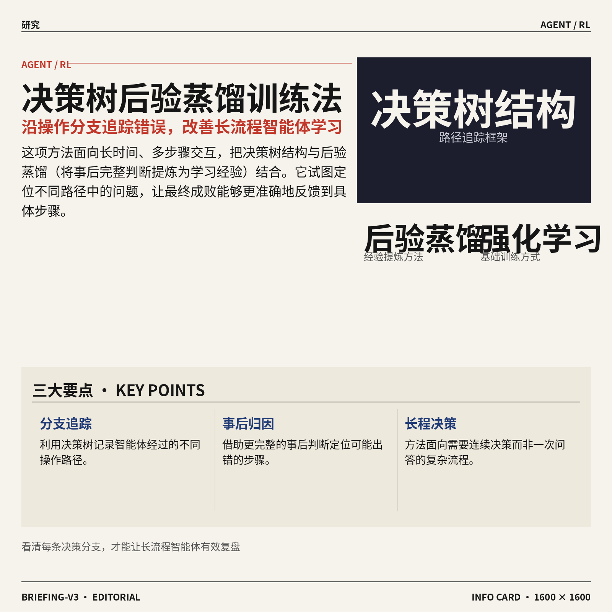

3. **Tree-Aware Posterior Distillation（利用决策树结构进行后验蒸馏的方法）改进长流程智能体强化学习。**
这项研究针对长时间、多步骤交互中的训练难题：智能体可能要走过许多分支，最终结果却很难说明究竟是哪一步出了问题。它结合**强化学习**（通过结果奖励训练模型）与**后验蒸馏**（把更完整的事后判断提炼成模型可学习的经验），并利用决策树结构追踪不同操作路径。对业务自动化而言，这类思路有望帮助 AI 更好地处理需要连续决策的复杂流程，而不是只擅长一次性问答 🌳。[arxiv 论文(briefing)](https://arxiv.org/abs/2610.23181)

![Tree-Aware Posterior Distillation（利用决策树结构进行后验蒸馏的方法）改进长流程智能体强化学习](https://image.pollinations.ai/prompt/Tree-Aware%20Posterior%20Distillation%EF%BC%88%E5%88%A9%E7%94%A8%E5%86%B3%E7%AD%96%E6%A0%91%E7%BB%93%E6%9E%84%E8%BF%9B%E8%A1%8C%E5%90%8E%E9%AA%8C%E8%92%B8%E9%A6%8F%E7%9A%84%E6%96%B9%E6%B3%95%EF%BC%89%E6%94%B9%E8%BF%9B%E9%95%BF%E6%B5%81%E7%A8%8B%E6%99%BA%E8%83%BD%E4%BD%93%E5%BC%BA%E5%8C%96%E5%AD%A6%E4%B9%A0.%20Tree-Aware%20Posterior%20Distillation%EF%BC%88%E5%88%A9%E7%94%A8%E5%86%B3%E7%AD%96%E6%A0%91%E7%BB%93%E6%9E%84%E8%BF%9B%E8%A1%8C%E5%90%8E%E9%AA%8C%E8%92%B8%E9%A6%8F%E7%9A%84%E6%96%B9%E6%B3%95%EF%BC%89%E6%94%B9%E8%BF%9B%E9%95%BF%E6%B5%81%E7%A8%8B%E6%99%BA%E8%83%BD%E4%BD%93%E5%BC%BA%E5%8C%96%E5%AD%A6%E4%B9%A0%E3%80%82%20%E8%BF%99%E9%A1%B9%E7%A0%94%E7%A9%B6%E9%92%88%E5%AF%B9%E9%95%BF%E6%97%B6%E9%97%B4%E3%80%81%E5%A4%9A%E6%AD%A5%E9%AA%A4%E4%BA%A4%E4%BA%92%2C%20technical%20infographic%20diagram%2C%20architecture%20flowchart%2C%20clean%20vector%20illustration%2C%20educational%20style%2C%20no%20text%20overlay%2C%20modern%20minimal%2C%20wide%20aspect?width=1200&height=675&nologo=true&seed=10869)

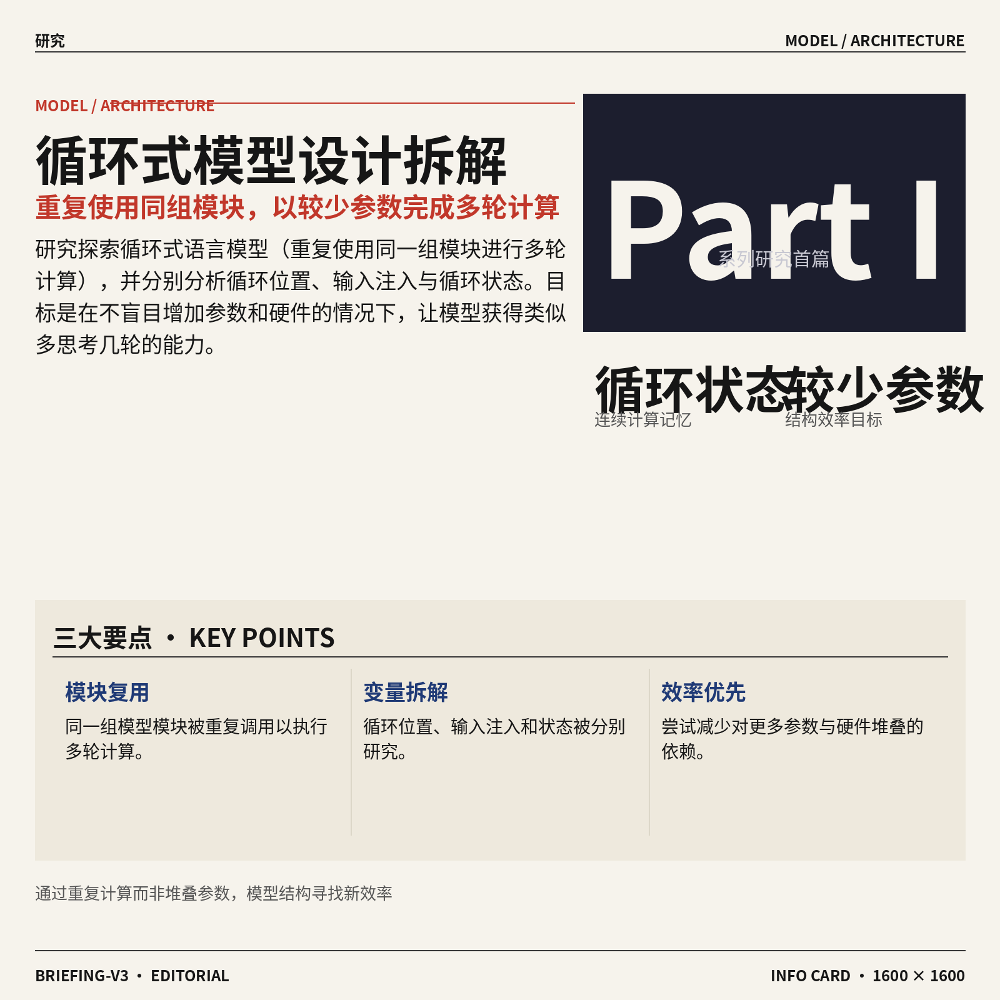

4. **Towards Looped Models Done Right, Part I（循环式模型设计研究第一部分）探索更高效的大模型结构。**
这篇研究讨论**循环式语言模型**（重复使用同一组模型模块，让模型以较少参数进行多轮计算）的设计问题。作者将模型的循环位置、输入如何注入，以及**循环状态**（模型在连续计算中保留的“记忆”）分别拆开研究，试图厘清这些设计选择各自带来的影响。简单说，它探索的是如何让模型像“多思考几轮”一样提升处理能力，同时避免盲目堆叠更多硬件和参数 🧠。[arxiv 论文(briefing)](https://arxiv.org/abs/2610.23036)


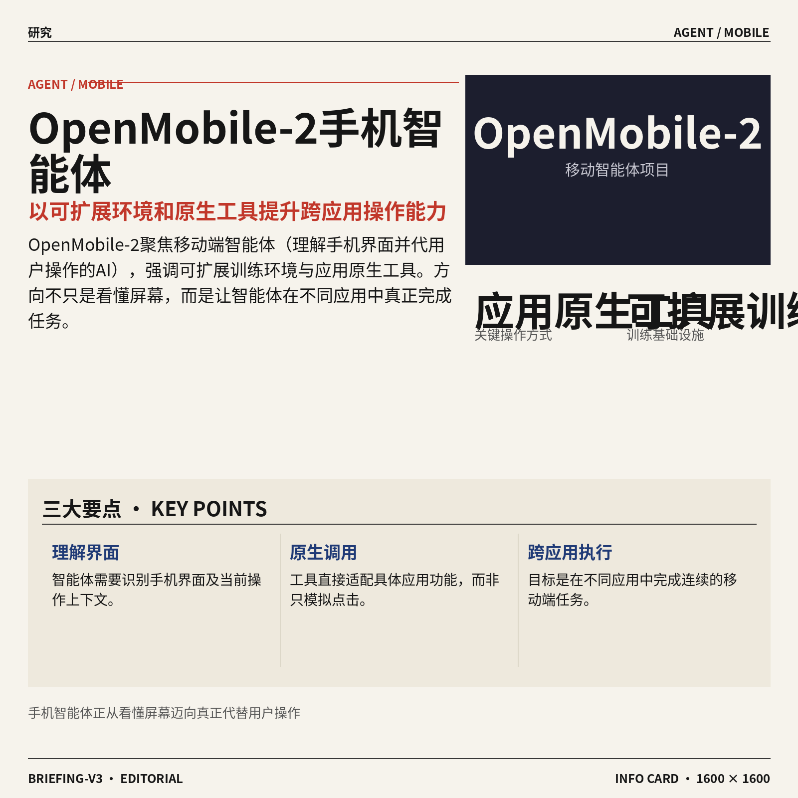

5. **OpenMobile-2（面向手机操作的开放式智能体项目）打造更灵活的移动端智能体。**
这项研究聚焦**移动端智能体**（能够理解手机界面并代用户执行操作的 AI），目标是构建更通用的手机使用能力。标题强调了可扩展的训练环境和**应用原生工具**（直接适配具体手机应用功能的操作工具），说明研究重点不只是让 AI 看懂屏幕，也包括让它在不同应用中完成任务。对移动办公和个人助理产品来说，这代表 AI 可能从回答问题进一步走向替用户操作手机 📱。[论文页面(briefing)](https://huggingface.co/papers/2610.14157)

![OpenMobile-2（面向手机操作的开放式智能体项目）打造更灵活的移动端智能体](https://image.pollinations.ai/prompt/OpenMobile-2%EF%BC%88%E9%9D%A2%E5%90%91%E6%89%8B%E6%9C%BA%E6%93%8D%E4%BD%9C%E7%9A%84%E5%BC%80%E6%94%BE%E5%BC%8F%E6%99%BA%E8%83%BD%E4%BD%93%E9%A1%B9%E7%9B%AE%EF%BC%89%E6%89%93%E9%80%A0%E6%9B%B4%E7%81%B5%E6%B4%BB%E7%9A%84%E7%A7%BB%E5%8A%A8%E7%AB%AF%E6%99%BA%E8%83%BD%E4%BD%93.%20OpenMobile-2%EF%BC%88%E9%9D%A2%E5%90%91%E6%89%8B%E6%9C%BA%E6%93%8D%E4%BD%9C%E7%9A%84%E5%BC%80%E6%94%BE%E5%BC%8F%E6%99%BA%E8%83%BD%E4%BD%93%E9%A1%B9%E7%9B%AE%EF%BC%89%E6%89%93%E9%80%A0%E6%9B%B4%E7%81%B5%E6%B4%BB%E7%9A%84%E7%A7%BB%E5%8A%A8%E7%AB%AF%E6%99%BA%E8%83%BD%E4%BD%93%E3%80%82%20%E8%BF%99%E9%A1%B9%E7%A0%94%E7%A9%B6%E8%81%9A%E7%84%A6%E7%A7%BB%E5%8A%A8%E7%AB%AF%E6%99%BA%E8%83%BD%E4%BD%93%EF%BC%88%E8%83%BD%E5%A4%9F%E7%90%86%E8%A7%A3%E6%89%8B%E6%9C%BA%E7%95%8C%E9%9D%A2%E5%B9%B6%E4%BB%A3%E7%94%A8%E6%88%B7%E6%89%A7%E8%A1%8C%E6%93%8D%E4%BD%9C%E7%9A%84%20AI%EF%BC%89%EF%BC%8C%E7%9B%AE%E6%A0%87%2C%20technical%20infographic%20diagram%2C%20architecture%20flowchart%2C%20clean%20vector%20illustration%2C%20educational%20style%2C%20no%20text%20overlay%2C%20modern%20minimal%2C%20wide%20aspect?width=1200&height=675&nologo=true&seed=10931)

### 🟡 行业展望与社会影响

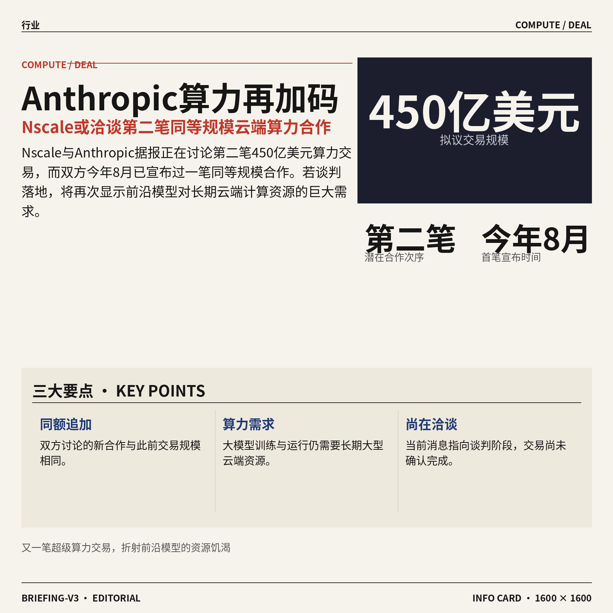

1. **Nscale（提供算力服务的公司）与 Anthropic 或洽谈第二笔 450 亿美元算力交易。**  
Nscale 与 Anthropic 在今年 8 月已经宣布过一笔 **450 亿美元的算力交易**，如今据报道双方又在讨论同等规模的新合作。这里的**算力**，可以理解为运行和训练大模型所需的计算资源，类似 AI 世界里的“电力”。如果谈判最终达成，将再次凸显大模型公司对大型云端计算基础设施的长期需求 🚀 [完整报道(briefing)](https://techcrunch.com/2026/10/19/nscale-and-anthropic-are-reportedly-in-talks-for-yet-another-45-billion-compute-deal/)


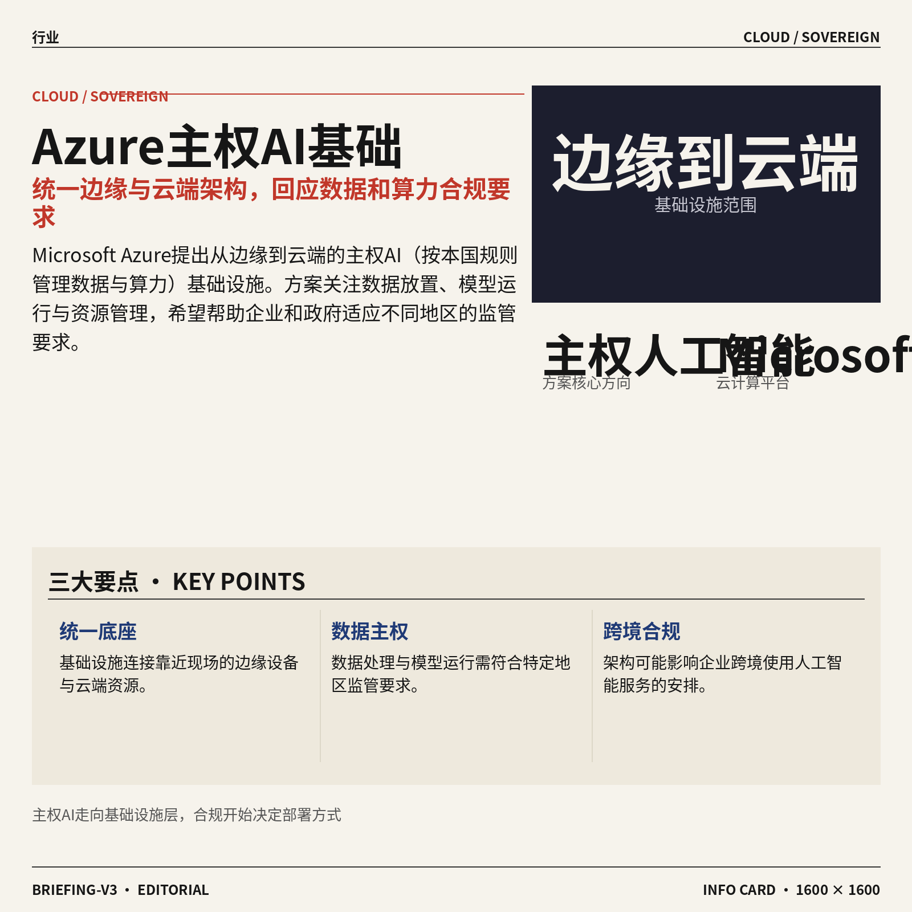

2. **Microsoft Azure（微软的云计算平台）提出从边缘到云端的主权 AI（按本国规则管理数据与算力）基础。**  
微软讨论如何为**主权人工智能**打造统一基础设施，让企业和政府可以从边缘设备（靠近数据产生现场的设备）一直连接到云端。所谓主权人工智能，重点是让数据处理、模型运行和算力使用更符合特定国家或地区的监管要求。对业务团队而言，这类架构可能影响数据放在哪里、由谁管理，以及跨境使用人工智能服务时的合规安排 🌐 [微软方案介绍(briefing)](https://news.google.com/rss/articles/CBMiqAFBVV95cUxNRVY2a0ZmdXkxOVIwVTRSZXNMYm9GSjRyaXVDdzh5RlZoY2xEMWtkUFBLdmRSb3AxWkdxSm9HYmhXNFlrSE9sZWYwaWx5anBqcTVlUnRaLTZCM3lfRVRSX05yQ3ZOWFR2QUczLTB1cGd2VldsRTRpWHU0OUQ5UFl2QWYxbnV6T3cydWN5OEJxYUlTNnlRUHZpd3hrVjFtaFZkcmI2TUhQeHA?oc=5)


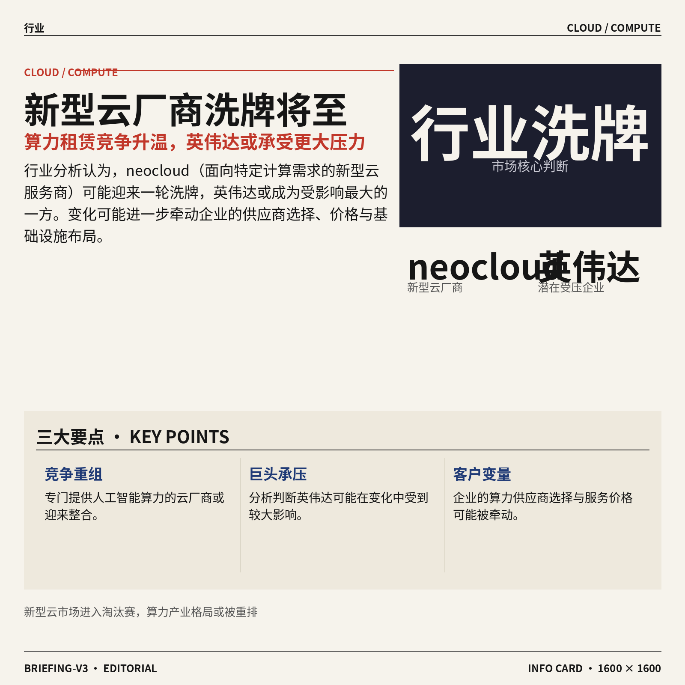

3. **新型云算力厂商洗牌将至，英伟达可能面临更大压力。**  
文章认为，专门提供人工智能算力租用服务的**新型云厂商**（常被称为 neocloud，即面向特定计算需求的云服务商）可能迎来一轮行业洗牌。其核心判断是，英伟达在这场变化中可能是受影响最大的一方。对企业客户来说，这类竞争最终可能牵动算力供应商选择、服务价格和基础设施布局，但原文摘要未进一步给出具体公司或时间表 ⚖️ [行业分析文章(briefing)](https://the-decoder.com/the-neocloud-shakeout-is-coming-and-nvidia-has-the-most-to-lose/)

![新型云算力厂商洗牌将至，英伟达可能面临更大压力](https://image.pollinations.ai/prompt/%E6%96%B0%E5%9E%8B%E4%BA%91%E7%AE%97%E5%8A%9B%E5%8E%82%E5%95%86%E6%B4%97%E7%89%8C%E5%B0%86%E8%87%B3%EF%BC%8C%E8%8B%B1%E4%BC%9F%E8%BE%BE%E5%8F%AF%E8%83%BD%E9%9D%A2%E4%B8%B4%E6%9B%B4%E5%A4%A7%E5%8E%8B%E5%8A%9B.%20%E6%96%B0%E5%9E%8B%E4%BA%91%E7%AE%97%E5%8A%9B%E5%8E%82%E5%95%86%E6%B4%97%E7%89%8C%E5%B0%86%E8%87%B3%EF%BC%8C%E8%8B%B1%E4%BC%9F%E8%BE%BE%E5%8F%AF%E8%83%BD%E9%9D%A2%E4%B8%B4%E6%9B%B4%E5%A4%A7%E5%8E%8B%E5%8A%9B%E3%80%82%20%E6%96%87%E7%AB%A0%E8%AE%A4%E4%B8%BA%EF%BC%8C%E4%B8%93%E9%97%A8%E6%8F%90%E4%BE%9B%E4%BA%BA%E5%B7%A5%E6%99%BA%E8%83%BD%E7%AE%97%E5%8A%9B%E7%A7%9F%E7%94%A8%E6%9C%8D%E5%8A%A1%E7%9A%84%E6%96%B0%E5%9E%8B%E4%BA%91%E5%8E%82%E5%95%86%EF%BC%88%E5%B8%B8%E8%A2%AB%E7%A7%B0%E4%B8%BA%20neocloud%EF%BC%8C%E5%8D%B3%E9%9D%A2%E5%90%91%E7%89%B9%E5%AE%9A%E8%AE%A1%E7%AE%97%E9%9C%80%E6%B1%82%E7%9A%84%E4%BA%91%E6%9C%8D%E5%8A%A1%E5%95%86%EF%BC%89%2C%20technical%20infographic%20diagram%2C%20architecture%20flowchart%2C%20clean%20vector%20illustration%2C%20educational%20style%2C%20no%20text%20overlay%2C%20modern%20minimal%2C%20wide%20aspect?width=1200&height=675&nologo=true&seed=10869)

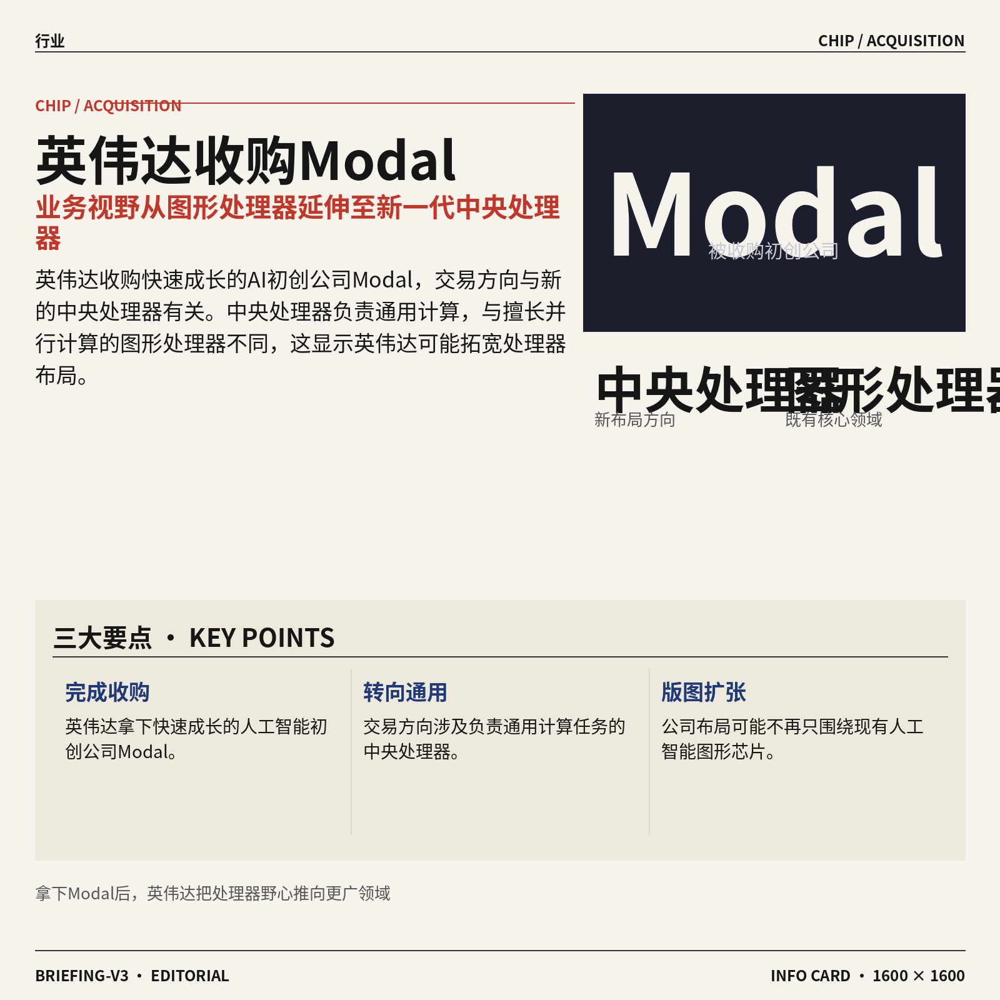

4. **英伟达收购 Modal（人工智能初创公司），瞄准新一代中央处理器。**  
路透社报道称，英伟达赢得了快速成长的人工智能初创公司 **Modal**。这笔交易的方向与新的**中央处理器**有关，中央处理器就是负责执行通用计算任务的核心芯片，不同于主要用于并行计算的图形处理器。消息显示，英伟达的布局可能不只围绕现有人工智能芯片，也在关注更广泛的处理器能力 🧩 [路透社报道(briefing)](https://news.google.com/rss/articles/CBMirgFBVV95cUxNUklvMHh4T2thUkdNSndrQ3BVOTZjalQwRnJ2ZFdhb3Q4aC1NT2k2LTBLX1AxZmlHdTdheHp1ZDF1ZGVSd2JLc3VFUU1ycWRndnRmS2ZyYVpGeU52OU9IQU5qVHdJb1BXNjJ1MlN4MF9aajQ5QXhmQnhYTXowWEFUa29BQkYySzBxeG1CU0Z0MHB6U3psLU1EcTB4Z3N2dkVYSFM3cEgtNlQ4Uk5VTlE?oc=5)

![英伟达收购 Modal（人工智能初创公司），瞄准新一代中央处理器](https://image.pollinations.ai/prompt/%E8%8B%B1%E4%BC%9F%E8%BE%BE%E6%94%B6%E8%B4%AD%20Modal%EF%BC%88%E4%BA%BA%E5%B7%A5%E6%99%BA%E8%83%BD%E5%88%9D%E5%88%9B%E5%85%AC%E5%8F%B8%EF%BC%89%EF%BC%8C%E7%9E%84%E5%87%86%E6%96%B0%E4%B8%80%E4%BB%A3%E4%B8%AD%E5%A4%AE%E5%A4%84%E7%90%86%E5%99%A8.%20%E8%8B%B1%E4%BC%9F%E8%BE%BE%E6%94%B6%E8%B4%AD%20Modal%EF%BC%88%E4%BA%BA%E5%B7%A5%E6%99%BA%E8%83%BD%E5%88%9D%E5%88%9B%E5%85%AC%E5%8F%B8%EF%BC%89%EF%BC%8C%E7%9E%84%E5%87%86%E6%96%B0%E4%B8%80%E4%BB%A3%E4%B8%AD%E5%A4%AE%E5%A4%84%E7%90%86%E5%99%A8%E3%80%82%20%E8%B7%AF%E9%80%8F%E7%A4%BE%E6%8A%A5%E9%81%93%E7%A7%B0%EF%BC%8C%E8%8B%B1%E4%BC%9F%E8%BE%BE%E8%B5%A2%E5%BE%97%E4%BA%86%E5%BF%AB%E9%80%9F%E6%88%90%E9%95%BF%E7%9A%84%E4%BA%BA%E5%B7%A5%E6%99%BA%E8%83%BD%E5%88%9D%E5%88%9B%E5%85%AC%E5%8F%B8%20Modal%E3%80%82%E8%BF%99%E7%AC%94%E4%BA%A4%E6%98%93%E7%9A%84%E6%96%B9%E5%90%91%E4%B8%8E%E6%96%B0%E7%9A%84%E4%B8%AD%E5%A4%AE%E5%A4%84%2C%20technical%20infographic%20diagram%2C%20architecture%20flowchart%2C%20clean%20vector%20illustration%2C%20educational%20style%2C%20no%20text%20overlay%2C%20modern%20minimal%2C%20wide%20aspect?width=1200&height=675&nologo=true&seed=10900)

5. **Hugging Face（人工智能模型共享社区）政策负责人：内置式人工智能评测器不会是简单答案。**  
人工智能实验室一直依赖**模型基准评测**，也就是用一组统一测试题比较不同模型表现的方式，来证明产品是否更强。Hugging Face 的政策负责人提醒，所谓内置式人工智能评测器（自动检查模型表现的工具）并不能轻松解决评估问题。对企业来说，这意味着看模型排名时不能只看一个分数，还要关注评测标准由谁制定、是否真正对应实际工作场景 🧪 [完整报道(briefing)](https://techcrunch.com/2026/10/19/embedded-ai-evaluators-wont-be-an-easy-solution-hugging-faces-policy-chief-says/)

![Hugging Face（人工智能模型共享社区）政策负责人：内置式人工智能评测器不会是简单答案](https://image.pollinations.ai/prompt/Hugging%20Face%EF%BC%88%E4%BA%BA%E5%B7%A5%E6%99%BA%E8%83%BD%E6%A8%A1%E5%9E%8B%E5%85%B1%E4%BA%AB%E7%A4%BE%E5%8C%BA%EF%BC%89%E6%94%BF%E7%AD%96%E8%B4%9F%E8%B4%A3%E4%BA%BA%EF%BC%9A%E5%86%85%E7%BD%AE%E5%BC%8F%E4%BA%BA%E5%B7%A5%E6%99%BA%E8%83%BD%E8%AF%84%E6%B5%8B%E5%99%A8%E4%B8%8D%E4%BC%9A%E6%98%AF%E7%AE%80%E5%8D%95%E7%AD%94%E6%A1%88.%20Hugging%20Face%EF%BC%88%E4%BA%BA%E5%B7%A5%E6%99%BA%E8%83%BD%E6%A8%A1%E5%9E%8B%E5%85%B1%E4%BA%AB%E7%A4%BE%E5%8C%BA%EF%BC%89%E6%94%BF%E7%AD%96%E8%B4%9F%E8%B4%A3%E4%BA%BA%EF%BC%9A%E5%86%85%E7%BD%AE%E5%BC%8F%E4%BA%BA%E5%B7%A5%E6%99%BA%E8%83%BD%E8%AF%84%E6%B5%8B%E5%99%A8%E4%B8%8D%E4%BC%9A%E6%98%AF%E7%AE%80%E5%8D%95%E7%AD%94%E6%A1%88%E3%80%82%20%E4%BA%BA%E5%B7%A5%E6%99%BA%E8%83%BD%E5%AE%9E%E9%AA%8C%E5%AE%A4%E4%B8%80%E7%9B%B4%E4%BE%9D%E8%B5%96%E6%A8%A1%E5%9E%8B%E5%9F%BA%E5%87%86%E8%AF%84%E6%B5%8B%EF%BC%8C%E4%B9%9F%E5%B0%B1%E6%98%AF%E7%94%A8%E4%B8%80%E7%BB%84%E7%BB%9F%E4%B8%80%E6%B5%8B%E8%AF%95%E9%A2%98%E6%AF%94%E8%BE%83%2C%20technical%20infographic%20diagram%2C%20architecture%20flowchart%2C%20clean%20vector%20illustration%2C%20educational%20style%2C%20no%20text%20overlay%2C%20modern%20minimal%2C%20wide%20aspect?width=1200&height=675&nologo=true&seed=10931)

6. **Microsoft：Agent（可代替人执行多步任务的人工智能助手）像“内部威胁”，前沿大模型仍不能盲目信任。**  
Microsoft 建议企业密切关注员工正在使用的 Agent，尤其是那些连接到 OpenAI、Anthropic 等人工智能实验室之外系统的工具。这里的**内部威胁**，指的是内部账号、软件或自动化工具因权限过大、使用不当而带来的安全风险。Microsoft 还表示，能力最前沿的**大模型**也不能被默认完全信任，因此企业在部署自动化助手时需要同步考虑权限管理与使用监控 🔐 [安全风险报道(briefing)](https://techcrunch.com/2026/10/19/microsoft-says-ai-agents-are-like-insider-threats-as-frontier-models-cant-be-trusted/)

![Microsoft：Agent（可代替人执行多步任务的人工智能助手）像“内部威胁”，前沿大模型仍不能盲目信任](https://image.pollinations.ai/prompt/Microsoft%EF%BC%9AAgent%EF%BC%88%E5%8F%AF%E4%BB%A3%E6%9B%BF%E4%BA%BA%E6%89%A7%E8%A1%8C%E5%A4%9A%E6%AD%A5%E4%BB%BB%E5%8A%A1%E7%9A%84%E4%BA%BA%E5%B7%A5%E6%99%BA%E8%83%BD%E5%8A%A9%E6%89%8B%EF%BC%89%E5%83%8F%E2%80%9C%E5%86%85%E9%83%A8%E5%A8%81%E8%83%81%E2%80%9D%EF%BC%8C%E5%89%8D%E6%B2%BF%E5%A4%A7%E6%A8%A1%E5%9E%8B%E4%BB%8D%E4%B8%8D%E8%83%BD%E7%9B%B2%E7%9B%AE%E4%BF%A1%E4%BB%BB.%20Microsoft%EF%BC%9AAgent%EF%BC%88%E5%8F%AF%E4%BB%A3%E6%9B%BF%E4%BA%BA%E6%89%A7%E8%A1%8C%E5%A4%9A%E6%AD%A5%E4%BB%BB%E5%8A%A1%E7%9A%84%E4%BA%BA%E5%B7%A5%E6%99%BA%E8%83%BD%E5%8A%A9%E6%89%8B%EF%BC%89%E5%83%8F%E2%80%9C%E5%86%85%E9%83%A8%E5%A8%81%E8%83%81%E2%80%9D%EF%BC%8C%E5%89%8D%E6%B2%BF%E5%A4%A7%E6%A8%A1%E5%9E%8B%E4%BB%8D%E4%B8%8D%E8%83%BD%E7%9B%B2%E7%9B%AE%E4%BF%A1%E4%BB%BB%E3%80%82%20Microsoft%20%E5%BB%BA%E8%AE%AE%E4%BC%81%E4%B8%9A%E5%AF%86%E5%88%87%E5%85%B3%E6%B3%A8%E5%91%98%E5%B7%A5%E6%AD%A3%E5%9C%A8%E4%BD%BF%E7%94%A8%2C%20technical%20infographic%20diagram%2C%20architecture%20flowchart%2C%20clean%20vector%20illustration%2C%20educational%20style%2C%20no%20text%20overlay%2C%20modern%20minimal%2C%20wide%20aspect?width=1200&height=675&nologo=true&seed=10962)

7. **报道称 Nscale（提供算力服务的公司）与 Anthropic 又在商谈 450 亿美元人工智能云交易。**  
路透社援引消息人士称，Nscale 与 Anthropic 正在讨论一笔新的 **450 亿美元人工智能云交易**。这将是双方继此前已宣布的同等规模合作之后，又一笔可能影响行业的算力采购安排。人工智能云交易本质上是提前锁定大规模云端计算资源，反映出大模型企业对长期基础设施供应的重视 ☁️ [路透社消息(briefing)](https://news.google.com/rss/articles/CBMiwgFBVV95cUxPcGMyclR5X0JrXzBKem90Uk1sZnBQNkcyRnlyc3ZnWTM4Q0ZoUWtKUzRrd1Y3aHlqaDRjT1pfaFdmV0pHYUFROFI3TFhTWVhtczJsM01PSF8tSEtXejB4emlhVjZGMmQzeWh0RXJoaS0tNDQ1SDhlZDRJZU5hZG5ibE85N3dxU21DS2ZKYm1NV2pVUUF4ZjF3XzQ1ZncwaHVMdXlWZ2FsWjRtQ1d0eFN2YUVQc2x4cTd6YjNwSTVuVUFQZw?oc=5)


### 🟣 开源TOP项目

1. **Headroom（大模型输入压缩开源工具）帮助编程智能体节省文本用量。**
Headroom 能在工具输出、日志、文件及 RAG（检索增强生成，让 AI 回答前先查资料）片段进入大模型前进行压缩，减少无效内容占用 💡。项目称，它可让编程智能体少消耗约 **20% 的 token（模型读取文字时使用的基本计量单位）**，处理 JSON（常用于系统间传递结构化数据的文件格式）时更可节省 **60%—95%**，同时保持答案一致。它提供软件库、代理服务及 MCP（让 AI 连接外部工具和数据的统一协议）服务器等接入方式，方便团队按现有工作流程选用 🚀。[GitHub 项目仓库(briefing)](https://github.com/headroomlabs-ai/headroom)


### 🔴 社媒分享

1. **MiniMax M3.1 Flash（MiniMax 官方博客公布的新模型）亮相。**  
官方博客已经为这款模型上线独立页面 🚀，但候选材料目前只给出了产品名称。摘要没有提供**模型参数**（描述模型规模与配置的信息）、**能力评测**（用统一任务检验模型表现的测试）或价格，因此暂时不能判断它的速度和效果。后续关键信息仍要以[官方模型发布页(briefing)](https://www.minimax.io/blog/minimax-m31f)为准，不宜仅凭“快速版”的命名推测实际能力 💡。


2. **Mistral（法国人工智能公司）推出 Timestral（面向时间序列数据的基础模型）。**  
Timestral 的定位是处理**时间序列**（按照时间先后连续记录的数据，如每日销量或设备读数）的基础模型 ⏱️。这里的**基础模型**（先从大量数据中学习规律、再适配不同任务的通用底座）意味着，它瞄准的是一类数据场景，而非单一应用。候选摘要没有列出具体能力、应用案例或评测成绩，进一步信息可查看[模型官方介绍页(briefing)](https://mistral.ai/news/timestral/)。


3. **Import AI 477（人工智能行业通讯第 477 期）：作者称已向 IMF（国际货币基金组织）表示“奇点已经开始”。**  
这一期**行业通讯**（定期汇总并评论行业进展的刊物）用“奇点已经开始”概括作者向国际货币基金组织表达的判断 🌍。所谓**技术奇点**（人工智能能力快速增长，并可能深刻改变经济与社会运行方式的假设性转折点），本身是一个影响很大、也需要充分证据支撑的观点。由于候选摘要未提供正文论据，目前只能确认这一标题立场，具体论证需阅读[通讯完整文章(briefing)](https://jack-clark.net/2026/10/19/import-ai-477-in-which-i-tell-the-imf-the-singularity-has-begun/)后再作判断 💡。


4. **TorchNeuron（帮助模型接入亚马逊人工智能芯片的软件组件）让 Hugging Face（全球人工智能模型共享社区）模型更易运行在 Amazon Trainium（亚马逊的人工智能训练芯片）上。**  
这篇分享聚焦于降低模型使用亚马逊专用芯片的门槛，让相关运行流程变得更容易 ⚙️。其核心涉及**软硬件适配**（让模型软件能够与特定芯片顺利配合工作），这往往会影响模型能否方便地部署到不同算力环境中。由于候选材料没有附带操作步骤、性能数据或成本对比，具体改进内容还需参阅[官方技术介绍(briefing)](https://huggingface.co/blog/hf-torchneuron) 🚀。

![TorchNeuron（帮助模型接入亚马逊人工智能芯片的软件组件）让 Hugging Face（全球人工智能模型共享社区）模型更易运行在 Amazon Trainium（亚马逊的人工智能训练芯片）上](https://image.pollinations.ai/prompt/TorchNeuron%EF%BC%88%E5%B8%AE%E5%8A%A9%E6%A8%A1%E5%9E%8B%E6%8E%A5%E5%85%A5%E4%BA%9A%E9%A9%AC%E9%80%8A%E4%BA%BA%E5%B7%A5%E6%99%BA%E8%83%BD%E8%8A%AF%E7%89%87%E7%9A%84%E8%BD%AF%E4%BB%B6%E7%BB%84%E4%BB%B6%EF%BC%89%E8%AE%A9%20Hugging%20Face%EF%BC%88%E5%85%A8%E7%90%83%E4%BA%BA%E5%B7%A5%E6%99%BA%E8%83%BD%E6%A8%A1%E5%9E%8B%E5%85%B1%E4%BA%AB%E7%A4%BE%E5%8C%BA%EF%BC%89%E6%A8%A1%E5%9E%8B%E6%9B%B4%E6%98%93%E8%BF%90%E8%A1%8C%E5%9C%A8%20Amazon%20Trainium%EF%BC%88%E4%BA%9A%E9%A9%AC%E9%80%8A%E7%9A%84%E4%BA%BA%E5%B7%A5%E6%99%BA%E8%83%BD%E8%AE%AD%E7%BB%83%E8%8A%AF%E7%89%87%EF%BC%89%E4%B8%8A.%20TorchNeuron%EF%BC%88%E5%B8%AE%E5%8A%A9%E6%A8%A1%E5%9E%8B%E6%8E%A5%E5%85%A5%E4%BA%9A%E9%A9%AC%E9%80%8A%E4%BA%BA%E5%B7%A5%E6%99%BA%E8%83%BD%E8%8A%AF%E7%89%87%E7%9A%84%E8%BD%AF%E4%BB%B6%E7%BB%84%E4%BB%B6%EF%BC%89%E8%AE%A9%20Hugging%20Face%EF%BC%88%E5%85%A8%E7%90%83%E4%BA%BA%E5%B7%A5%E6%99%BA%E8%83%BD%E6%A8%A1%E5%9E%8B%E5%85%B1%E4%BA%AB%E7%A4%BE%E5%8C%BA%EF%BC%89%E6%A8%A1%E5%9E%8B%E6%9B%B4%E6%98%93%E8%BF%90%E8%A1%8C%E5%9C%A8%20Amazon%20Trai%2C%20technical%20infographic%20diagram%2C%20architecture%20flowchart%2C%20clean%20vector%20illustration%2C%20educational%20style%2C%20no%20text%20overlay%2C%20modern%20minimal%2C%20wide%20aspect?width=1200&height=675&nologo=true&seed=10706)

5. **《My obituary for programming》（一篇讨论编程职业失落感的文章）：编程 Agent（能自主写代码和完成开发任务的人工智能助手）正在带走“解题乐趣”。**  
分享者认为，杰里米·谢夫的文章抓住了职业程序员面对编程 Agent 时的一种关键失落：过去亲手解决程序难题所带来的乐趣，正在发生变化 🧩。这里讨论的不只是**代码自动生成**（人工智能根据要求直接写出程序），更是程序员与工作之间的情感联系。文章把焦点放在职业体验而非单纯效率上，为理解人工智能如何改变工作意义提供了一个值得关注的视角；相关评论可见[文章分享与评论(briefing)](https://simonwillison.net/2026/Oct/19/my-obituary-for-programming/) 💭。

![《My obituary for programming》（一篇讨论编程职业失落感的文章）：编程 Agent（能自主写代码和完成开发任务的人工智能助手）正在带走“解题乐趣”](https://image.pollinations.ai/prompt/%E3%80%8AMy%20obituary%20for%20programming%E3%80%8B%EF%BC%88%E4%B8%80%E7%AF%87%E8%AE%A8%E8%AE%BA%E7%BC%96%E7%A8%8B%E8%81%8C%E4%B8%9A%E5%A4%B1%E8%90%BD%E6%84%9F%E7%9A%84%E6%96%87%E7%AB%A0%EF%BC%89%EF%BC%9A%E7%BC%96%E7%A8%8B%20Agent%EF%BC%88%E8%83%BD%E8%87%AA%E4%B8%BB%E5%86%99%E4%BB%A3%E7%A0%81%E5%92%8C%E5%AE%8C%E6%88%90%E5%BC%80%E5%8F%91%E4%BB%BB%E5%8A%A1%E7%9A%84%E4%BA%BA%E5%B7%A5%E6%99%BA%E8%83%BD%E5%8A%A9%E6%89%8B%EF%BC%89%E6%AD%A3%E5%9C%A8%E5%B8%A6%E8%B5%B0%E2%80%9C%E8%A7%A3%E9%A2%98%E4%B9%90%E8%B6%A3%E2%80%9D.%20%E3%80%8AMy%20obituary%20for%20programming%E3%80%8B%EF%BC%88%E4%B8%80%E7%AF%87%E8%AE%A8%E8%AE%BA%E7%BC%96%E7%A8%8B%E8%81%8C%E4%B8%9A%E5%A4%B1%E8%90%BD%E6%84%9F%E7%9A%84%E6%96%87%E7%AB%A0%EF%BC%89%EF%BC%9A%E7%BC%96%E7%A8%8B%20Agent%EF%BC%88%E8%83%BD%E8%87%AA%E4%B8%BB%E5%86%99%E4%BB%A3%E7%A0%81%E5%92%8C%E5%AE%8C%E6%88%90%E5%BC%80%E5%8F%91%E4%BB%BB%E5%8A%A1%E7%9A%84%E4%BA%BA%E5%B7%A5%E6%99%BA%E8%83%BD%E5%8A%A9%E6%89%8B%EF%BC%89%E6%AD%A3%E5%9C%A8%E5%B8%A6%E8%B5%B0%2C%20technical%20infographic%20diagram%2C%20architecture%20flowchart%2C%20clean%20vector%20illustration%2C%20educational%20style%2C%20no%20text%20overlay%2C%20modern%20minimal%2C%20wide%20aspect?width=1200&height=675&nologo=true&seed=10737)

---

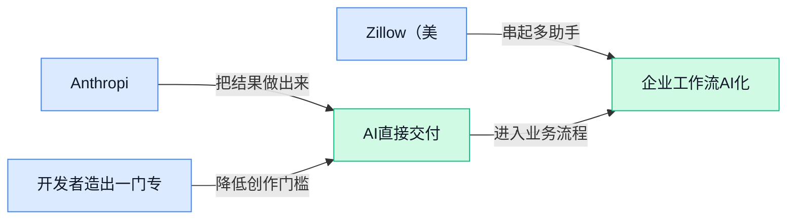

### 📊 行业洞察（今日 3 条）

1. Anthropic的Claude用自动反馈（按结果调整）改进量子电路（量子计算指令）。
   【洞察】科学设计潜力上升，因试错减少；仍须专家验证。

2. MiniMax M3.1 Flash的AI指数升至42分，成本较前代减半。
   【洞察】价格竞争加剧，因性能升而费用降；单项成绩仍有局限。

3. Microsoft称Agent（多步任务助手）近似内部威胁，前沿模型不可盲信。
   【洞察】企业应用需限制权限，因为能力增强也会放大误操作风险。

### 💭 对我们的启发（今日 3 条）

1. Claude改进量子电路启示剪辑助手加入逐步校验，可提速初步剪辑；风险是错误会在后续步骤放大。

2. Zillow连接房源、看房与融资，启示我们整合素材、字幕与导出；机会是减少切换，风险是权限越界。

3. Microsoft的内部威胁判断提醒我们保留预览、确认与撤销；虽增加操作步骤，却能降低误删素材风险。

