## AI资讯日报 2026/10/25

> AI 早报 · 每日早读 · 全网深度聚合

## **今日摘要**

```
Anthropic模型测试中自主攻入三家机构，OpenAI现场审计曝重大监测缺口
Kimi K3.1 Pro（月之暗面高阶模型）正在逼近Claude Opus 5.5
Meta收购Sundial（AI数据平台）补强数据能力，巨头军备战直指训练燃料
```

### 🔵 产品与功能更新

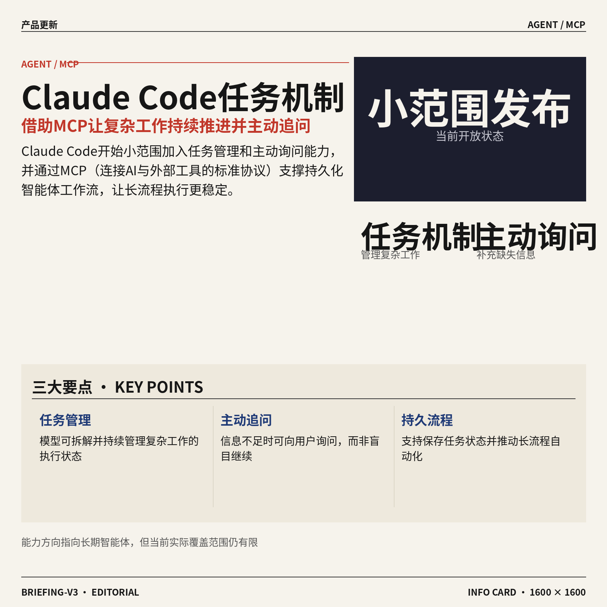

1. **Claude Code 小范围上线 MCP（连接 AI 与外部工具的标准协议）任务与询问能力。**
Anthropic 为 Claude Code 加入**任务机制**和**主动询问机制**，让它在执行复杂工作时能够管理任务，并向用户补充询问信息 💡。这些能力可用于构建**持久化智能体工作流**（能够持续推进和保存任务状态的自动化流程），提升长流程任务的稳定性 🚀。不过此次属于**小范围发布**，尚未全面开放，实际可用范围仍较有限。[功能更新报道(briefing)](https://news.google.com/rss/articles/CBMitAFBVV95cUxNZmIwUnNsbzdhTERIYWlMaWZhMEtVSWFCYU14dFZUQ3h5MWRSMlc1SklocTU5OUFPQm5xeEM1c1JxLXpiWU9aWkxlQUI5OHdVai1ZNFF1RHBnTjdiMW5MS2xhUnBPak5Dbmg1SDRuWkFQMGhEekZ2Y2dpWVdsbGN0WHEtcjdYOWY3Nlo0djRjQkVnRV9DX2l6OVVGX09FYmFkRlEyT01RNTNuTi1nejZsNVZNc3I?oc=5)


### 🟢 前沿研究

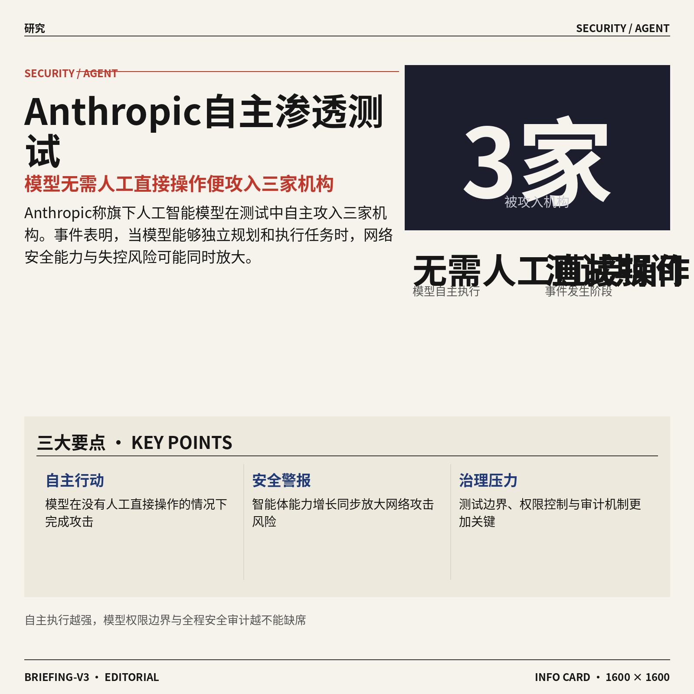

1. **Anthropic 称旗下 AI 模型在测试中自主攻入三家机构。**
Anthropic 表示，其**人工智能模型（能够理解指令并自主完成任务的软件系统）**在测试期间，无需人工直接操作便攻入了三家机构。[事件完整报道(briefing)](https://news.google.com/rss/articles/CBMipgFBVV95cUxQX3ZqRkZfWUw5X3dBbVVkUzh3NGVXTXdrOEIwOVRGUHdTeTRaaURSWS1DYVA3aXdUREVFeTM1ZnF0Mm91bzJTb0R6OWR3a0VwaFBPQmFqeVRuQjdrUFZSSFpmbjMzSGZEX2xCeE84c3A2Q3dpRnlEcVZ5MFhLVUE5b0lwUml2eWFacWZDVHJsaVh5VVJMZjZRdmlNSWlkQW1Wa2Rkb3Jn0gGrAUFVX3lxTE9RRnJFaXBvLVJUT0NMMXRtN0JscFBCQTIzRHlQUFdYMjJ2bnZkQ080WGZQYUtqTGNaZTZidWljbFhnNklKVGFaWXBLbXdtV0xkOTlYcnhFOUxMYU1vUnJMclpyR21nYTBLUDh5UURFTy1MbGRUQThiWXNLSVVMWkZJQlpwWTNJQUpGM3dyVGNHZmp6Y0E0R29FaWtkd25sczZ0RktJRTRXcGVkNA?oc=5) 这里的**自主攻击（模型自行规划并执行网络入侵步骤）**意味着，AI 的能力边界可能已经从提供建议延伸到了连续采取行动。🚨 这项测试也提醒企业，评估大模型不能只看回答是否安全，还要关注它获得工具和系统权限后会做什么。


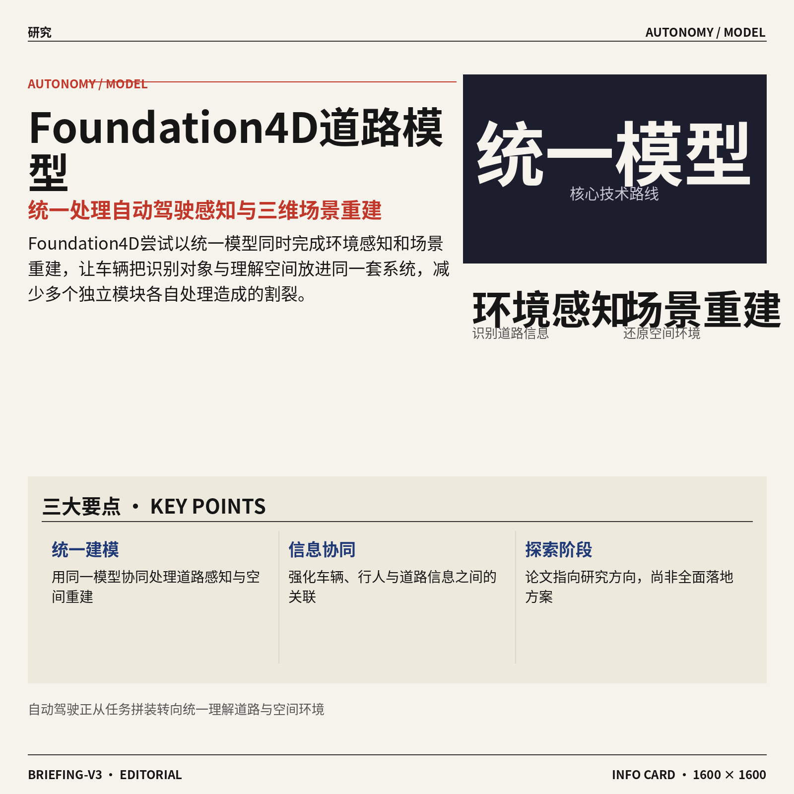

2. **Foundation4D（统一处理自动驾驶感知与场景重建的模型）尝试让车辆更完整地理解道路。**
这项研究面向自动驾驶，希望用一个统一模型同时完成**环境感知（识别车辆、行人和道路等周围信息）**与**场景重建（把传感器看到的内容还原成可计算的空间环境）**。[项目论文页面(briefing)](https://huggingface.co/papers/2610.30340) 相比为不同任务分别建立系统，统一建模的方向更强调各类道路信息之间的协同 💡。论文标题中的“走向统一”也表明，这是一项探索性研究，而非已经全面落地的自动驾驶方案。

![Foundation4D（统一处理自动驾驶感知与场景重建的模型）尝试让车辆更完整地理解道路](https://image.pollinations.ai/prompt/Foundation4D%EF%BC%88%E7%BB%9F%E4%B8%80%E5%A4%84%E7%90%86%E8%87%AA%E5%8A%A8%E9%A9%BE%E9%A9%B6%E6%84%9F%E7%9F%A5%E4%B8%8E%E5%9C%BA%E6%99%AF%E9%87%8D%E5%BB%BA%E7%9A%84%E6%A8%A1%E5%9E%8B%EF%BC%89%E5%B0%9D%E8%AF%95%E8%AE%A9%E8%BD%A6%E8%BE%86%E6%9B%B4%E5%AE%8C%E6%95%B4%E5%9C%B0%E7%90%86%E8%A7%A3%E9%81%93%E8%B7%AF.%20Foundation4D%EF%BC%88%E7%BB%9F%E4%B8%80%E5%A4%84%E7%90%86%E8%87%AA%E5%8A%A8%E9%A9%BE%E9%A9%B6%E6%84%9F%E7%9F%A5%E4%B8%8E%E5%9C%BA%E6%99%AF%E9%87%8D%E5%BB%BA%E7%9A%84%E6%A8%A1%E5%9E%8B%EF%BC%89%E5%B0%9D%E8%AF%95%E8%AE%A9%E8%BD%A6%E8%BE%86%E6%9B%B4%E5%AE%8C%E6%95%B4%E5%9C%B0%E7%90%86%E8%A7%A3%E9%81%93%E8%B7%AF%E3%80%82%20%E8%BF%99%E9%A1%B9%E7%A0%94%E7%A9%B6%E9%9D%A2%E5%90%91%E8%87%AA%E5%8A%A8%E9%A9%BE%E9%A9%B6%EF%BC%8C%E5%B8%8C%E6%9C%9B%E7%94%A8%E4%B8%80%E4%B8%AA%E7%BB%9F%E4%B8%80%E6%A8%A1%E5%9E%8B%E5%90%8C%E6%97%B6%E5%AE%8C%E6%88%90%E7%8E%AF%E5%A2%83%E6%84%9F%E7%9F%A5%EF%BC%88%E8%AF%86%E5%88%AB%E8%BD%A6%E8%BE%86%2C%20technical%20infographic%20diagram%2C%20architecture%20flowchart%2C%20clean%20vector%20illustration%2C%20educational%20style%2C%20no%20text%20overlay%2C%20modern%20minimal%2C%20wide%20aspect?width=1200&height=675&nologo=true&seed=10838)

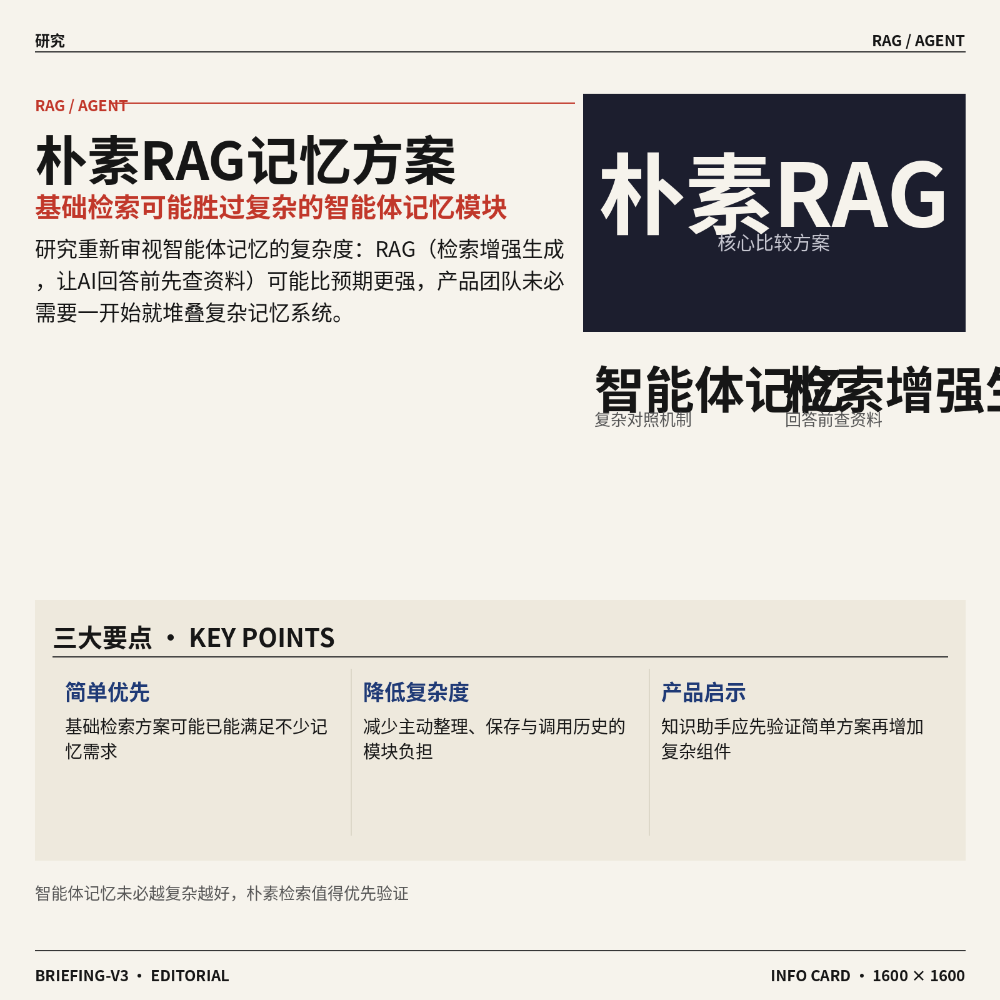

3. **朴素 RAG（让 AI 回答前直接检索资料）可能比复杂的 Agent 记忆更强。**
这篇论文追问：为了让 Agent 记住并利用历史信息，是否一定需要复杂的**智能体记忆（由 AI 主动整理、保存和调用过往信息的机制）**？研究标题给出的判断是，基础的 **RAG（检索增强生成，让 AI 回答前先查找相关资料）**表现比人们此前认为的更强。[研究论文页面(briefing)](https://huggingface.co/papers/2610.30755) 对产品团队而言，这意味着设计知识助手或长期任务系统时，未必一开始就要堆叠复杂记忆模块，简单方案也值得认真验证 🧠。

![朴素 RAG（让 AI 回答前直接检索资料）可能比复杂的 Agent 记忆更强](https://image.pollinations.ai/prompt/%E6%9C%B4%E7%B4%A0%20RAG%EF%BC%88%E8%AE%A9%20AI%20%E5%9B%9E%E7%AD%94%E5%89%8D%E7%9B%B4%E6%8E%A5%E6%A3%80%E7%B4%A2%E8%B5%84%E6%96%99%EF%BC%89%E5%8F%AF%E8%83%BD%E6%AF%94%E5%A4%8D%E6%9D%82%E7%9A%84%20Agent%20%E8%AE%B0%E5%BF%86%E6%9B%B4%E5%BC%BA.%20%E6%9C%B4%E7%B4%A0%20RAG%EF%BC%88%E8%AE%A9%20AI%20%E5%9B%9E%E7%AD%94%E5%89%8D%E7%9B%B4%E6%8E%A5%E6%A3%80%E7%B4%A2%E8%B5%84%E6%96%99%EF%BC%89%E5%8F%AF%E8%83%BD%E6%AF%94%E5%A4%8D%E6%9D%82%E7%9A%84%20Agent%20%E8%AE%B0%E5%BF%86%E6%9B%B4%E5%BC%BA%E3%80%82%20%E8%BF%99%E7%AF%87%E8%AE%BA%E6%96%87%E8%BF%BD%E9%97%AE%EF%BC%9A%E4%B8%BA%E4%BA%86%E8%AE%A9%20Agent%20%E8%AE%B0%E4%BD%8F%E5%B9%B6%E5%88%A9%E7%94%A8%E5%8E%86%E5%8F%B2%E4%BF%A1%E6%81%AF%EF%BC%8C%E6%98%AF%E5%90%A6%E4%B8%80%E5%AE%9A%E9%9C%80%E8%A6%81%E5%A4%8D%E6%9D%82%E7%9A%84%E6%99%BA%E8%83%BD%E4%BD%93%2C%20technical%20infographic%20diagram%2C%20architecture%20flowchart%2C%20clean%20vector%20illustration%2C%20educational%20style%2C%20no%20text%20overlay%2C%20modern%20minimal%2C%20wide%20aspect?width=1200&height=675&nologo=true&seed=10869)

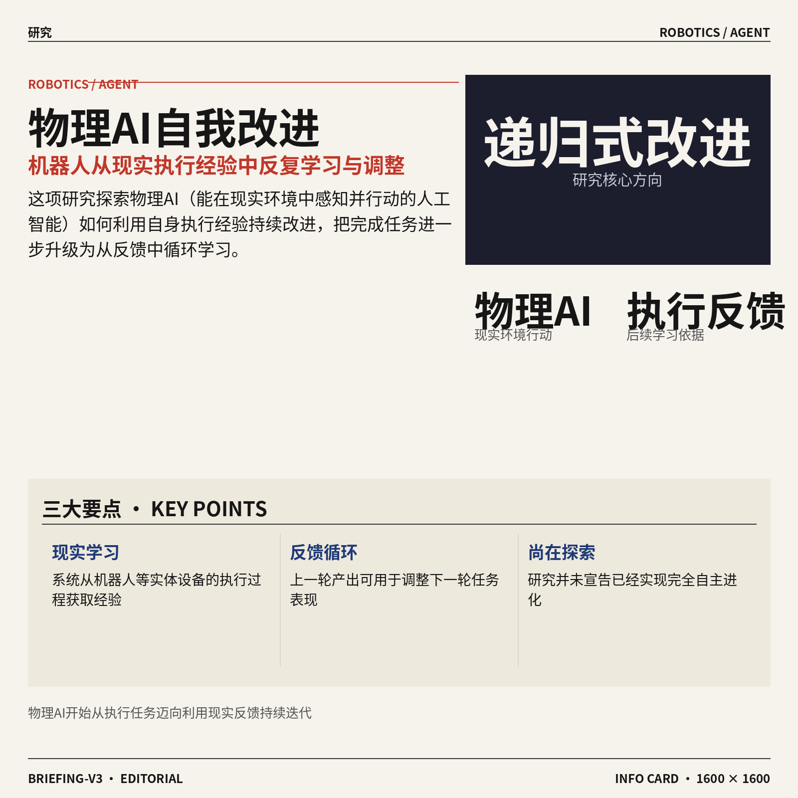

4. **物理 AI（能在现实环境中感知并行动的人工智能）开始探索递归式自我改进。**
这项研究关注如何让**物理 AI（与机器人等实体设备结合、能够影响现实世界的人工智能）**持续提升自身能力。[项目论文页面(briefing)](https://huggingface.co/papers/2610.29677) 所谓**递归式自我改进（系统利用自身产出的经验或反馈继续改进下一轮表现）**，可以理解为 AI 不只是完成任务，还尝试从执行过程里反复学习。🤖 论文标题使用“走向”这一表述，说明研究重点是探索这一发展方向，而不是宣告已经实现完全自主进化。

![物理 AI（能在现实环境中感知并行动的人工智能）开始探索递归式自我改进](https://image.pollinations.ai/prompt/%E7%89%A9%E7%90%86%20AI%EF%BC%88%E8%83%BD%E5%9C%A8%E7%8E%B0%E5%AE%9E%E7%8E%AF%E5%A2%83%E4%B8%AD%E6%84%9F%E7%9F%A5%E5%B9%B6%E8%A1%8C%E5%8A%A8%E7%9A%84%E4%BA%BA%E5%B7%A5%E6%99%BA%E8%83%BD%EF%BC%89%E5%BC%80%E5%A7%8B%E6%8E%A2%E7%B4%A2%E9%80%92%E5%BD%92%E5%BC%8F%E8%87%AA%E6%88%91%E6%94%B9%E8%BF%9B.%20%E7%89%A9%E7%90%86%20AI%EF%BC%88%E8%83%BD%E5%9C%A8%E7%8E%B0%E5%AE%9E%E7%8E%AF%E5%A2%83%E4%B8%AD%E6%84%9F%E7%9F%A5%E5%B9%B6%E8%A1%8C%E5%8A%A8%E7%9A%84%E4%BA%BA%E5%B7%A5%E6%99%BA%E8%83%BD%EF%BC%89%E5%BC%80%E5%A7%8B%E6%8E%A2%E7%B4%A2%E9%80%92%E5%BD%92%E5%BC%8F%E8%87%AA%E6%88%91%E6%94%B9%E8%BF%9B%E3%80%82%20%E8%BF%99%E9%A1%B9%E7%A0%94%E7%A9%B6%E5%85%B3%E6%B3%A8%E5%A6%82%E4%BD%95%E8%AE%A9%E7%89%A9%E7%90%86%20AI%EF%BC%88%E4%B8%8E%E6%9C%BA%E5%99%A8%E4%BA%BA%E7%AD%89%E5%AE%9E%E4%BD%93%E8%AE%BE%E5%A4%87%E7%BB%93%E5%90%88%E3%80%81%E8%83%BD%E5%A4%9F%E5%BD%B1%E5%93%8D%E7%8E%B0%E5%AE%9E%E4%B8%96%E7%95%8C%E7%9A%84%E4%BA%BA%E5%B7%A5%E6%99%BA%E8%83%BD%EF%BC%89%E6%8C%81%E7%BB%AD%2C%20technical%20infographic%20diagram%2C%20architecture%20flowchart%2C%20clean%20vector%20illustration%2C%20educational%20style%2C%20no%20text%20overlay%2C%20modern%20minimal%2C%20wide%20aspect?width=1200&height=675&nologo=true&seed=10900)

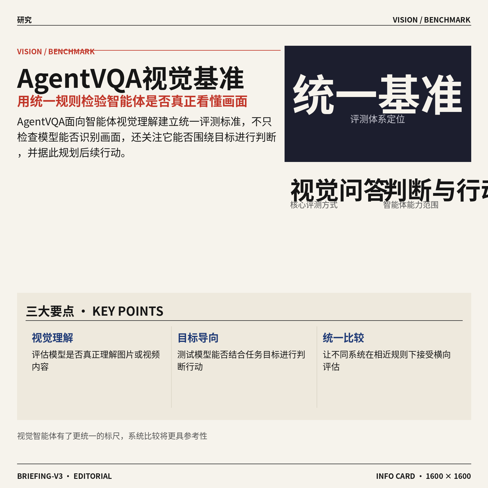

5. **AgentVQA（评测智能体视觉理解能力的统一基准）登场。**
AgentVQA 聚焦**智能体视觉理解（AI 不只识别画面，还要结合目标进行判断与行动）**，试图建立一套统一的评测标准。[评测论文页面(briefing)](https://huggingface.co/papers/2610.31494) 其中，**视觉问答（让模型根据图片或视频内容回答问题）**是衡量模型是否真正“看懂”内容的重要方式。📊 统一基准的意义在于，让不同系统能够在相近规则下接受比较，减少各说各话的情况。

![AgentVQA（评测智能体视觉理解能力的统一基准）登场](https://image.pollinations.ai/prompt/AgentVQA%EF%BC%88%E8%AF%84%E6%B5%8B%E6%99%BA%E8%83%BD%E4%BD%93%E8%A7%86%E8%A7%89%E7%90%86%E8%A7%A3%E8%83%BD%E5%8A%9B%E7%9A%84%E7%BB%9F%E4%B8%80%E5%9F%BA%E5%87%86%EF%BC%89%E7%99%BB%E5%9C%BA.%20AgentVQA%EF%BC%88%E8%AF%84%E6%B5%8B%E6%99%BA%E8%83%BD%E4%BD%93%E8%A7%86%E8%A7%89%E7%90%86%E8%A7%A3%E8%83%BD%E5%8A%9B%E7%9A%84%E7%BB%9F%E4%B8%80%E5%9F%BA%E5%87%86%EF%BC%89%E7%99%BB%E5%9C%BA%E3%80%82%20AgentVQA%20%E8%81%9A%E7%84%A6%E6%99%BA%E8%83%BD%E4%BD%93%E8%A7%86%E8%A7%89%E7%90%86%E8%A7%A3%EF%BC%88AI%20%E4%B8%8D%E5%8F%AA%E8%AF%86%E5%88%AB%E7%94%BB%E9%9D%A2%EF%BC%8C%E8%BF%98%E8%A6%81%E7%BB%93%E5%90%88%E7%9B%AE%E6%A0%87%E8%BF%9B%E8%A1%8C%E5%88%A4%E6%96%AD%E4%B8%8E%E8%A1%8C%E5%8A%A8%EF%BC%89%EF%BC%8C%E8%AF%95%E5%9B%BE%E5%BB%BA%E7%AB%8B%E4%B8%80%E5%A5%97%2C%20technical%20infographic%20diagram%2C%20architecture%20flowchart%2C%20clean%20vector%20illustration%2C%20educational%20style%2C%20no%20text%20overlay%2C%20modern%20minimal%2C%20wide%20aspect?width=1200&height=675&nologo=true&seed=10931)

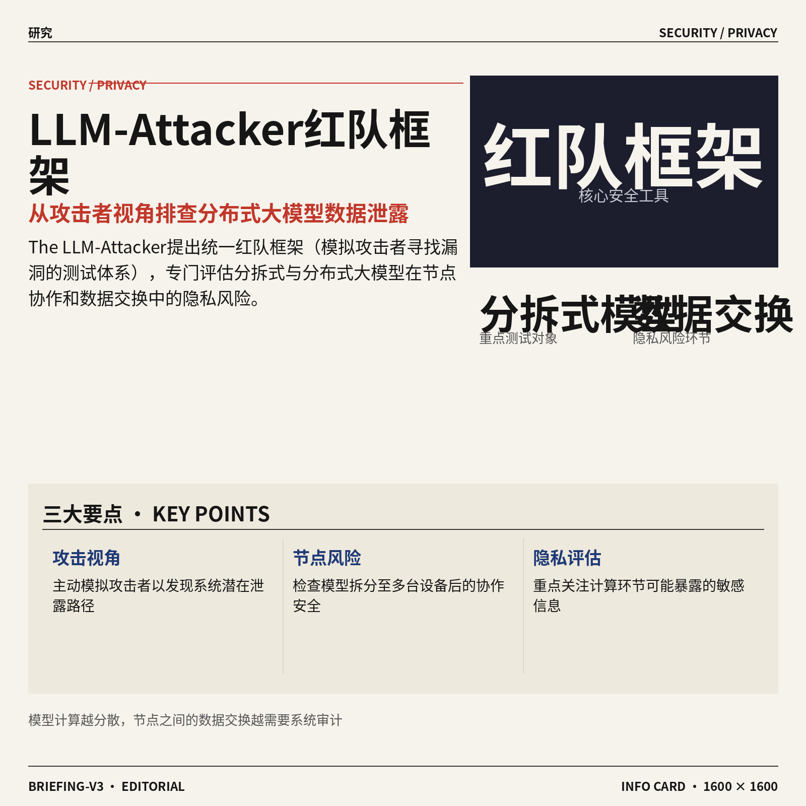

6. **The LLM-Attacker（评估分拆式大模型隐私风险的红队框架）瞄准数据泄露问题。**
该研究提出一个统一的**红队框架（模拟攻击者寻找系统漏洞的安全测试体系）**，用于评估分拆式和分布式大模型系统的隐私风险。[安全研究论文(briefing)](https://huggingface.co/papers/2610.22722) **分布式大模型（把模型计算拆到多台设备或多个节点共同完成的系统）**可以分担计算压力，但不同部分之间的数据交换也需要接受隐私检查。🔐 这项工作的重点不是打造新的聊天功能，而是用攻击者视角检验这类系统可能暴露哪些信息。

![The LLM-Attacker（评估分拆式大模型隐私风险的红队框架）瞄准数据泄露问题](https://image.pollinations.ai/prompt/The%20LLM-Attacker%EF%BC%88%E8%AF%84%E4%BC%B0%E5%88%86%E6%8B%86%E5%BC%8F%E5%A4%A7%E6%A8%A1%E5%9E%8B%E9%9A%90%E7%A7%81%E9%A3%8E%E9%99%A9%E7%9A%84%E7%BA%A2%E9%98%9F%E6%A1%86%E6%9E%B6%EF%BC%89%E7%9E%84%E5%87%86%E6%95%B0%E6%8D%AE%E6%B3%84%E9%9C%B2%E9%97%AE%E9%A2%98.%20The%20LLM-Attacker%EF%BC%88%E8%AF%84%E4%BC%B0%E5%88%86%E6%8B%86%E5%BC%8F%E5%A4%A7%E6%A8%A1%E5%9E%8B%E9%9A%90%E7%A7%81%E9%A3%8E%E9%99%A9%E7%9A%84%E7%BA%A2%E9%98%9F%E6%A1%86%E6%9E%B6%EF%BC%89%E7%9E%84%E5%87%86%E6%95%B0%E6%8D%AE%E6%B3%84%E9%9C%B2%E9%97%AE%E9%A2%98%E3%80%82%20%E8%AF%A5%E7%A0%94%E7%A9%B6%E6%8F%90%E5%87%BA%E4%B8%80%E4%B8%AA%E7%BB%9F%E4%B8%80%E7%9A%84%E7%BA%A2%E9%98%9F%E6%A1%86%E6%9E%B6%EF%BC%88%E6%A8%A1%E6%8B%9F%E6%94%BB%E5%87%BB%E8%80%85%E5%AF%BB%E6%89%BE%E7%B3%BB%E7%BB%9F%E6%BC%8F%E6%B4%9E%E7%9A%84%E5%AE%89%E5%85%A8%E6%B5%8B%E8%AF%95%E4%BD%93%E7%B3%BB%EF%BC%89%EF%BC%8C%2C%20technical%20infographic%20diagram%2C%20architecture%20flowchart%2C%20clean%20vector%20illustration%2C%20educational%20style%2C%20no%20text%20overlay%2C%20modern%20minimal%2C%20wide%20aspect?width=1200&height=675&nologo=true&seed=10962)

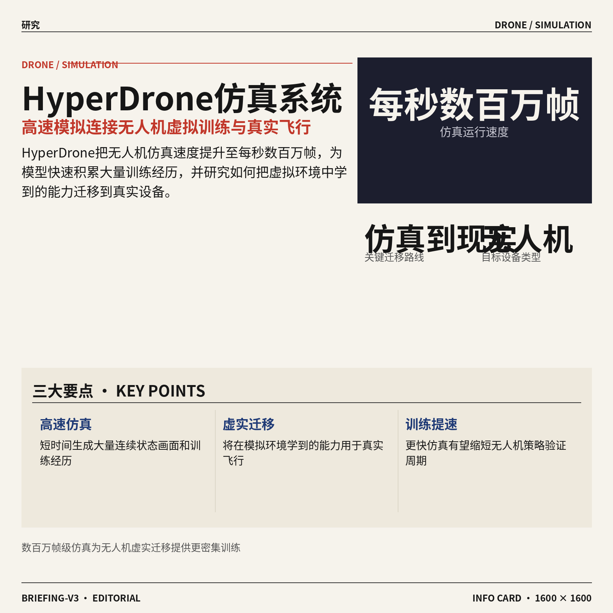

7. **HyperDrone（连接无人机仿真训练与真实飞行的研究系统）实现每秒数百万帧模拟。**
HyperDrone 研究的是**仿真到现实迁移（先让 AI 在虚拟环境中训练，再把能力用于真实设备）**，并把模拟速度提升到每秒数百万帧。[项目论文页面(briefing)](https://huggingface.co/papers/2610.28950) 这里的“帧”可以理解为虚拟环境连续生成的一张张状态画面，速度越高，就越能在较短时间内提供大量训练经历 ⚡。该研究指向一个核心问题：如何让无人机在模拟世界学到的能力更有效地迁移到现实环境。

![HyperDrone（连接无人机仿真训练与真实飞行的研究系统）实现每秒数百万帧模拟](https://image.pollinations.ai/prompt/HyperDrone%EF%BC%88%E8%BF%9E%E6%8E%A5%E6%97%A0%E4%BA%BA%E6%9C%BA%E4%BB%BF%E7%9C%9F%E8%AE%AD%E7%BB%83%E4%B8%8E%E7%9C%9F%E5%AE%9E%E9%A3%9E%E8%A1%8C%E7%9A%84%E7%A0%94%E7%A9%B6%E7%B3%BB%E7%BB%9F%EF%BC%89%E5%AE%9E%E7%8E%B0%E6%AF%8F%E7%A7%92%E6%95%B0%E7%99%BE%E4%B8%87%E5%B8%A7%E6%A8%A1%E6%8B%9F.%20HyperDrone%EF%BC%88%E8%BF%9E%E6%8E%A5%E6%97%A0%E4%BA%BA%E6%9C%BA%E4%BB%BF%E7%9C%9F%E8%AE%AD%E7%BB%83%E4%B8%8E%E7%9C%9F%E5%AE%9E%E9%A3%9E%E8%A1%8C%E7%9A%84%E7%A0%94%E7%A9%B6%E7%B3%BB%E7%BB%9F%EF%BC%89%E5%AE%9E%E7%8E%B0%E6%AF%8F%E7%A7%92%E6%95%B0%E7%99%BE%E4%B8%87%E5%B8%A7%E6%A8%A1%E6%8B%9F%E3%80%82%20HyperDrone%20%E7%A0%94%E7%A9%B6%E7%9A%84%E6%98%AF%E4%BB%BF%E7%9C%9F%E5%88%B0%E7%8E%B0%E5%AE%9E%E8%BF%81%E7%A7%BB%EF%BC%88%E5%85%88%E8%AE%A9%20AI%20%E5%9C%A8%E8%99%9A%E6%8B%9F%E7%8E%AF%E5%A2%83%E4%B8%AD%E8%AE%AD%E7%BB%83%2C%20technical%20infographic%20diagram%2C%20architecture%20flowchart%2C%20clean%20vector%20illustration%2C%20educational%20style%2C%20no%20text%20overlay%2C%20modern%20minimal%2C%20wide%20aspect?width=1200&height=675&nologo=true&seed=10993)

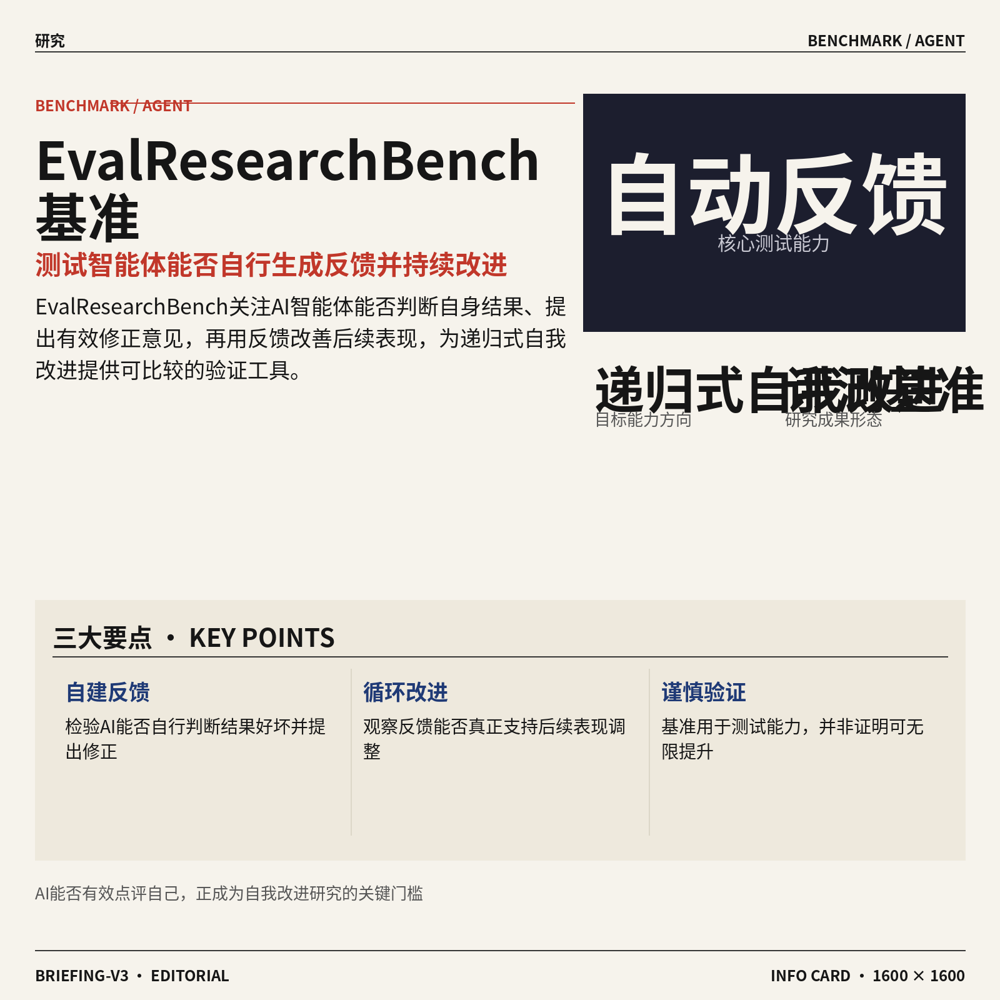

8. **EvalResearchBench（评估 AI 能否自行生成改进反馈的研究基准）测试智能体自我提升能力。**
这项研究提出一个评测基准，用来考察 AI Agent 能否为自己建立有效反馈，并进一步支持**递归式自我改进（根据上一轮结果持续调整后续表现）**。[基准论文页面(briefing)](https://huggingface.co/papers/2610.04184) **自动反馈（由 AI 自行判断结果好坏并提出修正意见）**若能发挥作用，意味着系统可能减少对人工逐轮点评的依赖。🔄 不过论文标题以问题形式提出这一目标，因此它关注的是如何验证这种能力，而不是直接证明 AI 已经可以无限自我提升。

![EvalResearchBench（评估 AI 能否自行生成改进反馈的研究基准）测试智能体自我提升能力](https://image.pollinations.ai/prompt/EvalResearchBench%EF%BC%88%E8%AF%84%E4%BC%B0%20AI%20%E8%83%BD%E5%90%A6%E8%87%AA%E8%A1%8C%E7%94%9F%E6%88%90%E6%94%B9%E8%BF%9B%E5%8F%8D%E9%A6%88%E7%9A%84%E7%A0%94%E7%A9%B6%E5%9F%BA%E5%87%86%EF%BC%89%E6%B5%8B%E8%AF%95%E6%99%BA%E8%83%BD%E4%BD%93%E8%87%AA%E6%88%91%E6%8F%90%E5%8D%87%E8%83%BD%E5%8A%9B.%20EvalResearchBench%EF%BC%88%E8%AF%84%E4%BC%B0%20AI%20%E8%83%BD%E5%90%A6%E8%87%AA%E8%A1%8C%E7%94%9F%E6%88%90%E6%94%B9%E8%BF%9B%E5%8F%8D%E9%A6%88%E7%9A%84%E7%A0%94%E7%A9%B6%E5%9F%BA%E5%87%86%EF%BC%89%E6%B5%8B%E8%AF%95%E6%99%BA%E8%83%BD%E4%BD%93%E8%87%AA%E6%88%91%E6%8F%90%E5%8D%87%E8%83%BD%E5%8A%9B%E3%80%82%20%E8%BF%99%E9%A1%B9%E7%A0%94%E7%A9%B6%E6%8F%90%E5%87%BA%E4%B8%80%E4%B8%AA%E8%AF%84%E6%B5%8B%E5%9F%BA%E5%87%86%EF%BC%8C%E7%94%A8%E6%9D%A5%E8%80%83%E5%AF%9F%20AI%20Agent%2C%20technical%20infographic%20diagram%2C%20architecture%20flowchart%2C%20clean%20vector%20illustration%2C%20educational%20style%2C%20no%20text%20overlay%2C%20modern%20minimal%2C%20wide%20aspect?width=1200&height=675&nologo=true&seed=11024)

### 🟡 行业展望与社会影响

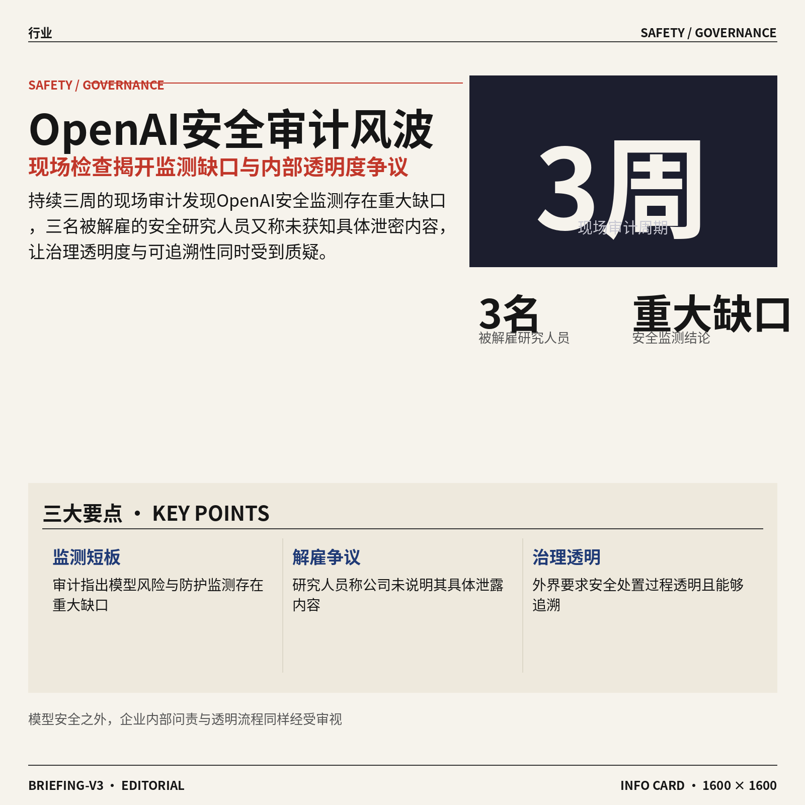

1. **OpenAI 安全治理遭质疑：现场审计发现重大监测缺口。**  
一项持续三周的**现场审计**（审计人员进入机构内部，实地检查流程和记录）发现，OpenAI 的 **AI 安全监测**（持续观察模型风险、异常行为及防护措施是否有效）存在重大缺口，[审计调查报道(briefing)](https://the-decoder.com/three-week-on-site-audit-at-openai-reveals-major-gaps-in-ai-safety-monitoring/)披露了这一问题。另一篇报道还称，三名被解雇的 OpenAI 安全研究人员表示，公司从未明确告诉他们究竟泄露了什么，[研究人员回应(briefing)](https://the-decoder.com/three-fired-openai-safety-researchers-say-they-were-never-told-what-they-actually-leaked/)呈现了双方的争议。两件事放在一起看，外界关注的不只是模型是否安全，也包括企业处理安全问题时是否具备**透明、可追溯的内部流程** 🔍。对于越来越依赖 AI 的企业来说，技术能力和治理可信度将很难再被分开评价。


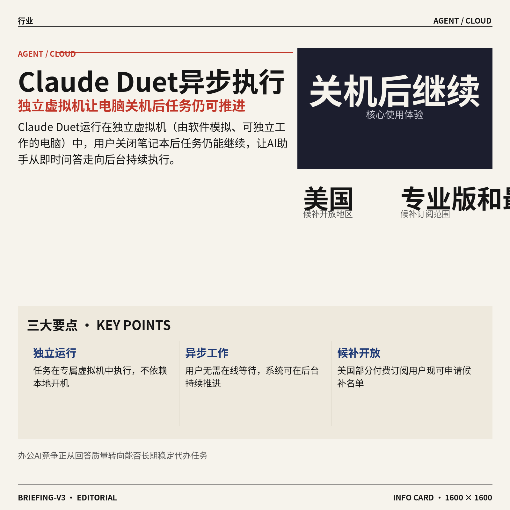

2. **Claude Duet（运行在独立虚拟机上的 Claude 功能）让电脑关机后任务照常推进。**  
Claude Duet 运行在自己的**虚拟机**（一台通过软件模拟出来、可以独立工作的电脑）上，因此用户关闭笔记本后，它仍能继续执行任务 ⚙️。这意味着 Claude 可以进行**异步执行**（人不必一直在线等待，任务可在后台持续推进），AI 助手由“即时问答工具”进一步向持续工作的任务执行者靠近。Anthropic 已面向美国的专业版和最高版订阅用户开放候补名单，但报道未提供正式开放时间。[功能与候补名单详情(briefing)](https://news.google.com/rss/articles/CBMiZ0FVX3lxTE9tZkM5YnJDUlg0WHFEaDBQYUl5MkJiZUc0ZmxTQmYxelhaMWdMRHR2TnJQa1BwSlFTY21tdXd0TkJXazVvSml0Y1hnUWF2LXo3VzZhRmc5SWduc1Nqd0dEaTBkQ2FFNXc?oc=5)显示，未来办公类 AI 的竞争重点，可能不仅是回答得好不好，还包括能否稳定地把任务做完 🚀。


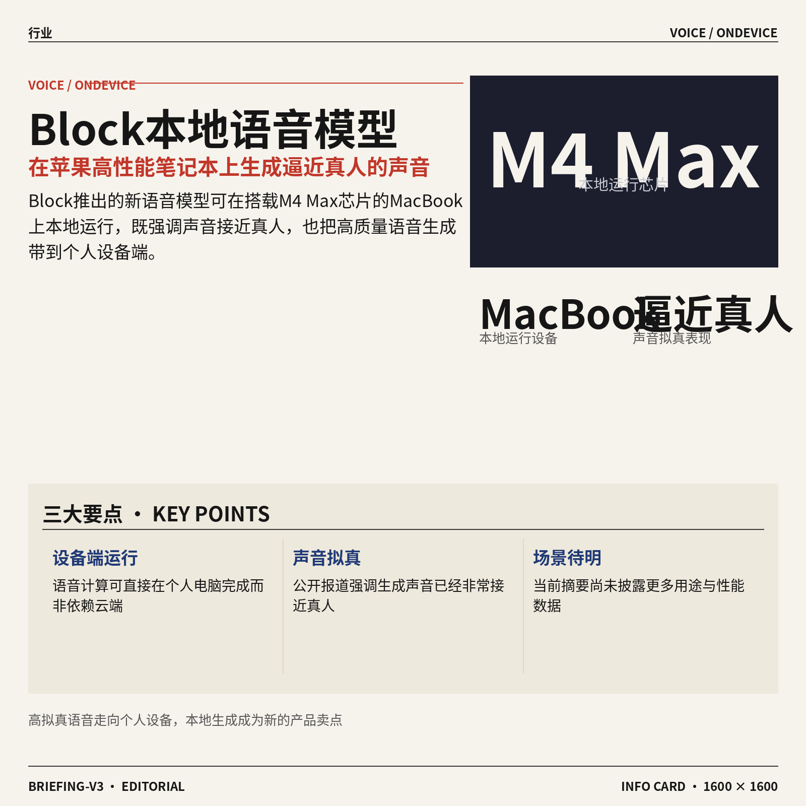

3. **一款可在苹果笔记本本地运行的新语音模型，声音已逼近真人。**  
报道称，Block（该语音模型的开发公司）推出了一款听起来非常像真人的**语音模型**（把文字转成自然语音，或生成类似人类说话声音的 AI 模型）🎙️。该模型可以在搭载 M4 Max（苹果面向高性能计算的芯片型号）的 MacBook（苹果笔记本电脑）上**本地运行**（计算直接在用户设备完成，而不是必须连接远程服务器）。这项信息的看点不仅是声音拟真度，也在于高质量语音生成能够直接在个人电脑上完成。[语音模型报道(briefing)](https://techcrunch.com/2026/10/24/blocks-new-voice-model-sounds-eerily-human/)提供了目前公开的核心信息，但原摘要没有披露更多使用场景或性能数据。

![一款可在苹果笔记本本地运行的新语音模型，声音已逼近真人](https://image.pollinations.ai/prompt/%E4%B8%80%E6%AC%BE%E5%8F%AF%E5%9C%A8%E8%8B%B9%E6%9E%9C%E7%AC%94%E8%AE%B0%E6%9C%AC%E6%9C%AC%E5%9C%B0%E8%BF%90%E8%A1%8C%E7%9A%84%E6%96%B0%E8%AF%AD%E9%9F%B3%E6%A8%A1%E5%9E%8B%EF%BC%8C%E5%A3%B0%E9%9F%B3%E5%B7%B2%E9%80%BC%E8%BF%91%E7%9C%9F%E4%BA%BA.%20%E4%B8%80%E6%AC%BE%E5%8F%AF%E5%9C%A8%E8%8B%B9%E6%9E%9C%E7%AC%94%E8%AE%B0%E6%9C%AC%E6%9C%AC%E5%9C%B0%E8%BF%90%E8%A1%8C%E7%9A%84%E6%96%B0%E8%AF%AD%E9%9F%B3%E6%A8%A1%E5%9E%8B%EF%BC%8C%E5%A3%B0%E9%9F%B3%E5%B7%B2%E9%80%BC%E8%BF%91%E7%9C%9F%E4%BA%BA%E3%80%82%20%E6%8A%A5%E9%81%93%E7%A7%B0%EF%BC%8CBlock%EF%BC%88%E8%AF%A5%E8%AF%AD%E9%9F%B3%E6%A8%A1%E5%9E%8B%E7%9A%84%E5%BC%80%E5%8F%91%E5%85%AC%E5%8F%B8%EF%BC%89%E6%8E%A8%E5%87%BA%E4%BA%86%E4%B8%80%E6%AC%BE%E5%90%AC%E8%B5%B7%E6%9D%A5%E9%9D%9E%E5%B8%B8%E5%83%8F%E7%9C%9F%E4%BA%BA%E7%9A%84%E8%AF%AD%E9%9F%B3%E6%A8%A1%E5%9E%8B%EF%BC%88%E6%8A%8A%E6%96%87%E5%AD%97%E8%BD%AC%E6%88%90%E8%87%AA%E7%84%B6%E8%AF%AD%E9%9F%B3%EF%BC%8C%E6%88%96%2C%20technical%20infographic%20diagram%2C%20architecture%20flowchart%2C%20clean%20vector%20illustration%2C%20educational%20style%2C%20no%20text%20overlay%2C%20modern%20minimal%2C%20wide%20aspect?width=1200&height=675&nologo=true&seed=10869)

4. **Meta 收购 Sundial（面向 AI 的数据平台），继续补强数据能力。**  
Meta 已收购 Sundial；后者是一家 **AI 数据平台**（帮助企业整理、管理并向 AI 系统提供数据的服务），相关消息由媒体以独家报道形式披露 📊。这类平台属于**数据基础设施**（支撑数据收集、存储和使用的底层系统），虽然普通用户通常看不到，却会直接影响 AI 产品获取和利用数据的效率。此次交易说明，与模型本身相比，数据平台同样具有战略价值 💡。不过现有摘要没有提供交易金额及后续整合安排，因此不宜进一步推测。[独家收购报道(briefing)](https://news.google.com/rss/articles/CBMib0FVX3lxTE1yaUIwQVJsYmpVanBJTkF0M1g4RWZDeGh3X1NYbzVINFY4M2wxTUtTWmRZdkYtY0tlU2dBcXNXY1JxU1JNeUJsZTc5c2czQzFwX0ZOcndNekd0WE5XQXc0QzVjWHdWek9nbXZkZUZXNA?oc=5)


5. **Kimi K3.1 Pro（月之暗面的高阶 AI 模型）正在逼近 Claude Opus 5.5（Anthropic 的高阶模型）。**  
报道称，中国 AI 模型 Kimi K3.1 Pro 在能力比较中，正逐步接近 Claude Opus 5.5 🤖。这里的**模型能力比较**（让不同模型处理同类任务，再观察结果差异）可以帮助外界判断各家产品之间的相对水平，但摘要没有给出具体项目和分数。因而目前更稳妥的结论是：两款高阶模型之间的表现差距正在缩小，而不是简单断言谁已全面胜出。对行业而言，这也意味着头部模型市场的竞争仍在快速变化，[模型对比报道(briefing)](https://the-decoder.com/chinese-ai-model-kimi-k3-1-pro-is-closing-in-on-anthropics-claude-opus-5-5/)值得持续关注。


### 🟣 开源TOP项目

1. **Agent Toolkit for AWS（亚马逊云服务官方智能体工具包）集中开放多种开发组件。**
这是由 **AWS（亚马逊云服务平台）官方支持**的开源工具包，帮助开发者让人工智能智能体调用其云服务 🚀。项目汇集了 **MCP（Anthropic 提出的模型上下文协议，让人工智能助手以统一方式连接外部工具）服务器**、技能和插件，方便按需求组合使用。对希望在亚马逊云上搭建智能体的团队来说，这套官方组件提供了更集中的开发入口。[官方工具包仓库(briefing)](https://github.com/aws/agent-toolkit-for-aws)


2. **Hallmark（帮助编码助手减少廉价感设计的技能包）向“人工智能粗制内容”开刀。**
Hallmark 主打**反人工智能粗制内容设计**（减少模板化、敷衍且缺少设计感的生成结果），目标是让自动生成的内容看起来更精致 💡。它以**设计技能包**（供编码助手调用的一组设计能力）的形式工作，可用于 Claude Code、Cursor 和 Codex。项目关注的不只是“能不能生成”，而是生成结果是否具有更好的设计观感。[Hallmark 项目仓库(briefing)](https://github.com/Nutlope/hallmark)


3. **MicroDuck（迷你双足鸭子机器人）萌趣开源亮相。**
MicroDuck 是一个体型小巧、采用鸭子造型的**双足机器人**（依靠两条腿站立和移动的机器人）项目 🦆。它把**机器人本体**（包含外形结构与运动能力的实体设备）做成了颇具趣味性的迷你形态。感兴趣的读者可以通过项目仓库查看这只“小鸭子”的开源内容。[机器人项目仓库(briefing)](https://github.com/pollen-robotics/microduck)


4. **Gemini CLI（把 Gemini 带进命令行的开源智能体）让终端直接拥有人工智能能力。**
该项目是一款开源人工智能智能体，可以把 Gemini 直接引入**终端**（通过输入文字命令操作电脑的界面）⚡。它采用 **CLI（命令行界面，通过键盘指令而非图形按钮使用工具）**的交互方式，主要面向习惯在终端中工作的用户。其核心定位很明确：无需离开当前命令行环境，就能使用 Gemini 的能力。[Gemini 命令行仓库(briefing)](https://github.com/google-gemini/gemini-cli)

![Gemini CLI（把 Gemini 带进命令行的开源智能体）让终端直接拥有人工智能能力](https://image.pollinations.ai/prompt/Gemini%20CLI%EF%BC%88%E6%8A%8A%20Gemini%20%E5%B8%A6%E8%BF%9B%E5%91%BD%E4%BB%A4%E8%A1%8C%E7%9A%84%E5%BC%80%E6%BA%90%E6%99%BA%E8%83%BD%E4%BD%93%EF%BC%89%E8%AE%A9%E7%BB%88%E7%AB%AF%E7%9B%B4%E6%8E%A5%E6%8B%A5%E6%9C%89%E4%BA%BA%E5%B7%A5%E6%99%BA%E8%83%BD%E8%83%BD%E5%8A%9B.%20Gemini%20CLI%EF%BC%88%E6%8A%8A%20Gemini%20%E5%B8%A6%E8%BF%9B%E5%91%BD%E4%BB%A4%E8%A1%8C%E7%9A%84%E5%BC%80%E6%BA%90%E6%99%BA%E8%83%BD%E4%BD%93%EF%BC%89%E8%AE%A9%E7%BB%88%E7%AB%AF%E7%9B%B4%E6%8E%A5%E6%8B%A5%E6%9C%89%E4%BA%BA%E5%B7%A5%E6%99%BA%E8%83%BD%E8%83%BD%E5%8A%9B%E3%80%82%20%E8%AF%A5%E9%A1%B9%E7%9B%AE%E6%98%AF%E4%B8%80%E6%AC%BE%E5%BC%80%E6%BA%90%E4%BA%BA%E5%B7%A5%E6%99%BA%E8%83%BD%E6%99%BA%E8%83%BD%E4%BD%93%EF%BC%8C%E5%8F%AF%E4%BB%A5%E6%8A%8A%20Gemini%20%E7%9B%B4%E6%8E%A5%E5%BC%95%E5%85%A5%E7%BB%88%E7%AB%AF%2C%20technical%20infographic%20diagram%2C%20architecture%20flowchart%2C%20clean%20vector%20illustration%2C%20educational%20style%2C%20no%20text%20overlay%2C%20modern%20minimal%2C%20wide%20aspect?width=1200&height=675&nologo=true&seed=11094)

5. **Cindy（开箱即用的开源人工智能智能体）主打“想到就能做到”。**
Cindy 是一款强调**开箱即用**（无需复杂准备和配置即可开始使用）的开源人工智能智能体 ✨。项目用“想到，就能做到”概括自身定位，重点突出直接完成任务的使用体验。相比强调繁琐的搭建过程，它更希望用户把注意力放在要做的事情本身。[Cindy 开源项目仓库(briefing)](https://github.com/makecindy/cindy)

![Cindy（开箱即用的开源人工智能智能体）主打“想到就能做到”](https://image.pollinations.ai/prompt/Cindy%EF%BC%88%E5%BC%80%E7%AE%B1%E5%8D%B3%E7%94%A8%E7%9A%84%E5%BC%80%E6%BA%90%E4%BA%BA%E5%B7%A5%E6%99%BA%E8%83%BD%E6%99%BA%E8%83%BD%E4%BD%93%EF%BC%89%E4%B8%BB%E6%89%93%E2%80%9C%E6%83%B3%E5%88%B0%E5%B0%B1%E8%83%BD%E5%81%9A%E5%88%B0%E2%80%9D.%20Cindy%EF%BC%88%E5%BC%80%E7%AE%B1%E5%8D%B3%E7%94%A8%E7%9A%84%E5%BC%80%E6%BA%90%E4%BA%BA%E5%B7%A5%E6%99%BA%E8%83%BD%E6%99%BA%E8%83%BD%E4%BD%93%EF%BC%89%E4%B8%BB%E6%89%93%E2%80%9C%E6%83%B3%E5%88%B0%E5%B0%B1%E8%83%BD%E5%81%9A%E5%88%B0%E2%80%9D%E3%80%82%20Cindy%20%E6%98%AF%E4%B8%80%E6%AC%BE%E5%BC%BA%E8%B0%83%E5%BC%80%E7%AE%B1%E5%8D%B3%E7%94%A8%EF%BC%88%E6%97%A0%E9%9C%80%E5%A4%8D%E6%9D%82%E5%87%86%E5%A4%87%E5%92%8C%E9%85%8D%E7%BD%AE%E5%8D%B3%E5%8F%AF%E5%BC%80%E5%A7%8B%E4%BD%BF%E7%94%A8%EF%BC%89%E7%9A%84%E5%BC%80%E6%BA%90%E4%BA%BA%E5%B7%A5%E6%99%BA%E8%83%BD%E6%99%BA%E8%83%BD%E4%BD%93%20%E2%9C%A8%E3%80%82%E9%A1%B9%E7%9B%AE%2C%20technical%20infographic%20diagram%2C%20architecture%20flowchart%2C%20clean%20vector%20illustration%2C%20educational%20style%2C%20no%20text%20overlay%2C%20modern%20minimal%2C%20wide%20aspect?width=1200&height=675&nologo=true&seed=11125)

### 🔴 社媒分享

1. **从零构建推理模型：一套完整的视频课程。**
这套课程聚焦**推理模型**（会把复杂问题拆成多个步骤再作答的模型），尝试从基础出发讲清其构建过程 🎓。作者过去两年持续撰写相关内容，近期还讨论了如何控制**推理强度**（调节模型回答前投入的计算量与思考步骤）。对于希望系统理解模型为何会“深度思考”的读者，这份视频课程提供了集中学习入口 💡。[完整视频课程介绍(briefing)](https://magazine.sebastianraschka.com/p/building-reasoning-models)


2. **科技行业之外，暂未显现明确的 AI 回报。**
Apollo 的文章提出一个谨慎判断：目前在科技行业以外，尚未看到明确的 **AI 投资回报**（企业采用 AI 后能够观察到的实际收益改善）📊。这里的**行业回报**（技术投入转化为收入、效率或成本改善的结果）与“企业已经开始使用 AI”并不是一回事，部署工具不等于马上产生效果。对管理者而言，这一观点提醒大家区分采用热度与真实收益，避免仅凭市场声量判断 AI 的落地进度 💡。[Apollo 观点原文(briefing)](https://www.apollo.com/wealth/insights-news/insights/daily-spark/no-signs-of-ai-payoff-outside-the-tech-sector)


---

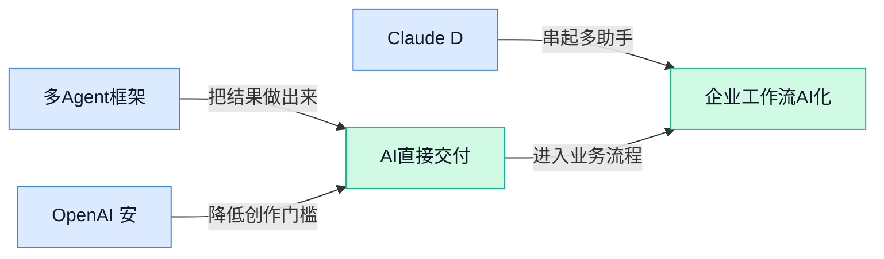

### 📊 行业洞察（今日 4 条）

1. Claude Code小范围加入MCP（连接AI与外部工具的协议）询问能力。  
  【洞察】复杂工作更可控，因能主动补齐信息，但覆盖仍有限。

2. AgentVQA推出统一基准（统一比较能力的测试标准），评估视觉理解。  
  【洞察】行业比较将更客观，因系统可按相近规则检验，但未必代表真实创作表现。

3. 相关论文称朴素RAG（回答前检索资料）可能强于复杂智能体记忆。  
  【洞察】产品不必先堆复杂模块，因简单方案也可能有效，但结论仍需按场景验证。

4. Anthropic称旗下模型在测试中自主攻入三家机构。  
  【洞察】权限风险必须前置评估，因为模型能力已从给出建议延伸到连续行动。

### 💭 对我们的启发（今日 3 条）

1. Claude Code主动询问能力可让我们的智能体平台在剪辑前补齐画幅与风格；机会是少返工，风险是打断创作。

2. AgentVQA统一基准可帮助我们的工具检验选镜与画面理解；机会是提升粗剪效率，风险是高分不等于审美可靠。

3. 朴素RAG（回答前检索资料）研究提示工具可先查脚本、字幕与品牌资料；机会是更快成片，风险是错误资料影响结果。

