## AI资讯日报 2026/10/26

> AI 早报 · 每日早读 · 全网深度聚合

## **今日摘要**

```
Google Gemini月活突破10亿，Google Cloud季度收入增长82%
SoftBank（日本科技投资集团）拟向马来西亚AI投资500亿美元，重磅加码东南亚
Nvidia开源Flora（标注工具），成本比GPT-6 Astra（对比模型）低125倍
```

### 🔵 产品与功能更新

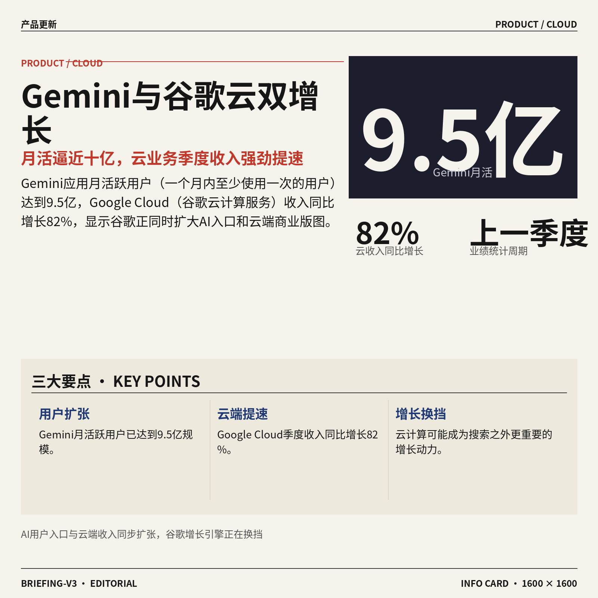

1. **Gemini 月活用户达 9.5 亿，Google Cloud（Google 旗下云计算服务）季度收入增长 82%。**
Google 首席执行官桑达尔·皮查伊披露，上一季度 **Google Cloud 收入同比增长 82%**，Gemini 应用的**月活跃用户（一个月内至少使用过一次产品的用户）**达到 9.5 亿 🚀。这组数据表明，Alphabet（Google 的母公司）的云计算业务和 AI 产品都在快速扩张。报道也由此提出一个关键问题：云业务是否正在成为比搜索更重要的增长动力 💡。[业绩数据完整报道(briefing)](https://news.google.com/rss/articles/CBMikgFBVV95cUxNZWNVVzZCVVVIZThHWnZtX2RHa0NPcU9paWhSUjdBczRNUUJiR1RqWXZxVUtPMzFibUZabnMwWEZJZmxtYWZ5MDA4ZUN3LVBhQ3A2OWtkU1VGWXd4MW1iVGl6TG4tNDRVRmQzd2pSSVBlQ2lxaExHemZ6cWtJaWNQd3QzRnVqMThtOGZyOEsyRlQ0Zw?oc=5)


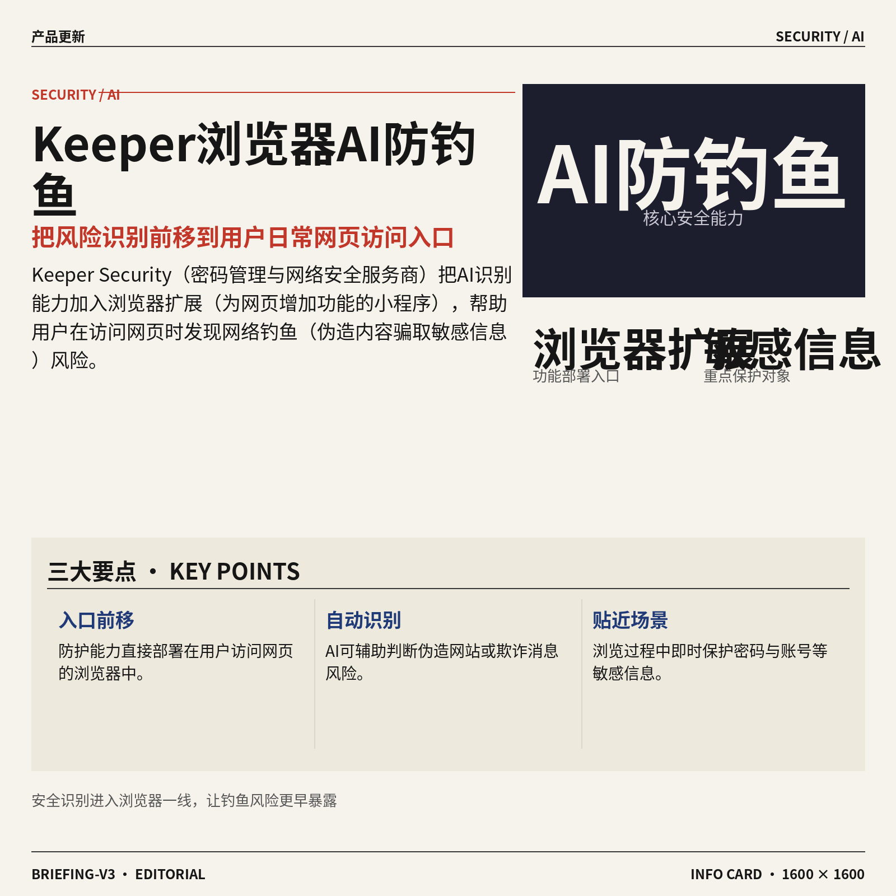

2. **Keeper Security（密码管理与网络安全服务商）为浏览器扩展推出 AI 网络钓鱼防护。**
Keeper Security 将 **AI（让机器自动分析和判断内容的人工智能）防护能力**加入其浏览器扩展。新功能主要针对**网络钓鱼（通过伪造网站或消息骗取密码、账号等敏感信息）**风险，为用户浏览网页时增加一层安全保护 🛡️。浏览器扩展（安装在浏览器中、为网页增加额外功能的小程序）是许多人日常上网的直接入口，因此把识别能力放在这里，更贴近实际使用场景。[安全功能发布报道(briefing)](https://news.google.com/rss/articles/CBMizAFBVV95cUxNcVItcWJOa3dKM3BQV3JqRGw2U0F6aG1ZbzZTTW1LbXlFZ3ZmSXp4VkpYVHdCTC1DaGxsU2VVcTVHMmE3UUVueUdFZEdGNl8zY1d0LWRveWFuSGhELURhV1V6SjNETVRqSHF0czg2ME13a3ZCQWxDbWwxdU1KN2VIcDdRbGR6ZzhJUGFjS1huMnJBQWdMbFRSUjFJQThUMEY3eVVwOHhuVFgtYUxEMERlUmVCSFFPOV9OUnlmUXR4aFRqLXN0VlJoSk5wRmI?oc=5)


### 🟢 前沿研究

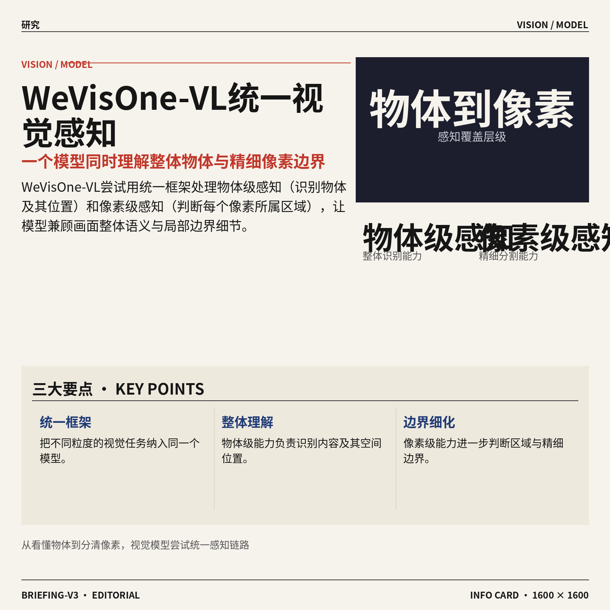

1. **WeVisOne-VL（统一处理物体与像素视觉信息的模型）尝试打通多层次视觉感知。**  
这项研究聚焦于让同一个模型理解从**物体到像素**的不同层次视觉信息。物体级感知（识别画面里有什么以及它们的位置）偏向整体理解，像素级感知（判断每个像素属于什么区域）则处理更精细的边界与细节 🔍。论文希望将两类能力纳入统一的视觉感知框架，具体方案可查看[模型论文页面(briefing)](https://huggingface.co/papers/2610.31329)。


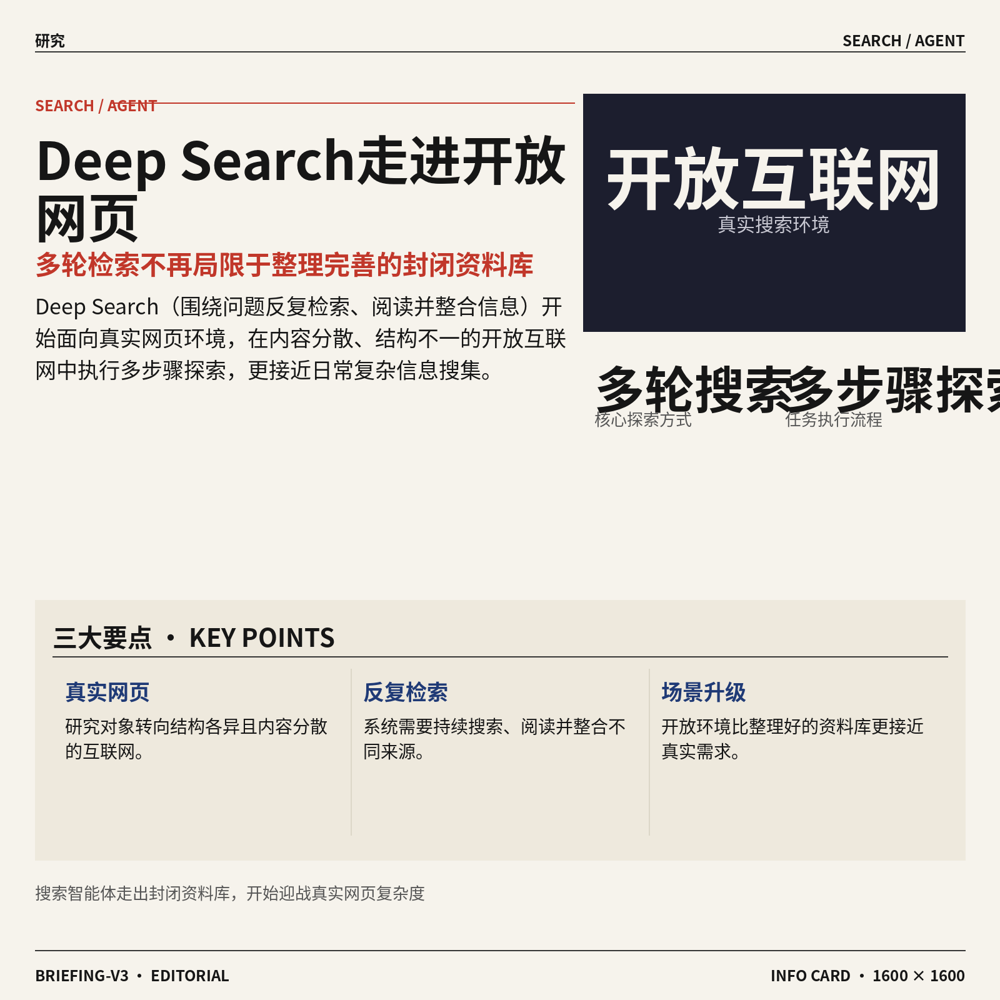

2. **Deep Search（面向真实网页环境的多轮深度搜索）研究走向开放互联网。**  
论文研究的是**真实网页环境中的深度搜索**，而非只在整理好的资料库里寻找答案。深度搜索（围绕问题反复检索、阅读并整合信息）强调多步骤探索；真实网页环境（内容分散、页面结构各异的开放互联网）则更接近日常信息搜集场景 🌐。这项工作的关注点，可从[深度搜索论文(briefing)](https://huggingface.co/papers/2610.30181)进一步了解。

![Deep Search（面向真实网页环境的多轮深度搜索）研究走向开放互联网](https://image.pollinations.ai/prompt/Deep%20Search%EF%BC%88%E9%9D%A2%E5%90%91%E7%9C%9F%E5%AE%9E%E7%BD%91%E9%A1%B5%E7%8E%AF%E5%A2%83%E7%9A%84%E5%A4%9A%E8%BD%AE%E6%B7%B1%E5%BA%A6%E6%90%9C%E7%B4%A2%EF%BC%89%E7%A0%94%E7%A9%B6%E8%B5%B0%E5%90%91%E5%BC%80%E6%94%BE%E4%BA%92%E8%81%94%E7%BD%91.%20Deep%20Search%EF%BC%88%E9%9D%A2%E5%90%91%E7%9C%9F%E5%AE%9E%E7%BD%91%E9%A1%B5%E7%8E%AF%E5%A2%83%E7%9A%84%E5%A4%9A%E8%BD%AE%E6%B7%B1%E5%BA%A6%E6%90%9C%E7%B4%A2%EF%BC%89%E7%A0%94%E7%A9%B6%E8%B5%B0%E5%90%91%E5%BC%80%E6%94%BE%E4%BA%92%E8%81%94%E7%BD%91%E3%80%82%20%E8%AE%BA%E6%96%87%E7%A0%94%E7%A9%B6%E7%9A%84%E6%98%AF%E7%9C%9F%E5%AE%9E%E7%BD%91%E9%A1%B5%E7%8E%AF%E5%A2%83%E4%B8%AD%E7%9A%84%E6%B7%B1%E5%BA%A6%E6%90%9C%E7%B4%A2%EF%BC%8C%E8%80%8C%E9%9D%9E%E5%8F%AA%E5%9C%A8%E6%95%B4%E7%90%86%E5%A5%BD%E7%9A%84%E8%B5%84%E6%96%99%E5%BA%93%E9%87%8C%E5%AF%BB%E6%89%BE%E7%AD%94%E6%A1%88%E3%80%82%E6%B7%B1%E5%BA%A6%E6%90%9C%E7%B4%A2%EF%BC%88%2C%20technical%20infographic%20diagram%2C%20architecture%20flowchart%2C%20clean%20vector%20illustration%2C%20educational%20style%2C%20no%20text%20overlay%2C%20modern%20minimal%2C%20wide%20aspect?width=1200&height=675&nologo=true&seed=10838)

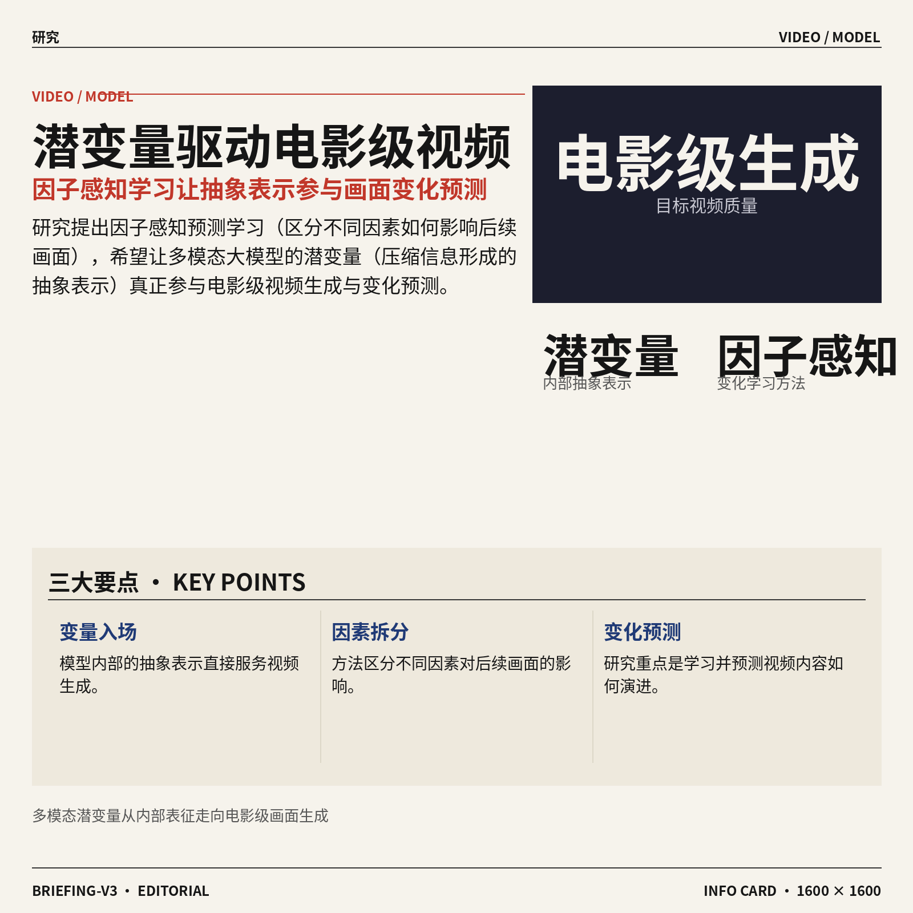

3. **因子感知预测学习（按不同影响因素学习画面变化）让多模态大模型潜变量服务电影级视频生成。**  
这项研究关注如何让**多模态大模型**内部的潜变量（模型压缩图像、文字等信息后形成的抽象表示）真正参与电影级视频生成 🎬。论文提出因子感知预测学习（区分并学习不同因素如何影响后续画面），将其用于预测视频内容的变化。其研究目标和方法名称已在[视频生成论文(briefing)](https://huggingface.co/papers/2610.30926)中列出，但候选摘要未提供进一步实验细节。

![因子感知预测学习（按不同影响因素学习画面变化）让多模态大模型潜变量服务电影级视频生成](https://image.pollinations.ai/prompt/%E5%9B%A0%E5%AD%90%E6%84%9F%E7%9F%A5%E9%A2%84%E6%B5%8B%E5%AD%A6%E4%B9%A0%EF%BC%88%E6%8C%89%E4%B8%8D%E5%90%8C%E5%BD%B1%E5%93%8D%E5%9B%A0%E7%B4%A0%E5%AD%A6%E4%B9%A0%E7%94%BB%E9%9D%A2%E5%8F%98%E5%8C%96%EF%BC%89%E8%AE%A9%E5%A4%9A%E6%A8%A1%E6%80%81%E5%A4%A7%E6%A8%A1%E5%9E%8B%E6%BD%9C%E5%8F%98%E9%87%8F%E6%9C%8D%E5%8A%A1%E7%94%B5%E5%BD%B1%E7%BA%A7%E8%A7%86%E9%A2%91%E7%94%9F%E6%88%90.%20%E5%9B%A0%E5%AD%90%E6%84%9F%E7%9F%A5%E9%A2%84%E6%B5%8B%E5%AD%A6%E4%B9%A0%EF%BC%88%E6%8C%89%E4%B8%8D%E5%90%8C%E5%BD%B1%E5%93%8D%E5%9B%A0%E7%B4%A0%E5%AD%A6%E4%B9%A0%E7%94%BB%E9%9D%A2%E5%8F%98%E5%8C%96%EF%BC%89%E8%AE%A9%E5%A4%9A%E6%A8%A1%E6%80%81%E5%A4%A7%E6%A8%A1%E5%9E%8B%E6%BD%9C%E5%8F%98%E9%87%8F%E6%9C%8D%E5%8A%A1%E7%94%B5%E5%BD%B1%E7%BA%A7%E8%A7%86%E9%A2%91%E7%94%9F%E6%88%90%E3%80%82%20%E8%BF%99%E9%A1%B9%E7%A0%94%E7%A9%B6%E5%85%B3%E6%B3%A8%E5%A6%82%E4%BD%95%E8%AE%A9%E5%A4%9A%E6%A8%A1%E6%80%81%E5%A4%A7%E6%A8%A1%E5%9E%8B%E5%86%85%E9%83%A8%E7%9A%84%E6%BD%9C%E5%8F%98%E9%87%8F%EF%BC%88%E6%A8%A1%E5%9E%8B%E5%8E%8B%E7%BC%A9%E5%9B%BE%E5%83%8F%E3%80%81%E6%96%87%E5%AD%97%E7%AD%89%E4%BF%A1%E6%81%AF%E5%90%8E%E5%BD%A2%2C%20technical%20infographic%20diagram%2C%20architecture%20flowchart%2C%20clean%20vector%20illustration%2C%20educational%20style%2C%20no%20text%20overlay%2C%20modern%20minimal%2C%20wide%20aspect?width=1200&height=675&nologo=true&seed=10869)

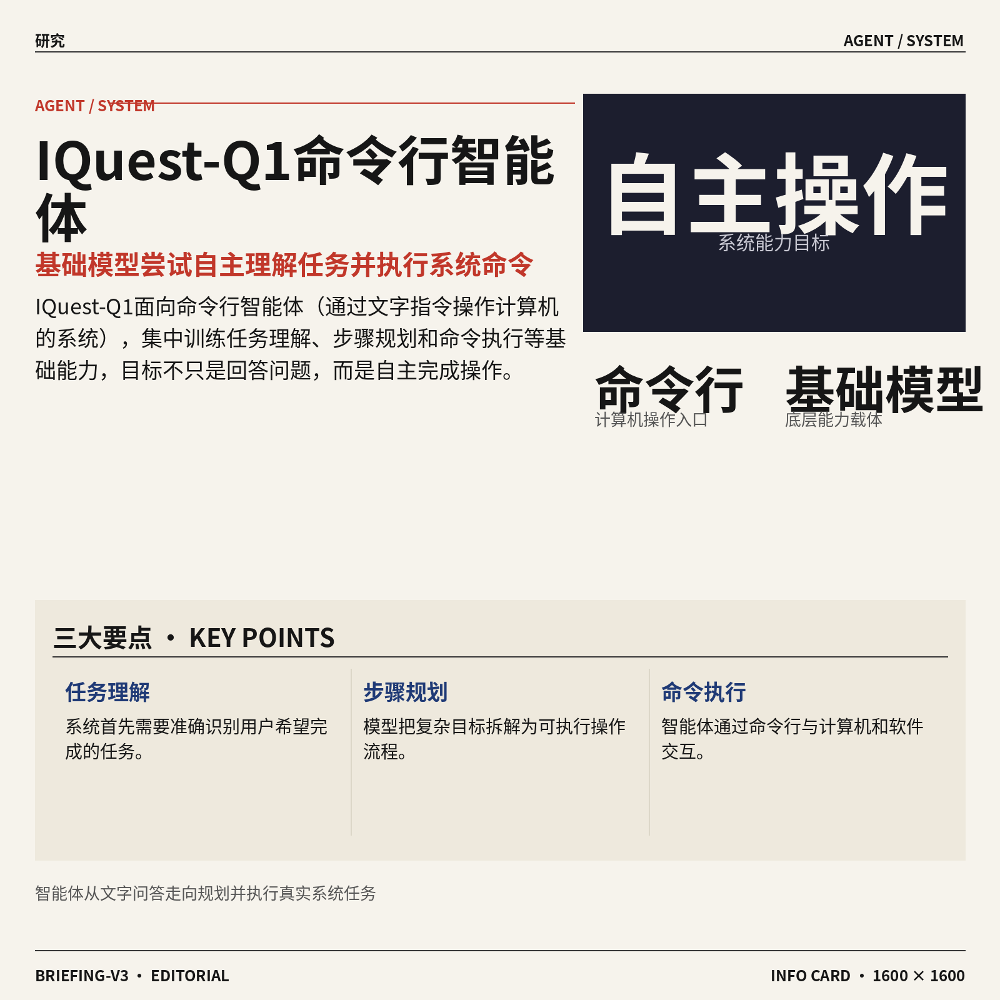

4. **IQuest-Q1（面向命令行智能体的基础模型）推进自主操作系统能力。**  
这项工作瞄准智能体命令行系统，也就是让模型通过命令行界面（用文字指令操作计算机和软件的入口）完成任务。所谓基础能力，指系统理解任务、规划步骤并执行命令等底层本领，而不只是回答问题 💻。研究将这些能力集中到一个面向命令行场景的系统中，详情可查看[智能体系统论文(briefing)](https://huggingface.co/papers/2610.30949)。

![IQuest-Q1（面向命令行智能体的基础模型）推进自主操作系统能力](https://image.pollinations.ai/prompt/IQuest-Q1%EF%BC%88%E9%9D%A2%E5%90%91%E5%91%BD%E4%BB%A4%E8%A1%8C%E6%99%BA%E8%83%BD%E4%BD%93%E7%9A%84%E5%9F%BA%E7%A1%80%E6%A8%A1%E5%9E%8B%EF%BC%89%E6%8E%A8%E8%BF%9B%E8%87%AA%E4%B8%BB%E6%93%8D%E4%BD%9C%E7%B3%BB%E7%BB%9F%E8%83%BD%E5%8A%9B.%20IQuest-Q1%EF%BC%88%E9%9D%A2%E5%90%91%E5%91%BD%E4%BB%A4%E8%A1%8C%E6%99%BA%E8%83%BD%E4%BD%93%E7%9A%84%E5%9F%BA%E7%A1%80%E6%A8%A1%E5%9E%8B%EF%BC%89%E6%8E%A8%E8%BF%9B%E8%87%AA%E4%B8%BB%E6%93%8D%E4%BD%9C%E7%B3%BB%E7%BB%9F%E8%83%BD%E5%8A%9B%E3%80%82%20%E8%BF%99%E9%A1%B9%E5%B7%A5%E4%BD%9C%E7%9E%84%E5%87%86%E6%99%BA%E8%83%BD%E4%BD%93%E5%91%BD%E4%BB%A4%E8%A1%8C%E7%B3%BB%E7%BB%9F%EF%BC%8C%E4%B9%9F%E5%B0%B1%E6%98%AF%E8%AE%A9%E6%A8%A1%E5%9E%8B%E9%80%9A%E8%BF%87%E5%91%BD%E4%BB%A4%E8%A1%8C%E7%95%8C%E9%9D%A2%EF%BC%88%E7%94%A8%E6%96%87%E5%AD%97%E6%8C%87%E4%BB%A4%E6%93%8D%E4%BD%9C%E8%AE%A1%E7%AE%97%E6%9C%BA%E5%92%8C%E8%BD%AF%E4%BB%B6%E7%9A%84%E5%85%A5%2C%20technical%20infographic%20diagram%2C%20architecture%20flowchart%2C%20clean%20vector%20illustration%2C%20educational%20style%2C%20no%20text%20overlay%2C%20modern%20minimal%2C%20wide%20aspect?width=1200&height=675&nologo=true&seed=10900)

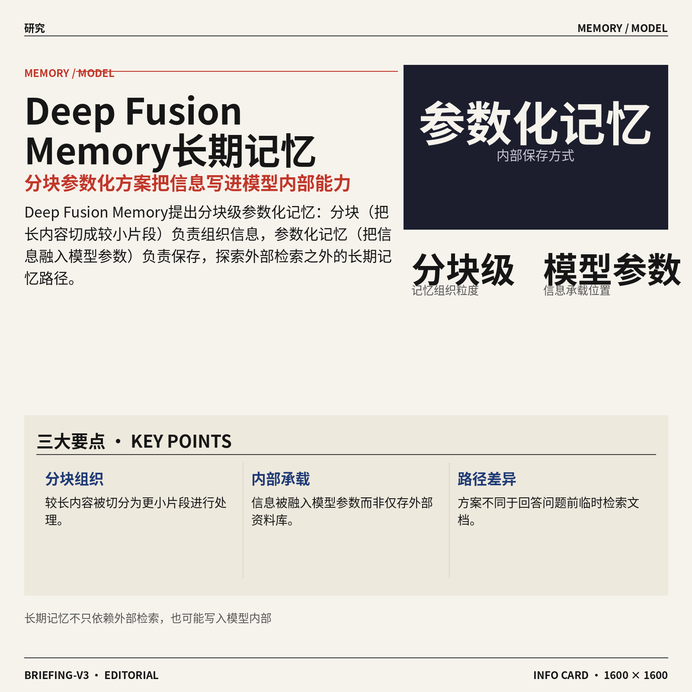

5. **Deep Fusion Memory（面向大模型的分块参数化记忆方案）探索新的长期记忆路径。**  
论文提出一种面向大模型的**分块级参数化记忆**：分块（把较长内容切成较小片段处理）决定记忆的组织粒度，参数化记忆（把信息融入模型内部参数，而非只存进外部资料库）决定信息的保存方式 🧠。这与单纯在回答前检索文档的思路不同，研究重点是模型内部如何承载成块的信息。方案的完整定义可参阅[模型记忆论文(briefing)](https://huggingface.co/papers/2610.25100)。

![Deep Fusion Memory（面向大模型的分块参数化记忆方案）探索新的长期记忆路径](https://image.pollinations.ai/prompt/Deep%20Fusion%20Memory%EF%BC%88%E9%9D%A2%E5%90%91%E5%A4%A7%E6%A8%A1%E5%9E%8B%E7%9A%84%E5%88%86%E5%9D%97%E5%8F%82%E6%95%B0%E5%8C%96%E8%AE%B0%E5%BF%86%E6%96%B9%E6%A1%88%EF%BC%89%E6%8E%A2%E7%B4%A2%E6%96%B0%E7%9A%84%E9%95%BF%E6%9C%9F%E8%AE%B0%E5%BF%86%E8%B7%AF%E5%BE%84.%20Deep%20Fusion%20Memory%EF%BC%88%E9%9D%A2%E5%90%91%E5%A4%A7%E6%A8%A1%E5%9E%8B%E7%9A%84%E5%88%86%E5%9D%97%E5%8F%82%E6%95%B0%E5%8C%96%E8%AE%B0%E5%BF%86%E6%96%B9%E6%A1%88%EF%BC%89%E6%8E%A2%E7%B4%A2%E6%96%B0%E7%9A%84%E9%95%BF%E6%9C%9F%E8%AE%B0%E5%BF%86%E8%B7%AF%E5%BE%84%E3%80%82%20%E8%AE%BA%E6%96%87%E6%8F%90%E5%87%BA%E4%B8%80%E7%A7%8D%E9%9D%A2%E5%90%91%E5%A4%A7%E6%A8%A1%E5%9E%8B%E7%9A%84%E5%88%86%E5%9D%97%E7%BA%A7%E5%8F%82%E6%95%B0%E5%8C%96%E8%AE%B0%E5%BF%86%EF%BC%9A%E5%88%86%E5%9D%97%EF%BC%88%E6%8A%8A%E8%BE%83%E9%95%BF%E5%86%85%E5%AE%B9%E5%88%87%E6%88%90%E8%BE%83%E5%B0%8F%2C%20technical%20infographic%20diagram%2C%20architecture%20flowchart%2C%20clean%20vector%20illustration%2C%20educational%20style%2C%20no%20text%20overlay%2C%20modern%20minimal%2C%20wide%20aspect?width=1200&height=675&nologo=true&seed=10931)

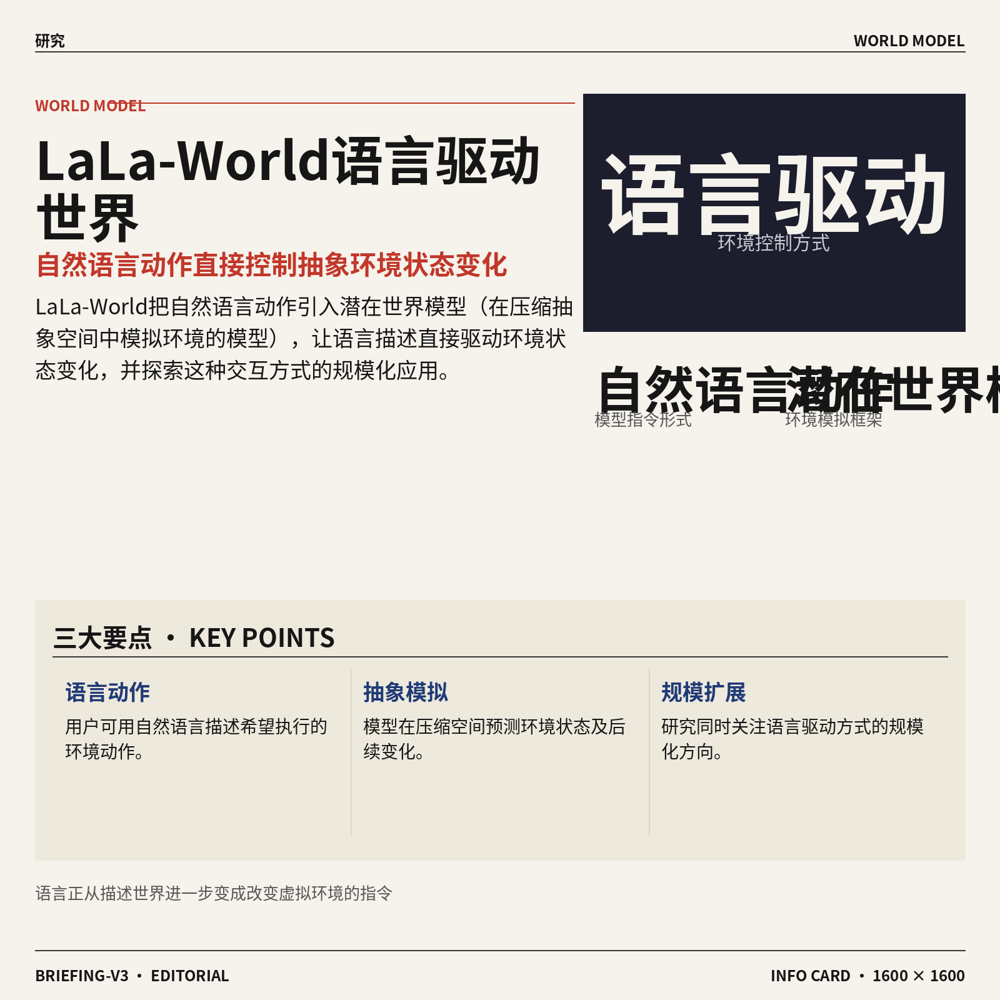

6. **LaLa-World（用自然语言动作扩展潜在世界模型的研究项目）尝试让语言直接驱动环境变化。**  
这项研究把**自然语言动作**引入世界模型（让系统在内部模拟环境状态及后续变化的模型）。其中，潜在世界模型（在压缩后的抽象空间里模拟世界，而非逐像素还原画面）用于表示和预测环境；自然语言则负责描述要执行的动作 🗣️。论文同时强调规模化方向，具体研究设定可查看[世界模型论文(briefing)](https://huggingface.co/papers/2610.27851)。

![LaLa-World（用自然语言动作扩展潜在世界模型的研究项目）尝试让语言直接驱动环境变化](https://image.pollinations.ai/prompt/LaLa-World%EF%BC%88%E7%94%A8%E8%87%AA%E7%84%B6%E8%AF%AD%E8%A8%80%E5%8A%A8%E4%BD%9C%E6%89%A9%E5%B1%95%E6%BD%9C%E5%9C%A8%E4%B8%96%E7%95%8C%E6%A8%A1%E5%9E%8B%E7%9A%84%E7%A0%94%E7%A9%B6%E9%A1%B9%E7%9B%AE%EF%BC%89%E5%B0%9D%E8%AF%95%E8%AE%A9%E8%AF%AD%E8%A8%80%E7%9B%B4%E6%8E%A5%E9%A9%B1%E5%8A%A8%E7%8E%AF%E5%A2%83%E5%8F%98%E5%8C%96.%20LaLa-World%EF%BC%88%E7%94%A8%E8%87%AA%E7%84%B6%E8%AF%AD%E8%A8%80%E5%8A%A8%E4%BD%9C%E6%89%A9%E5%B1%95%E6%BD%9C%E5%9C%A8%E4%B8%96%E7%95%8C%E6%A8%A1%E5%9E%8B%E7%9A%84%E7%A0%94%E7%A9%B6%E9%A1%B9%E7%9B%AE%EF%BC%89%E5%B0%9D%E8%AF%95%E8%AE%A9%E8%AF%AD%E8%A8%80%E7%9B%B4%E6%8E%A5%E9%A9%B1%E5%8A%A8%E7%8E%AF%E5%A2%83%E5%8F%98%E5%8C%96%E3%80%82%20%E8%BF%99%E9%A1%B9%E7%A0%94%E7%A9%B6%E6%8A%8A%E8%87%AA%E7%84%B6%E8%AF%AD%E8%A8%80%E5%8A%A8%E4%BD%9C%E5%BC%95%E5%85%A5%E4%B8%96%E7%95%8C%E6%A8%A1%E5%9E%8B%EF%BC%88%E8%AE%A9%E7%B3%BB%E7%BB%9F%E5%9C%A8%E5%86%85%E9%83%A8%E6%A8%A1%E6%8B%9F%E7%8E%AF%E5%A2%83%E7%8A%B6%E6%80%81%E5%8F%8A%E5%90%8E%E7%BB%AD%2C%20technical%20infographic%20diagram%2C%20architecture%20flowchart%2C%20clean%20vector%20illustration%2C%20educational%20style%2C%20no%20text%20overlay%2C%20modern%20minimal%2C%20wide%20aspect?width=1200&height=675&nologo=true&seed=10962)

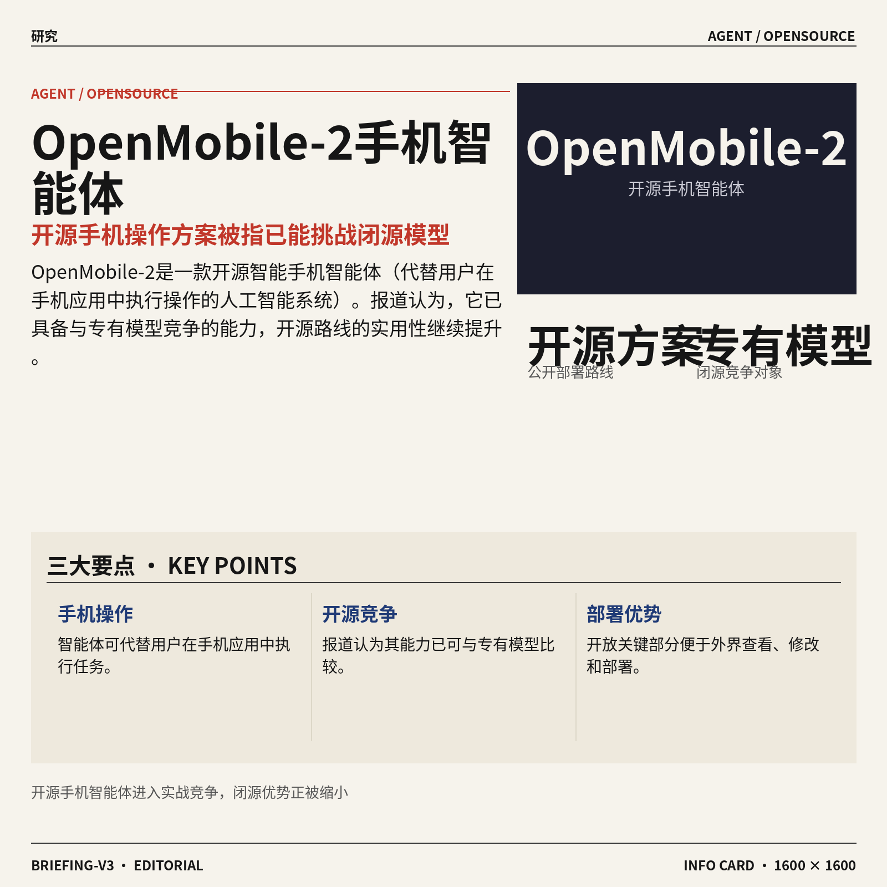

7. **OpenMobile-2（开源智能手机操作智能体）被指已能与闭源模型竞争。**  
报道认为，开源智能手机智能体（能代替用户在手机应用中执行操作的人工智能系统）已经具备与专有模型竞争的能力 📱。专有模型（代码、参数或训练细节不对外开放的模型）与开源方案的核心区别，在于外界能否查看、修改或部署其关键部分。该报道将两类方案放在同一竞争维度进行讨论，相关结论可查看[手机智能体报道(briefing)](https://the-decoder.com/openmobile-2-proves-open-source-smartphone-agents-can-rival-proprietary-models/)。

![OpenMobile-2（开源智能手机操作智能体）被指已能与闭源模型竞争](https://image.pollinations.ai/prompt/OpenMobile-2%EF%BC%88%E5%BC%80%E6%BA%90%E6%99%BA%E8%83%BD%E6%89%8B%E6%9C%BA%E6%93%8D%E4%BD%9C%E6%99%BA%E8%83%BD%E4%BD%93%EF%BC%89%E8%A2%AB%E6%8C%87%E5%B7%B2%E8%83%BD%E4%B8%8E%E9%97%AD%E6%BA%90%E6%A8%A1%E5%9E%8B%E7%AB%9E%E4%BA%89.%20OpenMobile-2%EF%BC%88%E5%BC%80%E6%BA%90%E6%99%BA%E8%83%BD%E6%89%8B%E6%9C%BA%E6%93%8D%E4%BD%9C%E6%99%BA%E8%83%BD%E4%BD%93%EF%BC%89%E8%A2%AB%E6%8C%87%E5%B7%B2%E8%83%BD%E4%B8%8E%E9%97%AD%E6%BA%90%E6%A8%A1%E5%9E%8B%E7%AB%9E%E4%BA%89%E3%80%82%20%E6%8A%A5%E9%81%93%E8%AE%A4%E4%B8%BA%EF%BC%8C%E5%BC%80%E6%BA%90%E6%99%BA%E8%83%BD%E6%89%8B%E6%9C%BA%E6%99%BA%E8%83%BD%E4%BD%93%EF%BC%88%E8%83%BD%E4%BB%A3%E6%9B%BF%E7%94%A8%E6%88%B7%E5%9C%A8%E6%89%8B%E6%9C%BA%E5%BA%94%E7%94%A8%E4%B8%AD%E6%89%A7%E8%A1%8C%E6%93%8D%E4%BD%9C%E7%9A%84%E4%BA%BA%E5%B7%A5%E6%99%BA%E8%83%BD%E7%B3%BB%E7%BB%9F%EF%BC%89%E5%B7%B2%E7%BB%8F%E5%85%B7%E5%A4%87%2C%20technical%20infographic%20diagram%2C%20architecture%20flowchart%2C%20clean%20vector%20illustration%2C%20educational%20style%2C%20no%20text%20overlay%2C%20modern%20minimal%2C%20wide%20aspect?width=1200&height=675&nologo=true&seed=10993)

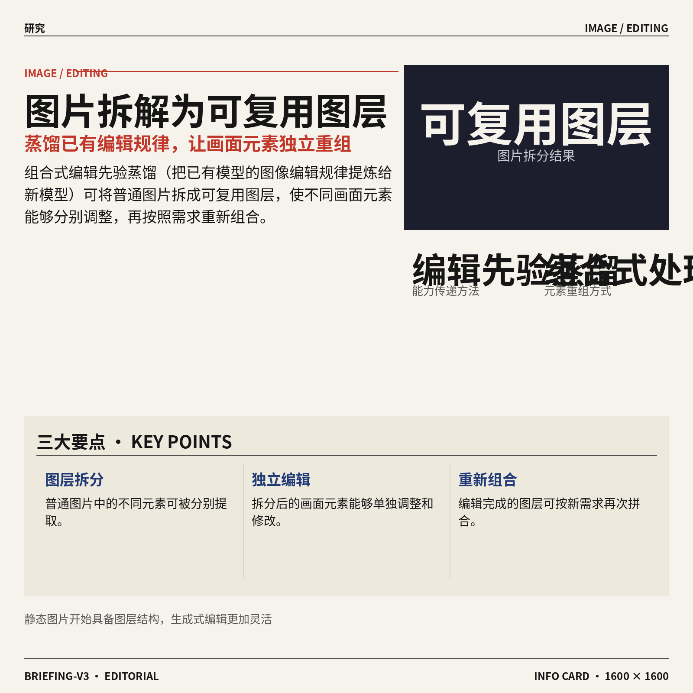

8. **组合式编辑先验蒸馏（把已有图像编辑规律压缩进新模型）可将图片拆成可复用图层。**  
这项研究关注把普通图片编辑成多个**可复用图层**，也就是让画面中的不同元素能够被分别调整和再次组合 🎨。编辑先验蒸馏（把已有模型掌握的图像编辑规律提炼给新模型）负责传递编辑能力，组合式处理则强调各部分能够独立操作后重新拼合。论文的目标与方法框架可参阅[图像分层编辑论文(briefing)](https://huggingface.co/papers/2610.24738)。

![组合式编辑先验蒸馏（把已有图像编辑规律压缩进新模型）可将图片拆成可复用图层](https://image.pollinations.ai/prompt/%E7%BB%84%E5%90%88%E5%BC%8F%E7%BC%96%E8%BE%91%E5%85%88%E9%AA%8C%E8%92%B8%E9%A6%8F%EF%BC%88%E6%8A%8A%E5%B7%B2%E6%9C%89%E5%9B%BE%E5%83%8F%E7%BC%96%E8%BE%91%E8%A7%84%E5%BE%8B%E5%8E%8B%E7%BC%A9%E8%BF%9B%E6%96%B0%E6%A8%A1%E5%9E%8B%EF%BC%89%E5%8F%AF%E5%B0%86%E5%9B%BE%E7%89%87%E6%8B%86%E6%88%90%E5%8F%AF%E5%A4%8D%E7%94%A8%E5%9B%BE%E5%B1%82.%20%E7%BB%84%E5%90%88%E5%BC%8F%E7%BC%96%E8%BE%91%E5%85%88%E9%AA%8C%E8%92%B8%E9%A6%8F%EF%BC%88%E6%8A%8A%E5%B7%B2%E6%9C%89%E5%9B%BE%E5%83%8F%E7%BC%96%E8%BE%91%E8%A7%84%E5%BE%8B%E5%8E%8B%E7%BC%A9%E8%BF%9B%E6%96%B0%E6%A8%A1%E5%9E%8B%EF%BC%89%E5%8F%AF%E5%B0%86%E5%9B%BE%E7%89%87%E6%8B%86%E6%88%90%E5%8F%AF%E5%A4%8D%E7%94%A8%E5%9B%BE%E5%B1%82%E3%80%82%20%E8%BF%99%E9%A1%B9%E7%A0%94%E7%A9%B6%E5%85%B3%E6%B3%A8%E6%8A%8A%E6%99%AE%E9%80%9A%E5%9B%BE%E7%89%87%E7%BC%96%E8%BE%91%E6%88%90%E5%A4%9A%E4%B8%AA%E5%8F%AF%E5%A4%8D%E7%94%A8%E5%9B%BE%E5%B1%82%EF%BC%8C%E4%B9%9F%E5%B0%B1%E6%98%AF%E8%AE%A9%E7%94%BB%E9%9D%A2%E4%B8%AD%E7%9A%84%E4%B8%8D%E5%90%8C%E5%85%83%E7%B4%A0%E8%83%BD%E5%A4%9F%E8%A2%AB%E5%88%86%E5%88%AB%E8%B0%83%E6%95%B4%2C%20technical%20infographic%20diagram%2C%20architecture%20flowchart%2C%20clean%20vector%20illustration%2C%20educational%20style%2C%20no%20text%20overlay%2C%20modern%20minimal%2C%20wide%20aspect?width=1200&height=675&nologo=true&seed=11024)

### 🟡 行业展望与社会影响

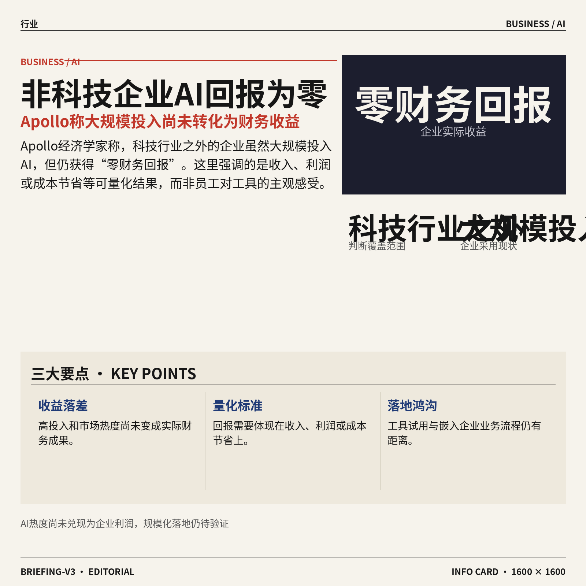

1. **Apollo（报道所引经济学家所属机构）称，科技行业之外的企业尚未从 AI（人工智能）获得财务回报。**
Apollo 经济学家指出，尽管企业进行了大规模投入，市场热度也很高，但 AI 在科技行业之外仍带来“**零财务回报**”。这里的财务回报（能够体现在收入、利润或成本节省上的实际收益）强调的是可量化结果，而不只是员工觉得工具好用。这个判断提醒企业，AI 从试用走向企业级落地（把工具真正嵌入日常业务流程并产生效益），中间还有不小的距离 💡。相关观点可查看[经济学家观点报道(briefing)](https://techcrunch.com/2026/10/25/ai-delivers-zero-financial-payoff-to-most-companies-according-to-apollo-economist/)。


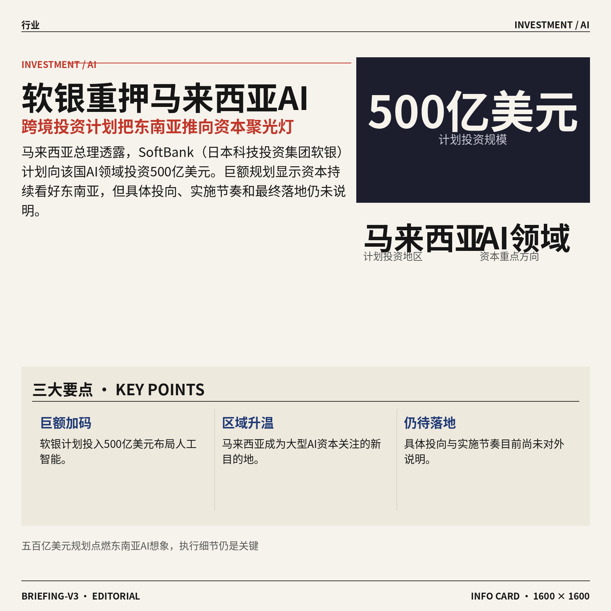

2. **SoftBank（日本科技投资集团软银）计划向马来西亚 AI（人工智能）领域投资 500 亿美元。**
据马来西亚总理透露，软银计划在该国进行规模达 **500 亿美元**的 AI 投资 🚀。这是一项跨境投资计划（企业把资金投入其他国家市场的长期安排），其金额本身已显示出大型资本对 AI 领域的持续关注。现有材料仅确认了投资规划和规模，具体投向与实施节奏尚未说明，后续是否真正落地仍值得关注。[投资计划相关报道(briefing)](https://news.google.com/rss/articles/CBMimwFBVV95cUxQdzBmUUw1d0Z4V21ZUnRtSlQ1SmdsN3FZVmgtTVRVVng5MEpzY090LVc2SVEzdE5IX2ZWbHNqbkFlR1FvUExoaWxsOGo0a2xjWHo4VUJGRFdjaEplZklXVjBqQ2FjOVMtQXhxa0szVzA2NE1XVjZEYloxUkxFbDRQN0pSMWV5MUFEWXM5Tk5RT3MzREYyYzlFYXdSOA?oc=5)

![SoftBank（日本科技投资集团软银）计划向马来西亚 AI（人工智能）领域投资 500 亿美元](https://image.pollinations.ai/prompt/SoftBank%EF%BC%88%E6%97%A5%E6%9C%AC%E7%A7%91%E6%8A%80%E6%8A%95%E8%B5%84%E9%9B%86%E5%9B%A2%E8%BD%AF%E9%93%B6%EF%BC%89%E8%AE%A1%E5%88%92%E5%90%91%E9%A9%AC%E6%9D%A5%E8%A5%BF%E4%BA%9A%20AI%EF%BC%88%E4%BA%BA%E5%B7%A5%E6%99%BA%E8%83%BD%EF%BC%89%E9%A2%86%E5%9F%9F%E6%8A%95%E8%B5%84%20500%20%E4%BA%BF%E7%BE%8E%E5%85%83.%20SoftBank%EF%BC%88%E6%97%A5%E6%9C%AC%E7%A7%91%E6%8A%80%E6%8A%95%E8%B5%84%E9%9B%86%E5%9B%A2%E8%BD%AF%E9%93%B6%EF%BC%89%E8%AE%A1%E5%88%92%E5%90%91%E9%A9%AC%E6%9D%A5%E8%A5%BF%E4%BA%9A%20AI%EF%BC%88%E4%BA%BA%E5%B7%A5%E6%99%BA%E8%83%BD%EF%BC%89%E9%A2%86%E5%9F%9F%E6%8A%95%E8%B5%84%20500%20%E4%BA%BF%E7%BE%8E%E5%85%83%E3%80%82%20%E6%8D%AE%E9%A9%AC%E6%9D%A5%E8%A5%BF%E4%BA%9A%E6%80%BB%E7%90%86%E9%80%8F%E9%9C%B2%EF%BC%8C%E8%BD%AF%E9%93%B6%E8%AE%A1%E5%88%92%E5%9C%A8%E8%AF%A5%E5%9B%BD%E8%BF%9B%E8%A1%8C%E8%A7%84%E6%A8%A1%E8%BE%BE%20500%20%E4%BA%BF%E7%BE%8E%E5%85%83%2C%20technical%20infographic%20diagram%2C%20architecture%20flowchart%2C%20clean%20vector%20illustration%2C%20educational%20style%2C%20no%20text%20overlay%2C%20modern%20minimal%2C%20wide%20aspect?width=1200&height=675&nologo=true&seed=10838)

3. **Google 称 Gemini 月活跃用户已突破 10 亿。**
Google 表示，Gemini 应用的**月活跃用户**已经超过 10 亿。月活跃用户（一个月内至少使用过一次产品的用户统计口径）主要衡量产品覆盖面和使用规模，是判断大众采用程度的重要指标 📈。不过，这一数字并不直接等同于付费用户或收入表现；它首先说明 Gemini 已触达极其庞大的用户群体。[用户规模报道(briefing)](https://news.google.com/rss/articles/CBMiWEFVX3lxTE1PX1NaNExNN2diY0lTQW5MWUppa3JEa3huSk8tTXE4RWczR3ZoV1NoRGU5c1pGUmFEdWVoM1k1Wjh3UGQyZ0tReDZPeEktTjFzTHZjZ0t5UG4?oc=5)


4. **Nvidia 开源 Flora（用于机器人视频标注的工具），成本据称比 GPT-6 Astra（报道用作对比的模型）低 125 倍。**
Nvidia 宣布开源 Flora，目标是显著降低**机器人视频标注**的费用。视频标注（给画面中的动作、物体或事件添加说明，帮助模型理解视频内容）通常是机器人学习过程中的基础环节，也是成本来源之一。报道给出的对比结果是，Flora 的相关成本比 GPT-6 Astra 低 **125 倍**，若这一差距在实际项目中成立，可能让机器人训练数据的准备更便宜 💡。[开源项目完整报道(briefing)](https://the-decoder.com/nvidia-open-sources-flora-to-make-robot-video-labeling-125x-cheaper-than-gpt-6-astra/)

![Nvidia 开源 Flora（用于机器人视频标注的工具），成本据称比 GPT-6 Astra（报道用作对比的模型）低 125 倍](https://image.pollinations.ai/prompt/Nvidia%20%E5%BC%80%E6%BA%90%20Flora%EF%BC%88%E7%94%A8%E4%BA%8E%E6%9C%BA%E5%99%A8%E4%BA%BA%E8%A7%86%E9%A2%91%E6%A0%87%E6%B3%A8%E7%9A%84%E5%B7%A5%E5%85%B7%EF%BC%89%EF%BC%8C%E6%88%90%E6%9C%AC%E6%8D%AE%E7%A7%B0%E6%AF%94%20GPT-6%20Astra%EF%BC%88%E6%8A%A5%E9%81%93%E7%94%A8%E4%BD%9C%E5%AF%B9%E6%AF%94%E7%9A%84%E6%A8%A1%E5%9E%8B%EF%BC%89%E4%BD%8E%20125%20%E5%80%8D.%20Nvidia%20%E5%BC%80%E6%BA%90%20Flora%EF%BC%88%E7%94%A8%E4%BA%8E%E6%9C%BA%E5%99%A8%E4%BA%BA%E8%A7%86%E9%A2%91%E6%A0%87%E6%B3%A8%E7%9A%84%E5%B7%A5%E5%85%B7%EF%BC%89%EF%BC%8C%E6%88%90%E6%9C%AC%E6%8D%AE%E7%A7%B0%E6%AF%94%20GPT-6%20Astra%EF%BC%88%E6%8A%A5%E9%81%93%E7%94%A8%E4%BD%9C%E5%AF%B9%E6%AF%94%E7%9A%84%E6%A8%A1%E5%9E%8B%EF%BC%89%E4%BD%8E%20125%20%E5%80%8D%E3%80%82%20Nvidia%20%E5%AE%A3%E5%B8%83%E5%BC%80%E6%BA%90%20F%2C%20technical%20infographic%20diagram%2C%20architecture%20flowchart%2C%20clean%20vector%20illustration%2C%20educational%20style%2C%20no%20text%20overlay%2C%20modern%20minimal%2C%20wide%20aspect?width=1200&height=675&nologo=true&seed=10900)

5. **Meta 称 Muse（可帮助管理资金的人工智能助手）能替用户管钱，信任问题随之而来。**
Meta 表示，其 Muse 人工智能 Agent（能够代替用户处理任务的智能助手）可以参与资金管理。与普通问答不同，资金管理会触及更敏感的**授权边界**（用户允许系统查看或处理哪些财务事项）💰。因此，相关报道直接提出“是否应该把钱交给它管理”的问题：当人工智能进入个人财务场景，便利性之外，用户还需要认真考虑信任与控制权。[资金管理争议报道(briefing)](https://news.google.com/rss/articles/CBMijAFBVV95cUxPOWlsNDJwQ0pVNjh0eENIME9OY3B1SWhRSlR5S01MYW1uN3pTNFJjaTFiNWlvYTQ1REF0Ym1QMkNwYlp6VVpaeE93QU5yZzI2MU5qOWxTSEZ0YXJ4VzE5QkkzYm5QVXVtSFVOMEx5YzdYV1ctNG9ZU2FfNldJTGpJYXJxVlIxU1JTb2tSZg?oc=5)

![Meta 称 Muse（可帮助管理资金的人工智能助手）能替用户管钱，信任问题随之而来](https://image.pollinations.ai/prompt/Meta%20%E7%A7%B0%20Muse%EF%BC%88%E5%8F%AF%E5%B8%AE%E5%8A%A9%E7%AE%A1%E7%90%86%E8%B5%84%E9%87%91%E7%9A%84%E4%BA%BA%E5%B7%A5%E6%99%BA%E8%83%BD%E5%8A%A9%E6%89%8B%EF%BC%89%E8%83%BD%E6%9B%BF%E7%94%A8%E6%88%B7%E7%AE%A1%E9%92%B1%EF%BC%8C%E4%BF%A1%E4%BB%BB%E9%97%AE%E9%A2%98%E9%9A%8F%E4%B9%8B%E8%80%8C%E6%9D%A5.%20Meta%20%E7%A7%B0%20Muse%EF%BC%88%E5%8F%AF%E5%B8%AE%E5%8A%A9%E7%AE%A1%E7%90%86%E8%B5%84%E9%87%91%E7%9A%84%E4%BA%BA%E5%B7%A5%E6%99%BA%E8%83%BD%E5%8A%A9%E6%89%8B%EF%BC%89%E8%83%BD%E6%9B%BF%E7%94%A8%E6%88%B7%E7%AE%A1%E9%92%B1%EF%BC%8C%E4%BF%A1%E4%BB%BB%E9%97%AE%E9%A2%98%E9%9A%8F%E4%B9%8B%E8%80%8C%E6%9D%A5%E3%80%82%20Meta%20%E8%A1%A8%E7%A4%BA%EF%BC%8C%E5%85%B6%20Muse%20%E4%BA%BA%E5%B7%A5%E6%99%BA%E8%83%BD%20Agent%EF%BC%88%E8%83%BD%E5%A4%9F%E4%BB%A3%E6%9B%BF%E7%94%A8%E6%88%B7%E5%A4%84%E7%90%86%E4%BB%BB%E5%8A%A1%2C%20technical%20infographic%20diagram%2C%20architecture%20flowchart%2C%20clean%20vector%20illustration%2C%20educational%20style%2C%20no%20text%20overlay%2C%20modern%20minimal%2C%20wide%20aspect?width=1200&height=675&nologo=true&seed=10931)

### 🟣 开源TOP项目

1. **JetBrains（软件开发工具公司）推出 thinkrail（可适应个人工作方式的轻量编程环境）。**
thinkrail 主打**氛围编程**（通过自然语言描述需求，让人工智能协助写代码），并把 pi（项目采用的编程助手组件）融入轻量级 IDE（集代码编写、运行和调试于一体的开发环境）🚀。它强调自己是一个真正的开发环境，而不只是简单的聊天窗口。其核心卖点是能围绕用户的工作方式进行自定义，减少人去适应固定工具和流程的负担 💡。感兴趣的同事可查看[项目代码仓库(briefing)](https://github.com/JetBrains/thinkrail)。


2. **Cindy（开箱即用的开源人工智能智能体）主打“想到，就能做到”。**
Cindy 定位为**开源人工智能智能体**（能够根据目标自主推进任务的软件），希望用户提出想法后，就能把事情交给它处理 🚀。项目特别强调**开箱即用**（无需复杂配置，安装后即可开始使用），把降低使用门槛放在了核心位置。其产品思路很直接：让智能体少一些繁琐准备，多一些实际执行 💡。目前可通过[项目代码仓库(briefing)](https://github.com/makecindy/cindy)进一步了解其使用方式。


### 🔴 社媒分享

1. **Cerebras（人工智能计算公司）展示万亿参数模型部署方式。**
Cerebras 分享了如何部署**万亿参数模型**，也就是内部拥有上万亿个可调数值、规模极其庞大的人工智能模型 🚀。文章聚焦**模型部署（把训练好的模型接入计算系统，真正对外提供服务）**，涉及前沿模型从“训练完成”走向“可实际使用”的关键环节。对行业而言，模型越大，如何稳定承载其运行就越重要，可查看[官方技术文章(briefing)](https://www.cerebras.ai/blog/how-we-deploy-trillion-parameter-frontier-models-on-cerebras)了解其方案 💡。


2. **十年前的 CNN（擅长识别图像的卷积神经网络）在皮肤癌诊断中胜过前沿大模型。**
这项对比显示，一款已有约十年历史的**图像识别模型**，在皮肤癌诊断任务上的表现超过了前沿大模型 🔬。CNN（通过逐层提取边缘、纹理和形状来理解图片的模型结构）虽然不新，但在特定视觉任务中仍可能很有竞争力；**前沿大模型（当前能力领先、通常可处理多种任务的通用模型）**也并非处处占优。这个结果提醒我们，模型不是越新、越通用就一定越合适，具体表现仍要看应用场景和任务，可参考[实验对比说明(briefing)](https://lynchlab.net/llm-skin-cancer)。


3. **人工智能让加州大学伯克利分校教授认为“批改作业已无意义”。**
加州大学伯克利分校一位数学教授表示，随着学生使用人工智能，他认为继续给家庭作业评分已经“没有意义” 📚。这里涉及的**生成式人工智能（能够按要求生成文字、答案或解题过程的模型）**，正在冲击传统的作业评价方式。对学校来说，如何设计真正反映学生理解程度的**学习评价（通过作业、考试等判断知识掌握情况的机制）**，正成为无法回避的问题，事件经过可见[校园完整报道(briefing)](https://www.dailycal.org/news/campus/academics/ai-use-leads-uc-berkeley-math-professor-to-see-no-point-in-grading-homework/article_bdf1eae2-c08b-491f-b9f1-81a7cea177de.html) 🤔。


---

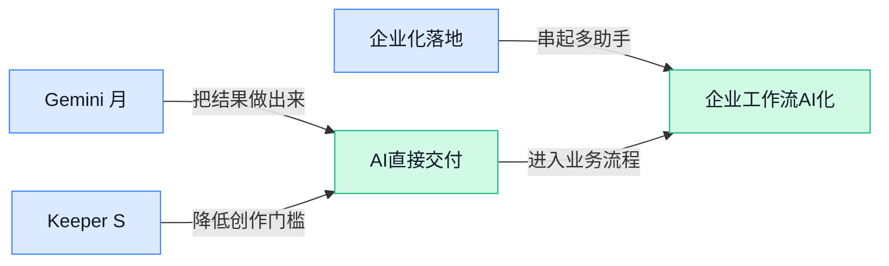

### 📊 行业洞察（今日 4 条）

1. Google称Gemini月活跃用户（每月至少使用一次）突破10亿。  
  【洞察】用户覆盖已成规模，但商业价值未明，因为该口径不代表付费。

2. Nvidia开源Flora（机器人视频标注工具），称成本低125倍。  
  【洞察】降本潜力较强，但仍需验证，因为其描述准确性偶有不足。

3. WeVisOne-VL（统一理解物体与像素的模型）尝试打通多层视觉感知。  
  【洞察】精细编辑基础在增强，但落地尚早，因为材料未给出产品化结果。

4. Grok发布人工智能生成的《Odyssey》前七分钟片段。  
  【洞察】长视频生成可用性提升，但创意仍弱，因为报道认为其缺少艺术性与人情味。

### 💭 对我们的启发（今日 3 条）

1. 借鉴Flora低成本视频标注，我们的智能体（按目标完成多步任务的软件）可强化素材识别与粗剪；机会是提效，风险是描述误差。

2. Grok发布《Odyssey》片段，提示产品加入分镜重排与人工精修入口；机会是缩短成片周期，风险是内容同质化。

3. WeVisOne-VL（同时理解物体与像素）可支持主体分离；机会是减少手工选区，风险是边界识别不稳。

