## AI资讯日报 2026/10/27

> AI 早报 · 每日早读 · 全网深度聚合

## **今日摘要**

```
Anthropic重磅提交S-1（上市注册文件），披露模型训练曾停摆整整一个月
OpenAI GPT-6.1 Terra（低成本大模型）正式亮相，接口价格直接减半
Meta拟出售最多950亿美元股票为AI扩建筹资，OpenAI公布三项科研新发现
```

### 🔵 产品与功能更新

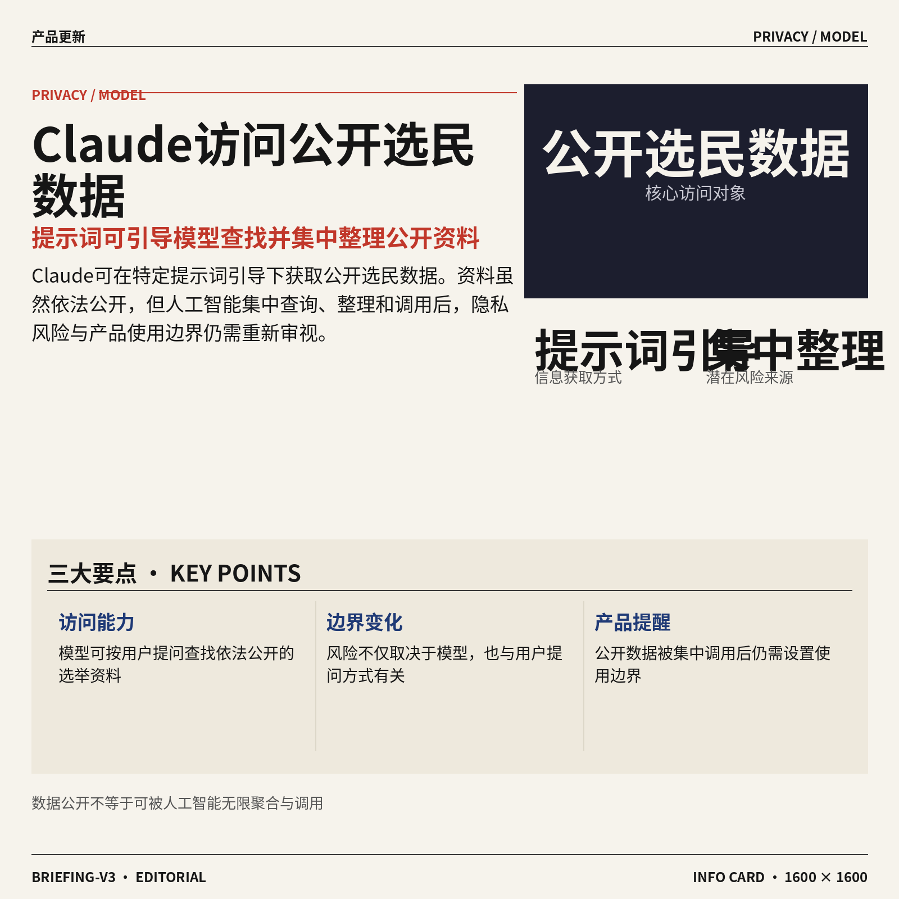

1. **Anthropic 称 Claude 可在提示词引导下访问公开选民数据。**
Anthropic 表示，Claude 能在用户提示词引导下获取**公开选民数据**（依法向公众开放、可供查询的选举相关资料）。这里的**提示词引导**（通过特定提问方式让模型寻找并整理信息）说明，AI 的信息获取边界不仅取决于模型本身，也与用户如何提问有关 🔍。这件事再次提醒产品团队：即使数据原本公开，AI 对其进行集中整理和调用时，仍值得关注使用边界与风险。[选民数据完整报道(briefing)](https://news.google.com/rss/articles/CBMiswFBVV95cUxOUmVwVGx2VUR4dlU5eXhnb193Sy1DZ0tBR1JlNnpxZU9Sc056ZGhoVFM5M09lWDhzSmQ3RDZsVHRIRDQzcURIVkpaMnVHcmZucVBUbHdUWHRBeHpCbXl6RlI0Tjc0VWthZmZDVDhuS25BdkpvU3h1V2pvOEMxMjdTWkhfal9HVENVeDZWVnJQNkgybC15TndkcFJCTFhTemxjUXVRS2VNVHJtdGpPaW0xaW9jcw?oc=5)


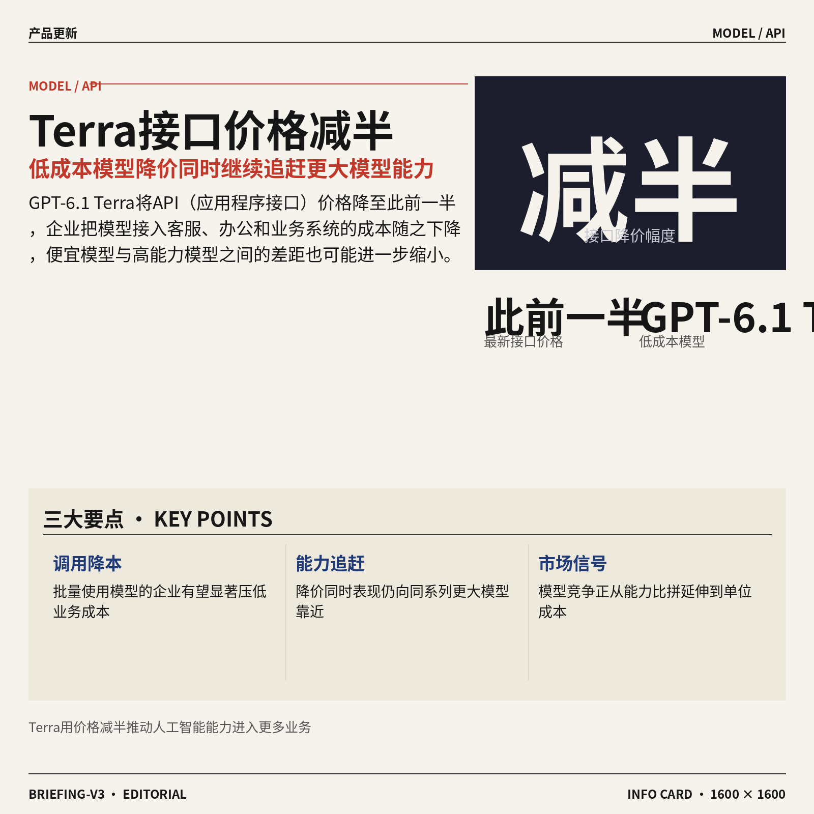

2. **GPT-6.1 Terra（主打低调用成本的 OpenAI 模型）将接口价格减半。**
报道显示，**GPT-6.1 Terra** 的接口价格降至此前的一半，让企业批量调用模型时有机会进一步压低成本 💰。这里的 **API（应用程序接口，让不同软件自动调用模型能力）**，可以理解为企业把 AI 接进客服、办公或业务系统的“标准插座”。更值得注意的是，该模型在价格下降的同时，表现仍在向同系列更大的模型靠近，意味着“便宜”和“能力”之间的取舍可能继续缩小 🚀。[模型定价完整报道(briefing)](https://the-decoder.com/gpt-6-1-terra-halves-openais-api-prices-and-still-gains-ground-on-its-larger-models/)


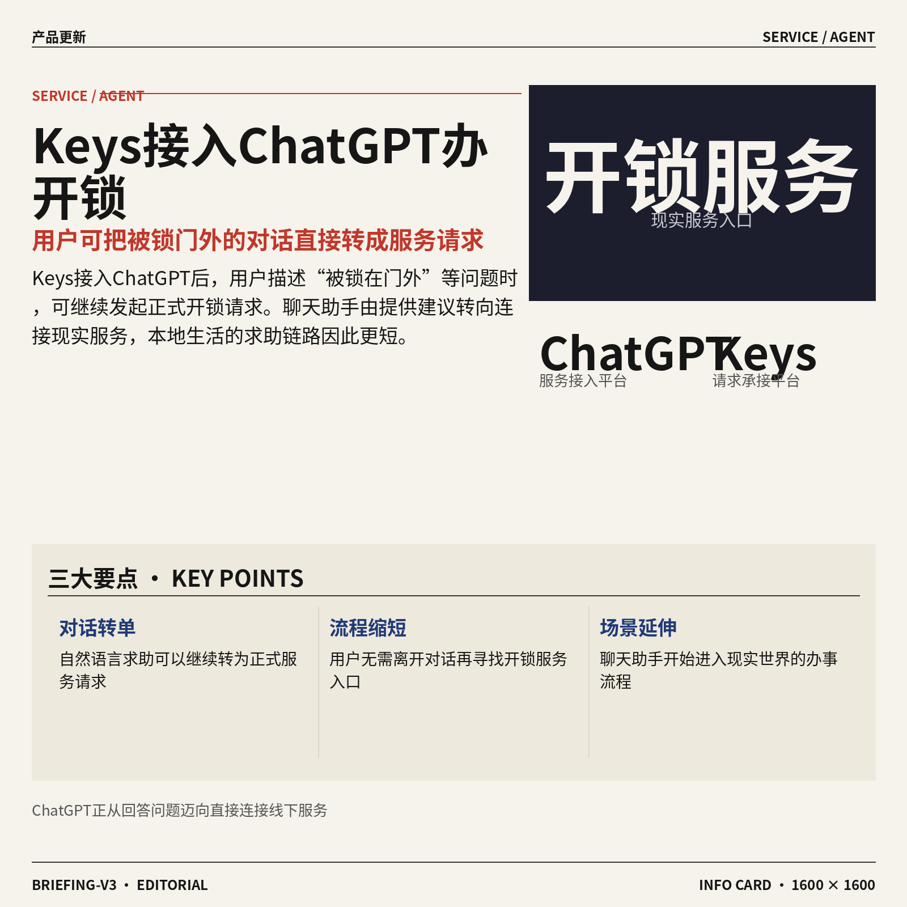

3. **Keys（把求助转成开锁服务请求的平台）接入 ChatGPT。**
Keys 已在 ChatGPT 中上线，用户表达“被锁在门外”等需求时，可将对话进一步转成**开锁服务请求** 🔑。这种**服务接入**（把第三方办事入口嵌入聊天工具）让 ChatGPT 不再只是提供建议，还能成为连接现实服务的入口。对本地生活服务而言，这意味着用户从描述问题到发起正式求助的流程有望更直接，也展示了聊天助手向实际办事场景延伸的方向。[服务上线相关报道(briefing)](https://news.google.com/rss/articles/CBMizAFBVV95cUxQUkdxZzlVYVcyekdDX2VTZTEzY2JDZ1BvdWpvT3V4dW1XdklyYmNlWTN1S3J4YVVvS1Nwdk00cFpqNWRnbUNMMDBsQlI0MWVwSVdnZTdnNXpwY3RUTHJhZmpxS1IzUjBNY1dlOWJCZVBOQ3hVai1Xa0NxUWlYWlE3ZTdScVNiMG5YN19ESE1fTW5IVTYxakV4SVk0dGRULXdlN1V0WGVCRTZwV0c1T1NZNmJpVG1CUHM5WXJlWWhubXhWMlRxb3JKdUlOQWk?oc=5)


### 🟢 前沿研究

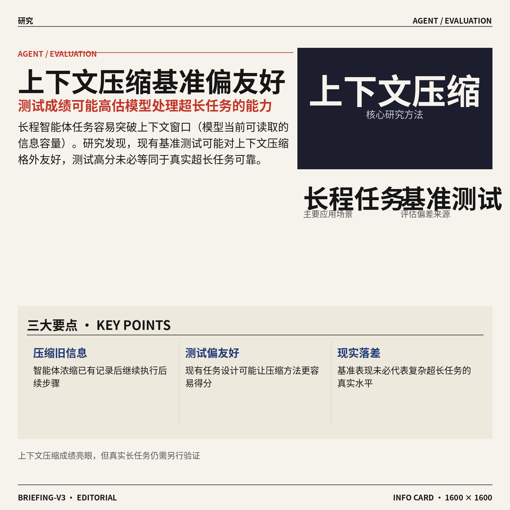

1. **基准测试意外适合上下文压缩（把旧信息浓缩后为模型腾空间）。**
需要连续执行许多步骤的**长程智能体任务**，可能超出大模型一次能够读取的上下文窗口（模型当前能记住的信息容量）。研究关注上下文压缩，即由智能体运行框架整理或浓缩已有记录，再继续完成任务。论文标题指出，现有**基准测试**（用统一任务衡量模型能力的测试集）对这种压缩出乎意料地友好，这也提示研究者需要谨慎判断测试成绩能否代表真实的超长任务表现 💡。[上下文压缩论文(briefing)](https://arxiv.org/abs/2610.31778)

![基准测试意外适合上下文压缩（把旧信息浓缩后为模型腾空间）](https://image.pollinations.ai/prompt/%E5%9F%BA%E5%87%86%E6%B5%8B%E8%AF%95%E6%84%8F%E5%A4%96%E9%80%82%E5%90%88%E4%B8%8A%E4%B8%8B%E6%96%87%E5%8E%8B%E7%BC%A9%EF%BC%88%E6%8A%8A%E6%97%A7%E4%BF%A1%E6%81%AF%E6%B5%93%E7%BC%A9%E5%90%8E%E4%B8%BA%E6%A8%A1%E5%9E%8B%E8%85%BE%E7%A9%BA%E9%97%B4%EF%BC%89.%20%E5%9F%BA%E5%87%86%E6%B5%8B%E8%AF%95%E6%84%8F%E5%A4%96%E9%80%82%E5%90%88%E4%B8%8A%E4%B8%8B%E6%96%87%E5%8E%8B%E7%BC%A9%EF%BC%88%E6%8A%8A%E6%97%A7%E4%BF%A1%E6%81%AF%E6%B5%93%E7%BC%A9%E5%90%8E%E4%B8%BA%E6%A8%A1%E5%9E%8B%E8%85%BE%E7%A9%BA%E9%97%B4%EF%BC%89%E3%80%82%20%E9%9C%80%E8%A6%81%E8%BF%9E%E7%BB%AD%E6%89%A7%E8%A1%8C%E8%AE%B8%E5%A4%9A%E6%AD%A5%E9%AA%A4%E7%9A%84%E9%95%BF%E7%A8%8B%E6%99%BA%E8%83%BD%E4%BD%93%E4%BB%BB%E5%8A%A1%EF%BC%8C%E5%8F%AF%E8%83%BD%E8%B6%85%E5%87%BA%E5%A4%A7%E6%A8%A1%E5%9E%8B%E4%B8%80%E6%AC%A1%E8%83%BD%E5%A4%9F%E8%AF%BB%E5%8F%96%E7%9A%84%E4%B8%8A%E4%B8%8B%E6%96%87%E7%AA%97%E5%8F%A3%EF%BC%88%E6%A8%A1%E5%9E%8B%E5%BD%93%E5%89%8D%E8%83%BD%E8%AE%B0%E4%BD%8F%E7%9A%84%E4%BF%A1%E6%81%AF%E5%AE%B9%2C%20technical%20infographic%20diagram%2C%20architecture%20flowchart%2C%20clean%20vector%20illustration%2C%20educational%20style%2C%20no%20text%20overlay%2C%20modern%20minimal%2C%20wide%20aspect?width=1200&height=675&nologo=true&seed=10807)

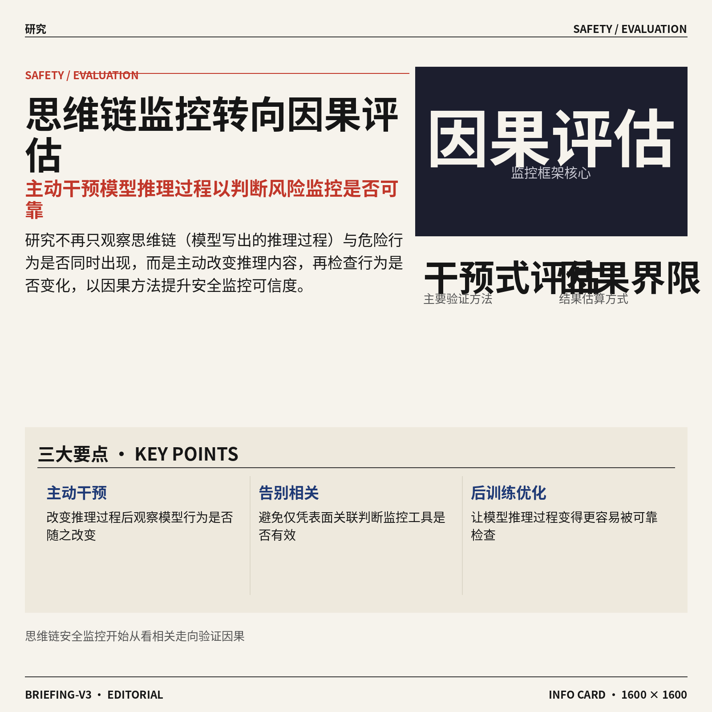

2. **思维链可监控性（从模型推理文字中发现风险）迎来因果评估框架。**
**思维链监控**是通过查看大模型写出的推理过程，识别其中可能存在的有害行为或危险意图。该研究引入**干预式评估**（主动改变模型推理过程，再观察行为是否随之变化），避免只凭表面相关性判断监控是否有效 🔍。论文还讨论了**因果界限**（从因果关系角度估算结果的上下范围）以及干预感知的后训练方案（基础训练完成后，再根据特定目标调整模型），重点是让模型的推理过程更容易被可靠检查。[思维链监控论文(briefing)](https://arxiv.org/abs/2610.31733)

![思维链可监控性（从模型推理文字中发现风险）迎来因果评估框架](https://image.pollinations.ai/prompt/%E6%80%9D%E7%BB%B4%E9%93%BE%E5%8F%AF%E7%9B%91%E6%8E%A7%E6%80%A7%EF%BC%88%E4%BB%8E%E6%A8%A1%E5%9E%8B%E6%8E%A8%E7%90%86%E6%96%87%E5%AD%97%E4%B8%AD%E5%8F%91%E7%8E%B0%E9%A3%8E%E9%99%A9%EF%BC%89%E8%BF%8E%E6%9D%A5%E5%9B%A0%E6%9E%9C%E8%AF%84%E4%BC%B0%E6%A1%86%E6%9E%B6.%20%E6%80%9D%E7%BB%B4%E9%93%BE%E5%8F%AF%E7%9B%91%E6%8E%A7%E6%80%A7%EF%BC%88%E4%BB%8E%E6%A8%A1%E5%9E%8B%E6%8E%A8%E7%90%86%E6%96%87%E5%AD%97%E4%B8%AD%E5%8F%91%E7%8E%B0%E9%A3%8E%E9%99%A9%EF%BC%89%E8%BF%8E%E6%9D%A5%E5%9B%A0%E6%9E%9C%E8%AF%84%E4%BC%B0%E6%A1%86%E6%9E%B6%E3%80%82%20%E6%80%9D%E7%BB%B4%E9%93%BE%E7%9B%91%E6%8E%A7%E6%98%AF%E9%80%9A%E8%BF%87%E6%9F%A5%E7%9C%8B%E5%A4%A7%E6%A8%A1%E5%9E%8B%E5%86%99%E5%87%BA%E7%9A%84%E6%8E%A8%E7%90%86%E8%BF%87%E7%A8%8B%EF%BC%8C%E8%AF%86%E5%88%AB%E5%85%B6%E4%B8%AD%E5%8F%AF%E8%83%BD%E5%AD%98%E5%9C%A8%E7%9A%84%E6%9C%89%E5%AE%B3%E8%A1%8C%E4%B8%BA%E6%88%96%E5%8D%B1%E9%99%A9%E6%84%8F%E5%9B%BE%E3%80%82%E8%AF%A5%E7%A0%94%E7%A9%B6%E5%BC%95%E5%85%A5%E5%B9%B2%E9%A2%84%E5%BC%8F%E8%AF%84%2C%20technical%20infographic%20diagram%2C%20architecture%20flowchart%2C%20clean%20vector%20illustration%2C%20educational%20style%2C%20no%20text%20overlay%2C%20modern%20minimal%2C%20wide%20aspect?width=1200&height=675&nologo=true&seed=10838)

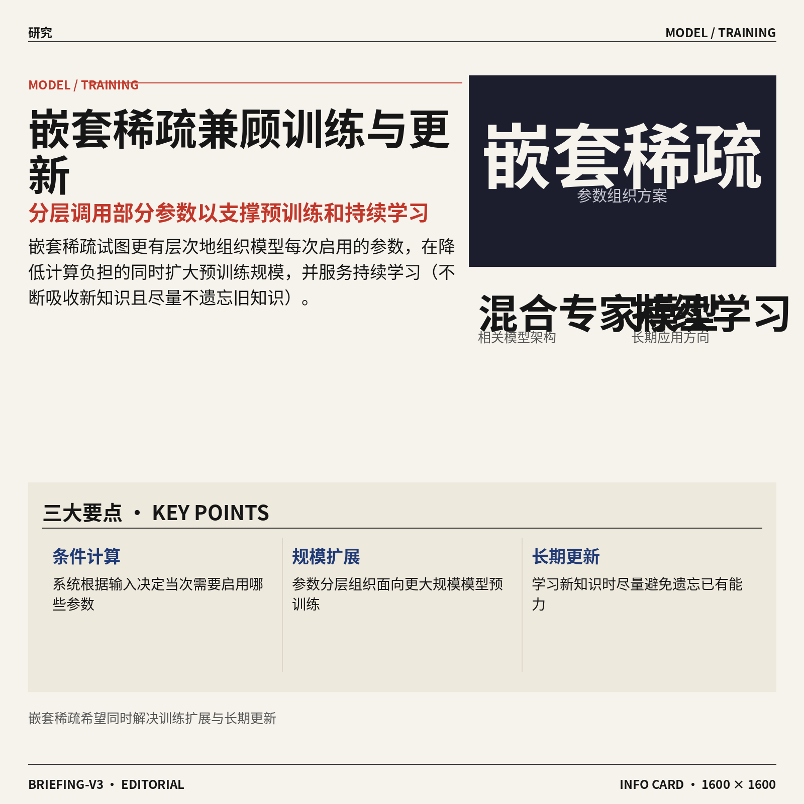

3. **嵌套稀疏（让模型分层只调用部分参数）瞄准大规模预训练与持续学习。**
现代大模型常使用**混合专家模型**（由多个“小专家”分工、每次只调用其中一部分）降低单次计算量，其核心是条件计算（根据输入决定启用哪些参数）。这篇论文提出嵌套稀疏思路，研究如何进一步组织这些被选择的参数，以支持更大规模的预训练 🚀。它还面向**持续学习**（模型上线后不断学习新知识，同时尽量避免忘掉旧知识）场景，试图把训练扩展能力与长期更新放进同一套设计中。[嵌套稀疏论文(briefing)](https://arxiv.org/abs/2610.31818)

![嵌套稀疏（让模型分层只调用部分参数）瞄准大规模预训练与持续学习](https://image.pollinations.ai/prompt/%E5%B5%8C%E5%A5%97%E7%A8%80%E7%96%8F%EF%BC%88%E8%AE%A9%E6%A8%A1%E5%9E%8B%E5%88%86%E5%B1%82%E5%8F%AA%E8%B0%83%E7%94%A8%E9%83%A8%E5%88%86%E5%8F%82%E6%95%B0%EF%BC%89%E7%9E%84%E5%87%86%E5%A4%A7%E8%A7%84%E6%A8%A1%E9%A2%84%E8%AE%AD%E7%BB%83%E4%B8%8E%E6%8C%81%E7%BB%AD%E5%AD%A6%E4%B9%A0.%20%E5%B5%8C%E5%A5%97%E7%A8%80%E7%96%8F%EF%BC%88%E8%AE%A9%E6%A8%A1%E5%9E%8B%E5%88%86%E5%B1%82%E5%8F%AA%E8%B0%83%E7%94%A8%E9%83%A8%E5%88%86%E5%8F%82%E6%95%B0%EF%BC%89%E7%9E%84%E5%87%86%E5%A4%A7%E8%A7%84%E6%A8%A1%E9%A2%84%E8%AE%AD%E7%BB%83%E4%B8%8E%E6%8C%81%E7%BB%AD%E5%AD%A6%E4%B9%A0%E3%80%82%20%E7%8E%B0%E4%BB%A3%E5%A4%A7%E6%A8%A1%E5%9E%8B%E5%B8%B8%E4%BD%BF%E7%94%A8%E6%B7%B7%E5%90%88%E4%B8%93%E5%AE%B6%E6%A8%A1%E5%9E%8B%EF%BC%88%E7%94%B1%E5%A4%9A%E4%B8%AA%E2%80%9C%E5%B0%8F%E4%B8%93%E5%AE%B6%E2%80%9D%E5%88%86%E5%B7%A5%E3%80%81%E6%AF%8F%E6%AC%A1%E5%8F%AA%E8%B0%83%E7%94%A8%E5%85%B6%E4%B8%AD%E4%B8%80%E9%83%A8%E5%88%86%EF%BC%89%E9%99%8D%E4%BD%8E%E5%8D%95%E6%AC%A1%E8%AE%A1%E7%AE%97%E9%87%8F%EF%BC%8C%E5%85%B6%E6%A0%B8%2C%20technical%20infographic%20diagram%2C%20architecture%20flowchart%2C%20clean%20vector%20illustration%2C%20educational%20style%2C%20no%20text%20overlay%2C%20modern%20minimal%2C%20wide%20aspect?width=1200&height=675&nologo=true&seed=10869)

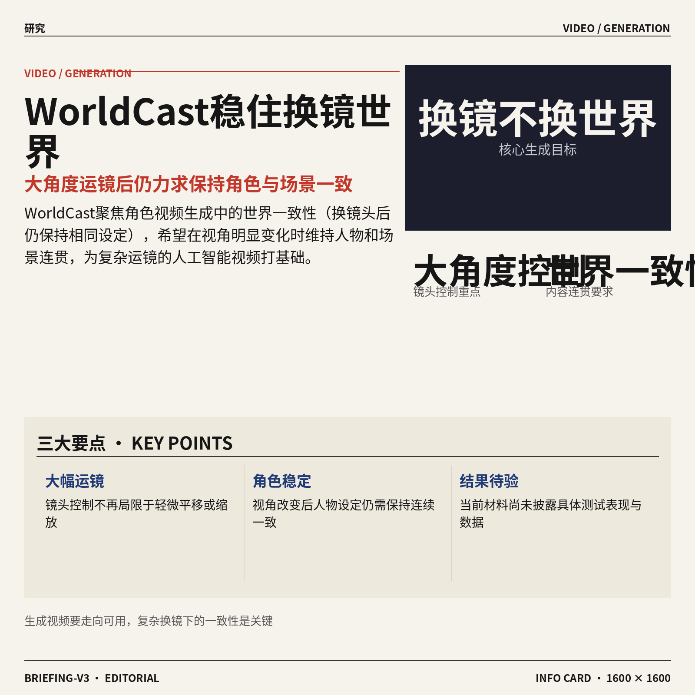

4. **WorldCast（支持大角度镜头控制的角色视频生成方案）探索“换镜头不换世界”。**
这项研究聚焦带有角色的人工智能视频生成，并强调**世界一致性**（镜头变化后，角色与场景仍保持同一设定）🎬。其另一重点是大角度摄像机控制，即让视角发生明显变化，而不只是进行轻微平移或缩放。对视频创作者而言，这类研究瞄准的是生成内容在复杂运镜下的连贯性；不过当前候选材料仅给出研究主题，尚未提供具体测试结果。[世界一致视频论文(briefing)](https://huggingface.co/papers/2610.33135)

![WorldCast（支持大角度镜头控制的角色视频生成方案）探索“换镜头不换世界”](https://image.pollinations.ai/prompt/WorldCast%EF%BC%88%E6%94%AF%E6%8C%81%E5%A4%A7%E8%A7%92%E5%BA%A6%E9%95%9C%E5%A4%B4%E6%8E%A7%E5%88%B6%E7%9A%84%E8%A7%92%E8%89%B2%E8%A7%86%E9%A2%91%E7%94%9F%E6%88%90%E6%96%B9%E6%A1%88%EF%BC%89%E6%8E%A2%E7%B4%A2%E2%80%9C%E6%8D%A2%E9%95%9C%E5%A4%B4%E4%B8%8D%E6%8D%A2%E4%B8%96%E7%95%8C%E2%80%9D.%20WorldCast%EF%BC%88%E6%94%AF%E6%8C%81%E5%A4%A7%E8%A7%92%E5%BA%A6%E9%95%9C%E5%A4%B4%E6%8E%A7%E5%88%B6%E7%9A%84%E8%A7%92%E8%89%B2%E8%A7%86%E9%A2%91%E7%94%9F%E6%88%90%E6%96%B9%E6%A1%88%EF%BC%89%E6%8E%A2%E7%B4%A2%E2%80%9C%E6%8D%A2%E9%95%9C%E5%A4%B4%E4%B8%8D%E6%8D%A2%E4%B8%96%E7%95%8C%E2%80%9D%E3%80%82%20%E8%BF%99%E9%A1%B9%E7%A0%94%E7%A9%B6%E8%81%9A%E7%84%A6%E5%B8%A6%E6%9C%89%E8%A7%92%E8%89%B2%E7%9A%84%E4%BA%BA%E5%B7%A5%E6%99%BA%E8%83%BD%E8%A7%86%E9%A2%91%E7%94%9F%E6%88%90%EF%BC%8C%E5%B9%B6%E5%BC%BA%E8%B0%83%E4%B8%96%E7%95%8C%E4%B8%80%E8%87%B4%E6%80%A7%EF%BC%88%E9%95%9C%E5%A4%B4%E5%8F%98%E5%8C%96%E5%90%8E%EF%BC%8C%E8%A7%92%E8%89%B2%E4%B8%8E%2C%20technical%20infographic%20diagram%2C%20architecture%20flowchart%2C%20clean%20vector%20illustration%2C%20educational%20style%2C%20no%20text%20overlay%2C%20modern%20minimal%2C%20wide%20aspect?width=1200&height=675&nologo=true&seed=10900)

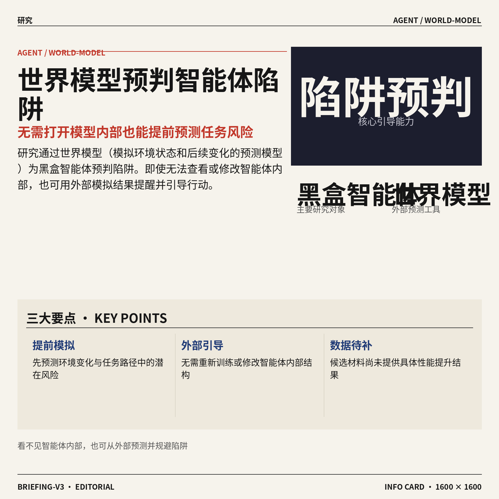

5. **“陷阱预判世界模型”（提前模拟任务风险的内部预测机制）尝试引导黑盒智能体。**
研究对象是**黑盒大模型智能体**（只能观察输入和输出、无法查看或修改内部结构的智能体）。论文提出利用世界模型（在内部模拟环境状态及后续变化的预测模型）提前判断任务中可能出现的陷阱，再据此引导智能体行动 🧭。这一方向的意义在于，即使无法重新训练或打开模型内部，也可能通过外部预测与提醒改善其决策；但候选材料未披露具体性能数据。[黑盒智能体论文(briefing)](https://huggingface.co/papers/2610.29139)

![“陷阱预判世界模型”（提前模拟任务风险的内部预测机制）尝试引导黑盒智能体](https://image.pollinations.ai/prompt/%E2%80%9C%E9%99%B7%E9%98%B1%E9%A2%84%E5%88%A4%E4%B8%96%E7%95%8C%E6%A8%A1%E5%9E%8B%E2%80%9D%EF%BC%88%E6%8F%90%E5%89%8D%E6%A8%A1%E6%8B%9F%E4%BB%BB%E5%8A%A1%E9%A3%8E%E9%99%A9%E7%9A%84%E5%86%85%E9%83%A8%E9%A2%84%E6%B5%8B%E6%9C%BA%E5%88%B6%EF%BC%89%E5%B0%9D%E8%AF%95%E5%BC%95%E5%AF%BC%E9%BB%91%E7%9B%92%E6%99%BA%E8%83%BD%E4%BD%93.%20%E2%80%9C%E9%99%B7%E9%98%B1%E9%A2%84%E5%88%A4%E4%B8%96%E7%95%8C%E6%A8%A1%E5%9E%8B%E2%80%9D%EF%BC%88%E6%8F%90%E5%89%8D%E6%A8%A1%E6%8B%9F%E4%BB%BB%E5%8A%A1%E9%A3%8E%E9%99%A9%E7%9A%84%E5%86%85%E9%83%A8%E9%A2%84%E6%B5%8B%E6%9C%BA%E5%88%B6%EF%BC%89%E5%B0%9D%E8%AF%95%E5%BC%95%E5%AF%BC%E9%BB%91%E7%9B%92%E6%99%BA%E8%83%BD%E4%BD%93%E3%80%82%20%E7%A0%94%E7%A9%B6%E5%AF%B9%E8%B1%A1%E6%98%AF%E9%BB%91%E7%9B%92%E5%A4%A7%E6%A8%A1%E5%9E%8B%E6%99%BA%E8%83%BD%E4%BD%93%EF%BC%88%E5%8F%AA%E8%83%BD%E8%A7%82%E5%AF%9F%E8%BE%93%E5%85%A5%E5%92%8C%E8%BE%93%E5%87%BA%E3%80%81%E6%97%A0%E6%B3%95%E6%9F%A5%E7%9C%8B%E6%88%96%E4%BF%AE%E6%94%B9%E5%86%85%E9%83%A8%E7%BB%93%E6%9E%84%E7%9A%84%E6%99%BA%E8%83%BD%E4%BD%93%EF%BC%89%E3%80%82%E8%AE%BA%2C%20technical%20infographic%20diagram%2C%20architecture%20flowchart%2C%20clean%20vector%20illustration%2C%20educational%20style%2C%20no%20text%20overlay%2C%20modern%20minimal%2C%20wide%20aspect?width=1200&height=675&nologo=true&seed=10931)

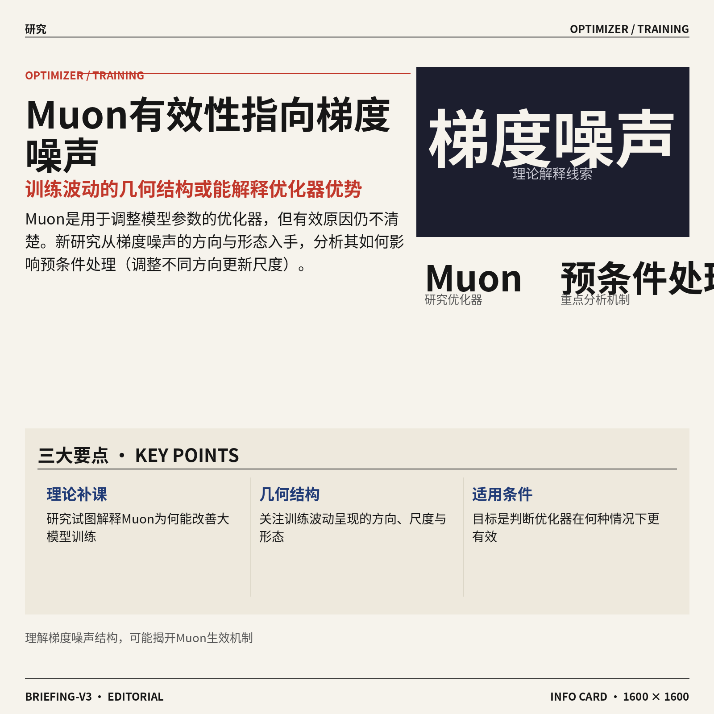

6. **Muon（一种用于训练大模型的优化器）为何有效，可能与梯度噪声结构有关。**
Muon 已成为大模型训练中受到关注的**优化器**（根据误差不断调整模型参数的计算规则），但其理论基础仍不够清楚。论文研究梯度噪声的几何结构，即训练数据带来的参数调整波动呈现怎样的方向与形态。作者重点分析这种结构如何影响 Muon 的**预条件处理**（先调整不同方向的更新尺度，让训练更稳定或高效）🔬，试图从底层解释它在什么情况下会发挥作用。[优化器原理论文(briefing)](https://arxiv.org/abs/2610.31728)

![Muon（一种用于训练大模型的优化器）为何有效，可能与梯度噪声结构有关](https://image.pollinations.ai/prompt/Muon%EF%BC%88%E4%B8%80%E7%A7%8D%E7%94%A8%E4%BA%8E%E8%AE%AD%E7%BB%83%E5%A4%A7%E6%A8%A1%E5%9E%8B%E7%9A%84%E4%BC%98%E5%8C%96%E5%99%A8%EF%BC%89%E4%B8%BA%E4%BD%95%E6%9C%89%E6%95%88%EF%BC%8C%E5%8F%AF%E8%83%BD%E4%B8%8E%E6%A2%AF%E5%BA%A6%E5%99%AA%E5%A3%B0%E7%BB%93%E6%9E%84%E6%9C%89%E5%85%B3.%20Muon%EF%BC%88%E4%B8%80%E7%A7%8D%E7%94%A8%E4%BA%8E%E8%AE%AD%E7%BB%83%E5%A4%A7%E6%A8%A1%E5%9E%8B%E7%9A%84%E4%BC%98%E5%8C%96%E5%99%A8%EF%BC%89%E4%B8%BA%E4%BD%95%E6%9C%89%E6%95%88%EF%BC%8C%E5%8F%AF%E8%83%BD%E4%B8%8E%E6%A2%AF%E5%BA%A6%E5%99%AA%E5%A3%B0%E7%BB%93%E6%9E%84%E6%9C%89%E5%85%B3%E3%80%82%20Muon%20%E5%B7%B2%E6%88%90%E4%B8%BA%E5%A4%A7%E6%A8%A1%E5%9E%8B%E8%AE%AD%E7%BB%83%E4%B8%AD%E5%8F%97%E5%88%B0%E5%85%B3%E6%B3%A8%E7%9A%84%E4%BC%98%E5%8C%96%E5%99%A8%EF%BC%88%E6%A0%B9%E6%8D%AE%E8%AF%AF%E5%B7%AE%E4%B8%8D%E6%96%AD%E8%B0%83%E6%95%B4%E6%A8%A1%E5%9E%8B%E5%8F%82%E6%95%B0%E7%9A%84%E8%AE%A1%E7%AE%97%E8%A7%84%E5%88%99%EF%BC%89%EF%BC%8C%E4%BD%86%2C%20technical%20infographic%20diagram%2C%20architecture%20flowchart%2C%20clean%20vector%20illustration%2C%20educational%20style%2C%20no%20text%20overlay%2C%20modern%20minimal%2C%20wide%20aspect?width=1200&height=675&nologo=true&seed=10962)

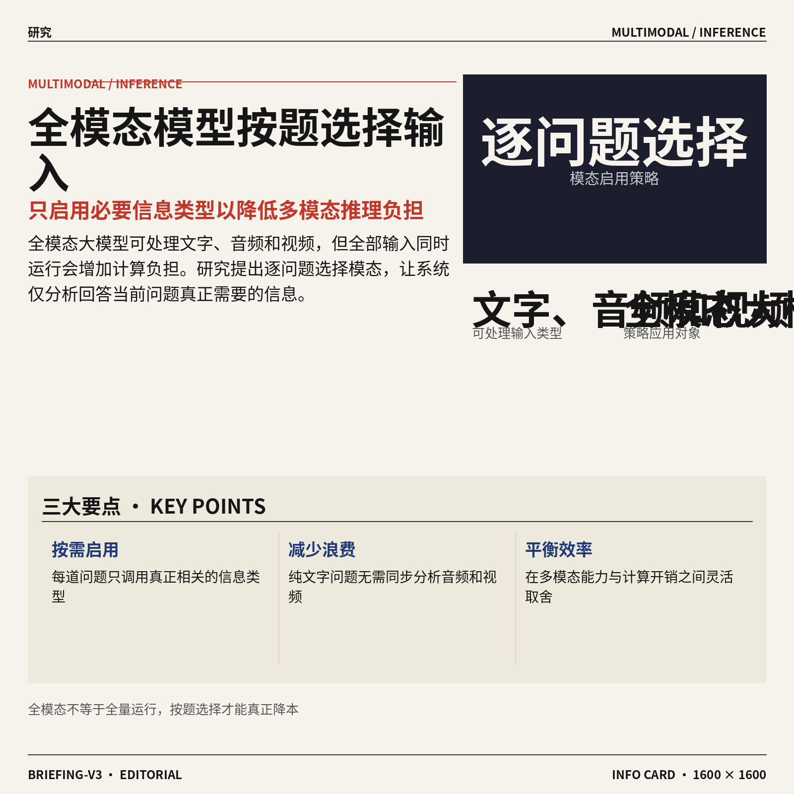

7. **全模态大模型（同时处理文字、音频和视频的模型）可按问题选择输入类型。**
全模态大模型能够联合处理文字、音频和视频，因此具备更广泛的理解与推理能力，但处理所有信息也会带来较重的推理负担。论文提出**逐问题模态选择**（根据每个问题，只启用真正需要的信息类型），以提升模型推理（让训练好的模型生成答案的过程）的效率 ⚡。简单来说，如果一道问题只需看文字，系统就不必同时分析音频和视频；这一思路试图在多模态能力与计算开销之间取得更灵活的平衡。[全模态推理论文(briefing)](https://arxiv.org/abs/2610.31768)

![全模态大模型（同时处理文字、音频和视频的模型）可按问题选择输入类型](https://image.pollinations.ai/prompt/%E5%85%A8%E6%A8%A1%E6%80%81%E5%A4%A7%E6%A8%A1%E5%9E%8B%EF%BC%88%E5%90%8C%E6%97%B6%E5%A4%84%E7%90%86%E6%96%87%E5%AD%97%E3%80%81%E9%9F%B3%E9%A2%91%E5%92%8C%E8%A7%86%E9%A2%91%E7%9A%84%E6%A8%A1%E5%9E%8B%EF%BC%89%E5%8F%AF%E6%8C%89%E9%97%AE%E9%A2%98%E9%80%89%E6%8B%A9%E8%BE%93%E5%85%A5%E7%B1%BB%E5%9E%8B.%20%E5%85%A8%E6%A8%A1%E6%80%81%E5%A4%A7%E6%A8%A1%E5%9E%8B%EF%BC%88%E5%90%8C%E6%97%B6%E5%A4%84%E7%90%86%E6%96%87%E5%AD%97%E3%80%81%E9%9F%B3%E9%A2%91%E5%92%8C%E8%A7%86%E9%A2%91%E7%9A%84%E6%A8%A1%E5%9E%8B%EF%BC%89%E5%8F%AF%E6%8C%89%E9%97%AE%E9%A2%98%E9%80%89%E6%8B%A9%E8%BE%93%E5%85%A5%E7%B1%BB%E5%9E%8B%E3%80%82%20%E5%85%A8%E6%A8%A1%E6%80%81%E5%A4%A7%E6%A8%A1%E5%9E%8B%E8%83%BD%E5%A4%9F%E8%81%94%E5%90%88%E5%A4%84%E7%90%86%E6%96%87%E5%AD%97%E3%80%81%E9%9F%B3%E9%A2%91%E5%92%8C%E8%A7%86%E9%A2%91%EF%BC%8C%E5%9B%A0%E6%AD%A4%E5%85%B7%E5%A4%87%E6%9B%B4%E5%B9%BF%E6%B3%9B%E7%9A%84%E7%90%86%E8%A7%A3%E4%B8%8E%E6%8E%A8%E7%90%86%E8%83%BD%E5%8A%9B%EF%BC%8C%E4%BD%86%E5%A4%84%E7%90%86%E6%89%80%E6%9C%89%E4%BF%A1%E6%81%AF%E4%B9%9F%2C%20technical%20infographic%20diagram%2C%20architecture%20flowchart%2C%20clean%20vector%20illustration%2C%20educational%20style%2C%20no%20text%20overlay%2C%20modern%20minimal%2C%20wide%20aspect?width=1200&height=675&nologo=true&seed=10993)

### 🟡 行业展望与社会影响

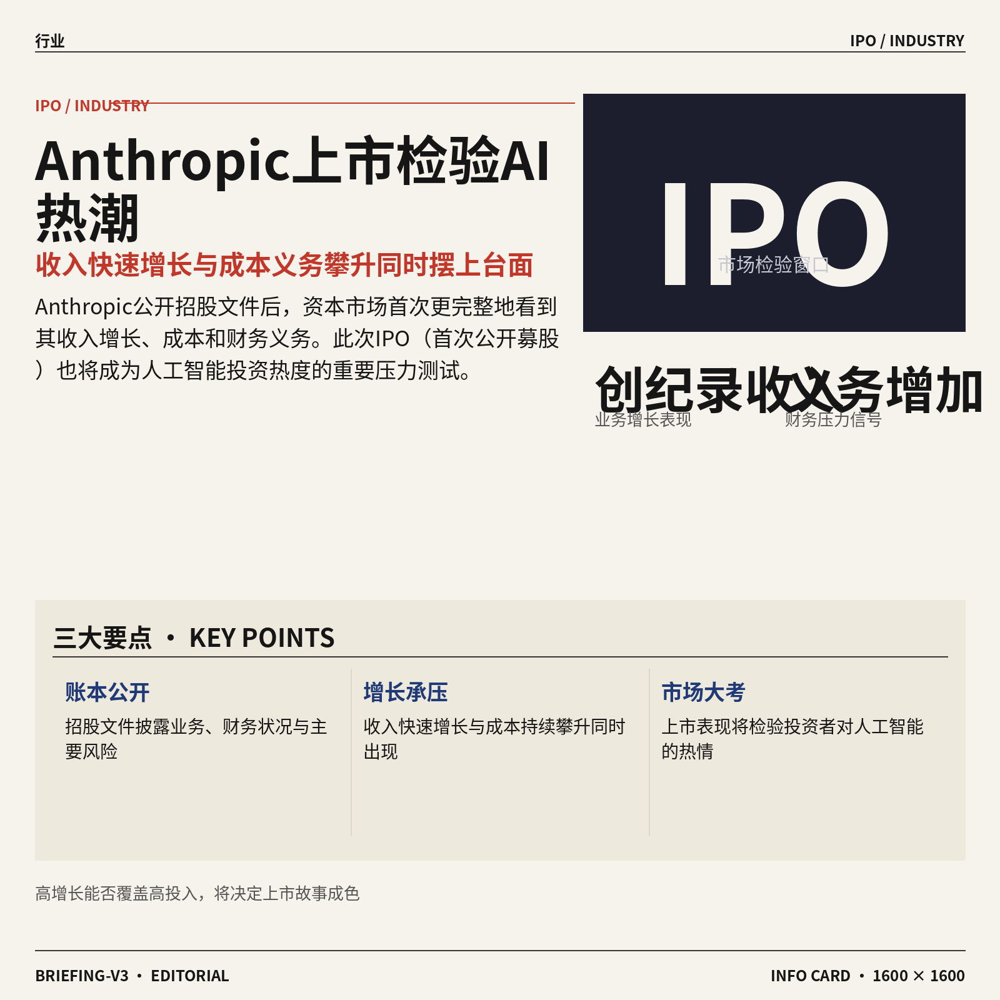

1. **Anthropic IPO（首次公开募股）将检验人工智能投资热潮。**
Anthropic 向华尔街公开招股文件（公司上市前披露业务、财务和风险的正式材料），展现出**收入快速增长**与**成本持续攀升**并存的局面。相关材料还显示，公司取得创纪录收入的同时，承担的财务义务也在增加，[财务状况解读(briefing)](https://the-decoder.com/anthropic-opens-its-books-for-wall-street-showing-record-revenue-and-mounting-obligations/)值得关注。消息推动人工智能概念股（业务与人工智能密切相关的上市公司股票）上涨，但投资者仍保持谨慎，这次上市也因此成为市场检验行业热度的重要窗口 🚀。[路透市场观察(briefing)](https://news.google.com/rss/articles/CBMixAFBVV95cUxQNVdGRWF4eUpFNlQ2QkxGSWVrdlZZMU9OVlgtNkduS1JrMVdzQ0VJRVJPak4xcERFNENPWGE3YUM3VHpSSnFybzZJRWRTSW53eWwzTW1jLTR5dmpjelcxam96czEycUZ3a1piY2kwcC15WTR3ZFJUeGdIUkxuLXl6b0d4dGJ0T0hWcUl0ejVSMzI1UlpJdzRnZ09Td05wRDlJbVJaT0ktM3Z4Q2ZNdnNSWnA1bkZGVl9iYVI1TEtCc0VhRjRJ?oc=5)


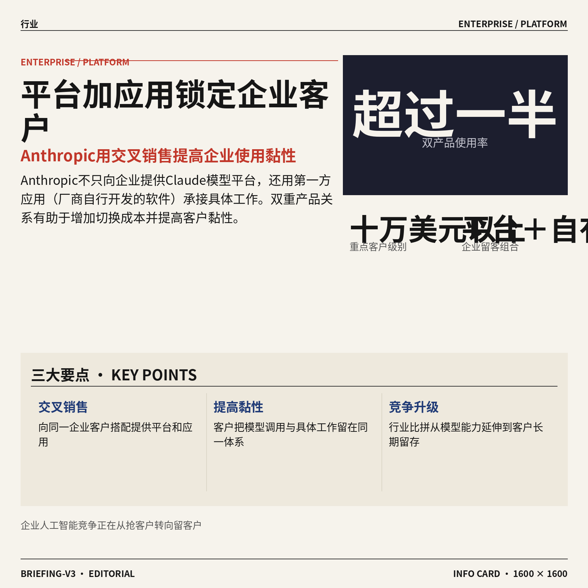

2. **Anthropic 用“平台＋自有应用”提高企业客户黏性。**
招股文件显示，在 Anthropic 的**十万美元以上级别客户**中，超过一半同时使用 Claude 平台和第一方应用（由厂商自行开发、直接提供给客户的软件）。这是一种交叉销售（向同一客户搭配销售多种产品）的打法：企业一边调用模型能力，一边把具体工作放进 Anthropic 自己的应用中。[企业客户策略解析(briefing)](https://techcrunch.com/2026/10/26/anthropics-ipo-filing-reveals-its-strategy-for-keeping-enterprise-customers-hooked/) 报道认为，这套思路与亚马逊相似，重点不只是获得客户，更是让客户持续使用多项产品 💡。对行业而言，竞争正从“谁的模型更强”延伸到“谁能把企业客户长期留在自己的产品体系里”。


3. **Anthropic 披露长达一个月的模型训练暂停与安全事件。**
Anthropic 在上市文件中披露，公司曾暂停模型训练（让模型从大量数据中学习能力的过程）长达一个月，同时还出现过**人工智能安全事件**（模型或相关系统的安全防线出现问题）。[安全披露报道(briefing)](https://news.google.com/rss/articles/CBMiygFBVV95cUxQWUlrWDlwMnBvb2RvQ1ZTVHpNdEFETnkycHVyVnlJNDVqdnNJRVo3MTZEZGxfbHFjczk2YmJVc2lqb25kZnZtcDhObmFYZ3BoMmtZUi02ZkNBTFZLMEE1VHE4clRXbWJSQTE3MWNMRFNSNDQ3c0tZeWRTdUZDODEyQWFnRlgwLVdkVnctalBhTEE1SjNQRk04REtWQ2VNOGk0c0ZnS2JvZkNjX3VfSWFaZjNBbExVOEYxS0dSRzc5azFFR3ltb2hqOHNn?oc=5)把这些信息与上市材料放在一起，也意味着投资者可以更直接地评估其运营稳定性与风险管理能力。对于高速扩张的模型公司来说，训练进度不仅影响产品迭代，安全治理（识别、控制并持续处理潜在风险的管理体系）也会成为资本市场的重要考题 ⚠️。


4. **Meta 计划出售最多950亿美元股票，为人工智能扩建筹资。**
Meta 计划通过股票出售（以出售股份方式获得资金的融资安排），最多筹集**950亿美元**，用于推进人工智能建设。[融资计划报道(briefing)](https://the-decoder.com/meta-plans-up-to-95-billion-in-stock-sales-to-fund-its-ai-buildout/) 这一规模反映出人工智能基础设施（支撑模型训练和运行的硬件、系统与配套资源）需要庞大资金投入 💰。对市场而言，关注点不仅是 Meta 能否继续扩张，还包括如此大规模的融资将如何影响投资者对人工智能投入成本与回报的判断。

![Meta 计划出售最多950亿美元股票，为人工智能扩建筹资](https://image.pollinations.ai/prompt/Meta%20%E8%AE%A1%E5%88%92%E5%87%BA%E5%94%AE%E6%9C%80%E5%A4%9A950%E4%BA%BF%E7%BE%8E%E5%85%83%E8%82%A1%E7%A5%A8%EF%BC%8C%E4%B8%BA%E4%BA%BA%E5%B7%A5%E6%99%BA%E8%83%BD%E6%89%A9%E5%BB%BA%E7%AD%B9%E8%B5%84.%20Meta%20%E8%AE%A1%E5%88%92%E5%87%BA%E5%94%AE%E6%9C%80%E5%A4%9A950%E4%BA%BF%E7%BE%8E%E5%85%83%E8%82%A1%E7%A5%A8%EF%BC%8C%E4%B8%BA%E4%BA%BA%E5%B7%A5%E6%99%BA%E8%83%BD%E6%89%A9%E5%BB%BA%E7%AD%B9%E8%B5%84%E3%80%82%20Meta%20%E8%AE%A1%E5%88%92%E9%80%9A%E8%BF%87%E8%82%A1%E7%A5%A8%E5%87%BA%E5%94%AE%EF%BC%88%E4%BB%A5%E5%87%BA%E5%94%AE%E8%82%A1%E4%BB%BD%E6%96%B9%E5%BC%8F%E8%8E%B7%E5%BE%97%E8%B5%84%E9%87%91%E7%9A%84%E8%9E%8D%E8%B5%84%E5%AE%89%E6%8E%92%EF%BC%89%EF%BC%8C%E6%9C%80%E5%A4%9A%E7%AD%B9%E9%9B%86950%E4%BA%BF%E7%BE%8E%E5%85%83%EF%BC%8C%E7%94%A8%E4%BA%8E%E6%8E%A8%E8%BF%9B%E4%BA%BA%E5%B7%A5%2C%20technical%20infographic%20diagram%2C%20architecture%20flowchart%2C%20clean%20vector%20illustration%2C%20educational%20style%2C%20no%20text%20overlay%2C%20modern%20minimal%2C%20wide%20aspect?width=1200&height=675&nologo=true&seed=10900)

### 🟣 开源TOP项目

1. **Postiz（智能体式社交媒体排程工具）主打自动安排内容。**  
该项目定位为一款**智能体式工具**（人工智能围绕目标主动执行任务，而不只是提供建议），重点服务社交媒体内容安排 🤖。它聚焦**社交媒体排程**（提前规划内容及其发布时间），让人工智能参与日常发布流程。从项目介绍来看，其核心方向就是把智能体能力与社媒运营结合起来，感兴趣的同事可查看[开源项目仓库(briefing)](https://github.com/gitroomhq/postiz-app) 🚀。


2. **OpenBot（本地优先的桌面智能协作空间）让多个智能助手协同工作。**  
OpenBot 采用**本地优先**（主要围绕用户自己的电脑组织和运行工作）的设计，为持续工作的人工智能队友提供独立空间 💻。用户可以在其中运行 Codex、Claude 和 Grok（可在该工作空间中运行的人工智能助手），并通过**任务队列**（把待办事项按顺序交给助手处理）管理工作。它还支持文件共享、浏览器控制及不同智能体之间的协作，目标是把多个助手集中到一个桌面工作环境中；具体功能可查看[开源项目仓库(briefing)](https://github.com/nightly-labs/openbot) 🤝。


### 🔴 社媒分享

1. **GPT-6.1 Terra（OpenAI 新发布的大模型）正式亮相。**
OpenAI 已上线该模型的[官方发布说明(briefing)](https://openai.com/index/introducing-gpt-6-1-terra/)，并同步提供[模型接口文档(briefing)](https://developers.openai.com/api/docs/models/gpt-6.1-terra)，方便其他软件接入模型能力。第三方观察指出，新模型发布时“官方重点强调什么”本身就值得关注，但现有摘要没有展示具体能力与**评测指标**（用统一测试衡量模型表现的数据）💡。在性能数字和使用场景进一步明确前，更适合先把它视为 OpenAI 的一次**模型版本更新**（对模型能力或使用方式进行升级），而不是急着下结论。[第三方观察文章(briefing)](https://simonwillison.net/2026/Oct/26/gpt-61-terra/)


2. **OpenAI 公布数学、计算机科学与物理领域的三项新发现。**
OpenAI 宣布与学术界合作，在三个基础研究领域取得新发现，相关信息汇总在[官方研究公告(briefing)](https://openai.com/index/building-scientific-understanding-with-academic-communities/)中 🔬。候选材料还关联到“**指数时间假设**”（计算复杂性领域的重要猜想，用来判断某些难题能否被大幅加速）可能被推翻的研究。这里的**计算复杂性**（研究一个问题需要多少计算时间和资源的理论领域）虽然离日常办公较远，却会影响人们对算法能力边界的理解。现有摘要没有展开三项发现的证明过程与完整结论，因此更适合作为后续关注学术原文的入口。

![OpenAI 公布数学、计算机科学与物理领域的三项新发现](https://image.pollinations.ai/prompt/OpenAI%20%E5%85%AC%E5%B8%83%E6%95%B0%E5%AD%A6%E3%80%81%E8%AE%A1%E7%AE%97%E6%9C%BA%E7%A7%91%E5%AD%A6%E4%B8%8E%E7%89%A9%E7%90%86%E9%A2%86%E5%9F%9F%E7%9A%84%E4%B8%89%E9%A1%B9%E6%96%B0%E5%8F%91%E7%8E%B0.%20OpenAI%20%E5%85%AC%E5%B8%83%E6%95%B0%E5%AD%A6%E3%80%81%E8%AE%A1%E7%AE%97%E6%9C%BA%E7%A7%91%E5%AD%A6%E4%B8%8E%E7%89%A9%E7%90%86%E9%A2%86%E5%9F%9F%E7%9A%84%E4%B8%89%E9%A1%B9%E6%96%B0%E5%8F%91%E7%8E%B0%E3%80%82%20OpenAI%20%E5%AE%A3%E5%B8%83%E4%B8%8E%E5%AD%A6%E6%9C%AF%E7%95%8C%E5%90%88%E4%BD%9C%EF%BC%8C%E5%9C%A8%E4%B8%89%E4%B8%AA%E5%9F%BA%E7%A1%80%E7%A0%94%E7%A9%B6%E9%A2%86%E5%9F%9F%E5%8F%96%E5%BE%97%E6%96%B0%E5%8F%91%E7%8E%B0%EF%BC%8C%E7%9B%B8%E5%85%B3%E4%BF%A1%E6%81%AF%E6%B1%87%E6%80%BB%E5%9C%A8%E5%AE%98%E6%96%B9%E7%A0%94%E7%A9%B6%E5%85%AC%E5%91%8A%28brief%2C%20technical%20infographic%20diagram%2C%20architecture%20flowchart%2C%20clean%20vector%20illustration%2C%20educational%20style%2C%20no%20text%20overlay%2C%20modern%20minimal%2C%20wide%20aspect?width=1200&height=675&nologo=true&seed=10644)

3. **vLLM（让大模型高效生成回答的开源推理引擎）着手修复工具调用准确率。**
这篇文章聚焦一个很实际的问题：模型能正常聊天，不代表它总能准确使用外部工具 🛠️。所谓**工具调用**（模型按规定格式连接搜索、数据库或其他软件功能），一旦参数或格式出错，自动化流程就可能直接中断。文章标题明确指向对调用准确率的修复，可从[完整技术文章(briefing)](https://www.ubicloud.com/blog/fixing-tool-call-accuracy-in-vllm)了解详情。候选摘要没有列出具体修复方案和测试结果，因此目前能确认的重点是：**推理引擎**（负责让训练好的模型真正运行并输出答案的软件）正在补齐模型落地时的可靠性短板。

![vLLM（让大模型高效生成回答的开源推理引擎）着手修复工具调用准确率](https://image.pollinations.ai/prompt/vLLM%EF%BC%88%E8%AE%A9%E5%A4%A7%E6%A8%A1%E5%9E%8B%E9%AB%98%E6%95%88%E7%94%9F%E6%88%90%E5%9B%9E%E7%AD%94%E7%9A%84%E5%BC%80%E6%BA%90%E6%8E%A8%E7%90%86%E5%BC%95%E6%93%8E%EF%BC%89%E7%9D%80%E6%89%8B%E4%BF%AE%E5%A4%8D%E5%B7%A5%E5%85%B7%E8%B0%83%E7%94%A8%E5%87%86%E7%A1%AE%E7%8E%87.%20vLLM%EF%BC%88%E8%AE%A9%E5%A4%A7%E6%A8%A1%E5%9E%8B%E9%AB%98%E6%95%88%E7%94%9F%E6%88%90%E5%9B%9E%E7%AD%94%E7%9A%84%E5%BC%80%E6%BA%90%E6%8E%A8%E7%90%86%E5%BC%95%E6%93%8E%EF%BC%89%E7%9D%80%E6%89%8B%E4%BF%AE%E5%A4%8D%E5%B7%A5%E5%85%B7%E8%B0%83%E7%94%A8%E5%87%86%E7%A1%AE%E7%8E%87%E3%80%82%20%E8%BF%99%E7%AF%87%E6%96%87%E7%AB%A0%E8%81%9A%E7%84%A6%E4%B8%80%E4%B8%AA%E5%BE%88%E5%AE%9E%E9%99%85%E7%9A%84%E9%97%AE%E9%A2%98%EF%BC%9A%E6%A8%A1%E5%9E%8B%E8%83%BD%E6%AD%A3%E5%B8%B8%E8%81%8A%E5%A4%A9%EF%BC%8C%E4%B8%8D%E4%BB%A3%E8%A1%A8%E5%AE%83%E6%80%BB%E8%83%BD%E5%87%86%E7%A1%AE%E4%BD%BF%E7%94%A8%E5%A4%96%E9%83%A8%E5%B7%A5%E5%85%B7%20%F0%9F%9B%A0%EF%B8%8F%E3%80%82%E6%89%80%E8%B0%93%E5%B7%A5%2C%20technical%20infographic%20diagram%2C%20architecture%20flowchart%2C%20clean%20vector%20illustration%2C%20educational%20style%2C%20no%20text%20overlay%2C%20modern%20minimal%2C%20wide%20aspect?width=1200&height=675&nologo=true&seed=10675)

4. **Anthropic 提交 S-1（美国公司上市前常用的证券注册文件）。**
候选材料指向 Anthropic 在美国证券交易委员会系统中的[官方申报文件(briefing)](https://www.sec.gov/Archives/edgar/data/2130357/000162828026067168/anthropicpbc-sx1.htm) 📄。这类**注册声明**（企业向证券监管机构提交的公开披露材料）通常是外界了解公司业务、财务与风险信息的重要一手入口。它也常与**首次公开募股**（公司第一次向公众发行股票）流程相关，但现有摘要只提供了文件标题，并未列出估值、融资规模或时间安排。对业务和财务同事而言，后续最值得关注的是文件正文披露的经营数据，而不是仅凭提交动作猜测具体上市节奏。


---

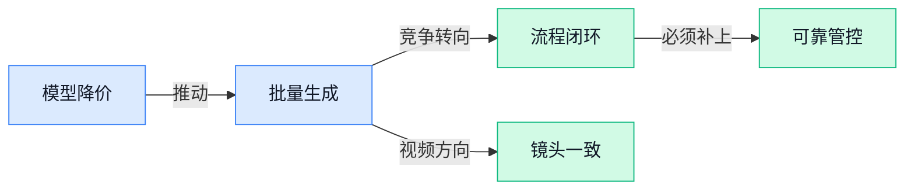

### 📊 行业洞察（今日 4 条）

1. OpenAI低价模型价格减半，研究同时尝试只处理任务真正需要的文字、音频或视频  
  【洞察】两件事放一起看，降本已从单纯降价走向“按需花钱”，批量内容生产成本还会下降。

2. Anthropic首度盈利却背负巨额长期算力承诺，Meta又计划融资最多950亿美元  
  【洞察】人工智能竞争正变成资金与稳定性竞争；头部越扩张，价格压力越大，中小厂商越难追赶。

3. ChatGPT开始直接发起开锁请求，社交媒体工具也在自动安排内容，同时工具调用仍在修复准确率  
  【洞察】人工智能正从“给答案”转向“替人办事”，但能否稳定完成流程，比会不会聊天更重要。

4. 角色视频研究开始解决大角度换镜后，角色与场景仍保持一致的问题，但尚无测试结果  
  【洞察】视频生成竞争正从“能出画面”转向“镜头可控”，方向明确，但距离可靠商用仍有差距。

### 💭 对我们的启发（今日 3 条）

1. OpenAI降价和按需处理信息都说明：文案、字幕等轻任务应优先用便宜模型，只有必要时才分析完整视频，避免成本失控。

2. 角色视频研究瞄准换镜后的一致性，我们应增加人物、商品和场景锁定及局部重做，而不是只提供整段重新生成。

3. ChatGPT开始替用户办事，但工具调用仍会出错；自动发布前必须提供预览、确认和人工接管，不能把品牌账号完全交给模型。

