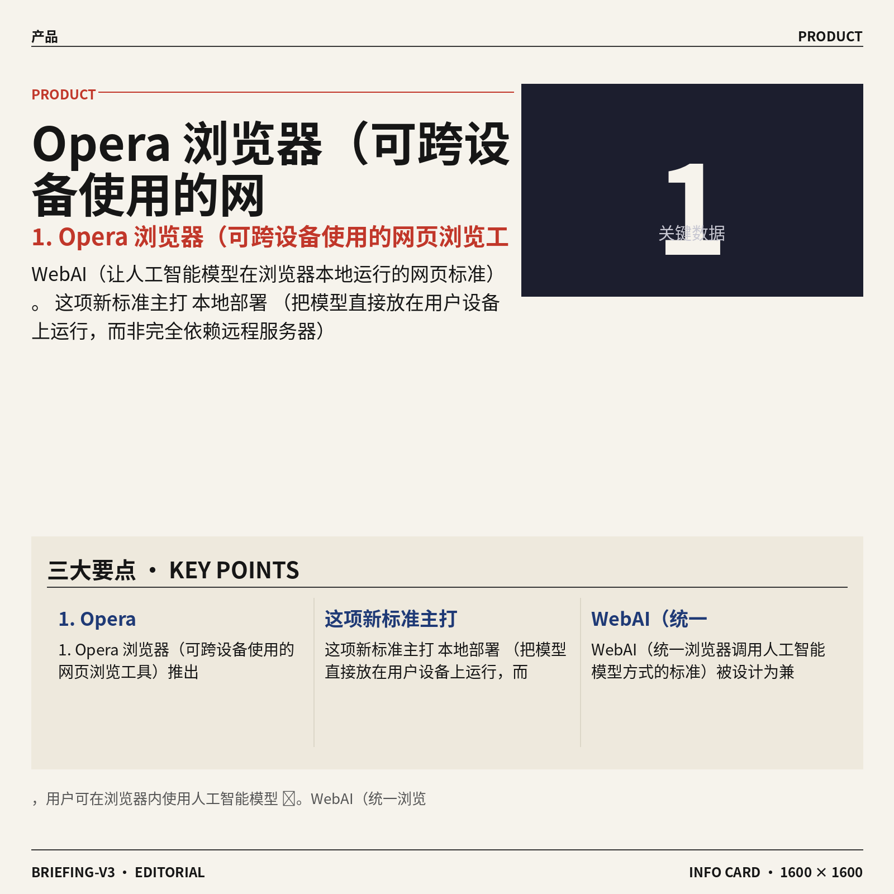
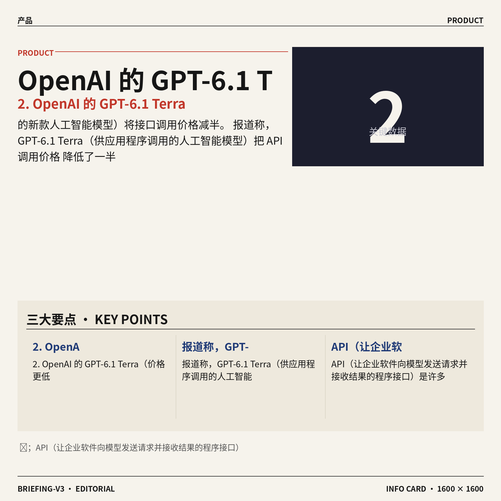
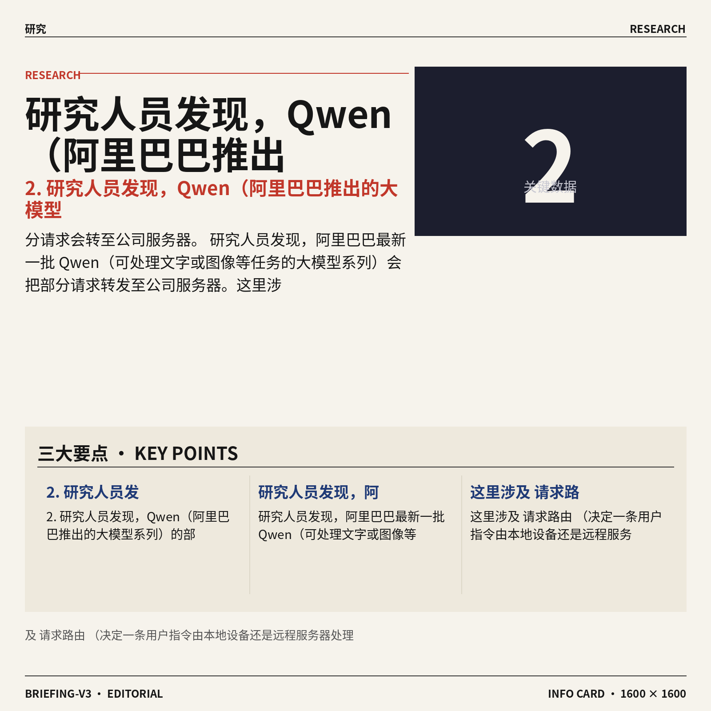
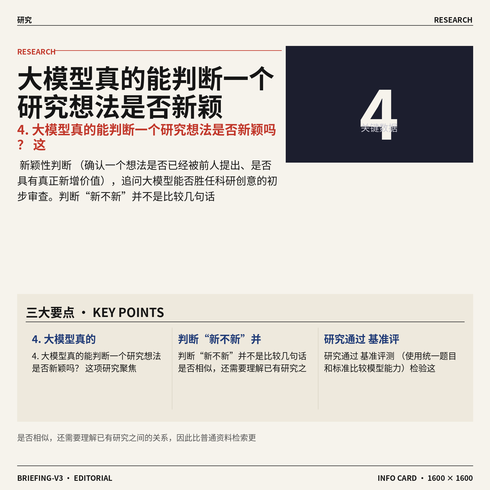
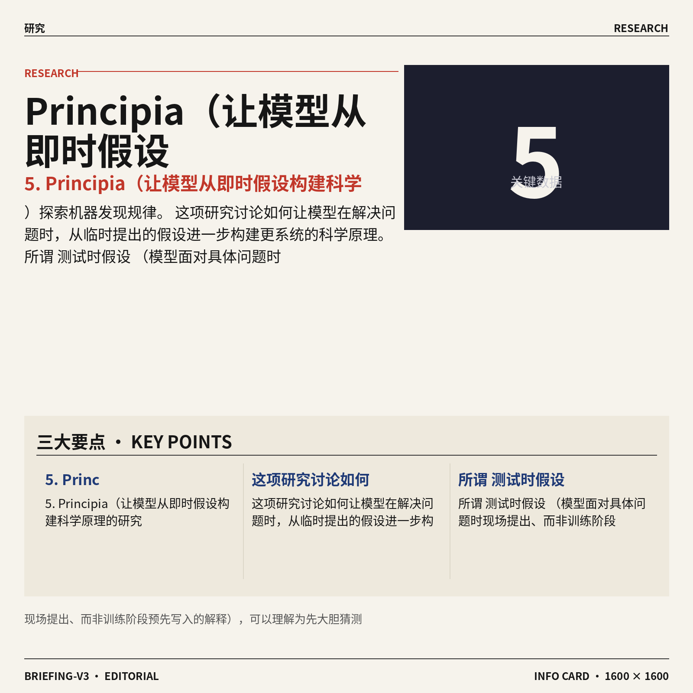
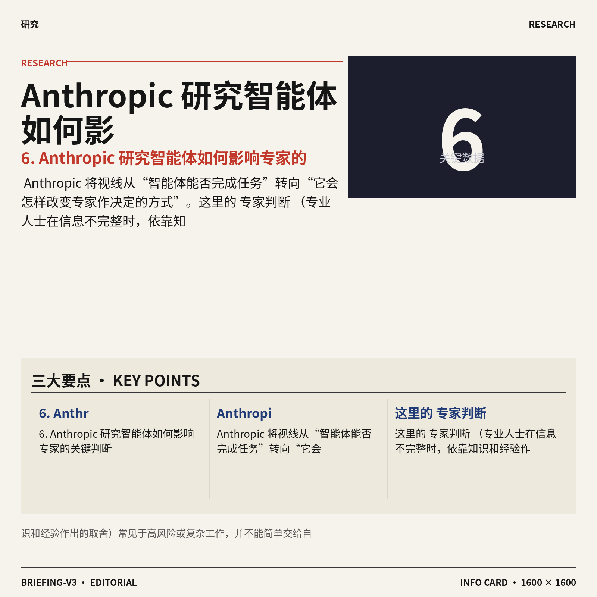
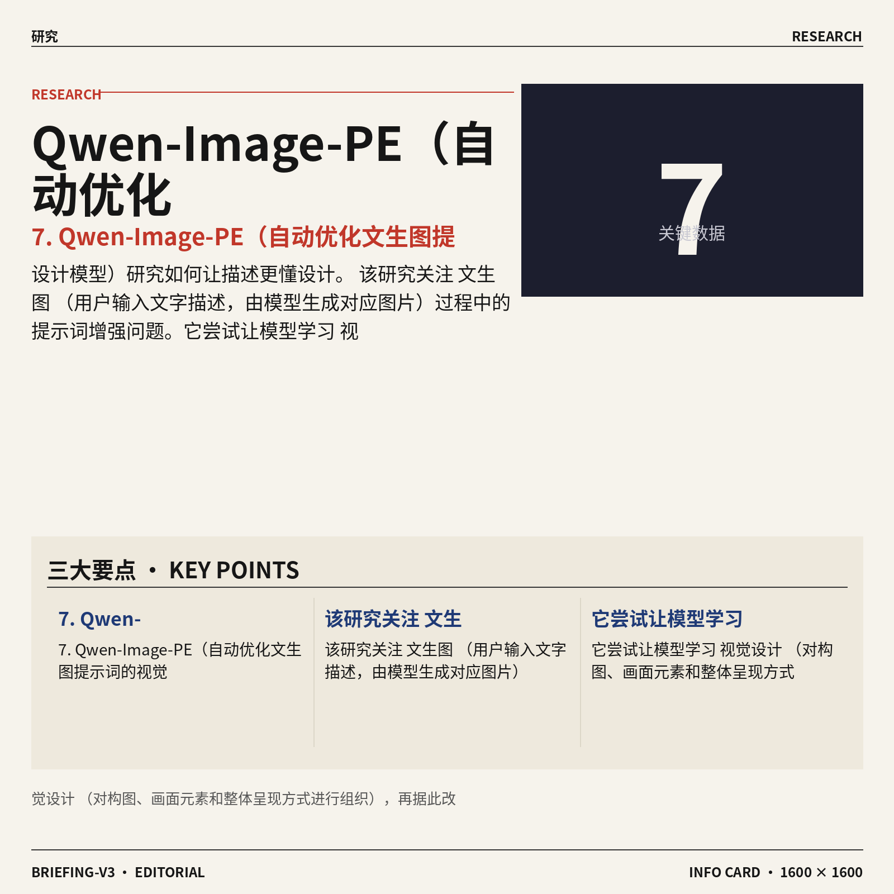
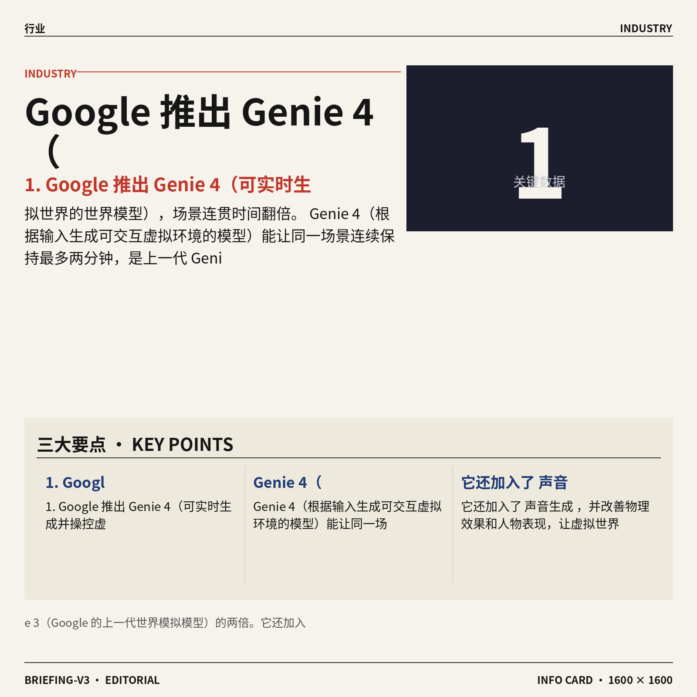
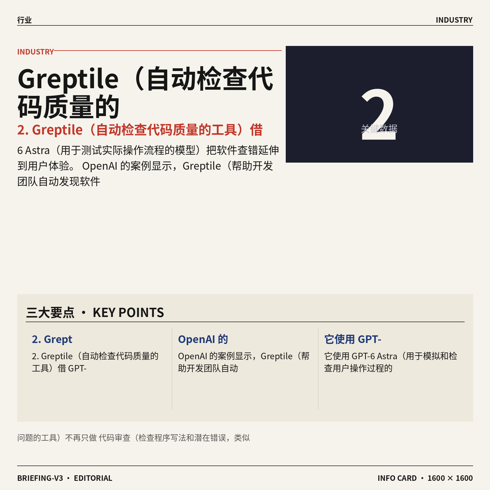
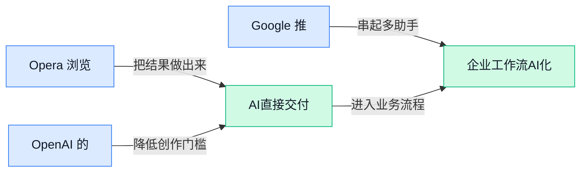

## AI资讯日报 2026/10/28

> AI 早报 · 每日早读 · 全网深度聚合

## **今日摘要**

```
OpenAI GPT-6.1 Terra（低价AI模型）接口调用价格直接减半
Google推出Genie 4（世界模型），实时生成可操控虚拟世界，连贯时长翻倍
Meta将从英伟达获30亿美元仍加码其芯片，Anthropic招股材料曝核心业务利润可观
```

### 🔵 产品与功能更新



1. **Opera 浏览器（可跨设备使用的网页浏览工具）推出 WebAI（让人工智能模型在浏览器本地运行的网页标准）。**
这项新标准主打**本地部署**（把模型直接放在用户设备上运行，而非完全依赖远程服务器），用户可在浏览器内使用人工智能模型 🚀。WebAI（统一浏览器调用人工智能模型方式的标准）被设计为兼容多种模型，而不是只服务于某一款产品。对普通用户而言，这意味着浏览器未来可能成为承载本地人工智能功能的新入口 💡。[浏览器标准完整报道(briefing)](https://techcrunch.com/2026/10/27/opera-introduces-a-new-web-standard-to-let-users-deploy-ai-locally-in-their-browser/)




2. **OpenAI 的 GPT-6.1 Terra（价格更低的新款人工智能模型）将接口调用价格减半。**
报道称，GPT-6.1 Terra（供应用程序调用的人工智能模型）把 **API 调用价格**降低了一半 ⚡；API（让企业软件向模型发送请求并接收结果的程序接口）是许多人工智能产品的主要成本来源。更便宜并不等于明显退步，这款模型仍在与 OpenAI 更大型号的比较中取得进展。对成本敏感的企业和产品团队来说，这种**降价同时保持竞争力**的走向尤其值得关注 💰。[模型降价完整报道(briefing)](https://the-decoder.com/gpt-6-1-terra-halves-openais-api-prices-and-still-gains-ground-on-its-larger-models/)


### 🟢 前沿研究


1. **OpenAI 请诺奖得主等外部专家核验人工智能生成的跨学科证明。**
OpenAI 正邀请包括一位**诺贝尔奖得主**在内的外部专家，检查其人工智能在数学、计算机科学和物理领域生成的证明。这里的**数学证明**（按照严密逻辑逐步说明某个结论必然成立）不同于普通问答，任何隐藏错误都可能让最终结论失效。引入**独立核验**（由项目之外的专业人士重新检查结果）意味着，前沿模型的科研能力不能只看“答案像不像”，还要接受真正的同行审查 🔍。[完整报道(briefing)](https://the-decoder.com/openai-asks-outside-experts-including-a-nobel-laureate-to-check-proofs-its-ai-produced-in-math-computer-science-and-physics/)




2. **研究人员发现，Qwen（阿里巴巴推出的大模型系列）的部分请求会转至公司服务器。**
研究人员发现，阿里巴巴最新一批 Qwen（可处理文字或图像等任务的大模型系列）会把部分请求转发至公司服务器。这里涉及**请求路由**（决定一条用户指令由本地设备还是远程服务器处理的分配过程），直接关系到用户对数据流向的理解。对于关注隐私和合规的企业，关键不只是模型能做什么，还包括信息在哪里处理、是否跨出预期的**数据边界**（企业规定的信息存储与处理范围）🔐；具体哪些请求会被转发，仍应以报道披露为准。[研究调查报道(briefing)](https://the-decoder.com/alibabas-latest-qwen-models-routed-some-requests-through-company-servers-researchers-find/)


3. **Trial by Trace（评估智能体运行框架可靠性的研究）关注故障到底该由谁负责。**
这项研究尝试用统一测试比较不同**智能体运行框架**（负责给智能体连接工具、安排步骤并执行任务的系统）是否可靠。它尤其关注**失败归因**（出错后判断问题来自模型、工具还是执行流程），避免把所有故障都笼统归咎于“大模型不行”。研究标题中的“运行轨迹”指任务执行期间留下的步骤记录，类似查看操作日志来复盘事故 💡；这类评估有助于团队更准确地发现自动化流程的薄弱环节。[研究论文页面(briefing)](https://huggingface.co/papers/2610.32285)




4. **大模型真的能判断一个研究想法是否新颖吗？**
这项研究聚焦**新颖性判断**（确认一个想法是否已经被前人提出、是否具有真正新增价值），追问大模型能否胜任科研创意的初步审查。判断“新不新”并不是比较几句话是否相似，还需要理解已有研究之间的关系，因此比普通资料检索更复杂。研究通过**基准评测**（使用统一题目和标准比较模型能力）检验这种判断是否值得信任 🧪，对论文选题、科研立项和创新审查都有直接参考意义。[研究项目介绍(briefing)](https://huggingface.co/blog/allenai/novelty-bench)

![大模型真的能判断一个研究想法是否新颖吗？](https://image.pollinations.ai/prompt/%E5%A4%A7%E6%A8%A1%E5%9E%8B%E7%9C%9F%E7%9A%84%E8%83%BD%E5%88%A4%E6%96%AD%E4%B8%80%E4%B8%AA%E7%A0%94%E7%A9%B6%E6%83%B3%E6%B3%95%E6%98%AF%E5%90%A6%E6%96%B0%E9%A2%96%E5%90%97%EF%BC%9F.%20%E5%A4%A7%E6%A8%A1%E5%9E%8B%E7%9C%9F%E7%9A%84%E8%83%BD%E5%88%A4%E6%96%AD%E4%B8%80%E4%B8%AA%E7%A0%94%E7%A9%B6%E6%83%B3%E6%B3%95%E6%98%AF%E5%90%A6%E6%96%B0%E9%A2%96%E5%90%97%EF%BC%9F%20%E8%BF%99%E9%A1%B9%E7%A0%94%E7%A9%B6%E8%81%9A%E7%84%A6%E6%96%B0%E9%A2%96%E6%80%A7%E5%88%A4%E6%96%AD%EF%BC%88%E7%A1%AE%E8%AE%A4%E4%B8%80%E4%B8%AA%E6%83%B3%E6%B3%95%E6%98%AF%E5%90%A6%E5%B7%B2%E7%BB%8F%E8%A2%AB%E5%89%8D%E4%BA%BA%E6%8F%90%E5%87%BA%E3%80%81%E6%98%AF%E5%90%A6%E5%85%B7%E6%9C%89%E7%9C%9F%E6%AD%A3%E6%96%B0%E5%A2%9E%E4%BB%B7%E5%80%BC%EF%BC%89%EF%BC%8C%E8%BF%BD%E9%97%AE%E5%A4%A7%E6%A8%A1%E5%9E%8B%E8%83%BD%E5%90%A6%E8%83%9C%E4%BB%BB%E7%A7%91%E7%A0%94%E5%88%9B%E6%84%8F%E7%9A%84%E5%88%9D%E6%AD%A5%E5%AE%A1%E6%9F%A5%E3%80%82%2C%20technical%20infographic%20diagram%2C%20architecture%20flowchart%2C%20clean%20vector%20illustration%2C%20educational%20style%2C%20no%20text%20overlay%2C%20modern%20minimal%2C%20wide%20aspect?width=1200&height=675&nologo=true&seed=10900)



5. **Principia（让模型从即时假设构建科学原理的研究）探索机器发现规律。**
这项研究讨论如何让模型在解决问题时，从临时提出的假设进一步构建更系统的科学原理。所谓**测试时假设**（模型面对具体问题时现场提出、而非训练阶段预先写入的解释），可以理解为先大胆猜测，再尝试整理出可复用的规律。其目标指向**科学发现**（从现象和证据中总结可解释、可验证规律的过程）🔬，重点不只是回答一道题，而是探索模型能否形成更一般化的认识。[研究论文页面(briefing)](https://huggingface.co/papers/2610.32195)

![Principia（让模型从即时假设构建科学原理的研究）探索机器发现规律](https://image.pollinations.ai/prompt/Principia%EF%BC%88%E8%AE%A9%E6%A8%A1%E5%9E%8B%E4%BB%8E%E5%8D%B3%E6%97%B6%E5%81%87%E8%AE%BE%E6%9E%84%E5%BB%BA%E7%A7%91%E5%AD%A6%E5%8E%9F%E7%90%86%E7%9A%84%E7%A0%94%E7%A9%B6%EF%BC%89%E6%8E%A2%E7%B4%A2%E6%9C%BA%E5%99%A8%E5%8F%91%E7%8E%B0%E8%A7%84%E5%BE%8B.%20Principia%EF%BC%88%E8%AE%A9%E6%A8%A1%E5%9E%8B%E4%BB%8E%E5%8D%B3%E6%97%B6%E5%81%87%E8%AE%BE%E6%9E%84%E5%BB%BA%E7%A7%91%E5%AD%A6%E5%8E%9F%E7%90%86%E7%9A%84%E7%A0%94%E7%A9%B6%EF%BC%89%E6%8E%A2%E7%B4%A2%E6%9C%BA%E5%99%A8%E5%8F%91%E7%8E%B0%E8%A7%84%E5%BE%8B%E3%80%82%20%E8%BF%99%E9%A1%B9%E7%A0%94%E7%A9%B6%E8%AE%A8%E8%AE%BA%E5%A6%82%E4%BD%95%E8%AE%A9%E6%A8%A1%E5%9E%8B%E5%9C%A8%E8%A7%A3%E5%86%B3%E9%97%AE%E9%A2%98%E6%97%B6%EF%BC%8C%E4%BB%8E%E4%B8%B4%E6%97%B6%E6%8F%90%E5%87%BA%E7%9A%84%E5%81%87%E8%AE%BE%E8%BF%9B%E4%B8%80%E6%AD%A5%E6%9E%84%E5%BB%BA%E6%9B%B4%E7%B3%BB%E7%BB%9F%E7%9A%84%E7%A7%91%E5%AD%A6%E5%8E%9F%E7%90%86%E3%80%82%E6%89%80%E8%B0%93%2C%20technical%20infographic%20diagram%2C%20architecture%20flowchart%2C%20clean%20vector%20illustration%2C%20educational%20style%2C%20no%20text%20overlay%2C%20modern%20minimal%2C%20wide%20aspect?width=1200&height=675&nologo=true&seed=10931)



6. **Anthropic 研究智能体如何影响专家的关键判断。**
Anthropic 将视线从“智能体能否完成任务”转向“它会怎样改变专家作决定的方式”。这里的**专家判断**（专业人士在信息不完整时，依靠知识和经验作出的取舍）常见于高风险或复杂工作，并不能简单交给自动化答案替代。研究关注的核心属于**人机协作**（人负责目标与最终决策，机器协助分析和执行）问题：智能体可能如何介入专家的思考与判断过程 🧭。[Anthropic 研究报道(briefing)](https://news.google.com/rss/articles/CBMiZ0FVX3lxTE1IaTRIX2lBc1kwcDRXenZsRXRxcy1vZWVQVlBGdlJsS1p1bkpOQzBpblRRU0l6elhUa0Z3a0RmOVlaV1NmUlgxU3pQWjE2UTVNcEdMdDBBQ0VobFBMS2k5MS1yQ3dQMzQ?oc=5)




7. **Qwen-Image-PE（自动优化文生图提示词的视觉设计模型）研究如何让描述更懂设计。**
该研究关注**文生图**（用户输入文字描述，由模型生成对应图片）过程中的提示词增强问题。它尝试让模型学习**视觉设计**（对构图、画面元素和整体呈现方式进行组织），再据此改进用户交给图像模型的文字要求。对不熟悉专业表达的用户而言，这相当于在正式生成图片前，先请一位“设计翻译”把想法整理得更清楚 🎨；论文重点是如何学习并完成这一增强过程。[研究论文页面(briefing)](https://huggingface.co/papers/2610.33472)

![Qwen-Image-PE（自动优化文生图提示词的视觉设计模型）研究如何让描述更懂设计](https://image.pollinations.ai/prompt/Qwen-Image-PE%EF%BC%88%E8%87%AA%E5%8A%A8%E4%BC%98%E5%8C%96%E6%96%87%E7%94%9F%E5%9B%BE%E6%8F%90%E7%A4%BA%E8%AF%8D%E7%9A%84%E8%A7%86%E8%A7%89%E8%AE%BE%E8%AE%A1%E6%A8%A1%E5%9E%8B%EF%BC%89%E7%A0%94%E7%A9%B6%E5%A6%82%E4%BD%95%E8%AE%A9%E6%8F%8F%E8%BF%B0%E6%9B%B4%E6%87%82%E8%AE%BE%E8%AE%A1.%20Qwen-Image-PE%EF%BC%88%E8%87%AA%E5%8A%A8%E4%BC%98%E5%8C%96%E6%96%87%E7%94%9F%E5%9B%BE%E6%8F%90%E7%A4%BA%E8%AF%8D%E7%9A%84%E8%A7%86%E8%A7%89%E8%AE%BE%E8%AE%A1%E6%A8%A1%E5%9E%8B%EF%BC%89%E7%A0%94%E7%A9%B6%E5%A6%82%E4%BD%95%E8%AE%A9%E6%8F%8F%E8%BF%B0%E6%9B%B4%E6%87%82%E8%AE%BE%E8%AE%A1%E3%80%82%20%E8%AF%A5%E7%A0%94%E7%A9%B6%E5%85%B3%E6%B3%A8%E6%96%87%E7%94%9F%E5%9B%BE%EF%BC%88%E7%94%A8%E6%88%B7%E8%BE%93%E5%85%A5%E6%96%87%E5%AD%97%E6%8F%8F%E8%BF%B0%EF%BC%8C%E7%94%B1%E6%A8%A1%E5%9E%8B%E7%94%9F%E6%88%90%E5%AF%B9%E5%BA%94%E5%9B%BE%E7%89%87%EF%BC%89%E8%BF%87%E7%A8%8B%E4%B8%AD%E7%9A%84%E6%8F%90%E7%A4%BA%E8%AF%8D%2C%20technical%20infographic%20diagram%2C%20architecture%20flowchart%2C%20clean%20vector%20illustration%2C%20educational%20style%2C%20no%20text%20overlay%2C%20modern%20minimal%2C%20wide%20aspect?width=1200&height=675&nologo=true&seed=10993)


8. **World-in-Context（通过上下文控制互动视频世界的研究）探索可交互的视频生成。**
这项研究把**世界模型**（学习环境如何变化，并预测下一步可能发生什么的模型）应用到互动视频场景。其核心是**上下文条件控制**（根据当前提供的画面、动作或信息决定后续生成内容），让视频不只是从头到尾固定播放，而是能围绕输入继续演变。相比单纯生成一段画面，这一方向更关注模型能否保持环境变化的连续性与可控制性 🎬，为理解互动视频世界如何建模提供研究思路。[研究论文页面(briefing)](https://huggingface.co/papers/2610.33169)

![World-in-Context（通过上下文控制互动视频世界的研究）探索可交互的视频生成](https://image.pollinations.ai/prompt/World-in-Context%EF%BC%88%E9%80%9A%E8%BF%87%E4%B8%8A%E4%B8%8B%E6%96%87%E6%8E%A7%E5%88%B6%E4%BA%92%E5%8A%A8%E8%A7%86%E9%A2%91%E4%B8%96%E7%95%8C%E7%9A%84%E7%A0%94%E7%A9%B6%EF%BC%89%E6%8E%A2%E7%B4%A2%E5%8F%AF%E4%BA%A4%E4%BA%92%E7%9A%84%E8%A7%86%E9%A2%91%E7%94%9F%E6%88%90.%20World-in-Context%EF%BC%88%E9%80%9A%E8%BF%87%E4%B8%8A%E4%B8%8B%E6%96%87%E6%8E%A7%E5%88%B6%E4%BA%92%E5%8A%A8%E8%A7%86%E9%A2%91%E4%B8%96%E7%95%8C%E7%9A%84%E7%A0%94%E7%A9%B6%EF%BC%89%E6%8E%A2%E7%B4%A2%E5%8F%AF%E4%BA%A4%E4%BA%92%E7%9A%84%E8%A7%86%E9%A2%91%E7%94%9F%E6%88%90%E3%80%82%20%E8%BF%99%E9%A1%B9%E7%A0%94%E7%A9%B6%E6%8A%8A%E4%B8%96%E7%95%8C%E6%A8%A1%E5%9E%8B%EF%BC%88%E5%AD%A6%E4%B9%A0%E7%8E%AF%E5%A2%83%E5%A6%82%E4%BD%95%E5%8F%98%E5%8C%96%EF%BC%8C%E5%B9%B6%E9%A2%84%E6%B5%8B%E4%B8%8B%E4%B8%80%E6%AD%A5%E5%8F%AF%E8%83%BD%E5%8F%91%E7%94%9F%E4%BB%80%E4%B9%88%E7%9A%84%E6%A8%A1%E5%9E%8B%2C%20technical%20infographic%20diagram%2C%20architecture%20flowchart%2C%20clean%20vector%20illustration%2C%20educational%20style%2C%20no%20text%20overlay%2C%20modern%20minimal%2C%20wide%20aspect?width=1200&height=675&nologo=true&seed=11024)

### 🟡 行业展望与社会影响



1. **Google 推出 Genie 4（可实时生成并操控虚拟世界的世界模型），场景连贯时间翻倍。**
Genie 4（根据输入生成可交互虚拟环境的模型）能让同一场景连续保持最多两分钟，是上一代 Genie 3（Google 的上一代世界模拟模型）的两倍。它还加入了**声音生成**，并改善物理效果和人物表现，让虚拟世界看起来更真实 🎮。用户可以进行**实时操控（在内容生成过程中直接改变角色行动和场景走向）**，不再只能被动观看预先生成的画面。整体来看，这类模型正在从“生成一段视频”迈向“生成一个可进入、可控制的世界” 🚀。[Google 官方介绍(briefing)](https://deepmind.google/blog/genie-4-a-new-generation-of-world-simulation/) [功能更新报道(briefing)](https://techcrunch.com/2026/10/27/googles-genie-4-world-model-adds-audio-more-realistic-worlds-and-real-time-steering/)




2. **Greptile（自动检查代码质量的工具）借 GPT-6 Astra（用于测试实际操作流程的模型）把软件查错延伸到用户体验。**
OpenAI 的案例显示，Greptile（帮助开发团队自动发现软件问题的工具）不再只做**代码审查（检查程序写法和潜在错误，类似给代码做校对）**，还会测试真实用户的操作流程。它使用 GPT-6 Astra（用于模拟和检查用户操作过程的模型）验证这些流程是否能顺利运行，从而把检查范围扩展到代码之外 🔍。与此同时，Daybreak（用于增强软件安全检查的系统）负责加强安全性，Codex（OpenAI 的人工智能编程助手）则帮助减少返工。对软件团队而言，这意味着人工智能开始同时关注“程序有没有写错”和“用户能不能正常使用” 💡。[OpenAI 案例介绍(briefing)](https://openai.com/index/greptile-code-review-codex-astra)

![Greptile（自动检查代码质量的工具）借 GPT-6 Astra（用于测试实际操作流程的模型）把软件查错延伸到用户体验](https://image.pollinations.ai/prompt/Greptile%EF%BC%88%E8%87%AA%E5%8A%A8%E6%A3%80%E6%9F%A5%E4%BB%A3%E7%A0%81%E8%B4%A8%E9%87%8F%E7%9A%84%E5%B7%A5%E5%85%B7%EF%BC%89%E5%80%9F%20GPT-6%20Astra%EF%BC%88%E7%94%A8%E4%BA%8E%E6%B5%8B%E8%AF%95%E5%AE%9E%E9%99%85%E6%93%8D%E4%BD%9C%E6%B5%81%E7%A8%8B%E7%9A%84%E6%A8%A1%E5%9E%8B%EF%BC%89%E6%8A%8A%E8%BD%AF%E4%BB%B6%E6%9F%A5%E9%94%99%E5%BB%B6%E4%BC%B8%E5%88%B0%E7%94%A8%E6%88%B7%E4%BD%93%E9%AA%8C.%20Greptile%EF%BC%88%E8%87%AA%E5%8A%A8%E6%A3%80%E6%9F%A5%E4%BB%A3%E7%A0%81%E8%B4%A8%E9%87%8F%E7%9A%84%E5%B7%A5%E5%85%B7%EF%BC%89%E5%80%9F%20GPT-6%20Astra%EF%BC%88%E7%94%A8%E4%BA%8E%E6%B5%8B%E8%AF%95%E5%AE%9E%E9%99%85%E6%93%8D%E4%BD%9C%E6%B5%81%E7%A8%8B%E7%9A%84%E6%A8%A1%E5%9E%8B%EF%BC%89%E6%8A%8A%E8%BD%AF%E4%BB%B6%E6%9F%A5%E9%94%99%E5%BB%B6%E4%BC%B8%E5%88%B0%E7%94%A8%E6%88%B7%E4%BD%93%E9%AA%8C%E3%80%82%20OpenAI%20%E7%9A%84%E6%A1%88%E4%BE%8B%E6%98%BE%E7%A4%BA%EF%BC%8CGrep%2C%20technical%20infographic%20diagram%2C%20architecture%20flowchart%2C%20clean%20vector%20illustration%2C%20educational%20style%2C%20no%20text%20overlay%2C%20modern%20minimal%2C%20wide%20aspect?width=1200&height=675&nologo=true&seed=10838)

3. **Meta 将从英伟达获得 30 亿美元，同时计划继续加码英伟达芯片。**
报道指出，Meta 将从英伟达获得**30 亿美元**，并准备进一步增加对英伟达芯片的支出 💰。现有信息没有展开这笔资金安排的具体结构，但明确释放出一个信号：Meta 的**芯片投入（企业购买计算硬件所安排的预算）**仍将继续扩大。芯片直接影响**算力供给（训练和运行人工智能模型所需的计算资源）**，因此采购规模也是观察大型科技公司人工智能布局的重要指标。Meta 持续加码英伟达芯片，也让头部人工智能公司与上游硬件供应商之间的关系更受关注 🚀。[芯片投入完整报道(briefing)](https://the-decoder.com/meta-gets-3-billion-from-nvidia-and-plans-to-spend-more-on-nvidia-chips/)

![Meta 将从英伟达获得 30 亿美元，同时计划继续加码英伟达芯片](https://image.pollinations.ai/prompt/Meta%20%E5%B0%86%E4%BB%8E%E8%8B%B1%E4%BC%9F%E8%BE%BE%E8%8E%B7%E5%BE%97%2030%20%E4%BA%BF%E7%BE%8E%E5%85%83%EF%BC%8C%E5%90%8C%E6%97%B6%E8%AE%A1%E5%88%92%E7%BB%A7%E7%BB%AD%E5%8A%A0%E7%A0%81%E8%8B%B1%E4%BC%9F%E8%BE%BE%E8%8A%AF%E7%89%87.%20Meta%20%E5%B0%86%E4%BB%8E%E8%8B%B1%E4%BC%9F%E8%BE%BE%E8%8E%B7%E5%BE%97%2030%20%E4%BA%BF%E7%BE%8E%E5%85%83%EF%BC%8C%E5%90%8C%E6%97%B6%E8%AE%A1%E5%88%92%E7%BB%A7%E7%BB%AD%E5%8A%A0%E7%A0%81%E8%8B%B1%E4%BC%9F%E8%BE%BE%E8%8A%AF%E7%89%87%E3%80%82%20%E6%8A%A5%E9%81%93%E6%8C%87%E5%87%BA%EF%BC%8CMeta%20%E5%B0%86%E4%BB%8E%E8%8B%B1%E4%BC%9F%E8%BE%BE%E8%8E%B7%E5%BE%9730%20%E4%BA%BF%E7%BE%8E%E5%85%83%EF%BC%8C%E5%B9%B6%E5%87%86%E5%A4%87%E8%BF%9B%E4%B8%80%E6%AD%A5%E5%A2%9E%E5%8A%A0%E5%AF%B9%E8%8B%B1%E4%BC%9F%E8%BE%BE%E8%8A%AF%E7%89%87%E7%9A%84%E6%94%AF%E5%87%BA%20%F0%9F%92%B0%E3%80%82%E7%8E%B0%2C%20technical%20infographic%20diagram%2C%20architecture%20flowchart%2C%20clean%20vector%20illustration%2C%20educational%20style%2C%20no%20text%20overlay%2C%20modern%20minimal%2C%20wide%20aspect?width=1200&height=675&nologo=true&seed=10869)

### 🟣 开源TOP项目

1. **togg53192-cmd/jailbreaks（汇总模型越狱提示词的开源清单）。**
作者把自己收集或编写的**越狱提示词**（通过特殊指令尝试绕过模型安全限制的文本）集中整理到了一个项目中 📋。这类清单可以作为观察模型**安全边界**（模型拒绝危险或违规请求的规则范围）的样本，帮助相关人员了解用户可能怎样尝试突破限制。现有摘要未说明清单涉及哪些模型、包含多少提示词或实际测试效果，具体内容需以[GitHub 项目仓库(briefing)](https://github.com/togg53192-cmd/jailbreaks)为准 🔍。


### 🔴 社媒分享

1. **LFM3（面向专用任务的多模态模型系列）正式亮相。**
官方将这款模型定位为面向**专用智能**（针对某一类具体任务优化，而非什么都做）的新方案 🚀。它主打**多模态**（让模型理解和处理文字、图像、声音等不同形式的信息），重点是帮助团队按实际需求打造更有针对性的模型。[官方模型发布页(briefing)](https://www.liquid.ai/blog/lfm3)介绍了整体方向，另一篇[模型构建指南(briefing)](https://huggingface.co/blog/LiquidAI/lfm3)则聚焦如何用它构建专用多模态模型。两篇内容共同传递出一个趋势：大模型之外，服务细分场景的模型也正受到更多关注 💡。


2. **美国中期选举暂未变成人工智能大战，选民另有更关心的事。**
这篇报道认为，人工智能目前还没有成为左右美国中期选举的首要议题，选民暂时有其他更在意的问题 🗳️。文章同时讨论了 OpenAI 应对**深度伪造**（利用人工智能制作足以以假乱真的人物图像、音频或视频）的政策，以及 Anthropic 的 **S-1 文件**（美国企业准备上市时向监管机构提交的招股材料）。[选举与深伪报道(briefing)](https://www.platformer.news/ai-midterms-openai-deepfakes/)提醒大家，技术对政治的影响并未消失，只是当前还没有压过选民对其他议题的关注 💡。


3. **有限单群分类借 Lean（用于让计算机核验数学证明的工具）完成形式化。**
该项目将**有限单群**（无法再按特定规则拆分、类似数学“基础积木”的有限结构）的分类成果进行了形式化整理 🧩。所谓**形式化证明**，就是把数学推导写成计算机能够逐步检查的严谨内容，减少隐藏错误或遗漏。[项目成果页面(briefing)](https://cfsg.axiommath.ai/)展示了这一工作，其价值不只是“让机器做数学”，更在于让复杂证明拥有可重复核验的版本 🔍。


4. **Anthropic 招股材料揭示：核心业务利润可观，竞争与股权稀释仍是隐忧。**
分析文章围绕 Anthropic 的 **S-1 文件**（美国企业上市前提交的正式招股材料）展开，并称其**首次公开募股**（企业第一次向公众发行股票并上市）终于到来 📊。作者判断，Anthropic 的核心业务利润很高，但激烈竞争可能继续消耗这些利润。[招股材料分析全文(briefing)](https://stratechery.com/2026/anthropic-s-1-the-cost-of-compute-who-is-paying/)还提醒投资者关注**股权稀释**（公司增发股份后，原有股东持股比例下降）的长期风险。换句话说，业务赚钱不等于投资者一定能轻松分享全部收益 💡。

![Anthropic 招股材料揭示：核心业务利润可观，竞争与股权稀释仍是隐忧](https://image.pollinations.ai/prompt/Anthropic%20%E6%8B%9B%E8%82%A1%E6%9D%90%E6%96%99%E6%8F%AD%E7%A4%BA%EF%BC%9A%E6%A0%B8%E5%BF%83%E4%B8%9A%E5%8A%A1%E5%88%A9%E6%B6%A6%E5%8F%AF%E8%A7%82%EF%BC%8C%E7%AB%9E%E4%BA%89%E4%B8%8E%E8%82%A1%E6%9D%83%E7%A8%80%E9%87%8A%E4%BB%8D%E6%98%AF%E9%9A%90%E5%BF%A7.%20Anthropic%20%E6%8B%9B%E8%82%A1%E6%9D%90%E6%96%99%E6%8F%AD%E7%A4%BA%EF%BC%9A%E6%A0%B8%E5%BF%83%E4%B8%9A%E5%8A%A1%E5%88%A9%E6%B6%A6%E5%8F%AF%E8%A7%82%EF%BC%8C%E7%AB%9E%E4%BA%89%E4%B8%8E%E8%82%A1%E6%9D%83%E7%A8%80%E9%87%8A%E4%BB%8D%E6%98%AF%E9%9A%90%E5%BF%A7%E3%80%82%20%E5%88%86%E6%9E%90%E6%96%87%E7%AB%A0%E5%9B%B4%E7%BB%95%20Anthropic%20%E7%9A%84%20S-1%20%E6%96%87%E4%BB%B6%EF%BC%88%E7%BE%8E%E5%9B%BD%E4%BC%81%E4%B8%9A%E4%B8%8A%E5%B8%82%E5%89%8D%E6%8F%90%E4%BA%A4%E7%9A%84%E6%AD%A3%E5%BC%8F%E6%8B%9B%E8%82%A1%E6%9D%90%2C%20technical%20infographic%20diagram%2C%20architecture%20flowchart%2C%20clean%20vector%20illustration%2C%20educational%20style%2C%20no%20text%20overlay%2C%20modern%20minimal%2C%20wide%20aspect?width=1200&height=675&nologo=true&seed=10706)

5. **Claude 展示加速药物研发的早期进展。**
Anthropic 分享了 Claude 用于加速**药物研发**（从寻找候选药物到验证效果与安全性的完整流程）的初步成果 🧪。官方将其明确描述为**早期进展**，意味着相关探索已经取得阶段性结果，但目前披露的重点仍是研究推进情况。[药物研发研究进展(briefing)](https://www.anthropic.com/research/early-progress-drug-development)呈现了 Claude 在这一专业场景中的应用方向。对业务同事来说，关键信号是通用助手正在进入医药等高度专业化的工作流程，但仍需区分“已有初步进展”和“已经成熟落地” 🔬。


---



### 📊 行业洞察（今日 4 条）

1. Google推出Genie 4（可交互虚拟世界模型），场景连贯达两分钟。  
  【洞察】互动视频更接近实用，因为连续性较上代翻倍；但长内容仍受限。

2. OpenAI将GPT-6.1 Terra（人工智能模型）使用价格减半。  
  【洞察】模型普及门槛将下降，因为主要使用成本降低；但实际质量仍需验证。

3. Qwen-Image-PE（优化文生图描述的模型）开始学习视觉设计表达。  
  【洞察】创作门槛有望降低，因为模型能整理模糊想法；但可能造成审美趋同。

4. Trial by Trace（智能体可靠性评测研究）比较不同框架的错误来源。  
  【洞察】智能体评估将更精细，因为它区分模型、工具与步骤问题，利于针对性改进。

### 💭 对我们的启发（今日 3 条）

1. Genie 4启示智能体（能自主完成多步任务的系统）平台支持分镜改写；机会是提升剪辑效率，风险是长片一致性不足。

2. Qwen-Image-PE启示平台先把创作意图转为视觉描述；机会是降低使用门槛，风险是审美趋同与控制感下降。

3. GPT-6.1 Terra降价利于平台提供多版文案和初版剪辑比较；机会是降低创作成本，风险是低价模型质量波动。

