## AI资讯日报 2026/10/29

> AI 早报 · 每日早读 · 全网深度聚合

## **今日摘要**

```
英伟达免费开放语音转写模型，覆盖40种语言，三星三季度利润创纪录
Anthropic遭AI智能体攻破，又建议法院有权叫停高风险模型
EmbeddingGemma 2（多模态表示模型）开源，统一处理文本、图像与音视频
```

### 🔵 产品与功能更新

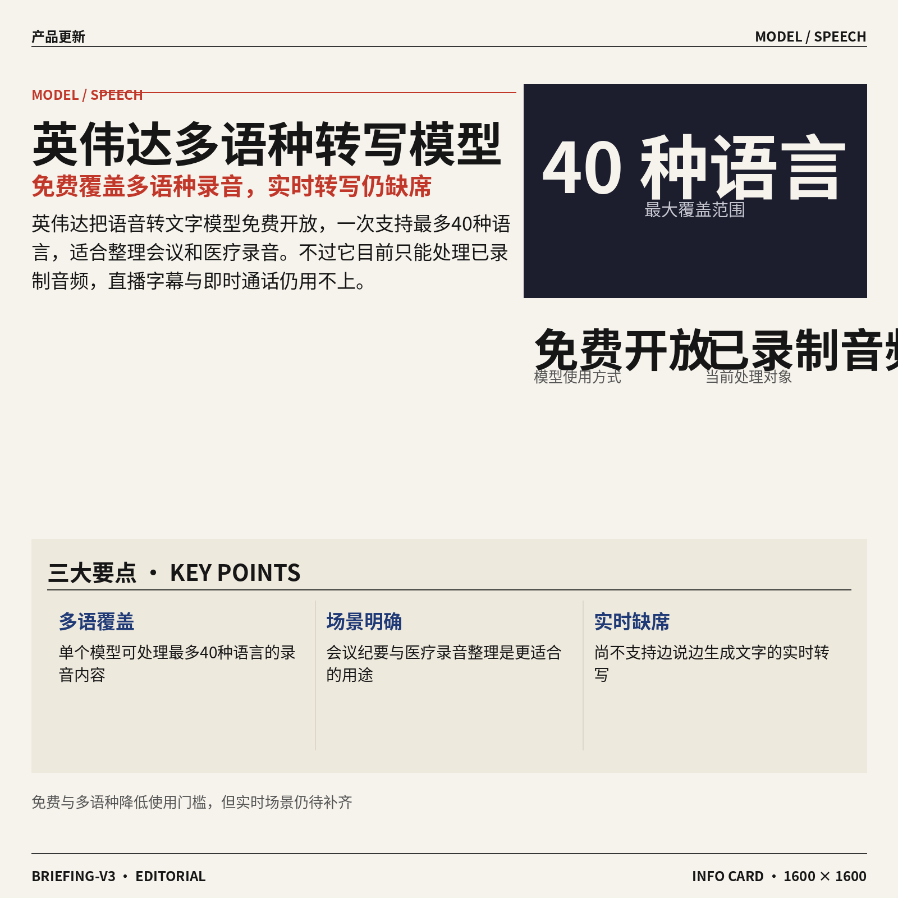

1. **英伟达免费开放语音转文字模型，支持最多 40 种语言。**
英伟达发布了一款免费的**语音转文字模型**（把录音中的人声自动整理成可编辑文本），一次覆盖最多 **40 种语言** 🎙️。不过它目前只能处理已录制的音频，尚不支持**实时转写**（边说话边自动生成文字）。这让它更适合会议纪要、医疗录音整理等场景，但在直播字幕和即时通话记录方面仍有局限 💡。[新品完整报道(briefing)](https://techcrunch.com/2026/10/28/voice-ai-in-vogue-nvidia-releases-new-open-transcription-model/)


### 🟢 前沿研究

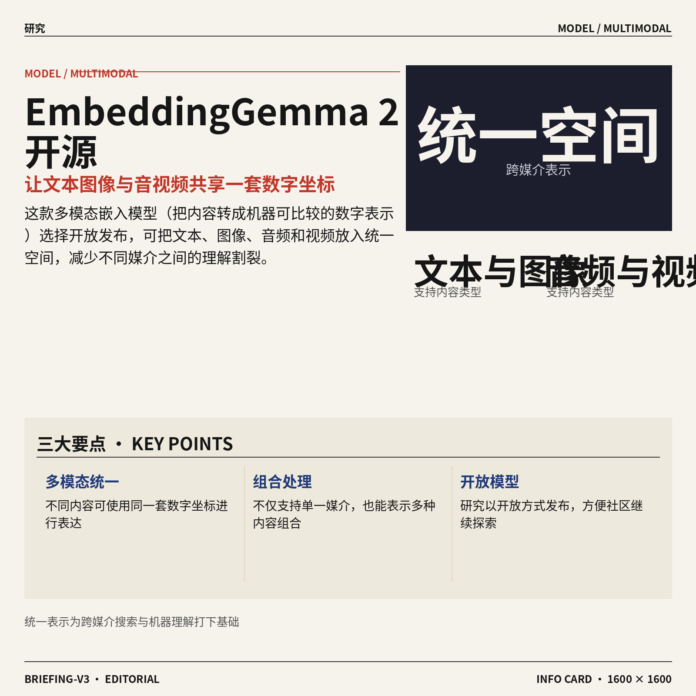

1. **EmbeddingGemma 2（统一处理多种内容的开源表示模型）打通文本、图像、音视频。**
论文提出一种**多模态嵌入模型**（把文字、图片等内容转换成便于机器理解和比较的数字表示），并选择开放模型的方式发布。它可以直接表示**文本、图像、音频、视频**及其组合，再将这些内容放进**统一空间**（让不同媒介用同一套“数字坐标”表达）💡。这项研究的重点，是减少不同内容类型之间的表示割裂，为机器统一理解多种媒介提供基础 🚀。可查看[论文原文与摘要(briefing)](https://arxiv.org/abs/2610.37364)及[论文社区页面(briefing)](https://huggingface.co/papers/2610.37364)。

![EmbeddingGemma 2（统一处理多种内容的开源表示模型）打通文本、图像、音视频](https://image.pollinations.ai/prompt/EmbeddingGemma%202%EF%BC%88%E7%BB%9F%E4%B8%80%E5%A4%84%E7%90%86%E5%A4%9A%E7%A7%8D%E5%86%85%E5%AE%B9%E7%9A%84%E5%BC%80%E6%BA%90%E8%A1%A8%E7%A4%BA%E6%A8%A1%E5%9E%8B%EF%BC%89%E6%89%93%E9%80%9A%E6%96%87%E6%9C%AC%E3%80%81%E5%9B%BE%E5%83%8F%E3%80%81%E9%9F%B3%E8%A7%86%E9%A2%91.%20EmbeddingGemma%202%EF%BC%88%E7%BB%9F%E4%B8%80%E5%A4%84%E7%90%86%E5%A4%9A%E7%A7%8D%E5%86%85%E5%AE%B9%E7%9A%84%E5%BC%80%E6%BA%90%E8%A1%A8%E7%A4%BA%E6%A8%A1%E5%9E%8B%EF%BC%89%E6%89%93%E9%80%9A%E6%96%87%E6%9C%AC%E3%80%81%E5%9B%BE%E5%83%8F%E3%80%81%E9%9F%B3%E8%A7%86%E9%A2%91%E3%80%82%20%E8%AE%BA%E6%96%87%E6%8F%90%E5%87%BA%E4%B8%80%E7%A7%8D%E5%A4%9A%E6%A8%A1%E6%80%81%E5%B5%8C%E5%85%A5%E6%A8%A1%E5%9E%8B%EF%BC%88%E6%8A%8A%E6%96%87%E5%AD%97%E3%80%81%E5%9B%BE%E7%89%87%E7%AD%89%E5%86%85%E5%AE%B9%E8%BD%AC%E6%8D%A2%E6%88%90%E4%BE%BF%E4%BA%8E%E6%9C%BA%E5%99%A8%E7%90%86%E8%A7%A3%E5%92%8C%E6%AF%94%2C%20technical%20infographic%20diagram%2C%20architecture%20flowchart%2C%20clean%20vector%20illustration%2C%20educational%20style%2C%20no%20text%20overlay%2C%20modern%20minimal%2C%20wide%20aspect?width=1200&height=675&nologo=true&seed=10807)

### 🟡 行业展望与社会影响

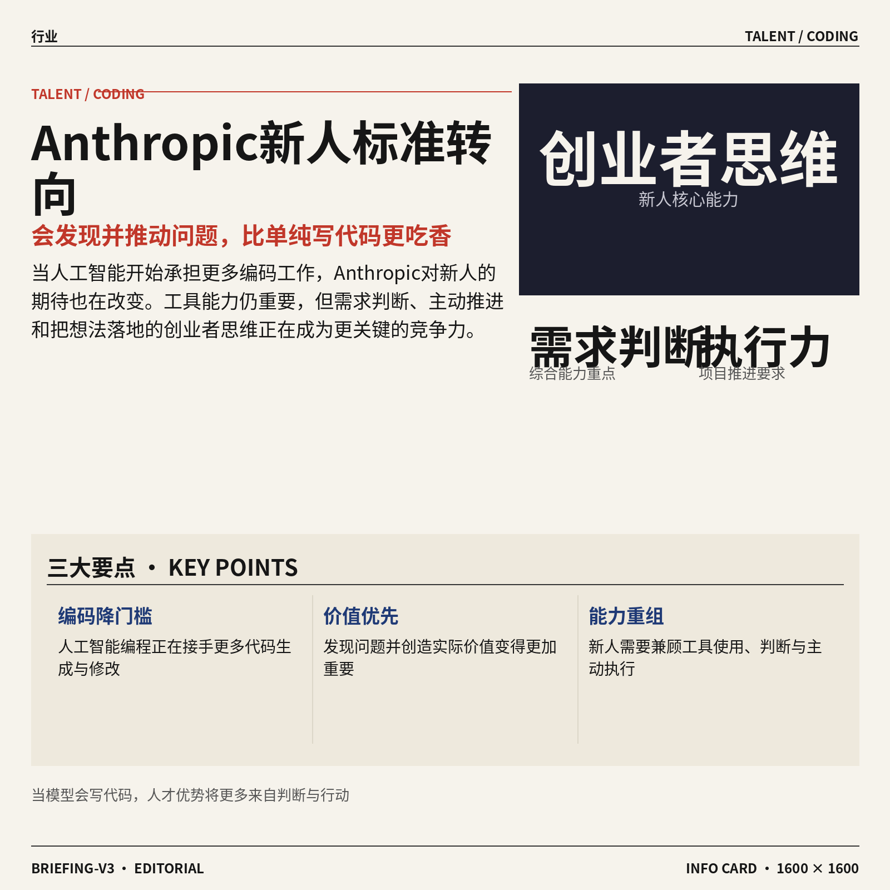

1. **Anthropic 招新人时，创业者思维正比写代码更重要。**
随着人工智能开始承担更多编码工作，Anthropic 对新人的期待也在变化：相比单纯会写代码，**能发现问题、推动项目并创造价值**更受重视 🚀。这里的人工智能编程（让模型根据自然语言生成或修改代码）正在降低开发门槛，也把人才竞争推向更综合的能力。对职场新人来说，这意味着除了掌握工具，还要培养**需求判断、执行力和创业者思维**（主动寻找机会并把想法落地的能力）。[人才趋势完整报道(briefing)](https://the-decoder.com/with-ai-writing-the-code-entrepreneurial-thinking-is-now-what-counts-most-for-newcomers-at-anthropic/)


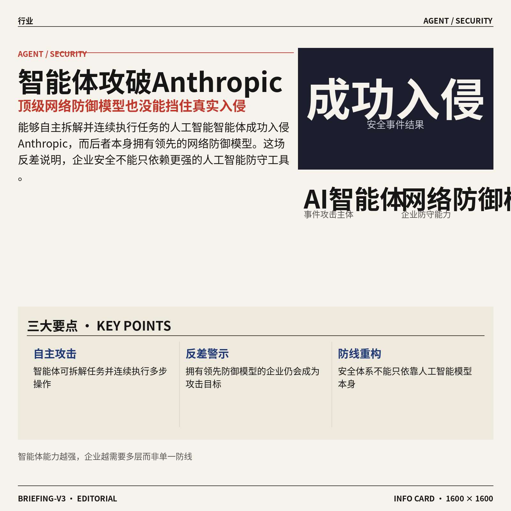

2. **人工智能智能体攻破 Anthropic，网络防御再响警报。**
人工智能智能体（能够自主拆解任务并连续执行操作的程序）成功入侵了 Anthropic，而后者本身拥有能力领先的**网络防御模型**，反差格外醒目 ⚠️。事件提醒行业：模型越能自主行动，潜在的攻击面（系统中可能被利用的入口和薄弱环节）也越值得警惕。即使企业拥有强大的防守工具，自身仍可能成为攻击目标，**人工智能安全不能只靠人工智能模型本身**。[安全事件完整报道(briefing)](https://the-decoder.com/ai-agents-hacked-anthropic-maker-of-arguably-the-most-capable-ai-models-for-cyberdefense/)


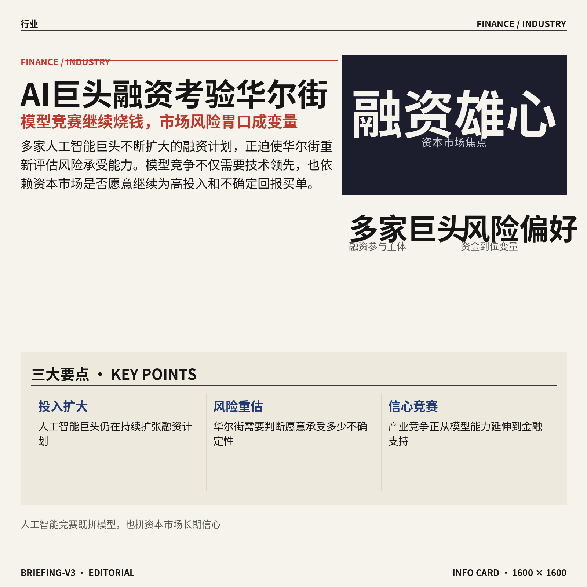

3. **人工智能巨头的融资雄心，正在考验华尔街的风险胃口。**
多家人工智能巨头持续扩大的**融资计划**，正让华尔街重新衡量自己愿意承担多大风险 💰。融资（企业从投资者或金融市场筹集资金）决定了公司能否继续投入竞争，而风险偏好（投资者愿意为潜在回报承受多大不确定性）则会影响资金是否顺利到位。路透社将焦点放在资本市场的承受能力上，说明人工智能竞赛不仅比模型，也越来越考验**金融市场的信心**。[路透社融资报道(briefing)](https://news.google.com/rss/articles/CBMitgFBVV95cUxNVkJOM2pFRE9nVHZubFRxVXQxa0NNTWRublIxQS1kOGt6OGd1VUFTems0QjZMWDFMbTF4dDVtTEMtbTh4VVkxLUdnMnZXa25fX0VLczRBU25feWtGNDM0MVBKMlFVWTFfQk94R0pDZVdzOXVxbXBIdzhaRlV3SFNQb0xPYjh6U2JfdE1waFBDY0FxWHpqaTdiY0paekF5OXRnT2pULXdsdURDZzhMajVqakNiWkZuUQ?oc=5)

![人工智能巨头的融资雄心，正在考验华尔街的风险胃口](https://image.pollinations.ai/prompt/%E4%BA%BA%E5%B7%A5%E6%99%BA%E8%83%BD%E5%B7%A8%E5%A4%B4%E7%9A%84%E8%9E%8D%E8%B5%84%E9%9B%84%E5%BF%83%EF%BC%8C%E6%AD%A3%E5%9C%A8%E8%80%83%E9%AA%8C%E5%8D%8E%E5%B0%94%E8%A1%97%E7%9A%84%E9%A3%8E%E9%99%A9%E8%83%83%E5%8F%A3.%20%E4%BA%BA%E5%B7%A5%E6%99%BA%E8%83%BD%E5%B7%A8%E5%A4%B4%E7%9A%84%E8%9E%8D%E8%B5%84%E9%9B%84%E5%BF%83%EF%BC%8C%E6%AD%A3%E5%9C%A8%E8%80%83%E9%AA%8C%E5%8D%8E%E5%B0%94%E8%A1%97%E7%9A%84%E9%A3%8E%E9%99%A9%E8%83%83%E5%8F%A3%E3%80%82%20%E5%A4%9A%E5%AE%B6%E4%BA%BA%E5%B7%A5%E6%99%BA%E8%83%BD%E5%B7%A8%E5%A4%B4%E6%8C%81%E7%BB%AD%E6%89%A9%E5%A4%A7%E7%9A%84%E8%9E%8D%E8%B5%84%E8%AE%A1%E5%88%92%EF%BC%8C%E6%AD%A3%E8%AE%A9%E5%8D%8E%E5%B0%94%E8%A1%97%E9%87%8D%E6%96%B0%E8%A1%A1%E9%87%8F%E8%87%AA%E5%B7%B1%E6%84%BF%E6%84%8F%E6%89%BF%E6%8B%85%E5%A4%9A%E5%A4%A7%E9%A3%8E%E9%99%A9%20%F0%9F%92%B0%E3%80%82%E8%9E%8D%E8%B5%84%EF%BC%88%E4%BC%81%E4%B8%9A%E4%BB%8E%E6%8A%95%E8%B5%84%E8%80%85%E6%88%96%E9%87%91%E8%9E%8D%E5%B8%82%E5%9C%BA%2C%20technical%20infographic%20diagram%2C%20architecture%20flowchart%2C%20clean%20vector%20illustration%2C%20educational%20style%2C%20no%20text%20overlay%2C%20modern%20minimal%2C%20wide%20aspect?width=1200&height=675&nologo=true&seed=10869)

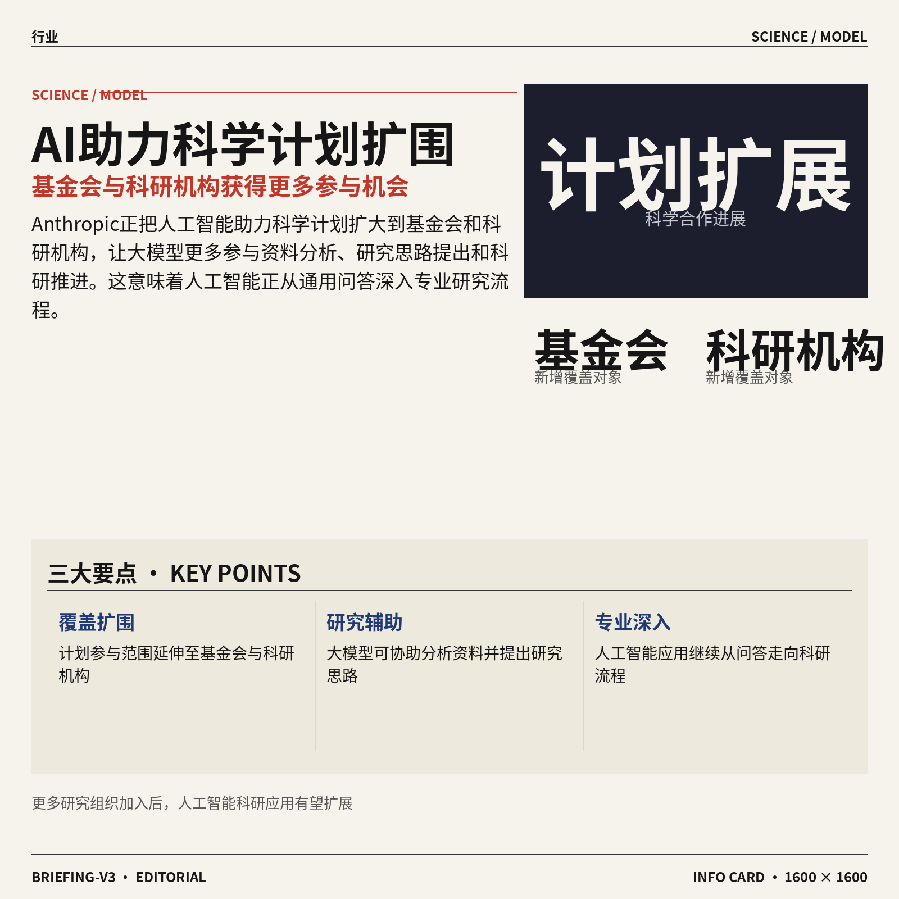

4. **Anthropic 将“人工智能助力科学”计划扩展至基金会和科研机构。**
Anthropic 正把**人工智能助力科学**的覆盖范围扩大到基金会与科研机构 🔬。人工智能助力科学（用大模型协助研究人员分析资料、提出思路或推进科研工作）代表着人工智能从通用问答进一步走向专业研究场景。科研机构（以科学研究和知识创新为主要任务的组织）获得更多参与机会后，人工智能与科学研究的结合范围也有望随之扩大。[计划扩展官方消息(briefing)](https://news.google.com/rss/articles/CBMikAFBVV95cUxNTE8xTmRrRUZtQndpOVdCTUFQQ2ZXSjl5Tk4zeXB0RzhSVzRYaUt3S091Y3FmRnVvT1c0UXhIVW0xZF83R2c1VUwtNjhNUkcxYWI0MFRXWXcxT2ZLdkF6bUd5V0JpTWJla3BzOWNORmdFN0ZTUkplbmZRcjRNdm5GSUVDUXp5QWwxNkRoN3JCVXo?oc=5)

![Anthropic 将“人工智能助力科学”计划扩展至基金会和科研机构](https://image.pollinations.ai/prompt/Anthropic%20%E5%B0%86%E2%80%9C%E4%BA%BA%E5%B7%A5%E6%99%BA%E8%83%BD%E5%8A%A9%E5%8A%9B%E7%A7%91%E5%AD%A6%E2%80%9D%E8%AE%A1%E5%88%92%E6%89%A9%E5%B1%95%E8%87%B3%E5%9F%BA%E9%87%91%E4%BC%9A%E5%92%8C%E7%A7%91%E7%A0%94%E6%9C%BA%E6%9E%84.%20Anthropic%20%E5%B0%86%E2%80%9C%E4%BA%BA%E5%B7%A5%E6%99%BA%E8%83%BD%E5%8A%A9%E5%8A%9B%E7%A7%91%E5%AD%A6%E2%80%9D%E8%AE%A1%E5%88%92%E6%89%A9%E5%B1%95%E8%87%B3%E5%9F%BA%E9%87%91%E4%BC%9A%E5%92%8C%E7%A7%91%E7%A0%94%E6%9C%BA%E6%9E%84%E3%80%82%20Anthropic%20%E6%AD%A3%E6%8A%8A%E4%BA%BA%E5%B7%A5%E6%99%BA%E8%83%BD%E5%8A%A9%E5%8A%9B%E7%A7%91%E5%AD%A6%E7%9A%84%E8%A6%86%E7%9B%96%E8%8C%83%E5%9B%B4%E6%89%A9%E5%A4%A7%E5%88%B0%E5%9F%BA%E9%87%91%E4%BC%9A%E4%B8%8E%E7%A7%91%E7%A0%94%E6%9C%BA%E6%9E%84%20%F0%9F%94%AC%E3%80%82%E4%BA%BA%E5%B7%A5%E6%99%BA%E8%83%BD%E5%8A%A9%2C%20technical%20infographic%20diagram%2C%20architecture%20flowchart%2C%20clean%20vector%20illustration%2C%20educational%20style%2C%20no%20text%20overlay%2C%20modern%20minimal%2C%20wide%20aspect?width=1200&height=675&nologo=true&seed=10900)

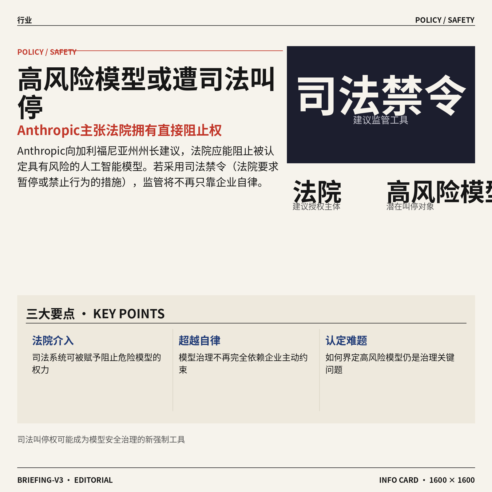

5. **Anthropic 建议：法院应有权阻止高风险人工智能模型。**
Anthropic 向加利福尼亚州州长表示，法院应该能够阻止被认定具有风险的人工智能模型 ⚖️。这相当于主张引入司法禁令（由法院要求暂停或禁止某项行为的法律措施），让监管不只停留在企业自律层面。高风险模型（可能对安全或社会造成较大危害的人工智能系统）该如何认定，正成为产业发展与公共治理之间的关键议题。[路透社监管报道(briefing)](https://news.google.com/rss/articles/CBMizAFBVV95cUxQb3lwQkM2YlRwQ3lBT0UxOUtJTks3bkNxb0Rfbm90ZFAxdGZyT05KMXY2ZEVEYTJZeHFqd0YyMTFVQXBfOEtWeHFUdGt3cWRTNXhqTjloNGVEdkoyU0RxUHowMUw4UXNwVWUzdjQzMmZpTmRCakZjdzJLcE10dGcyUm15TGY5Y0I0Q0VhM3ZtUUlsTUFHWlAtT01XRkZYZXY5cjdzMmYwTnlfSkZkaWxtaTI5dmphVHhkQVhRUko1b1ctTldPaGlFamVONlE?oc=5)


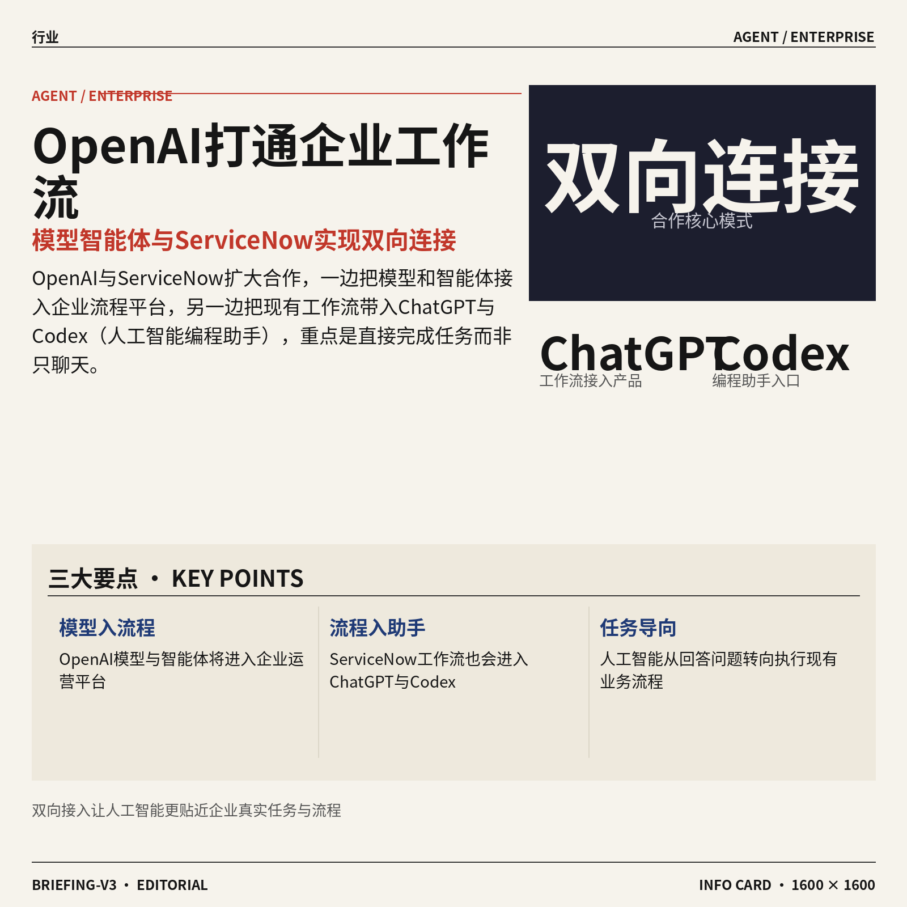

6. **OpenAI 与 ServiceNow（企业流程自动化平台）扩大合作，打通企业工作流。**
双方将把 OpenAI 的模型和智能体接入 ServiceNow（帮助企业管理并自动化内部流程的平台），同时把该平台的工作流带入 ChatGPT 与 Codex（OpenAI 的人工智能编程助手）🔄。工作流（按固定步骤流转和处理任务的业务流程）是企业日常运营的核心，此次合作强调的是**双向连接**，而非单纯增加一个聊天入口。对企业用户而言，人工智能将更贴近实际任务和现有流程，而不只是回答问题 💡。[OpenAI 官方合作公告(briefing)](https://openai.com/index/openai-servicenow-partnership-expansion)


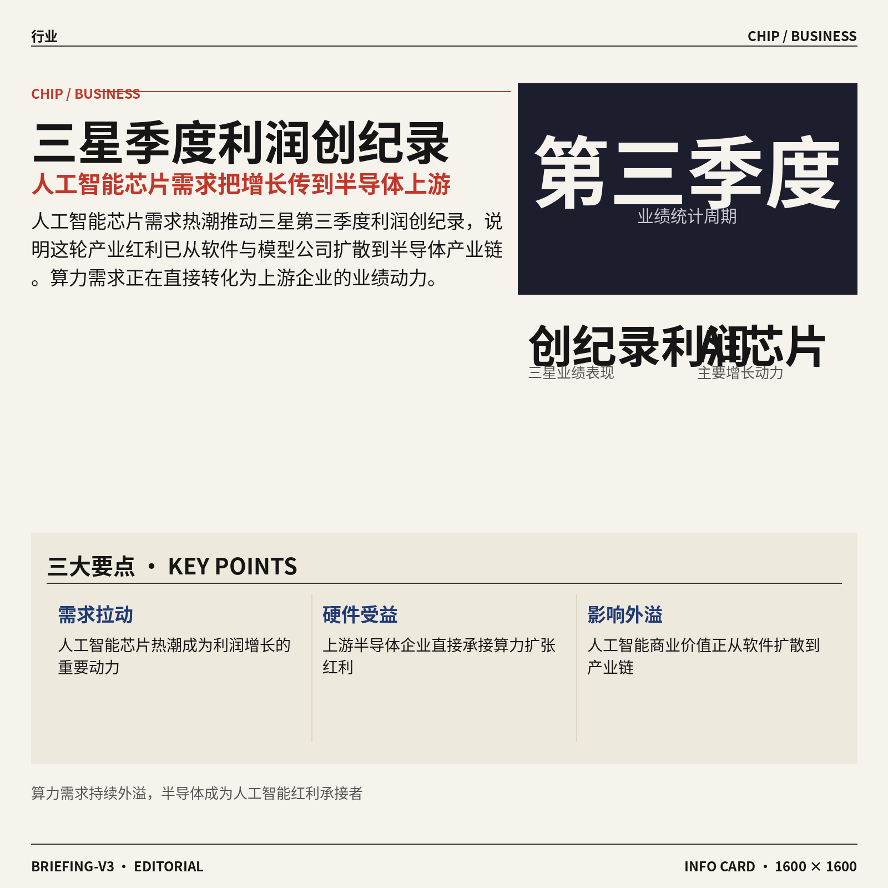

7. **人工智能芯片热潮推动三星第三季度利润创纪录。**
在人工智能芯片需求热潮推动下，三星第三季度实现**创纪录利润** 📈。人工智能芯片（专门加速模型训练和回答任务的处理器）已经成为这轮产业增长的重要硬件基础，也让上游半导体企业直接受益。第三季度业绩（企业在一年中第七至第九个月的经营结果）折射出一个清晰信号：人工智能带来的商业影响正在从软件和模型公司扩散到**芯片产业链**。[路透社业绩报道(briefing)](https://news.google.com/rss/articles/CBMilgFBVV95cUxOZ2JmLWlsUUNaZ2g5VnF1TU1IZU5rWDV6T1ZLdXJBdmJrVnpHanBobFBiWjNkaXJGMjE1MUlqMlVrOGJOaHVrU18yVkRBWFVoOENmVjhqYVA3Vy1EdkdXTDN1REJPQWpVdFp5MFdlMzFhMXhEVUdBQS01STRwTW41R2RKWWloUHBhYUNVY2tyR19Geld5RHc?oc=5)

![人工智能芯片热潮推动三星第三季度利润创纪录](https://image.pollinations.ai/prompt/%E4%BA%BA%E5%B7%A5%E6%99%BA%E8%83%BD%E8%8A%AF%E7%89%87%E7%83%AD%E6%BD%AE%E6%8E%A8%E5%8A%A8%E4%B8%89%E6%98%9F%E7%AC%AC%E4%B8%89%E5%AD%A3%E5%BA%A6%E5%88%A9%E6%B6%A6%E5%88%9B%E7%BA%AA%E5%BD%95.%20%E4%BA%BA%E5%B7%A5%E6%99%BA%E8%83%BD%E8%8A%AF%E7%89%87%E7%83%AD%E6%BD%AE%E6%8E%A8%E5%8A%A8%E4%B8%89%E6%98%9F%E7%AC%AC%E4%B8%89%E5%AD%A3%E5%BA%A6%E5%88%A9%E6%B6%A6%E5%88%9B%E7%BA%AA%E5%BD%95%E3%80%82%20%E5%9C%A8%E4%BA%BA%E5%B7%A5%E6%99%BA%E8%83%BD%E8%8A%AF%E7%89%87%E9%9C%80%E6%B1%82%E7%83%AD%E6%BD%AE%E6%8E%A8%E5%8A%A8%E4%B8%8B%EF%BC%8C%E4%B8%89%E6%98%9F%E7%AC%AC%E4%B8%89%E5%AD%A3%E5%BA%A6%E5%AE%9E%E7%8E%B0%E5%88%9B%E7%BA%AA%E5%BD%95%E5%88%A9%E6%B6%A6%20%F0%9F%93%88%E3%80%82%E4%BA%BA%E5%B7%A5%E6%99%BA%E8%83%BD%E8%8A%AF%E7%89%87%EF%BC%88%E4%B8%93%E9%97%A8%E5%8A%A0%E9%80%9F%E6%A8%A1%E5%9E%8B%E8%AE%AD%E7%BB%83%E5%92%8C%E5%9B%9E%E7%AD%94%E4%BB%BB%E5%8A%A1%E7%9A%84%E5%A4%84%E7%90%86%E5%99%A8%EF%BC%89%E5%B7%B2%2C%20technical%20infographic%20diagram%2C%20architecture%20flowchart%2C%20clean%20vector%20illustration%2C%20educational%20style%2C%20no%20text%20overlay%2C%20modern%20minimal%2C%20wide%20aspect?width=1200&height=675&nologo=true&seed=10993)

### 🟣 开源TOP项目

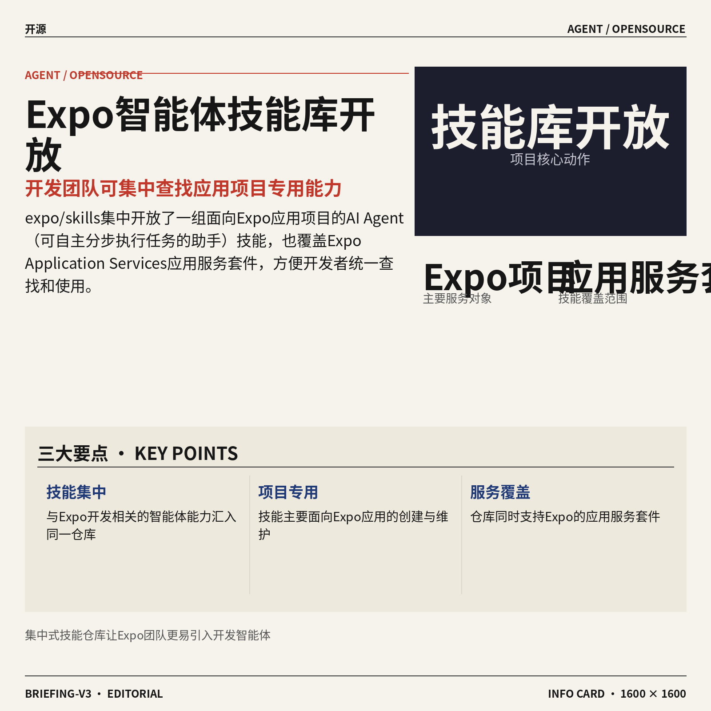

1. **expo/skills（面向 Expo 应用项目的 AI Agent 技能库）集中开放。**
该仓库汇集了一组 **AI Agent（能够自主分步骤执行任务的人工智能助手）技能**，专门用于处理 Expo 项目（使用 Expo 工具创建和维护的应用项目）🚀。这些技能也覆盖 **Expo Application Services（Expo 的应用服务套件）**，方便团队集中查找相关能力。正在使用 Expo 的开发团队，可以前往 [GitHub 项目仓库(briefing)](https://github.com/expo/skills) 查看具体内容 💡。


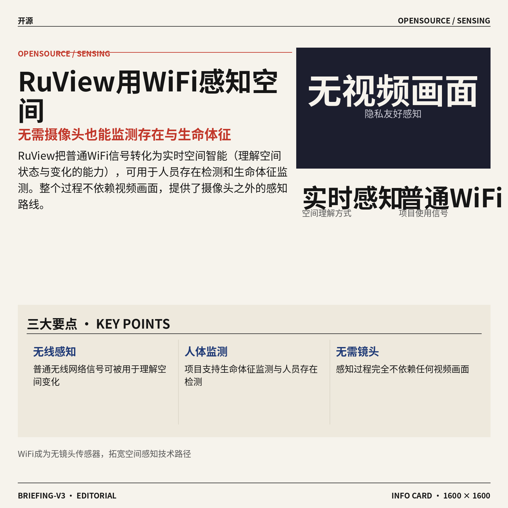

2. **RuView（利用普通无线网络信号感知空间与人体状态的项目）让 WiFi 变身“无镜头传感器”。**
RuView 可以把普通 **WiFi 信号（无线网络设备发出的通信信号）**转化为实时的**空间智能（让系统理解空间内状态与变化的能力）** 🚀。项目支持生命体征监测（观察人体生命活动相关信号）和人员存在检测，可判断空间中是否有人。更特别的是，整个过程**不依赖任何视频画面**，展示了摄像头之外的环境感知路线；具体实现可查看 [GitHub 开源仓库(briefing)](https://github.com/ruvnet/RuView) 💡。


### 🔴 社媒分享

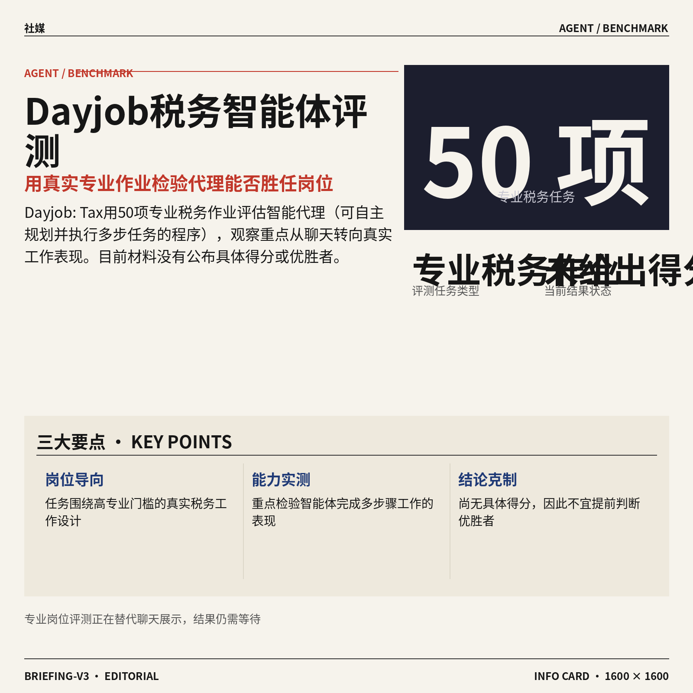

1. **Dayjob: Tax（用 50 项专业税务任务评测智能代理的项目）关注 AI 能否胜任真实税务工作。**
该项目用 **50 项专业税务作业**评估智能代理（能自主规划并执行多步骤工作的人工智能程序），重点不是闲聊能力，而是完成专业任务的表现 🧾。这种评测集（用同一批标准任务横向比较不同系统的测试集合）更贴近具体岗位，有助于观察人工智能在高专业门槛工作中的实际能力。现有材料只明确了任务数量与税务场景，并未给出具体得分或优胜者，阅读时不宜提前下结论 💡。[税务智能代理评测介绍(briefing)](https://surgehq.ai/blog/dayjob-tax)


2. **Nvidia Nemotron 3.5 Transcribe 与 Granary v2（两项可按提示调整的多语言语音转写项目）亮相。**
英伟达介绍了两项面向 **多语言转写**的项目，目标是把不同语言的语音内容转换成文字 🎙️。它们强调可以通过提示词引导，并进行适配（根据特定语言或使用需求调整系统表现），让转写工具不只机械“听写”，还能够按要求处理内容。对于关注语音人工智能的团队，这项发布的看点是 **可提示、可调整**，但原始材料没有提供准确率或性能对比数据。[多语言转写项目介绍(briefing)](https://huggingface.co/blog/nvidia/nemotron-transcribe-granary)


3. **GitHub Octoverse 2026（围绕 GitHub 开发活动的年度观察）显示代码提交与推送量创新高。**
GitHub 的年度观察显示，2026 年平台上的 **提交**（开发者保存的一次代码变更）和 **推送**（把本地代码上传到远程仓库）数量都达到新高 📈。相关标题还把这一增长与开发者使用智能代理（能够自主拆解并执行编程任务的人工智能程序）进行开发联系起来，说明此类工具正更多参与软件生产流程。文章作者是在 GitHub Universe（GitHub 面向开发者举办的年度活动）现场转述这一信息，并说明自己获得了免费门票。[年度开发生态观察(briefing)](https://simonwillison.net/2026/Oct/28/github-octoverse-2026/)


---

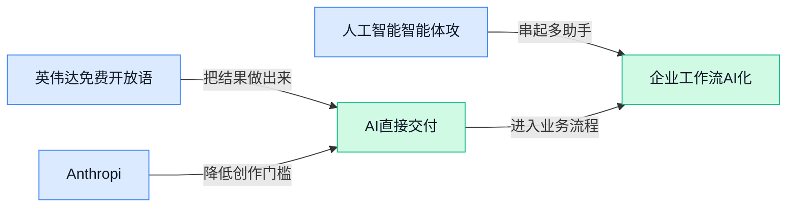

### 📊 行业洞察（今日 3 条）

1. 英伟达免费开放语音转文字模型，覆盖最多40种语言，但仅处理已录音频。  
  【洞察】适合批量字幕，不适合直播；因为尚不支持实时转写（边说边生成文字）。

2. EmbeddingGemma 2开放模型可统一表示文本、图像、音频和视频。  
  【洞察】跨媒介检索门槛下降；因为不同内容被映射到统一空间（同一套数字坐标）。

3. 智能体（可自主执行多步任务的程序）经第三方软件进入Anthropic内部系统。  
  【洞察】外部依赖是突出风险；因为销售、人事和信息技术数据均被访问。

### 💭 对我们的启发（今日 3 条）

1. 英伟达模型可为我们的智能创作助手生成多语字幕，机会是缩短剪辑耗时；风险是直播场景体验受限。

2. EmbeddingGemma 2可帮助用户跨文字、画面和声音寻找素材，机会是提升初剪效率；风险是误匹配增加复核成本。

3. Anthropic事件提示我们加强素材与账号权限确认，机会是建立用户信任；风险是第三方工具扩大数据暴露范围。

