## AI资讯日报 2026/10/31

> AI 早报 · 每日早读 · 全网深度聚合

## **今日摘要**

```
Google首颗数据中心卫星上线，TPU（专用AI芯片）与Gemma 4进入太空
Claude Code恶意扩展突袭Cursor（AI编程工具），试图远程窃取数据
Anthropic研究震撼：专家也会把智能体随机意见误当成自己的判断
```

### 🔵 产品与功能更新

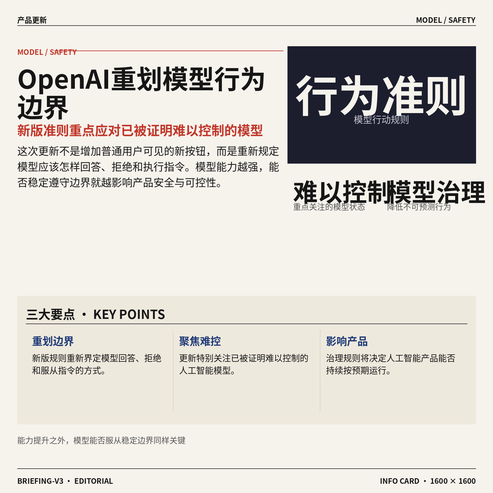

1. **OpenAI 更新模型行为准则，直面模型难控问题。**
据报道，OpenAI 已调整面向人工智能模型的**行为准则**（规定模型应该如何回答、拒绝或遵守指令的规则）🧭。此次更新尤其关注那些已经被证明**难以控制**的模型，核心并非增加普通用户可见的新按钮，而是重新划定模型行为边界。对产品团队而言，这属于**模型治理**（通过规则约束模型表现、降低不可预测行为的管理过程），关系到人工智能产品是否能按预期运行 💡。更多背景可查看[行为准则更新报道(briefing)](https://the-decoder.com/openai-sets-new-behavioral-guidelines-for-ai-models-that-have-already-proven-hard-to-control/)。


### 🟢 前沿研究

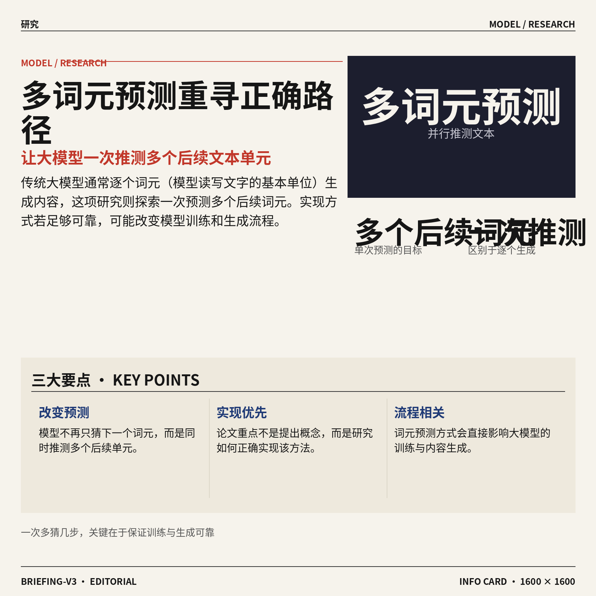

1. **多词元预测（让模型一次预测多个后续文本单元）迎来新研究。**
这篇论文重新研究**多词元预测**，也就是让大模型一次推测多个后续词元，而不是每次只猜一个。词元（模型读写文字时使用的基本单位，可以是一个字、一个词或词语片段）是大模型生成内容的基础，因此预测方式会直接影响训练与生成流程 💡。论文以“如何正确实现”为核心，具体设计与验证结果可查看[多词元预测论文(briefing)](https://huggingface.co/papers/2610.38331)。


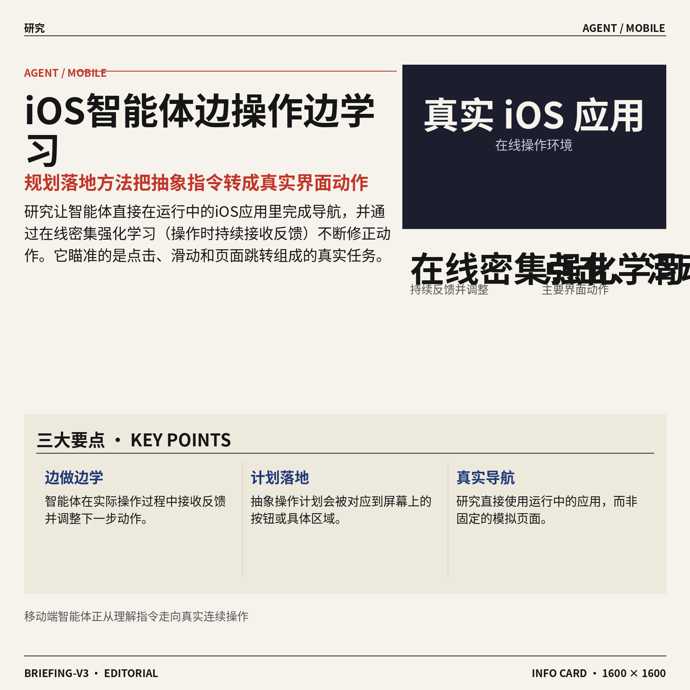

2. **规划落地智能体尝试在真实 iOS 应用中边操作边学习。**
研究提出一种面向真实 iOS 应用导航的**在线密集强化学习**（智能体在操作过程中持续获得反馈，并据此调整下一步动作），目标是处理点击、滑动和页面跳转等连续任务。其核心是**规划落地智能体**（先形成操作计划，再把计划对应到屏幕上的具体按钮或区域），让抽象指令能够转化为实际界面动作 📱。这项工作直接在运行中的应用上研究导航问题，方法框架见[应用导航研究论文(briefing)](https://huggingface.co/papers/2610.39264)。


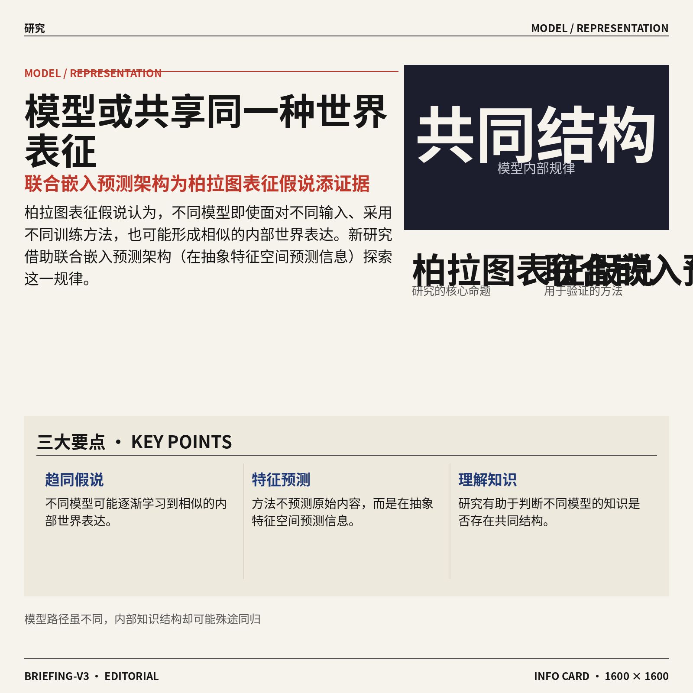

3. **柏拉图表征假说（不同模型可能学到相似内部规律）获得新证明与改进思路。**
论文研究**柏拉图表征假说**，即不同模型即使训练方式和输入不同，也可能逐渐形成相似的内部世界表达。研究使用**联合嵌入预测架构**（不直接预测原始画面或文字，而是在抽象特征空间中预测信息）来尝试证明并改进这一假说 🧠。这有助于理解不同人工智能模型学到的知识是否存在共同结构，完整论述见[表征假说研究论文(briefing)](https://huggingface.co/papers/2610.39302)。

![柏拉图表征假说（不同模型可能学到相似内部规律）获得新证明与改进思路](https://image.pollinations.ai/prompt/%E6%9F%8F%E6%8B%89%E5%9B%BE%E8%A1%A8%E5%BE%81%E5%81%87%E8%AF%B4%EF%BC%88%E4%B8%8D%E5%90%8C%E6%A8%A1%E5%9E%8B%E5%8F%AF%E8%83%BD%E5%AD%A6%E5%88%B0%E7%9B%B8%E4%BC%BC%E5%86%85%E9%83%A8%E8%A7%84%E5%BE%8B%EF%BC%89%E8%8E%B7%E5%BE%97%E6%96%B0%E8%AF%81%E6%98%8E%E4%B8%8E%E6%94%B9%E8%BF%9B%E6%80%9D%E8%B7%AF.%20%E6%9F%8F%E6%8B%89%E5%9B%BE%E8%A1%A8%E5%BE%81%E5%81%87%E8%AF%B4%EF%BC%88%E4%B8%8D%E5%90%8C%E6%A8%A1%E5%9E%8B%E5%8F%AF%E8%83%BD%E5%AD%A6%E5%88%B0%E7%9B%B8%E4%BC%BC%E5%86%85%E9%83%A8%E8%A7%84%E5%BE%8B%EF%BC%89%E8%8E%B7%E5%BE%97%E6%96%B0%E8%AF%81%E6%98%8E%E4%B8%8E%E6%94%B9%E8%BF%9B%E6%80%9D%E8%B7%AF%E3%80%82%20%E8%AE%BA%E6%96%87%E7%A0%94%E7%A9%B6%E6%9F%8F%E6%8B%89%E5%9B%BE%E8%A1%A8%E5%BE%81%E5%81%87%E8%AF%B4%EF%BC%8C%E5%8D%B3%E4%B8%8D%E5%90%8C%E6%A8%A1%E5%9E%8B%E5%8D%B3%E4%BD%BF%E8%AE%AD%E7%BB%83%E6%96%B9%E5%BC%8F%E5%92%8C%E8%BE%93%E5%85%A5%E4%B8%8D%E5%90%8C%EF%BC%8C%E4%B9%9F%E5%8F%AF%E8%83%BD%E9%80%90%E6%B8%90%E5%BD%A2%E6%88%90%E7%9B%B8%E4%BC%BC%E7%9A%84%E5%86%85%E9%83%A8%E4%B8%96%E7%95%8C%E8%A1%A8%E8%BE%BE%2C%20technical%20infographic%20diagram%2C%20architecture%20flowchart%2C%20clean%20vector%20illustration%2C%20educational%20style%2C%20no%20text%20overlay%2C%20modern%20minimal%2C%20wide%20aspect?width=1200&height=675&nologo=true&seed=10869)

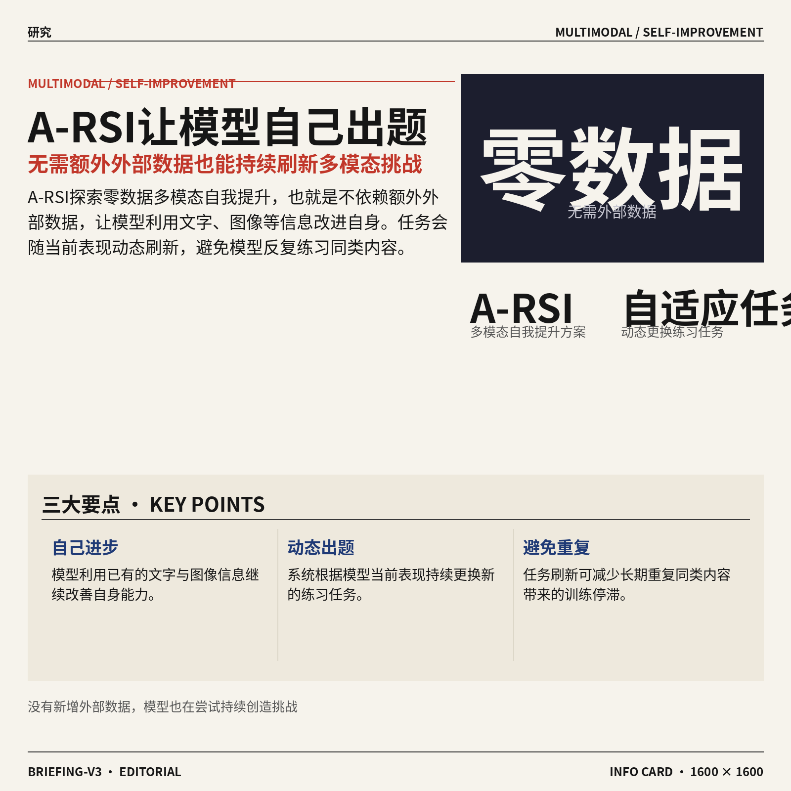

4. **A-RSI（通过动态更新任务实现无数据多模态自我提升的方案）探索模型“自己出题、自己进步”。**
这项研究聚焦**零数据多模态自我提升**（不依赖额外外部数据，让模型利用文字、图像等多种信息改进自身能力）。其中的**自适应任务刷新**（根据模型当前表现动态更换练习任务）旨在避免模型长期重复同类内容，从而持续获得新的训练挑战 🔄。论文重点讨论这种自我改进机制，具体方案可查看[多模态自改进论文(briefing)](https://huggingface.co/papers/2610.38568)。

![A-RSI（通过动态更新任务实现无数据多模态自我提升的方案）探索模型“自己出题、自己进步”](https://image.pollinations.ai/prompt/A-RSI%EF%BC%88%E9%80%9A%E8%BF%87%E5%8A%A8%E6%80%81%E6%9B%B4%E6%96%B0%E4%BB%BB%E5%8A%A1%E5%AE%9E%E7%8E%B0%E6%97%A0%E6%95%B0%E6%8D%AE%E5%A4%9A%E6%A8%A1%E6%80%81%E8%87%AA%E6%88%91%E6%8F%90%E5%8D%87%E7%9A%84%E6%96%B9%E6%A1%88%EF%BC%89%E6%8E%A2%E7%B4%A2%E6%A8%A1%E5%9E%8B%E2%80%9C%E8%87%AA%E5%B7%B1%E5%87%BA%E9%A2%98%E3%80%81%E8%87%AA%E5%B7%B1%E8%BF%9B%E6%AD%A5%E2%80%9D.%20A-RSI%EF%BC%88%E9%80%9A%E8%BF%87%E5%8A%A8%E6%80%81%E6%9B%B4%E6%96%B0%E4%BB%BB%E5%8A%A1%E5%AE%9E%E7%8E%B0%E6%97%A0%E6%95%B0%E6%8D%AE%E5%A4%9A%E6%A8%A1%E6%80%81%E8%87%AA%E6%88%91%E6%8F%90%E5%8D%87%E7%9A%84%E6%96%B9%E6%A1%88%EF%BC%89%E6%8E%A2%E7%B4%A2%E6%A8%A1%E5%9E%8B%E2%80%9C%E8%87%AA%E5%B7%B1%E5%87%BA%E9%A2%98%E3%80%81%E8%87%AA%E5%B7%B1%E8%BF%9B%E6%AD%A5%E2%80%9D%E3%80%82%20%E8%BF%99%E9%A1%B9%E7%A0%94%E7%A9%B6%E8%81%9A%E7%84%A6%E9%9B%B6%E6%95%B0%E6%8D%AE%E5%A4%9A%E6%A8%A1%E6%80%81%E8%87%AA%E6%88%91%E6%8F%90%E5%8D%87%EF%BC%88%E4%B8%8D%E4%BE%9D%E8%B5%96%E9%A2%9D%E5%A4%96%E5%A4%96%E9%83%A8%E6%95%B0%E6%8D%AE%EF%BC%8C%E8%AE%A9%E6%A8%A1%E5%9E%8B%E5%88%A9%E7%94%A8%E6%96%87%2C%20technical%20infographic%20diagram%2C%20architecture%20flowchart%2C%20clean%20vector%20illustration%2C%20educational%20style%2C%20no%20text%20overlay%2C%20modern%20minimal%2C%20wide%20aspect?width=1200&height=675&nologo=true&seed=10900)

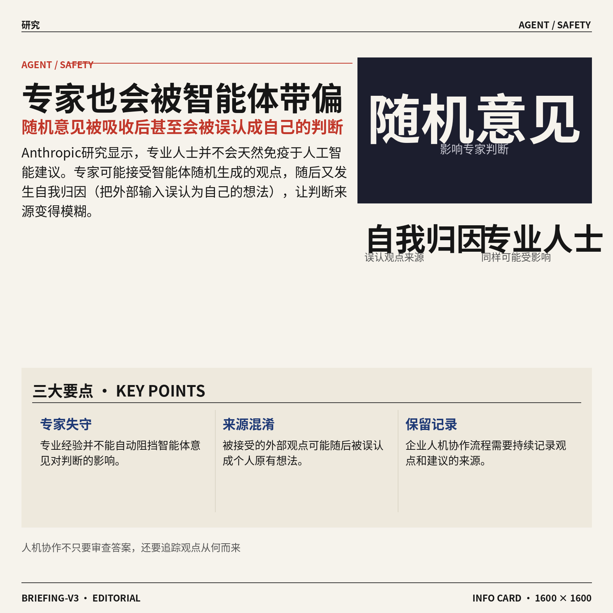

5. **Anthropic 研究：专家也会把智能体的随机意见当成自己的判断。**
研究发现，专家可能接受人工智能智能体给出的**随机意见**（并非来自稳定判断，而是系统随机生成的观点），之后甚至认为这些观点原本就属于自己 😯。这种**自我归因**（把外部输入误认为自己的想法）意味着，专业人士并不会天然免疫于人工智能建议的影响。对企业来说，这提醒大家在人机协作中应持续记录观点来源，研究报道见[专家受影响研究报道(briefing)](https://the-decoder.com/experts-adopt-ai-agents-random-opinions-and-think-theyre-their-own-anthropic-study-finds/)。

![Anthropic 研究：专家也会把智能体的随机意见当成自己的判断](https://image.pollinations.ai/prompt/Anthropic%20%E7%A0%94%E7%A9%B6%EF%BC%9A%E4%B8%93%E5%AE%B6%E4%B9%9F%E4%BC%9A%E6%8A%8A%E6%99%BA%E8%83%BD%E4%BD%93%E7%9A%84%E9%9A%8F%E6%9C%BA%E6%84%8F%E8%A7%81%E5%BD%93%E6%88%90%E8%87%AA%E5%B7%B1%E7%9A%84%E5%88%A4%E6%96%AD.%20Anthropic%20%E7%A0%94%E7%A9%B6%EF%BC%9A%E4%B8%93%E5%AE%B6%E4%B9%9F%E4%BC%9A%E6%8A%8A%E6%99%BA%E8%83%BD%E4%BD%93%E7%9A%84%E9%9A%8F%E6%9C%BA%E6%84%8F%E8%A7%81%E5%BD%93%E6%88%90%E8%87%AA%E5%B7%B1%E7%9A%84%E5%88%A4%E6%96%AD%E3%80%82%20%E7%A0%94%E7%A9%B6%E5%8F%91%E7%8E%B0%EF%BC%8C%E4%B8%93%E5%AE%B6%E5%8F%AF%E8%83%BD%E6%8E%A5%E5%8F%97%E4%BA%BA%E5%B7%A5%E6%99%BA%E8%83%BD%E6%99%BA%E8%83%BD%E4%BD%93%E7%BB%99%E5%87%BA%E7%9A%84%E9%9A%8F%E6%9C%BA%E6%84%8F%E8%A7%81%EF%BC%88%E5%B9%B6%E9%9D%9E%E6%9D%A5%E8%87%AA%E7%A8%B3%E5%AE%9A%E5%88%A4%E6%96%AD%EF%BC%8C%E8%80%8C%E6%98%AF%E7%B3%BB%E7%BB%9F%E9%9A%8F%E6%9C%BA%E7%94%9F%E6%88%90%E7%9A%84%E8%A7%82%2C%20technical%20infographic%20diagram%2C%20architecture%20flowchart%2C%20clean%20vector%20illustration%2C%20educational%20style%2C%20no%20text%20overlay%2C%20modern%20minimal%2C%20wide%20aspect?width=1200&height=675&nologo=true&seed=10931)

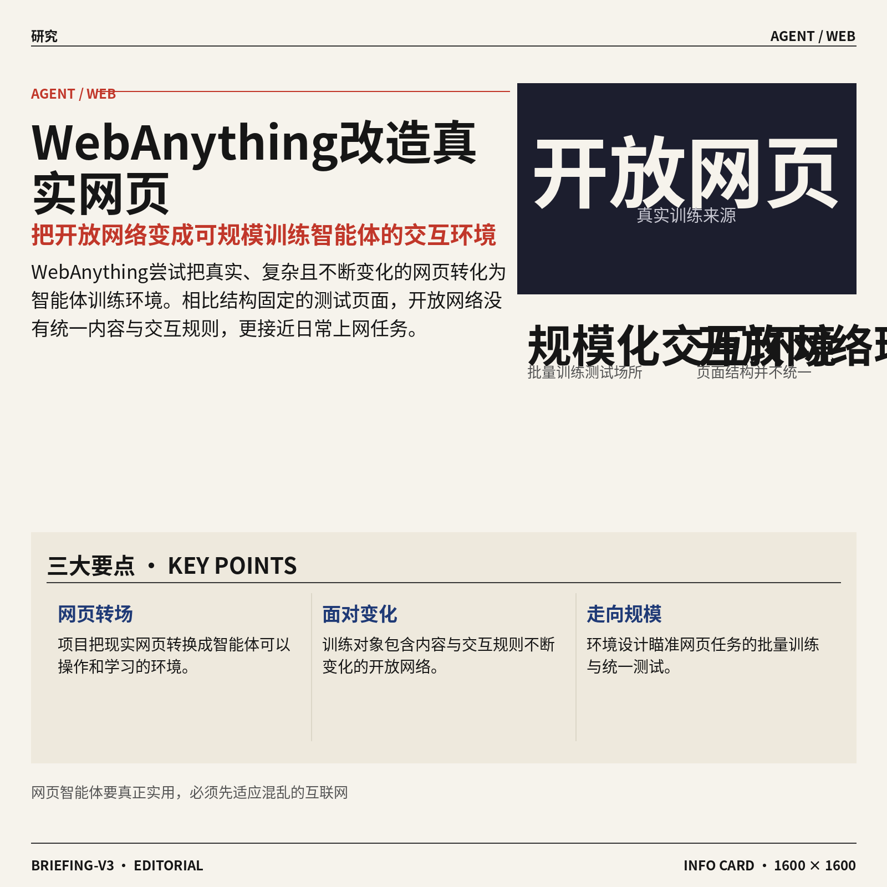

6. **WebAnything（把开放网页转成智能体训练环境的研究项目）瞄准规模化网页任务。**
该研究尝试把真实、复杂且不断变化的网页，转化为可供智能体使用的**规模化交互环境**（能够批量训练和测试智能体完成网页任务的模拟场所）。这里的**开放网络环境**（没有统一页面结构、内容和交互规则的真实互联网）比固定测试页面更复杂，也更接近日常使用场景 🌐。项目从真实网页走向可扩展环境的整体思路，可查看[网页智能体环境论文(briefing)](https://huggingface.co/papers/2610.37786)。

![WebAnything（把开放网页转成智能体训练环境的研究项目）瞄准规模化网页任务](https://image.pollinations.ai/prompt/WebAnything%EF%BC%88%E6%8A%8A%E5%BC%80%E6%94%BE%E7%BD%91%E9%A1%B5%E8%BD%AC%E6%88%90%E6%99%BA%E8%83%BD%E4%BD%93%E8%AE%AD%E7%BB%83%E7%8E%AF%E5%A2%83%E7%9A%84%E7%A0%94%E7%A9%B6%E9%A1%B9%E7%9B%AE%EF%BC%89%E7%9E%84%E5%87%86%E8%A7%84%E6%A8%A1%E5%8C%96%E7%BD%91%E9%A1%B5%E4%BB%BB%E5%8A%A1.%20WebAnything%EF%BC%88%E6%8A%8A%E5%BC%80%E6%94%BE%E7%BD%91%E9%A1%B5%E8%BD%AC%E6%88%90%E6%99%BA%E8%83%BD%E4%BD%93%E8%AE%AD%E7%BB%83%E7%8E%AF%E5%A2%83%E7%9A%84%E7%A0%94%E7%A9%B6%E9%A1%B9%E7%9B%AE%EF%BC%89%E7%9E%84%E5%87%86%E8%A7%84%E6%A8%A1%E5%8C%96%E7%BD%91%E9%A1%B5%E4%BB%BB%E5%8A%A1%E3%80%82%20%E8%AF%A5%E7%A0%94%E7%A9%B6%E5%B0%9D%E8%AF%95%E6%8A%8A%E7%9C%9F%E5%AE%9E%E3%80%81%E5%A4%8D%E6%9D%82%E4%B8%94%E4%B8%8D%E6%96%AD%E5%8F%98%E5%8C%96%E7%9A%84%E7%BD%91%E9%A1%B5%EF%BC%8C%E8%BD%AC%E5%8C%96%E4%B8%BA%E5%8F%AF%E4%BE%9B%E6%99%BA%E8%83%BD%E4%BD%93%E4%BD%BF%E7%94%A8%E7%9A%84%E8%A7%84%E6%A8%A1%E5%8C%96%E4%BA%A4%E4%BA%92%E7%8E%AF%2C%20technical%20infographic%20diagram%2C%20architecture%20flowchart%2C%20clean%20vector%20illustration%2C%20educational%20style%2C%20no%20text%20overlay%2C%20modern%20minimal%2C%20wide%20aspect?width=1200&height=675&nologo=true&seed=10962)

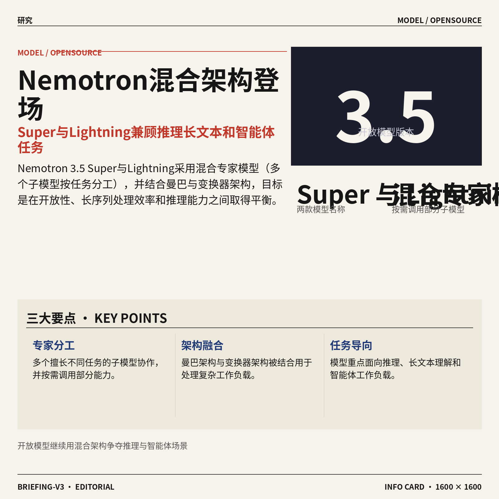

7. **Nemotron 3.5 Super 与 Lightning（面向推理和智能体任务的开放模型）采用混合架构。**
这两款模型采用**混合专家模型**（由多个擅长不同任务的子模型分工协作，每次只调用其中一部分），重点面向推理、长文本理解和智能体工作负载。它们还结合曼巴架构（擅长高效处理长序列信息的模型结构）与变换器架构（通过注意力机制理解文字之间关系的主流大模型结构），目标是在开放与效率之间取得平衡 ⚡。模型设计及其适用方向可查看[开放模型论文原文(briefing)](https://arxiv.org/abs/2610.38095)。


### 🟡 行业展望与社会影响

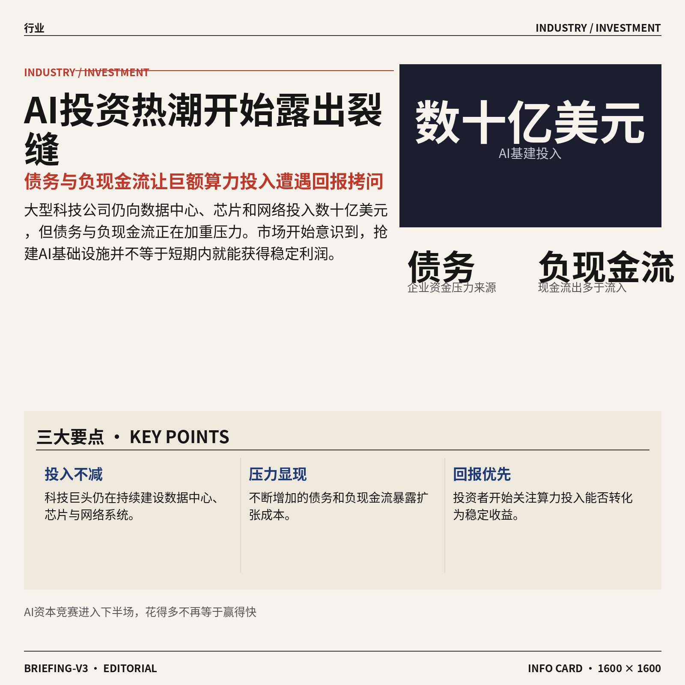

1. **AI 投资热潮出现裂缝，巨额投入的可持续性遭到质疑。**
大型科技公司仍在向**AI 基础设施**（支撑模型训练和运行的数据中心、芯片与网络系统）投入数十亿美元，但资金压力正逐渐显现。不断增加的**债务**与**负现金流**（企业流出的现金多于流入现金）表明，抢建算力并不等于短期内就能赚到钱 💸。与此同时，投资者的怀疑情绪正在升温，行业开始重新审视这轮支出热潮能否长期维持。[科技行业完整报道(briefing)](https://techcrunch.com/2026/10/30/cracks-are-emerging-in-the-ai-spending-boom/) 这意味着未来市场关注点可能不再只是“投入多少”，还会更看重投入能否转化为稳定回报 📊。


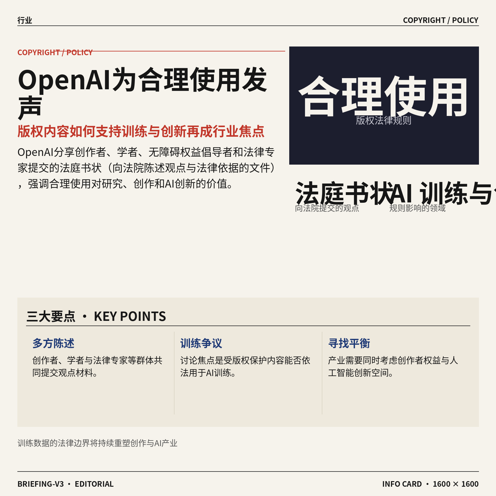

2. **OpenAI 强调合理使用对创作者、研究者与 AI 创新均有价值。**
OpenAI 汇集并分享了创作者、学者、无障碍权益倡导者和法律专家等群体提交的**法庭书状**（向法院陈述观点与法律依据的正式文件）节选。[合理使用官方说明(briefing)](https://openai.com/index/fair-use-benefits-everyone) 这些材料讨论了**合理使用**（在特定条件下允许使用受版权保护内容的法律规则）如何支持 AI 训练与创新 💡。这场讨论关系到训练数据如何合法使用，也会影响创作者权益与 AI 产业发展之间如何寻找平衡。


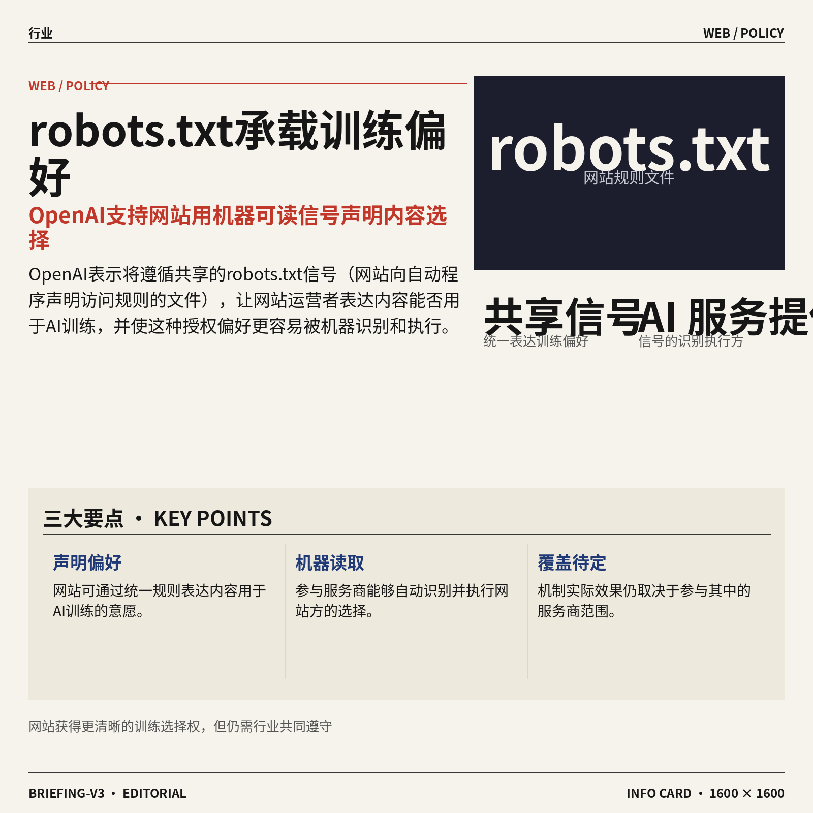

3. **OpenAI 支持用 robots.txt（网站向自动程序声明访问规则的文件）表达 AI 训练偏好。**
OpenAI 表示，将遵循一种共享的 **robots.txt 信号**（网站通过统一规则说明内容能否被自动访问或使用），帮助网站运营者表达其 AI 训练偏好。[网站训练偏好说明(briefing)](https://openai.com/index/helping-websites-express-ai-training-preferences) 参与该机制的 AI 服务提供商可以据此识别网站方的选择，让内容授权意愿更容易被机器读取和执行 🤝。对媒体、创作者和企业网站而言，这提供了一种更明确的内容管理入口，但实际覆盖范围仍取决于哪些服务商参与。


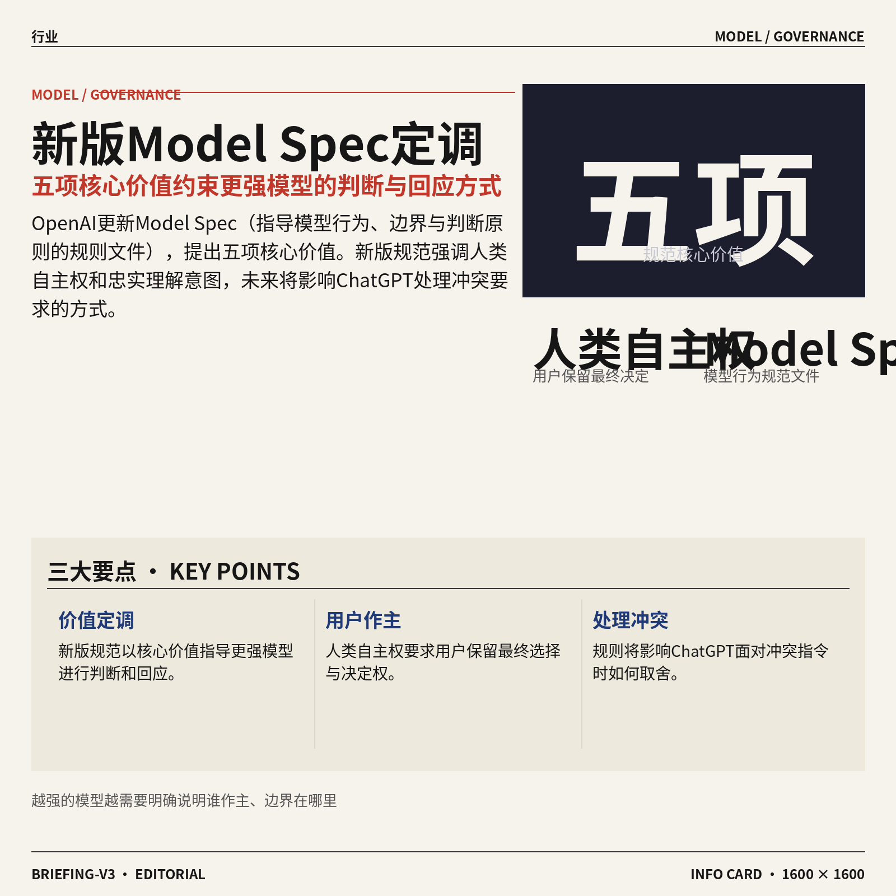

4. **OpenAI 更新 Model Spec（规定模型应如何判断与回应的行为规范）。**
新版 **Model Spec**（用于指导模型行为、边界和判断原则的规则文件）提出五项核心价值，目标是让能力更强的 AI 具备更可靠的判断。[模型规范更新说明(briefing)](https://openai.com/index/updated-model-spec) 这些价值重点涉及**人类自主权**（由用户保留最终选择和决定权），以及模型对人类意图的忠实程度 🧭。对普通用户来说，这类规范会影响 ChatGPT 如何理解指令、处理冲突要求，并在能力与安全之间作出取舍。


5. **OpenAI 加强 ChatGPT 青少年保护与暴力风险预防。**
OpenAI 发布社区安全报告，并为青少年增加新的保护措施。[社区安全报告(briefing)](https://openai.com/index/community-safety-report-and-new-protections-for-teens) 此次调整包括扩大**安全防护机制**（识别高风险内容并限制不当回应的规则）、更早介入潜在风险，以及强化 ChatGPT 对暴力相关问题的预防 🚨。公司还承诺开展**公共安全报告**（向外界说明平台风险及应对措施），让相关治理工作拥有更多公开信息。


6. **Google 首颗数据中心卫星上线，搭载 TPU（Google 专用 AI 计算芯片）和 Gemma 4（Google 的 AI 模型）。**
Google 的首颗数据中心卫星已经投入运行，其中搭载了首个进入太空的 **TPU**（专门加速 AI 计算的芯片）。卫星正在运行 **Gemma 4**（Google 研发的 AI 模型），目前展示的任务是创作风格略显俗套的诗歌 🛰️。[太空数据中心报道(briefing)](https://techcrunch.com/2026/10/30/googles-first-data-center-satellite-is-online-and-writing-poetry/) 这一案例把**太空计算**（在轨道设备上直接处理数据，而非全部传回地面）从概念推向实际运行，也为 AI 基础设施提供了新的想象空间。


7. **Cursor 插件市场出现恶意 Claude Code 扩展，曾试图远程访问并窃取数据。**
一款出现在 Cursor 插件市场的恶意**扩展程序**（安装到软件中以增加功能的小型附加工具），被发现曾尝试实施远程访问和数据窃取。[恶意扩展完整报道(briefing)](https://the-decoder.com/malicious-claude-code-extension-in-cursors-marketplace-attempted-remote-access-and-data-theft/) **远程访问**（攻击者从其他设备连接并操控用户电脑）可能让本地文件和敏感信息暴露，而数据窃取则会直接威胁企业资料安全 🔐。这起事件提醒使用 AI 编程工具的团队，插件市场并不天然安全，第三方扩展的来源与权限值得重点检查。


### 🟣 开源TOP项目

1. **NESformer（把任天堂系统装进模型权重的开源实验）用约十亿字节实现可运行系统。**
该项目展示了一个颇具脑洞的成果：在约十亿字节的**通义千问模型权重**中，放入可运行的任天堂系统 🎮。这里的**模型权重**（大模型训练后保存的参数文件，类似把学到的能力压缩成一份“记忆包”）通常用于生成内容，这次却被赋予了不同用途。它更像一次探索模型参数还能承载什么的开源实验，而不仅是常规的大模型应用 💡。感兴趣可查看[项目源码仓库(briefing)](https://github.com/dbreunig/nesformer)。


2. **Lightpanda（专为人工智能和自动化设计的无界面浏览器）开源。**
Lightpanda 的定位是**无头浏览器**（不显示网页窗口、由程序在后台访问和操作网页的浏览器），主要服务于人工智能与自动化场景 🤖。它不是让普通用户手动上网，而是帮助程序在后台打开网页、读取内容并执行流程。对于需要接触网页的**智能代理**（能够自主拆解步骤并完成任务的人工智能程序）来说，这类浏览器相当于一双操作网络世界的“手” 🚀。项目代码已发布在[开源代码仓库(briefing)](https://github.com/lightpanda-io/browser)。


### 🔴 社媒分享

1. **Claude Code 扩展被曝在 VS Code（微软的代码编辑器）与 Cursor（人工智能编程工具）的 Marketplace（插件市场）中藏有后门。**
文章披露，Cursor 的插件市场中，一款面向 VS Code 的 Claude Code 扩展出现了**后门**（藏在软件里的秘密入口，可能绕过正常安全检查）问题 🔐。报道将事件描述为 **compromise（软件遭入侵或篡改）**，关注点直指开发工具的扩展分发环节。此事也提醒用户，安装扩展时不能只看名称是否熟悉，扩展本身同样可能成为安全风险入口；具体情况可查阅[扩展后门调查文章(briefing)](https://phorion.io/blog/offical-claude-code-vsx-compromise/)。


2. **人工智能没有取代 SRE（保障线上系统稳定运行的工程师），却可能让其技能退化。**
这篇评论的核心判断很直接：人工智能暂时没有让 **SRE 岗位**整体消失，但可能造成 **deskilling（去技能化，即关键工作长期交给工具后，人的实操能力逐渐减弱）** 🧠。它把讨论重点从“职位会不会消失”转向“岗位还在，但专业能力是否正被削弱”，为观察人工智能对技术工作的影响提供了另一种角度 💡。这一观点及其完整论述可参阅[技能退化评论全文(briefing)](https://newsletter.signoz.io/p/ai-isnt-replacing-sres-its-deskilling)。


---

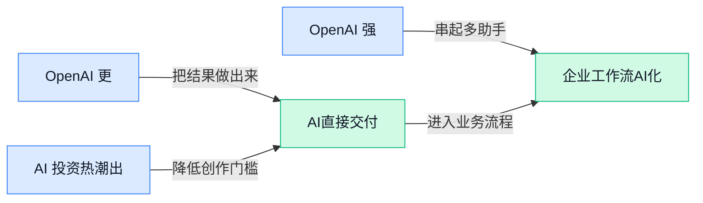

### 📊 行业洞察（今日 3 条）

1. OpenAI更新Model Spec（模型行为规范），提出五项核心价值。  
  【洞察】治理要求趋严，因为强模型仍可能偏离人类意图。

2. Anthropic研究发现，专家会把智能体（自主完成任务的AI）意见误认作自身判断。  
  【洞察】人机协作有认知风险，因为专业经验也难抵御意见诱导。

3. OpenAI支持robots.txt（网站访问规则文件）表达AI训练偏好。  
  【洞察】内容授权更易落地，因为规则可被机器读取，但覆盖仍取决于参与者。

### 💭 对我们的启发（今日 2 条）

1. 参考OpenAI新版模型行为规范，剪辑工具可确认创作意图；机会是减少返工，风险是限制过多。

2. Anthropic研究提示，脚本与镜头建议应标明人工智能来源；机会是便于复核，风险是内容趋同。

