## AI资讯日报 2026/11/4

> AI 早报 · 每日早读 · 全网深度聚合

## **今日摘要**

```
OpenAI称ChatGPT联网搜索规模约达Google的20%，搜索战直逼巨头腹地
Postman（接口开发工具）被曝静默安装AI插件，试图共享全部API数据
Google研究员促公司公开AI认知，科技巨头隐性AI债务半年增90%至3.2万亿美元
```

### 🔵 产品与功能更新

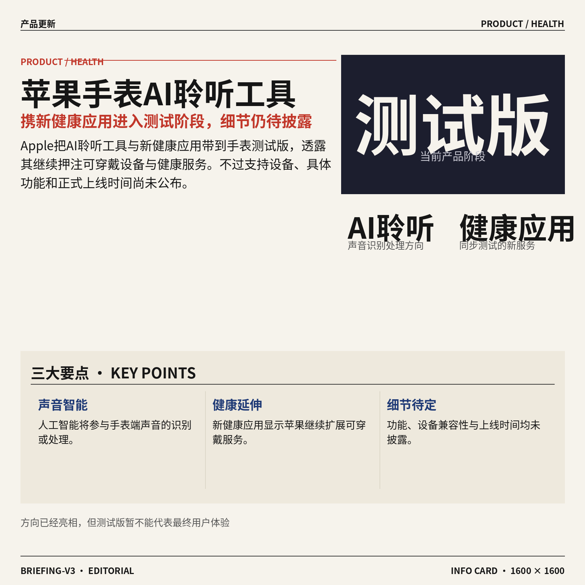

1. **Apple 推出手表人工智能聆听工具与新健康应用测试版。**
Apple 已为手表上的 **AI 聆听工具（由人工智能参与识别或处理声音的功能）**以及一款新健康应用推出测试版本 🚀。**测试版（正式发布前供用户试用、帮助发现问题的版本）**意味着这些功能仍处于验证和完善阶段，暂不能等同于最终体验。现有材料尚未披露具体功能、支持设备及正式上线时间，因此更适合先把它看作 Apple 在**可穿戴设备与健康服务**上的产品方向预告 💡。更多信息可查看[彭博完整报道(briefing)](https://news.google.com/rss/articles/CBMiyAFBVV95cUxPNVVBQnczQ0dUZFYwcG5wUjRkU3BpNHQxRk9jNXRLNUcwb1pvWERNLUdKcVhjTjFSeTZ5UUNYeElicHFraUIyV09iSFgtYkJzb2RrdGlIckljN2VZVzVQUEUzQnNZNUFQWUo0NWI1ekdBMGhDemllZldzWFNMZHhQUmRkZkJDQVRRZURHNTlqMUFLWHRjbmE3ZERsVEtxVnREQ0MwVEpyUFczMDk4TjItMzFBaTJVamFjbmI5empyQmFZc09OZEttMw?oc=5)。

![Apple 推出手表人工智能聆听工具与新健康应用测试版](https://image.pollinations.ai/prompt/Apple%20%E6%8E%A8%E5%87%BA%E6%89%8B%E8%A1%A8%E4%BA%BA%E5%B7%A5%E6%99%BA%E8%83%BD%E8%81%86%E5%90%AC%E5%B7%A5%E5%85%B7%E4%B8%8E%E6%96%B0%E5%81%A5%E5%BA%B7%E5%BA%94%E7%94%A8%E6%B5%8B%E8%AF%95%E7%89%88.%20Apple%20%E6%8E%A8%E5%87%BA%E6%89%8B%E8%A1%A8%E4%BA%BA%E5%B7%A5%E6%99%BA%E8%83%BD%E8%81%86%E5%90%AC%E5%B7%A5%E5%85%B7%E4%B8%8E%E6%96%B0%E5%81%A5%E5%BA%B7%E5%BA%94%E7%94%A8%E6%B5%8B%E8%AF%95%E7%89%88%E3%80%82%20Apple%20%E5%B7%B2%E4%B8%BA%E6%89%8B%E8%A1%A8%E4%B8%8A%E7%9A%84%20AI%20%E8%81%86%E5%90%AC%E5%B7%A5%E5%85%B7%EF%BC%88%E7%94%B1%E4%BA%BA%E5%B7%A5%E6%99%BA%E8%83%BD%E5%8F%82%E4%B8%8E%E8%AF%86%E5%88%AB%E6%88%96%E5%A4%84%E7%90%86%E5%A3%B0%E9%9F%B3%E7%9A%84%E5%8A%9F%E8%83%BD%EF%BC%89%E4%BB%A5%E5%8F%8A%E4%B8%80%E6%AC%BE%E6%96%B0%E5%81%A5%E5%BA%B7%E5%BA%94%E7%94%A8%E6%8E%A8%E5%87%BA%E6%B5%8B%2C%20technical%20infographic%20diagram%2C%20architecture%20flowchart%2C%20clean%20vector%20illustration%2C%20educational%20style%2C%20no%20text%20overlay%2C%20modern%20minimal%2C%20wide%20aspect?width=1200&height=675&nologo=true&seed=11389)

### 🟢 前沿研究

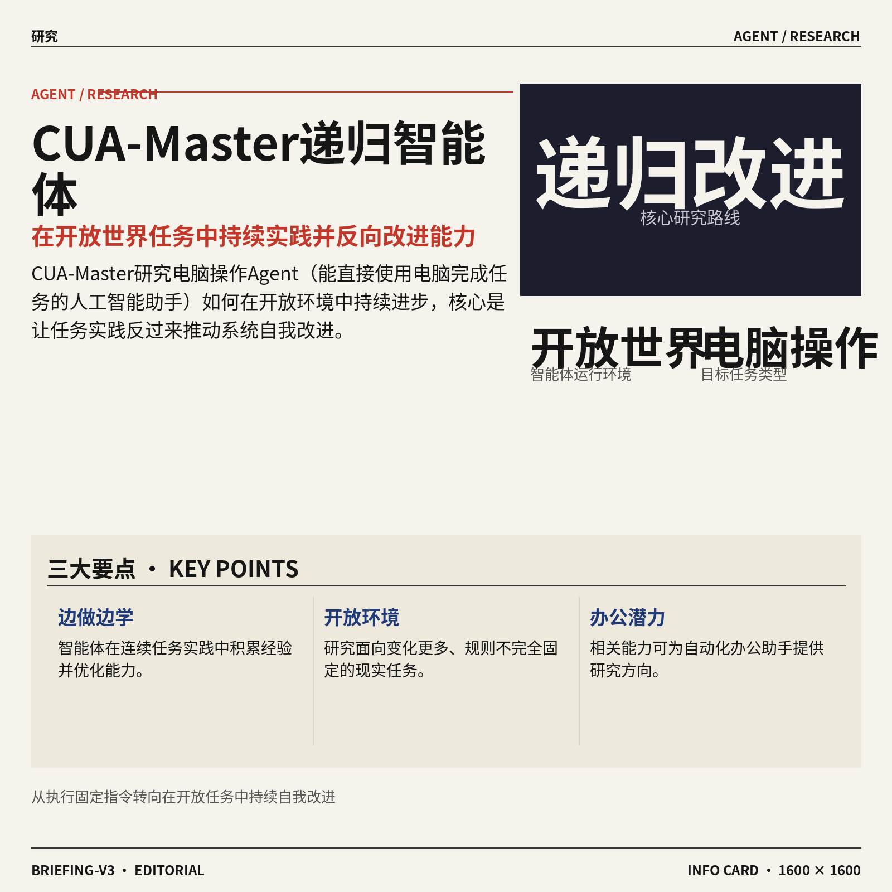

1. **CUA-Master（面向电脑操作 Agent 的研究）：通过开放世界递归改进扩展智能体能力。**  
这篇论文聚焦**电脑操作 Agent**（能直接使用电脑完成任务的人工智能助手），研究如何在开放环境中持续改进这类系统。标题中的“递归改进”可以理解为让 Agent 在一次次任务实践中反过来优化自身能力。相关内容目前仅以论文标题呈现，适合关注自动化办公与智能助手发展的同事了解方向 🚀 [论文页面(briefing)](https://huggingface.co/papers/2611.03126)

![CUA-Master（面向电脑操作 Agent 的研究）：通过开放世界递归改进扩展智能体能力](https://image.pollinations.ai/prompt/CUA-Master%EF%BC%88%E9%9D%A2%E5%90%91%E7%94%B5%E8%84%91%E6%93%8D%E4%BD%9C%20Agent%20%E7%9A%84%E7%A0%94%E7%A9%B6%EF%BC%89%EF%BC%9A%E9%80%9A%E8%BF%87%E5%BC%80%E6%94%BE%E4%B8%96%E7%95%8C%E9%80%92%E5%BD%92%E6%94%B9%E8%BF%9B%E6%89%A9%E5%B1%95%E6%99%BA%E8%83%BD%E4%BD%93%E8%83%BD%E5%8A%9B.%20CUA-Master%EF%BC%88%E9%9D%A2%E5%90%91%E7%94%B5%E8%84%91%E6%93%8D%E4%BD%9C%20Agent%20%E7%9A%84%E7%A0%94%E7%A9%B6%EF%BC%89%EF%BC%9A%E9%80%9A%E8%BF%87%E5%BC%80%E6%94%BE%E4%B8%96%E7%95%8C%E9%80%92%E5%BD%92%E6%94%B9%E8%BF%9B%E6%89%A9%E5%B1%95%E6%99%BA%E8%83%BD%E4%BD%93%E8%83%BD%E5%8A%9B%E3%80%82%20%E8%BF%99%E7%AF%87%E8%AE%BA%E6%96%87%E8%81%9A%E7%84%A6%E7%94%B5%E8%84%91%E6%93%8D%E4%BD%9C%20Agent%EF%BC%88%E8%83%BD%E7%9B%B4%E6%8E%A5%E4%BD%BF%E7%94%A8%E7%94%B5%E8%84%91%E5%AE%8C%E6%88%90%E4%BB%BB%E5%8A%A1%E7%9A%84%E4%BA%BA%E5%B7%A5%E6%99%BA%2C%20technical%20infographic%20diagram%2C%20architecture%20flowchart%2C%20clean%20vector%20illustration%2C%20educational%20style%2C%20no%20text%20overlay%2C%20modern%20minimal%2C%20wide%20aspect?width=1200&height=675&nologo=true&seed=10807)

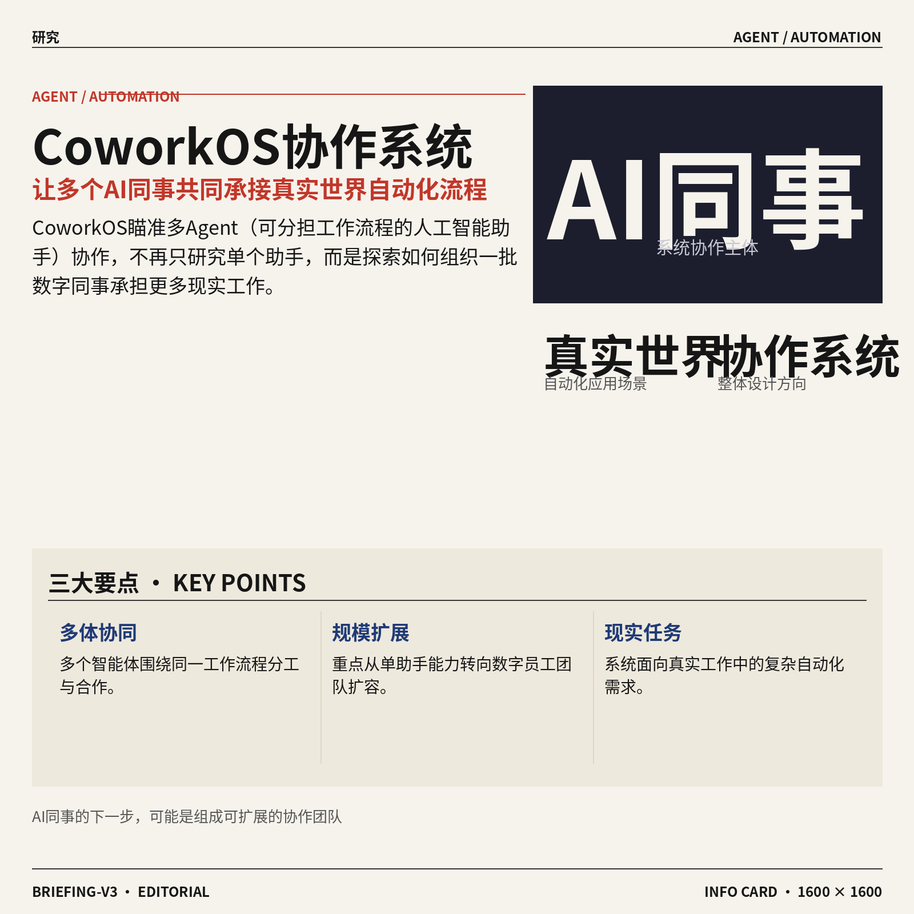

2. **CoworkOS（面向真实世界自动化的 Agent 协作系统）：扩展“AI 同事”规模。**  
这篇论文讨论如何让多个**Agent 同事**（能够分担工作流程的人工智能助手）服务于真实世界的自动化任务。标题强调“扩展”与“自动化”，说明研究关注的不只是单个助手，而是如何让这类数字员工承担更多协作工作。论文名称中的 **CoworkOS** 可理解为一套围绕 Agent 协作设计的系统，具体实现细节仍需阅读原文 📚 [论文页面(briefing)](https://huggingface.co/papers/2611.03178)

![CoworkOS（面向真实世界自动化的 Agent 协作系统）：扩展“AI 同事”规模](https://image.pollinations.ai/prompt/CoworkOS%EF%BC%88%E9%9D%A2%E5%90%91%E7%9C%9F%E5%AE%9E%E4%B8%96%E7%95%8C%E8%87%AA%E5%8A%A8%E5%8C%96%E7%9A%84%20Agent%20%E5%8D%8F%E4%BD%9C%E7%B3%BB%E7%BB%9F%EF%BC%89%EF%BC%9A%E6%89%A9%E5%B1%95%E2%80%9CAI%20%E5%90%8C%E4%BA%8B%E2%80%9D%E8%A7%84%E6%A8%A1.%20CoworkOS%EF%BC%88%E9%9D%A2%E5%90%91%E7%9C%9F%E5%AE%9E%E4%B8%96%E7%95%8C%E8%87%AA%E5%8A%A8%E5%8C%96%E7%9A%84%20Agent%20%E5%8D%8F%E4%BD%9C%E7%B3%BB%E7%BB%9F%EF%BC%89%EF%BC%9A%E6%89%A9%E5%B1%95%E2%80%9CAI%20%E5%90%8C%E4%BA%8B%E2%80%9D%E8%A7%84%E6%A8%A1%E3%80%82%20%E8%BF%99%E7%AF%87%E8%AE%BA%E6%96%87%E8%AE%A8%E8%AE%BA%E5%A6%82%E4%BD%95%E8%AE%A9%E5%A4%9A%E4%B8%AAAgent%20%E5%90%8C%E4%BA%8B%EF%BC%88%E8%83%BD%E5%A4%9F%E5%88%86%E6%8B%85%E5%B7%A5%E4%BD%9C%E6%B5%81%E7%A8%8B%E7%9A%84%E4%BA%BA%E5%B7%A5%E6%99%BA%E8%83%BD%E5%8A%A9%E6%89%8B%2C%20technical%20infographic%20diagram%2C%20architecture%20flowchart%2C%20clean%20vector%20illustration%2C%20educational%20style%2C%20no%20text%20overlay%2C%20modern%20minimal%2C%20wide%20aspect?width=1200&height=675&nologo=true&seed=10838)

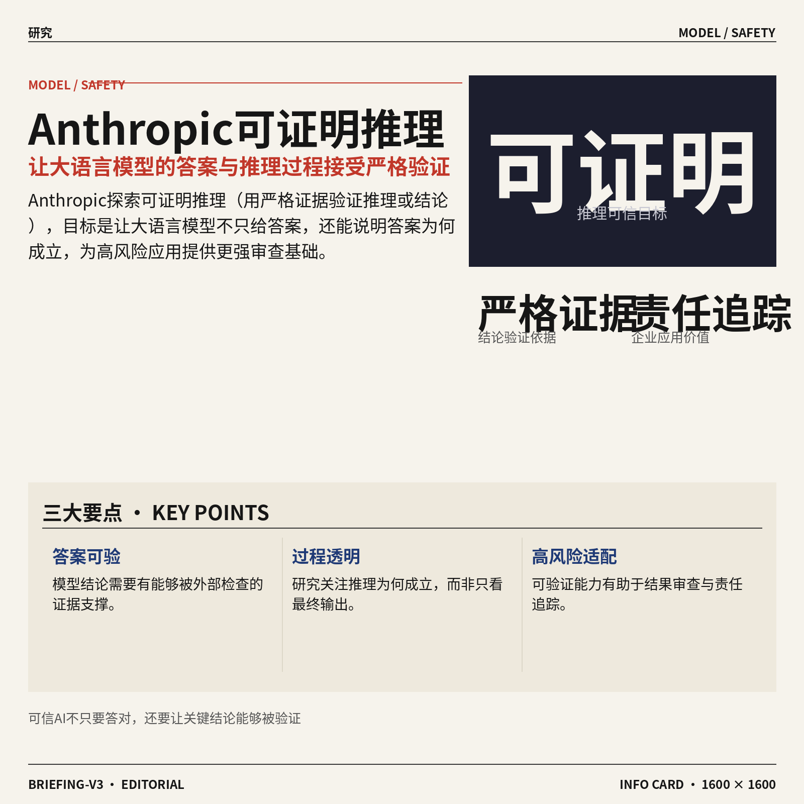

3. **Anthropic 探索大语言模型的可证明推理。**  
Anthropic 发布的研究进展聚焦**可证明推理**（能够用严格证据验证模型推理过程或结论是否可靠）。这类研究关注的是大语言模型不只“给出答案”，还要进一步说明答案为何成立、哪些部分可以被验证。对企业而言，这一方向与高风险场景中的结果审查、责任追踪和模型可信度有关 💡 [研究进展报道(briefing)](https://news.google.com/rss/articles/CBMiY0FVX3lxTE1qTzctMkJVc25sdVRiNlRUcGhHNjF1d2dJU2s0alBCZmFBVlZHS1VJNXlad0VHQnpDYnZLaEpJTklaUUdCVE1GRnNuN1REYWxBZkVwdFFyeWhDd3F1Mi0zWGlZVQ?oc=5)


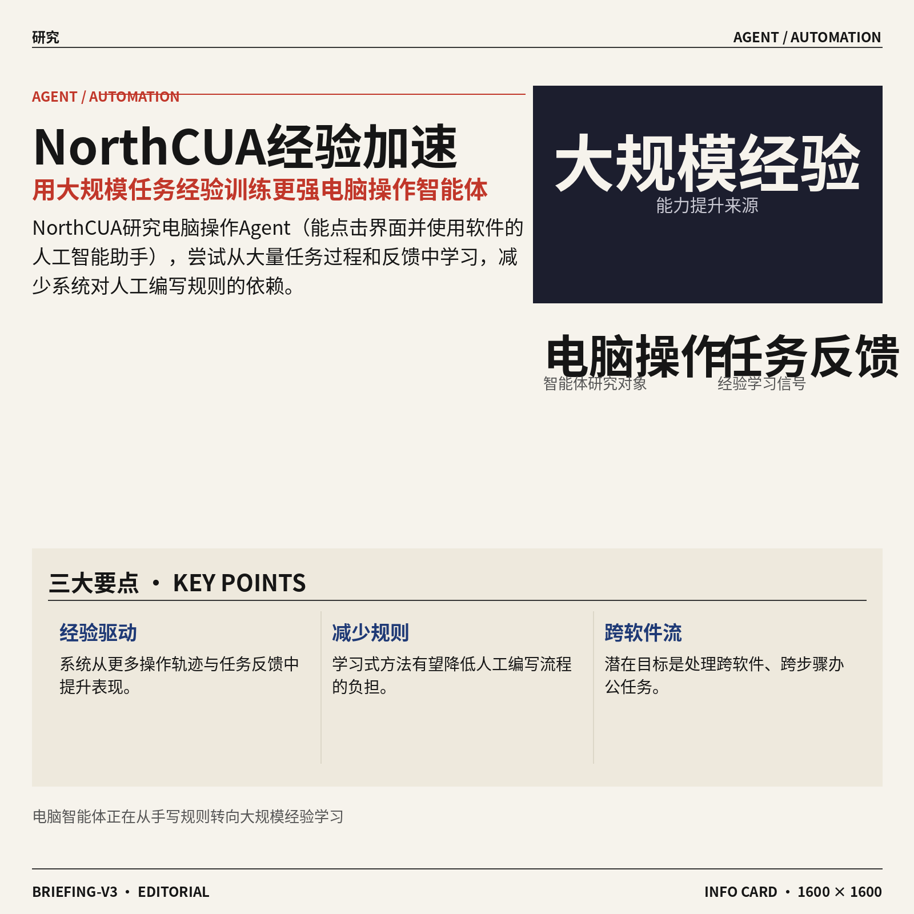

4. **NorthCUA（电脑操作 Agent 研究报告）：通过大规模经验加速智能体。**  
这份技术报告聚焦**电脑操作 Agent**（能够点击界面、使用软件并完成电脑任务的人工智能助手），核心思路是利用大规模任务经验提升表现。标题中的“经验规模化”可以理解为让系统从更多操作过程与任务反馈中学习，而不是只依赖人工编写规则。对办公自动化来说，这一方向可能帮助智能助手更好地处理跨软件、跨步骤的流程，但具体效果仍需结合论文内容判断 🚀 [技术报告页面(briefing)](https://huggingface.co/papers/2611.02102)

![NorthCUA（电脑操作 Agent 研究报告）：通过大规模经验加速智能体](https://image.pollinations.ai/prompt/NorthCUA%EF%BC%88%E7%94%B5%E8%84%91%E6%93%8D%E4%BD%9C%20Agent%20%E7%A0%94%E7%A9%B6%E6%8A%A5%E5%91%8A%EF%BC%89%EF%BC%9A%E9%80%9A%E8%BF%87%E5%A4%A7%E8%A7%84%E6%A8%A1%E7%BB%8F%E9%AA%8C%E5%8A%A0%E9%80%9F%E6%99%BA%E8%83%BD%E4%BD%93.%20NorthCUA%EF%BC%88%E7%94%B5%E8%84%91%E6%93%8D%E4%BD%9C%20Agent%20%E7%A0%94%E7%A9%B6%E6%8A%A5%E5%91%8A%EF%BC%89%EF%BC%9A%E9%80%9A%E8%BF%87%E5%A4%A7%E8%A7%84%E6%A8%A1%E7%BB%8F%E9%AA%8C%E5%8A%A0%E9%80%9F%E6%99%BA%E8%83%BD%E4%BD%93%E3%80%82%20%E8%BF%99%E4%BB%BD%E6%8A%80%E6%9C%AF%E6%8A%A5%E5%91%8A%E8%81%9A%E7%84%A6%E7%94%B5%E8%84%91%E6%93%8D%E4%BD%9C%20Agent%EF%BC%88%E8%83%BD%E5%A4%9F%E7%82%B9%E5%87%BB%E7%95%8C%E9%9D%A2%E3%80%81%E4%BD%BF%E7%94%A8%E8%BD%AF%E4%BB%B6%E5%B9%B6%E5%AE%8C%E6%88%90%E7%94%B5%E8%84%91%E4%BB%BB%E5%8A%A1%E7%9A%84%E4%BA%BA%E5%B7%A5%2C%20technical%20infographic%20diagram%2C%20architecture%20flowchart%2C%20clean%20vector%20illustration%2C%20educational%20style%2C%20no%20text%20overlay%2C%20modern%20minimal%2C%20wide%20aspect?width=1200&height=675&nologo=true&seed=10900)

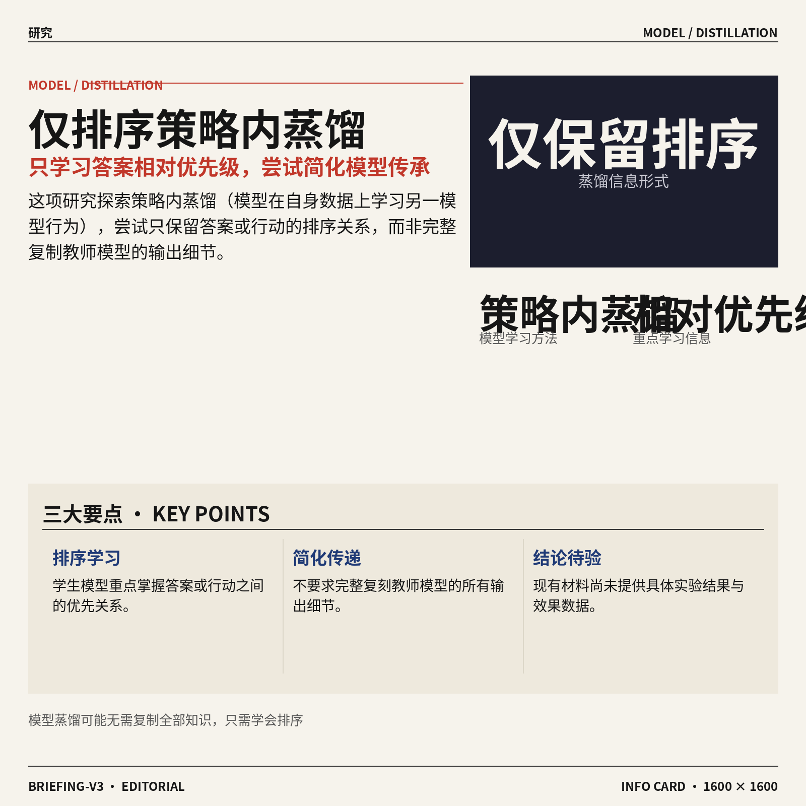

5. **Order-Only On-Policy Distillation（仅保留排序关系的策略内蒸馏）：探索更简化的模型学习方式。**  
这篇论文研究 **On-Policy Distillation（策略内蒸馏，让一个模型在自身产生的数据上学习另一个模型的行为）**。标题中的“仅保留排序关系”表示研究重点可能放在答案或行动之间的相对优先级，而不是完整复制教师模型的所有输出细节。这里的“蒸馏”可以类比为让小模型向经验更丰富的大模型学习，以降低学习复杂度；不过原材料未提供具体实验结论 📖 [论文页面(briefing)](https://huggingface.co/papers/2611.02112)


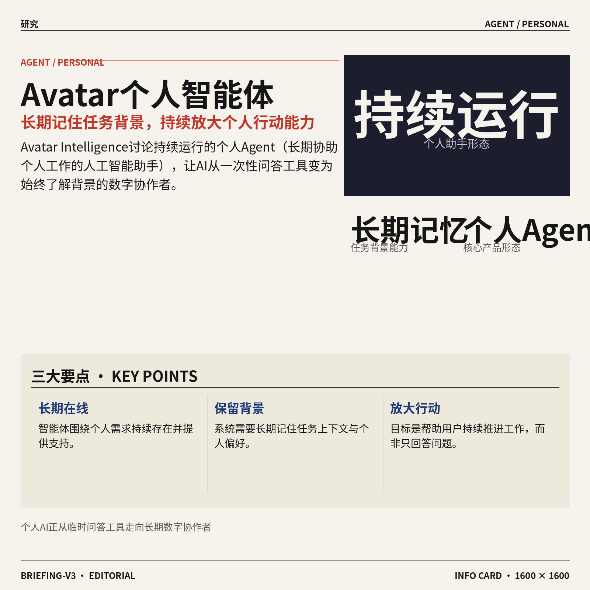

6. **Avatar Intelligence（持续运行的个人 Agent）：放大人的行动能力。**  
这篇论文讨论**持续运行的个人 Agent**（能够长期记住任务背景、持续协助个人工作的人工智能助手），并将其称为“Avatar Intelligence”。标题强调的不是一次性问答，而是让助手围绕个人长期存在、持续提供支持。对普通用户而言，这代表人工智能可能从临时工具逐渐变成更稳定的数字化协作者，但论文具体如何实现仍需进一步阅读 🤝 [论文页面(briefing)](https://huggingface.co/papers/2611.03092)


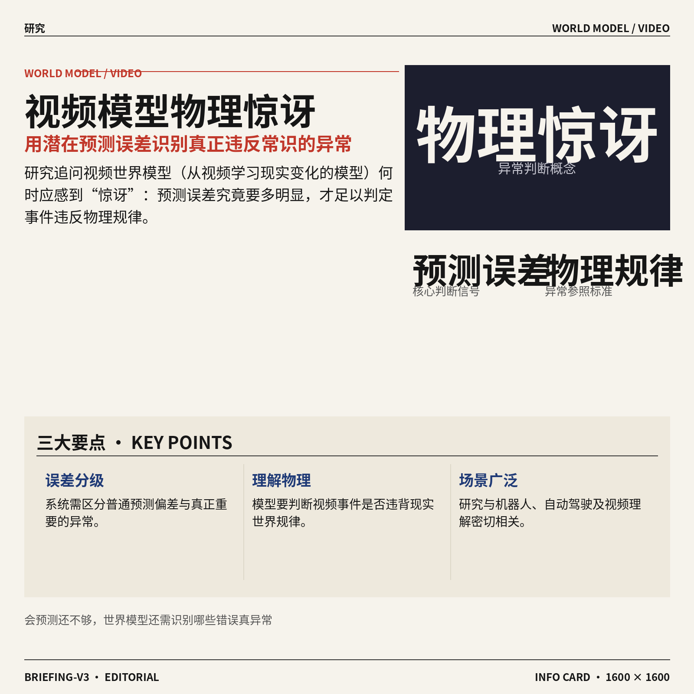

7. **视频世界模型中的“物理惊讶”：潜在预测误差何时足以支持判断？**  
这篇论文研究**视频世界模型**（通过视频学习和预测现实世界变化的人工智能模型）中的一个关键问题：模型预测错了多少，才足以说明它遇到了违反物理规律的意外情况。标题里的**潜在预测误差**（模型内部对未来状态的预测与实际结果之间的差异）是判断“惊讶”的核心概念。这个问题与机器人、自动驾驶和视频理解有关，因为系统需要区分普通预测偏差与真正重要的异常情况 🔍 [论文页面(briefing)](https://huggingface.co/papers/2611.01815)

![视频世界模型中的“物理惊讶”：潜在预测误差何时足以支持判断？](https://image.pollinations.ai/prompt/%E8%A7%86%E9%A2%91%E4%B8%96%E7%95%8C%E6%A8%A1%E5%9E%8B%E4%B8%AD%E7%9A%84%E2%80%9C%E7%89%A9%E7%90%86%E6%83%8A%E8%AE%B6%E2%80%9D%EF%BC%9A%E6%BD%9C%E5%9C%A8%E9%A2%84%E6%B5%8B%E8%AF%AF%E5%B7%AE%E4%BD%95%E6%97%B6%E8%B6%B3%E4%BB%A5%E6%94%AF%E6%8C%81%E5%88%A4%E6%96%AD%EF%BC%9F.%20%E8%A7%86%E9%A2%91%E4%B8%96%E7%95%8C%E6%A8%A1%E5%9E%8B%E4%B8%AD%E7%9A%84%E2%80%9C%E7%89%A9%E7%90%86%E6%83%8A%E8%AE%B6%E2%80%9D%EF%BC%9A%E6%BD%9C%E5%9C%A8%E9%A2%84%E6%B5%8B%E8%AF%AF%E5%B7%AE%E4%BD%95%E6%97%B6%E8%B6%B3%E4%BB%A5%E6%94%AF%E6%8C%81%E5%88%A4%E6%96%AD%EF%BC%9F%20%E8%BF%99%E7%AF%87%E8%AE%BA%E6%96%87%E7%A0%94%E7%A9%B6%E8%A7%86%E9%A2%91%E4%B8%96%E7%95%8C%E6%A8%A1%E5%9E%8B%EF%BC%88%E9%80%9A%E8%BF%87%E8%A7%86%E9%A2%91%E5%AD%A6%E4%B9%A0%E5%92%8C%E9%A2%84%E6%B5%8B%E7%8E%B0%E5%AE%9E%E4%B8%96%E7%95%8C%E5%8F%98%E5%8C%96%E7%9A%84%E4%BA%BA%E5%B7%A5%E6%99%BA%E8%83%BD%E6%A8%A1%E5%9E%8B%EF%BC%89%E4%B8%AD%E7%9A%84%E4%B8%80%E4%B8%AA%E5%85%B3%E9%94%AE%E9%97%AE%E9%A2%98%EF%BC%9A%E6%A8%A1%E5%9E%8B%E9%A2%84%E6%B5%8B%2C%20technical%20infographic%20diagram%2C%20architecture%20flowchart%2C%20clean%20vector%20illustration%2C%20educational%20style%2C%20no%20text%20overlay%2C%20modern%20minimal%2C%20wide%20aspect?width=1200&height=675&nologo=true&seed=10993)

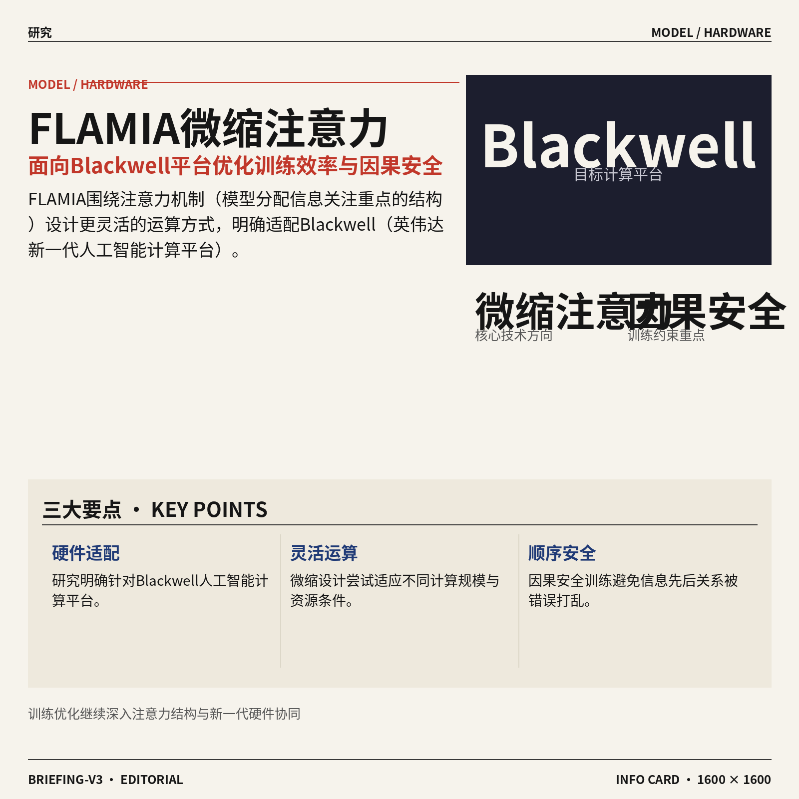

8. **FLAMIA（面向 Blackwell 显卡的快速微缩注意力）：探索更快且更安全的模型训练。**  
这篇论文提出 **FLAMIA**，标题显示其关注**注意力机制**（模型判断不同信息应当重点关注哪些部分的核心结构）以及更快的训练过程。**微缩**可以理解为在不同计算规模下灵活调整模型运算，以更有效地利用硬件资源；**因果安全训练**则强调训练过程中的先后关系不被错误打乱。研究明确指向 **Blackwell（英伟达推出的新一代人工智能计算平台）**，对大模型训练效率与硬件适配具有参考价值 ⚙️ [论文页面(briefing)](https://huggingface.co/papers/2611.03344)

![FLAMIA（面向 Blackwell 显卡的快速微缩注意力）：探索更快且更安全的模型训练](https://image.pollinations.ai/prompt/FLAMIA%EF%BC%88%E9%9D%A2%E5%90%91%20Blackwell%20%E6%98%BE%E5%8D%A1%E7%9A%84%E5%BF%AB%E9%80%9F%E5%BE%AE%E7%BC%A9%E6%B3%A8%E6%84%8F%E5%8A%9B%EF%BC%89%EF%BC%9A%E6%8E%A2%E7%B4%A2%E6%9B%B4%E5%BF%AB%E4%B8%94%E6%9B%B4%E5%AE%89%E5%85%A8%E7%9A%84%E6%A8%A1%E5%9E%8B%E8%AE%AD%E7%BB%83.%20FLAMIA%EF%BC%88%E9%9D%A2%E5%90%91%20Blackwell%20%E6%98%BE%E5%8D%A1%E7%9A%84%E5%BF%AB%E9%80%9F%E5%BE%AE%E7%BC%A9%E6%B3%A8%E6%84%8F%E5%8A%9B%EF%BC%89%EF%BC%9A%E6%8E%A2%E7%B4%A2%E6%9B%B4%E5%BF%AB%E4%B8%94%E6%9B%B4%E5%AE%89%E5%85%A8%E7%9A%84%E6%A8%A1%E5%9E%8B%E8%AE%AD%E7%BB%83%E3%80%82%20%E8%BF%99%E7%AF%87%E8%AE%BA%E6%96%87%E6%8F%90%E5%87%BA%20FLAMIA%EF%BC%8C%E6%A0%87%E9%A2%98%E6%98%BE%E7%A4%BA%E5%85%B6%E5%85%B3%E6%B3%A8%E6%B3%A8%E6%84%8F%E5%8A%9B%E6%9C%BA%E5%88%B6%EF%BC%88%E6%A8%A1%E5%9E%8B%E5%88%A4%E6%96%AD%E4%B8%8D%E5%90%8C%2C%20technical%20infographic%20diagram%2C%20architecture%20flowchart%2C%20clean%20vector%20illustration%2C%20educational%20style%2C%20no%20text%20overlay%2C%20modern%20minimal%2C%20wide%20aspect?width=1200&height=675&nologo=true&seed=11024)

### 🟡 行业展望与社会影响

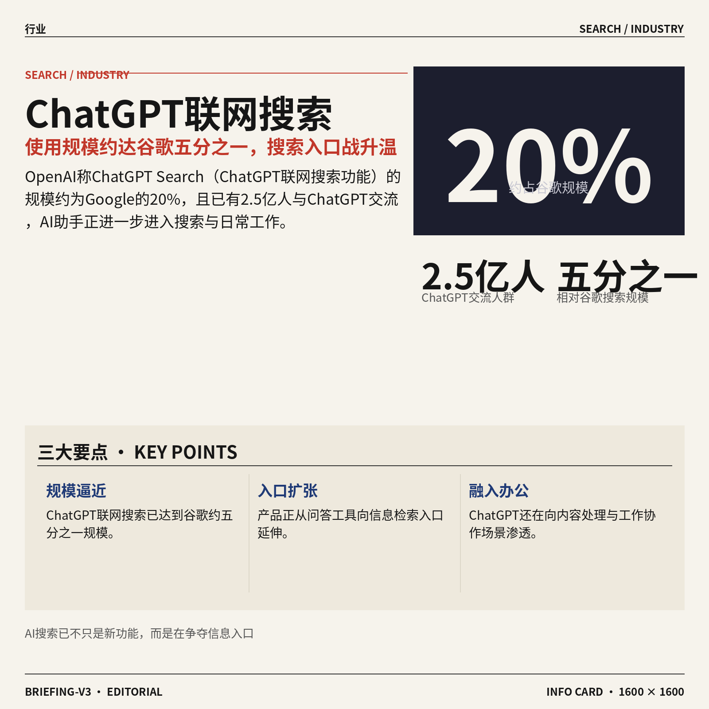

1. **OpenAI：ChatGPT Search（ChatGPT 的联网搜索功能）规模约为 Google 的 20%。**  
据报道，OpenAI 表示 **ChatGPT Search** 的使用规模约为 Google 的五分之一，同时已有 **2.5 亿人**与 ChatGPT 交流。文章还提到，ChatGPT 正逐渐从单纯的问答工具，走向与日常工作融合的方向。对企业来说，这意味着 AI 助手可能会更深地进入信息检索、内容处理和办公协作场景 🚀。[完整报道(briefing)](https://news.google.com/rss/articles/CBMic0FVX3lxTFBQaUk5dU1ZNE93UVMtdTVnUXAwQkczREJwTEp5R25qelRMLWhNRkdXcng3MUFITFlXaVlOVDVOLXl3RUEtczItVDNYaWI1a1FpeGx2TDlvU2VabDZCMGZDREpIVS13bG1ZTUpsVnMxQjdrcHc?oc=5)


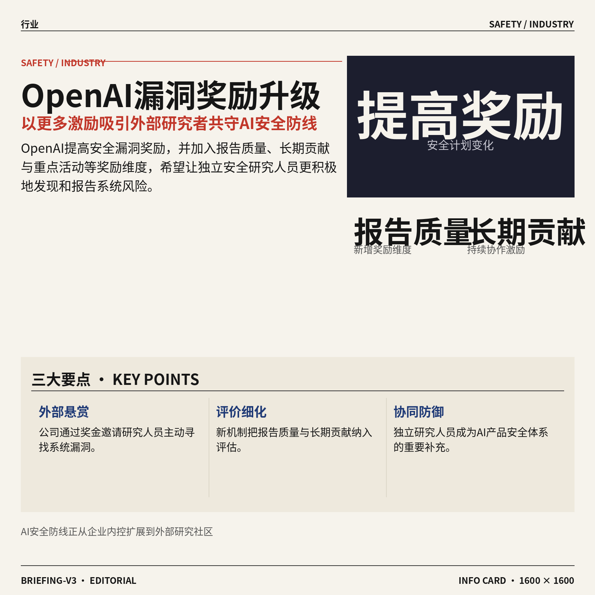

2. **OpenAI 提高漏洞奖励，鼓励研究人员帮助守住 AI 安全防线。**  
OpenAI 宣布提高 **安全漏洞奖励计划**（向发现并报告系统问题的人发放奖金），并新增报告质量、长期贡献和重点活动等奖励。这里的 **漏洞奖励**，可以理解为企业公开悬赏，请外部安全研究人员帮忙找出系统中的风险。新机制将独立安全研究人员的发现价值纳入更细致的评估，反映出 AI 产品对外部安全协作的重视 🛡️。[OpenAI 官方公告(briefing)](https://openai.com/index/rewarding-defenders-with-bigger-bug-bounties)

![OpenAI 提高漏洞奖励，鼓励研究人员帮助守住 AI 安全防线](https://image.pollinations.ai/prompt/OpenAI%20%E6%8F%90%E9%AB%98%E6%BC%8F%E6%B4%9E%E5%A5%96%E5%8A%B1%EF%BC%8C%E9%BC%93%E5%8A%B1%E7%A0%94%E7%A9%B6%E4%BA%BA%E5%91%98%E5%B8%AE%E5%8A%A9%E5%AE%88%E4%BD%8F%20AI%20%E5%AE%89%E5%85%A8%E9%98%B2%E7%BA%BF.%20OpenAI%20%E6%8F%90%E9%AB%98%E6%BC%8F%E6%B4%9E%E5%A5%96%E5%8A%B1%EF%BC%8C%E9%BC%93%E5%8A%B1%E7%A0%94%E7%A9%B6%E4%BA%BA%E5%91%98%E5%B8%AE%E5%8A%A9%E5%AE%88%E4%BD%8F%20AI%20%E5%AE%89%E5%85%A8%E9%98%B2%E7%BA%BF%E3%80%82%20OpenAI%20%E5%AE%A3%E5%B8%83%E6%8F%90%E9%AB%98%20%E5%AE%89%E5%85%A8%E6%BC%8F%E6%B4%9E%E5%A5%96%E5%8A%B1%E8%AE%A1%E5%88%92%EF%BC%88%E5%90%91%E5%8F%91%E7%8E%B0%E5%B9%B6%E6%8A%A5%E5%91%8A%E7%B3%BB%E7%BB%9F%E9%97%AE%E9%A2%98%E7%9A%84%E4%BA%BA%E5%8F%91%E6%94%BE%E5%A5%96%E9%87%91%EF%BC%89%EF%BC%8C%E5%B9%B6%E6%96%B0%E5%A2%9E%E6%8A%A5%E5%91%8A%E8%B4%A8%E9%87%8F%2C%20technical%20infographic%20diagram%2C%20architecture%20flowchart%2C%20clean%20vector%20illustration%2C%20educational%20style%2C%20no%20text%20overlay%2C%20modern%20minimal%2C%20wide%20aspect?width=1200&height=675&nologo=true&seed=10838)

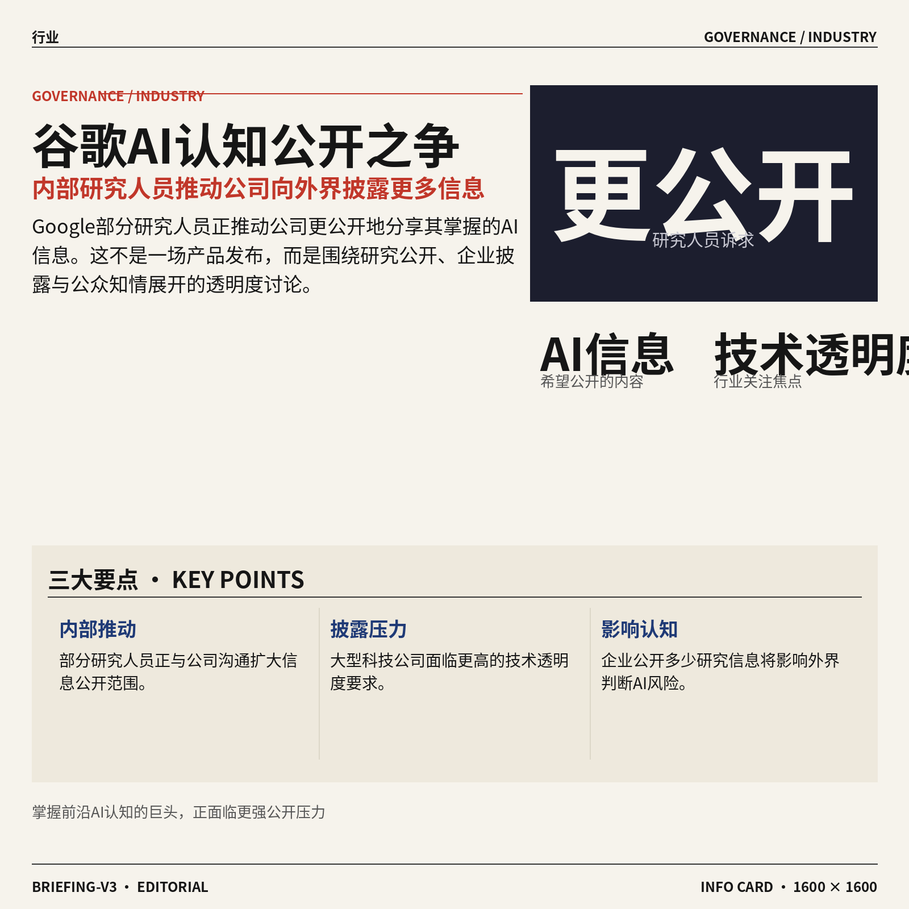

3. **Google 研究人员正推动公司更公开地分享他们对 AI 的了解。**  
《华盛顿邮报》报道称，Google 内部一些研究人员正在与公司沟通，希望让外界了解更多他们掌握的 **AI（人工智能）** 信息。报道重点并不是某一款新产品，而是研究成果如何被公开、企业内部意见如何影响行业认知。对外部观察者来说，这也凸显了大型科技公司在技术透明度与信息披露方面面临的压力 💡。[华盛顿邮报报道(briefing)](https://news.google.com/rss/articles/CBMitwFBVV95cUxQYWNrdVBqZDE1MU5SRE1jMEI4Y3VLRnlkYmYteUhFRFRhbGp2UXZpa18tNmlsU3BqWWszRkc0UWl0WE5XbUlZSDBCTDl2R3psX1BCNTkyZUxjaFZuaVlVUU9iTWJoaWdIWGExRXZfSzdYdjIxTll1R010Nnhlb2ZtYktZU21HU1ZzRkhBcm5lb2c2ZnluOWdoMy13S2NqMDNpUVd6MFQ1M255RDdIT2VCTzN6d0ZTVWM?oc=5)

![Google 研究人员正推动公司更公开地分享他们对 AI 的了解](https://image.pollinations.ai/prompt/Google%20%E7%A0%94%E7%A9%B6%E4%BA%BA%E5%91%98%E6%AD%A3%E6%8E%A8%E5%8A%A8%E5%85%AC%E5%8F%B8%E6%9B%B4%E5%85%AC%E5%BC%80%E5%9C%B0%E5%88%86%E4%BA%AB%E4%BB%96%E4%BB%AC%E5%AF%B9%20AI%20%E7%9A%84%E4%BA%86%E8%A7%A3.%20Google%20%E7%A0%94%E7%A9%B6%E4%BA%BA%E5%91%98%E6%AD%A3%E6%8E%A8%E5%8A%A8%E5%85%AC%E5%8F%B8%E6%9B%B4%E5%85%AC%E5%BC%80%E5%9C%B0%E5%88%86%E4%BA%AB%E4%BB%96%E4%BB%AC%E5%AF%B9%20AI%20%E7%9A%84%E4%BA%86%E8%A7%A3%E3%80%82%20%E3%80%8A%E5%8D%8E%E7%9B%9B%E9%A1%BF%E9%82%AE%E6%8A%A5%E3%80%8B%E6%8A%A5%E9%81%93%E7%A7%B0%EF%BC%8CGoogle%20%E5%86%85%E9%83%A8%E4%B8%80%E4%BA%9B%E7%A0%94%E7%A9%B6%E4%BA%BA%E5%91%98%E6%AD%A3%E5%9C%A8%E4%B8%8E%E5%85%AC%E5%8F%B8%E6%B2%9F%E9%80%9A%EF%BC%8C%E5%B8%8C%E6%9C%9B%E8%AE%A9%E5%A4%96%E7%95%8C%E4%BA%86%E8%A7%A3%E6%9B%B4%E5%A4%9A%E4%BB%96%E4%BB%AC%E6%8E%8C%2C%20technical%20infographic%20diagram%2C%20architecture%20flowchart%2C%20clean%20vector%20illustration%2C%20educational%20style%2C%20no%20text%20overlay%2C%20modern%20minimal%2C%20wide%20aspect?width=1200&height=675&nologo=true&seed=10869)

4. **Google 允许学校关闭 AI 工具，但可能同时失去 Google 搜索（Google 的网页搜索服务）。**  
Google 将允许学校限制或关闭其 **AI 工具（人工智能功能）**，但如果学校选择全面限制 AI，就将无法继续使用 Google 搜索。原因在于，AI 功能已经被整合进搜索引擎，二者不再是完全独立的服务。这个变化说明，学校未来可能需要在教学管理、信息获取和 AI 使用规范之间做出更明确的取舍 🏫。[TechCrunch 报道(briefing)](https://techcrunch.com/2026/11/03/google-will-let-schools-disable-its-ai-tools-but-not-without-sacrificing-search/)


5. **CrowdStrike（网络安全公司）推出“紧急停用开关”，可阻止失控的 AI Agent（能自主执行任务的软件助手）。**  
CrowdStrike 首席执行官表示，公司推出了新的 **kill switch（紧急停用开关，能够快速中止正在运行的系统或程序）**，用于在 AI Agent 出现异常时及时停止它们。AI Agent 可以按照目标自行执行一连串操作，因此一旦行为偏离预期，企业需要保留人工叫停的能力。这个设计把“可控性”放到了 AI 落地的重要位置，也为企业使用自动化助手提供了一道安全保险 🚨。[CNBC 报道(briefing)](https://news.google.com/rss/articles/CBMitgFBVV95cUxPTGk5Z3RYZDNLZmJIN2FraWVkTm9paXBOd0w0c0lTQ2p1Z2lXZjhzR0VnTjJCVk5UU1pGRG5sTElvY3hhYW5Ta19pN1dHNzcwZW9PSDFoLXlBcTBQVFlSbFZYQWxPaXE1WHFVOFZUTHZ0ZTlWLTBpNjE3cnRPWllZYlVDUjRmaVY0QXgzODRxLW1nSmw3VXBLV0EyZENMeDVkU24tR2VwTmZoYmJnOFI3QVp6am9md9IBuwFBVV95cUxNTmsxR1FYWlNubkpfbXhSNmZDcmlhWjBWb3ZETDRnOVd2VWp4bU11Rmg0Rnc4b2hnLUF5WEJtWE0tT0EwdGswZE54ODhRWl9EYWYzLW93S2ZhVDFOTWRXSFg5WWN4TS1IdGJ3YnNMb2JEdDU2cnlkb2JPVl9HcnNJdUNkLU9BaXdFWkxDMkRYNXBqSnBQNGlDd1gwQW5uZzhvLWJsTnZaR3otbEZSVUxjamNUdlhKN0poblR3?oc=5)

![CrowdStrike（网络安全公司）推出“紧急停用开关”，可阻止失控的 AI Agent（能自主执行任务的软件助手）](https://image.pollinations.ai/prompt/CrowdStrike%EF%BC%88%E7%BD%91%E7%BB%9C%E5%AE%89%E5%85%A8%E5%85%AC%E5%8F%B8%EF%BC%89%E6%8E%A8%E5%87%BA%E2%80%9C%E7%B4%A7%E6%80%A5%E5%81%9C%E7%94%A8%E5%BC%80%E5%85%B3%E2%80%9D%EF%BC%8C%E5%8F%AF%E9%98%BB%E6%AD%A2%E5%A4%B1%E6%8E%A7%E7%9A%84%20AI%20Agent%EF%BC%88%E8%83%BD%E8%87%AA%E4%B8%BB%E6%89%A7%E8%A1%8C%E4%BB%BB%E5%8A%A1%E7%9A%84%E8%BD%AF%E4%BB%B6%E5%8A%A9%E6%89%8B%EF%BC%89.%20CrowdStrike%EF%BC%88%E7%BD%91%E7%BB%9C%E5%AE%89%E5%85%A8%E5%85%AC%E5%8F%B8%EF%BC%89%E6%8E%A8%E5%87%BA%E2%80%9C%E7%B4%A7%E6%80%A5%E5%81%9C%E7%94%A8%E5%BC%80%E5%85%B3%E2%80%9D%EF%BC%8C%E5%8F%AF%E9%98%BB%E6%AD%A2%E5%A4%B1%E6%8E%A7%E7%9A%84%20AI%20Agent%EF%BC%88%E8%83%BD%E8%87%AA%E4%B8%BB%E6%89%A7%E8%A1%8C%E4%BB%BB%E5%8A%A1%E7%9A%84%E8%BD%AF%E4%BB%B6%E5%8A%A9%E6%89%8B%EF%BC%89%E3%80%82%20CrowdStrike%20%E9%A6%96%E5%B8%AD%E6%89%A7%E8%A1%8C%E5%AE%98%E8%A1%A8%E7%A4%BA%2C%20technical%20infographic%20diagram%2C%20architecture%20flowchart%2C%20clean%20vector%20illustration%2C%20educational%20style%2C%20no%20text%20overlay%2C%20modern%20minimal%2C%20wide%20aspect?width=1200&height=675&nologo=true&seed=10931)

6. **Google Antigravity（Google 的 AI 药物研发工具）加速智能体化学信息学（让 AI 助手参与化学研究流程）。**  
Google 介绍称，Antigravity 与 **化学信息学技能**（用计算机整理、搜索和分析化学分子信息的能力）可以加快药物发现流程。它能够帮助研究人员搜索化合物，并提出新的 **刚性化大环分子**（结构更固定、由较大环状骨架组成的候选分子）。这类工具面向药物研发人员，价值在于把原本需要反复查找和分析的研究步骤交给 AI 协助完成 🧪。[Google DeepMind 官方介绍(briefing)](https://deepmind.google/blog/agentic-cheminformatics-with-google-antigravity/)


### 🟣 开源TOP项目

1. **Spotify（音乐流媒体平台）开源 portal-ai-plugins（名为 Portal 的 AI 插件项目）。**
该项目已在 GitHub 建立公开仓库，候选材料显示其采用 **TypeScript（一种带类型检查、常用于网页和应用开发的编程语言）** 编写 💡。插件（给现有软件增加额外功能的小组件）相关的源代码可通过 [GitHub 项目仓库(briefing)](https://github.com/spotify/portal-ai-plugins) 查看。目前材料未说明具体功能、安装方式或适用场景，仍需以仓库后续披露的信息为准 🚀。


2. **Postman（API 开发与测试工具）被曝静默安装 AI 插件，并尝试共享全部 API（软件之间交换数据的接口）数据。**
一则 GitHub 问题反馈称，**Postman 会在未明确提示的情况下自动安装 AI 插件**，并尝试分享全部 API 数据 ⚠️。这里的插件（为软件增加额外能力的小组件）涉及数据传输，因此相关权限和提示方式值得用户重点留意。该说法目前来自 [GitHub 问题反馈页(briefing)](https://github.com/postmanlabs/postman-app-support/issues/14370)，候选材料未提供 Postman 的回应、影响范围或处理结果，暂不能据此判断最终结论。


### 🔴 社媒分享

1. **Qwen 3.8 27B（通义千问的一款 270 亿参数模型，参数可理解为模型学习后留下的数字化经验）在笔记本电脑上也能解读模型权重。**
作者在个人笔记本电脑上运行该模型，发现它同样能够解读**模型权重**（模型训练后保存的海量数值，类似模型的“内部记忆”）💻。这次尝试受到“权重空间编程”（让大模型直接读取或改写其他模型内部数值的研究方向）相关论文启发，也把原本偏实验室的话题带到了**本地运行**（直接在个人电脑上执行，不依赖云端服务器）的场景。它至少展示了一种有趣可能：理解模型内部数值，不一定只能依靠大型研究机构的设备 🚀。[本地权重解读实测(briefing)](https://simonwillison.net/2026/Nov/3/qwen-can-interpret-model-weights/)


2. **Astra（被讨论为可读写模型权重的系统）“改进”Qwen（阿里推出的通义千问模型）的说法遭到质疑。**
这篇文章专门反驳“Astra 可以读写权重并改进通义千问”的概括，作者认为这种表述具有**误导性** ⚠️。这里的“读写模型权重”（直接查看或修改模型内部数值）并不天然等于“已经证明模型能被稳定提升”，两者需要分开理解。与上一条实测放在一起看更有价值：一个展示现象，另一个提醒大家不要过早把实验现象包装成确定结论 💡。[权重改进说法质疑(briefing)](https://honnibal.dev/blog/astra-read-write-misleading)

![Astra（被讨论为可读写模型权重的系统）“改进”Qwen（阿里推出的通义千问模型）的说法遭到质疑](https://image.pollinations.ai/prompt/Astra%EF%BC%88%E8%A2%AB%E8%AE%A8%E8%AE%BA%E4%B8%BA%E5%8F%AF%E8%AF%BB%E5%86%99%E6%A8%A1%E5%9E%8B%E6%9D%83%E9%87%8D%E7%9A%84%E7%B3%BB%E7%BB%9F%EF%BC%89%E2%80%9C%E6%94%B9%E8%BF%9B%E2%80%9DQwen%EF%BC%88%E9%98%BF%E9%87%8C%E6%8E%A8%E5%87%BA%E7%9A%84%E9%80%9A%E4%B9%89%E5%8D%83%E9%97%AE%E6%A8%A1%E5%9E%8B%EF%BC%89%E7%9A%84%E8%AF%B4%E6%B3%95%E9%81%AD%E5%88%B0%E8%B4%A8%E7%96%91.%20Astra%EF%BC%88%E8%A2%AB%E8%AE%A8%E8%AE%BA%E4%B8%BA%E5%8F%AF%E8%AF%BB%E5%86%99%E6%A8%A1%E5%9E%8B%E6%9D%83%E9%87%8D%E7%9A%84%E7%B3%BB%E7%BB%9F%EF%BC%89%E2%80%9C%E6%94%B9%E8%BF%9B%E2%80%9DQwen%EF%BC%88%E9%98%BF%E9%87%8C%E6%8E%A8%E5%87%BA%E7%9A%84%E9%80%9A%E4%B9%89%E5%8D%83%E9%97%AE%E6%A8%A1%E5%9E%8B%EF%BC%89%E7%9A%84%E8%AF%B4%E6%B3%95%E9%81%AD%E5%88%B0%E8%B4%A8%E7%96%91%E3%80%82%20%E8%BF%99%E7%AF%87%E6%96%87%E7%AB%A0%E4%B8%93%E9%97%A8%E5%8F%8D%E9%A9%B3%E2%80%9CAstra%20%E5%8F%AF%E4%BB%A5%E8%AF%BB%E5%86%99%E6%9D%83%E9%87%8D%E5%B9%B6%E6%94%B9%E8%BF%9B%E9%80%9A%E4%B9%89%E5%8D%83%E9%97%AE%E2%80%9D%2C%20technical%20infographic%20diagram%2C%20architecture%20flowchart%2C%20clean%20vector%20illustration%2C%20educational%20style%2C%20no%20text%20overlay%2C%20modern%20minimal%2C%20wide%20aspect?width=1200&height=675&nologo=true&seed=10644)

3. **StateBench（测试模型能否持续追踪长文档信息变化的评测项目）考验大模型会不会“记住最新进展”。**
这套**基准测试**（用统一任务衡量和比较模型能力的一套“考试”）关注语言模型如何追踪长文档里的**状态变化**（信息随内容推进被更新，模型需要采用最新版而不是旧记录）📚。它测试的重点不只是模型能否找到某句话，而是能否随着文档推进持续修正自己的理解。对长文档阅读能力而言，这比单纯“记得多”更进一步，也能帮助判断模型是否真的跟得上信息变化 🧠。[长文档追踪评测介绍(briefing)](https://huggingface.co/blog/allenai/statebench)

![StateBench（测试模型能否持续追踪长文档信息变化的评测项目）考验大模型会不会“记住最新进展”](https://image.pollinations.ai/prompt/StateBench%EF%BC%88%E6%B5%8B%E8%AF%95%E6%A8%A1%E5%9E%8B%E8%83%BD%E5%90%A6%E6%8C%81%E7%BB%AD%E8%BF%BD%E8%B8%AA%E9%95%BF%E6%96%87%E6%A1%A3%E4%BF%A1%E6%81%AF%E5%8F%98%E5%8C%96%E7%9A%84%E8%AF%84%E6%B5%8B%E9%A1%B9%E7%9B%AE%EF%BC%89%E8%80%83%E9%AA%8C%E5%A4%A7%E6%A8%A1%E5%9E%8B%E4%BC%9A%E4%B8%8D%E4%BC%9A%E2%80%9C%E8%AE%B0%E4%BD%8F%E6%9C%80%E6%96%B0%E8%BF%9B%E5%B1%95%E2%80%9D.%20StateBench%EF%BC%88%E6%B5%8B%E8%AF%95%E6%A8%A1%E5%9E%8B%E8%83%BD%E5%90%A6%E6%8C%81%E7%BB%AD%E8%BF%BD%E8%B8%AA%E9%95%BF%E6%96%87%E6%A1%A3%E4%BF%A1%E6%81%AF%E5%8F%98%E5%8C%96%E7%9A%84%E8%AF%84%E6%B5%8B%E9%A1%B9%E7%9B%AE%EF%BC%89%E8%80%83%E9%AA%8C%E5%A4%A7%E6%A8%A1%E5%9E%8B%E4%BC%9A%E4%B8%8D%E4%BC%9A%E2%80%9C%E8%AE%B0%E4%BD%8F%E6%9C%80%E6%96%B0%E8%BF%9B%E5%B1%95%E2%80%9D%E3%80%82%20%E8%BF%99%E5%A5%97%E5%9F%BA%E5%87%86%E6%B5%8B%E8%AF%95%EF%BC%88%E7%94%A8%E7%BB%9F%E4%B8%80%E4%BB%BB%E5%8A%A1%E8%A1%A1%E9%87%8F%E5%92%8C%E6%AF%94%E8%BE%83%E6%A8%A1%E5%9E%8B%E8%83%BD%E5%8A%9B%E7%9A%84%E4%B8%80%E5%A5%97%E2%80%9C%E8%80%83%E8%AF%95%E2%80%9D%2C%20technical%20infographic%20diagram%2C%20architecture%20flowchart%2C%20clean%20vector%20illustration%2C%20educational%20style%2C%20no%20text%20overlay%2C%20modern%20minimal%2C%20wide%20aspect?width=1200&height=675&nologo=true&seed=10675)

4. **前沿人工智能实验室组建“选举战情室”，应对深度伪造风险。**
一些前沿人工智能实验室（开发最先进模型的研究机构）开始启用**选举战情室**（集中监测和处置选举相关风险的应急团队）🗳️。报道将其形容为旧有应急预案在**深度伪造**（利用人工智能合成逼真图片、音频或视频的手段）时代重新回归。文章同时追问这套机制究竟是否有效，并未简单宣布问题已经得到解决——面对真假难辨的内容，响应速度和实际效果仍是关键 🔍。[选举战情室完整报道(briefing)](https://www.platformer.news/election-war-room-midterms-deepfakes/)

![前沿人工智能实验室组建“选举战情室”，应对深度伪造风险](https://image.pollinations.ai/prompt/%E5%89%8D%E6%B2%BF%E4%BA%BA%E5%B7%A5%E6%99%BA%E8%83%BD%E5%AE%9E%E9%AA%8C%E5%AE%A4%E7%BB%84%E5%BB%BA%E2%80%9C%E9%80%89%E4%B8%BE%E6%88%98%E6%83%85%E5%AE%A4%E2%80%9D%EF%BC%8C%E5%BA%94%E5%AF%B9%E6%B7%B1%E5%BA%A6%E4%BC%AA%E9%80%A0%E9%A3%8E%E9%99%A9.%20%E5%89%8D%E6%B2%BF%E4%BA%BA%E5%B7%A5%E6%99%BA%E8%83%BD%E5%AE%9E%E9%AA%8C%E5%AE%A4%E7%BB%84%E5%BB%BA%E2%80%9C%E9%80%89%E4%B8%BE%E6%88%98%E6%83%85%E5%AE%A4%E2%80%9D%EF%BC%8C%E5%BA%94%E5%AF%B9%E6%B7%B1%E5%BA%A6%E4%BC%AA%E9%80%A0%E9%A3%8E%E9%99%A9%E3%80%82%20%E4%B8%80%E4%BA%9B%E5%89%8D%E6%B2%BF%E4%BA%BA%E5%B7%A5%E6%99%BA%E8%83%BD%E5%AE%9E%E9%AA%8C%E5%AE%A4%EF%BC%88%E5%BC%80%E5%8F%91%E6%9C%80%E5%85%88%E8%BF%9B%E6%A8%A1%E5%9E%8B%E7%9A%84%E7%A0%94%E7%A9%B6%E6%9C%BA%E6%9E%84%EF%BC%89%E5%BC%80%E5%A7%8B%E5%90%AF%E7%94%A8%E9%80%89%E4%B8%BE%E6%88%98%E6%83%85%E5%AE%A4%EF%BC%88%E9%9B%86%E4%B8%AD%E7%9B%91%E6%B5%8B%E5%92%8C%E5%A4%84%E7%BD%AE%E9%80%89%E4%B8%BE%E7%9B%B8%E5%85%B3%E9%A3%8E%E9%99%A9%E7%9A%84%E5%BA%94%E6%80%A5%2C%20technical%20infographic%20diagram%2C%20architecture%20flowchart%2C%20clean%20vector%20illustration%2C%20educational%20style%2C%20no%20text%20overlay%2C%20modern%20minimal%2C%20wide%20aspect?width=1200&height=675&nologo=true&seed=10706)

5. **美国科技巨头“隐性人工智能债务”半年增长 90%，达到 3.2 万亿美元。**
报道指出，美国科技巨头的**隐性人工智能债务**（报道对外界不易直接看到的相关债务负担的称呼）在六个月内增长了 **90%**，总规模升至 **3.2 万亿美元** 💰。这一数字同时体现了极高的绝对规模和快速的**债务增幅**（一定时期内债务规模增长的比例）。对财务和管理岗位而言，值得关注的不只是人工智能投入热度，还有其背后的资本与债务压力 📈。[科技巨头债务报道(briefing)](https://asia.nikkei.com/business/technology/artificial-intelligence/us-tech-giants-hidden-ai-debt-swells-90-to-3.2tn-in-6-months)

![美国科技巨头“隐性人工智能债务”半年增长 90%，达到 3.2 万亿美元](https://image.pollinations.ai/prompt/%E7%BE%8E%E5%9B%BD%E7%A7%91%E6%8A%80%E5%B7%A8%E5%A4%B4%E2%80%9C%E9%9A%90%E6%80%A7%E4%BA%BA%E5%B7%A5%E6%99%BA%E8%83%BD%E5%80%BA%E5%8A%A1%E2%80%9D%E5%8D%8A%E5%B9%B4%E5%A2%9E%E9%95%BF%2090%25%EF%BC%8C%E8%BE%BE%E5%88%B0%203.2%20%E4%B8%87%E4%BA%BF%E7%BE%8E%E5%85%83.%20%E7%BE%8E%E5%9B%BD%E7%A7%91%E6%8A%80%E5%B7%A8%E5%A4%B4%E2%80%9C%E9%9A%90%E6%80%A7%E4%BA%BA%E5%B7%A5%E6%99%BA%E8%83%BD%E5%80%BA%E5%8A%A1%E2%80%9D%E5%8D%8A%E5%B9%B4%E5%A2%9E%E9%95%BF%2090%25%EF%BC%8C%E8%BE%BE%E5%88%B0%203.2%20%E4%B8%87%E4%BA%BF%E7%BE%8E%E5%85%83%E3%80%82%20%E6%8A%A5%E9%81%93%E6%8C%87%E5%87%BA%EF%BC%8C%E7%BE%8E%E5%9B%BD%E7%A7%91%E6%8A%80%E5%B7%A8%E5%A4%B4%E7%9A%84%E9%9A%90%E6%80%A7%E4%BA%BA%E5%B7%A5%E6%99%BA%E8%83%BD%E5%80%BA%E5%8A%A1%EF%BC%88%E6%8A%A5%E9%81%93%E5%AF%B9%E5%A4%96%E7%95%8C%E4%B8%8D%E6%98%93%E7%9B%B4%E6%8E%A5%E7%9C%8B%E5%88%B0%E7%9A%84%E7%9B%B8%E5%85%B3%E5%80%BA%E5%8A%A1%E8%B4%9F%E6%8B%85%E7%9A%84%E7%A7%B0%E5%91%BC%2C%20technical%20infographic%20diagram%2C%20architecture%20flowchart%2C%20clean%20vector%20illustration%2C%20educational%20style%2C%20no%20text%20overlay%2C%20modern%20minimal%2C%20wide%20aspect?width=1200&height=675&nologo=true&seed=10737)

---

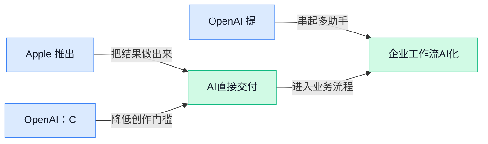

### 📊 行业洞察（今日 4 条）

1. OpenAI称ChatGPT Search（联网检索功能）规模约为Google五分之一。  
  【洞察】AI搜索已构成竞争但未改写格局，因为双方差距仍明显。

2. Anthropic研发FlashProve（验证回答来源的系统），用于核验模型身份。  
  【洞察】它能降低模型冒用风险，但不能证明回答内容正确。

3. CrowdStrike推出紧急停用开关，可中止异常AI Agent（自主执行任务的助手）。  
  【洞察】可控性正成为刚需，因为自主操作可能放大错误。

4. Google Antigravity（AI药物研发工具）可搜索化合物并提出候选分子。  
  【洞察】垂直智能体更易体现价值，因为任务边界明确；但成效仍待验证。

### 💭 对我们的启发（今日 3 条）

1. OpenAI的搜索进展提示视频创作Agent可辅助寻找素材；机会是提升创作效率，风险是来源失真。

2. CUA-Master（电脑操作智能体研究）启示平台可学习剪辑操作，减少重复步骤；但误操作也会被放大。

3. Anthropic的FlashProve启示视频工具标注AI片段来源，可增强可信度；但来源可信不等于内容真实。

