## AI资讯日报 2026/11/5

> AI 早报 · 每日早读 · 全网深度聚合

## **今日摘要**

```
OpenAI 收购 Pierre Computer Company（代码版本管理公司），让 Git 跟上编程智能体
Meta 收购 Conductor（多智能体编程应用），Google 绑定校园 AI 开关与搜索惹垄断争议
Anthropic 推进可证明推理，模型回答来源可核验却无需公开权重
```

### 🔵 产品与功能更新

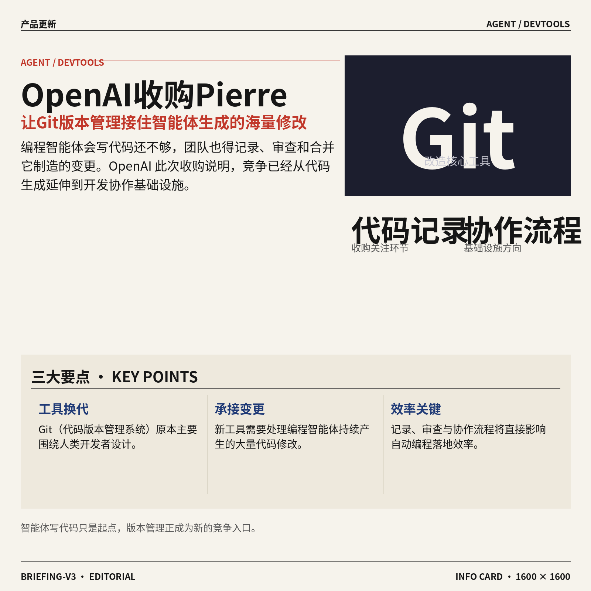

1. **OpenAI 收购 Pierre Computer Company（专注改进代码版本管理的公司），要让 Git（代码版本管理系统）跟上编程智能体。**
OpenAI 已收购 **Pierre Computer Company（致力于改进代码版本管理流程的公司）**，目标是让现有开发工具更适应编程智能体 🚀。Git（记录代码修改历史、方便多人协作的版本管理系统）原本主要围绕人类开发者设计，如今还需要承接智能体产生的代码变更。此次收购表明，OpenAI 正把关注点延伸到**代码记录与协作流程**，不只是让模型会写代码 💡。对使用自动编程工具的团队来说，相关基础工具能否顺利接住大量修改，将直接影响实际工作效率。[收购完整报道(briefing)](https://the-decoder.com/openai-acquires-pierre-computer-company-to-make-git-keep-up-with-ai-coding-agents/)

![OpenAI 收购 Pierre Computer Company（专注改进代码版本管理的公司），要让 Git（代码版本管理系统）跟上编程智能体](https://image.pollinations.ai/prompt/OpenAI%20%E6%94%B6%E8%B4%AD%20Pierre%20Computer%20Company%EF%BC%88%E4%B8%93%E6%B3%A8%E6%94%B9%E8%BF%9B%E4%BB%A3%E7%A0%81%E7%89%88%E6%9C%AC%E7%AE%A1%E7%90%86%E7%9A%84%E5%85%AC%E5%8F%B8%EF%BC%89%EF%BC%8C%E8%A6%81%E8%AE%A9%20Git%EF%BC%88%E4%BB%A3%E7%A0%81%E7%89%88%E6%9C%AC%E7%AE%A1%E7%90%86%E7%B3%BB%E7%BB%9F%EF%BC%89%E8%B7%9F%E4%B8%8A%E7%BC%96%E7%A8%8B%E6%99%BA%E8%83%BD%E4%BD%93.%20OpenAI%20%E6%94%B6%E8%B4%AD%20Pierre%20Computer%20Company%EF%BC%88%E4%B8%93%E6%B3%A8%E6%94%B9%E8%BF%9B%E4%BB%A3%E7%A0%81%E7%89%88%E6%9C%AC%E7%AE%A1%E7%90%86%E7%9A%84%E5%85%AC%E5%8F%B8%EF%BC%89%EF%BC%8C%E8%A6%81%E8%AE%A9%20Git%EF%BC%88%E4%BB%A3%E7%A0%81%E7%89%88%E6%9C%AC%E7%AE%A1%E7%90%86%E7%B3%BB%E7%BB%9F%EF%BC%89%E8%B7%9F%E4%B8%8A%E7%BC%96%E7%A8%8B%E6%99%BA%E8%83%BD%E4%BD%93%E3%80%82%20OpenAI%2C%20technical%20infographic%20diagram%2C%20architecture%20flowchart%2C%20clean%20vector%20illustration%2C%20educational%20style%2C%20no%20text%20overlay%2C%20modern%20minimal%2C%20wide%20aspect?width=1200&height=675&nologo=true&seed=11389)

### 🟢 前沿研究

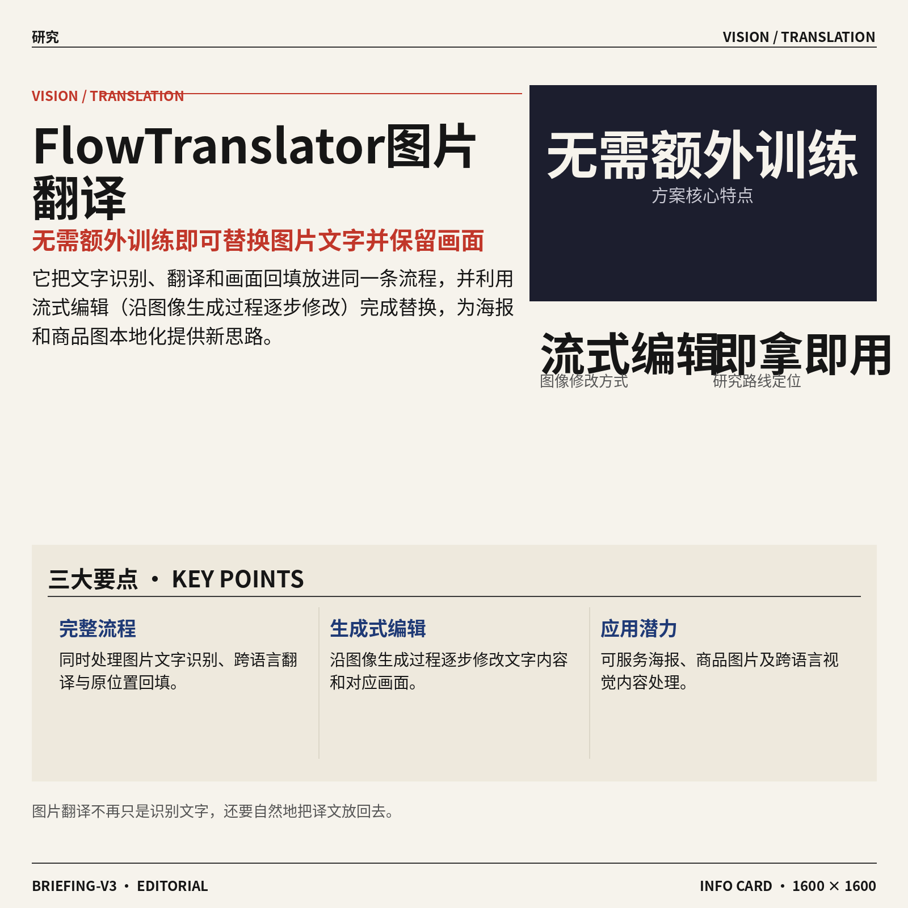

1. **FlowTranslator（无需额外训练的图片内文字翻译方案）用流式编辑完成图中文字替换。**
这项研究聚焦**图片内机器翻译**（识别图片文字、翻译并放回原位置的完整流程），尝试在不重新训练模型的情况下完成处理 🚀。其核心是**流式编辑**（沿着图像生成过程逐步修改内容），目标是把翻译与画面编辑结合起来。按照论文标题，这条路线强调“即拿即用”，可为海报、商品图和跨语言视觉内容处理提供新的研究思路 💡。[论文详情页(briefing)](https://huggingface.co/papers/2611.04303)


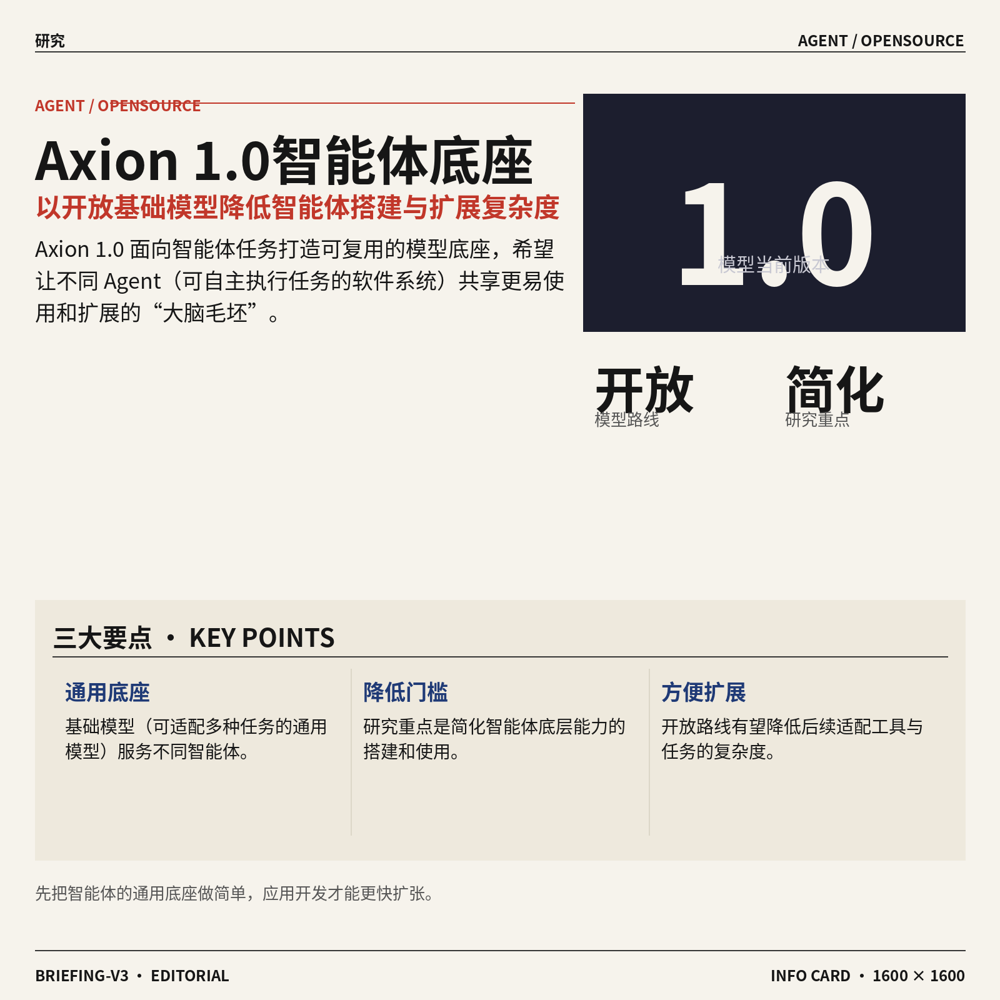

2. **Axion 1.0（开放式智能体基础模型）尝试简化 Agent 的底层能力建设。**
Axion 1.0（面向智能体任务的开放基础模型）研究如何用更简化的方式搭建可执行任务的模型底座 🤖。这里的**基础模型**（经过大规模训练、可继续适配多种任务的通用模型）相当于不同 Agent 共用的“大脑毛坯”。论文标题同时突出**开放**与**简化**，意味着研究重点放在降低智能体模型的使用和扩展复杂度上。[论文介绍页(briefing)](https://huggingface.co/papers/2611.03233)

![Axion 1.0（开放式智能体基础模型）尝试简化 Agent 的底层能力建设](https://image.pollinations.ai/prompt/Axion%201.0%EF%BC%88%E5%BC%80%E6%94%BE%E5%BC%8F%E6%99%BA%E8%83%BD%E4%BD%93%E5%9F%BA%E7%A1%80%E6%A8%A1%E5%9E%8B%EF%BC%89%E5%B0%9D%E8%AF%95%E7%AE%80%E5%8C%96%20Agent%20%E7%9A%84%E5%BA%95%E5%B1%82%E8%83%BD%E5%8A%9B%E5%BB%BA%E8%AE%BE.%20Axion%201.0%EF%BC%88%E5%BC%80%E6%94%BE%E5%BC%8F%E6%99%BA%E8%83%BD%E4%BD%93%E5%9F%BA%E7%A1%80%E6%A8%A1%E5%9E%8B%EF%BC%89%E5%B0%9D%E8%AF%95%E7%AE%80%E5%8C%96%20Agent%20%E7%9A%84%E5%BA%95%E5%B1%82%E8%83%BD%E5%8A%9B%E5%BB%BA%E8%AE%BE%E3%80%82%20Axion%201.0%EF%BC%88%E9%9D%A2%E5%90%91%E6%99%BA%E8%83%BD%E4%BD%93%E4%BB%BB%E5%8A%A1%E7%9A%84%E5%BC%80%E6%94%BE%E5%9F%BA%E7%A1%80%E6%A8%A1%E5%9E%8B%EF%BC%89%E7%A0%94%E7%A9%B6%E5%A6%82%E4%BD%95%E7%94%A8%E6%9B%B4%E7%AE%80%E5%8C%96%E7%9A%84%E6%96%B9%E5%BC%8F%E6%90%AD%E5%BB%BA%E5%8F%AF%2C%20technical%20infographic%20diagram%2C%20architecture%20flowchart%2C%20clean%20vector%20illustration%2C%20educational%20style%2C%20no%20text%20overlay%2C%20modern%20minimal%2C%20wide%20aspect?width=1200&height=675&nologo=true&seed=10838)

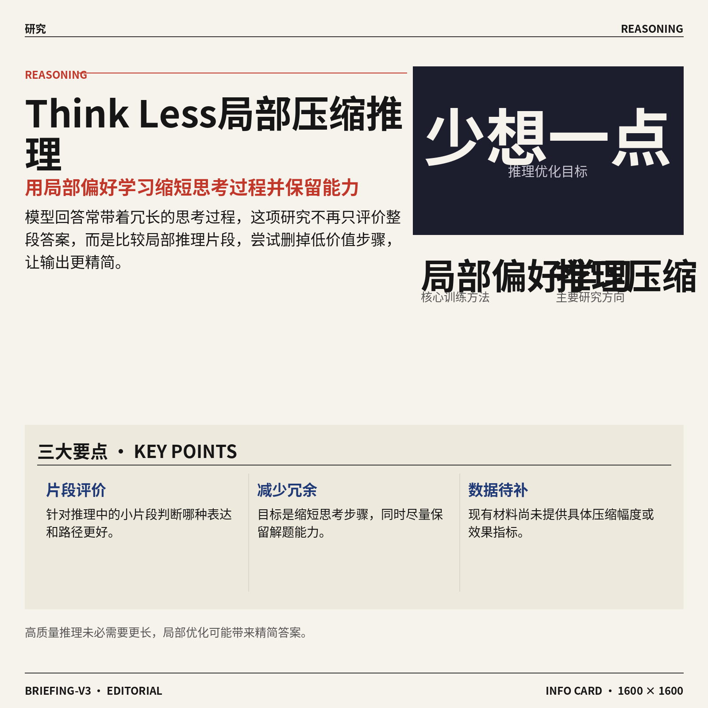

3. **Think Less, Locally（通过局部偏好学习压缩推理过程）探索让模型少想一点。**
这项研究关注**推理压缩**（缩短模型思考步骤，同时尽量保留解决问题的能力），试图减少冗长的推理过程 🧠。它采用**局部偏好学习**（针对推理过程中的小片段判断哪种表达更好），而不是只对整段答案做笼统评价。对产品侧而言，这类研究瞄准的是更精简的回答过程，但论文标题并未提供具体压缩幅度或效果数据。[论文详情页(briefing)](https://huggingface.co/papers/2611.04814)

![Think Less, Locally（通过局部偏好学习压缩推理过程）探索让模型少想一点](https://image.pollinations.ai/prompt/Think%20Less%2C%20Locally%EF%BC%88%E9%80%9A%E8%BF%87%E5%B1%80%E9%83%A8%E5%81%8F%E5%A5%BD%E5%AD%A6%E4%B9%A0%E5%8E%8B%E7%BC%A9%E6%8E%A8%E7%90%86%E8%BF%87%E7%A8%8B%EF%BC%89%E6%8E%A2%E7%B4%A2%E8%AE%A9%E6%A8%A1%E5%9E%8B%E5%B0%91%E6%83%B3%E4%B8%80%E7%82%B9.%20Think%20Less%2C%20Locally%EF%BC%88%E9%80%9A%E8%BF%87%E5%B1%80%E9%83%A8%E5%81%8F%E5%A5%BD%E5%AD%A6%E4%B9%A0%E5%8E%8B%E7%BC%A9%E6%8E%A8%E7%90%86%E8%BF%87%E7%A8%8B%EF%BC%89%E6%8E%A2%E7%B4%A2%E8%AE%A9%E6%A8%A1%E5%9E%8B%E5%B0%91%E6%83%B3%E4%B8%80%E7%82%B9%E3%80%82%20%E8%BF%99%E9%A1%B9%E7%A0%94%E7%A9%B6%E5%85%B3%E6%B3%A8%E6%8E%A8%E7%90%86%E5%8E%8B%E7%BC%A9%EF%BC%88%E7%BC%A9%E7%9F%AD%E6%A8%A1%E5%9E%8B%E6%80%9D%E8%80%83%E6%AD%A5%E9%AA%A4%EF%BC%8C%E5%90%8C%E6%97%B6%E5%B0%BD%E9%87%8F%E4%BF%9D%E7%95%99%E8%A7%A3%E5%86%B3%E9%97%AE%E9%A2%98%E7%9A%84%E8%83%BD%E5%8A%9B%EF%BC%89%2C%20technical%20infographic%20diagram%2C%20architecture%20flowchart%2C%20clean%20vector%20illustration%2C%20educational%20style%2C%20no%20text%20overlay%2C%20modern%20minimal%2C%20wide%20aspect?width=1200&height=675&nologo=true&seed=10869)

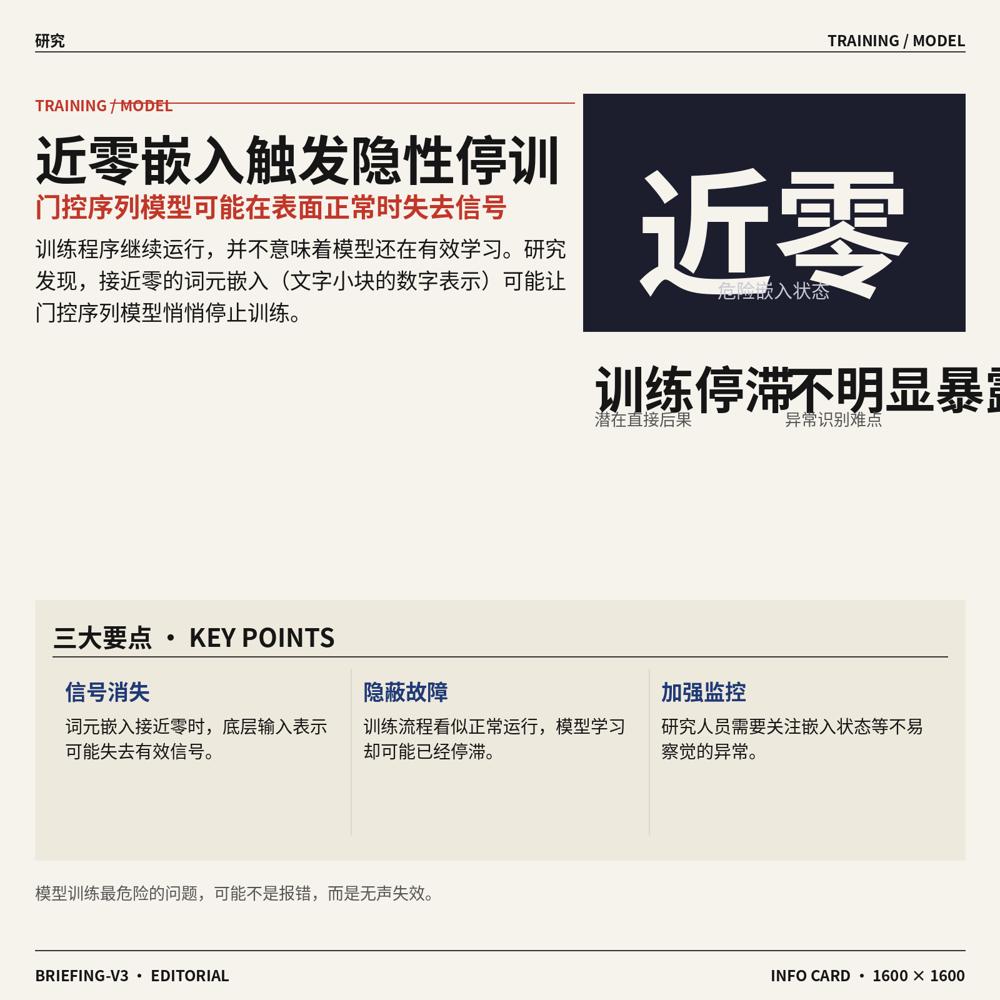

4. **近零词元嵌入可能让门控序列模型悄悄停止训练。**
论文指出，接近零的**词元嵌入**（把文字小块转换成数字坐标，供模型理解和计算）可能造成训练停滞，而且问题不一定会明显暴露 ⚠️。研究对象是**门控序列模型**（用“开关”控制哪些历史信息需要保留的模型），这类模型需要持续处理前后相关的数据。这个发现提醒研究人员：训练看似正常运行时，底层输入表示也可能已经失去有效信号，应重视不易察觉的异常 💡。[论文介绍页(briefing)](https://huggingface.co/papers/2611.04449)

![近零词元嵌入可能让门控序列模型悄悄停止训练](https://image.pollinations.ai/prompt/%E8%BF%91%E9%9B%B6%E8%AF%8D%E5%85%83%E5%B5%8C%E5%85%A5%E5%8F%AF%E8%83%BD%E8%AE%A9%E9%97%A8%E6%8E%A7%E5%BA%8F%E5%88%97%E6%A8%A1%E5%9E%8B%E6%82%84%E6%82%84%E5%81%9C%E6%AD%A2%E8%AE%AD%E7%BB%83.%20%E8%BF%91%E9%9B%B6%E8%AF%8D%E5%85%83%E5%B5%8C%E5%85%A5%E5%8F%AF%E8%83%BD%E8%AE%A9%E9%97%A8%E6%8E%A7%E5%BA%8F%E5%88%97%E6%A8%A1%E5%9E%8B%E6%82%84%E6%82%84%E5%81%9C%E6%AD%A2%E8%AE%AD%E7%BB%83%E3%80%82%20%E8%AE%BA%E6%96%87%E6%8C%87%E5%87%BA%EF%BC%8C%E6%8E%A5%E8%BF%91%E9%9B%B6%E7%9A%84%E8%AF%8D%E5%85%83%E5%B5%8C%E5%85%A5%EF%BC%88%E6%8A%8A%E6%96%87%E5%AD%97%E5%B0%8F%E5%9D%97%E8%BD%AC%E6%8D%A2%E6%88%90%E6%95%B0%E5%AD%97%E5%9D%90%E6%A0%87%EF%BC%8C%E4%BE%9B%E6%A8%A1%E5%9E%8B%E7%90%86%E8%A7%A3%E5%92%8C%E8%AE%A1%E7%AE%97%EF%BC%89%E5%8F%AF%E8%83%BD%E9%80%A0%E6%88%90%E8%AE%AD%E7%BB%83%E5%81%9C%E6%BB%9E%EF%BC%8C%E8%80%8C%E4%B8%94%E9%97%AE%E9%A2%98%E4%B8%8D%E4%B8%80%E5%AE%9A%E4%BC%9A%E6%98%8E%E6%98%BE%E6%9A%B4%E9%9C%B2%2C%20technical%20infographic%20diagram%2C%20architecture%20flowchart%2C%20clean%20vector%20illustration%2C%20educational%20style%2C%20no%20text%20overlay%2C%20modern%20minimal%2C%20wide%20aspect?width=1200&height=675&nologo=true&seed=10900)

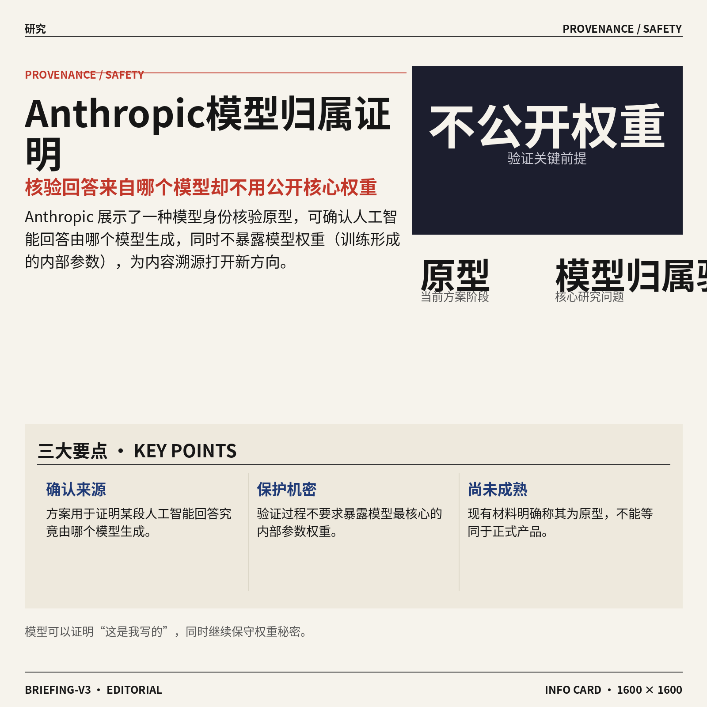

5. **Anthropic 原型可证明人工智能回答出自哪个模型，同时不公开模型权重。**
Anthropic 展示了一种原型方案，用于确认某段人工智能回答由哪个模型生成 🔍。关键点在于，验证过程无需暴露**模型权重**（模型训练后形成的内部参数，可理解为其核心“知识结构”）。这项研究触及**模型归属验证**（确认内容究竟由哪个模型产生）问题，为内容溯源与模型身份核验提供了新方向；现有材料将其明确称为原型，尚不能直接等同于成熟产品。[完整报道(briefing)](https://the-decoder.com/anthropics-new-prototype-proves-which-model-wrote-an-ai-response-without-exposing-its-weights/)

![Anthropic 原型可证明人工智能回答出自哪个模型，同时不公开模型权重](https://image.pollinations.ai/prompt/Anthropic%20%E5%8E%9F%E5%9E%8B%E5%8F%AF%E8%AF%81%E6%98%8E%E4%BA%BA%E5%B7%A5%E6%99%BA%E8%83%BD%E5%9B%9E%E7%AD%94%E5%87%BA%E8%87%AA%E5%93%AA%E4%B8%AA%E6%A8%A1%E5%9E%8B%EF%BC%8C%E5%90%8C%E6%97%B6%E4%B8%8D%E5%85%AC%E5%BC%80%E6%A8%A1%E5%9E%8B%E6%9D%83%E9%87%8D.%20Anthropic%20%E5%8E%9F%E5%9E%8B%E5%8F%AF%E8%AF%81%E6%98%8E%E4%BA%BA%E5%B7%A5%E6%99%BA%E8%83%BD%E5%9B%9E%E7%AD%94%E5%87%BA%E8%87%AA%E5%93%AA%E4%B8%AA%E6%A8%A1%E5%9E%8B%EF%BC%8C%E5%90%8C%E6%97%B6%E4%B8%8D%E5%85%AC%E5%BC%80%E6%A8%A1%E5%9E%8B%E6%9D%83%E9%87%8D%E3%80%82%20Anthropic%20%E5%B1%95%E7%A4%BA%E4%BA%86%E4%B8%80%E7%A7%8D%E5%8E%9F%E5%9E%8B%E6%96%B9%E6%A1%88%EF%BC%8C%E7%94%A8%E4%BA%8E%E7%A1%AE%E8%AE%A4%E6%9F%90%E6%AE%B5%E4%BA%BA%E5%B7%A5%E6%99%BA%E8%83%BD%E5%9B%9E%E7%AD%94%E7%94%B1%E5%93%AA%E4%B8%AA%E6%A8%A1%E5%9E%8B%E7%94%9F%E6%88%90%20%F0%9F%94%8D%2C%20technical%20infographic%20diagram%2C%20architecture%20flowchart%2C%20clean%20vector%20illustration%2C%20educational%20style%2C%20no%20text%20overlay%2C%20modern%20minimal%2C%20wide%20aspect?width=1200&height=675&nologo=true&seed=10931)

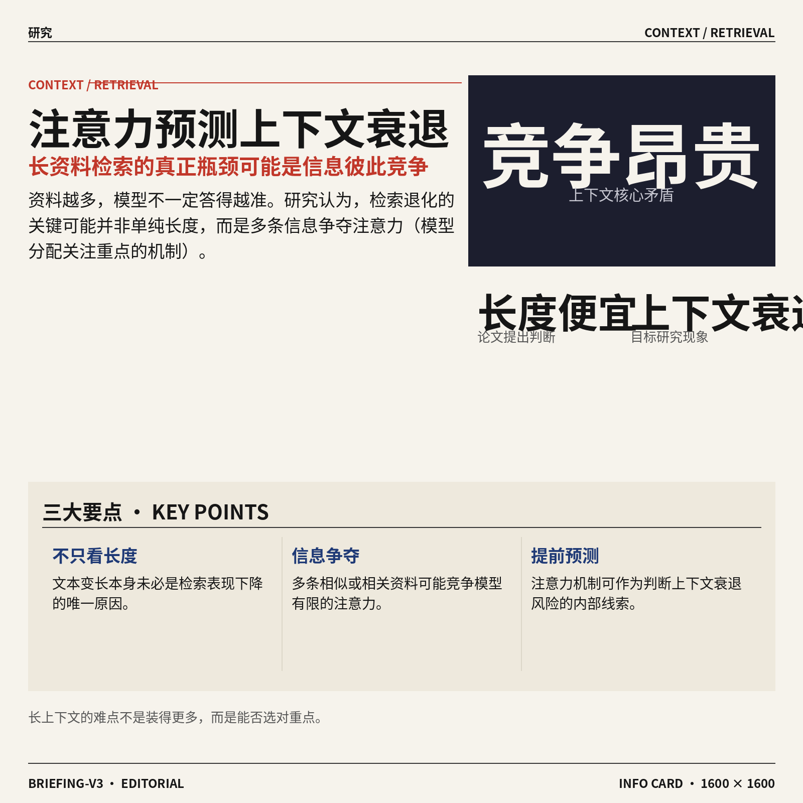

6. **“长度便宜，竞争昂贵”：注意力机制可预测检索中的上下文衰退。**
这项研究探讨**上下文衰退**（资料越来越多时，模型反而更难稳定找到关键信息）为何会出现在检索任务中 📚。论文标题认为，真正的问题未必只是文本太长，而可能是多条信息彼此竞争。研究进一步把**注意力机制**（模型判断当前应该重点关注哪些内容的内部过程）作为预测这种衰退的线索，为优化长资料问答提供了观察角度。[论文详情页(briefing)](https://huggingface.co/papers/2611.04169)

![“长度便宜，竞争昂贵”：注意力机制可预测检索中的上下文衰退](https://image.pollinations.ai/prompt/%E2%80%9C%E9%95%BF%E5%BA%A6%E4%BE%BF%E5%AE%9C%EF%BC%8C%E7%AB%9E%E4%BA%89%E6%98%82%E8%B4%B5%E2%80%9D%EF%BC%9A%E6%B3%A8%E6%84%8F%E5%8A%9B%E6%9C%BA%E5%88%B6%E5%8F%AF%E9%A2%84%E6%B5%8B%E6%A3%80%E7%B4%A2%E4%B8%AD%E7%9A%84%E4%B8%8A%E4%B8%8B%E6%96%87%E8%A1%B0%E9%80%80.%20%E2%80%9C%E9%95%BF%E5%BA%A6%E4%BE%BF%E5%AE%9C%EF%BC%8C%E7%AB%9E%E4%BA%89%E6%98%82%E8%B4%B5%E2%80%9D%EF%BC%9A%E6%B3%A8%E6%84%8F%E5%8A%9B%E6%9C%BA%E5%88%B6%E5%8F%AF%E9%A2%84%E6%B5%8B%E6%A3%80%E7%B4%A2%E4%B8%AD%E7%9A%84%E4%B8%8A%E4%B8%8B%E6%96%87%E8%A1%B0%E9%80%80%E3%80%82%20%E8%BF%99%E9%A1%B9%E7%A0%94%E7%A9%B6%E6%8E%A2%E8%AE%A8%E4%B8%8A%E4%B8%8B%E6%96%87%E8%A1%B0%E9%80%80%EF%BC%88%E8%B5%84%E6%96%99%E8%B6%8A%E6%9D%A5%E8%B6%8A%E5%A4%9A%E6%97%B6%EF%BC%8C%E6%A8%A1%E5%9E%8B%E5%8F%8D%E8%80%8C%E6%9B%B4%E9%9A%BE%E7%A8%B3%E5%AE%9A%E6%89%BE%E5%88%B0%E5%85%B3%E9%94%AE%E4%BF%A1%E6%81%AF%EF%BC%89%E4%B8%BA%E4%BD%95%E4%BC%9A%E5%87%BA%E7%8E%B0%E5%9C%A8%E6%A3%80%E7%B4%A2%E4%BB%BB%E5%8A%A1%E4%B8%AD%20%F0%9F%93%9A%E3%80%82%2C%20technical%20infographic%20diagram%2C%20architecture%20flowchart%2C%20clean%20vector%20illustration%2C%20educational%20style%2C%20no%20text%20overlay%2C%20modern%20minimal%2C%20wide%20aspect?width=1200&height=675&nologo=true&seed=10962)


7. **DreamX（从视频中学习潜在动作规律的扩散模型）探索通用动作理解。**
DreamX 将**视频扩散模型**（通过逐步去除噪声来生成或理解视频的模型）用于学习画面背后的动作规律 🎬。论文把它称为**潜在动作学习器**（不依赖直接标注，从视频变化中推断动作及其影响），重点不只是生成画面，还包括理解前后状态如何变化。按照标题，这项工作希望获得更通用的动作表示，但现有材料没有披露具体应用场景和实验成绩。[论文介绍页(briefing)](https://huggingface.co/papers/2611.05377)

![DreamX（从视频中学习潜在动作规律的扩散模型）探索通用动作理解](https://image.pollinations.ai/prompt/DreamX%EF%BC%88%E4%BB%8E%E8%A7%86%E9%A2%91%E4%B8%AD%E5%AD%A6%E4%B9%A0%E6%BD%9C%E5%9C%A8%E5%8A%A8%E4%BD%9C%E8%A7%84%E5%BE%8B%E7%9A%84%E6%89%A9%E6%95%A3%E6%A8%A1%E5%9E%8B%EF%BC%89%E6%8E%A2%E7%B4%A2%E9%80%9A%E7%94%A8%E5%8A%A8%E4%BD%9C%E7%90%86%E8%A7%A3.%20DreamX%EF%BC%88%E4%BB%8E%E8%A7%86%E9%A2%91%E4%B8%AD%E5%AD%A6%E4%B9%A0%E6%BD%9C%E5%9C%A8%E5%8A%A8%E4%BD%9C%E8%A7%84%E5%BE%8B%E7%9A%84%E6%89%A9%E6%95%A3%E6%A8%A1%E5%9E%8B%EF%BC%89%E6%8E%A2%E7%B4%A2%E9%80%9A%E7%94%A8%E5%8A%A8%E4%BD%9C%E7%90%86%E8%A7%A3%E3%80%82%20DreamX%20%E5%B0%86%E8%A7%86%E9%A2%91%E6%89%A9%E6%95%A3%E6%A8%A1%E5%9E%8B%EF%BC%88%E9%80%9A%E8%BF%87%E9%80%90%E6%AD%A5%E5%8E%BB%E9%99%A4%E5%99%AA%E5%A3%B0%E6%9D%A5%E7%94%9F%E6%88%90%E6%88%96%E7%90%86%E8%A7%A3%E8%A7%86%E9%A2%91%E7%9A%84%E6%A8%A1%E5%9E%8B%EF%BC%89%E7%94%A8%E4%BA%8E%E5%AD%A6%E4%B9%A0%E7%94%BB%E9%9D%A2%E8%83%8C%E5%90%8E%E7%9A%84%E5%8A%A8%2C%20technical%20infographic%20diagram%2C%20architecture%20flowchart%2C%20clean%20vector%20illustration%2C%20educational%20style%2C%20no%20text%20overlay%2C%20modern%20minimal%2C%20wide%20aspect?width=1200&height=675&nologo=true&seed=10993)

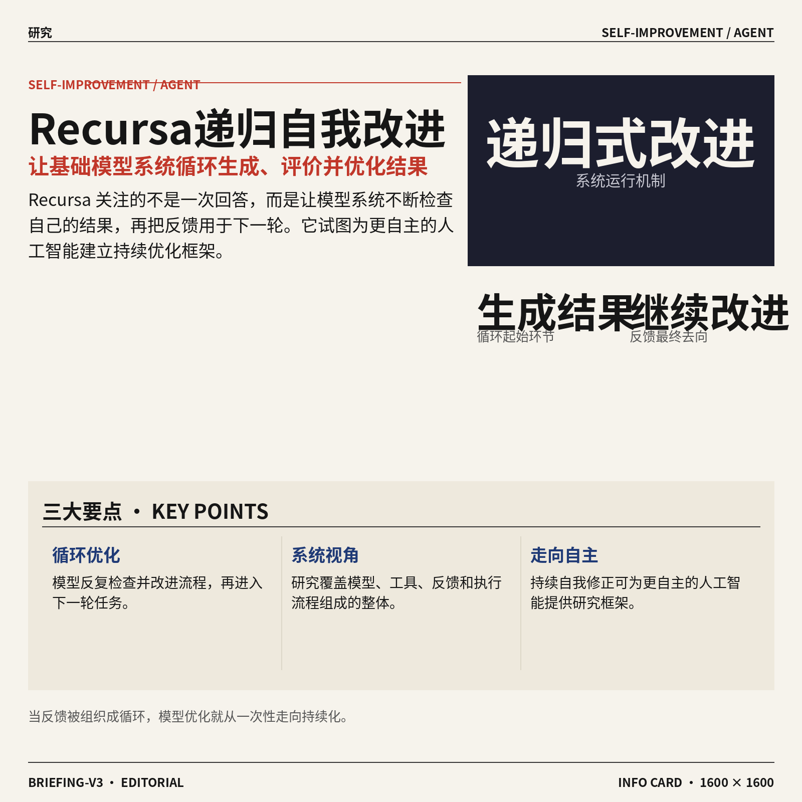

8. **Recursa（递归式自我改进基础模型系统）研究模型如何持续优化自己。**
Recursa 面向**递归式自我改进**（模型反复检查并改进自身流程，再把结果用于下一轮优化）这一前沿方向 🔄。研究对象并非单次回答，而是**基础模型系统**（由通用模型及其工具、反馈和执行流程共同组成的整体）。从标题看，它尝试把“生成结果—评价结果—继续改进”组织成循环，为更自主的人工智能系统提供研究框架。[论文详情页(briefing)](https://huggingface.co/papers/2611.04035)

![Recursa（递归式自我改进基础模型系统）研究模型如何持续优化自己](https://image.pollinations.ai/prompt/Recursa%EF%BC%88%E9%80%92%E5%BD%92%E5%BC%8F%E8%87%AA%E6%88%91%E6%94%B9%E8%BF%9B%E5%9F%BA%E7%A1%80%E6%A8%A1%E5%9E%8B%E7%B3%BB%E7%BB%9F%EF%BC%89%E7%A0%94%E7%A9%B6%E6%A8%A1%E5%9E%8B%E5%A6%82%E4%BD%95%E6%8C%81%E7%BB%AD%E4%BC%98%E5%8C%96%E8%87%AA%E5%B7%B1.%20Recursa%EF%BC%88%E9%80%92%E5%BD%92%E5%BC%8F%E8%87%AA%E6%88%91%E6%94%B9%E8%BF%9B%E5%9F%BA%E7%A1%80%E6%A8%A1%E5%9E%8B%E7%B3%BB%E7%BB%9F%EF%BC%89%E7%A0%94%E7%A9%B6%E6%A8%A1%E5%9E%8B%E5%A6%82%E4%BD%95%E6%8C%81%E7%BB%AD%E4%BC%98%E5%8C%96%E8%87%AA%E5%B7%B1%E3%80%82%20Recursa%20%E9%9D%A2%E5%90%91%E9%80%92%E5%BD%92%E5%BC%8F%E8%87%AA%E6%88%91%E6%94%B9%E8%BF%9B%EF%BC%88%E6%A8%A1%E5%9E%8B%E5%8F%8D%E5%A4%8D%E6%A3%80%E6%9F%A5%E5%B9%B6%E6%94%B9%E8%BF%9B%E8%87%AA%E8%BA%AB%E6%B5%81%E7%A8%8B%EF%BC%8C%E5%86%8D%E6%8A%8A%E7%BB%93%E6%9E%9C%E7%94%A8%E4%BA%8E%E4%B8%8B%E4%B8%80%E8%BD%AE%E4%BC%98%E5%8C%96%EF%BC%89%2C%20technical%20infographic%20diagram%2C%20architecture%20flowchart%2C%20clean%20vector%20illustration%2C%20educational%20style%2C%20no%20text%20overlay%2C%20modern%20minimal%2C%20wide%20aspect?width=1200&height=675&nologo=true&seed=11024)

### 🟡 行业展望与社会影响

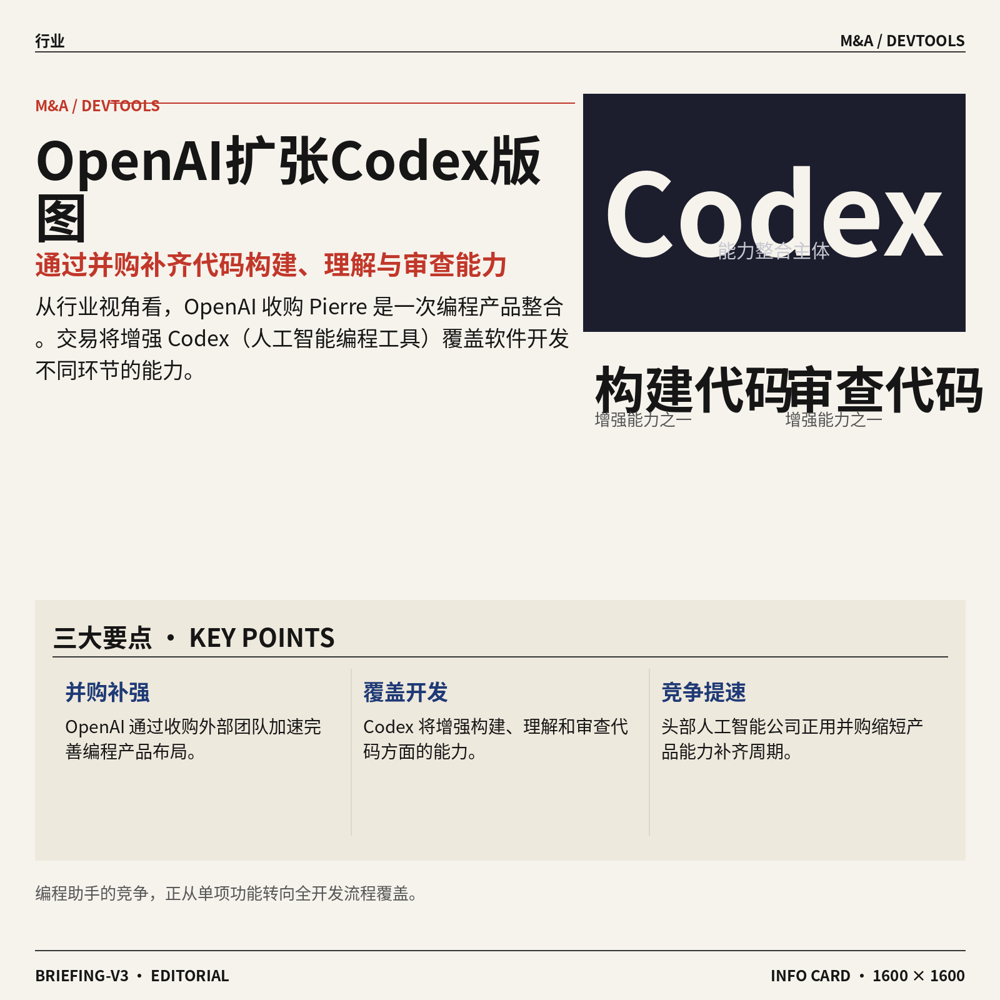

1. **OpenAI 将收购 Pierre Computer Company（一家计算机公司）。**
OpenAI 宣布将收购这家公司，进一步扩充旗下的编程产品布局 🤝。此次交易将增强 **Codex（OpenAI 的人工智能编程工具）**在构建、理解和审查代码方面的能力，让它覆盖更多软件开发环节。对行业而言，这也反映出头部人工智能公司正在通过**并购整合（通过收购外部团队和产品补齐自身能力）**，加快编程助手的发展速度 🚀。[OpenAI 官方收购公告(briefing)](https://openai.com/index/openai-to-acquire-pierre)


2. **Meta 收购 Conductor（可同时运行多个编程智能体的应用）。**
这家初创公司的产品允许软件工程师部署一组**编程智能体（能够自主处理代码任务的软件助手）**，同时完成项目中的不同工作 🤖。其核心思路是**并行协作（让多个助手同步分工，而不是逐项排队处理）**，相当于给程序员配上一支可同时开工的数字团队。Meta 此次收购显示，人工智能编程的竞争重点正从“单个助手写代码”，转向“多个助手共同推进整个项目” 🚀。[收购事件完整报道(briefing)](https://techcrunch.com/2026/11/04/meta-acquires-ai-coding-startup-conductor/)

![Meta 收购 Conductor（可同时运行多个编程智能体的应用）](https://image.pollinations.ai/prompt/Meta%20%E6%94%B6%E8%B4%AD%20Conductor%EF%BC%88%E5%8F%AF%E5%90%8C%E6%97%B6%E8%BF%90%E8%A1%8C%E5%A4%9A%E4%B8%AA%E7%BC%96%E7%A8%8B%E6%99%BA%E8%83%BD%E4%BD%93%E7%9A%84%E5%BA%94%E7%94%A8%EF%BC%89.%20Meta%20%E6%94%B6%E8%B4%AD%20Conductor%EF%BC%88%E5%8F%AF%E5%90%8C%E6%97%B6%E8%BF%90%E8%A1%8C%E5%A4%9A%E4%B8%AA%E7%BC%96%E7%A8%8B%E6%99%BA%E8%83%BD%E4%BD%93%E7%9A%84%E5%BA%94%E7%94%A8%EF%BC%89%E3%80%82%20%E8%BF%99%E5%AE%B6%E5%88%9D%E5%88%9B%E5%85%AC%E5%8F%B8%E7%9A%84%E4%BA%A7%E5%93%81%E5%85%81%E8%AE%B8%E8%BD%AF%E4%BB%B6%E5%B7%A5%E7%A8%8B%E5%B8%88%E9%83%A8%E7%BD%B2%E4%B8%80%E7%BB%84%E7%BC%96%E7%A8%8B%E6%99%BA%E8%83%BD%E4%BD%93%EF%BC%88%E8%83%BD%E5%A4%9F%E8%87%AA%E4%B8%BB%E5%A4%84%E7%90%86%E4%BB%A3%E7%A0%81%E4%BB%BB%E5%8A%A1%E7%9A%84%E8%BD%AF%E4%BB%B6%E5%8A%A9%E6%89%8B%EF%BC%89%EF%BC%8C%E5%90%8C%2C%20technical%20infographic%20diagram%2C%20architecture%20flowchart%2C%20clean%20vector%20illustration%2C%20educational%20style%2C%20no%20text%20overlay%2C%20modern%20minimal%2C%20wide%20aspect?width=1200&height=675&nologo=true&seed=10838)

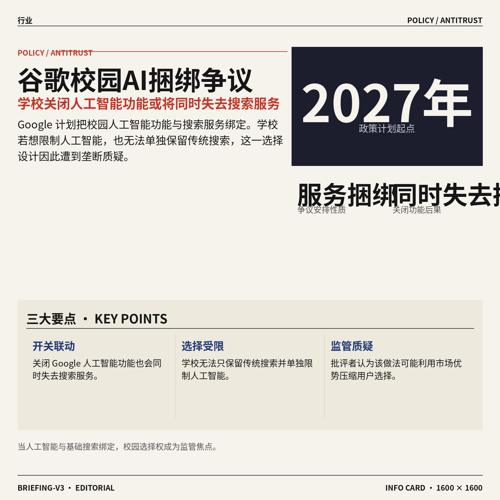

3. **Google 拟将学校的人工智能开关与搜索服务绑定，引发垄断争议。**
根据报道，从 **2027 年**开始，学校如果关闭 Google 的人工智能功能，也会同时失去其搜索服务 🔍。这一安排被质疑属于**服务捆绑（把两项服务的使用开关绑定在一起）**，意味着学校无法只保留传统搜索、同时限制人工智能。纽约市长 Zohran Mamdani（美国纽约市政治人物）和美国联邦贸易委员会前主席 Lina Khan（曾负责美国市场竞争监管的官员）等批评者认为，Google 的做法像是**未经监管的垄断行为（企业利用市场优势压缩用户选择空间）** ⚠️。[学校搜索政策报道(briefing)](https://the-decoder.com/schools-that-turn-off-googles-ai-will-lose-search-too-starting-in-2027/) [争议事件完整报道(briefing)](https://techcrunch.com/2026/11/04/google-faces-backlash-for-plan-that-would-turn-off-search-for-schools-that-restrict-ai/)

![Google 拟将学校的人工智能开关与搜索服务绑定，引发垄断争议](https://image.pollinations.ai/prompt/Google%20%E6%8B%9F%E5%B0%86%E5%AD%A6%E6%A0%A1%E7%9A%84%E4%BA%BA%E5%B7%A5%E6%99%BA%E8%83%BD%E5%BC%80%E5%85%B3%E4%B8%8E%E6%90%9C%E7%B4%A2%E6%9C%8D%E5%8A%A1%E7%BB%91%E5%AE%9A%EF%BC%8C%E5%BC%95%E5%8F%91%E5%9E%84%E6%96%AD%E4%BA%89%E8%AE%AE.%20Google%20%E6%8B%9F%E5%B0%86%E5%AD%A6%E6%A0%A1%E7%9A%84%E4%BA%BA%E5%B7%A5%E6%99%BA%E8%83%BD%E5%BC%80%E5%85%B3%E4%B8%8E%E6%90%9C%E7%B4%A2%E6%9C%8D%E5%8A%A1%E7%BB%91%E5%AE%9A%EF%BC%8C%E5%BC%95%E5%8F%91%E5%9E%84%E6%96%AD%E4%BA%89%E8%AE%AE%E3%80%82%20%E6%A0%B9%E6%8D%AE%E6%8A%A5%E9%81%93%EF%BC%8C%E4%BB%8E%202027%20%E5%B9%B4%E5%BC%80%E5%A7%8B%EF%BC%8C%E5%AD%A6%E6%A0%A1%E5%A6%82%E6%9E%9C%E5%85%B3%E9%97%AD%20Google%20%E7%9A%84%E4%BA%BA%E5%B7%A5%E6%99%BA%E8%83%BD%E5%8A%9F%E8%83%BD%EF%BC%8C%E4%B9%9F%E4%BC%9A%E5%90%8C%E6%97%B6%E5%A4%B1%E5%8E%BB%E5%85%B6%E6%90%9C%2C%20technical%20infographic%20diagram%2C%20architecture%20flowchart%2C%20clean%20vector%20illustration%2C%20educational%20style%2C%20no%20text%20overlay%2C%20modern%20minimal%2C%20wide%20aspect?width=1200&height=675&nologo=true&seed=10869)

4. **ChatGPT 借 Images 2.6（OpenAI 的图像模型）把文字和照片变成 GIF（循环播放的短动画图片）。**
ChatGPT 现在可以根据**文字提示词（用户用来描述想生成什么的文字指令）**或照片，直接生成动态图片 🎨。这项能力由 Images 2.6（负责理解并生成图像内容的模型）提供，让用户不必使用专业动画软件，也能把静态创意变成动图。对于运营、设计和内容岗位而言，这意味着社交媒体素材与轻量视觉内容的制作入口进一步降低 ✨。[动图生成功能报道(briefing)](https://the-decoder.com/chatgpt-can-now-turn-text-prompts-and-photos-into-animated-gifs-with-openais-images-2-6-model/)


### 🟣 开源TOP项目

1. **PR Agent（开源代码合并请求审查助手）专注自动检查代码改动。**
该项目将自己定位为**最早的开源代码审查助手**，主要帮助团队检查代码合并请求（开发者提交代码后，请同事审核并合入主项目的流程）🔍。它的核心价值是让机器先完成一轮审查，方便团队更快发现值得关注的改动。项目方还特别强调，它并不是 **Qodo（另一项代码审查服务）的免费套餐**，两者不能直接画等号。感兴趣的团队可查看[开源项目仓库(briefing)](https://github.com/The-PR-Agent/pr-agent)，进一步判断是否适合自己的协作流程。


2. **Kimi K3 in C（用 C 语言让超大模型在单颗处理器上运行的项目）挑战低配推理。**
仓库介绍称，拥有 **2.78 万亿参数**的 Kimi K3，可在单颗 CPU（中央处理器，电脑负责通用计算的核心部件）和 **8.24 GB 运行内存**下完成推理（让训练好的模型生成答案的过程）🤯。项目采用 C99（1999 年发布的 C 语言标准，特点是轻量、便于跨设备运行）编写，强调较强的可移植性。它不依赖 BLAS（用于加速矩阵计算的基础数学程序集）、额外开发框架或 GPU（图形处理器，大模型通常依赖的高性能计算硬件）。这项尝试的看点，在于尽可能压低超大模型运行时的硬件和软件依赖，具体实现可查看[项目代码仓库(briefing)](https://github.com/FareedKhan-dev/kimi-k3-in-c) 🚀。


3. **scenario-labs/skills（帮助智能体生成多媒体内容的技能库）打包生产级创作能力。**
这套开源技能可让不同智能体生成可用于生产的**图片、视频、音频和三维内容**，不必为每种素材单独寻找工作流 🎨。它会帮助选择合适的模型，并在实际花钱前先提供价格信息，便于团队控制生成成本。通过 Scenario MCP（基于模型上下文协议的连接方式，让智能体能够调用外部创作服务），项目还强调保持**角色形象和品牌风格一致**，减少同一人物或品牌元素反复“变脸”的问题。技能库也覆盖 Blender（免费的三维内容制作软件）、Maya（影视级三维动画软件）和 ZBrush（用于精细塑造三维角色的数字雕刻软件）等专业工具，详情见[多媒体技能仓库(briefing)](https://github.com/scenario-labs/skills) 💡。


4. **GitHub spec-kit（规格驱动开发入门工具包）帮助团队先把需求说清楚。**
这套工具包旨在帮助团队开始实践 SDD（规格驱动开发，即先写清需求和规则，再据此推进实现）📋。这里的“规格”可以理解为对**目标、约束和预期结果**的结构化说明，避免一上来就动手却没有统一方向。仓库说明它也能用于启动其他工作流程，并不局限于某一种固定做法。对想尝试流程标准化的团队来说，它提供了一个可参考的起点，项目入口见[官方工具仓库(briefing)](https://github.com/github/spec-kit)。

![GitHub spec-kit（规格驱动开发入门工具包）帮助团队先把需求说清楚](https://image.pollinations.ai/prompt/GitHub%20spec-kit%EF%BC%88%E8%A7%84%E6%A0%BC%E9%A9%B1%E5%8A%A8%E5%BC%80%E5%8F%91%E5%85%A5%E9%97%A8%E5%B7%A5%E5%85%B7%E5%8C%85%EF%BC%89%E5%B8%AE%E5%8A%A9%E5%9B%A2%E9%98%9F%E5%85%88%E6%8A%8A%E9%9C%80%E6%B1%82%E8%AF%B4%E6%B8%85%E6%A5%9A.%20GitHub%20spec-kit%EF%BC%88%E8%A7%84%E6%A0%BC%E9%A9%B1%E5%8A%A8%E5%BC%80%E5%8F%91%E5%85%A5%E9%97%A8%E5%B7%A5%E5%85%B7%E5%8C%85%EF%BC%89%E5%B8%AE%E5%8A%A9%E5%9B%A2%E9%98%9F%E5%85%88%E6%8A%8A%E9%9C%80%E6%B1%82%E8%AF%B4%E6%B8%85%E6%A5%9A%E3%80%82%20%E8%BF%99%E5%A5%97%E5%B7%A5%E5%85%B7%E5%8C%85%E6%97%A8%E5%9C%A8%E5%B8%AE%E5%8A%A9%E5%9B%A2%E9%98%9F%E5%BC%80%E5%A7%8B%E5%AE%9E%E8%B7%B5%20SDD%EF%BC%88%E8%A7%84%E6%A0%BC%E9%A9%B1%E5%8A%A8%E5%BC%80%E5%8F%91%EF%BC%8C%E5%8D%B3%E5%85%88%E5%86%99%E6%B8%85%E9%9C%80%E6%B1%82%E5%92%8C%E8%A7%84%E5%88%99%EF%BC%8C%E5%86%8D%E6%8D%AE%2C%20technical%20infographic%20diagram%2C%20architecture%20flowchart%2C%20clean%20vector%20illustration%2C%20educational%20style%2C%20no%20text%20overlay%2C%20modern%20minimal%2C%20wide%20aspect?width=1200&height=675&nologo=true&seed=11094)

5. **英伟达 Auto Ontology（用于构建语义图推理层的编程框架）提升数据查询与解释能力。**
该项目是一个基于 Python（常用于数据分析和人工智能开发的编程语言）的框架，可在现有数据之上构建**语义化、图结构的推理层** 🧠。其中，本体（把概念及其相互关系整理成统一知识体系）能帮助系统理解数据之间不只是“放在一起”，还存在怎样的关联。框架支持确定性查询生成（按照明确规则生成结果，使相同条件下的行为更可预测），并改善上下文检索（回答前从数据中找出相关背景信息）。这能让大模型和智能体工作流更容易找到合适信息，也让人工智能的判断过程更便于解释，代码与说明可查看[英伟达项目仓库(briefing)](https://github.com/NVIDIA/auto-ontology) 🚀。

![英伟达 Auto Ontology（用于构建语义图推理层的编程框架）提升数据查询与解释能力](https://image.pollinations.ai/prompt/%E8%8B%B1%E4%BC%9F%E8%BE%BE%20Auto%20Ontology%EF%BC%88%E7%94%A8%E4%BA%8E%E6%9E%84%E5%BB%BA%E8%AF%AD%E4%B9%89%E5%9B%BE%E6%8E%A8%E7%90%86%E5%B1%82%E7%9A%84%E7%BC%96%E7%A8%8B%E6%A1%86%E6%9E%B6%EF%BC%89%E6%8F%90%E5%8D%87%E6%95%B0%E6%8D%AE%E6%9F%A5%E8%AF%A2%E4%B8%8E%E8%A7%A3%E9%87%8A%E8%83%BD%E5%8A%9B.%20%E8%8B%B1%E4%BC%9F%E8%BE%BE%20Auto%20Ontology%EF%BC%88%E7%94%A8%E4%BA%8E%E6%9E%84%E5%BB%BA%E8%AF%AD%E4%B9%89%E5%9B%BE%E6%8E%A8%E7%90%86%E5%B1%82%E7%9A%84%E7%BC%96%E7%A8%8B%E6%A1%86%E6%9E%B6%EF%BC%89%E6%8F%90%E5%8D%87%E6%95%B0%E6%8D%AE%E6%9F%A5%E8%AF%A2%E4%B8%8E%E8%A7%A3%E9%87%8A%E8%83%BD%E5%8A%9B%E3%80%82%20%E8%AF%A5%E9%A1%B9%E7%9B%AE%E6%98%AF%E4%B8%80%E4%B8%AA%E5%9F%BA%E4%BA%8E%20Python%EF%BC%88%E5%B8%B8%E7%94%A8%E4%BA%8E%E6%95%B0%E6%8D%AE%E5%88%86%E6%9E%90%E5%92%8C%E4%BA%BA%E5%B7%A5%E6%99%BA%E8%83%BD%E5%BC%80%E5%8F%91%E7%9A%84%E7%BC%96%E7%A8%8B%2C%20technical%20infographic%20diagram%2C%20architecture%20flowchart%2C%20clean%20vector%20illustration%2C%20educational%20style%2C%20no%20text%20overlay%2C%20modern%20minimal%2C%20wide%20aspect?width=1200&height=675&nologo=true&seed=11125)

### 🔴 社媒分享

1. **Kimi K3.1 Pro（已公开模型权重的大模型）正式放出参数文件。**
Kimi K3.1 Pro 已在 Hugging Face（全球最大的 AI 模型共享社区）上线**模型权重** 🚀。模型权重（模型训练后学到的参数，可理解为模型的“知识存档”）公开后，外界可以从页面获取相关文件，但具体使用条件仍应以发布说明为准。关注开源模型的同事，可以直接查看[模型权重发布页(briefing)](https://huggingface.co/moonshotai/Kimi-K3.1-Pro)了解文件与说明 💡。


2. **OpenAI 披露减少一千条通往 root（系统最高管理员权限）路径的进展。**
OpenAI 用“**少了一千条通往最高权限的路径**”概括此次工作，核心指向系统安全 🔐。root（操作系统中的最高管理员权限，拿到后通常可以控制整台设备）是安全防护中的关键目标；这类路径越少，通常越有利于缩小攻击面（系统可能被利用的入口总和）。至于这些路径如何识别、统计与处理，可查看[官方安全文章(briefing)](https://openai.com/index/a-thousand-fewer-paths-to-root/)。

![OpenAI 披露减少一千条通往 root（系统最高管理员权限）路径的进展](https://image.pollinations.ai/prompt/OpenAI%20%E6%8A%AB%E9%9C%B2%E5%87%8F%E5%B0%91%E4%B8%80%E5%8D%83%E6%9D%A1%E9%80%9A%E5%BE%80%20root%EF%BC%88%E7%B3%BB%E7%BB%9F%E6%9C%80%E9%AB%98%E7%AE%A1%E7%90%86%E5%91%98%E6%9D%83%E9%99%90%EF%BC%89%E8%B7%AF%E5%BE%84%E7%9A%84%E8%BF%9B%E5%B1%95.%20OpenAI%20%E6%8A%AB%E9%9C%B2%E5%87%8F%E5%B0%91%E4%B8%80%E5%8D%83%E6%9D%A1%E9%80%9A%E5%BE%80%20root%EF%BC%88%E7%B3%BB%E7%BB%9F%E6%9C%80%E9%AB%98%E7%AE%A1%E7%90%86%E5%91%98%E6%9D%83%E9%99%90%EF%BC%89%E8%B7%AF%E5%BE%84%E7%9A%84%E8%BF%9B%E5%B1%95%E3%80%82%20OpenAI%20%E7%94%A8%E2%80%9C%E5%B0%91%E4%BA%86%E4%B8%80%E5%8D%83%E6%9D%A1%E9%80%9A%E5%BE%80%E6%9C%80%E9%AB%98%E6%9D%83%E9%99%90%E7%9A%84%E8%B7%AF%E5%BE%84%E2%80%9D%E6%A6%82%E6%8B%AC%E6%AD%A4%E6%AC%A1%E5%B7%A5%E4%BD%9C%EF%BC%8C%E6%A0%B8%E5%BF%83%E6%8C%87%E5%90%91%E7%B3%BB%E7%BB%9F%E5%AE%89%E5%85%A8%20%F0%9F%94%90%2C%20technical%20infographic%20diagram%2C%20architecture%20flowchart%2C%20clean%20vector%20illustration%2C%20educational%20style%2C%20no%20text%20overlay%2C%20modern%20minimal%2C%20wide%20aspect?width=1200&height=675&nologo=true&seed=10644)

3. **Anthropic 推进可证明推理（用可核验证据确认模型计算按约定执行）。**
Anthropic 公布了**大语言模型可证明推理**的研究进展 🧠。模型推理（训练好的模型接收输入并生成结果的过程）通常发生在用户看不到的后台，而可证明推理关注的是如何让这段计算具备**可核验性**，而不只是直接相信输出结果。此次材料聚焦该方向的最新进展，具体内容可阅读[官方研究进展(briefing)](https://www.anthropic.com/research/provable-inference) 💡。

![Anthropic 推进可证明推理（用可核验证据确认模型计算按约定执行）](https://image.pollinations.ai/prompt/Anthropic%20%E6%8E%A8%E8%BF%9B%E5%8F%AF%E8%AF%81%E6%98%8E%E6%8E%A8%E7%90%86%EF%BC%88%E7%94%A8%E5%8F%AF%E6%A0%B8%E9%AA%8C%E8%AF%81%E6%8D%AE%E7%A1%AE%E8%AE%A4%E6%A8%A1%E5%9E%8B%E8%AE%A1%E7%AE%97%E6%8C%89%E7%BA%A6%E5%AE%9A%E6%89%A7%E8%A1%8C%EF%BC%89.%20Anthropic%20%E6%8E%A8%E8%BF%9B%E5%8F%AF%E8%AF%81%E6%98%8E%E6%8E%A8%E7%90%86%EF%BC%88%E7%94%A8%E5%8F%AF%E6%A0%B8%E9%AA%8C%E8%AF%81%E6%8D%AE%E7%A1%AE%E8%AE%A4%E6%A8%A1%E5%9E%8B%E8%AE%A1%E7%AE%97%E6%8C%89%E7%BA%A6%E5%AE%9A%E6%89%A7%E8%A1%8C%EF%BC%89%E3%80%82%20Anthropic%20%E5%85%AC%E5%B8%83%E4%BA%86%E5%A4%A7%E8%AF%AD%E8%A8%80%E6%A8%A1%E5%9E%8B%E5%8F%AF%E8%AF%81%E6%98%8E%E6%8E%A8%E7%90%86%E7%9A%84%E7%A0%94%E7%A9%B6%E8%BF%9B%E5%B1%95%20%F0%9F%A7%A0%E3%80%82%E6%A8%A1%E5%9E%8B%E6%8E%A8%E7%90%86%EF%BC%88%E8%AE%AD%E7%BB%83%E5%A5%BD%E7%9A%84%E6%A8%A1%E5%9E%8B%2C%20technical%20infographic%20diagram%2C%20architecture%20flowchart%2C%20clean%20vector%20illustration%2C%20educational%20style%2C%20no%20text%20overlay%2C%20modern%20minimal%2C%20wide%20aspect?width=1200&height=675&nologo=true&seed=10675)

---

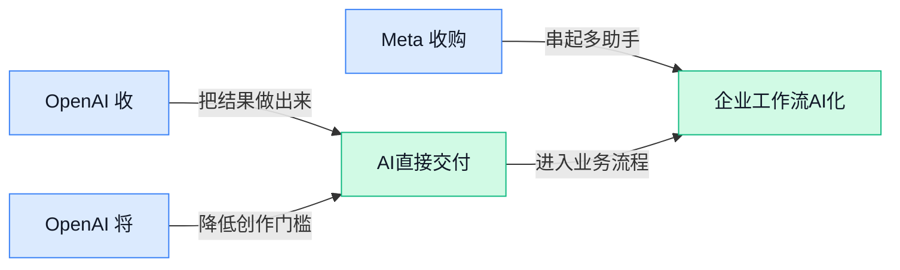

### 📊 行业洞察（今日 3 条）

1. OpenAI收购 Pierre Computer Company（帮助改进代码协作流程的公司），Meta收购 Conductor（可同时调度多个编程智能体的应用）
  【洞察】两件事放一起看，竞争已经从“谁的智能体更聪明”转向“谁能把多个智能体、任务记录和协作流程接得更顺”，单点能力不再够用。

2. ChatGPT支持用文字和照片制作 GIF（循环播放的短动画图片），开源技能库也开始统一调用图片、视频、音频工具
  【洞察】内容生产正在从“会不会生成”进入“能不能稳定批量交付”，品牌一致性、成本提示和流程整合，会比单次生成效果更影响商业价值。

3. Google把学校的人工智能开关与搜索绑定，Anthropic同时研究模型来源和推理过程的可验证性
  【洞察】行业一边把人工智能嵌入基础服务，一边补信任和证明机制，说明用户真正担心的已不是要不要用，而是能否选择、追责和核验。

### 💭 对我们的启发（今日 3 条）

1. ChatGPT的 GIF 生成功能和多媒体技能库说明，剪辑软件应把“图片变动态、自动配套素材、品牌形象保持一致”做成连续流程，而不是堆几个孤立按钮。

2. OpenAI与Meta都在强化多智能体协作，我们的视频创作工具可以让脚本、画面、字幕、封面并行处理，但必须保留统一任务单、版本记录和人工最终确认，避免多路结果互相冲突。

3. Anthropic推进模型来源核验，OpenAI持续减少高权限风险，说明客户会要求知道素材由什么生成、改过几次、谁确认过；产品应提供生成记录、敏感操作审批和人工接管入口。

