## AI资讯日报 2026/11/7

> AI 早报 · 每日早读 · 全网深度聚合

## **今日摘要**

```
OpenAI 据报获110亿美元融资，估值冲上1.25万亿美元
Anthropic IPO估值预期最低降至1.1万亿美元，Claude推出个人财务功能
OpenAI 推出 GPT-6 Cyber，联手 Hacktron（漏洞安全伙伴）加固系统
```

### 🔵 产品与功能更新

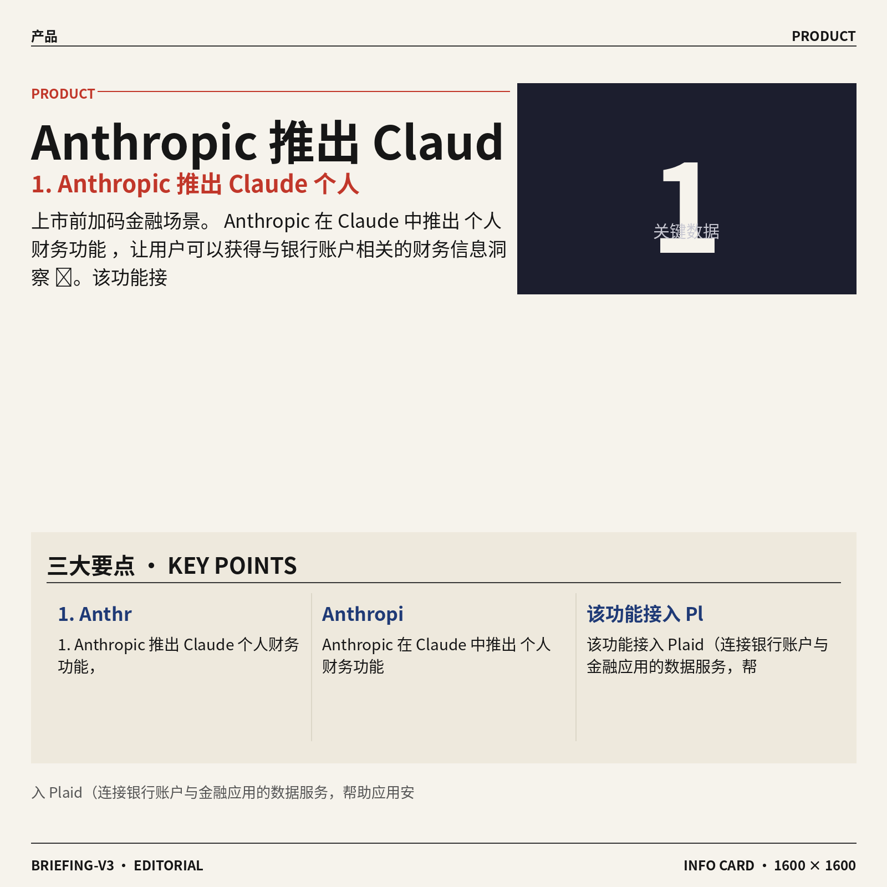

1. **Anthropic 推出 Claude 个人财务功能，上市前加码金融场景。**  
Anthropic 在 Claude 中推出**个人财务功能**，让用户可以获得与银行账户相关的财务信息洞察 💰。该功能接入 Plaid（连接银行账户与金融应用的数据服务，帮助应用安全读取金融信息），重点面向日常资金管理场景。此次发布也发生在 Anthropic 准备纳斯达克上市的背景下，显示其正把 Claude 从通用助手延伸到更具体的金融服务领域。[个人财务功能报道(briefing)](https://news.google.com/rss/articles/CBMiwgFBVV95cUxQTGVPOGo1UDd1TUxtU3AybjA3MXhXeWJmU0lkNndvc29oeTBpTWFJTnJJR3ZWSXlPak9rQUVSM2ZsbEFVUGlEdjMxMm5VbEtSdWprb3liSkp3dFFSdnJXMVBoM1dyQTJZNDZMMTc3UmgxVTFiUHpEcEJubVNUYTZlOGVFMkRNdGh1b3VuX3F5ekJwSGdFV21GNWFHVFRlZDIzdkRUZnhfdVhRa25ZZXRPWG02S0FXSURhbjBYMUZTekRVZw?oc=5) [银行洞察合作报道(briefing)](https://news.google.com/rss/articles/CBMie0FVX3lxTE1fMHFtV0dPdWVQX2N5LTI0T1VXX01tU3dYOHRqN3N2Q3RoQWhLUWE2VTdXY0E0VGQtYXlKTjg2Z3Y3UklKZkE0RUdGa1VBRlNyV0lib05ETjhPV1RGWDdQMlhpRUpTOFV4eVRaV3NPY0RKMkZMRDN4TlJvVQ?oc=5)


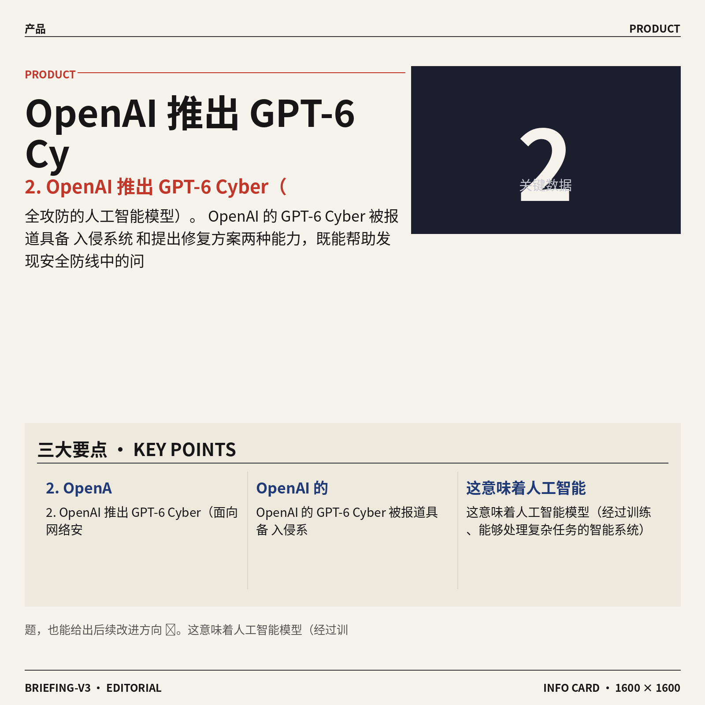

2. **OpenAI 推出 GPT-6 Cyber（面向网络安全攻防的人工智能模型）。**  
OpenAI 的 GPT-6 Cyber 被报道具备**入侵系统**和提出修复方案两种能力，既能帮助发现安全防线中的问题，也能给出后续改进方向 🛡️。这意味着人工智能模型（经过训练、能够处理复杂任务的智能系统）正在同时参与安全检查与问题修复，而不只是生成文字或回答问题。对企业而言，这类能力可能让网络安全团队更快定位风险，但实际使用仍需要明确授权和专业人员把关。[网络安全模型报道(briefing)](https://the-decoder.com/openais-gpt-6-cyber-can-both-break-into-systems-and-propose-how-to-fix-them/)


### 🟢 前沿研究

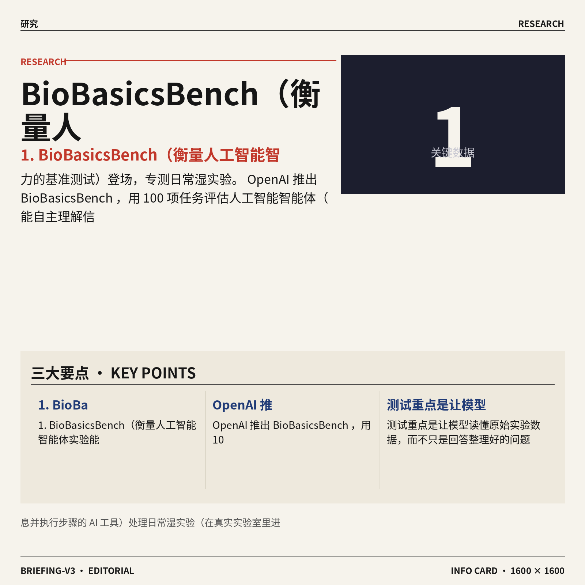

1. **BioBasicsBench（衡量人工智能智能体实验能力的基准测试）登场，专测日常湿实验。**  
OpenAI 推出 **BioBasicsBench**，用 100 项任务评估人工智能智能体（能自主理解信息并执行步骤的 AI 工具）处理日常湿实验（在真实实验室里进行的生物实验）的能力。测试重点是让模型读懂原始实验数据，而不只是回答整理好的问题 🧪。这为判断 AI 是否真正能辅助科研人员处理实验记录与结果，提供了更具体的衡量方式。[OpenAI 官方介绍(briefing)](https://openai.com/index/measuring-how-ai-agents-handle-wet-lab-science)


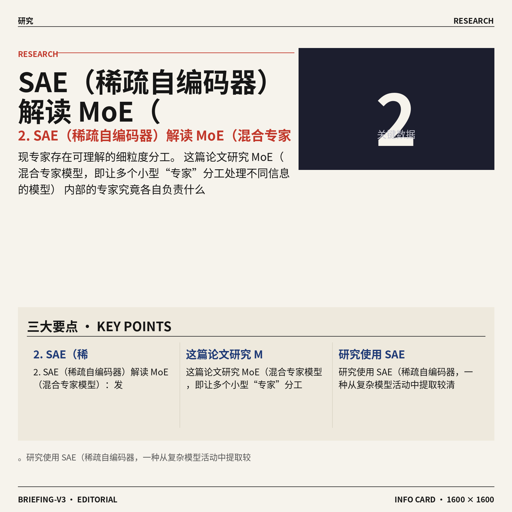

2. **SAE（稀疏自编码器）解读 MoE（混合专家模型）：发现专家存在可理解的细粒度分工。**  
这篇论文研究 **MoE（混合专家模型，即让多个小型“专家”分工处理不同信息的模型）** 内部的专家究竟各自负责什么。研究使用 SAE（稀疏自编码器，一种从复杂模型活动中提取较清晰特征的工具）进行分析，试图把模型内部的分工转化为人类能理解的概念。论文标题提出，MoE 中的不同专家呈现出可解释的细粒度专业化（对更具体、更窄领域的分工），有助于我们理解大模型为何会作出某种判断 🔍。[arXiv 论文页面(briefing)](https://arxiv.org/abs/2611.08089)

![SAE（稀疏自编码器）解读 MoE（混合专家模型）：发现专家存在可理解的细粒度分工](https://image.pollinations.ai/prompt/SAE%EF%BC%88%E7%A8%80%E7%96%8F%E8%87%AA%E7%BC%96%E7%A0%81%E5%99%A8%EF%BC%89%E8%A7%A3%E8%AF%BB%20MoE%EF%BC%88%E6%B7%B7%E5%90%88%E4%B8%93%E5%AE%B6%E6%A8%A1%E5%9E%8B%EF%BC%89%EF%BC%9A%E5%8F%91%E7%8E%B0%E4%B8%93%E5%AE%B6%E5%AD%98%E5%9C%A8%E5%8F%AF%E7%90%86%E8%A7%A3%E7%9A%84%E7%BB%86%E7%B2%92%E5%BA%A6%E5%88%86%E5%B7%A5.%20SAE%EF%BC%88%E7%A8%80%E7%96%8F%E8%87%AA%E7%BC%96%E7%A0%81%E5%99%A8%EF%BC%89%E8%A7%A3%E8%AF%BB%20MoE%EF%BC%88%E6%B7%B7%E5%90%88%E4%B8%93%E5%AE%B6%E6%A8%A1%E5%9E%8B%EF%BC%89%EF%BC%9A%E5%8F%91%E7%8E%B0%E4%B8%93%E5%AE%B6%E5%AD%98%E5%9C%A8%E5%8F%AF%E7%90%86%E8%A7%A3%E7%9A%84%E7%BB%86%E7%B2%92%E5%BA%A6%E5%88%86%E5%B7%A5%E3%80%82%20%E8%BF%99%E7%AF%87%E8%AE%BA%E6%96%87%E7%A0%94%E7%A9%B6%20MoE%EF%BC%88%E6%B7%B7%E5%90%88%E4%B8%93%E5%AE%B6%E6%A8%A1%E5%9E%8B%EF%BC%8C%E5%8D%B3%E8%AE%A9%E5%A4%9A%E4%B8%AA%E5%B0%8F%E5%9E%8B%E2%80%9C%E4%B8%93%E5%AE%B6%E2%80%9D%E5%88%86%E5%B7%A5%E5%A4%84%E7%90%86%E4%B8%8D%E5%90%8C%E4%BF%A1%E6%81%AF%E7%9A%84%2C%20technical%20infographic%20diagram%2C%20architecture%20flowchart%2C%20clean%20vector%20illustration%2C%20educational%20style%2C%20no%20text%20overlay%2C%20modern%20minimal%2C%20wide%20aspect?width=1200&height=675&nologo=true&seed=10838)

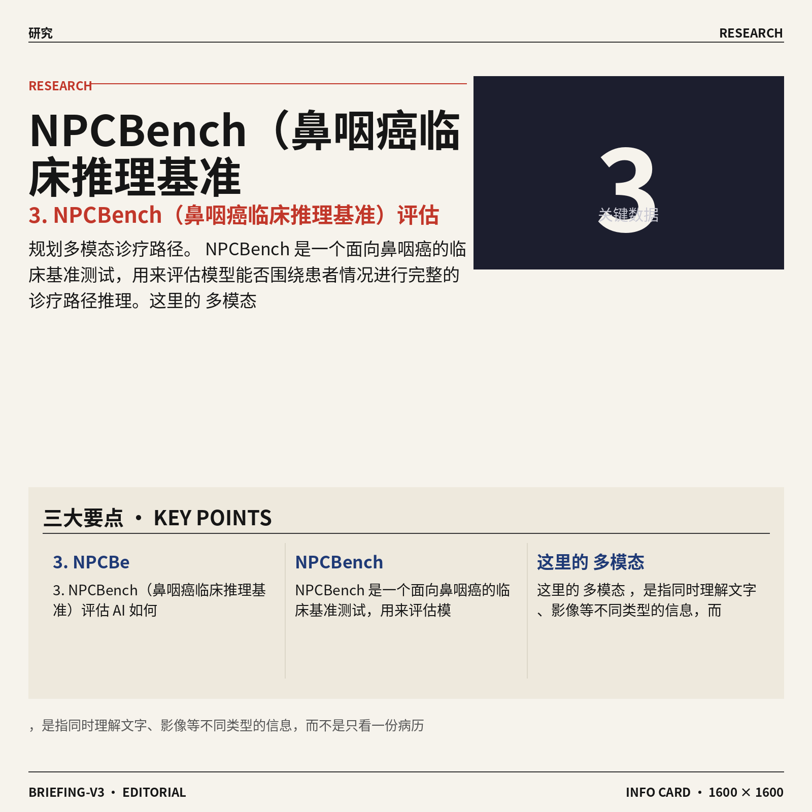

3. **NPCBench（鼻咽癌临床推理基准）评估 AI 如何规划多模态诊疗路径。**  
NPCBench 是一个面向鼻咽癌的临床基准测试，用来评估模型能否围绕患者情况进行完整的诊疗路径推理。这里的**多模态**，是指同时理解文字、影像等不同类型的信息，而不是只看一份病历。它采用“临床学徒式”的评估思路，关注 AI 是否能像学习中的医生一样，结合多种资料理解护理与治疗流程 🩺。[论文项目页面(briefing)](https://huggingface.co/papers/2611.08369)

![NPCBench（鼻咽癌临床推理基准）评估 AI 如何规划多模态诊疗路径](https://image.pollinations.ai/prompt/NPCBench%EF%BC%88%E9%BC%BB%E5%92%BD%E7%99%8C%E4%B8%B4%E5%BA%8A%E6%8E%A8%E7%90%86%E5%9F%BA%E5%87%86%EF%BC%89%E8%AF%84%E4%BC%B0%20AI%20%E5%A6%82%E4%BD%95%E8%A7%84%E5%88%92%E5%A4%9A%E6%A8%A1%E6%80%81%E8%AF%8A%E7%96%97%E8%B7%AF%E5%BE%84.%20NPCBench%EF%BC%88%E9%BC%BB%E5%92%BD%E7%99%8C%E4%B8%B4%E5%BA%8A%E6%8E%A8%E7%90%86%E5%9F%BA%E5%87%86%EF%BC%89%E8%AF%84%E4%BC%B0%20AI%20%E5%A6%82%E4%BD%95%E8%A7%84%E5%88%92%E5%A4%9A%E6%A8%A1%E6%80%81%E8%AF%8A%E7%96%97%E8%B7%AF%E5%BE%84%E3%80%82%20NPCBench%20%E6%98%AF%E4%B8%80%E4%B8%AA%E9%9D%A2%E5%90%91%E9%BC%BB%E5%92%BD%E7%99%8C%E7%9A%84%E4%B8%B4%E5%BA%8A%E5%9F%BA%E5%87%86%E6%B5%8B%E8%AF%95%EF%BC%8C%E7%94%A8%E6%9D%A5%E8%AF%84%E4%BC%B0%E6%A8%A1%E5%9E%8B%E8%83%BD%E5%90%A6%E5%9B%B4%E7%BB%95%E6%82%A3%E8%80%85%E6%83%85%E5%86%B5%E8%BF%9B%E8%A1%8C%E5%AE%8C%2C%20technical%20infographic%20diagram%2C%20architecture%20flowchart%2C%20clean%20vector%20illustration%2C%20educational%20style%2C%20no%20text%20overlay%2C%20modern%20minimal%2C%20wide%20aspect?width=1200&height=675&nologo=true&seed=10869)

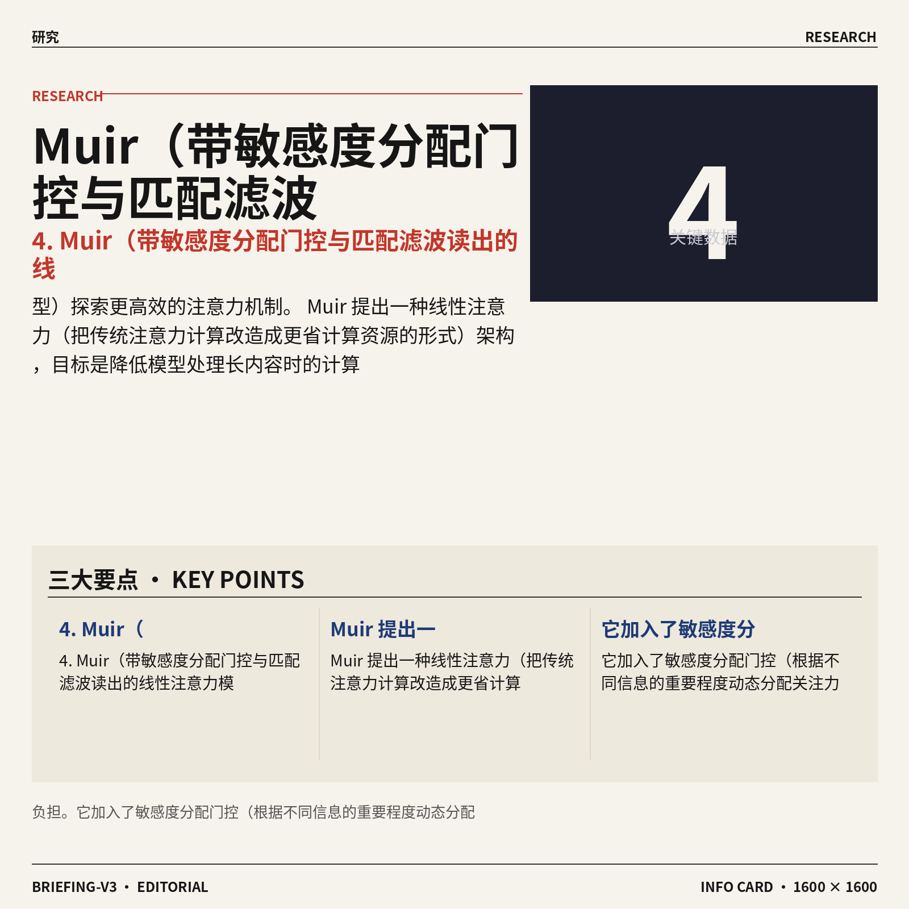

4. **Muir（带敏感度分配门控与匹配滤波读出的线性注意力模型）探索更高效的注意力机制。**  
Muir 提出一种线性注意力（把传统注意力计算改造成更省计算资源的形式）架构，目标是降低模型处理长内容时的计算负担。它加入了敏感度分配门控（根据不同信息的重要程度动态分配关注力度）以及匹配滤波读出（像从噪声中筛出最匹配信号的读取方式）。目前候选信息主要介绍了这套结构的设计方向，重点在于探索模型如何更高效地分配注意力 ⚙️。[论文项目页面(briefing)](https://huggingface.co/papers/2611.08376)

![Muir（带敏感度分配门控与匹配滤波读出的线性注意力模型）探索更高效的注意力机制](https://image.pollinations.ai/prompt/Muir%EF%BC%88%E5%B8%A6%E6%95%8F%E6%84%9F%E5%BA%A6%E5%88%86%E9%85%8D%E9%97%A8%E6%8E%A7%E4%B8%8E%E5%8C%B9%E9%85%8D%E6%BB%A4%E6%B3%A2%E8%AF%BB%E5%87%BA%E7%9A%84%E7%BA%BF%E6%80%A7%E6%B3%A8%E6%84%8F%E5%8A%9B%E6%A8%A1%E5%9E%8B%EF%BC%89%E6%8E%A2%E7%B4%A2%E6%9B%B4%E9%AB%98%E6%95%88%E7%9A%84%E6%B3%A8%E6%84%8F%E5%8A%9B%E6%9C%BA%E5%88%B6.%20Muir%EF%BC%88%E5%B8%A6%E6%95%8F%E6%84%9F%E5%BA%A6%E5%88%86%E9%85%8D%E9%97%A8%E6%8E%A7%E4%B8%8E%E5%8C%B9%E9%85%8D%E6%BB%A4%E6%B3%A2%E8%AF%BB%E5%87%BA%E7%9A%84%E7%BA%BF%E6%80%A7%E6%B3%A8%E6%84%8F%E5%8A%9B%E6%A8%A1%E5%9E%8B%EF%BC%89%E6%8E%A2%E7%B4%A2%E6%9B%B4%E9%AB%98%E6%95%88%E7%9A%84%E6%B3%A8%E6%84%8F%E5%8A%9B%E6%9C%BA%E5%88%B6%E3%80%82%20Muir%20%E6%8F%90%E5%87%BA%E4%B8%80%E7%A7%8D%E7%BA%BF%E6%80%A7%E6%B3%A8%E6%84%8F%E5%8A%9B%EF%BC%88%E6%8A%8A%E4%BC%A0%E7%BB%9F%E6%B3%A8%E6%84%8F%E5%8A%9B%E8%AE%A1%E7%AE%97%E6%94%B9%E9%80%A0%E6%88%90%E6%9B%B4%E7%9C%81%E8%AE%A1%E7%AE%97%E8%B5%84%E6%BA%90%E7%9A%84%E5%BD%A2%E5%BC%8F%EF%BC%89%E6%9E%B6%E6%9E%84%2C%20technical%20infographic%20diagram%2C%20architecture%20flowchart%2C%20clean%20vector%20illustration%2C%20educational%20style%2C%20no%20text%20overlay%2C%20modern%20minimal%2C%20wide%20aspect?width=1200&height=675&nologo=true&seed=10900)

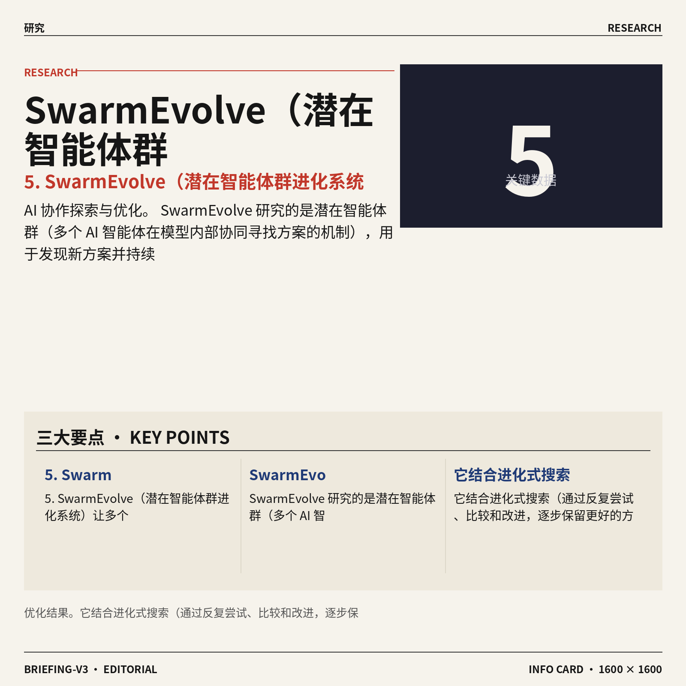

5. **SwarmEvolve（潜在智能体群进化系统）让多个 AI 协作探索与优化。**  
SwarmEvolve 研究的是潜在智能体群（多个 AI 智能体在模型内部协同寻找方案的机制），用于发现新方案并持续优化结果。它结合进化式搜索（通过反复尝试、比较和改进，逐步保留更好的方案）来推动探索过程。对科研和复杂决策场景来说，这类思路关注的不是让单个模型一次答对，而是让一组智能体共同寻找更优解 🚀。[论文项目页面(briefing)](https://huggingface.co/papers/2611.08483)


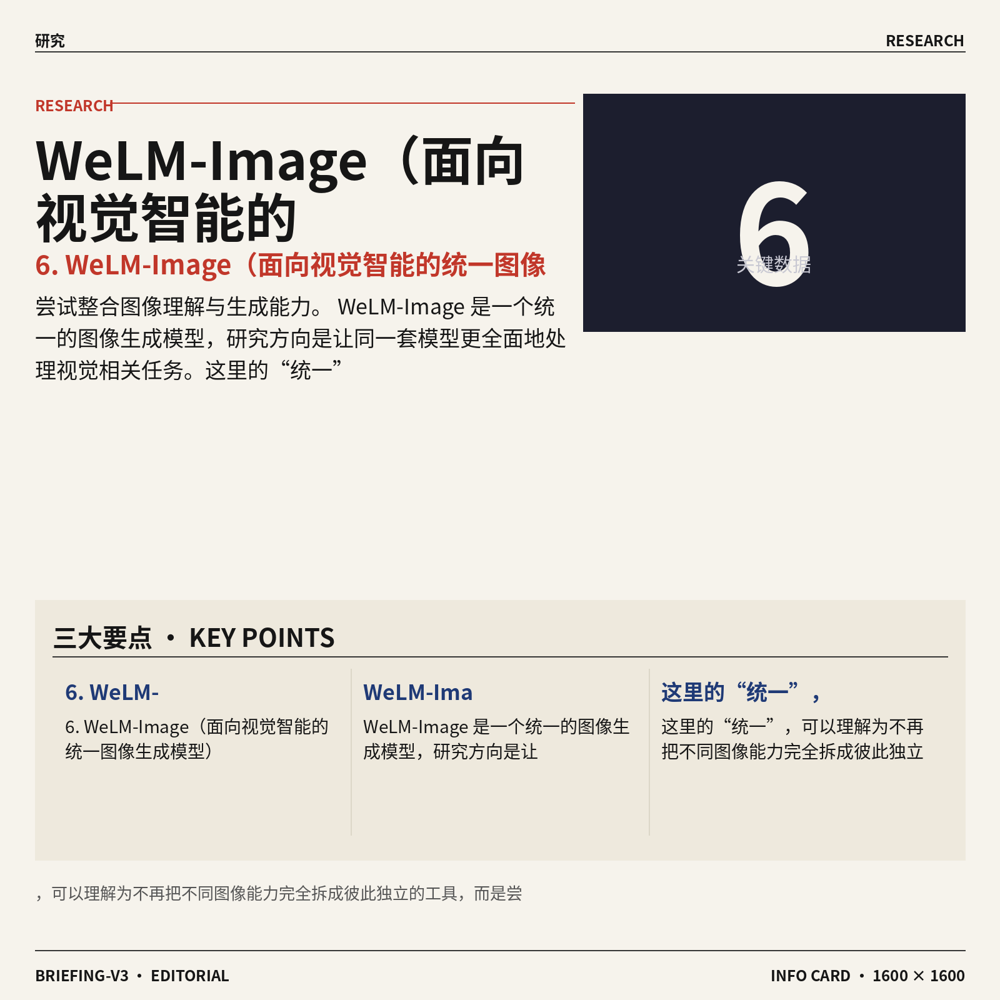

6. **WeLM-Image（面向视觉智能的统一图像生成模型）尝试整合图像理解与生成能力。**  
WeLM-Image 是一个统一的图像生成模型，研究方向是让同一套模型更全面地处理视觉相关任务。这里的“统一”，可以理解为不再把不同图像能力完全拆成彼此独立的工具，而是尝试放进一个更完整的模型框架中。论文将目标指向视觉智能（让 AI 不只生成图片，也能更好地理解和处理视觉信息），为图像创作与视觉分析提供新的模型路线 🎨。[论文项目页面(briefing)](https://huggingface.co/papers/2611.07392)

![WeLM-Image（面向视觉智能的统一图像生成模型）尝试整合图像理解与生成能力](https://image.pollinations.ai/prompt/WeLM-Image%EF%BC%88%E9%9D%A2%E5%90%91%E8%A7%86%E8%A7%89%E6%99%BA%E8%83%BD%E7%9A%84%E7%BB%9F%E4%B8%80%E5%9B%BE%E5%83%8F%E7%94%9F%E6%88%90%E6%A8%A1%E5%9E%8B%EF%BC%89%E5%B0%9D%E8%AF%95%E6%95%B4%E5%90%88%E5%9B%BE%E5%83%8F%E7%90%86%E8%A7%A3%E4%B8%8E%E7%94%9F%E6%88%90%E8%83%BD%E5%8A%9B.%20WeLM-Image%EF%BC%88%E9%9D%A2%E5%90%91%E8%A7%86%E8%A7%89%E6%99%BA%E8%83%BD%E7%9A%84%E7%BB%9F%E4%B8%80%E5%9B%BE%E5%83%8F%E7%94%9F%E6%88%90%E6%A8%A1%E5%9E%8B%EF%BC%89%E5%B0%9D%E8%AF%95%E6%95%B4%E5%90%88%E5%9B%BE%E5%83%8F%E7%90%86%E8%A7%A3%E4%B8%8E%E7%94%9F%E6%88%90%E8%83%BD%E5%8A%9B%E3%80%82%20WeLM-Image%20%E6%98%AF%E4%B8%80%E4%B8%AA%E7%BB%9F%E4%B8%80%E7%9A%84%E5%9B%BE%E5%83%8F%E7%94%9F%E6%88%90%E6%A8%A1%E5%9E%8B%EF%BC%8C%E7%A0%94%E7%A9%B6%E6%96%B9%E5%90%91%E6%98%AF%E8%AE%A9%E5%90%8C%E4%B8%80%E5%A5%97%E6%A8%A1%E5%9E%8B%E6%9B%B4%E5%85%A8%E9%9D%A2%2C%20technical%20infographic%20diagram%2C%20architecture%20flowchart%2C%20clean%20vector%20illustration%2C%20educational%20style%2C%20no%20text%20overlay%2C%20modern%20minimal%2C%20wide%20aspect?width=1200&height=675&nologo=true&seed=10962)

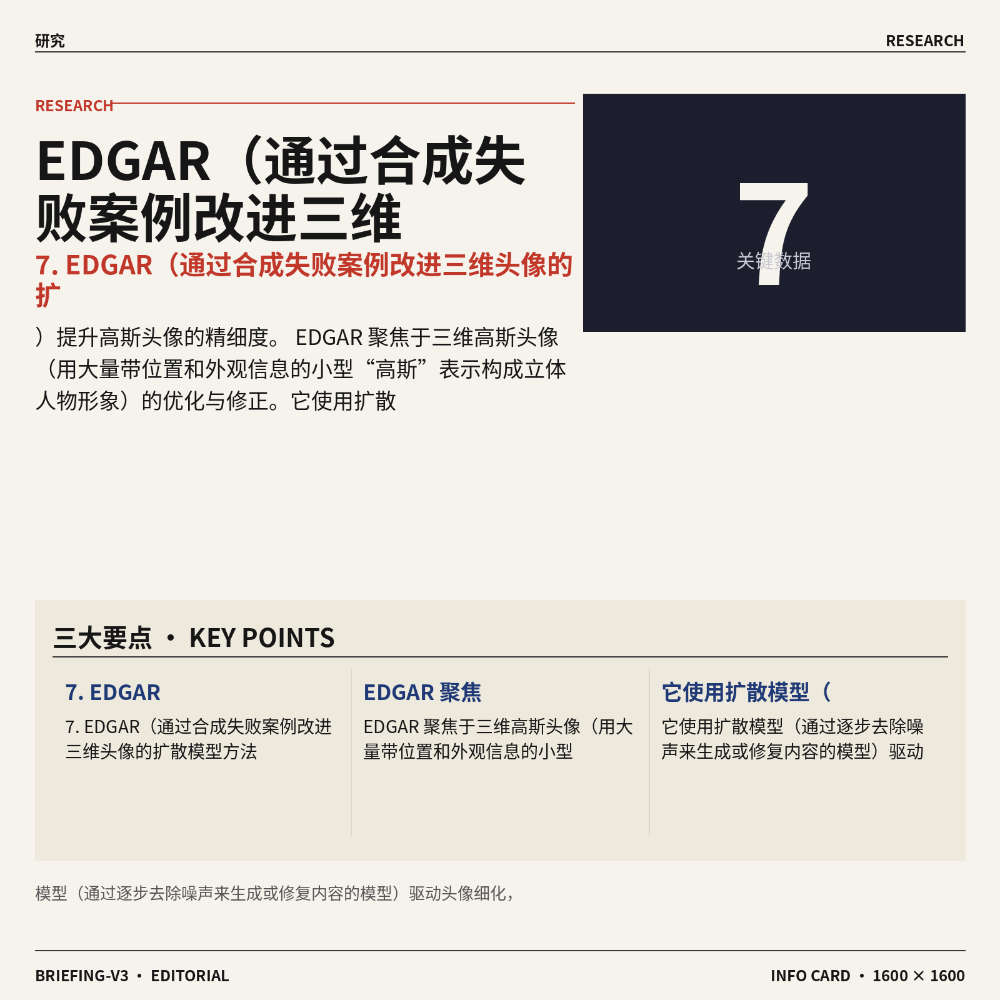

7. **EDGAR（通过合成失败案例改进三维头像的扩散模型方法）提升高斯头像的精细度。**  
EDGAR 聚焦于三维高斯头像（用大量带位置和外观信息的小型“高斯”表示构成立体人物形象）的优化与修正。它使用扩散模型（通过逐步去除噪声来生成或修复内容的模型）驱动头像细化，并引入合成失败（主动制造可能出错的样本，用来帮助模型识别和修正问题）。这项研究的核心方向，是让三维头像在生成后能够更有效地发现缺陷并完成精修 🧑‍🎨。[论文项目页面(briefing)](https://huggingface.co/papers/2611.07909)

![EDGAR（通过合成失败案例改进三维头像的扩散模型方法）提升高斯头像的精细度](https://image.pollinations.ai/prompt/EDGAR%EF%BC%88%E9%80%9A%E8%BF%87%E5%90%88%E6%88%90%E5%A4%B1%E8%B4%A5%E6%A1%88%E4%BE%8B%E6%94%B9%E8%BF%9B%E4%B8%89%E7%BB%B4%E5%A4%B4%E5%83%8F%E7%9A%84%E6%89%A9%E6%95%A3%E6%A8%A1%E5%9E%8B%E6%96%B9%E6%B3%95%EF%BC%89%E6%8F%90%E5%8D%87%E9%AB%98%E6%96%AF%E5%A4%B4%E5%83%8F%E7%9A%84%E7%B2%BE%E7%BB%86%E5%BA%A6.%20EDGAR%EF%BC%88%E9%80%9A%E8%BF%87%E5%90%88%E6%88%90%E5%A4%B1%E8%B4%A5%E6%A1%88%E4%BE%8B%E6%94%B9%E8%BF%9B%E4%B8%89%E7%BB%B4%E5%A4%B4%E5%83%8F%E7%9A%84%E6%89%A9%E6%95%A3%E6%A8%A1%E5%9E%8B%E6%96%B9%E6%B3%95%EF%BC%89%E6%8F%90%E5%8D%87%E9%AB%98%E6%96%AF%E5%A4%B4%E5%83%8F%E7%9A%84%E7%B2%BE%E7%BB%86%E5%BA%A6%E3%80%82%20EDGAR%20%E8%81%9A%E7%84%A6%E4%BA%8E%E4%B8%89%E7%BB%B4%E9%AB%98%E6%96%AF%E5%A4%B4%E5%83%8F%EF%BC%88%E7%94%A8%E5%A4%A7%E9%87%8F%E5%B8%A6%E4%BD%8D%E7%BD%AE%E5%92%8C%E5%A4%96%E8%A7%82%E4%BF%A1%E6%81%AF%E7%9A%84%E5%B0%8F%E5%9E%8B%E2%80%9C%E9%AB%98%E6%96%AF%E2%80%9D%E8%A1%A8%E7%A4%BA%E6%9E%84%E6%88%90%E7%AB%8B%E4%BD%93%2C%20technical%20infographic%20diagram%2C%20architecture%20flowchart%2C%20clean%20vector%20illustration%2C%20educational%20style%2C%20no%20text%20overlay%2C%20modern%20minimal%2C%20wide%20aspect?width=1200&height=675&nologo=true&seed=10993)

### 🟡 行业展望与社会影响

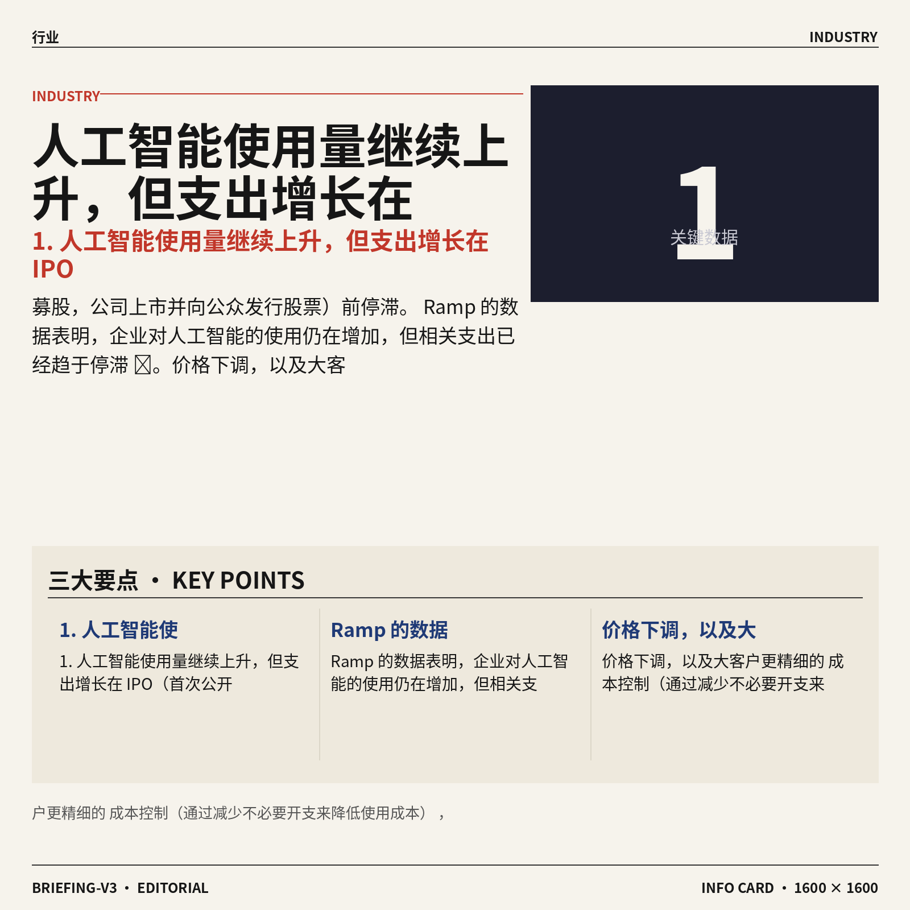

1. **人工智能使用量继续上升，但支出增长在 IPO（首次公开募股，公司上市并向公众发行股票）前停滞。**  
Ramp 的数据表明，企业对人工智能的使用仍在增加，但相关支出已经趋于停滞 📊。价格下调，以及大客户更精细的**成本控制（通过减少不必要开支来降低使用成本）**，可能正在改变市场对人工智能“高速增长”的预期。对行业来说，这意味着使用人数增加，并不一定会同步带来收入快速增长。[Ramp 数据分析(briefing)](https://techcrunch.com/2026/11/06/ramp-data-shows-ai-spending-stalling-just-as-anthropic-nears-its-ipo/)


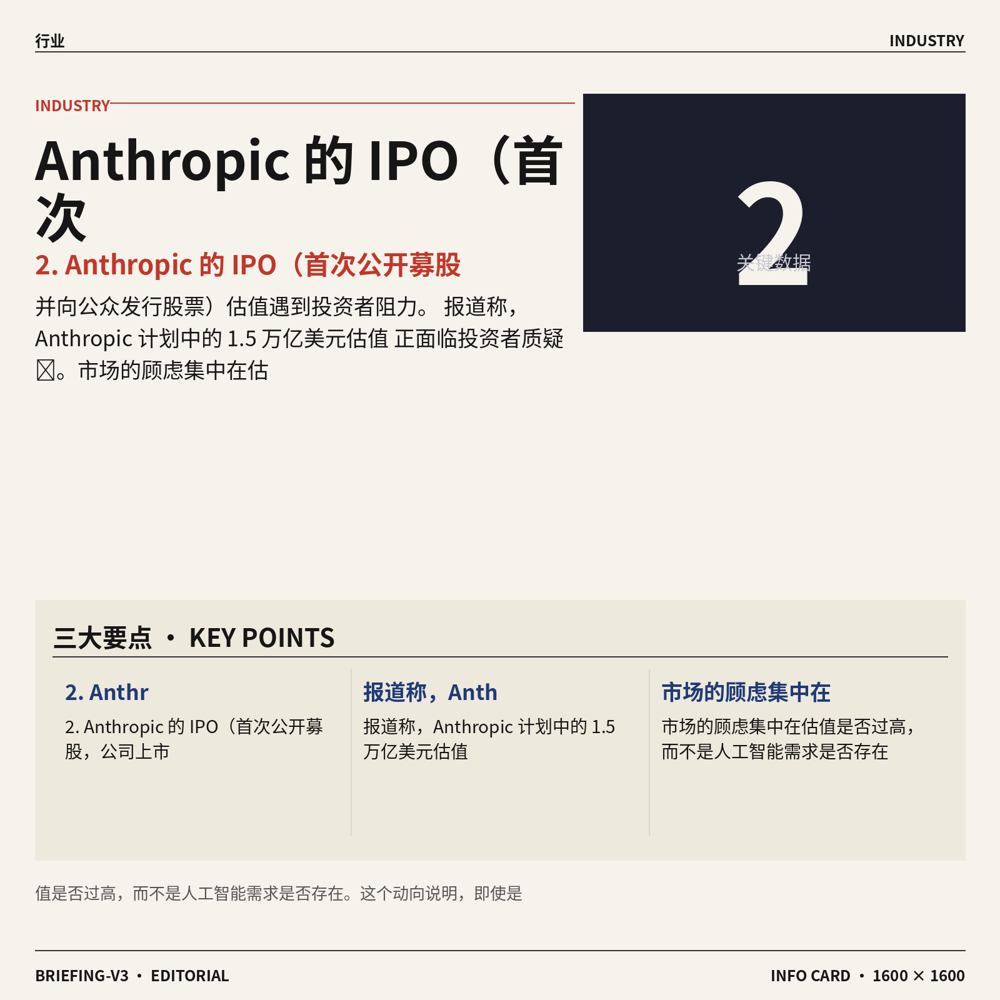

2. **Anthropic 的 IPO（首次公开募股，公司上市并向公众发行股票）估值遇到投资者阻力。**  
报道称，Anthropic 计划中的 **1.5 万亿美元估值**正面临投资者质疑 💰。市场的顾虑集中在估值是否过高，而不是人工智能需求是否存在。这个动向说明，即使是人工智能领域的头部公司，准备上市时也必须面对投资者对增长速度和公司价值的重新审视。[Anthropic 上市报道(briefing)](https://the-decoder.com/anthropics-1-5-trillion-ipo-hits-resistance-as-investors-balk-at-valuation/)


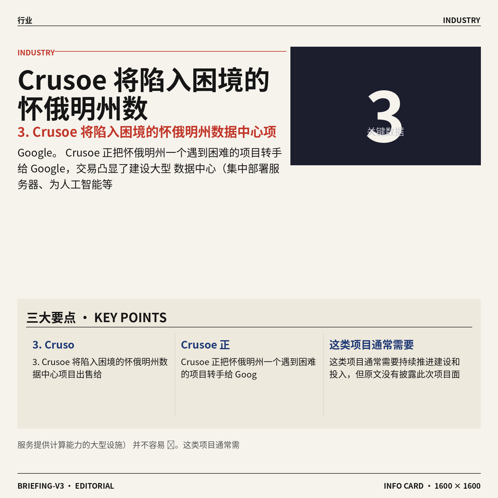

3. **Crusoe 将陷入困境的怀俄明州数据中心项目出售给 Google。**  
Crusoe 正把怀俄明州一个遇到困难的项目转手给 Google，交易凸显了建设大型**数据中心（集中部署服务器、为人工智能等服务提供计算能力的大型设施）**并不容易 🏗️。这类项目通常需要持续推进建设和投入，但原文没有披露此次项目面临困难的具体原因。对行业而言，这提醒企业：人工智能基础设施扩张不仅取决于模型需求，也考验项目落地能力。[项目交易详情(briefing)](https://techcrunch.com/2026/11/06/crusoe-sells-troubled-wyoming-data-center-project-to-google/)


4. **OpenAI 据报以 1.25 万亿美元估值获得 110 亿美元融资。**  
路透社报道称，OpenAI 获得了 **110 亿美元资金**，对应公司 **1.25 万亿美元估值（市场对公司整体价值的定价）** 💵。这笔融资消息显示，资本市场仍在持续关注人工智能头部企业的扩张和发展。由于候选材料仅提供了报道标题，具体投资方和交易条件暂未说明。[路透社融资消息(briefing)](https://news.google.com/rss/articles/CBMiwgFBVV95cUxNdlpNRm5XVy11c3hLY0NRdjh2T3VmOE1LOWQ2LXlvcFhmZlFJYkQya3N3QWxud2UteUZpWVlCTXVHUXZZTjIwRlVQaUhqOGhyM2lDaDJTSGcxMnE5MzhOZ1NHYlJIc1p5bHRxaVZjZDd4MFY2RWMtRkNlYkhSVkdpMlRBWi1PYUNmZGNydXZnOTZFMTFoOHR0azBpUlU1aHpVdFA4dlhCV0dDNm91VE0xSVg0bXZhcF9jaVAzcXYzaldOdw?oc=5)


5. **OpenAI 据报追加融资 110 亿美元，估值达到 1.25 万亿美元。**  
TechCrunch 报道称，OpenAI 正在推进一笔 **110 亿美元的追加融资**，但这轮交易尚未完成，预计将在未来几周结束。这里的**融资轮（投资者集中向公司投入资金的一次交易）**，如果最终落地，将进一步抬高市场对 OpenAI 价值的定价 📈。不过，在交易完成前，相关金额和估值仍应视为报道中的计划信息。[OpenAI 融资报道(briefing)](https://techcrunch.com/2026/11/06/openai-reportedly-raises-an-additional-11-billion-at-a-1-25-trillion-valuation/)


6. **OpenAI 与 Hacktron（协助发现软件漏洞的安全合作方）合作加固系统。**  
OpenAI 正与 Hacktron 合作，寻找系统中的**漏洞（可能被攻击者利用的安全缺陷）**，并测试与外部服务的连接 🔐。双方还将利用前沿人工智能能力加强防御，重点不仅是发现问题，也包括检验系统在连接其他服务时是否足够安全。对企业用户来说，这类合作有助于提升人工智能系统在真实业务环境中的可靠性。[OpenAI 安全合作公告(briefing)](https://openai.com/index/partnering-with-hacktron)


### 🟣 开源TOP项目

1. **Ruff（用 Rust 编写的 Python 代码检查与排版工具）主打极致速度。**  
Ruff 是面向 **Python（一种常用编程语言）** 的开发工具，能够自动检查代码问题。它同时提供 **linter（自动找出代码错误与不规范之处的工具）** 和 **formatter（自动统一代码排版的工具）** 两类能力。项目使用 **Rust（一种强调运行速度与安全性的编程语言）** 编写，核心卖点就是“快” 🚀。[Ruff GitHub 仓库(briefing)](https://github.com/astral-sh/ruff)


2. **Visual Studio Code（用于编写和修改程序的代码编辑器）持续作为开发者常用工具。**  
Visual Studio Code 是一款 **代码编辑器（编写、查看和修改程序文件的工具）**。它面向软件开发工作，帮助用户处理程序代码。作为开源项目中的代表性工具，它本身也是许多开发者日常工作的入口 💻。[Visual Studio Code GitHub 仓库(briefing)](https://github.com/microsoft/vscode)


3. **Zed（高性能多人协作代码编辑器）让编程更贴近“思维速度”。**  
Zed 是一款强调高性能的 **代码编辑器（专门用来编写和修改程序的工具）**，并支持多人一起编程。它由 Atom（曾经广受欢迎的代码编辑器）和 Tree-sitter（帮助工具理解代码结构的技术项目）的创作者打造。对需要协作开发的团队来说，Zed 的定位不只是个人写代码，也包含共同编辑这一使用场景 ⚡。[Zed GitHub 仓库(briefing)](https://github.com/zed-industries/zed)


### 🔴 社媒分享

1. **Jev（文中用于向更强模型求助的智能模型）以四分之一成本达到 Opus（Anthropic 的高能力模型）准确率。**  
这篇文章讨论 **identity resolution（身份解析，把不同记录判断为同一个对象）** 场景中的模型协作。Jev 可以在需要时向 Opus 求助，在准确率接近 Opus 的同时，将成本降至约四分之一 💡。这意味着企业处理客户、用户或账户信息匹配时，或许能在效果与预算之间找到更好的平衡。[身份解析案例分析(briefing)](https://hightouch.com/blog/llm-judges-identity-resolution)


2. **人工智能（AI）正在大幅加速人工智能研究。**  
文章的核心观点是，**AI research（人工智能研究，即设计、训练和改进人工智能系统的工作）** 正被人工智能工具明显提速 🚀。这不仅意味着模型本身进步更快，也可能缩短新算法、新产品从想法到验证的周期。对于企业而言，人工智能加速研究，最终可能影响产品创新和行业竞争节奏。[人工智能研究观察(briefing)](https://www.planned-obsolescence.org/p/ai-is-dramatically-accelerating-ai)


3. **Anthropic 的 IPO（首次公开募股，公司首次上市融资）估值预期最低降至 1.1 万亿美元。**  
文章聚焦 Anthropic 上市过程中潜在买家对公司 **估值（市场对企业整体价值的判断）** 的看法。相关买家给出的估值预期最低达到 **1.1 万亿美元**，显示市场对这家人工智能公司的定价存在分歧 📉。对关注人工智能行业资本市场表现的人来说，这反映出大型模型公司的上市估值仍在持续博弈。[Anthropic 上市估值报道(briefing)](https://www.bloomberg.com/news/articles/2026-11-06/anthropic-ipo-valuation-expectations-pressured-after-ai-rout)

![Anthropic 的 IPO（首次公开募股，公司首次上市融资）估值预期最低降至 1.1 万亿美元](https://image.pollinations.ai/prompt/Anthropic%20%E7%9A%84%20IPO%EF%BC%88%E9%A6%96%E6%AC%A1%E5%85%AC%E5%BC%80%E5%8B%9F%E8%82%A1%EF%BC%8C%E5%85%AC%E5%8F%B8%E9%A6%96%E6%AC%A1%E4%B8%8A%E5%B8%82%E8%9E%8D%E8%B5%84%EF%BC%89%E4%BC%B0%E5%80%BC%E9%A2%84%E6%9C%9F%E6%9C%80%E4%BD%8E%E9%99%8D%E8%87%B3%201.1%20%E4%B8%87%E4%BA%BF%E7%BE%8E%E5%85%83.%20Anthropic%20%E7%9A%84%20IPO%EF%BC%88%E9%A6%96%E6%AC%A1%E5%85%AC%E5%BC%80%E5%8B%9F%E8%82%A1%EF%BC%8C%E5%85%AC%E5%8F%B8%E9%A6%96%E6%AC%A1%E4%B8%8A%E5%B8%82%E8%9E%8D%E8%B5%84%EF%BC%89%E4%BC%B0%E5%80%BC%E9%A2%84%E6%9C%9F%E6%9C%80%E4%BD%8E%E9%99%8D%E8%87%B3%201.1%20%E4%B8%87%E4%BA%BF%E7%BE%8E%E5%85%83%E3%80%82%20%E6%96%87%E7%AB%A0%E8%81%9A%E7%84%A6%20Anthropic%20%E4%B8%8A%E5%B8%82%E8%BF%87%E7%A8%8B%E4%B8%AD%E6%BD%9C%E5%9C%A8%E4%B9%B0%E5%AE%B6%E5%AF%B9%E5%85%AC%E5%8F%B8%20%E4%BC%B0%2C%20technical%20infographic%20diagram%2C%20architecture%20flowchart%2C%20clean%20vector%20illustration%2C%20educational%20style%2C%20no%20text%20overlay%2C%20modern%20minimal%2C%20wide%20aspect?width=1200&height=675&nologo=true&seed=10675)

4. **埃及英语与尼日利亚英语加入 Open ASR Leaderboard（开放式自动语音识别排行榜）。**  
Open ASR Leaderboard 是一个用于比较语音识别效果的公开榜单；其中 **ASR（自动语音识别，把语音转换成文字）** 是语音助手、会议转写和客服质检等产品的基础能力。埃及英语和尼日利亚英语被纳入后，榜单覆盖的英语地区口音更加多样 🌍。这对需要服务不同英语用户的产品团队尤其有参考价值。[语音识别排行榜更新(briefing)](https://huggingface.co/blog/open-asr-leaderboard-liva)


5. **《落叶与股票》把季节意象与股市观察放在同一篇文章中。**  
文章标题中的 **Falling Leaves（落叶）** 与 **Stocks（股票）** 被并列呈现，具体内容可能围绕这两个意象展开。原始候选摘要没有提供正文观点，仅展示了文章配图，因此目前无法进一步确认作者对股市或科技行业的具体判断。文章发布于 Stratechery（科技行业分析与评论平台），可通过原文了解完整语境 🍂。[《落叶与股票》原文(briefing)](https://stratechery.com/2026/falling-leaves-and-stocks/)

![《落叶与股票》把季节意象与股市观察放在同一篇文章中](https://image.pollinations.ai/prompt/%E3%80%8A%E8%90%BD%E5%8F%B6%E4%B8%8E%E8%82%A1%E7%A5%A8%E3%80%8B%E6%8A%8A%E5%AD%A3%E8%8A%82%E6%84%8F%E8%B1%A1%E4%B8%8E%E8%82%A1%E5%B8%82%E8%A7%82%E5%AF%9F%E6%94%BE%E5%9C%A8%E5%90%8C%E4%B8%80%E7%AF%87%E6%96%87%E7%AB%A0%E4%B8%AD.%20%E3%80%8A%E8%90%BD%E5%8F%B6%E4%B8%8E%E8%82%A1%E7%A5%A8%E3%80%8B%E6%8A%8A%E5%AD%A3%E8%8A%82%E6%84%8F%E8%B1%A1%E4%B8%8E%E8%82%A1%E5%B8%82%E8%A7%82%E5%AF%9F%E6%94%BE%E5%9C%A8%E5%90%8C%E4%B8%80%E7%AF%87%E6%96%87%E7%AB%A0%E4%B8%AD%E3%80%82%20%E6%96%87%E7%AB%A0%E6%A0%87%E9%A2%98%E4%B8%AD%E7%9A%84%20Falling%20Leaves%EF%BC%88%E8%90%BD%E5%8F%B6%EF%BC%89%20%E4%B8%8E%20Stocks%EF%BC%88%E8%82%A1%E7%A5%A8%EF%BC%89%20%E8%A2%AB%E5%B9%B6%E5%88%97%E5%91%88%E7%8E%B0%EF%BC%8C%E5%85%B7%E4%BD%93%E5%86%85%E5%AE%B9%E5%8F%AF%E8%83%BD%E5%9B%B4%E7%BB%95%2C%20technical%20infographic%20diagram%2C%20architecture%20flowchart%2C%20clean%20vector%20illustration%2C%20educational%20style%2C%20no%20text%20overlay%2C%20modern%20minimal%2C%20wide%20aspect?width=1200&height=675&nologo=true&seed=10737)

6. **Sharp Tech（科技评论栏目）首次推出视频版，聚焦美国数据中心投票与 Google 对人工智能的回应。**  
这期内容讨论美国围绕 **data center（数据中心，集中运行计算设备的设施）** 的投票，以及相关议题对 **Big Tech（大型科技公司）** 的影响。节目还关注 Google 如何回应人工智能发展带来的变化 💡。Sharp Tech 首次提供视频观看方式，观众可以通过 YouTube（视频平台）或 Stratechery（科技行业分析与评论平台）收看。[Sharp Tech 视频版介绍(briefing)](https://stratechery.com/2026/sharp-tech-on-video-the-u-s-votes-on-data-centers-implications-for-big-tech-googles-response-to-ai/)

![Sharp Tech（科技评论栏目）首次推出视频版，聚焦美国数据中心投票与 Google 对人工智能的回应](https://image.pollinations.ai/prompt/Sharp%20Tech%EF%BC%88%E7%A7%91%E6%8A%80%E8%AF%84%E8%AE%BA%E6%A0%8F%E7%9B%AE%EF%BC%89%E9%A6%96%E6%AC%A1%E6%8E%A8%E5%87%BA%E8%A7%86%E9%A2%91%E7%89%88%EF%BC%8C%E8%81%9A%E7%84%A6%E7%BE%8E%E5%9B%BD%E6%95%B0%E6%8D%AE%E4%B8%AD%E5%BF%83%E6%8A%95%E7%A5%A8%E4%B8%8E%20Google%20%E5%AF%B9%E4%BA%BA%E5%B7%A5%E6%99%BA%E8%83%BD%E7%9A%84%E5%9B%9E%E5%BA%94.%20Sharp%20Tech%EF%BC%88%E7%A7%91%E6%8A%80%E8%AF%84%E8%AE%BA%E6%A0%8F%E7%9B%AE%EF%BC%89%E9%A6%96%E6%AC%A1%E6%8E%A8%E5%87%BA%E8%A7%86%E9%A2%91%E7%89%88%EF%BC%8C%E8%81%9A%E7%84%A6%E7%BE%8E%E5%9B%BD%E6%95%B0%E6%8D%AE%E4%B8%AD%E5%BF%83%E6%8A%95%E7%A5%A8%E4%B8%8E%20Google%20%E5%AF%B9%E4%BA%BA%E5%B7%A5%E6%99%BA%E8%83%BD%E7%9A%84%E5%9B%9E%E5%BA%94%E3%80%82%20%E8%BF%99%E6%9C%9F%E5%86%85%E5%AE%B9%E8%AE%A8%E8%AE%BA%E7%BE%8E%E5%9B%BD%E5%9B%B4%E7%BB%95%20data%20center%EF%BC%88%E6%95%B0%E6%8D%AE%2C%20technical%20infographic%20diagram%2C%20architecture%20flowchart%2C%20clean%20vector%20illustration%2C%20educational%20style%2C%20no%20text%20overlay%2C%20modern%20minimal%2C%20wide%20aspect?width=1200&height=675&nologo=true&seed=10768)

---

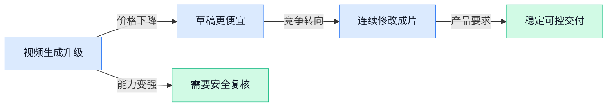

### 📊 行业洞察（今日 4 条）

1. Google 的 Gemini Omni 1.2 Flash（支持视频生成与编辑的模型）可生成15秒视频、支持对话修改，价格下降30%；WeLM-Image（同时理解和生成图片的模型）也在推进视觉能力合一  
  【洞察】视频和图片创作都从“一次生成”走向“理解素材后反复修改”，剪辑软件的竞争重点会从素材生成转向连续修改、效果稳定和成片可控

2. OpenAI 推出 BioBasicsBench（检验 AI 能否处理真实实验数据的测试），GPT-6 Cyber（能发现漏洞并提出修复方案的模型）还与 Hacktron（帮助发现软件漏洞的安全公司）合作  
  【洞察】AI能力评估正在从“会不会回答”变成“能不能完成真实任务”，但越接近实际操作，授权、复核和出错后的人工接管就越重要

3. Ramp数据显示 AI使用量继续上涨但支出停滞，OpenAI据报获110亿美元融资，而 Anthropic 的上市估值却遭投资者质疑  
  【洞察】行业出现“头部公司还能吸金、客户却更省钱”的分化，模型价格会继续下压，单靠调用量增长的 AI 生意越来越难证明价值

4. Google 将视频生成价格降至每秒0.07美元，且支持低清草稿、最后再放大；大客户也在通过精细管理减少 AI 开支  
  【洞察】AI视频成本下降不等于客户预算会增加，真正有竞争力的产品必须把便宜模型转化为更少操作、更高出片率和更稳定的商业结果

### 💭 对我们的启发（今日 3 条）

1. Gemini Omni 1.2 Flash 支持15秒生成、对话式修改和低清草稿，视频剪辑软件应增加“先快速出草稿、确认后高清导出”的分层流程，直接控制单条视频成本。

2. WeLM-Image 将图片理解与生成放在一起，提示我们不能只做素材生成；应让工具先识别商品、人物和画面问题，再给出可修改的剪辑方案，但关键内容仍需人工确认。

3. GPT-6 Cyber 与 Hacktron 都强调检查外部连接和修复漏洞，我们的 Agent 调度也要设置权限分级、操作记录和人工接管，不能让 AI 直接发布或覆盖客户成片。

