## AI资讯日报 2026/11/16

> AI 早报 · 每日早读 · 全网深度聚合

## **今日摘要**

```
美团1.6万亿参数Agent（自主执行任务助手）模型亮相，训练全程未用英伟达GPU
Anthropic Claude Fable 5.2（绘画式图像模型）不生成图片，竟然一笔一笔画出来
黄仁勋或将回归英伟达任CEO，关联公司据报撮合近120亿美元对华芯片订单
```

### 🔵 产品与功能更新

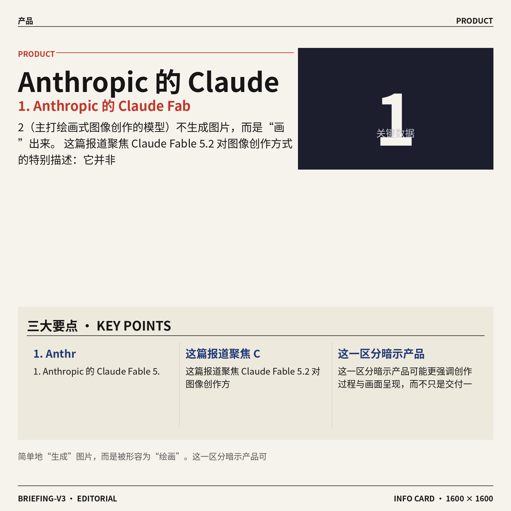

1. **Anthropic 的 Claude Fable 5.2（主打绘画式图像创作的模型）不生成图片，而是“画”出来。**  
这篇报道聚焦 Claude Fable 5.2 对图像创作方式的特别描述：它并非简单地“生成”图片，而是被形容为“绘画”。这一区分暗示产品可能更强调创作过程与画面呈现，而不只是交付一张最终图片 🎨。对设计、内容和营销团队来说，值得关注的是**人工智能（AI，能根据指令完成创作任务的软件）是否正在从出图工具变成更像创作者的助手**。[完整报道(briefing)](https://the-decoder.com/anthropics-claude-fable-5-2-doesnt-generate-images-it-paints-them/)


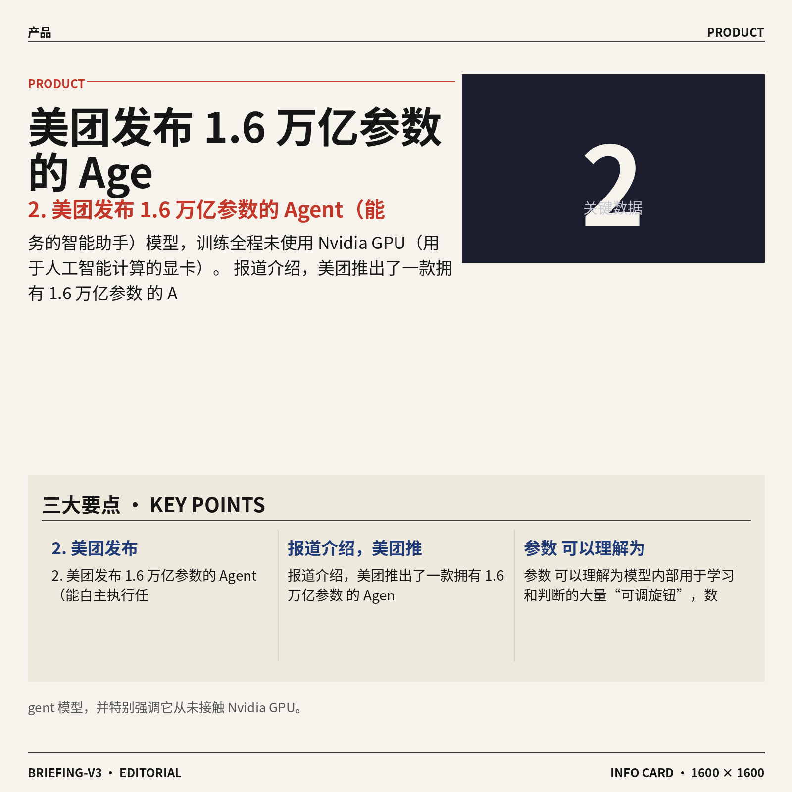

2. **美团发布 1.6 万亿参数的 Agent（能自主执行任务的智能助手）模型，训练全程未使用 Nvidia GPU（用于人工智能计算的显卡）。**  
报道介绍，美团推出了一款拥有 **1.6 万亿参数**的 Agent 模型，并特别强调它从未接触 Nvidia GPU。**参数**可以理解为模型内部用于学习和判断的大量“可调旋钮”，数量通常被用来体现模型规模，但不等同于实际效果 🚀。这条消息的核心看点，是大型模型的训练是否可以探索不同于主流显卡路线的算力方案。[完整报道(briefing)](https://the-decoder.com/meituan-releases-a-1-6-trillion-parameter-agent-model-that-never-touched-an-nvidia-gpu/)


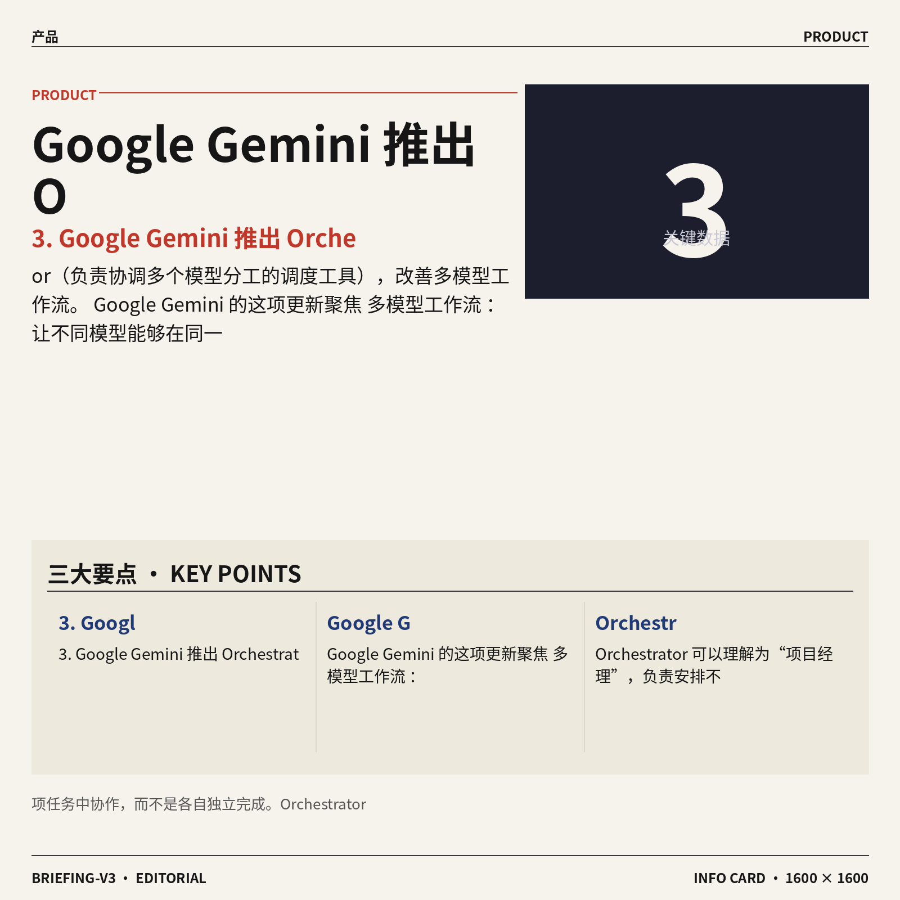

3. **Google Gemini 推出 Orchestrator（负责协调多个模型分工的调度工具），改善多模型工作流。**  
Google Gemini 的这项更新聚焦 **多模型工作流**：让不同模型能够在同一项任务中协作，而不是各自独立完成。Orchestrator 可以理解为“项目经理”，负责安排不同模型的分工与衔接；**工作流**则是把一连串步骤组织起来的办事流程 💡。对小企业和运营团队而言，这类能力有望让复杂任务更容易拆分、执行和管理。[Google 新闻报道(briefing)](https://news.google.com/rss/articles/CBMiTkFVX3lxTFBCcHFObXZ3MEhCLThPalhQdGJsYzMxemN2XzlhRGJOUk9Bc2wwYlRhZExJVm82QXg1NW9DMDBsWWwxSThodi1yQVhMUXNaUQ?oc=5)


### 🟢 前沿研究


1. **G-STAR（按群组扩展词元容量的生成模型）探索深度压缩的自回归生成。**  
这项研究聚焦于在模型被大幅压缩后，如何继续进行**自回归生成**（模型按顺序一个个生成词元，像接龙一样完成文本）。标题中的“群组扩展词元容量”意味着研究者尝试按不同群组调整模型一次能够处理的信息单元数量。它关注的是压缩模型的生成能力与效率之间如何平衡，对希望降低模型部署成本的团队具有参考意义 🚀。[G-STAR 论文页面(briefing)](https://huggingface.co/papers/2611.13004)


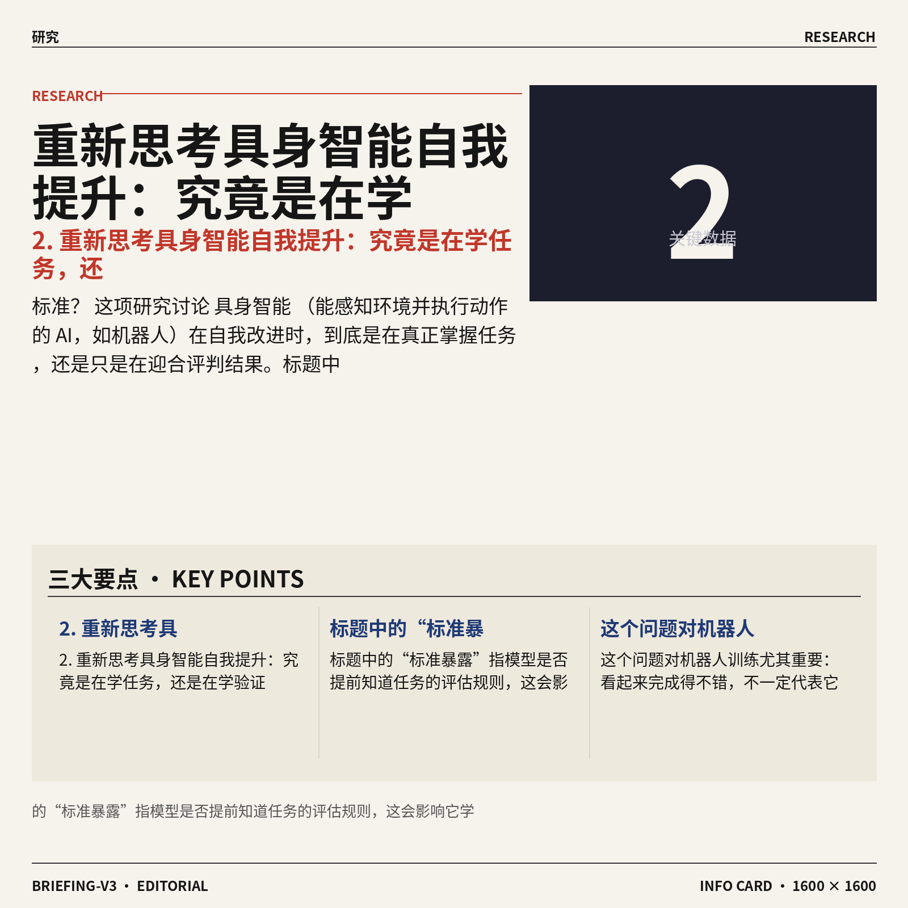

2. **重新思考具身智能自我提升：究竟是在学任务，还是在学验证标准？**  
这项研究讨论**具身智能**（能感知环境并执行动作的 AI，如机器人）在自我改进时，到底是在真正掌握任务，还是只是在迎合评判结果。标题中的“标准暴露”指模型是否提前知道任务的评估规则，这会影响它学到的是通用能力还是应试技巧。这个问题对机器人训练尤其重要：看起来完成得不错，不一定代表它理解了任务本身 🤖。[具身智能论文页面(briefing)](https://huggingface.co/papers/2611.08318)

![重新思考具身智能自我提升：究竟是在学任务，还是在学验证标准？](https://image.pollinations.ai/prompt/%E9%87%8D%E6%96%B0%E6%80%9D%E8%80%83%E5%85%B7%E8%BA%AB%E6%99%BA%E8%83%BD%E8%87%AA%E6%88%91%E6%8F%90%E5%8D%87%EF%BC%9A%E7%A9%B6%E7%AB%9F%E6%98%AF%E5%9C%A8%E5%AD%A6%E4%BB%BB%E5%8A%A1%EF%BC%8C%E8%BF%98%E6%98%AF%E5%9C%A8%E5%AD%A6%E9%AA%8C%E8%AF%81%E6%A0%87%E5%87%86%EF%BC%9F.%20%E9%87%8D%E6%96%B0%E6%80%9D%E8%80%83%E5%85%B7%E8%BA%AB%E6%99%BA%E8%83%BD%E8%87%AA%E6%88%91%E6%8F%90%E5%8D%87%EF%BC%9A%E7%A9%B6%E7%AB%9F%E6%98%AF%E5%9C%A8%E5%AD%A6%E4%BB%BB%E5%8A%A1%EF%BC%8C%E8%BF%98%E6%98%AF%E5%9C%A8%E5%AD%A6%E9%AA%8C%E8%AF%81%E6%A0%87%E5%87%86%EF%BC%9F%20%E8%BF%99%E9%A1%B9%E7%A0%94%E7%A9%B6%E8%AE%A8%E8%AE%BA%E5%85%B7%E8%BA%AB%E6%99%BA%E8%83%BD%EF%BC%88%E8%83%BD%E6%84%9F%E7%9F%A5%E7%8E%AF%E5%A2%83%E5%B9%B6%E6%89%A7%E8%A1%8C%E5%8A%A8%E4%BD%9C%E7%9A%84%20AI%EF%BC%8C%E5%A6%82%E6%9C%BA%E5%99%A8%E4%BA%BA%EF%BC%89%E5%9C%A8%E8%87%AA%E6%88%91%E6%94%B9%E8%BF%9B%E6%97%B6%EF%BC%8C%E5%88%B0%E5%BA%95%E6%98%AF%E5%9C%A8%E7%9C%9F%E6%AD%A3%E6%8E%8C%E6%8F%A1%E4%BB%BB%E5%8A%A1%EF%BC%8C%2C%20technical%20infographic%20diagram%2C%20architecture%20flowchart%2C%20clean%20vector%20illustration%2C%20educational%20style%2C%20no%20text%20overlay%2C%20modern%20minimal%2C%20wide%20aspect?width=1200&height=675&nologo=true&seed=10838)

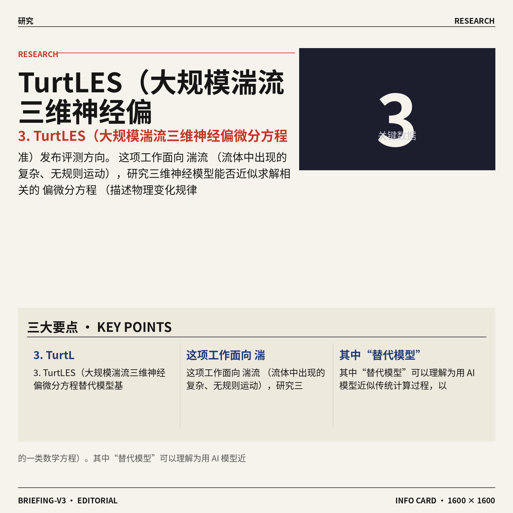

3. **TurtLES（大规模湍流三维神经偏微分方程替代模型基准）发布评测方向。**  
这项工作面向**湍流**（流体中出现的复杂、无规则运动），研究三维神经模型能否近似求解相关的**偏微分方程**（描述物理变化规律的一类数学方程）。其中“替代模型”可以理解为用 AI 模型近似传统计算过程，以便评估复杂物理系统。论文标题强调这是一个大规模**基准**（用统一数据和规则比较不同模型表现的测试平台），重点在于建立可比较的评测环境 💡。[TurtLES 论文页面(briefing)](https://huggingface.co/papers/2611.09567)

![TurtLES（大规模湍流三维神经偏微分方程替代模型基准）发布评测方向](https://image.pollinations.ai/prompt/TurtLES%EF%BC%88%E5%A4%A7%E8%A7%84%E6%A8%A1%E6%B9%8D%E6%B5%81%E4%B8%89%E7%BB%B4%E7%A5%9E%E7%BB%8F%E5%81%8F%E5%BE%AE%E5%88%86%E6%96%B9%E7%A8%8B%E6%9B%BF%E4%BB%A3%E6%A8%A1%E5%9E%8B%E5%9F%BA%E5%87%86%EF%BC%89%E5%8F%91%E5%B8%83%E8%AF%84%E6%B5%8B%E6%96%B9%E5%90%91.%20TurtLES%EF%BC%88%E5%A4%A7%E8%A7%84%E6%A8%A1%E6%B9%8D%E6%B5%81%E4%B8%89%E7%BB%B4%E7%A5%9E%E7%BB%8F%E5%81%8F%E5%BE%AE%E5%88%86%E6%96%B9%E7%A8%8B%E6%9B%BF%E4%BB%A3%E6%A8%A1%E5%9E%8B%E5%9F%BA%E5%87%86%EF%BC%89%E5%8F%91%E5%B8%83%E8%AF%84%E6%B5%8B%E6%96%B9%E5%90%91%E3%80%82%20%E8%BF%99%E9%A1%B9%E5%B7%A5%E4%BD%9C%E9%9D%A2%E5%90%91%E6%B9%8D%E6%B5%81%EF%BC%88%E6%B5%81%E4%BD%93%E4%B8%AD%E5%87%BA%E7%8E%B0%E7%9A%84%E5%A4%8D%E6%9D%82%E3%80%81%E6%97%A0%E8%A7%84%E5%88%99%E8%BF%90%E5%8A%A8%EF%BC%89%EF%BC%8C%E7%A0%94%E7%A9%B6%E4%B8%89%E7%BB%B4%E7%A5%9E%E7%BB%8F%E6%A8%A1%E5%9E%8B%E8%83%BD%E5%90%A6%E8%BF%91%E4%BC%BC%E6%B1%82%E8%A7%A3%E7%9B%B8%E5%85%B3%E7%9A%84%E5%81%8F%2C%20technical%20infographic%20diagram%2C%20architecture%20flowchart%2C%20clean%20vector%20illustration%2C%20educational%20style%2C%20no%20text%20overlay%2C%20modern%20minimal%2C%20wide%20aspect?width=1200&height=675&nologo=true&seed=10869)

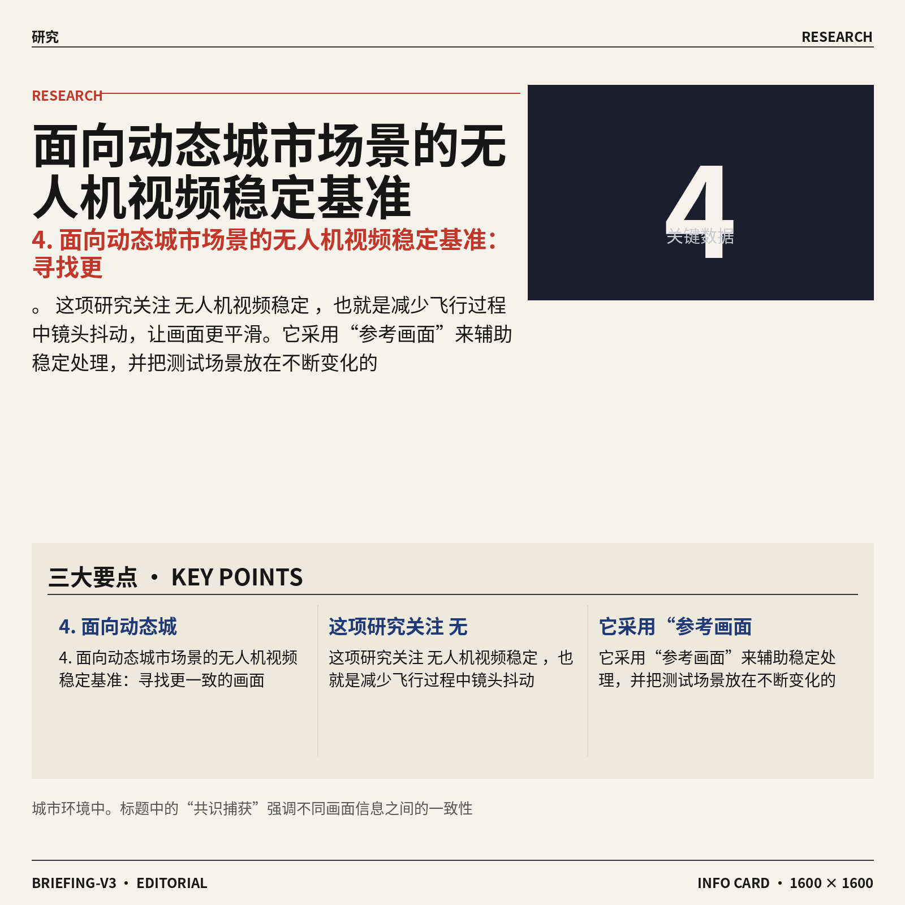

4. **面向动态城市场景的无人机视频稳定基准：寻找更一致的画面。**  
这项研究关注**无人机视频稳定**，也就是减少飞行过程中镜头抖动，让画面更平滑。它采用“参考画面”来辅助稳定处理，并把测试场景放在不断变化的城市环境中。标题中的“共识捕获”强调不同画面信息之间的一致性，核心价值是为这类视频处理任务提供统一的**基准**，方便比较不同方案的效果 🎥。[无人机视频论文页面(briefing)](https://huggingface.co/papers/2611.17190)

![面向动态城市场景的无人机视频稳定基准：寻找更一致的画面](https://image.pollinations.ai/prompt/%E9%9D%A2%E5%90%91%E5%8A%A8%E6%80%81%E5%9F%8E%E5%B8%82%E5%9C%BA%E6%99%AF%E7%9A%84%E6%97%A0%E4%BA%BA%E6%9C%BA%E8%A7%86%E9%A2%91%E7%A8%B3%E5%AE%9A%E5%9F%BA%E5%87%86%EF%BC%9A%E5%AF%BB%E6%89%BE%E6%9B%B4%E4%B8%80%E8%87%B4%E7%9A%84%E7%94%BB%E9%9D%A2.%20%E9%9D%A2%E5%90%91%E5%8A%A8%E6%80%81%E5%9F%8E%E5%B8%82%E5%9C%BA%E6%99%AF%E7%9A%84%E6%97%A0%E4%BA%BA%E6%9C%BA%E8%A7%86%E9%A2%91%E7%A8%B3%E5%AE%9A%E5%9F%BA%E5%87%86%EF%BC%9A%E5%AF%BB%E6%89%BE%E6%9B%B4%E4%B8%80%E8%87%B4%E7%9A%84%E7%94%BB%E9%9D%A2%E3%80%82%20%E8%BF%99%E9%A1%B9%E7%A0%94%E7%A9%B6%E5%85%B3%E6%B3%A8%E6%97%A0%E4%BA%BA%E6%9C%BA%E8%A7%86%E9%A2%91%E7%A8%B3%E5%AE%9A%EF%BC%8C%E4%B9%9F%E5%B0%B1%E6%98%AF%E5%87%8F%E5%B0%91%E9%A3%9E%E8%A1%8C%E8%BF%87%E7%A8%8B%E4%B8%AD%E9%95%9C%E5%A4%B4%E6%8A%96%E5%8A%A8%EF%BC%8C%E8%AE%A9%E7%94%BB%E9%9D%A2%E6%9B%B4%E5%B9%B3%E6%BB%91%E3%80%82%E5%AE%83%E9%87%87%E7%94%A8%E2%80%9C%E5%8F%82%E8%80%83%E7%94%BB%E9%9D%A2%E2%80%9D%E6%9D%A5%E8%BE%85%E5%8A%A9%E7%A8%B3%E5%AE%9A%E5%A4%84%2C%20technical%20infographic%20diagram%2C%20architecture%20flowchart%2C%20clean%20vector%20illustration%2C%20educational%20style%2C%20no%20text%20overlay%2C%20modern%20minimal%2C%20wide%20aspect?width=1200&height=675&nologo=true&seed=10900)

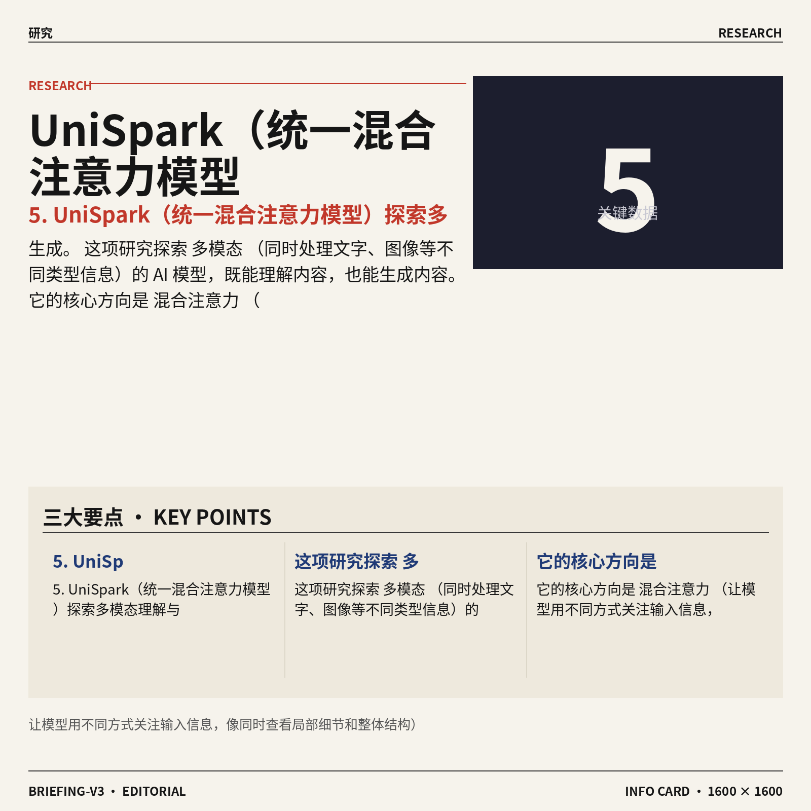

5. **UniSpark（统一混合注意力模型）探索多模态理解与生成。**  
这项研究探索**多模态**（同时处理文字、图像等不同类型信息）的 AI 模型，既能理解内容，也能生成内容。它的核心方向是**混合注意力**（让模型用不同方式关注输入信息，像同时查看局部细节和整体结构）。这表明研究重点不只是让模型“看懂”，也在尝试让理解与创作能力由同一套机制协同完成 ✨。[UniSpark 论文页面(briefing)](https://huggingface.co/papers/2611.16517)

![UniSpark（统一混合注意力模型）探索多模态理解与生成](https://image.pollinations.ai/prompt/UniSpark%EF%BC%88%E7%BB%9F%E4%B8%80%E6%B7%B7%E5%90%88%E6%B3%A8%E6%84%8F%E5%8A%9B%E6%A8%A1%E5%9E%8B%EF%BC%89%E6%8E%A2%E7%B4%A2%E5%A4%9A%E6%A8%A1%E6%80%81%E7%90%86%E8%A7%A3%E4%B8%8E%E7%94%9F%E6%88%90.%20UniSpark%EF%BC%88%E7%BB%9F%E4%B8%80%E6%B7%B7%E5%90%88%E6%B3%A8%E6%84%8F%E5%8A%9B%E6%A8%A1%E5%9E%8B%EF%BC%89%E6%8E%A2%E7%B4%A2%E5%A4%9A%E6%A8%A1%E6%80%81%E7%90%86%E8%A7%A3%E4%B8%8E%E7%94%9F%E6%88%90%E3%80%82%20%E8%BF%99%E9%A1%B9%E7%A0%94%E7%A9%B6%E6%8E%A2%E7%B4%A2%E5%A4%9A%E6%A8%A1%E6%80%81%EF%BC%88%E5%90%8C%E6%97%B6%E5%A4%84%E7%90%86%E6%96%87%E5%AD%97%E3%80%81%E5%9B%BE%E5%83%8F%E7%AD%89%E4%B8%8D%E5%90%8C%E7%B1%BB%E5%9E%8B%E4%BF%A1%E6%81%AF%EF%BC%89%E7%9A%84%20AI%20%E6%A8%A1%E5%9E%8B%EF%BC%8C%E6%97%A2%E8%83%BD%E7%90%86%E8%A7%A3%E5%86%85%E5%AE%B9%EF%BC%8C%E4%B9%9F%E8%83%BD%E7%94%9F%E6%88%90%E5%86%85%E5%AE%B9%E3%80%82%2C%20technical%20infographic%20diagram%2C%20architecture%20flowchart%2C%20clean%20vector%20illustration%2C%20educational%20style%2C%20no%20text%20overlay%2C%20modern%20minimal%2C%20wide%20aspect?width=1200&height=675&nologo=true&seed=10931)

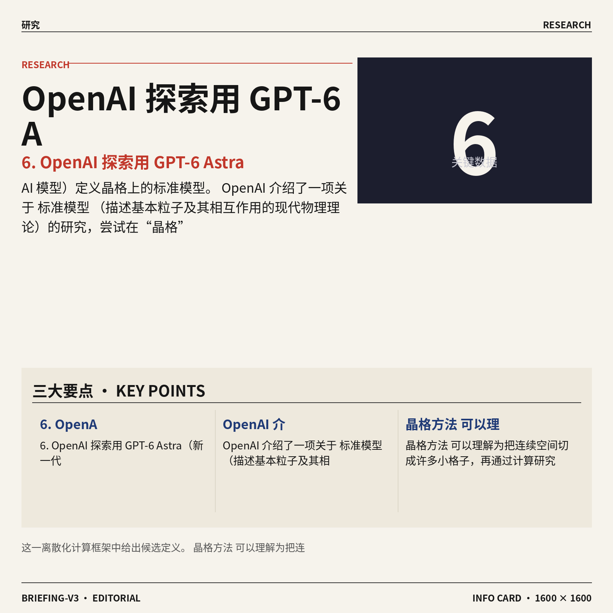

6. **OpenAI 探索用 GPT-6 Astra（新一代 AI 模型）定义晶格上的标准模型。**  
OpenAI 介绍了一项关于**标准模型**（描述基本粒子及其相互作用的现代物理理论）的研究，尝试在“晶格”这一离散化计算框架中给出候选定义。**晶格方法**可以理解为把连续空间切成许多小格子，再通过计算研究复杂物理过程。原文还提到，GPT-6 Astra（用于协助科研推理的 AI 模型）帮助把这一想法推进为一份详细证明，展示了 AI 参与理论物理研究的方式 🚀。[OpenAI 研究原文(briefing)](https://openai.com/index/step-toward-defining-the-standard-model)


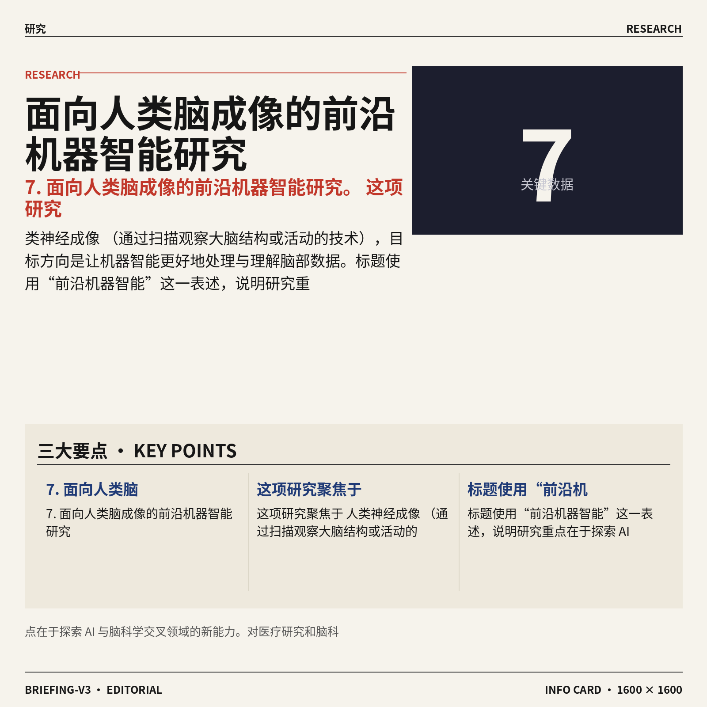

7. **面向人类脑成像的前沿机器智能研究。**  
这项研究聚焦于**人类神经成像**（通过扫描观察大脑结构或活动的技术），目标方向是让机器智能更好地处理与理解脑部数据。标题使用“前沿机器智能”这一表述，说明研究重点在于探索 AI 与脑科学交叉领域的新能力。对医疗研究和脑科学团队而言，这类工作可能帮助推动复杂神经数据的分析，但候选信息未进一步说明具体模型或实验结果 🧠。[脑成像论文页面(briefing)](https://huggingface.co/papers/2611.15094)

![面向人类脑成像的前沿机器智能研究](https://image.pollinations.ai/prompt/%E9%9D%A2%E5%90%91%E4%BA%BA%E7%B1%BB%E8%84%91%E6%88%90%E5%83%8F%E7%9A%84%E5%89%8D%E6%B2%BF%E6%9C%BA%E5%99%A8%E6%99%BA%E8%83%BD%E7%A0%94%E7%A9%B6.%20%E9%9D%A2%E5%90%91%E4%BA%BA%E7%B1%BB%E8%84%91%E6%88%90%E5%83%8F%E7%9A%84%E5%89%8D%E6%B2%BF%E6%9C%BA%E5%99%A8%E6%99%BA%E8%83%BD%E7%A0%94%E7%A9%B6%E3%80%82%20%E8%BF%99%E9%A1%B9%E7%A0%94%E7%A9%B6%E8%81%9A%E7%84%A6%E4%BA%8E%E4%BA%BA%E7%B1%BB%E7%A5%9E%E7%BB%8F%E6%88%90%E5%83%8F%EF%BC%88%E9%80%9A%E8%BF%87%E6%89%AB%E6%8F%8F%E8%A7%82%E5%AF%9F%E5%A4%A7%E8%84%91%E7%BB%93%E6%9E%84%E6%88%96%E6%B4%BB%E5%8A%A8%E7%9A%84%E6%8A%80%E6%9C%AF%EF%BC%89%EF%BC%8C%E7%9B%AE%E6%A0%87%E6%96%B9%E5%90%91%E6%98%AF%E8%AE%A9%E6%9C%BA%E5%99%A8%E6%99%BA%E8%83%BD%E6%9B%B4%E5%A5%BD%E5%9C%B0%E5%A4%84%E7%90%86%E4%B8%8E%E7%90%86%E8%A7%A3%E8%84%91%E9%83%A8%E6%95%B0%E6%8D%AE%E3%80%82%E6%A0%87%E9%A2%98%E4%BD%BF%E7%94%A8%E2%80%9C%E5%89%8D%E6%B2%BF%2C%20technical%20infographic%20diagram%2C%20architecture%20flowchart%2C%20clean%20vector%20illustration%2C%20educational%20style%2C%20no%20text%20overlay%2C%20modern%20minimal%2C%20wide%20aspect?width=1200&height=675&nologo=true&seed=10993)

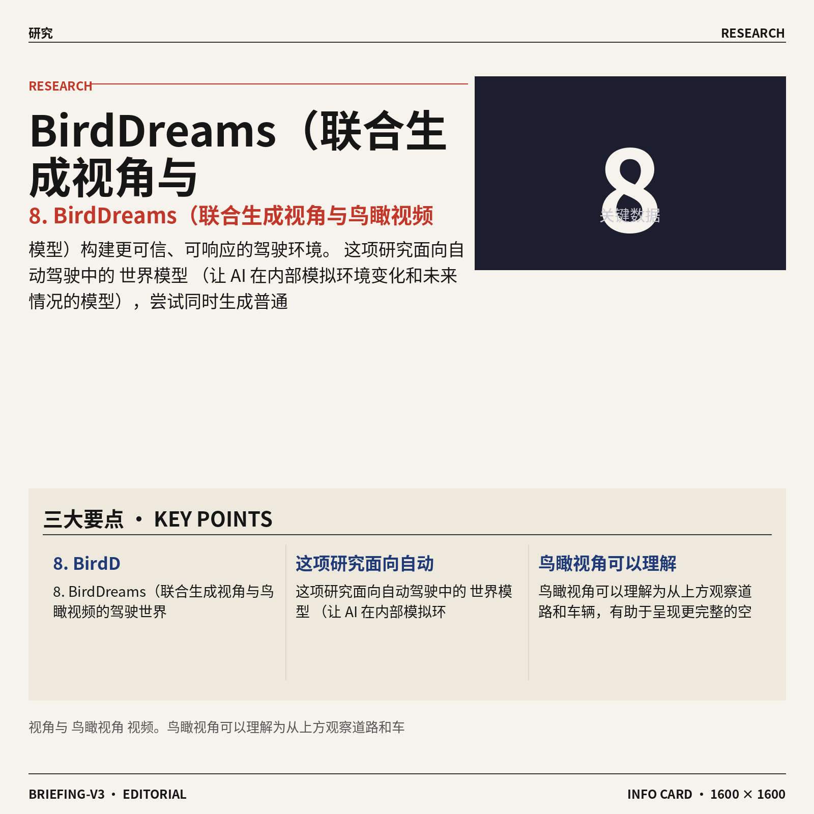

8. **BirdDreams（联合生成视角与鸟瞰视频的驾驶世界模型）构建更可信、可响应的驾驶环境。**  
这项研究面向自动驾驶中的**世界模型**（让 AI 在内部模拟环境变化和未来情况的模型），尝试同时生成普通视角与**鸟瞰视角**视频。鸟瞰视角可以理解为从上方观察道路和车辆，有助于呈现更完整的空间关系。标题还强调“可信”和“可响应”，说明研究关注生成的驾驶环境是否像真实世界一样合理，并能对场景变化作出反应 🚗。[BirdDreams 论文页面(briefing)](https://huggingface.co/papers/2611.14815)

![BirdDreams（联合生成视角与鸟瞰视频的驾驶世界模型）构建更可信、可响应的驾驶环境](https://image.pollinations.ai/prompt/BirdDreams%EF%BC%88%E8%81%94%E5%90%88%E7%94%9F%E6%88%90%E8%A7%86%E8%A7%92%E4%B8%8E%E9%B8%9F%E7%9E%B0%E8%A7%86%E9%A2%91%E7%9A%84%E9%A9%BE%E9%A9%B6%E4%B8%96%E7%95%8C%E6%A8%A1%E5%9E%8B%EF%BC%89%E6%9E%84%E5%BB%BA%E6%9B%B4%E5%8F%AF%E4%BF%A1%E3%80%81%E5%8F%AF%E5%93%8D%E5%BA%94%E7%9A%84%E9%A9%BE%E9%A9%B6%E7%8E%AF%E5%A2%83.%20BirdDreams%EF%BC%88%E8%81%94%E5%90%88%E7%94%9F%E6%88%90%E8%A7%86%E8%A7%92%E4%B8%8E%E9%B8%9F%E7%9E%B0%E8%A7%86%E9%A2%91%E7%9A%84%E9%A9%BE%E9%A9%B6%E4%B8%96%E7%95%8C%E6%A8%A1%E5%9E%8B%EF%BC%89%E6%9E%84%E5%BB%BA%E6%9B%B4%E5%8F%AF%E4%BF%A1%E3%80%81%E5%8F%AF%E5%93%8D%E5%BA%94%E7%9A%84%E9%A9%BE%E9%A9%B6%E7%8E%AF%E5%A2%83%E3%80%82%20%E8%BF%99%E9%A1%B9%E7%A0%94%E7%A9%B6%E9%9D%A2%E5%90%91%E8%87%AA%E5%8A%A8%E9%A9%BE%E9%A9%B6%E4%B8%AD%E7%9A%84%E4%B8%96%E7%95%8C%E6%A8%A1%E5%9E%8B%EF%BC%88%E8%AE%A9%20AI%20%E5%9C%A8%E5%86%85%E9%83%A8%E6%A8%A1%E6%8B%9F%E7%8E%AF%E5%A2%83%E5%8F%98%E5%8C%96%E5%92%8C%E6%9C%AA%E6%9D%A5%2C%20technical%20infographic%20diagram%2C%20architecture%20flowchart%2C%20clean%20vector%20illustration%2C%20educational%20style%2C%20no%20text%20overlay%2C%20modern%20minimal%2C%20wide%20aspect?width=1200&height=675&nologo=true&seed=11024)

### 🟡 行业展望与社会影响

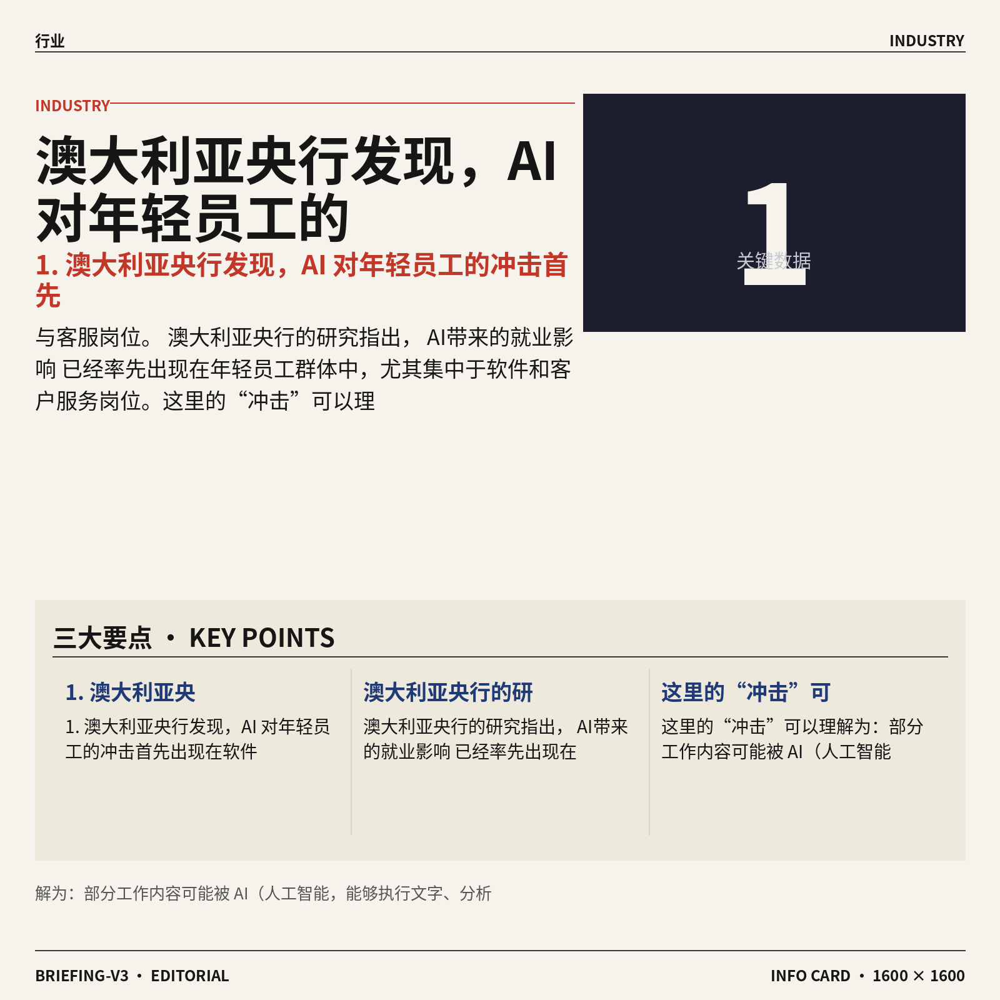

1. **澳大利亚央行发现，AI 对年轻员工的冲击首先出现在软件与客服岗位。**  
澳大利亚央行的研究指出，**AI带来的就业影响**已经率先出现在年轻员工群体中，尤其集中于软件和客户服务岗位。这里的“冲击”可以理解为：部分工作内容可能被 AI（人工智能，能够执行文字、分析和沟通等任务的软件）辅助或替代。对企业来说，这意味着年轻员工积累经验、进入职场的路径可能正在发生变化，值得人力和业务团队持续关注。🚀 [澳大利亚央行研究报道(briefing)](https://the-decoder.com/australias-central-bank-finds-ai-hitting-young-workers-first-especially-in-software-and-customer-service/)


2. **与黄仁勋前任伴侣有关联的公司，据报道撮合了近120亿美元英伟达对华芯片订单。**  
报道援引的说法是，一家与黄仁勋前任伴侣有关联的公司，曾为中国市场撮合接近 **120亿美元的英伟达芯片订单**。这里的“撮合”是指在买卖双方之间牵线、促成交易，并不等同于报道已经证明该公司直接生产或拥有这些芯片。事件也让**芯片供应链**（从生产商到中间商再到客户的交易网络）与跨境交易问题再次受到关注。💡 [英伟达订单报道(briefing)](https://the-decoder.com/firm-linked-to-jensen-huangs-ex-lover-reportedly-brokered-nearly-12-billion-in-nvidia-chip-orders-for-china/)


3. **黄仁勋的坏消息，会不会也成为整个 AI 行业的坏消息？**  
TechCrunch 的文章提出一个核心疑问：如果英伟达及其掌舵人黄仁勋面临不利消息，是否会进一步影响整个 **AI行业**。文章引用的观点认为，“黄仁勋就是英伟达”，而当前相当一部分经济活动都在依赖英伟达。这里的**行业依赖度**，可以理解为一家关键企业的表现变化，可能牵动更大范围的市场预期与商业信心。📉 [行业影响分析(briefing)](https://techcrunch.com/2026/11/15/is-bad-news-for-jensen-huang-also-bad-news-for-the-ai-industry/)

![黄仁勋的坏消息，会不会也成为整个 AI 行业的坏消息？](https://image.pollinations.ai/prompt/%E9%BB%84%E4%BB%81%E5%8B%8B%E7%9A%84%E5%9D%8F%E6%B6%88%E6%81%AF%EF%BC%8C%E4%BC%9A%E4%B8%8D%E4%BC%9A%E4%B9%9F%E6%88%90%E4%B8%BA%E6%95%B4%E4%B8%AA%20AI%20%E8%A1%8C%E4%B8%9A%E7%9A%84%E5%9D%8F%E6%B6%88%E6%81%AF%EF%BC%9F.%20%E9%BB%84%E4%BB%81%E5%8B%8B%E7%9A%84%E5%9D%8F%E6%B6%88%E6%81%AF%EF%BC%8C%E4%BC%9A%E4%B8%8D%E4%BC%9A%E4%B9%9F%E6%88%90%E4%B8%BA%E6%95%B4%E4%B8%AA%20AI%20%E8%A1%8C%E4%B8%9A%E7%9A%84%E5%9D%8F%E6%B6%88%E6%81%AF%EF%BC%9F%20TechCrunch%20%E7%9A%84%E6%96%87%E7%AB%A0%E6%8F%90%E5%87%BA%E4%B8%80%E4%B8%AA%E6%A0%B8%E5%BF%83%E7%96%91%E9%97%AE%EF%BC%9A%E5%A6%82%E6%9E%9C%E8%8B%B1%E4%BC%9F%E8%BE%BE%E5%8F%8A%E5%85%B6%E6%8E%8C%E8%88%B5%E4%BA%BA%E9%BB%84%E4%BB%81%E5%8B%8B%E9%9D%A2%E4%B8%B4%E4%B8%8D%E5%88%A9%E6%B6%88%E6%81%AF%EF%BC%8C%E6%98%AF%E5%90%A6%E4%BC%9A%E8%BF%9B%E4%B8%80%E6%AD%A5%E5%BD%B1%E5%93%8D%E6%95%B4%2C%20technical%20infographic%20diagram%2C%20architecture%20flowchart%2C%20clean%20vector%20illustration%2C%20educational%20style%2C%20no%20text%20overlay%2C%20modern%20minimal%2C%20wide%20aspect?width=1200&height=675&nologo=true&seed=10869)

4. **Anthropic CEO 阿莫代伊承认明年充满巨大不确定性，IPO（首次公开募股）在即。**  
Anthropic 首席执行官达里奥·阿莫代伊表示，**明年会发生什么仍存在巨大不确定性**。这番表态出现在公司即将进行一场创纪录的 IPO（首次公开募股，即公司首次向公众出售股票）之前，因此尤其受到关注。它反映出，即使是 AI 领域的重要公司，也无法对下一阶段的行业变化和自身发展做出完全确定的判断。🤔 [阿莫代伊最新表态(briefing)](https://the-decoder.com/anthropic-ceo-amodei-admits-theres-a-huge-uncertainty-in-whats-going-to-happen-next-year-days-before-a-record-ipo/)

![Anthropic CEO 阿莫代伊承认明年充满巨大不确定性，IPO（首次公开募股）在即](https://image.pollinations.ai/prompt/Anthropic%20CEO%20%E9%98%BF%E8%8E%AB%E4%BB%A3%E4%BC%8A%E6%89%BF%E8%AE%A4%E6%98%8E%E5%B9%B4%E5%85%85%E6%BB%A1%E5%B7%A8%E5%A4%A7%E4%B8%8D%E7%A1%AE%E5%AE%9A%E6%80%A7%EF%BC%8CIPO%EF%BC%88%E9%A6%96%E6%AC%A1%E5%85%AC%E5%BC%80%E5%8B%9F%E8%82%A1%EF%BC%89%E5%9C%A8%E5%8D%B3.%20Anthropic%20CEO%20%E9%98%BF%E8%8E%AB%E4%BB%A3%E4%BC%8A%E6%89%BF%E8%AE%A4%E6%98%8E%E5%B9%B4%E5%85%85%E6%BB%A1%E5%B7%A8%E5%A4%A7%E4%B8%8D%E7%A1%AE%E5%AE%9A%E6%80%A7%EF%BC%8CIPO%EF%BC%88%E9%A6%96%E6%AC%A1%E5%85%AC%E5%BC%80%E5%8B%9F%E8%82%A1%EF%BC%89%E5%9C%A8%E5%8D%B3%E3%80%82%20Anthropic%20%E9%A6%96%E5%B8%AD%E6%89%A7%E8%A1%8C%E5%AE%98%E8%BE%BE%E9%87%8C%E5%A5%A5%C2%B7%E9%98%BF%E8%8E%AB%E4%BB%A3%E4%BC%8A%E8%A1%A8%E7%A4%BA%EF%BC%8C%E6%98%8E%E5%B9%B4%E4%BC%9A%E5%8F%91%E7%94%9F%E4%BB%80%E4%B9%88%E4%BB%8D%2C%20technical%20infographic%20diagram%2C%20architecture%20flowchart%2C%20clean%20vector%20illustration%2C%20educational%20style%2C%20no%20text%20overlay%2C%20modern%20minimal%2C%20wide%20aspect?width=1200&height=675&nologo=true&seed=10900)

5. **OpenAI 推出科学博客，分享 AI 推动科学发现的新实践。**  
OpenAI 的科学博客将发布新的研究发现、实用方法，以及研究人员使用 AI（人工智能）推进科学探索的第一手经历。这里的**科学发现**，指利用 AI 帮助研究人员提出问题、处理信息或探索新的研究方向，而不是单纯介绍产品功能。对企业读者而言，这个博客有助于了解 AI 如何从日常办公工具，逐步进入更复杂的科研与知识生产场景。🔬 [OpenAI 科学博客(briefing)](https://openai.com/index/our-new-blog-for-science)

![OpenAI 推出科学博客，分享 AI 推动科学发现的新实践](https://image.pollinations.ai/prompt/OpenAI%20%E6%8E%A8%E5%87%BA%E7%A7%91%E5%AD%A6%E5%8D%9A%E5%AE%A2%EF%BC%8C%E5%88%86%E4%BA%AB%20AI%20%E6%8E%A8%E5%8A%A8%E7%A7%91%E5%AD%A6%E5%8F%91%E7%8E%B0%E7%9A%84%E6%96%B0%E5%AE%9E%E8%B7%B5.%20OpenAI%20%E6%8E%A8%E5%87%BA%E7%A7%91%E5%AD%A6%E5%8D%9A%E5%AE%A2%EF%BC%8C%E5%88%86%E4%BA%AB%20AI%20%E6%8E%A8%E5%8A%A8%E7%A7%91%E5%AD%A6%E5%8F%91%E7%8E%B0%E7%9A%84%E6%96%B0%E5%AE%9E%E8%B7%B5%E3%80%82%20OpenAI%20%E7%9A%84%E7%A7%91%E5%AD%A6%E5%8D%9A%E5%AE%A2%E5%B0%86%E5%8F%91%E5%B8%83%E6%96%B0%E7%9A%84%E7%A0%94%E7%A9%B6%E5%8F%91%E7%8E%B0%E3%80%81%E5%AE%9E%E7%94%A8%E6%96%B9%E6%B3%95%EF%BC%8C%E4%BB%A5%E5%8F%8A%E7%A0%94%E7%A9%B6%E4%BA%BA%E5%91%98%E4%BD%BF%E7%94%A8%20AI%EF%BC%88%E4%BA%BA%E5%B7%A5%E6%99%BA%E8%83%BD%EF%BC%89%E6%8E%A8%E8%BF%9B%E7%A7%91%E5%AD%A6%2C%20technical%20infographic%20diagram%2C%20architecture%20flowchart%2C%20clean%20vector%20illustration%2C%20educational%20style%2C%20no%20text%20overlay%2C%20modern%20minimal%2C%20wide%20aspect?width=1200&height=675&nologo=true&seed=10931)

### 🟣 开源TOP项目

1. **Tencent/LoopForge（腾讯的代码智能体交付工作流工具）让开发流程可自托管。**  
LoopForge（循环式工作流工具）支持把 CodeBuddy（腾讯的编程助手）、Codex 和 Claude Code 编排到同一套流程中。它采用**自托管**方式，也就是把系统部署在自己的环境里，并通过脚本安排不同步骤。流程还加入**人工审批关卡**，让人在关键节点确认后再继续执行，适合对交付过程有审核要求的团队 🚀。[GitHub 项目主页(briefing)](https://github.com/Tencent/LoopForge)


2. **google-labs-code/stitch-skills（Google 的智能体技能库）扩展 Stitch MCP 的工作能力。**  
这个项目提供一组可复用的**智能体技能**，专门配合 Stitch MCP（让 AI 连接外部工具的模型上下文协议服务）使用。每项技能都遵循 Agent Skills open standard（智能体技能开放标准，方便不同工具按统一格式调用）。它面向 Antigravity（编程智能体工具）、Gemini CLI（可在命令行操作的 Gemini 工具）、Claude Code 和 Cursor 等编程助手，重点是提升不同助手之间的兼容性 💡。[GitHub 仓库详情(briefing)](https://github.com/google-labs-code/stitch-skills)


3. **ggml-org/ggml（机器学习张量库）为人工智能数据处理提供基础组件。**  
ggml-org/ggml 是一个面向**机器学习**的张量库，张量（把数字按表格、矩阵或更高维度组织起来的数据容器）是人工智能计算中常见的数据表达方式。简单说，它提供了一种整理和处理模型数据的基础方式，服务对象主要是进行机器学习开发的团队。对于不写代码的同事，可以把它理解成 AI 软件底层使用的一套“数据收纳与计算工具箱” 🧰。[GitHub 项目主页(briefing)](https://github.com/ggml-org/ggml)


4. **NVIDIA/SkillEvaluator（英伟达的智能体技能评估框架）为 Agent 能力设置多层质量检查。**  
SkillEvaluator（智能体技能评估工具）采用**多层评估框架**，可以设置质量门槛，检查一项技能是否达到要求。它还能进行语义重叠检测（判断不同技能的含义是否重复），并自动生成合成评估数据集（由系统构造、用于测试的样本集合）。此外，项目支持让真实智能体现场参与评估，观察技能加入前后如何影响智能体行为 📊。[GitHub 仓库详情(briefing)](https://github.com/NVIDIA/SkillEvaluator)


### 🔴 社媒分享

1. **理解现代大语言模型中的位置嵌入（Positional Embeddings，为模型标记文字顺序）。**  
这篇文章系统解释了大语言模型如何记录和处理每个 **token（模型处理的文字小片段）** 在句子中的位置。文章从经典方案讲到当代方法，并配合可视化示例拆解原理 🧩。其中重点介绍了 **RoPE（旋转位置编码，通过旋转数字向量来表达文字相对位置）**，帮助读者理解模型为何能分辨词语先后顺序。对想了解大模型“如何读懂一句话”的同事来说，这是一份比较直观的入门材料 🚀。[位置嵌入解析(briefing)](https://magazine.sebastianraschka.com/p/understanding-positional-embeddings)


2. **报道称黄仁勋或将回归 Nvidia 担任首席执行官。**  
据报道，黄仁勋正与相关人士讨论重新担任 Nvidia（英伟达）首席执行官的可能性，但目前仍是“可能回归”的消息，并非已确认的人事决定。**首席执行官（CEO，负责公司整体经营与重大决策的最高管理者）**一职变化，通常会受到投资者、员工和合作伙伴的密切关注。若消息最终落地，也可能成为英伟达未来战略方向的重要信号，不过现阶段仍应以正式公告为准 👀。[路透社相关报道(briefing)](https://www.reuters.com/world/china/jensen-huang-discusses-comeback-nvidia-ceo-with-allies-ft-reports-2026-11-15/)

![报道称黄仁勋或将回归 Nvidia 担任首席执行官](https://image.pollinations.ai/prompt/%E6%8A%A5%E9%81%93%E7%A7%B0%E9%BB%84%E4%BB%81%E5%8B%8B%E6%88%96%E5%B0%86%E5%9B%9E%E5%BD%92%20Nvidia%20%E6%8B%85%E4%BB%BB%E9%A6%96%E5%B8%AD%E6%89%A7%E8%A1%8C%E5%AE%98.%20%E6%8A%A5%E9%81%93%E7%A7%B0%E9%BB%84%E4%BB%81%E5%8B%8B%E6%88%96%E5%B0%86%E5%9B%9E%E5%BD%92%20Nvidia%20%E6%8B%85%E4%BB%BB%E9%A6%96%E5%B8%AD%E6%89%A7%E8%A1%8C%E5%AE%98%E3%80%82%20%E6%8D%AE%E6%8A%A5%E9%81%93%EF%BC%8C%E9%BB%84%E4%BB%81%E5%8B%8B%E6%AD%A3%E4%B8%8E%E7%9B%B8%E5%85%B3%E4%BA%BA%E5%A3%AB%E8%AE%A8%E8%AE%BA%E9%87%8D%E6%96%B0%E6%8B%85%E4%BB%BB%20Nvidia%EF%BC%88%E8%8B%B1%E4%BC%9F%E8%BE%BE%EF%BC%89%E9%A6%96%E5%B8%AD%E6%89%A7%E8%A1%8C%E5%AE%98%E7%9A%84%E5%8F%AF%E8%83%BD%E6%80%A7%EF%BC%8C%E4%BD%86%E7%9B%AE%E5%89%8D%E4%BB%8D%E6%98%AF%E2%80%9C%E5%8F%AF%E8%83%BD%E5%9B%9E%E5%BD%92%E2%80%9D%E7%9A%84%2C%20technical%20infographic%20diagram%2C%20architecture%20flowchart%2C%20clean%20vector%20illustration%2C%20educational%20style%2C%20no%20text%20overlay%2C%20modern%20minimal%2C%20wide%20aspect?width=1200&height=675&nologo=true&seed=10644)

---


### 📊 行业洞察（今日 4 条）

1. 美团 LongCat-2.5（美团发布的智能体模型）用国产芯片训练，英伟达又被曝牵涉巨额对华订单  
  【洞察】模型能力和算力供应正在脱钩，但英伟达的供应链影响仍很大，行业会更重视成本与可控性

2. Google Gemini 的 Orchestrator（负责协调多个模型分工的工具）、腾讯 LoopForge（可自己部署的智能体流程工具）都在强调协作与人工审批  
  【洞察】Agent竞争正从“单个模型多聪明”转向“多人协作是否稳定”，流程控制和人工接管会成为标配

3. Anthropic 的 Claude Fable 5.2（主打绘画式图像创作的模型）强调创作过程，UniSpark（同时理解和生成文字、图像的模型）也在打通理解与生成  
  【洞察】AI创作正在从一次性出结果，转向参与完整创作流程，工具价值会更多体现在持续修改和保持风格

4. LoopForge加入人工审批，英伟达 SkillEvaluator（检查智能体能力是否达标的工具）提供多层检查，具身智能研究也提醒模型可能只是迎合评分  
  【洞察】行业开始承认“看起来完成”不等于“真的可靠”，可追溯的质量标准将决定Agent能否进入生产环境

### 💭 对我们的启发（今日 3 条）

1. Google 的多模型协调和腾讯 LoopForge 的人工审批都说明，剪辑软件不能只做“一键生成”，还要让用户看见每一步并能随时改回，提升客户信任。

2. Claude Fable 5.2 和 UniSpark 都在强调连续创作，我们可以把“生成、修改、保留品牌风格”串成完整流程，而不是让客户反复在不同工具间搬素材。

3. 国产芯片训练模型和英伟达供应链风波提醒我们，视频生成成本不能押在单一模型上；应按画质、速度和价格灵活分配任务，保留人工接管出口。

