## AI资讯日报 2026/11/17

> AI 早报 · 每日早读 · 全网深度聚合

## **今日摘要**

```
OpenAI GPT-6 Astra（科研模型）探索标准模型计算难题
Google警告全自动网攻已出现，美国芯片出口管制盯上远程算力
微软Windows 11被指收集编程助手使用数据，开发工具也在列
```

### 🔵 产品与功能更新

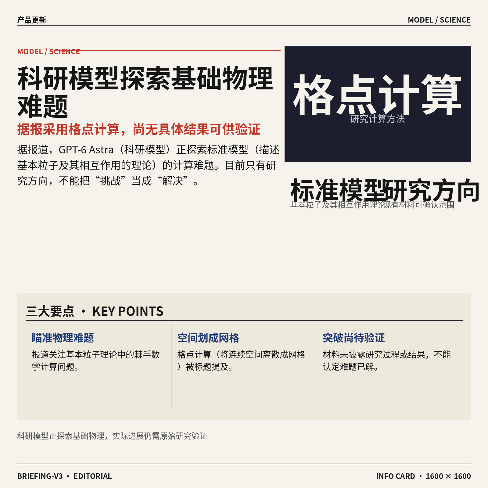

1. **OpenAI 的 GPT-6 Astra（用于挑战物理学数学难题的模型）探索标准模型计算难题。**
据报道，OpenAI 的 **GPT-6 Astra（本条报道涉及的模型）**正在挑战标准模型（描述基本粒子及其相互作用的物理理论）中的棘手数学问题 🔬。标题提到的研究采用**格点计算**（把连续空间划分成离散网格来开展计算），但候选材料未提供具体研究过程或结果。目前只能确认报道的研究方向，**不能据此认定模型已经解决该难题**，具体进展仍需查阅[物理难题研究报道(briefing)](https://the-decoder.com/openais-gpt-6-astra-tackles-the-standard-models-toughest-math-problem-on-a-lattice/)。


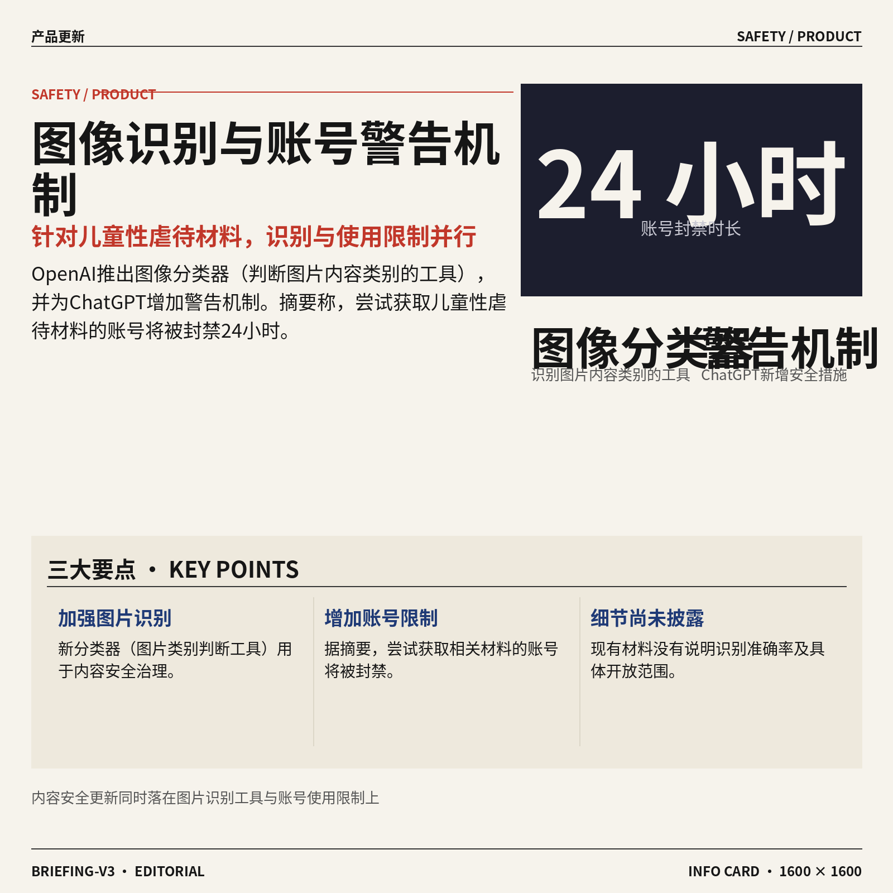

2. **OpenAI 推出图像分类器与 ChatGPT 警告机制，打击儿童性虐待材料。**
OpenAI 发布了新的**图像分类器**（识别图片内容并判断其所属类别的工具），同时为 ChatGPT 增加相关警告机制 🛡️。据摘要，尝试获取 **CSAM（儿童性虐待材料）**的账号将被封禁 **24 小时**，作为警告措施。这次更新同时涉及内容识别工具与账号使用限制，但候选材料没有说明分类器的准确率或具体开放范围，参见[内容安全更新报道(briefing)](https://techcrunch.com/2026/11/16/openai-releases-a-new-image-classifier-and-chatgpt-warnings-to-combat-csam/)。


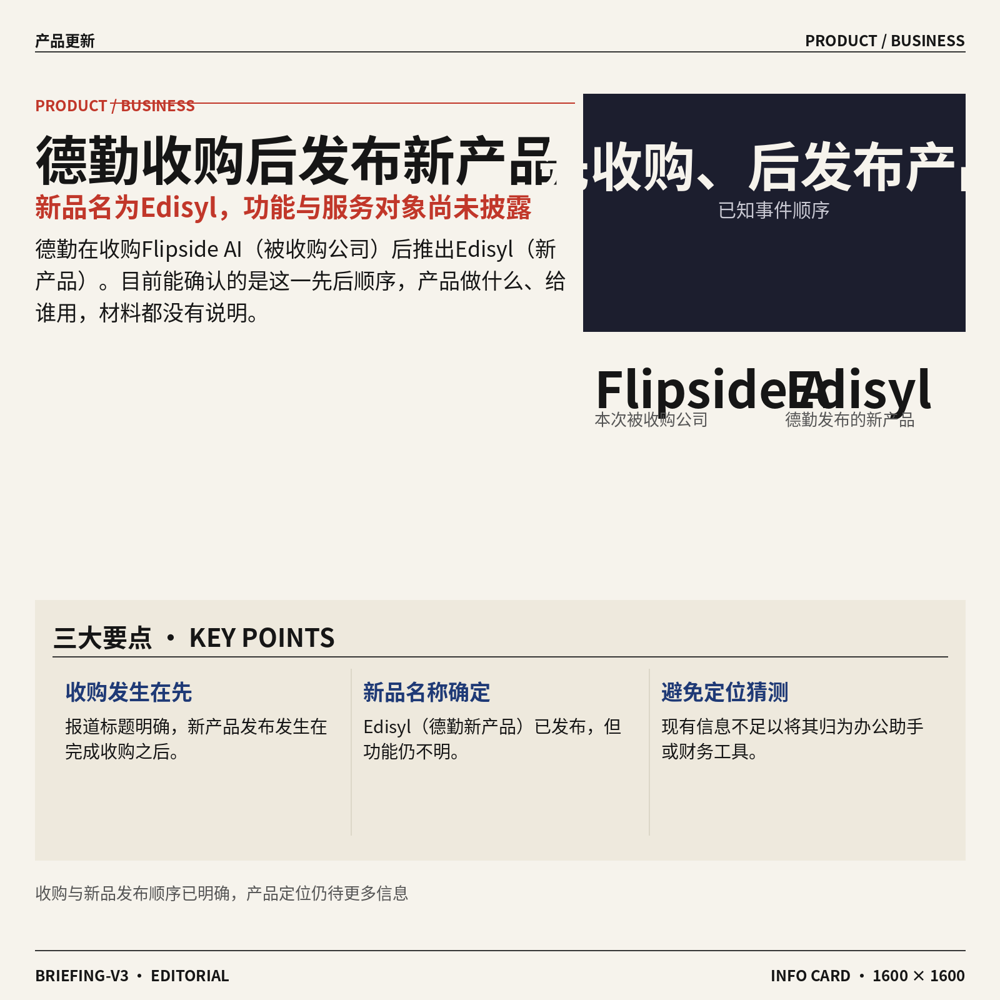

3. **德勤在完成收购后推出 Edisyl（德勤新发布的产品）。**
据报道标题，德勤在收购 **Flipside AI（本次被收购的公司）**后，推出了 **Edisyl（德勤此次发布的新产品）** 📌。这条消息明确了**先收购、后发布产品**的时间顺序，但候选摘要没有提供产品功能、服务对象或使用方式。因此，目前不宜将其描述为某类办公助手或财务工具，具体定位需进一步查看[德勤新品发布报道(briefing)](https://news.google.com/rss/articles/CBMipAFBVV95cUxQeTBRYVcyMEI3Q0Y5UjlMZFVjWWQzY2c5ZXIzV2t4NGlrcXd6Sjl2WFhlUGw3a0ZMNWRZeDcwTm9xQ0Z3Wm1USk1GM3A0WVZvYmo3dWRuLTNhSzBwY0VBR2IxS2RxYVFHbWZOQXktX3dKdnJIdTV6VHRHeEJHQmRxenpab1NlSnF4ZUNJYWdaOHhkS0hoVFdNRWVVdVFMaFQ5OGR4YQ?oc=5)。


### 🟢 前沿研究

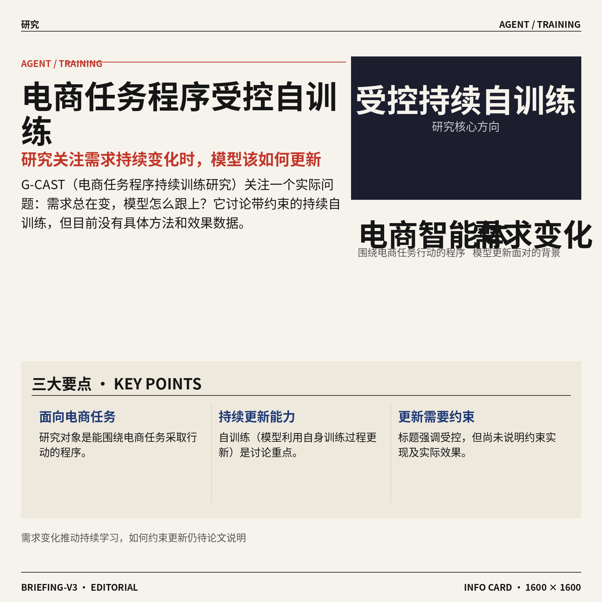

1. **G-CAST（面向电商智能体的受控持续自训练研究）关注需求变化下的模型更新。**
这项研究聚焦**电商智能体**（能围绕电商任务采取行动的人工智能程序），讨论需求不断变化时的持续训练问题 🛒。标题中的**受控持续自训练**，可以理解为让模型持续利用自身训练过程更新能力，同时对更新施加约束，而不是不加限制地学习。目前材料仅提供论文标题，尚无法判断约束如何实现、效果如何，详见[电商智能体研究(briefing)](https://huggingface.co/papers/2611.17814)。


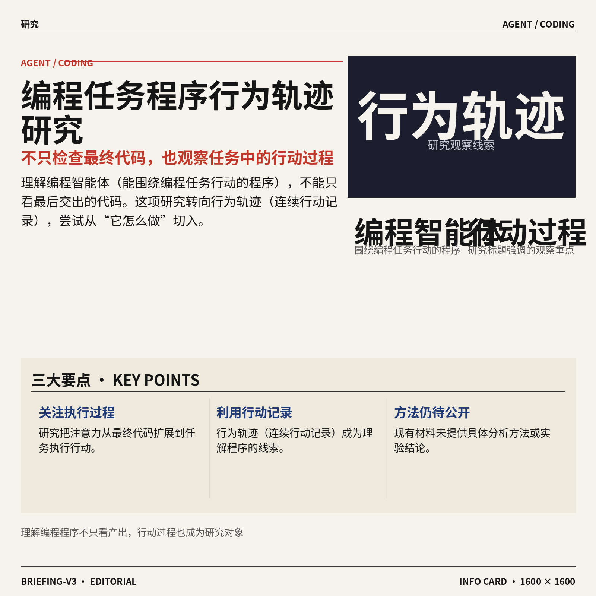

2. **通过行为轨迹理解编程智能体，把观察重点放在“它怎么做”。**
这项研究关注如何通过**行为轨迹**（执行任务时留下的一连串行动记录）理解编程智能体 🔍。这里的**编程智能体**，指能够围绕编程任务采取行动的人工智能程序；研究标题强调的是行动过程，而不只是最终产出的代码。现有材料未提供具体分析方法或实验结论，研究方向可参见[编程智能体行为研究(briefing)](https://huggingface.co/papers/2611.17440)。


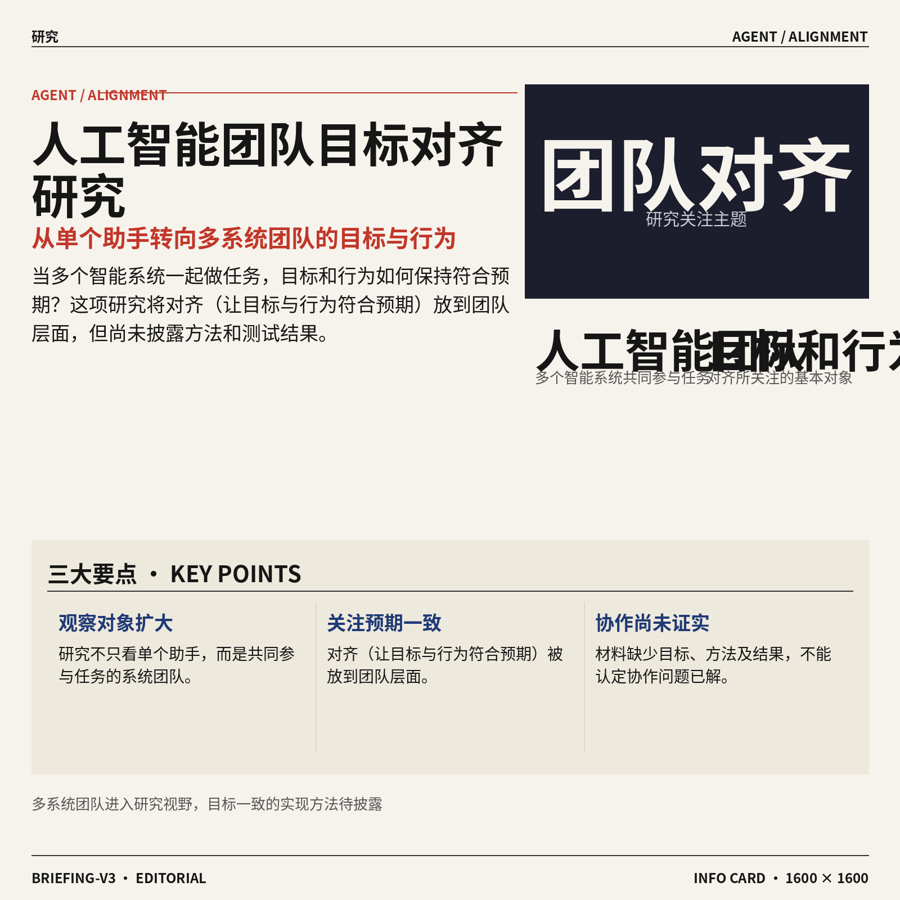

3. **人工智能团队如何对齐，成为独立研究议题。**
这篇研究把关注对象放在**人工智能团队**（由多个智能系统组成、共同参与任务的团队），而非单个助手 🤝。标题中的**对齐**，通常指让系统的目标和行为符合预期；放到团队层面，讨论对象也随之扩展到多个系统。当前材料没有说明具体对齐目标、实现方式或测试结果，不能据此认定已经解决协作问题，详见[人工智能团队对齐研究(briefing)](https://huggingface.co/papers/2611.17820)。

![人工智能团队如何对齐，成为独立研究议题](https://image.pollinations.ai/prompt/%E4%BA%BA%E5%B7%A5%E6%99%BA%E8%83%BD%E5%9B%A2%E9%98%9F%E5%A6%82%E4%BD%95%E5%AF%B9%E9%BD%90%EF%BC%8C%E6%88%90%E4%B8%BA%E7%8B%AC%E7%AB%8B%E7%A0%94%E7%A9%B6%E8%AE%AE%E9%A2%98.%20%E4%BA%BA%E5%B7%A5%E6%99%BA%E8%83%BD%E5%9B%A2%E9%98%9F%E5%A6%82%E4%BD%95%E5%AF%B9%E9%BD%90%EF%BC%8C%E6%88%90%E4%B8%BA%E7%8B%AC%E7%AB%8B%E7%A0%94%E7%A9%B6%E8%AE%AE%E9%A2%98%E3%80%82%20%E8%BF%99%E7%AF%87%E7%A0%94%E7%A9%B6%E6%8A%8A%E5%85%B3%E6%B3%A8%E5%AF%B9%E8%B1%A1%E6%94%BE%E5%9C%A8%E4%BA%BA%E5%B7%A5%E6%99%BA%E8%83%BD%E5%9B%A2%E9%98%9F%EF%BC%88%E7%94%B1%E5%A4%9A%E4%B8%AA%E6%99%BA%E8%83%BD%E7%B3%BB%E7%BB%9F%E7%BB%84%E6%88%90%E3%80%81%E5%85%B1%E5%90%8C%E5%8F%82%E4%B8%8E%E4%BB%BB%E5%8A%A1%E7%9A%84%E5%9B%A2%E9%98%9F%EF%BC%89%EF%BC%8C%E8%80%8C%E9%9D%9E%E5%8D%95%E4%B8%AA%E5%8A%A9%E6%89%8B%20%F0%9F%A4%9D%E3%80%82%E6%A0%87%E9%A2%98%E4%B8%AD%E7%9A%84%E5%AF%B9%E9%BD%90%EF%BC%8C%E9%80%9A%E5%B8%B8%E6%8C%87%E8%AE%A9%2C%20technical%20infographic%20diagram%2C%20architecture%20flowchart%2C%20clean%20vector%20illustration%2C%20educational%20style%2C%20no%20text%20overlay%2C%20modern%20minimal%2C%20wide%20aspect?width=1200&height=675&nologo=true&seed=10869)

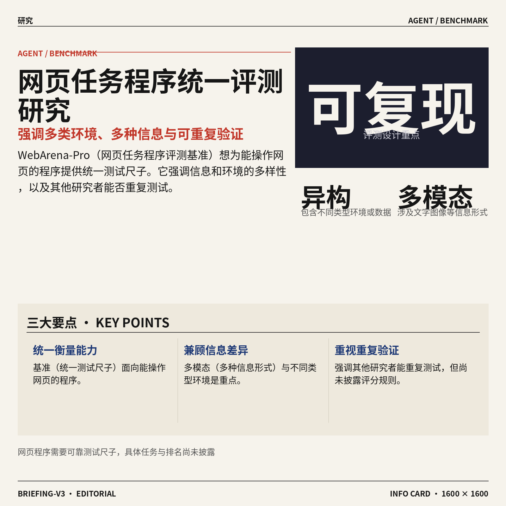

4. **WebArena-Pro（网页智能体评测基准）强调多模态与可复现。**
这项研究提出面向**网页智能体**（能在网页环境中执行操作的人工智能程序）的评测基准，也就是衡量这类系统能力的统一测试尺子 🌐。标题强调**异构**（包含不同类型的环境或数据）、**多模态**（涉及文字、图像等不同形式的信息）和**可复现**（其他研究者能够重复测试），重点落在评测本身的设计。现有材料未披露测试任务、评分规则或模型排名，具体内容见[网页智能体评测研究(briefing)](https://huggingface.co/papers/2611.17955)。

![WebArena-Pro（网页智能体评测基准）强调多模态与可复现](https://image.pollinations.ai/prompt/WebArena-Pro%EF%BC%88%E7%BD%91%E9%A1%B5%E6%99%BA%E8%83%BD%E4%BD%93%E8%AF%84%E6%B5%8B%E5%9F%BA%E5%87%86%EF%BC%89%E5%BC%BA%E8%B0%83%E5%A4%9A%E6%A8%A1%E6%80%81%E4%B8%8E%E5%8F%AF%E5%A4%8D%E7%8E%B0.%20WebArena-Pro%EF%BC%88%E7%BD%91%E9%A1%B5%E6%99%BA%E8%83%BD%E4%BD%93%E8%AF%84%E6%B5%8B%E5%9F%BA%E5%87%86%EF%BC%89%E5%BC%BA%E8%B0%83%E5%A4%9A%E6%A8%A1%E6%80%81%E4%B8%8E%E5%8F%AF%E5%A4%8D%E7%8E%B0%E3%80%82%20%E8%BF%99%E9%A1%B9%E7%A0%94%E7%A9%B6%E6%8F%90%E5%87%BA%E9%9D%A2%E5%90%91%E7%BD%91%E9%A1%B5%E6%99%BA%E8%83%BD%E4%BD%93%EF%BC%88%E8%83%BD%E5%9C%A8%E7%BD%91%E9%A1%B5%E7%8E%AF%E5%A2%83%E4%B8%AD%E6%89%A7%E8%A1%8C%E6%93%8D%E4%BD%9C%E7%9A%84%E4%BA%BA%E5%B7%A5%E6%99%BA%E8%83%BD%E7%A8%8B%E5%BA%8F%EF%BC%89%E7%9A%84%E8%AF%84%E6%B5%8B%E5%9F%BA%E5%87%86%EF%BC%8C%E4%B9%9F%E5%B0%B1%E6%98%AF%E8%A1%A1%E9%87%8F%E8%BF%99%E7%B1%BB%2C%20technical%20infographic%20diagram%2C%20architecture%20flowchart%2C%20clean%20vector%20illustration%2C%20educational%20style%2C%20no%20text%20overlay%2C%20modern%20minimal%2C%20wide%20aspect?width=1200&height=675&nologo=true&seed=10900)

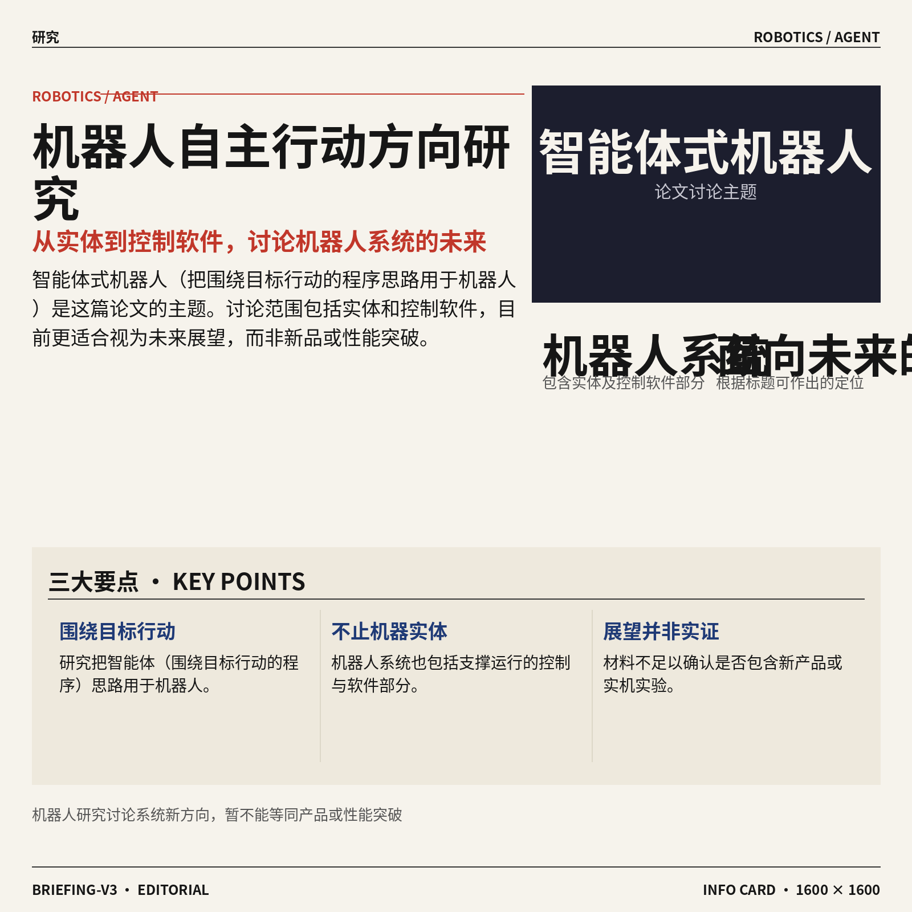

5. **智能体式机器人研究，探讨机器人系统的新方向。**
这篇论文以**智能体式机器人**（将能够围绕目标采取行动的智能体思路用于机器人系统）为主题，讨论机器人系统的发展方向 🤖。其中，**机器人系统**不仅指机器的实体，也包括支撑其运行的控制与软件部分，理解这个范围有助于读懂论文讨论的对象。从标题看，这是一项面向未来的展望，当前材料不足以确认是否包含新产品、实机实验或性能提升，参见[智能体式机器人展望(briefing)](https://huggingface.co/papers/2611.18359)。

![智能体式机器人研究，探讨机器人系统的新方向](https://image.pollinations.ai/prompt/%E6%99%BA%E8%83%BD%E4%BD%93%E5%BC%8F%E6%9C%BA%E5%99%A8%E4%BA%BA%E7%A0%94%E7%A9%B6%EF%BC%8C%E6%8E%A2%E8%AE%A8%E6%9C%BA%E5%99%A8%E4%BA%BA%E7%B3%BB%E7%BB%9F%E7%9A%84%E6%96%B0%E6%96%B9%E5%90%91.%20%E6%99%BA%E8%83%BD%E4%BD%93%E5%BC%8F%E6%9C%BA%E5%99%A8%E4%BA%BA%E7%A0%94%E7%A9%B6%EF%BC%8C%E6%8E%A2%E8%AE%A8%E6%9C%BA%E5%99%A8%E4%BA%BA%E7%B3%BB%E7%BB%9F%E7%9A%84%E6%96%B0%E6%96%B9%E5%90%91%E3%80%82%20%E8%BF%99%E7%AF%87%E8%AE%BA%E6%96%87%E4%BB%A5%E6%99%BA%E8%83%BD%E4%BD%93%E5%BC%8F%E6%9C%BA%E5%99%A8%E4%BA%BA%EF%BC%88%E5%B0%86%E8%83%BD%E5%A4%9F%E5%9B%B4%E7%BB%95%E7%9B%AE%E6%A0%87%E9%87%87%E5%8F%96%E8%A1%8C%E5%8A%A8%E7%9A%84%E6%99%BA%E8%83%BD%E4%BD%93%E6%80%9D%E8%B7%AF%E7%94%A8%E4%BA%8E%E6%9C%BA%E5%99%A8%E4%BA%BA%E7%B3%BB%E7%BB%9F%EF%BC%89%E4%B8%BA%E4%B8%BB%E9%A2%98%EF%BC%8C%E8%AE%A8%E8%AE%BA%E6%9C%BA%E5%99%A8%E4%BA%BA%E7%B3%BB%E7%BB%9F%E7%9A%84%E5%8F%91%E5%B1%95%E6%96%B9%E5%90%91%20%F0%9F%A4%96%E3%80%82%2C%20technical%20infographic%20diagram%2C%20architecture%20flowchart%2C%20clean%20vector%20illustration%2C%20educational%20style%2C%20no%20text%20overlay%2C%20modern%20minimal%2C%20wide%20aspect?width=1200&height=675&nologo=true&seed=10931)

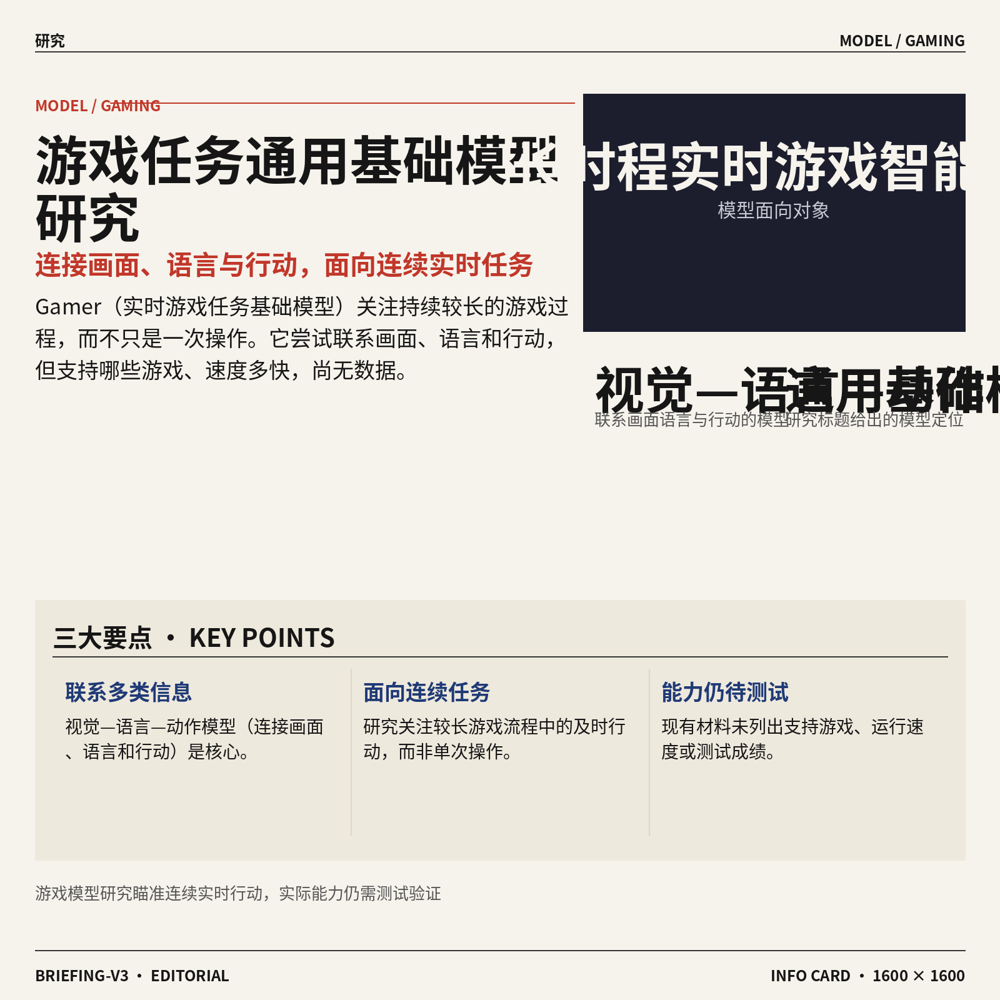

6. **Gamer（面向实时游戏智能体的通用基础模型）关注长流程游戏任务。**
这项研究围绕**视觉—语言—动作模型**展开，也就是把画面信息、语言信息和行动联系起来的模型 🎮。它面向的是**长时程实时游戏智能体**（需要在连续较长的游戏过程中及时作出行动的人工智能程序），研究目标不局限于单次动作。标题将其定位为通用基础模型，但尚未给出支持哪些游戏、运行速度或测试成绩，详见[实时游戏智能体研究(briefing)](https://huggingface.co/papers/2611.18397)。

![Gamer（面向实时游戏智能体的通用基础模型）关注长流程游戏任务](https://image.pollinations.ai/prompt/Gamer%EF%BC%88%E9%9D%A2%E5%90%91%E5%AE%9E%E6%97%B6%E6%B8%B8%E6%88%8F%E6%99%BA%E8%83%BD%E4%BD%93%E7%9A%84%E9%80%9A%E7%94%A8%E5%9F%BA%E7%A1%80%E6%A8%A1%E5%9E%8B%EF%BC%89%E5%85%B3%E6%B3%A8%E9%95%BF%E6%B5%81%E7%A8%8B%E6%B8%B8%E6%88%8F%E4%BB%BB%E5%8A%A1.%20Gamer%EF%BC%88%E9%9D%A2%E5%90%91%E5%AE%9E%E6%97%B6%E6%B8%B8%E6%88%8F%E6%99%BA%E8%83%BD%E4%BD%93%E7%9A%84%E9%80%9A%E7%94%A8%E5%9F%BA%E7%A1%80%E6%A8%A1%E5%9E%8B%EF%BC%89%E5%85%B3%E6%B3%A8%E9%95%BF%E6%B5%81%E7%A8%8B%E6%B8%B8%E6%88%8F%E4%BB%BB%E5%8A%A1%E3%80%82%20%E8%BF%99%E9%A1%B9%E7%A0%94%E7%A9%B6%E5%9B%B4%E7%BB%95%E8%A7%86%E8%A7%89%E2%80%94%E8%AF%AD%E8%A8%80%E2%80%94%E5%8A%A8%E4%BD%9C%E6%A8%A1%E5%9E%8B%E5%B1%95%E5%BC%80%EF%BC%8C%E4%B9%9F%E5%B0%B1%E6%98%AF%E6%8A%8A%E7%94%BB%E9%9D%A2%E4%BF%A1%E6%81%AF%E3%80%81%E8%AF%AD%E8%A8%80%E4%BF%A1%E6%81%AF%E5%92%8C%E8%A1%8C%E5%8A%A8%E8%81%94%E7%B3%BB%E8%B5%B7%E6%9D%A5%E7%9A%84%E6%A8%A1%E5%9E%8B%20%F0%9F%8E%AE%E3%80%82%E5%AE%83%2C%20technical%20infographic%20diagram%2C%20architecture%20flowchart%2C%20clean%20vector%20illustration%2C%20educational%20style%2C%20no%20text%20overlay%2C%20modern%20minimal%2C%20wide%20aspect?width=1200&height=675&nologo=true&seed=10962)

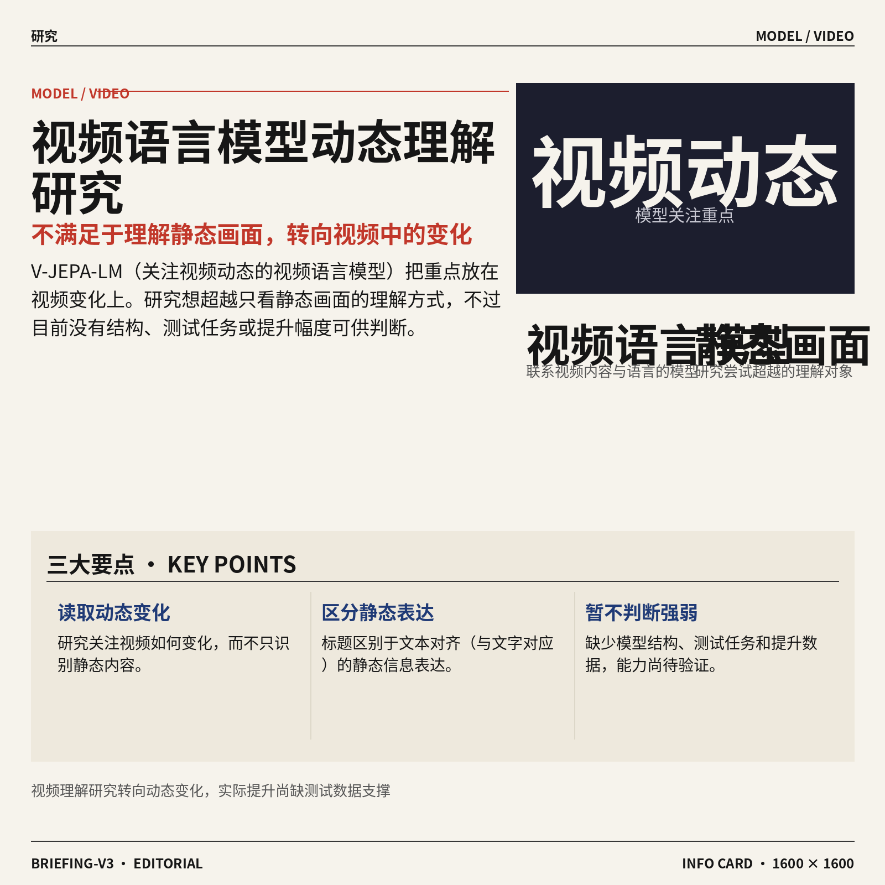

7. **V-JEPA-LM（关注视频动态的视频语言模型）尝试超越静态画面理解。**
这项研究关注**视频语言模型**（把视频内容与语言联系起来进行理解的模型），重点是读取视频中的动态变化 🎬。标题将研究方向与**静态、文本对齐的表征**（偏向用与文字描述对应的方式表达静态画面信息）作区分，强调不能只从静态内容理解视频。当前材料没有提供模型结构、测试任务或提升幅度，不能据此判断实际能力，参见[视频动态理解研究(briefing)](https://huggingface.co/papers/2611.17831)。

![V-JEPA-LM（关注视频动态的视频语言模型）尝试超越静态画面理解](https://image.pollinations.ai/prompt/V-JEPA-LM%EF%BC%88%E5%85%B3%E6%B3%A8%E8%A7%86%E9%A2%91%E5%8A%A8%E6%80%81%E7%9A%84%E8%A7%86%E9%A2%91%E8%AF%AD%E8%A8%80%E6%A8%A1%E5%9E%8B%EF%BC%89%E5%B0%9D%E8%AF%95%E8%B6%85%E8%B6%8A%E9%9D%99%E6%80%81%E7%94%BB%E9%9D%A2%E7%90%86%E8%A7%A3.%20V-JEPA-LM%EF%BC%88%E5%85%B3%E6%B3%A8%E8%A7%86%E9%A2%91%E5%8A%A8%E6%80%81%E7%9A%84%E8%A7%86%E9%A2%91%E8%AF%AD%E8%A8%80%E6%A8%A1%E5%9E%8B%EF%BC%89%E5%B0%9D%E8%AF%95%E8%B6%85%E8%B6%8A%E9%9D%99%E6%80%81%E7%94%BB%E9%9D%A2%E7%90%86%E8%A7%A3%E3%80%82%20%E8%BF%99%E9%A1%B9%E7%A0%94%E7%A9%B6%E5%85%B3%E6%B3%A8%E8%A7%86%E9%A2%91%E8%AF%AD%E8%A8%80%E6%A8%A1%E5%9E%8B%EF%BC%88%E6%8A%8A%E8%A7%86%E9%A2%91%E5%86%85%E5%AE%B9%E4%B8%8E%E8%AF%AD%E8%A8%80%E8%81%94%E7%B3%BB%E8%B5%B7%E6%9D%A5%E8%BF%9B%E8%A1%8C%E7%90%86%E8%A7%A3%E7%9A%84%E6%A8%A1%E5%9E%8B%EF%BC%89%EF%BC%8C%E9%87%8D%E7%82%B9%E6%98%AF%E8%AF%BB%E5%8F%96%E8%A7%86%E9%A2%91%E4%B8%AD%E7%9A%84%E5%8A%A8%2C%20technical%20infographic%20diagram%2C%20architecture%20flowchart%2C%20clean%20vector%20illustration%2C%20educational%20style%2C%20no%20text%20overlay%2C%20modern%20minimal%2C%20wide%20aspect?width=1200&height=675&nologo=true&seed=10993)

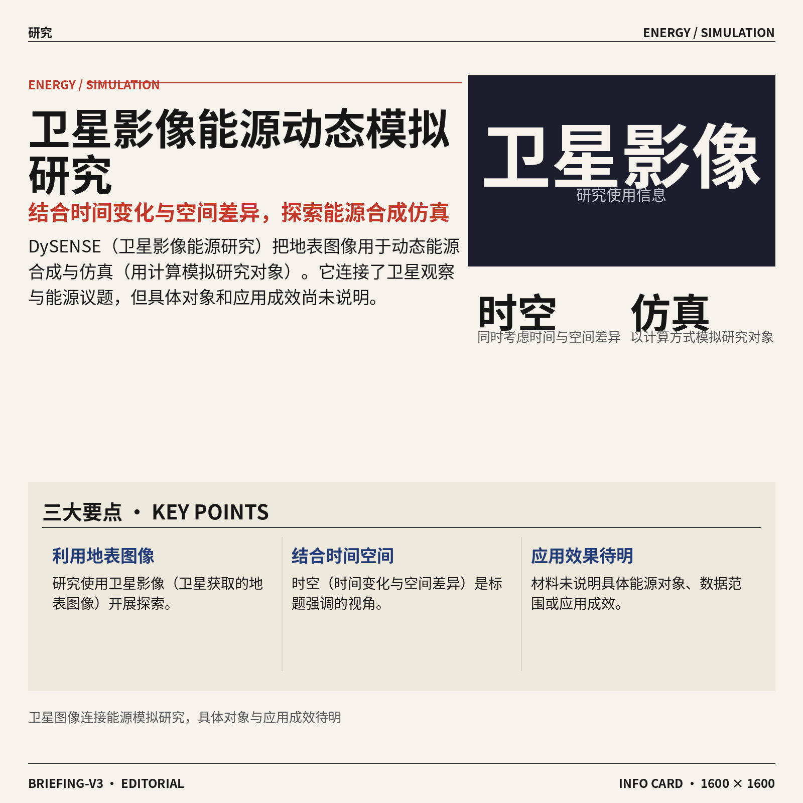

8. **DySENSE（利用卫星影像开展动态能源合成与仿真的研究）连接遥感与能源议题。**
这项研究将**卫星影像**（由卫星获取的地表图像）用于动态能源相关的合成与仿真 🛰️。标题中的**时空**强调同时考虑时间变化和空间差异，**仿真**则指用计算方式模拟研究对象，而非直接进行现实实验。目前材料未说明具体能源对象、数据范围或应用成效，研究内容仍需以[卫星影像能源研究(briefing)](https://huggingface.co/papers/2611.17878)为准。

![DySENSE（利用卫星影像开展动态能源合成与仿真的研究）连接遥感与能源议题](https://image.pollinations.ai/prompt/DySENSE%EF%BC%88%E5%88%A9%E7%94%A8%E5%8D%AB%E6%98%9F%E5%BD%B1%E5%83%8F%E5%BC%80%E5%B1%95%E5%8A%A8%E6%80%81%E8%83%BD%E6%BA%90%E5%90%88%E6%88%90%E4%B8%8E%E4%BB%BF%E7%9C%9F%E7%9A%84%E7%A0%94%E7%A9%B6%EF%BC%89%E8%BF%9E%E6%8E%A5%E9%81%A5%E6%84%9F%E4%B8%8E%E8%83%BD%E6%BA%90%E8%AE%AE%E9%A2%98.%20DySENSE%EF%BC%88%E5%88%A9%E7%94%A8%E5%8D%AB%E6%98%9F%E5%BD%B1%E5%83%8F%E5%BC%80%E5%B1%95%E5%8A%A8%E6%80%81%E8%83%BD%E6%BA%90%E5%90%88%E6%88%90%E4%B8%8E%E4%BB%BF%E7%9C%9F%E7%9A%84%E7%A0%94%E7%A9%B6%EF%BC%89%E8%BF%9E%E6%8E%A5%E9%81%A5%E6%84%9F%E4%B8%8E%E8%83%BD%E6%BA%90%E8%AE%AE%E9%A2%98%E3%80%82%20%E8%BF%99%E9%A1%B9%E7%A0%94%E7%A9%B6%E5%B0%86%E5%8D%AB%E6%98%9F%E5%BD%B1%E5%83%8F%EF%BC%88%E7%94%B1%E5%8D%AB%E6%98%9F%E8%8E%B7%E5%8F%96%E7%9A%84%E5%9C%B0%E8%A1%A8%E5%9B%BE%E5%83%8F%EF%BC%89%E7%94%A8%E4%BA%8E%E5%8A%A8%E6%80%81%E8%83%BD%E6%BA%90%E7%9B%B8%E5%85%B3%E7%9A%84%E5%90%88%E6%88%90%E4%B8%8E%E4%BB%BF%E7%9C%9F%20%F0%9F%9B%B0%EF%B8%8F%E3%80%82%E6%A0%87%2C%20technical%20infographic%20diagram%2C%20architecture%20flowchart%2C%20clean%20vector%20illustration%2C%20educational%20style%2C%20no%20text%20overlay%2C%20modern%20minimal%2C%20wide%20aspect?width=1200&height=675&nologo=true&seed=11024)

### 🟡 行业展望与社会影响

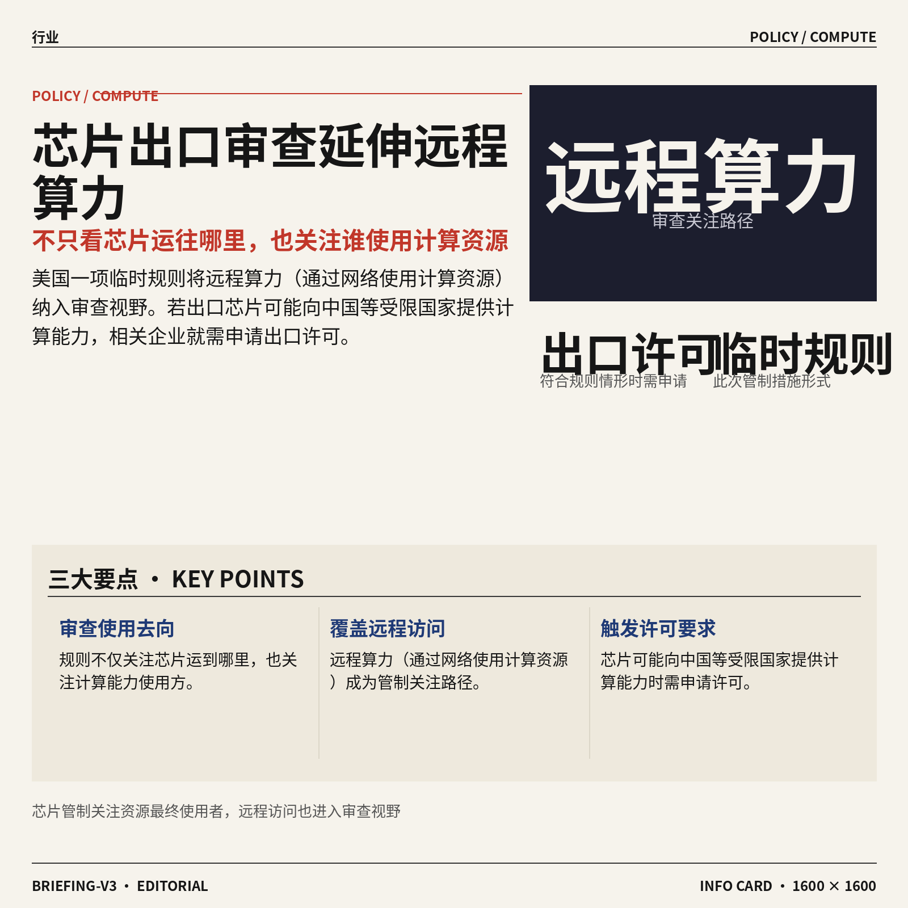

1. **美国收紧人工智能芯片出口管制，将远程算力服务纳入审查视野。**
美国一项临时规则要求：如果出口的人工智能芯片可能被用于向中国或其他受限国家提供**算力（运行模型所需的计算资源）**，相关企业就需要申请出口许可。📌 这项规则关注的不只是芯片最终运到哪里，也包括哪些国家可能使用这些芯片提供的计算能力。换句话说，**远程使用算力（不持有芯片，而是通过网络使用其计算资源）**也是此次管制试图覆盖的路径，目的是限制中国企业以这种方式获取计算资源。[芯片出口管制报道(briefing)](https://techcrunch.com/2026/11/16/us-tightens-ai-chip-export-controls-to-deter-chinese-companies-from-accessing-compute-remotely/)


2. **Google 警告：全自动网络攻击已经出现，风险还将快速加剧。**
Google 威胁情报团队首次发现，攻击者能够在**完全没有人工参与**的情况下，自动寻找并利用安全漏洞。⚠️ 报道提到，研究人员在一台暴露的服务器上发现了 **exploit_agent（用于自动执行网络攻击流程的人工智能框架）**。这里的**漏洞利用（借助软件或系统缺陷实施攻击）**不再只是由工具辅助人来完成，而是已经出现全程自动执行的案例。Google 的警告指向一个值得关注的变化：网络攻击的自动化已不只是设想，而且相关威胁还会迅速加剧。[全自动网络攻击报道(briefing)](https://the-decoder.com/google-warns-that-fully-automated-cyberattacks-have-arrived-and-will-get-worse-fast/)


3. **OpenAI 启动首阶段嵌入式评估，引入外部机构检查模型安全。**
OpenAI 开始开展**嵌入式评估（引入外部机构参与模型及相关安全机制的检查）**，由多家机构进行独立评估。🔍 检查内容包括**模型对齐（模型行为是否符合人类意图）**、安全防护措施，以及监测系统。也就是说，这次评估不只看模型如何回答问题，还将检查防护与监测机制本身；其核心变化是让外部机构参与审视，而不只是由开发方自行检查。[独立安全评估说明(briefing)](https://openai.com/index/our-first-phase-of-embedded-assessments)

![OpenAI 启动首阶段嵌入式评估，引入外部机构检查模型安全](https://image.pollinations.ai/prompt/OpenAI%20%E5%90%AF%E5%8A%A8%E9%A6%96%E9%98%B6%E6%AE%B5%E5%B5%8C%E5%85%A5%E5%BC%8F%E8%AF%84%E4%BC%B0%EF%BC%8C%E5%BC%95%E5%85%A5%E5%A4%96%E9%83%A8%E6%9C%BA%E6%9E%84%E6%A3%80%E6%9F%A5%E6%A8%A1%E5%9E%8B%E5%AE%89%E5%85%A8.%20OpenAI%20%E5%90%AF%E5%8A%A8%E9%A6%96%E9%98%B6%E6%AE%B5%E5%B5%8C%E5%85%A5%E5%BC%8F%E8%AF%84%E4%BC%B0%EF%BC%8C%E5%BC%95%E5%85%A5%E5%A4%96%E9%83%A8%E6%9C%BA%E6%9E%84%E6%A3%80%E6%9F%A5%E6%A8%A1%E5%9E%8B%E5%AE%89%E5%85%A8%E3%80%82%20OpenAI%20%E5%BC%80%E5%A7%8B%E5%BC%80%E5%B1%95%E5%B5%8C%E5%85%A5%E5%BC%8F%E8%AF%84%E4%BC%B0%EF%BC%88%E5%BC%95%E5%85%A5%E5%A4%96%E9%83%A8%E6%9C%BA%E6%9E%84%E5%8F%82%E4%B8%8E%E6%A8%A1%E5%9E%8B%E5%8F%8A%E7%9B%B8%E5%85%B3%E5%AE%89%E5%85%A8%E6%9C%BA%E5%88%B6%E7%9A%84%E6%A3%80%E6%9F%A5%EF%BC%89%EF%BC%8C%E7%94%B1%E5%A4%9A%E5%AE%B6%E6%9C%BA%E6%9E%84%E8%BF%9B%E8%A1%8C%E7%8B%AC%E7%AB%8B%2C%20technical%20infographic%20diagram%2C%20architecture%20flowchart%2C%20clean%20vector%20illustration%2C%20educational%20style%2C%20no%20text%20overlay%2C%20modern%20minimal%2C%20wide%20aspect?width=1200&height=675&nologo=true&seed=10869)

### 🟣 开源TOP项目

1. **PaperOrchestra（自动撰写人工智能研究论文的多助手协作框架）开源。**
Google 研究团队的 **PaperOrchestra（面向人工智能研究论文写作的自动化框架）**，把论文写作作为多个助手协同完成的任务 📝。项目采用**多智能体（让多个智能助手分工协作，而不是由一个助手包办任务）**的方式，探索研究论文的自动化撰写。它的定位是**研究论文写作**，具体能力与使用方式可查看[论文写作项目仓库(briefing)](https://github.com/google-research/paper-orchestra)。


2. **ffmpeg-skill（供编程助手调用的本地视频编辑工具）开源，提供 42 项处理工具。**
这个项目让**编程助手直接处理本地视频**，提供 42 项 **FFmpeg（用于剪辑、转码和处理音视频的开源工具）**相关工具，覆盖剪切、字幕、画面重构、响度处理和面向不同平台的导出 🎬。它提供**机器可读的调用规范（让助手能按明确规则选择工具、传入参数）**，以及 **MCP 服务（让助手连接并调用外部工具的标准接口服务）**，便于编程助手接入。对需要处理视频素材的人来说，值得关注的是它**不依赖云端，也不需要接口密钥**，操作在本地完成。具体功能与接入说明见[本地视频编辑工具仓库(briefing)](https://github.com/kajisho5/ffmpeg-skill)。


### 🔴 社媒分享

1. **Windows 11（微软操作系统）被指收集用户使用哪些编程助手和开发工具的数据。**
一篇开发者文章指出，Windows 11 会收集用户使用哪些**编程助手**（协助编写代码的人工智能工具）和**开发工具**（用于编写、运行或检查软件的程序）的数据，值得关注隐私设置的同事留意 🔎。这条分享关注的是**工具使用情况的数据采集**，不能据此推断代码内容或聊天记录也被上传。当前候选材料仅提供标题，尚不足以确认采集范围、触发条件及关闭方式，具体应以[开发工具数据采集报道(briefing)](https://xusheng.dev/posts/windows-coding-agent-telemetry/)为准。


2. **Hugging Face（模型共享社区）与 OpenRouter（统一模型调用平台）合作，让开放权重模型更容易运行。**
这次合作的重点是降低**开放权重模型**（公开训练后模型参数、可供他人获取使用的模型）的运行门槛 🚀。Hugging Face（供用户分享和获取模型的社区）与 OpenRouter（通过统一入口调用不同模型的平台）联手，瞄准的是让模型更方便地被实际使用。候选材料未提供具体接入方式、支持模型或费用信息，想了解合作细节可查看[模型平台合作介绍(briefing)](https://huggingface.co/blog/openrouter/)。


3. **llm（大模型调用工具）发布 0.37.3，重点修复软件包相关问题。**
这次更新属于**问题修复版本**，摘要提到主要处理与最新版 Homebrew（帮助用户安装和更新软件的工具）软件包有关的问题 🛠️。它的重点是修复已有使用环节，而不是发布新模型；其中，**软件包**（把程序及安装所需文件整理在一起的发布形式）是此次问题涉及的对象。现有摘要在问题描述处被截断，具体影响和修复内容可查阅[工具版本更新说明(briefing)](https://simonwillison.net/2026/Nov/16/llm/)。


---

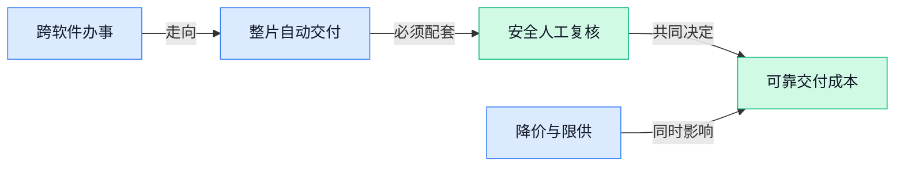

### 📊 行业洞察（今日 3 条）

1. OpenAI医疗助手开始跨软件办事，Google地图新增行程规划功能  
   【洞察】两件事说明，竞争正进入具体业务流程；只会回答问题，越来越难留住用户。

2. Google发现全自动网络攻击，OpenAI引入外部安全评估  
   【洞察】自动办事与自动作恶同步发展，安全不能只靠厂商承诺，客户也会要求可查证的防护。

3. 阿里推出低价模型，美国却将远程计算资源纳入出口审查  
   【洞察】价格下降不等于供应更稳，企业选服务商不能只比报价，还得算替换成本。

### 💭 对我们的启发（今日 3 条）

1. OpenAI医疗助手跨软件办事，提醒我们优先打通选素材、剪辑、导出；用整条视频的交付时间衡量价值，而非功能数量。

2. 今日开源项目已提供42项本地视频处理工具，基础剪辑更难卖高价；可尝试本地处理省云端费用，但须计入设备适配成本。

3. OpenAI加强儿童安全工具，提醒我们给视频素材和成片设置检查；疑似违规交人工复核，不能把自动识别当免责保证。

