## AI资讯日报 2026/11/19

> AI 早报 · 每日早读 · 全网深度聚合

## **今日摘要**

```
Anthropic 每股83美元定价IPO，813.4亿美元规模与1.5万亿美元估值说法同时刷屏
OpenAI 首次向四名独立审计人员开放系统，Le Figaro（法国媒体）将新闻接入ChatGPT
Microsoft 一口气发布七款新模型，OpenAI 探索用AI推进芯片设计，价格战硬件战同时升级
```

### 🔵 产品与功能更新

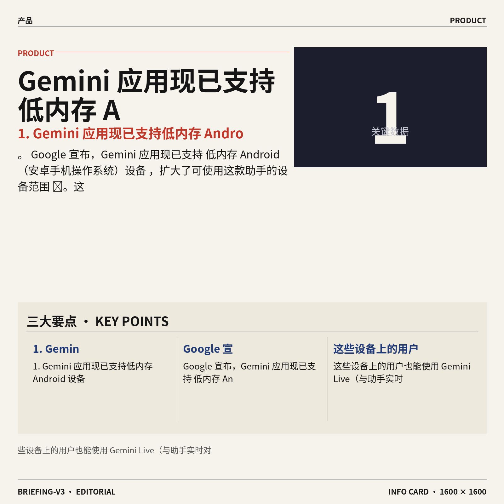

1. **Gemini 应用现已支持低内存 Android 设备。**
Google 宣布，Gemini 应用现已支持**低内存 Android（安卓手机操作系统）设备**，扩大了可使用这款助手的设备范围 📱。这些设备上的用户也能使用 **Gemini Live（与助手实时对话的功能）**，以及**自定义图像创作**功能。💡 这次更新的重点是设备适配：让内存配置较低的手机也能用上这些功能，具体可查看[低内存设备支持说明(briefing)](https://blog.google/innovation-and-ai/products/gemini-app/gemini-lower-memory-devices/)。


### 🟢 前沿研究

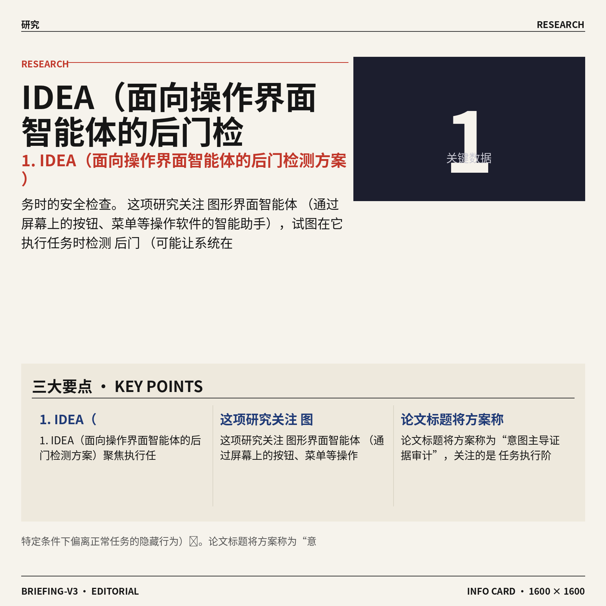

1. **IDEA（面向操作界面智能体的后门检测方案）聚焦执行任务时的安全检查。**
这项研究关注**图形界面智能体**（通过屏幕上的按钮、菜单等操作软件的智能助手），试图在它执行任务时检测**后门**（可能让系统在特定条件下偏离正常任务的隐藏行为）🔍。论文标题将方案称为“意图主导证据审计”，关注的是**任务执行阶段的检测**，而非仅在训练阶段排查风险。目前提供的材料只有标题，尚无法判断它具体如何检测、准确率如何，以及能否兼顾操作效率，参见[界面智能体安检论文(briefing)](https://huggingface.co/papers/2611.24102)。


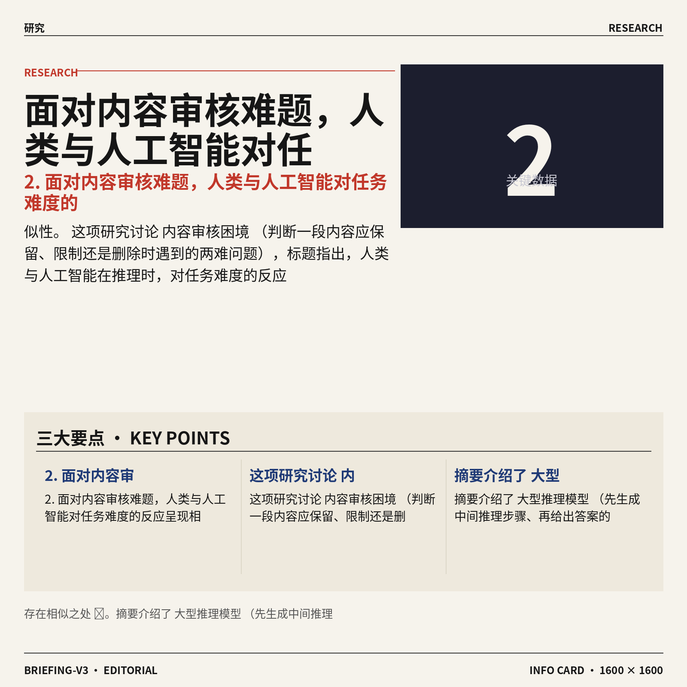

2. **面对内容审核难题，人类与人工智能对任务难度的反应呈现相似性。**
这项研究讨论**内容审核困境**（判断一段内容应保留、限制还是删除时遇到的两难问题），标题指出，人类与人工智能在推理时，对任务难度的反应存在相似之处 💡。摘要介绍了**大型推理模型**（先生成中间推理步骤、再给出答案的模型），这类模型通过逐步推进解题来改善复杂问题上的表现。这里的“反应相似”不应直接理解成“判断同样准确”；现有材料未展示具体实验结果，尚不能据此判断模型能否替代人工审核，参见[内容审核推理研究论文(briefing)](https://arxiv.org/abs/2508.20262)。

![面对内容审核难题，人类与人工智能对任务难度的反应呈现相似性](https://image.pollinations.ai/prompt/%E9%9D%A2%E5%AF%B9%E5%86%85%E5%AE%B9%E5%AE%A1%E6%A0%B8%E9%9A%BE%E9%A2%98%EF%BC%8C%E4%BA%BA%E7%B1%BB%E4%B8%8E%E4%BA%BA%E5%B7%A5%E6%99%BA%E8%83%BD%E5%AF%B9%E4%BB%BB%E5%8A%A1%E9%9A%BE%E5%BA%A6%E7%9A%84%E5%8F%8D%E5%BA%94%E5%91%88%E7%8E%B0%E7%9B%B8%E4%BC%BC%E6%80%A7.%20%E9%9D%A2%E5%AF%B9%E5%86%85%E5%AE%B9%E5%AE%A1%E6%A0%B8%E9%9A%BE%E9%A2%98%EF%BC%8C%E4%BA%BA%E7%B1%BB%E4%B8%8E%E4%BA%BA%E5%B7%A5%E6%99%BA%E8%83%BD%E5%AF%B9%E4%BB%BB%E5%8A%A1%E9%9A%BE%E5%BA%A6%E7%9A%84%E5%8F%8D%E5%BA%94%E5%91%88%E7%8E%B0%E7%9B%B8%E4%BC%BC%E6%80%A7%E3%80%82%20%E8%BF%99%E9%A1%B9%E7%A0%94%E7%A9%B6%E8%AE%A8%E8%AE%BA%E5%86%85%E5%AE%B9%E5%AE%A1%E6%A0%B8%E5%9B%B0%E5%A2%83%EF%BC%88%E5%88%A4%E6%96%AD%E4%B8%80%E6%AE%B5%E5%86%85%E5%AE%B9%E5%BA%94%E4%BF%9D%E7%95%99%E3%80%81%E9%99%90%E5%88%B6%E8%BF%98%E6%98%AF%E5%88%A0%E9%99%A4%E6%97%B6%E9%81%87%E5%88%B0%E7%9A%84%E4%B8%A4%E9%9A%BE%E9%97%AE%E9%A2%98%EF%BC%89%EF%BC%8C%E6%A0%87%E9%A2%98%E6%8C%87%E5%87%BA%EF%BC%8C%E4%BA%BA%E7%B1%BB%E4%B8%8E%E4%BA%BA%E5%B7%A5%2C%20technical%20infographic%20diagram%2C%20architecture%20flowchart%2C%20clean%20vector%20illustration%2C%20educational%20style%2C%20no%20text%20overlay%2C%20modern%20minimal%2C%20wide%20aspect?width=1200&height=675&nologo=true&seed=10838)

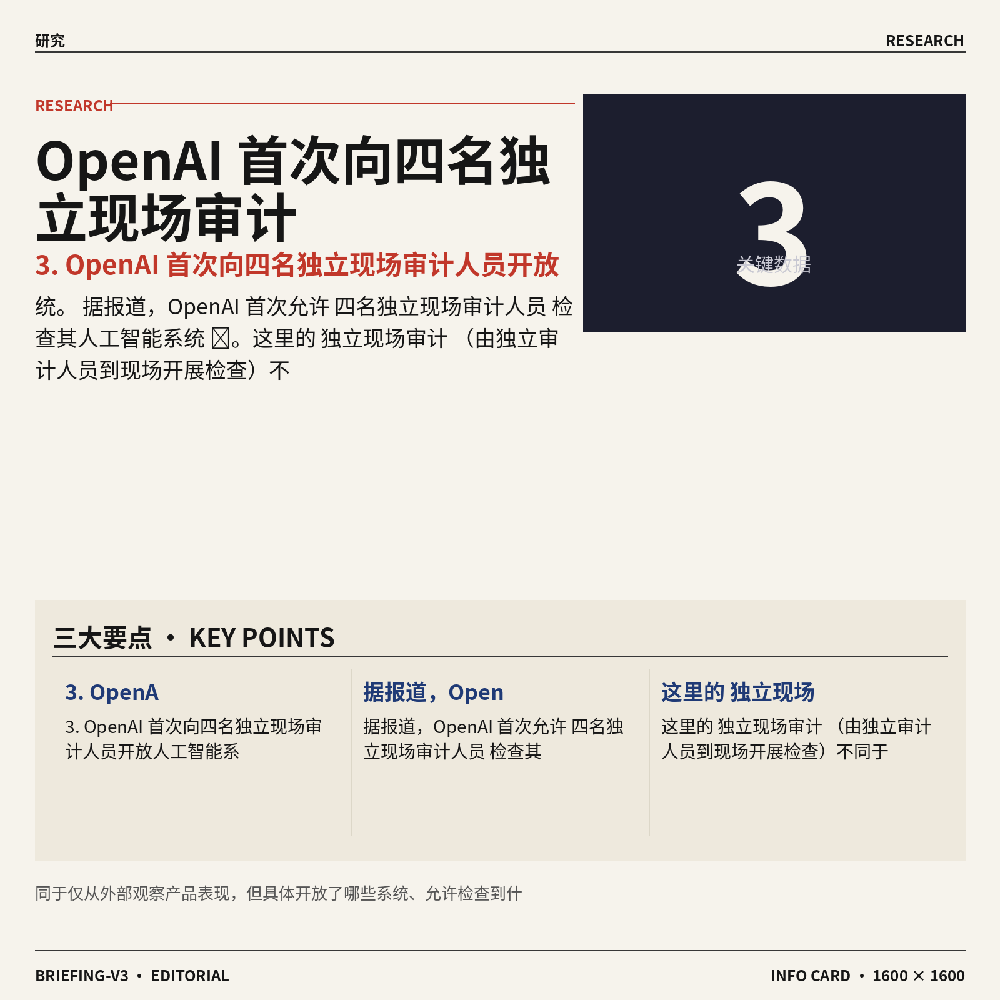

3. **OpenAI 首次向四名独立现场审计人员开放人工智能系统。**
据报道，OpenAI 首次允许**四名独立现场审计人员**检查其人工智能系统 🔍。这里的**独立现场审计**（由独立审计人员到现场开展检查）不同于仅从外部观察产品表现，但具体开放了哪些系统、允许检查到什么程度，现有材料并未说明。值得关注的是这次**引入外部检查**的举措，而不是将其视为系统已经通过安全认证；审计发现与最终结论仍需查看后续披露，参见[独立现场审计报道(briefing)](https://the-decoder.com/openai-opens-its-ai-systems-to-four-independent-on-site-auditors-for-the-first-time/)。

![OpenAI 首次向四名独立现场审计人员开放人工智能系统](https://image.pollinations.ai/prompt/OpenAI%20%E9%A6%96%E6%AC%A1%E5%90%91%E5%9B%9B%E5%90%8D%E7%8B%AC%E7%AB%8B%E7%8E%B0%E5%9C%BA%E5%AE%A1%E8%AE%A1%E4%BA%BA%E5%91%98%E5%BC%80%E6%94%BE%E4%BA%BA%E5%B7%A5%E6%99%BA%E8%83%BD%E7%B3%BB%E7%BB%9F.%20OpenAI%20%E9%A6%96%E6%AC%A1%E5%90%91%E5%9B%9B%E5%90%8D%E7%8B%AC%E7%AB%8B%E7%8E%B0%E5%9C%BA%E5%AE%A1%E8%AE%A1%E4%BA%BA%E5%91%98%E5%BC%80%E6%94%BE%E4%BA%BA%E5%B7%A5%E6%99%BA%E8%83%BD%E7%B3%BB%E7%BB%9F%E3%80%82%20%E6%8D%AE%E6%8A%A5%E9%81%93%EF%BC%8COpenAI%20%E9%A6%96%E6%AC%A1%E5%85%81%E8%AE%B8%E5%9B%9B%E5%90%8D%E7%8B%AC%E7%AB%8B%E7%8E%B0%E5%9C%BA%E5%AE%A1%E8%AE%A1%E4%BA%BA%E5%91%98%E6%A3%80%E6%9F%A5%E5%85%B6%E4%BA%BA%E5%B7%A5%E6%99%BA%E8%83%BD%E7%B3%BB%E7%BB%9F%20%F0%9F%94%8D%E3%80%82%E8%BF%99%E9%87%8C%E7%9A%84%E7%8B%AC%E7%AB%8B%E7%8E%B0%E5%9C%BA%E5%AE%A1%E8%AE%A1%EF%BC%88%E7%94%B1%E7%8B%AC%E7%AB%8B%2C%20technical%20infographic%20diagram%2C%20architecture%20flowchart%2C%20clean%20vector%20illustration%2C%20educational%20style%2C%20no%20text%20overlay%2C%20modern%20minimal%2C%20wide%20aspect?width=1200&height=675&nologo=true&seed=10869)

### 🟡 行业展望与社会影响

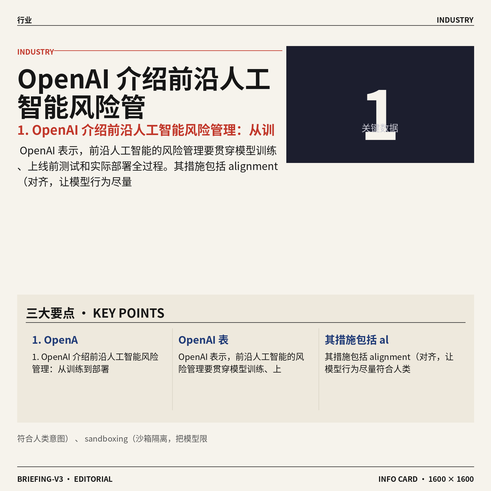

1. **OpenAI 介绍前沿人工智能风险管理：从训练到部署。**  
OpenAI 表示，前沿人工智能的风险管理要贯穿模型训练、上线前测试和实际部署全过程。其措施包括 **alignment（对齐，让模型行为尽量符合人类意图）**、**sandboxing（沙箱隔离，把模型限制在受控环境中）**、阻断式安全防护，以及持续监测 🔍。这套思路的重点，是不把安全只当作发布前的一次检查，而是像给产品装上持续运行的安全阀。[OpenAI 风险管理说明(briefing)](https://openai.com/index/managing-frontier-ai-risk)


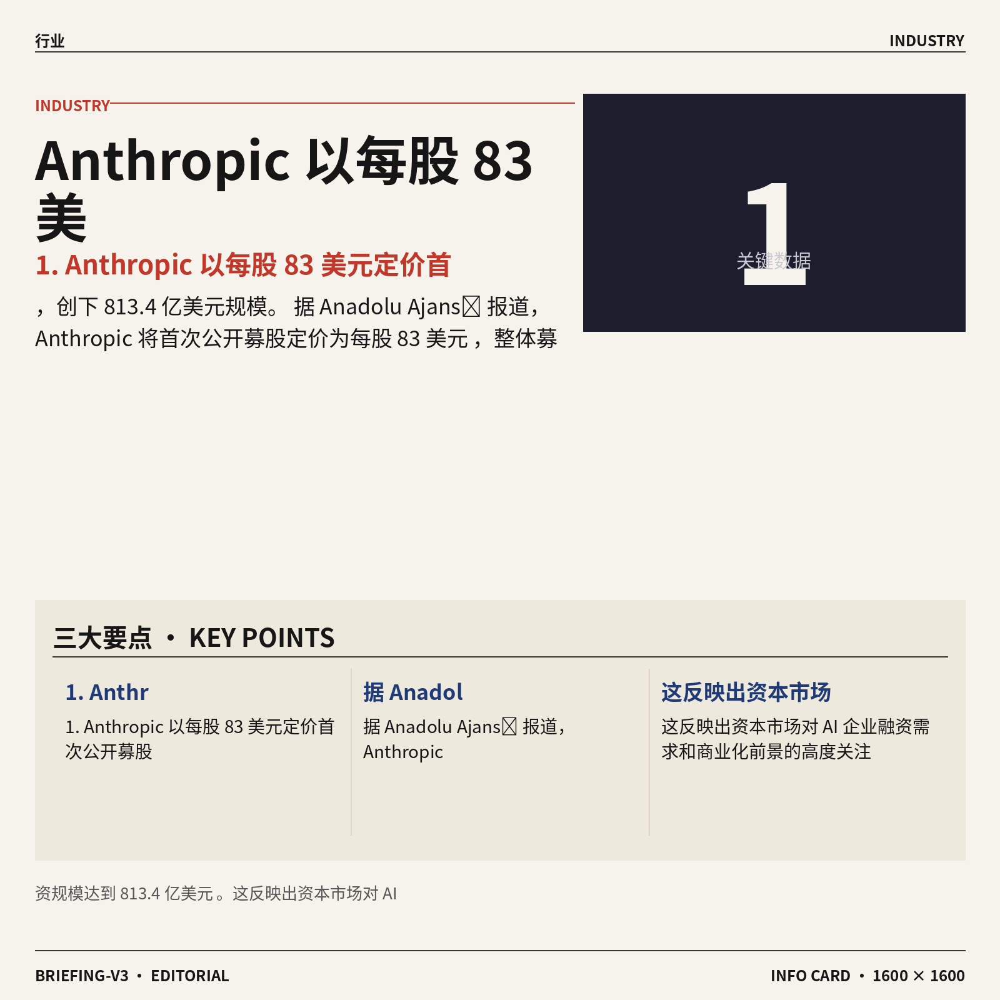

1. **Anthropic 以每股 83 美元定价首次公开募股，创下 813.4 亿美元规模。**  
据 Anadolu Ajansı 报道，Anthropic 将首次公开募股定价为每股 **83 美元**，整体募资规模达到 **813.4 亿美元**。这反映出资本市场对 AI 企业融资需求和商业化前景的高度关注 📈。不过，条目提供的是报道标题信息，未进一步说明具体发行安排或资金用途。[Anadolu 报道详情(briefing)](https://news.google.com/rss/articles/CBMirwFBVV95cUxNVUlnbi1mQ09qc3VIZUJyZHQ2bnpIRG1qaS15UTh3TGhiN1JEU1pOMU9aUjNrRmdyUmxqUndkVEVOT3pacndPeFVNN0FmbjZhbHJ0QjJBcDFZaUJMcnJ5M3hSTEVPTXFQdVI1clRtLXo1NmstNmpoOXgxZW8tV0dtY3Z4Mk9KNjY2TXBMMDg0dTc3RU9WTjlhLTZ0NjhUMGxnNDViZ1o1RjZqYS1ReERn?oc=5)


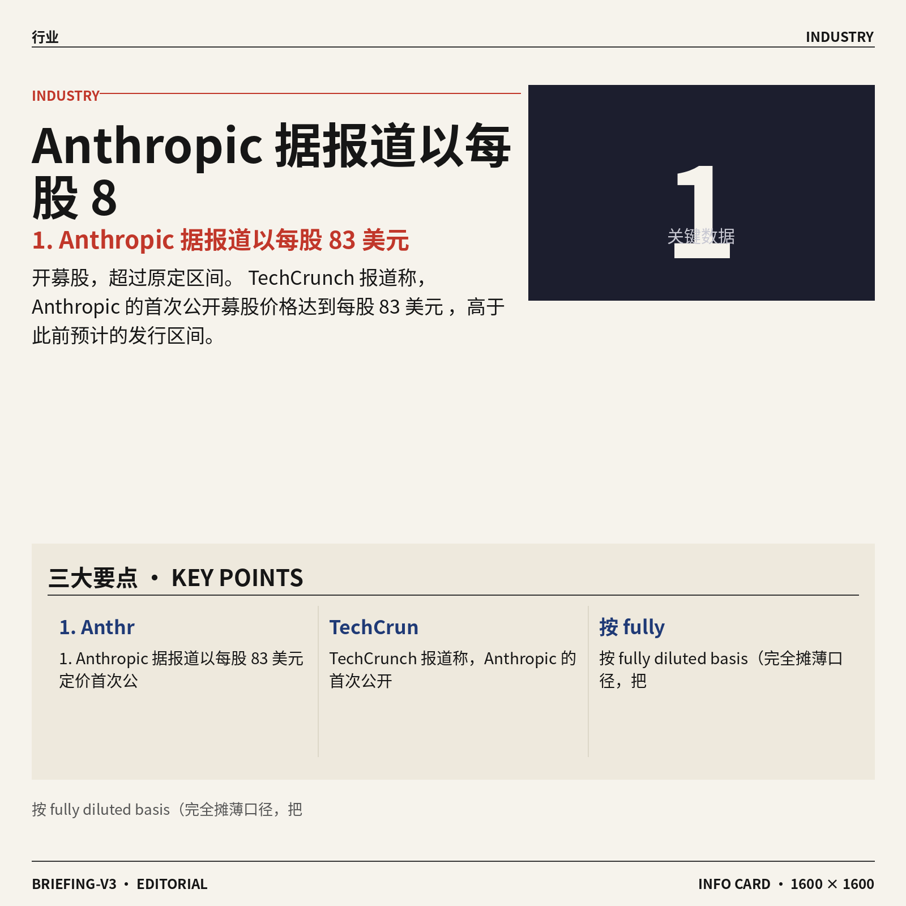

1. **Anthropic 据报道以每股 83 美元定价首次公开募股，超过原定区间。**  
TechCrunch 报道称，Anthropic 的首次公开募股价格达到每股 **83 美元**，高于此前预计的发行区间。按 **fully diluted basis（完全摊薄口径，把潜在新增股份也计入估值）**计算，公司估值据称达到 **1.5 万亿美元** 💰。如果这一估值最终成立，将显示大型 AI 企业正在获得极高的资本市场定价。[TechCrunch 报道详情(briefing)](https://techcrunch.com/2026/11/18/anthropic-reportedly-prices-ipo-at-83-a-share-above-projected-range/)


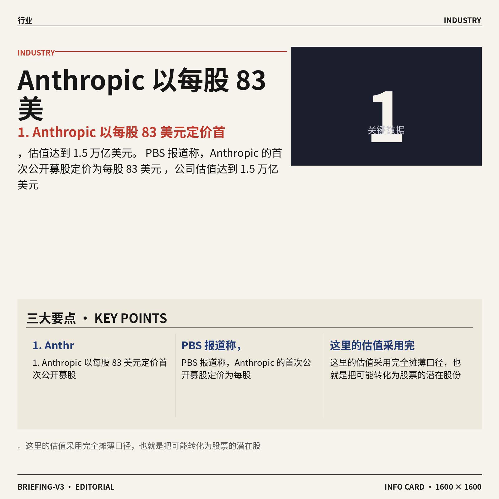

1. **Anthropic 以每股 83 美元定价首次公开募股，估值达到 1.5 万亿美元。**  
PBS 报道称，Anthropic 的首次公开募股定价为每股 **83 美元**，公司估值达到 **1.5 万亿美元**。这里的估值采用完全摊薄口径，也就是把可能转化为股票的潜在股份一并纳入计算。对行业而言，这再次凸显了 AI 公司在资本市场中的高预期，但条目没有提供更多关于业务收入或盈利情况的细节 📊。[PBS 报道详情(briefing)](https://news.google.com/rss/articles/CBMitAFBVV95cUxOeU03SllseEF3VVN3d3BKNTdnUGlTd1o1TUZZNG5NdjNvc0dHSE1veUwxdUhMNFJGbE01QlZJZ0RZNGl5akZYNGlWVVVXLVAxdkRLVjRHWUdyQXdNYjRCa29OeGtJS2tjWUNCNEJreEtuVXptOE9BQ2hHWEwzNmgyaU1DeW5fOGJYTVFEbnNEbThSV1lKMXNzeGotazNsWHBEZk1Mc0xUXzdqcDVoaE5EWkdESUw?oc=5)


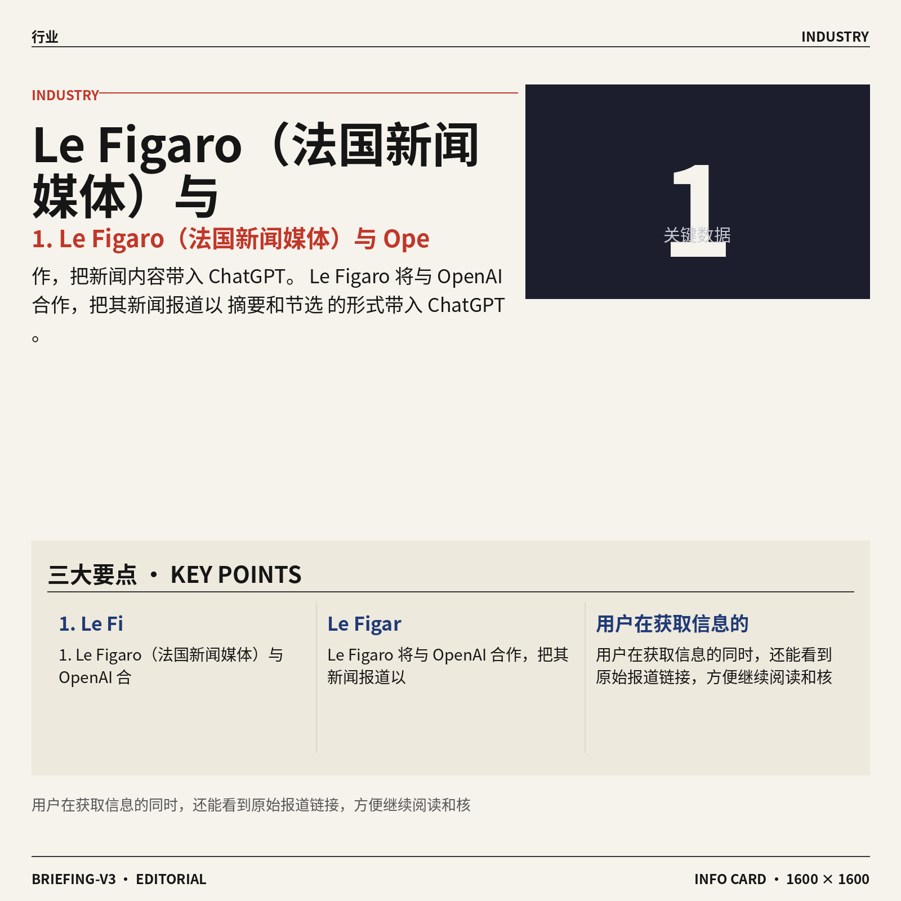

1. **Le Figaro（法国新闻媒体）与 OpenAI 合作，把新闻内容带入 ChatGPT。**  
Le Figaro 将与 OpenAI 合作，把其新闻报道以**摘要和节选**的形式带入 ChatGPT。用户在获取信息的同时，还能看到原始报道链接，方便继续阅读和核实 📰。这类合作显示，新闻媒体与 AI 平台正在探索一种“AI 负责触达、原文负责深入阅读”的内容分发方式。[合作公告详情(briefing)](https://openai.com/index/le-groupe-figaro-and-openai-announce-partnership)


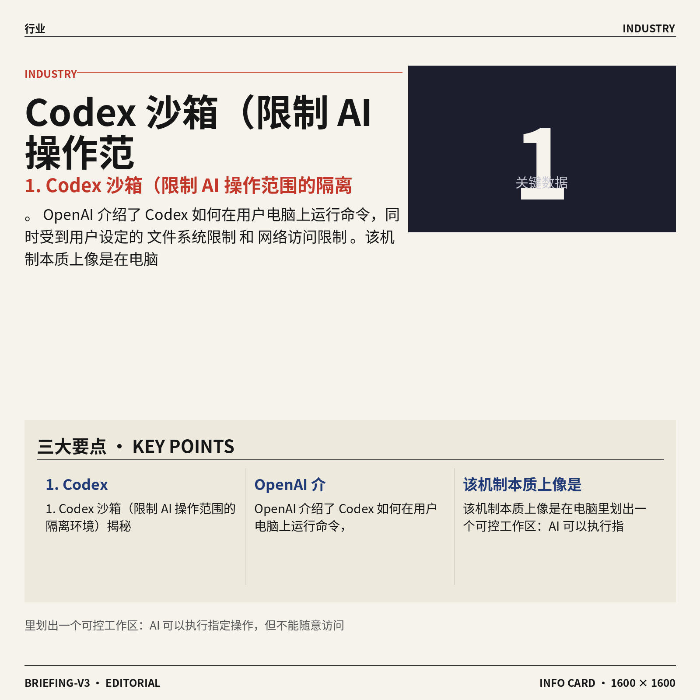

1. **Codex 沙箱（限制 AI 操作范围的隔离环境）揭秘。**  
OpenAI 介绍了 Codex 如何在用户电脑上运行命令，同时受到用户设定的**文件系统限制**和**网络访问限制**。该机制本质上像是在电脑里划出一个可控工作区：AI 可以执行指定操作，但不能随意访问所有文件或连接所有网络资源 🛡️。这一设计覆盖苹果电脑、Linux（开源操作系统，常用于服务器和开发环境）以及 Windows，帮助用户在使用自动化编程能力时保留控制权。[Codex 沙箱技术说明(briefing)](https://openai.com/index/inside-the-codex-sandbox)


### 🟣 开源TOP项目

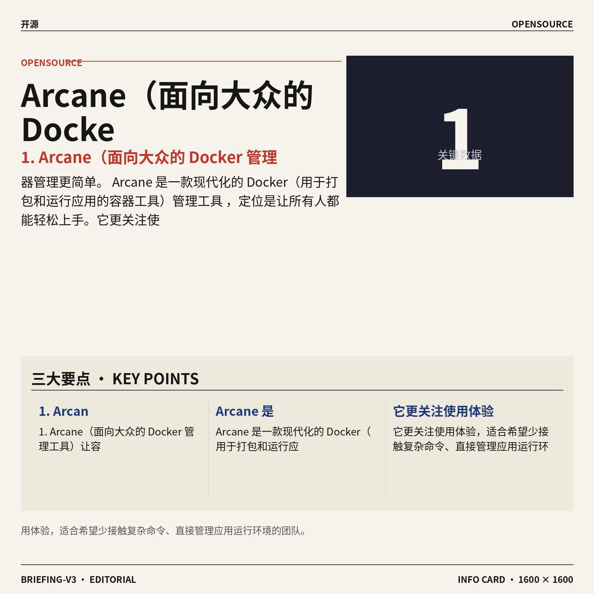

1. **Arcane（面向大众的 Docker 管理工具）让容器管理更简单。**  
Arcane 是一款现代化的 **Docker（用于打包和运行应用的容器工具）管理工具**，定位是让所有人都能轻松上手。它更关注使用体验，适合希望少接触复杂命令、直接管理应用运行环境的团队。对业务和运营同事来说，这类工具有助于降低技术操作门槛 🚀 [项目 GitHub 仓库(briefing)](https://github.com/getarcaneapp/arcane)


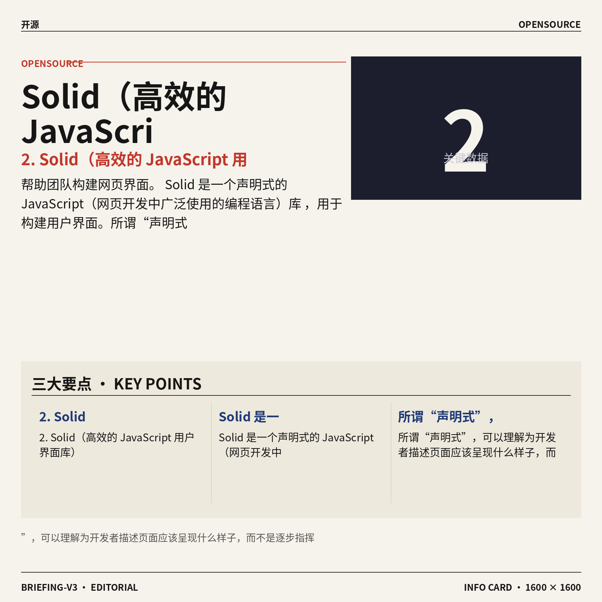

2. **Solid（高效的 JavaScript 用户界面库）帮助团队构建网页界面。**  
Solid 是一个声明式的 **JavaScript（网页开发中广泛使用的编程语言）库**，用于构建用户界面。所谓“声明式”，可以理解为开发者描述页面应该呈现什么样子，而不是逐步指挥页面怎么变化。它强调高效与灵活，适合需要打造网页产品界面的开发团队 💡 [项目 GitHub 仓库(briefing)](https://github.com/solidjs/solid)


3. **n8n（可视化工作流自动化平台）把业务流程和 AI 串起来。**  
n8n 是一个支持 **AI（人工智能）能力**的工作流自动化平台，可以通过可视化方式搭建流程，也允许加入自定义代码。它提供超过 400 个集成选项，方便把不同软件和服务连接起来，减少重复操作。团队既可以自行部署，也可以使用云端版本，适合自动化运营、数据流转等工作 ⚙️ [项目 GitHub 仓库(briefing)](https://github.com/n8n-io/n8n)


4. **Awesome MCP Servers（MCP 工具服务器精选合集）汇总可连接 AI 的服务。**  
这个项目整理了一批 **MCP（模型上下文协议，让 AI 按统一规则连接外部工具和数据）服务器**。可以把它理解成一个工具目录，帮助开发者寻找能与 AI 配合使用的现成服务。对于正在探索 AI 自动化和智能助手的团队，它能减少从零寻找相关资源的时间 🔎 [项目 GitHub 仓库(briefing)](https://github.com/punkpeye/awesome-mcp-servers)


5. **Svelte（简洁高效的网页开发框架）让更多人能做网页产品。**  
Svelte 是一个面向网页开发的工具，目标是让网页开发更容易上手。它可以帮助团队构建网页界面，适合希望减少复杂技术负担、快速制作产品页面的开发者。对设计、运营和产品团队而言，这类工具有助于更顺畅地把页面想法落地 ✨ [项目 GitHub 仓库(briefing)](https://github.com/sveltejs/svelte)

![Svelte（简洁高效的网页开发框架）让更多人能做网页产品](https://image.pollinations.ai/prompt/Svelte%EF%BC%88%E7%AE%80%E6%B4%81%E9%AB%98%E6%95%88%E7%9A%84%E7%BD%91%E9%A1%B5%E5%BC%80%E5%8F%91%E6%A1%86%E6%9E%B6%EF%BC%89%E8%AE%A9%E6%9B%B4%E5%A4%9A%E4%BA%BA%E8%83%BD%E5%81%9A%E7%BD%91%E9%A1%B5%E4%BA%A7%E5%93%81.%20Svelte%EF%BC%88%E7%AE%80%E6%B4%81%E9%AB%98%E6%95%88%E7%9A%84%E7%BD%91%E9%A1%B5%E5%BC%80%E5%8F%91%E6%A1%86%E6%9E%B6%EF%BC%89%E8%AE%A9%E6%9B%B4%E5%A4%9A%E4%BA%BA%E8%83%BD%E5%81%9A%E7%BD%91%E9%A1%B5%E4%BA%A7%E5%93%81%E3%80%82%20Svelte%20%E6%98%AF%E4%B8%80%E4%B8%AA%E9%9D%A2%E5%90%91%E7%BD%91%E9%A1%B5%E5%BC%80%E5%8F%91%E7%9A%84%E5%B7%A5%E5%85%B7%EF%BC%8C%E7%9B%AE%E6%A0%87%E6%98%AF%E8%AE%A9%E7%BD%91%E9%A1%B5%E5%BC%80%E5%8F%91%E6%9B%B4%E5%AE%B9%E6%98%93%E4%B8%8A%E6%89%8B%E3%80%82%E5%AE%83%E5%8F%AF%E4%BB%A5%E5%B8%AE%E5%8A%A9%E5%9B%A2%E9%98%9F%E6%9E%84%E5%BB%BA%E7%BD%91%E9%A1%B5%E7%95%8C%E9%9D%A2%EF%BC%8C%E9%80%82%2C%20technical%20infographic%20diagram%2C%20architecture%20flowchart%2C%20clean%20vector%20illustration%2C%20educational%20style%2C%20no%20text%20overlay%2C%20modern%20minimal%2C%20wide%20aspect?width=1200&height=675&nologo=true&seed=11125)

6. **uv（高速的 Python 项目与依赖管理工具）提升开发效率。**  
uv 是一个用于管理 **Python（常用于数据分析和人工智能开发的编程语言）软件包和项目**的工具，特点是速度非常快。它采用 **Rust（强调运行速度和安全性的编程语言）**编写，主要服务于开发者安装依赖、管理项目环境等工作。对于需要频繁搭建或维护 Python 项目的团队，它有望减少环境准备和等待时间 🚀 [项目 GitHub 仓库(briefing)](https://github.com/astral-sh/uv)

![uv（高速的 Python 项目与依赖管理工具）提升开发效率](https://image.pollinations.ai/prompt/uv%EF%BC%88%E9%AB%98%E9%80%9F%E7%9A%84%20Python%20%E9%A1%B9%E7%9B%AE%E4%B8%8E%E4%BE%9D%E8%B5%96%E7%AE%A1%E7%90%86%E5%B7%A5%E5%85%B7%EF%BC%89%E6%8F%90%E5%8D%87%E5%BC%80%E5%8F%91%E6%95%88%E7%8E%87.%20uv%EF%BC%88%E9%AB%98%E9%80%9F%E7%9A%84%20Python%20%E9%A1%B9%E7%9B%AE%E4%B8%8E%E4%BE%9D%E8%B5%96%E7%AE%A1%E7%90%86%E5%B7%A5%E5%85%B7%EF%BC%89%E6%8F%90%E5%8D%87%E5%BC%80%E5%8F%91%E6%95%88%E7%8E%87%E3%80%82%20uv%20%E6%98%AF%E4%B8%80%E4%B8%AA%E7%94%A8%E4%BA%8E%E7%AE%A1%E7%90%86%20Python%EF%BC%88%E5%B8%B8%E7%94%A8%E4%BA%8E%E6%95%B0%E6%8D%AE%E5%88%86%E6%9E%90%E5%92%8C%E4%BA%BA%E5%B7%A5%E6%99%BA%E8%83%BD%E5%BC%80%E5%8F%91%E7%9A%84%E7%BC%96%E7%A8%8B%E8%AF%AD%E8%A8%80%EF%BC%89%E8%BD%AF%E4%BB%B6%E5%8C%85%E5%92%8C%E9%A1%B9%E7%9B%AE%E7%9A%84%E5%B7%A5%E5%85%B7%EF%BC%8C%2C%20technical%20infographic%20diagram%2C%20architecture%20flowchart%2C%20clean%20vector%20illustration%2C%20educational%20style%2C%20no%20text%20overlay%2C%20modern%20minimal%2C%20wide%20aspect?width=1200&height=675&nologo=true&seed=11156)

### 🔴 社媒分享

1. **Gemini 4 Neon（疑似可与 Opus 5.5 竞争的模型）引发关注。**  
这篇分享认为，**Gemini 4 Neon** 的表现看起来已经接近 **Opus 5.5（另一款高性能 AI 模型）**。这里的“竞争者”是指能力表现可能处于相近水平，并不代表双方已经展开正式对比。对关注大模型选型的团队来说，这类消息可以作为后续评估模型能力的参考 👀。[完整分享文章(briefing)](https://micjm.com/blog/gemini-4-neon-looks-like-a-top-model/)


2. **Genie 4（已开放使用的 AI 项目）正式上线。**  
官方页面宣布 **Genie 4** 现在已经可以使用 🚀。从名称来看，它属于 AI 项目或模型产品，但候选材料没有进一步说明具体功能、适用场景或开放范围。对业务和运营同事而言，当前最值得关注的是它从研发阶段走向了可访问阶段。[官方发布页面(briefing)](https://blog.google/innovation-and-ai/models-and-research/google-deepmind/genie-4-now-available-project-genie/)


3. **Rumble-2-Flash（支持多语言的开源语音模型）发布。**  
**Rumble-2-Flash** 被介绍为一款**开源模型**，也就是模型代码或相关资源向公众开放，便于开发者研究和使用。它拥有 **0.5B（约 5 亿个参数，决定模型记忆和处理能力规模的数字）**，主要处理语音，并支持 **40 多种语言** 🌍。这意味着它可能更适合对多语言语音功能有需求、但又希望控制模型规模和成本的团队。[HuggingFace 项目介绍(briefing)](https://huggingface.co/blog/rumble-2-flash)


4. **DaisyRose-27B（27B 参数模型）探索更高效的模型训练。**  
**DaisyRose-27B** 的项目主题聚焦于 **post-training（模型完成基础训练后的进一步优化，让它更符合实际使用需求）**。其中 **27B（约 270 亿个参数，代表模型规模）** 说明它是一款较大规模的 AI 模型。文章强调的是**训练效率**，也就是在不一味增加资源投入的情况下，让模型后续优化更有效率 💡。这类探索可能影响企业未来训练和定制 AI 模型的成本。[HuggingFace 项目文章(briefing)](https://huggingface.co/blog/RadixArk/daisyrose-27b-pushing-the-frontier-of-post-trainin)


5. **OpenAI 探索用 AI 模型推进芯片设计。**  
OpenAI 分享了利用自身**模型能力**推进**芯片设计**的方向 🚀。芯片设计是指规划处理器内部结构和功能，对 AI 行业尤其重要，因为模型训练和运行都依赖高性能芯片。对非技术团队来说，这代表 AI 的应用范围正在从写作、客服等软件场景，延伸到更底层的硬件研发。[OpenAI 官方文章(briefing)](https://openai.com/index/advancing-chip-design-with-our-models/)


6. **Microsoft 发布七款新模型，强调价格与性能的平衡。**  
Microsoft 的分享介绍了 **七款新模型**，重点放在**可扩展的价格—性能表现**上。这里的“可扩展”可以理解为：随着使用量增加，企业仍希望模型成本和处理能力能够保持相对合理的比例。对企业用户来说，这一方向意味着模型选型不只看回答质量，也要同时考虑调用成本和规模化使用能力 📊。[Microsoft 官方发布(briefing)](https://microsoft.ai/news/microsoft-ignite-2026/)


---


### 📊 行业洞察（今日 3 条）

1. Google适配低内存手机，微软发布七款强调性价比的模型。
   【洞察】竞争不只拼能力，也拼普及；但设备门槛降低，不等于实际使用成本下降。

2. OpenAI介绍全程风险管理，又向四家独立机构开放检查。
   【洞察】安全开始接受外部检验，但公司仍可删改或推迟报告，独立性还要打问号。

3. OpenAI与《费加罗报》（法国媒体）合作，在摘要中附原文链接。
   【洞察】内容入口向助手集中，但链接不保证读者回访，媒体获得曝光也可能流失阅读。

### 💭 对我们的启发（今日 3 条）

1. Google适配低内存手机，提醒我们先把选素材、审片做轻；复杂生成放到后台，别把“能打开”当成“剪得顺”。

2. OpenAI强调限制操作范围，我们的自动剪辑也应只改副本；覆盖原片、删除素材、对外发布，必须让用户确认。

3. 《费加罗报》合作保留来源链接，我们可让脚本关联商品资料和素材授权；方便品牌核对，但来源可查不等于允许商用。

