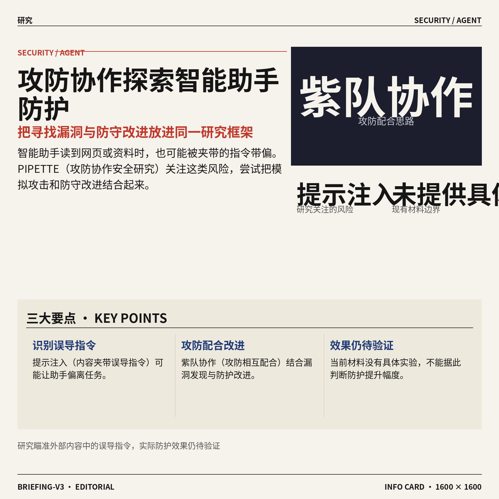
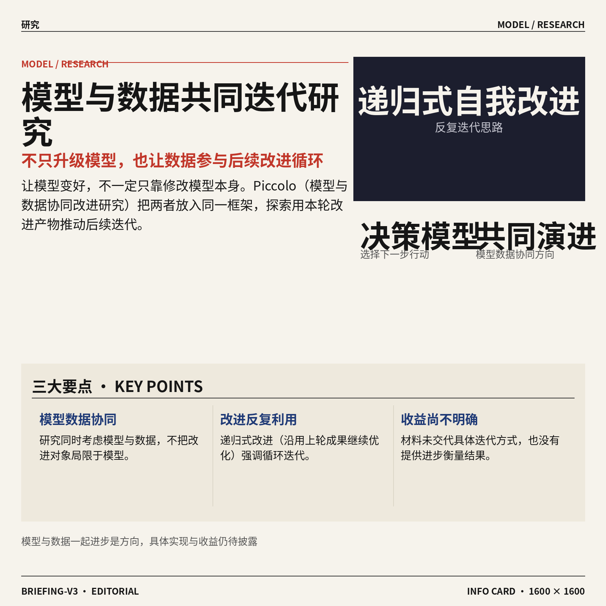
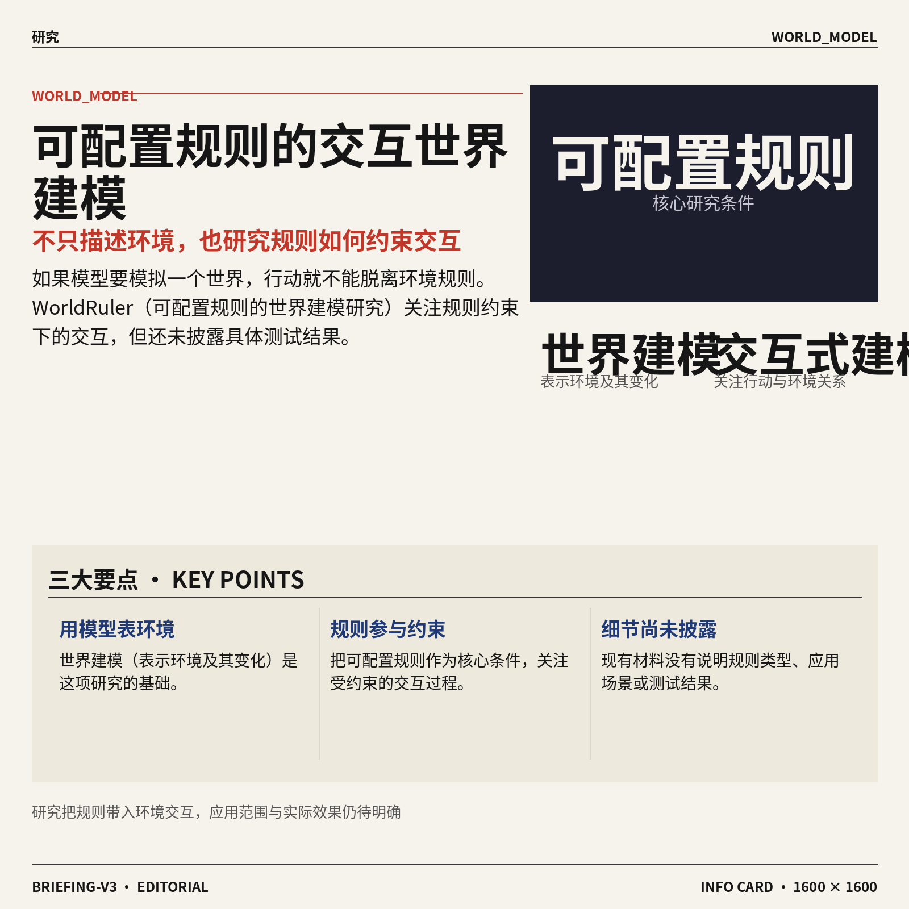
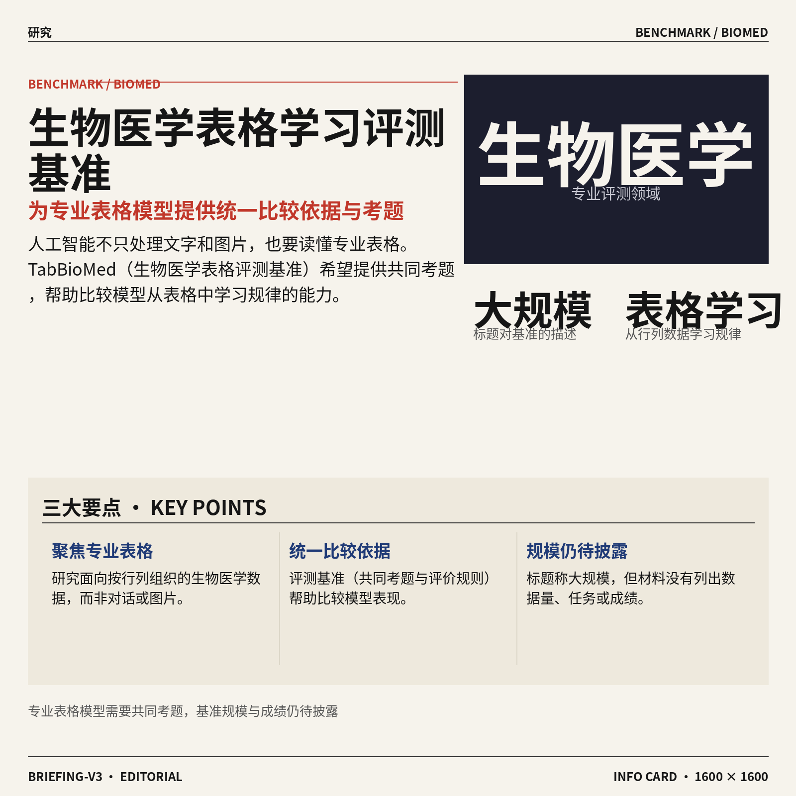
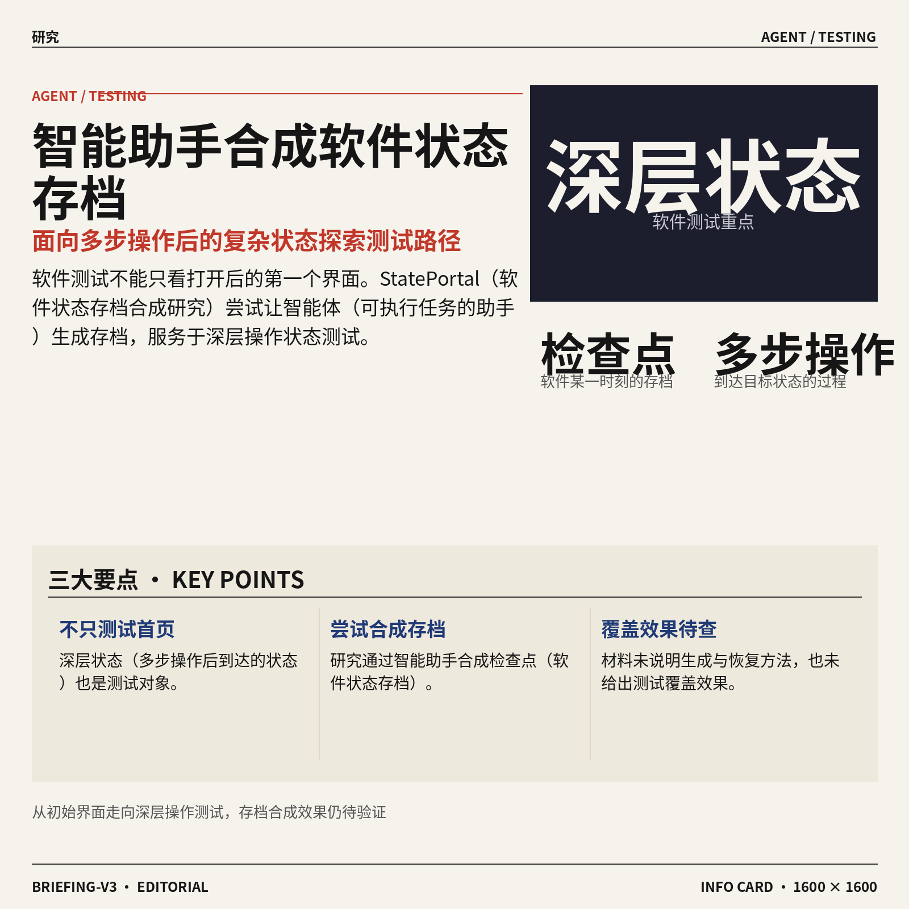
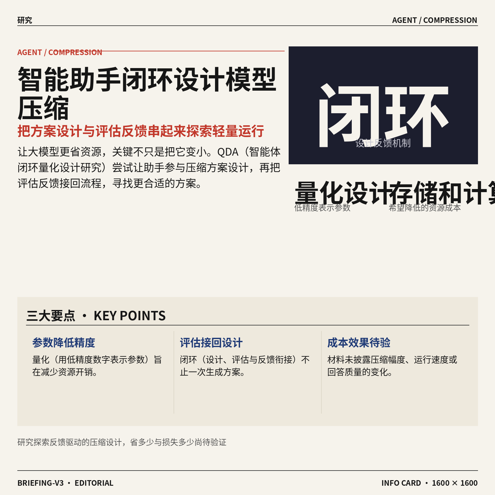
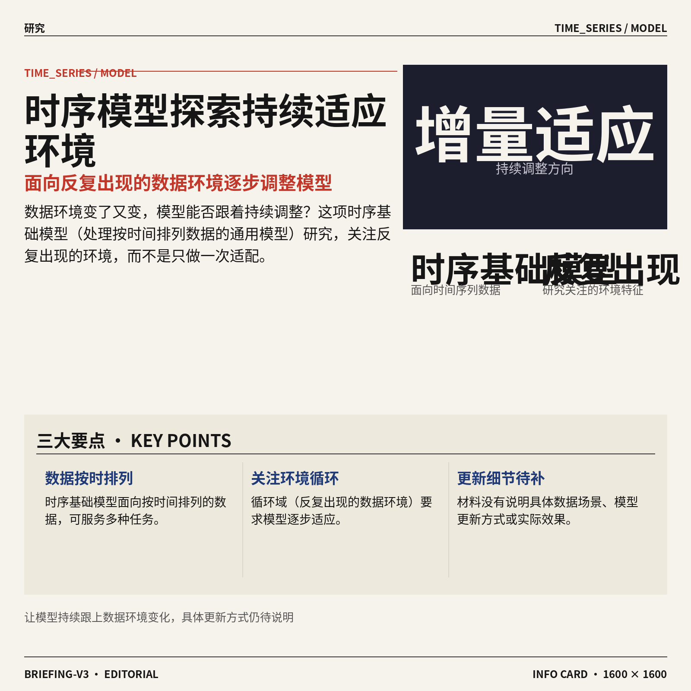
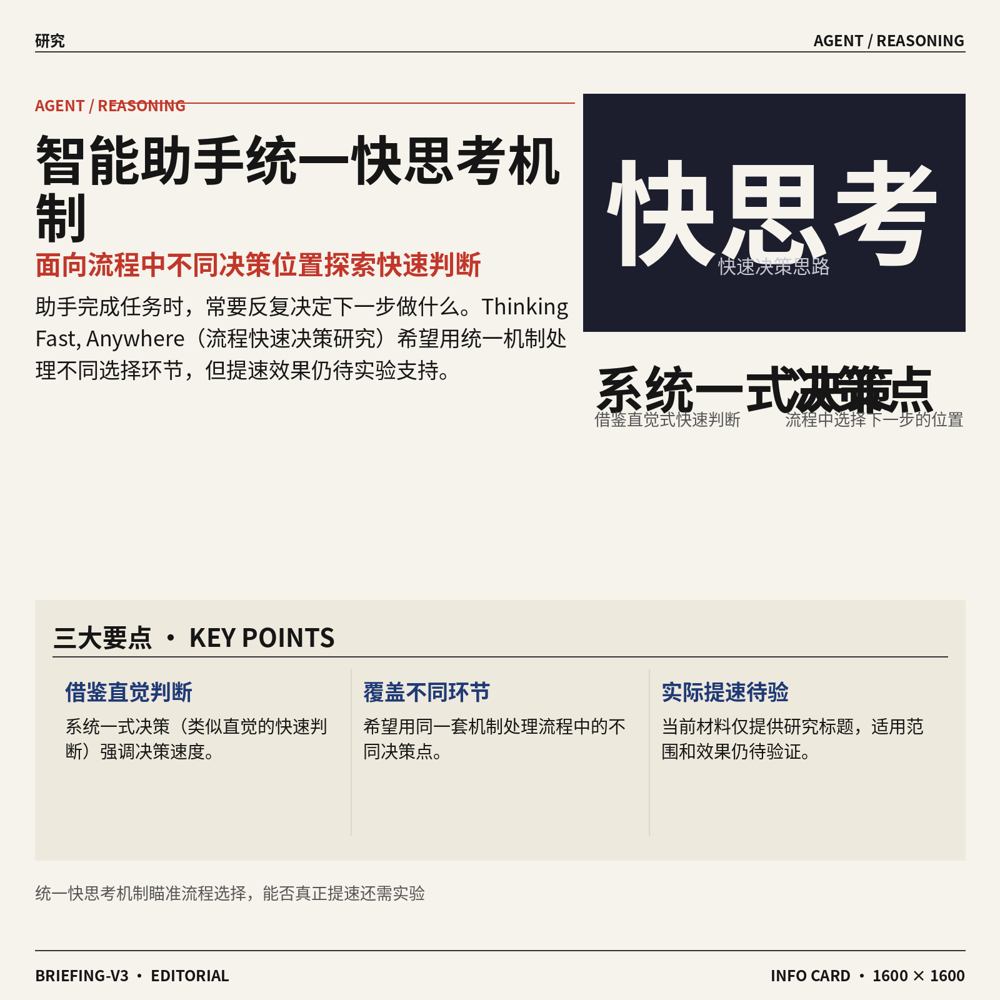
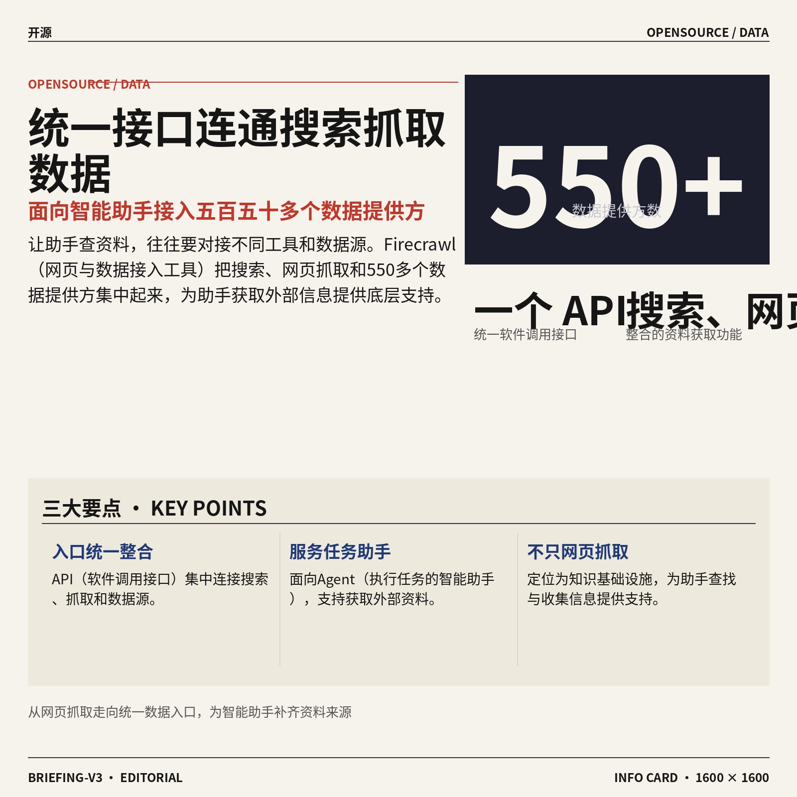

## AI资讯日报 2026/11/20

> AI 早报 · 每日早读 · 全网深度聚合

## **今日摘要**

```
Anthropic上市首日高开约三成，单次募资规模超过800亿美元
Claude连解两项黑洞物理开放问题，AI助手把战场推向基础科学
Firecrawl（智能体数据接入工具）一个接口连接搜索抓取，接通550多个数据提供方
```

### 🔵 产品与功能更新


1. **Gemini 应用支持低内存 Android 设备，更多手机也能用上智能助手。**
Google 宣布，Gemini 应用现已支持**内存较小的安卓设备**，扩大了可使用这款助手的手机范围 📱。用户可以使用 **Gemini Live（实时对话功能）**，也能体验**自定义图片生成（按用户要求创作图片）**。这次更新的重点是**降低设备内存门槛**，让上述功能覆盖更多设备，详见[低内存设备支持公告(briefing)](https://blog.google/innovation-and-ai/products/gemini-app/gemini-lower-memory-devices/)。


### 🟢 前沿研究



1. **PIPETTE（通过攻防协作增强智能体安全性的研究）聚焦提示注入防护。**
这项研究关注**提示注入**（把误导性指令混入模型接触的内容，诱导它偏离原本任务），目标是让大模型智能体更可靠地执行任务 🛡️。标题提出采用**紫队协作**（让模拟攻击与防守改进相互配合），把寻找漏洞与增强防护结合起来。当前材料未提供具体实验或防护效果，研究方向可参见[提示注入防护研究(briefing)](https://huggingface.co/papers/2611.24362)。




2. **Piccolo（让决策模型与数据共同改进的研究）探索递归式自我提升。**
这项研究把**决策模型**（根据已有信息选择下一步行动的模型）与数据放在同一个改进框架中，而不是只关注模型一方 🔄。标题中的**递归式自我改进**（将一轮改进的产物用于后续改进，形成反复迭代）强调两者共同演进的思路。所给材料未说明迭代如何开展、怎样衡量进步，暂不能据此判断实际收益，参见[模型数据协同改进研究(briefing)](https://huggingface.co/papers/2611.24651)。

![Piccolo（让决策模型与数据共同改进的研究）探索递归式自我提升](https://image.pollinations.ai/prompt/Piccolo%EF%BC%88%E8%AE%A9%E5%86%B3%E7%AD%96%E6%A8%A1%E5%9E%8B%E4%B8%8E%E6%95%B0%E6%8D%AE%E5%85%B1%E5%90%8C%E6%94%B9%E8%BF%9B%E7%9A%84%E7%A0%94%E7%A9%B6%EF%BC%89%E6%8E%A2%E7%B4%A2%E9%80%92%E5%BD%92%E5%BC%8F%E8%87%AA%E6%88%91%E6%8F%90%E5%8D%87.%20Piccolo%EF%BC%88%E8%AE%A9%E5%86%B3%E7%AD%96%E6%A8%A1%E5%9E%8B%E4%B8%8E%E6%95%B0%E6%8D%AE%E5%85%B1%E5%90%8C%E6%94%B9%E8%BF%9B%E7%9A%84%E7%A0%94%E7%A9%B6%EF%BC%89%E6%8E%A2%E7%B4%A2%E9%80%92%E5%BD%92%E5%BC%8F%E8%87%AA%E6%88%91%E6%8F%90%E5%8D%87%E3%80%82%20%E8%BF%99%E9%A1%B9%E7%A0%94%E7%A9%B6%E6%8A%8A%E5%86%B3%E7%AD%96%E6%A8%A1%E5%9E%8B%EF%BC%88%E6%A0%B9%E6%8D%AE%E5%B7%B2%E6%9C%89%E4%BF%A1%E6%81%AF%E9%80%89%E6%8B%A9%E4%B8%8B%E4%B8%80%E6%AD%A5%E8%A1%8C%E5%8A%A8%E7%9A%84%E6%A8%A1%E5%9E%8B%EF%BC%89%E4%B8%8E%E6%95%B0%E6%8D%AE%E6%94%BE%E5%9C%A8%E5%90%8C%E4%B8%80%E4%B8%AA%E6%94%B9%E8%BF%9B%E6%A1%86%E6%9E%B6%E4%B8%AD%EF%BC%8C%E8%80%8C%E4%B8%8D%E6%98%AF%E5%8F%AA%2C%20technical%20infographic%20diagram%2C%20architecture%20flowchart%2C%20clean%20vector%20illustration%2C%20educational%20style%2C%20no%20text%20overlay%2C%20modern%20minimal%2C%20wide%20aspect?width=1200&height=675&nologo=true&seed=10838)



3. **WorldRuler（支持自定义规则的交互式世界建模研究）关注规则如何约束环境。**
这项研究聚焦**世界建模**（用模型表示环境及其变化），并把可配置规则作为核心条件 🌍。标题还强调**交互式建模**（不仅描述环境，也考虑行动与环境变化之间的关系），关注点是有规则约束的交互过程。当前材料没有披露规则类型、应用场景或测试结果，可通过[可配置规则世界建模研究(briefing)](https://huggingface.co/papers/2611.24869)了解论文信息。

![WorldRuler（支持自定义规则的交互式世界建模研究）关注规则如何约束环境](https://image.pollinations.ai/prompt/WorldRuler%EF%BC%88%E6%94%AF%E6%8C%81%E8%87%AA%E5%AE%9A%E4%B9%89%E8%A7%84%E5%88%99%E7%9A%84%E4%BA%A4%E4%BA%92%E5%BC%8F%E4%B8%96%E7%95%8C%E5%BB%BA%E6%A8%A1%E7%A0%94%E7%A9%B6%EF%BC%89%E5%85%B3%E6%B3%A8%E8%A7%84%E5%88%99%E5%A6%82%E4%BD%95%E7%BA%A6%E6%9D%9F%E7%8E%AF%E5%A2%83.%20WorldRuler%EF%BC%88%E6%94%AF%E6%8C%81%E8%87%AA%E5%AE%9A%E4%B9%89%E8%A7%84%E5%88%99%E7%9A%84%E4%BA%A4%E4%BA%92%E5%BC%8F%E4%B8%96%E7%95%8C%E5%BB%BA%E6%A8%A1%E7%A0%94%E7%A9%B6%EF%BC%89%E5%85%B3%E6%B3%A8%E8%A7%84%E5%88%99%E5%A6%82%E4%BD%95%E7%BA%A6%E6%9D%9F%E7%8E%AF%E5%A2%83%E3%80%82%20%E8%BF%99%E9%A1%B9%E7%A0%94%E7%A9%B6%E8%81%9A%E7%84%A6%E4%B8%96%E7%95%8C%E5%BB%BA%E6%A8%A1%EF%BC%88%E7%94%A8%E6%A8%A1%E5%9E%8B%E8%A1%A8%E7%A4%BA%E7%8E%AF%E5%A2%83%E5%8F%8A%E5%85%B6%E5%8F%98%E5%8C%96%EF%BC%89%EF%BC%8C%E5%B9%B6%E6%8A%8A%E5%8F%AF%E9%85%8D%E7%BD%AE%E8%A7%84%E5%88%99%E4%BD%9C%E4%B8%BA%E6%A0%B8%E5%BF%83%E6%9D%A1%E4%BB%B6%20%F0%9F%8C%8D%2C%20technical%20infographic%20diagram%2C%20architecture%20flowchart%2C%20clean%20vector%20illustration%2C%20educational%20style%2C%20no%20text%20overlay%2C%20modern%20minimal%2C%20wide%20aspect?width=1200&height=675&nologo=true&seed=10869)



4. **TabBioMed（生物医学表格学习的大规模评测基准）聚焦专业表格数据。**
这项研究提出面向生物医学的**表格学习**（让模型从按行列组织的数据中学习规律）评测基准，关注的不是对话或图片，而是表格中的信息 📊。**评测基准**（用于比较不同模型表现的一套共同考题与评价规则）的意义，在于给相关模型提供统一的比较依据。标题将其描述为“大规模”，但所给材料未列出数据量、任务构成或模型成绩，参见[生物医学表格评测研究(briefing)](https://huggingface.co/papers/2611.23779)。

![TabBioMed（生物医学表格学习的大规模评测基准）聚焦专业表格数据](https://image.pollinations.ai/prompt/TabBioMed%EF%BC%88%E7%94%9F%E7%89%A9%E5%8C%BB%E5%AD%A6%E8%A1%A8%E6%A0%BC%E5%AD%A6%E4%B9%A0%E7%9A%84%E5%A4%A7%E8%A7%84%E6%A8%A1%E8%AF%84%E6%B5%8B%E5%9F%BA%E5%87%86%EF%BC%89%E8%81%9A%E7%84%A6%E4%B8%93%E4%B8%9A%E8%A1%A8%E6%A0%BC%E6%95%B0%E6%8D%AE.%20TabBioMed%EF%BC%88%E7%94%9F%E7%89%A9%E5%8C%BB%E5%AD%A6%E8%A1%A8%E6%A0%BC%E5%AD%A6%E4%B9%A0%E7%9A%84%E5%A4%A7%E8%A7%84%E6%A8%A1%E8%AF%84%E6%B5%8B%E5%9F%BA%E5%87%86%EF%BC%89%E8%81%9A%E7%84%A6%E4%B8%93%E4%B8%9A%E8%A1%A8%E6%A0%BC%E6%95%B0%E6%8D%AE%E3%80%82%20%E8%BF%99%E9%A1%B9%E7%A0%94%E7%A9%B6%E6%8F%90%E5%87%BA%E9%9D%A2%E5%90%91%E7%94%9F%E7%89%A9%E5%8C%BB%E5%AD%A6%E7%9A%84%E8%A1%A8%E6%A0%BC%E5%AD%A6%E4%B9%A0%EF%BC%88%E8%AE%A9%E6%A8%A1%E5%9E%8B%E4%BB%8E%E6%8C%89%E8%A1%8C%E5%88%97%E7%BB%84%E7%BB%87%E7%9A%84%E6%95%B0%E6%8D%AE%E4%B8%AD%E5%AD%A6%E4%B9%A0%E8%A7%84%E5%BE%8B%EF%BC%89%E8%AF%84%E6%B5%8B%E5%9F%BA%E5%87%86%EF%BC%8C%E5%85%B3%E6%B3%A8%2C%20technical%20infographic%20diagram%2C%20architecture%20flowchart%2C%20clean%20vector%20illustration%2C%20educational%20style%2C%20no%20text%20overlay%2C%20modern%20minimal%2C%20wide%20aspect?width=1200&height=675&nologo=true&seed=10900)



5. **StatePortal（利用智能体合成软件状态存档的研究）关注深层交互状态测试。**
这项研究面向交互式软件，尝试通过智能体合成**检查点**（保存软件某一时刻状态的“存档”），服务于软件测试 🧩。它关注的**深层状态**（需要经过多步操作才能到达的软件状态），对应的是不能只检查初始界面、还要检查后续操作环节的问题。标题尚未说明如何生成或恢复这些状态，也没有提供测试覆盖效果，详见[软件深层状态测试研究(briefing)](https://huggingface.co/papers/2611.23257)。

![StatePortal（利用智能体合成软件状态存档的研究）关注深层交互状态测试](https://image.pollinations.ai/prompt/StatePortal%EF%BC%88%E5%88%A9%E7%94%A8%E6%99%BA%E8%83%BD%E4%BD%93%E5%90%88%E6%88%90%E8%BD%AF%E4%BB%B6%E7%8A%B6%E6%80%81%E5%AD%98%E6%A1%A3%E7%9A%84%E7%A0%94%E7%A9%B6%EF%BC%89%E5%85%B3%E6%B3%A8%E6%B7%B1%E5%B1%82%E4%BA%A4%E4%BA%92%E7%8A%B6%E6%80%81%E6%B5%8B%E8%AF%95.%20StatePortal%EF%BC%88%E5%88%A9%E7%94%A8%E6%99%BA%E8%83%BD%E4%BD%93%E5%90%88%E6%88%90%E8%BD%AF%E4%BB%B6%E7%8A%B6%E6%80%81%E5%AD%98%E6%A1%A3%E7%9A%84%E7%A0%94%E7%A9%B6%EF%BC%89%E5%85%B3%E6%B3%A8%E6%B7%B1%E5%B1%82%E4%BA%A4%E4%BA%92%E7%8A%B6%E6%80%81%E6%B5%8B%E8%AF%95%E3%80%82%20%E8%BF%99%E9%A1%B9%E7%A0%94%E7%A9%B6%E9%9D%A2%E5%90%91%E4%BA%A4%E4%BA%92%E5%BC%8F%E8%BD%AF%E4%BB%B6%EF%BC%8C%E5%B0%9D%E8%AF%95%E9%80%9A%E8%BF%87%E6%99%BA%E8%83%BD%E4%BD%93%E5%90%88%E6%88%90%E6%A3%80%E6%9F%A5%E7%82%B9%EF%BC%88%E4%BF%9D%E5%AD%98%E8%BD%AF%E4%BB%B6%E6%9F%90%E4%B8%80%E6%97%B6%E5%88%BB%E7%8A%B6%E6%80%81%E7%9A%84%E2%80%9C%E5%AD%98%E6%A1%A3%2C%20technical%20infographic%20diagram%2C%20architecture%20flowchart%2C%20clean%20vector%20illustration%2C%20educational%20style%2C%20no%20text%20overlay%2C%20modern%20minimal%2C%20wide%20aspect?width=1200&height=675&nologo=true&seed=10931)



6. **QDA（利用智能体闭环设计大模型量化方案的研究）探索模型压缩设计。**
这项研究将智能体用于**量化设计**（设计如何用更低精度的数字表示模型参数，以减少存储和计算开销），关注大模型如何更轻量地运行 ⚙️。标题强调**闭环**（让设计、评估与反馈相互衔接，而不是只生成一次方案），核心是把反馈纳入设计过程。当前材料未给出压缩幅度、运行速度或回答质量的变化，不能据此判断是否实现了更好的成本与效果平衡，参见[智能体量化设计研究(briefing)](https://huggingface.co/papers/2611.23388)。

![QDA（利用智能体闭环设计大模型量化方案的研究）探索模型压缩设计](https://image.pollinations.ai/prompt/QDA%EF%BC%88%E5%88%A9%E7%94%A8%E6%99%BA%E8%83%BD%E4%BD%93%E9%97%AD%E7%8E%AF%E8%AE%BE%E8%AE%A1%E5%A4%A7%E6%A8%A1%E5%9E%8B%E9%87%8F%E5%8C%96%E6%96%B9%E6%A1%88%E7%9A%84%E7%A0%94%E7%A9%B6%EF%BC%89%E6%8E%A2%E7%B4%A2%E6%A8%A1%E5%9E%8B%E5%8E%8B%E7%BC%A9%E8%AE%BE%E8%AE%A1.%20QDA%EF%BC%88%E5%88%A9%E7%94%A8%E6%99%BA%E8%83%BD%E4%BD%93%E9%97%AD%E7%8E%AF%E8%AE%BE%E8%AE%A1%E5%A4%A7%E6%A8%A1%E5%9E%8B%E9%87%8F%E5%8C%96%E6%96%B9%E6%A1%88%E7%9A%84%E7%A0%94%E7%A9%B6%EF%BC%89%E6%8E%A2%E7%B4%A2%E6%A8%A1%E5%9E%8B%E5%8E%8B%E7%BC%A9%E8%AE%BE%E8%AE%A1%E3%80%82%20%E8%BF%99%E9%A1%B9%E7%A0%94%E7%A9%B6%E5%B0%86%E6%99%BA%E8%83%BD%E4%BD%93%E7%94%A8%E4%BA%8E%E9%87%8F%E5%8C%96%E8%AE%BE%E8%AE%A1%EF%BC%88%E8%AE%BE%E8%AE%A1%E5%A6%82%E4%BD%95%E7%94%A8%E6%9B%B4%E4%BD%8E%E7%B2%BE%E5%BA%A6%E7%9A%84%E6%95%B0%E5%AD%97%E8%A1%A8%E7%A4%BA%E6%A8%A1%E5%9E%8B%E5%8F%82%E6%95%B0%EF%BC%8C%E4%BB%A5%E5%87%8F%E5%B0%91%E5%AD%98%E5%82%A8%E5%92%8C%E8%AE%A1%E7%AE%97%E5%BC%80%E9%94%80%EF%BC%89%EF%BC%8C%2C%20technical%20infographic%20diagram%2C%20architecture%20flowchart%2C%20clean%20vector%20illustration%2C%20educational%20style%2C%20no%20text%20overlay%2C%20modern%20minimal%2C%20wide%20aspect?width=1200&height=675&nologo=true&seed=10962)



7. **时序基础模型研究探索反复出现的数据环境下的增量适应。**
这项研究关注**时序基础模型**（面向按时间先后排列的数据、可用于多种任务的通用模型），以及它如何适应不断变化的数据环境 📈。标题中的**循环域增量适应**（针对反复出现的数据环境，逐步调整模型）把重点放在持续适应，而非一次性完成调整。所给材料没有说明具体数据场景、更新方式或效果，研究信息可见[时序模型增量适应研究(briefing)](https://huggingface.co/papers/2611.24075)。

![时序基础模型研究探索反复出现的数据环境下的增量适应](https://image.pollinations.ai/prompt/%E6%97%B6%E5%BA%8F%E5%9F%BA%E7%A1%80%E6%A8%A1%E5%9E%8B%E7%A0%94%E7%A9%B6%E6%8E%A2%E7%B4%A2%E5%8F%8D%E5%A4%8D%E5%87%BA%E7%8E%B0%E7%9A%84%E6%95%B0%E6%8D%AE%E7%8E%AF%E5%A2%83%E4%B8%8B%E7%9A%84%E5%A2%9E%E9%87%8F%E9%80%82%E5%BA%94.%20%E6%97%B6%E5%BA%8F%E5%9F%BA%E7%A1%80%E6%A8%A1%E5%9E%8B%E7%A0%94%E7%A9%B6%E6%8E%A2%E7%B4%A2%E5%8F%8D%E5%A4%8D%E5%87%BA%E7%8E%B0%E7%9A%84%E6%95%B0%E6%8D%AE%E7%8E%AF%E5%A2%83%E4%B8%8B%E7%9A%84%E5%A2%9E%E9%87%8F%E9%80%82%E5%BA%94%E3%80%82%20%E8%BF%99%E9%A1%B9%E7%A0%94%E7%A9%B6%E5%85%B3%E6%B3%A8%E6%97%B6%E5%BA%8F%E5%9F%BA%E7%A1%80%E6%A8%A1%E5%9E%8B%EF%BC%88%E9%9D%A2%E5%90%91%E6%8C%89%E6%97%B6%E9%97%B4%E5%85%88%E5%90%8E%E6%8E%92%E5%88%97%E7%9A%84%E6%95%B0%E6%8D%AE%E3%80%81%E5%8F%AF%E7%94%A8%E4%BA%8E%E5%A4%9A%E7%A7%8D%E4%BB%BB%E5%8A%A1%E7%9A%84%E9%80%9A%E7%94%A8%E6%A8%A1%E5%9E%8B%EF%BC%89%EF%BC%8C%E4%BB%A5%E5%8F%8A%E5%AE%83%E5%A6%82%E4%BD%95%E9%80%82%E5%BA%94%E4%B8%8D%E6%96%AD%E5%8F%98%E5%8C%96%E7%9A%84%E6%95%B0%2C%20technical%20infographic%20diagram%2C%20architecture%20flowchart%2C%20clean%20vector%20illustration%2C%20educational%20style%2C%20no%20text%20overlay%2C%20modern%20minimal%2C%20wide%20aspect?width=1200&height=675&nologo=true&seed=10993)



8. **Thinking Fast, Anywhere（面向智能体流程决策点的快速决策研究）探索统一的“快思考”机制。**
这项研究提出面向智能体工作流程的**系统一式决策**（借用人类直觉式“快思考”的概念，强调快速作出判断），关注流程中需要选择下一步的环节 ⚡。标题希望用同一套机制覆盖不同的**决策点**（流程中需要决定接下来做什么的位置），而不是只处理某一个固定步骤。其适用范围与实际提速效果仍需实验支撑，当前材料仅提供研究标题，参见[智能体快速决策研究(briefing)](https://huggingface.co/papers/2611.23751)。

![Thinking Fast, Anywhere（面向智能体流程决策点的快速决策研究）探索统一的“快思考”机制](https://image.pollinations.ai/prompt/Thinking%20Fast%2C%20Anywhere%EF%BC%88%E9%9D%A2%E5%90%91%E6%99%BA%E8%83%BD%E4%BD%93%E6%B5%81%E7%A8%8B%E5%86%B3%E7%AD%96%E7%82%B9%E7%9A%84%E5%BF%AB%E9%80%9F%E5%86%B3%E7%AD%96%E7%A0%94%E7%A9%B6%EF%BC%89%E6%8E%A2%E7%B4%A2%E7%BB%9F%E4%B8%80%E7%9A%84%E2%80%9C%E5%BF%AB%E6%80%9D%E8%80%83%E2%80%9D%E6%9C%BA%E5%88%B6.%20Thinking%20Fast%2C%20Anywhere%EF%BC%88%E9%9D%A2%E5%90%91%E6%99%BA%E8%83%BD%E4%BD%93%E6%B5%81%E7%A8%8B%E5%86%B3%E7%AD%96%E7%82%B9%E7%9A%84%E5%BF%AB%E9%80%9F%E5%86%B3%E7%AD%96%E7%A0%94%E7%A9%B6%EF%BC%89%E6%8E%A2%E7%B4%A2%E7%BB%9F%E4%B8%80%E7%9A%84%E2%80%9C%E5%BF%AB%E6%80%9D%E8%80%83%E2%80%9D%E6%9C%BA%E5%88%B6%E3%80%82%20%E8%BF%99%E9%A1%B9%E7%A0%94%E7%A9%B6%E6%8F%90%E5%87%BA%E9%9D%A2%E5%90%91%E6%99%BA%E8%83%BD%E4%BD%93%E5%B7%A5%E4%BD%9C%E6%B5%81%E7%A8%8B%E7%9A%84%E7%B3%BB%E7%BB%9F%E4%B8%80%E5%BC%8F%E5%86%B3%E7%AD%96%EF%BC%88%E5%80%9F%2C%20technical%20infographic%20diagram%2C%20architecture%20flowchart%2C%20clean%20vector%20illustration%2C%20educational%20style%2C%20no%20text%20overlay%2C%20modern%20minimal%2C%20wide%20aspect?width=1200&height=675&nologo=true&seed=11024)

### 🟡 行业展望与社会影响


1. **Anthropic 上市首日高开约三成，募资超过 800 亿美元。**
据报道，Anthropic 此次 **IPO（首次公开募股，即公司首次向公众发行股票并上市）**的发行价为每股 **83 美元**，筹集的新资金超过 **800 亿美元** 💰。其股票在纳斯达克的**开盘价（股票开始交易时的首笔成交价格）**达到 **111 美元**，比发行价高出约三成。这里需要区分：**募资金额**是公司通过发行股票获得的资金，而**首日涨幅**反映的是上市后市场交易价格的变化，两者不是一回事，详见[上市首日表现报道(briefing)](https://techcrunch.com/2026/11/19/anthropic-hits-nasdaq-exchanges-at-110-27-above-ipo-price/)。


2. **OpenAI 介绍 Performance Factory（查找并修复软件性能问题的系统），帮助 ChatGPT 保持快速响应。**
OpenAI 在[性能优化系统介绍(briefing)](https://openai.com/index/how-openai-performance-factory-keeps-chatgpt-fast)中披露，这套系统通过 **Codex（OpenAI 的编程助手，可协助处理代码任务）**驱动的工作流程，查找并修复软件性能问题 ⚙️。这里的**性能优化（改善软件运行效率，让服务保持快速响应）**，关注的不是增加新功能，而是让已有服务运行得更顺畅。对日常使用 ChatGPT 的同事来说，这项工作的直接目标很明确：**帮助 ChatGPT 保持响应速度**，让背后的软件维护更好地支撑使用体验。


### 🟣 开源TOP项目



1. **Firecrawl（面向智能助手的网页与数据接入工具）：一个接口连接搜索、抓取与 550 多个数据提供方。**
想让 **Agent（能围绕任务执行操作的智能助手）**获取外部资料，Firecrawl 将搜索、网页抓取和 **550 多个数据提供方**整合到一个 API（供软件调用功能和数据的统一接口）中 🚀。它定位于**知识基础设施**，也就是为智能助手提供获取资料的底层支持，而不只是一个网页抓取工具。对于需要让助手查找、收集外部信息的团队，这种集中接入方式值得关注，具体介绍见[数据接入项目源码(briefing)](https://github.com/firecrawl/firecrawl)。


2. **AFFiNE（集规划、整理与创作于一体的知识库）：主打隐私优先、开源和可定制。**
AFFiNE 希望把**规划、整理和创作**放进同一个知识库（集中保存、组织和使用资料的工作空间），而不是将这些活动割裂开来 💡。项目强调**隐私优先**，并提供开源、可定制且开箱即用的产品定位；其中，可定制意味着用户可以按自己的需求调整工具。对于希望统一组织资料与创作内容的团队，可以从[知识库项目介绍(briefing)](https://github.com/toeverything/AFFiNE)了解它的设计方向。


3. **OpenVINO（用于优化和部署人工智能模型的开源工具包）：聚焦模型实际运行环节。**
OpenVINO 面向的是**模型推理（让训练好的模型处理输入、给出结果的过程）**，重点不在训练新模型，而在优化和部署已有模型 ⚙️。它将**优化与部署（把模型配置到实际使用环境中运行）**作为核心用途，服务于模型从开发走向应用的环节。对于负责把人工智能能力接入产品的技术团队，这是一类值得了解的基础工具，详见[模型部署工具源码(briefing)](https://github.com/openvinotoolkit/openvino)。


### 🔴 社媒分享

1. **Claude 解决两项黑洞物理开放问题（尚未解决的研究难题）。**
Anthropic 在官方研究文章中称，**Claude 解决了黑洞物理领域的两项开放问题**，将讨论焦点从日常问答带到了科学研究 🔬。这里的“开放问题”指仍待解答的研究难题，并不是面向公众征集的问题。当前摘要没有提供具体题目、求解过程或验证细节，因此不宜把这一结果扩大理解为“模型已经能独立完成科学研究”；具体成果应以[黑洞物理研究原文(briefing)](https://www.anthropic.com/research/claude-black-hole-physics)为准。


2. **模型微调（用特定数据进一步训练模型）耗时，为何比计算量估算更长？**
这篇分享讨论了一个直接关系到项目排期的问题：**按计算量推算的训练时间，为什么与实际耗时存在差距** ⏱️。标题中的 FLOPs（浮点运算次数，用来衡量计算工作量）描述的是需要完成多少计算，文章则关注它与**模型微调实际耗时**之间的差别。对参与预算或排期的同事，这个问题值得关注，但当前材料没有给出具体原因或估算公式，不能据此直接调整项目计划，详见[模型微调耗时分析(briefing)](https://huggingface.co/blog/Dharma-AI/predicting-fine-tuning-time)。


3. **智能代理购物（由智能助手代用户参与购物）如何改变广告与零售？**
这篇访谈围绕**智能代理购物**展开，也就是让智能助手代用户参与购物流程 🛒。受访者埃里克·塞弗特认为，**广告会成为这一场景的答案**；采访者则希望零售商能够面向这些代理提供服务。两人的关注点分别落在广告和零售商如何适应上，适合做营销、运营和电商的同事对照阅读；具体论证可查看[智能代理购物访谈(briefing)](https://stratechery.com/2026/an-interview-with-eric-seufert-about-agentic-commerce/)。

![智能代理购物（由智能助手代用户参与购物）如何改变广告与零售？](https://image.pollinations.ai/prompt/%E6%99%BA%E8%83%BD%E4%BB%A3%E7%90%86%E8%B4%AD%E7%89%A9%EF%BC%88%E7%94%B1%E6%99%BA%E8%83%BD%E5%8A%A9%E6%89%8B%E4%BB%A3%E7%94%A8%E6%88%B7%E5%8F%82%E4%B8%8E%E8%B4%AD%E7%89%A9%EF%BC%89%E5%A6%82%E4%BD%95%E6%94%B9%E5%8F%98%E5%B9%BF%E5%91%8A%E4%B8%8E%E9%9B%B6%E5%94%AE%EF%BC%9F.%20%E6%99%BA%E8%83%BD%E4%BB%A3%E7%90%86%E8%B4%AD%E7%89%A9%EF%BC%88%E7%94%B1%E6%99%BA%E8%83%BD%E5%8A%A9%E6%89%8B%E4%BB%A3%E7%94%A8%E6%88%B7%E5%8F%82%E4%B8%8E%E8%B4%AD%E7%89%A9%EF%BC%89%E5%A6%82%E4%BD%95%E6%94%B9%E5%8F%98%E5%B9%BF%E5%91%8A%E4%B8%8E%E9%9B%B6%E5%94%AE%EF%BC%9F%20%E8%BF%99%E7%AF%87%E8%AE%BF%E8%B0%88%E5%9B%B4%E7%BB%95%E6%99%BA%E8%83%BD%E4%BB%A3%E7%90%86%E8%B4%AD%E7%89%A9%E5%B1%95%E5%BC%80%EF%BC%8C%E4%B9%9F%E5%B0%B1%E6%98%AF%E8%AE%A9%E6%99%BA%E8%83%BD%E5%8A%A9%E6%89%8B%E4%BB%A3%E7%94%A8%E6%88%B7%E5%8F%82%E4%B8%8E%E8%B4%AD%E7%89%A9%E6%B5%81%E7%A8%8B%20%F0%9F%9B%92%E3%80%82%E5%8F%97%E8%AE%BF%E8%80%85%E5%9F%83%E9%87%8C%E5%85%8B%C2%B7%E5%A1%9E%E5%BC%97%E7%89%B9%E8%AE%A4%E4%B8%BA%EF%BC%8C%E5%B9%BF%2C%20technical%20infographic%20diagram%2C%20architecture%20flowchart%2C%20clean%20vector%20illustration%2C%20educational%20style%2C%20no%20text%20overlay%2C%20modern%20minimal%2C%20wide%20aspect?width=1200&height=675&nologo=true&seed=10675)

---


### 📊 行业洞察（今日 3 条）

1. Google新模型更便宜、更快，OpenAI则用自动修复系统维持响应速度
   【洞察】竞争不只是谁更聪明，还包括谁用着更顺；等待时间正成为产品短板。

2. Firecrawl（帮助手获取网页资料的工具）整合550多家数据源，攻防协作研究关注外部指令误导
   【洞察】资料接得越多，越要防止被带偏；接入数量不等于可靠程度。

3. 据报道，Anthropic上市募资超800亿美元，又称Claude解决两项黑洞难题
   【洞察】资金和科研成果都不能替代商业验证；客户是否持续付费，仍要单独看。

### 💭 对我们的启发（今日 3 条）

1. Google新模型降价提速，给剪辑工具降本机会；但换模型前要比较字幕、脚本质量，不能省了调用费却增加返工。

2. 今天的防误导指令研究提醒我们：导入商品网页时，只提取商品资料，不能让网页里的文字擅自改动脚本要求或触发发布。

3. OpenAI用自动修复维持速度，我们也应测试剪辑到导出的完整流程；先解决卡顿和失败，比继续堆生成功能更有价值。

