## AI资讯日报 2026/11/21

> AI 早报 · 每日早读 · 全网深度聚合

## **今日摘要**

```
英伟达押注至少5亿美元，借Inception（扩散模型开发商）强化开源模型阵容
Google搜索首页改版，移除搜索按钮、加入AI聊天历史
OpenAI推出ChatGPT Wallet（代购钱包功能），主打让AI安全代用户购物
```

### 🔵 产品与功能更新

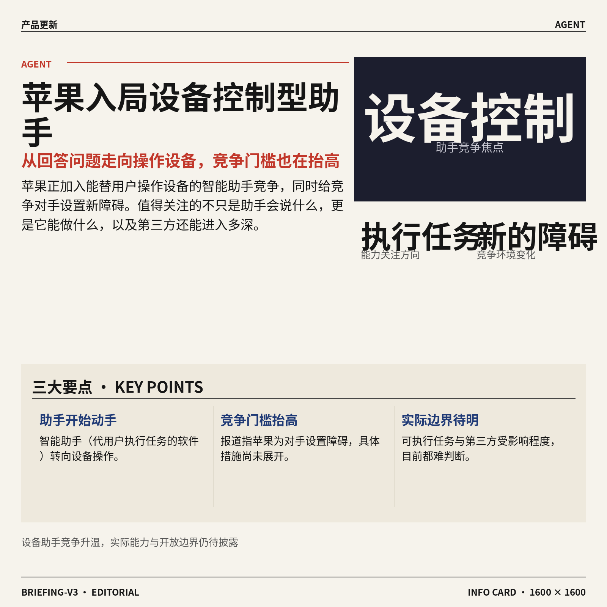

1. **苹果加入设备控制智能助手竞争，同时提高竞争对手的进入门槛。**
据[苹果设备助手报道(briefing)](https://the-decoder.com/apple-joins-the-race-for-ai-agents-that-control-your-device-while-raising-new-barriers-for-competitors/)，苹果正在加入**设备控制型 Agent（能代用户操作设备、执行任务的智能助手）**的竞争，同时为竞争对手设置新的障碍。📱 这类 AI（人工智能）产品的关注点不只是“回答得好不好”，还包括**能否替用户实际操作设备**。不过，现有材料没有展开具体功能和限制措施，暂时还不能判断它能替用户完成哪些工作，以及第三方产品会受到多大影响。

![苹果加入设备控制智能助手竞争，同时提高竞争对手的进入门槛](https://image.pollinations.ai/prompt/%E8%8B%B9%E6%9E%9C%E5%8A%A0%E5%85%A5%E8%AE%BE%E5%A4%87%E6%8E%A7%E5%88%B6%E6%99%BA%E8%83%BD%E5%8A%A9%E6%89%8B%E7%AB%9E%E4%BA%89%EF%BC%8C%E5%90%8C%E6%97%B6%E6%8F%90%E9%AB%98%E7%AB%9E%E4%BA%89%E5%AF%B9%E6%89%8B%E7%9A%84%E8%BF%9B%E5%85%A5%E9%97%A8%E6%A7%9B.%20%E8%8B%B9%E6%9E%9C%E5%8A%A0%E5%85%A5%E8%AE%BE%E5%A4%87%E6%8E%A7%E5%88%B6%E6%99%BA%E8%83%BD%E5%8A%A9%E6%89%8B%E7%AB%9E%E4%BA%89%EF%BC%8C%E5%90%8C%E6%97%B6%E6%8F%90%E9%AB%98%E7%AB%9E%E4%BA%89%E5%AF%B9%E6%89%8B%E7%9A%84%E8%BF%9B%E5%85%A5%E9%97%A8%E6%A7%9B%E3%80%82%20%E6%8D%AE%E8%8B%B9%E6%9E%9C%E8%AE%BE%E5%A4%87%E5%8A%A9%E6%89%8B%E6%8A%A5%E9%81%93%28briefing%29%EF%BC%8C%E8%8B%B9%E6%9E%9C%E6%AD%A3%E5%9C%A8%E5%8A%A0%E5%85%A5%E8%AE%BE%E5%A4%87%E6%8E%A7%E5%88%B6%E5%9E%8B%20Agent%EF%BC%88%E8%83%BD%E4%BB%A3%E7%94%A8%E6%88%B7%E6%93%8D%E4%BD%9C%E8%AE%BE%E5%A4%87%E3%80%81%E6%89%A7%E8%A1%8C%E4%BB%BB%2C%20technical%20infographic%20diagram%2C%20architecture%20flowchart%2C%20clean%20vector%20illustration%2C%20educational%20style%2C%20no%20text%20overlay%2C%20modern%20minimal%2C%20wide%20aspect?width=1200&height=675&nologo=true&seed=11389)

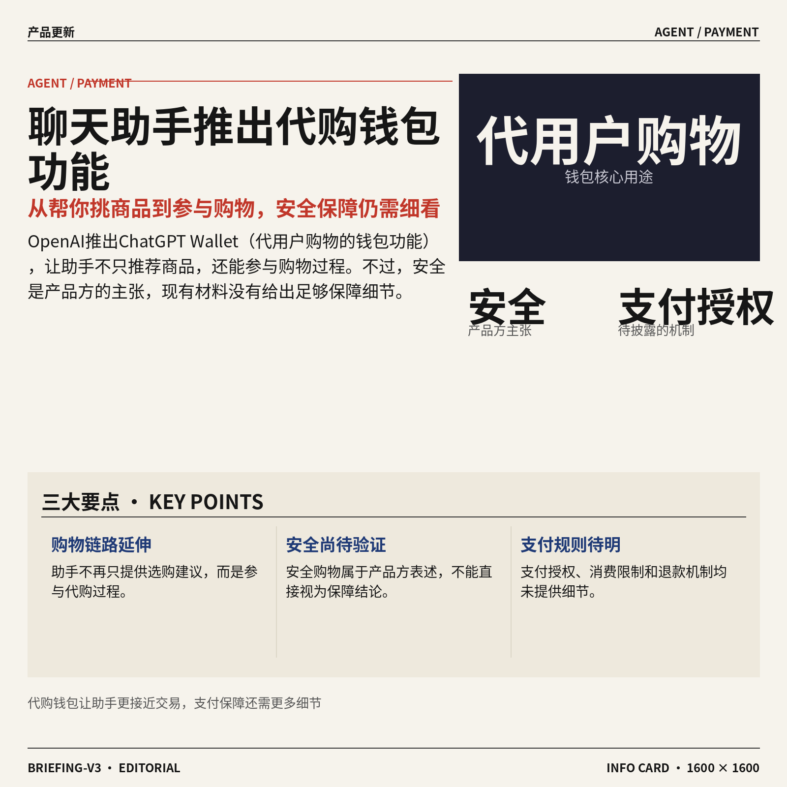

2. **OpenAI 推出 ChatGPT Wallet（供人工智能代用户购物的钱包功能），主打安全购物。**
据[购物钱包发布报道(briefing)](https://news.google.com/rss/articles/CBMiZ0FVX3lxTFBHeTFKZ0NySWhLdXF5bXRNLU5MOHJUUU9WcTVwOGFOc2xNaEstLVp6cy1Ia3BKTzJFczNBY2NOTW56SHJIWXRzY2UxY2NhQmJnQUgtZG5MemVpOG5XcWtUdjhWUzRjbjQ?oc=5)，OpenAI 推出了 **ChatGPT Wallet（让人工智能代用户购物的钱包功能）**，并宣称这是一种安全的购物方式。🛒 这次更新聚焦的是 **AI（人工智能）代购**：不只是帮用户挑商品，而是让它参与代用户购物的过程。需要注意，**“安全”目前是产品方的主张**；现有材料没有提供支付授权、消费限制或退款机制等细节，尚不足以判断实际使用中的保障程度。


### 🟢 前沿研究

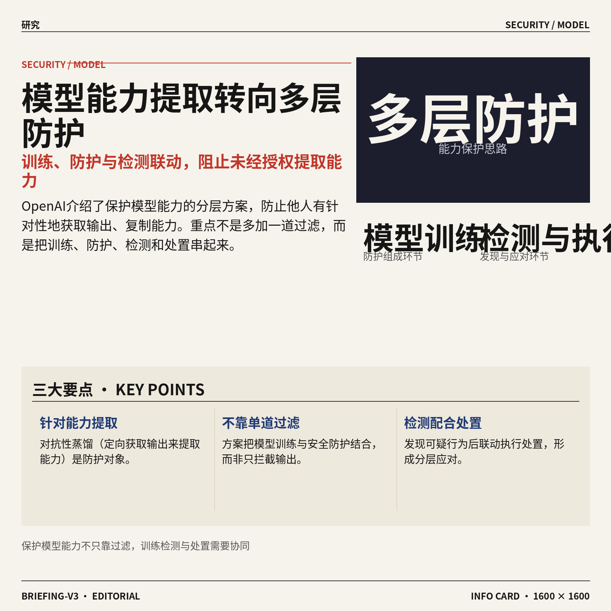

1. **OpenAI 以多层防护应对对抗性蒸馏，保护模型能力。**
OpenAI 介绍了应对**对抗性蒸馏**（通过有针对性地获取模型输出，提取其能力）的分层方案，重点是防止模型能力被未经授权地提取 🛡️。方案结合**模型训练、安全防护、检测与执行处置**，并非只依靠某一道过滤机制。这里的**蒸馏**（让另一个模型学习已有模型的输出与表现）是理解问题的关键；本次材料聚焦其对抗性用途，具体方案可见[官方防护方案说明(briefing)](https://openai.com/index/combatting-adversarial-distillation)。


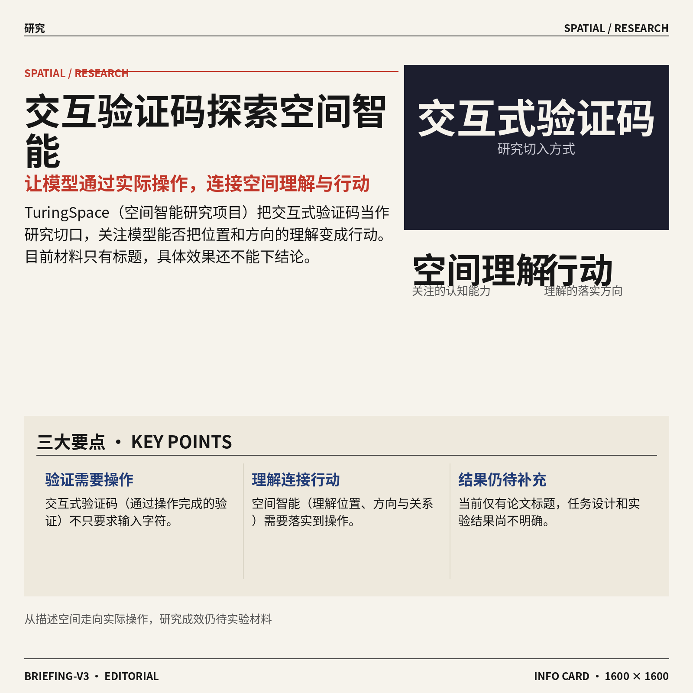

2. **TuringSpace（通过交互式验证码研究空间智能的项目）把空间理解与行动联系起来。**
从论文标题看，研究以**交互式验证码**（需要通过操作完成挑战、而不只是输入字符的验证任务）为切入点，探索模型的**空间智能**（理解物体位置、方向及空间关系的能力）🧩。它关注的是如何让空间理解落实到行动中，而不只是停留在描述层面。现有材料仅提供标题，尚无法判断具体任务设计、实验结果或实际应用范围，参见[空间智能研究页面(briefing)](https://huggingface.co/papers/2611.25387)。

![TuringSpace（通过交互式验证码研究空间智能的项目）把空间理解与行动联系起来](https://image.pollinations.ai/prompt/TuringSpace%EF%BC%88%E9%80%9A%E8%BF%87%E4%BA%A4%E4%BA%92%E5%BC%8F%E9%AA%8C%E8%AF%81%E7%A0%81%E7%A0%94%E7%A9%B6%E7%A9%BA%E9%97%B4%E6%99%BA%E8%83%BD%E7%9A%84%E9%A1%B9%E7%9B%AE%EF%BC%89%E6%8A%8A%E7%A9%BA%E9%97%B4%E7%90%86%E8%A7%A3%E4%B8%8E%E8%A1%8C%E5%8A%A8%E8%81%94%E7%B3%BB%E8%B5%B7%E6%9D%A5.%20TuringSpace%EF%BC%88%E9%80%9A%E8%BF%87%E4%BA%A4%E4%BA%92%E5%BC%8F%E9%AA%8C%E8%AF%81%E7%A0%81%E7%A0%94%E7%A9%B6%E7%A9%BA%E9%97%B4%E6%99%BA%E8%83%BD%E7%9A%84%E9%A1%B9%E7%9B%AE%EF%BC%89%E6%8A%8A%E7%A9%BA%E9%97%B4%E7%90%86%E8%A7%A3%E4%B8%8E%E8%A1%8C%E5%8A%A8%E8%81%94%E7%B3%BB%E8%B5%B7%E6%9D%A5%E3%80%82%20%E4%BB%8E%E8%AE%BA%E6%96%87%E6%A0%87%E9%A2%98%E7%9C%8B%EF%BC%8C%E7%A0%94%E7%A9%B6%E4%BB%A5%E4%BA%A4%E4%BA%92%E5%BC%8F%E9%AA%8C%E8%AF%81%E7%A0%81%EF%BC%88%E9%9C%80%E8%A6%81%E9%80%9A%E8%BF%87%E6%93%8D%E4%BD%9C%E5%AE%8C%E6%88%90%E6%8C%91%E6%88%98%E3%80%81%E8%80%8C%E4%B8%8D%E5%8F%AA%E6%98%AF%E8%BE%93%E5%85%A5%E5%AD%97%E7%AC%A6%2C%20technical%20infographic%20diagram%2C%20architecture%20flowchart%2C%20clean%20vector%20illustration%2C%20educational%20style%2C%20no%20text%20overlay%2C%20modern%20minimal%2C%20wide%20aspect?width=1200&height=675&nologo=true&seed=10838)

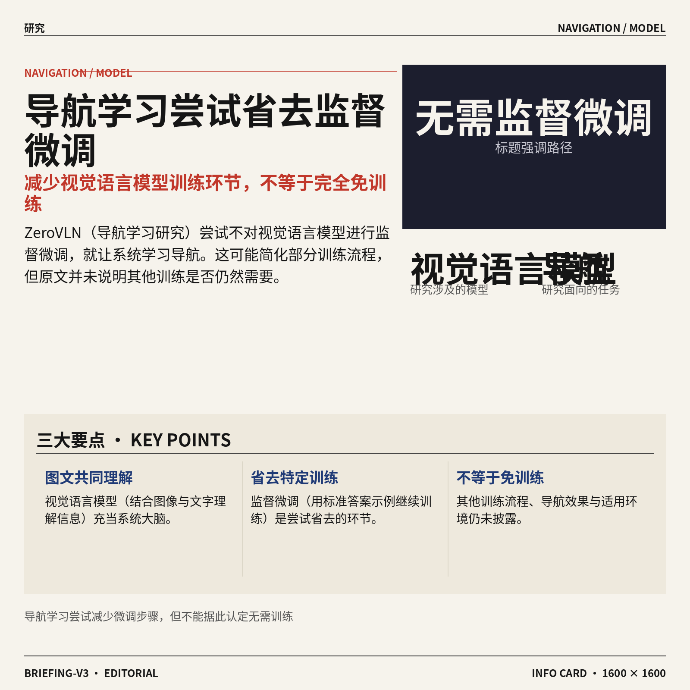

3. **ZeroVLN（探索无需监督微调视觉语言模型即可学习导航的研究）尝试减少导航训练环节。**
这项研究关注**导航**：让系统根据环境信息学习如何到达目标位置 🧭。标题强调，不对作为“大脑”的**视觉语言模型**（能够结合图像与文字理解信息的模型）进行**监督微调**（用带有标准答案的示例继续训练模型）。这并不等于完全不需要训练；当前材料未给出其他训练环节、导航效果或适用环境，详见[导航学习研究页面(briefing)](https://huggingface.co/papers/2611.26414)。

![ZeroVLN（探索无需监督微调视觉语言模型即可学习导航的研究）尝试减少导航训练环节](https://image.pollinations.ai/prompt/ZeroVLN%EF%BC%88%E6%8E%A2%E7%B4%A2%E6%97%A0%E9%9C%80%E7%9B%91%E7%9D%A3%E5%BE%AE%E8%B0%83%E8%A7%86%E8%A7%89%E8%AF%AD%E8%A8%80%E6%A8%A1%E5%9E%8B%E5%8D%B3%E5%8F%AF%E5%AD%A6%E4%B9%A0%E5%AF%BC%E8%88%AA%E7%9A%84%E7%A0%94%E7%A9%B6%EF%BC%89%E5%B0%9D%E8%AF%95%E5%87%8F%E5%B0%91%E5%AF%BC%E8%88%AA%E8%AE%AD%E7%BB%83%E7%8E%AF%E8%8A%82.%20ZeroVLN%EF%BC%88%E6%8E%A2%E7%B4%A2%E6%97%A0%E9%9C%80%E7%9B%91%E7%9D%A3%E5%BE%AE%E8%B0%83%E8%A7%86%E8%A7%89%E8%AF%AD%E8%A8%80%E6%A8%A1%E5%9E%8B%E5%8D%B3%E5%8F%AF%E5%AD%A6%E4%B9%A0%E5%AF%BC%E8%88%AA%E7%9A%84%E7%A0%94%E7%A9%B6%EF%BC%89%E5%B0%9D%E8%AF%95%E5%87%8F%E5%B0%91%E5%AF%BC%E8%88%AA%E8%AE%AD%E7%BB%83%E7%8E%AF%E8%8A%82%E3%80%82%20%E8%BF%99%E9%A1%B9%E7%A0%94%E7%A9%B6%E5%85%B3%E6%B3%A8%E5%AF%BC%E8%88%AA%EF%BC%9A%E8%AE%A9%E7%B3%BB%E7%BB%9F%E6%A0%B9%E6%8D%AE%E7%8E%AF%E5%A2%83%E4%BF%A1%E6%81%AF%E5%AD%A6%E4%B9%A0%E5%A6%82%E4%BD%95%E5%88%B0%E8%BE%BE%E7%9B%AE%E6%A0%87%E4%BD%8D%E7%BD%AE%20%F0%9F%A7%AD%E3%80%82%E6%A0%87%E9%A2%98%E5%BC%BA%E8%B0%83%EF%BC%8C%2C%20technical%20infographic%20diagram%2C%20architecture%20flowchart%2C%20clean%20vector%20illustration%2C%20educational%20style%2C%20no%20text%20overlay%2C%20modern%20minimal%2C%20wide%20aspect?width=1200&height=675&nologo=true&seed=10869)

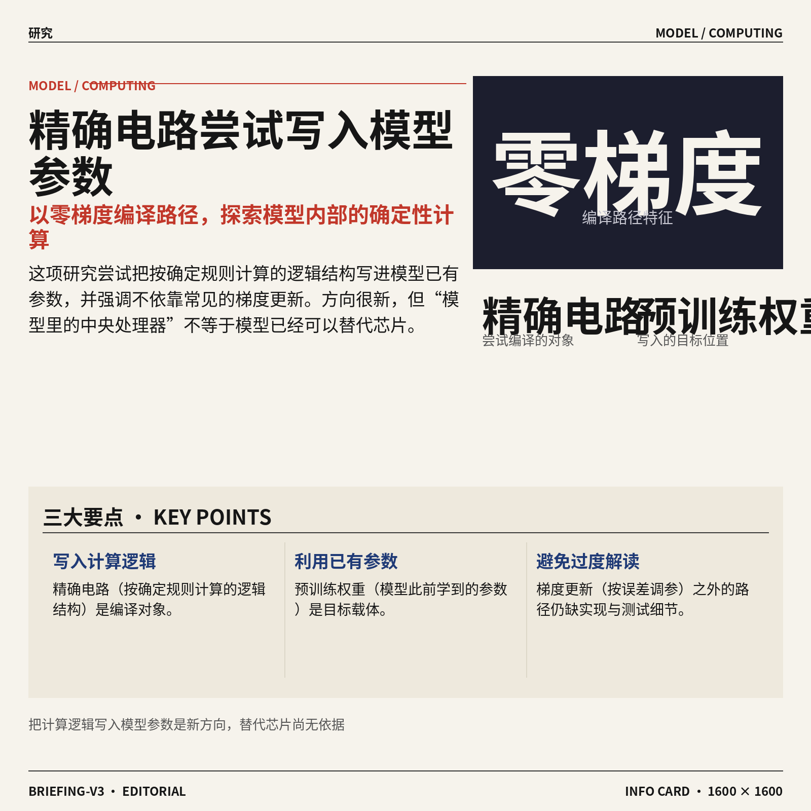

4. **“大模型里的中央处理器”研究：将精确电路编译进已有模型参数。**
这篇论文提出一个颇具想象力的方向：把**精确电路**（按确定规则执行计算的逻辑结构）编译到**预训练权重**（模型在先前训练中已经学到的内部参数）中 ⚙️。标题中的“零梯度”指向不依靠梯度更新（根据误差逐步调整参数的常见训练过程）完成这一编译过程。当前材料没有提供实现细节或测试结果，因此不能把标题中的“中央处理器”理解为模型已经能替代真实芯片，参见[模型电路编译研究(briefing)](https://huggingface.co/papers/2611.26450)。

![“大模型里的中央处理器”研究：将精确电路编译进已有模型参数](https://image.pollinations.ai/prompt/%E2%80%9C%E5%A4%A7%E6%A8%A1%E5%9E%8B%E9%87%8C%E7%9A%84%E4%B8%AD%E5%A4%AE%E5%A4%84%E7%90%86%E5%99%A8%E2%80%9D%E7%A0%94%E7%A9%B6%EF%BC%9A%E5%B0%86%E7%B2%BE%E7%A1%AE%E7%94%B5%E8%B7%AF%E7%BC%96%E8%AF%91%E8%BF%9B%E5%B7%B2%E6%9C%89%E6%A8%A1%E5%9E%8B%E5%8F%82%E6%95%B0.%20%E2%80%9C%E5%A4%A7%E6%A8%A1%E5%9E%8B%E9%87%8C%E7%9A%84%E4%B8%AD%E5%A4%AE%E5%A4%84%E7%90%86%E5%99%A8%E2%80%9D%E7%A0%94%E7%A9%B6%EF%BC%9A%E5%B0%86%E7%B2%BE%E7%A1%AE%E7%94%B5%E8%B7%AF%E7%BC%96%E8%AF%91%E8%BF%9B%E5%B7%B2%E6%9C%89%E6%A8%A1%E5%9E%8B%E5%8F%82%E6%95%B0%E3%80%82%20%E8%BF%99%E7%AF%87%E8%AE%BA%E6%96%87%E6%8F%90%E5%87%BA%E4%B8%80%E4%B8%AA%E9%A2%87%E5%85%B7%E6%83%B3%E8%B1%A1%E5%8A%9B%E7%9A%84%E6%96%B9%E5%90%91%EF%BC%9A%E6%8A%8A%E7%B2%BE%E7%A1%AE%E7%94%B5%E8%B7%AF%EF%BC%88%E6%8C%89%E7%A1%AE%E5%AE%9A%E8%A7%84%E5%88%99%E6%89%A7%E8%A1%8C%E8%AE%A1%E7%AE%97%E7%9A%84%E9%80%BB%E8%BE%91%E7%BB%93%E6%9E%84%EF%BC%89%E7%BC%96%E8%AF%91%E5%88%B0%E9%A2%84%E8%AE%AD%E7%BB%83%E6%9D%83%E9%87%8D%EF%BC%88%E6%A8%A1%E5%9E%8B%2C%20technical%20infographic%20diagram%2C%20architecture%20flowchart%2C%20clean%20vector%20illustration%2C%20educational%20style%2C%20no%20text%20overlay%2C%20modern%20minimal%2C%20wide%20aspect?width=1200&height=675&nologo=true&seed=10900)

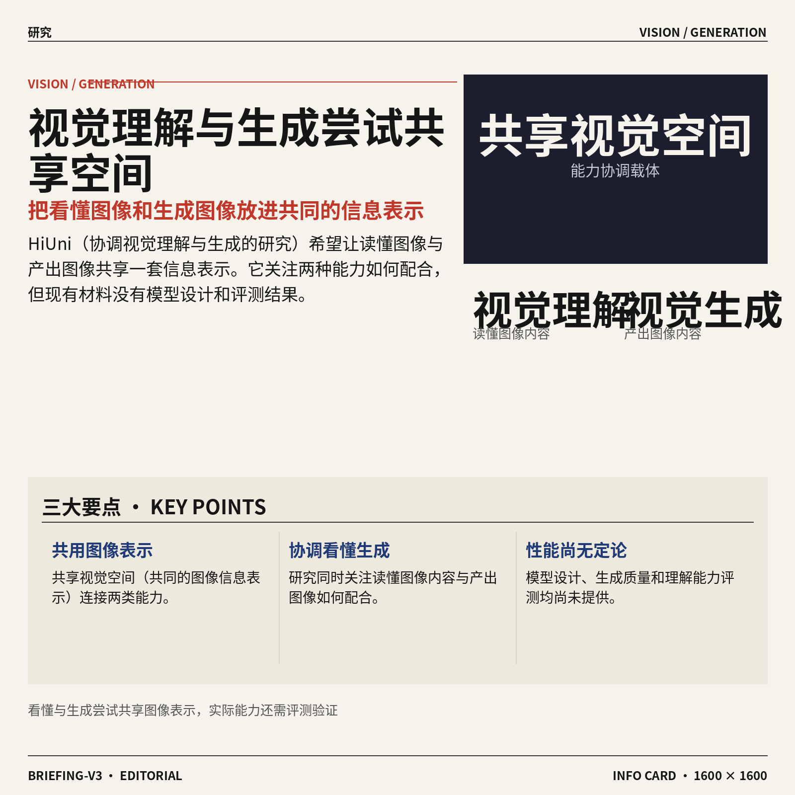

5. **HiUni（协调视觉理解与图像生成的研究）探索让“看懂”和“生成”共享视觉空间。**
从标题看，这项研究希望在**共享视觉空间**（让理解与生成使用共同的图像信息表示）中，协调视觉理解与生成两类能力 🎨。其中，**视觉理解**侧重读懂图像内容，**视觉生成**则侧重产出图像，研究关注的是两者如何配合。候选材料尚未提供模型设计、生成质量或理解能力的评测结果，具体信息见[视觉理解生成研究(briefing)](https://huggingface.co/papers/2611.26107)。

![HiUni（协调视觉理解与图像生成的研究）探索让“看懂”和“生成”共享视觉空间](https://image.pollinations.ai/prompt/HiUni%EF%BC%88%E5%8D%8F%E8%B0%83%E8%A7%86%E8%A7%89%E7%90%86%E8%A7%A3%E4%B8%8E%E5%9B%BE%E5%83%8F%E7%94%9F%E6%88%90%E7%9A%84%E7%A0%94%E7%A9%B6%EF%BC%89%E6%8E%A2%E7%B4%A2%E8%AE%A9%E2%80%9C%E7%9C%8B%E6%87%82%E2%80%9D%E5%92%8C%E2%80%9C%E7%94%9F%E6%88%90%E2%80%9D%E5%85%B1%E4%BA%AB%E8%A7%86%E8%A7%89%E7%A9%BA%E9%97%B4.%20HiUni%EF%BC%88%E5%8D%8F%E8%B0%83%E8%A7%86%E8%A7%89%E7%90%86%E8%A7%A3%E4%B8%8E%E5%9B%BE%E5%83%8F%E7%94%9F%E6%88%90%E7%9A%84%E7%A0%94%E7%A9%B6%EF%BC%89%E6%8E%A2%E7%B4%A2%E8%AE%A9%E2%80%9C%E7%9C%8B%E6%87%82%E2%80%9D%E5%92%8C%E2%80%9C%E7%94%9F%E6%88%90%E2%80%9D%E5%85%B1%E4%BA%AB%E8%A7%86%E8%A7%89%E7%A9%BA%E9%97%B4%E3%80%82%20%E4%BB%8E%E6%A0%87%E9%A2%98%E7%9C%8B%EF%BC%8C%E8%BF%99%E9%A1%B9%E7%A0%94%E7%A9%B6%E5%B8%8C%E6%9C%9B%E5%9C%A8%E5%85%B1%E4%BA%AB%E8%A7%86%E8%A7%89%E7%A9%BA%E9%97%B4%EF%BC%88%E8%AE%A9%E7%90%86%E8%A7%A3%E4%B8%8E%E7%94%9F%E6%88%90%E4%BD%BF%E7%94%A8%E5%85%B1%E5%90%8C%E7%9A%84%E5%9B%BE%E5%83%8F%E4%BF%A1%E6%81%AF%E8%A1%A8%E7%A4%BA%EF%BC%89%E4%B8%AD%EF%BC%8C%2C%20technical%20infographic%20diagram%2C%20architecture%20flowchart%2C%20clean%20vector%20illustration%2C%20educational%20style%2C%20no%20text%20overlay%2C%20modern%20minimal%2C%20wide%20aspect?width=1200&height=675&nologo=true&seed=10931)

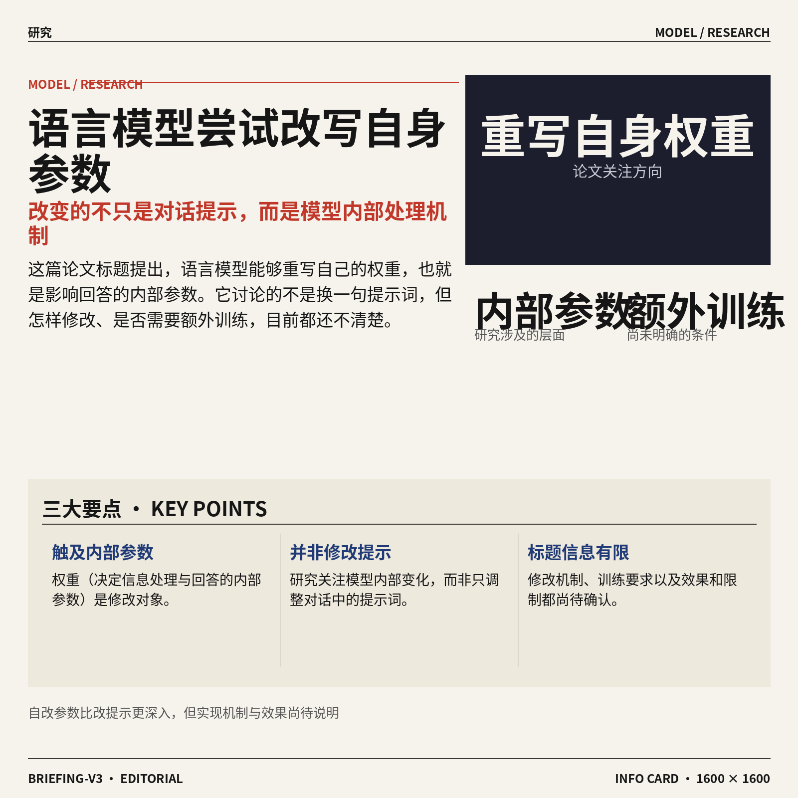

6. **语言模型能重写自身权重：研究关注模型内部参数的自我修改。**
这篇论文的标题直接提出：语言模型能够重写自己的**权重**（决定模型如何处理信息、生成回答的内部参数）🔬。它关注的不是修改一段对话中的提示词，而是模型内部参数这一层面的变化；**语言模型**则是学习语言规律、理解和生成文字的模型。现有材料仅有标题，无法确认修改如何发生、是否需要额外训练，以及效果和限制，参见[模型自改权重论文(briefing)](https://arxiv.org/abs/2611.21885)。

![语言模型能重写自身权重：研究关注模型内部参数的自我修改](https://image.pollinations.ai/prompt/%E8%AF%AD%E8%A8%80%E6%A8%A1%E5%9E%8B%E8%83%BD%E9%87%8D%E5%86%99%E8%87%AA%E8%BA%AB%E6%9D%83%E9%87%8D%EF%BC%9A%E7%A0%94%E7%A9%B6%E5%85%B3%E6%B3%A8%E6%A8%A1%E5%9E%8B%E5%86%85%E9%83%A8%E5%8F%82%E6%95%B0%E7%9A%84%E8%87%AA%E6%88%91%E4%BF%AE%E6%94%B9.%20%E8%AF%AD%E8%A8%80%E6%A8%A1%E5%9E%8B%E8%83%BD%E9%87%8D%E5%86%99%E8%87%AA%E8%BA%AB%E6%9D%83%E9%87%8D%EF%BC%9A%E7%A0%94%E7%A9%B6%E5%85%B3%E6%B3%A8%E6%A8%A1%E5%9E%8B%E5%86%85%E9%83%A8%E5%8F%82%E6%95%B0%E7%9A%84%E8%87%AA%E6%88%91%E4%BF%AE%E6%94%B9%E3%80%82%20%E8%BF%99%E7%AF%87%E8%AE%BA%E6%96%87%E7%9A%84%E6%A0%87%E9%A2%98%E7%9B%B4%E6%8E%A5%E6%8F%90%E5%87%BA%EF%BC%9A%E8%AF%AD%E8%A8%80%E6%A8%A1%E5%9E%8B%E8%83%BD%E5%A4%9F%E9%87%8D%E5%86%99%E8%87%AA%E5%B7%B1%E7%9A%84%E6%9D%83%E9%87%8D%EF%BC%88%E5%86%B3%E5%AE%9A%E6%A8%A1%E5%9E%8B%E5%A6%82%E4%BD%95%E5%A4%84%E7%90%86%E4%BF%A1%E6%81%AF%E3%80%81%E7%94%9F%E6%88%90%E5%9B%9E%E7%AD%94%E7%9A%84%E5%86%85%E9%83%A8%E5%8F%82%E6%95%B0%EF%BC%89%F0%9F%94%AC%E3%80%82%E5%AE%83%E5%85%B3%2C%20technical%20infographic%20diagram%2C%20architecture%20flowchart%2C%20clean%20vector%20illustration%2C%20educational%20style%2C%20no%20text%20overlay%2C%20modern%20minimal%2C%20wide%20aspect?width=1200&height=675&nologo=true&seed=10962)

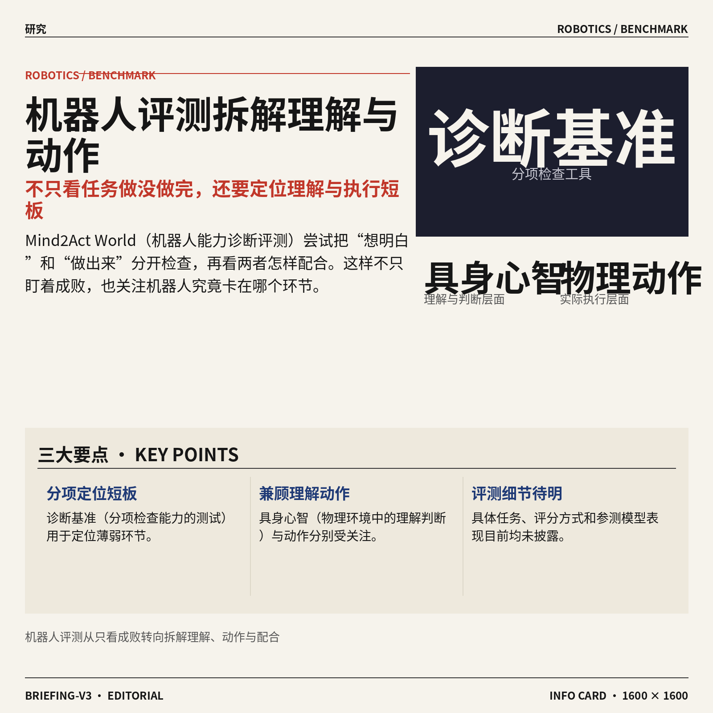

7. **Mind2Act World（诊断机器人理解与动作配合能力的评测）拆解“想明白”和“做出来”。**
这项研究面向**机器人操作**（机器人移动、抓取或摆放物体等任务），提出一套**诊断基准**（用于分项检查能力、定位薄弱环节的测试）🤖。从标题看，它分别关注具身心智（机器人在物理环境中的理解与判断）、物理动作，以及两者的组合，重点不只是看任务最终是否完成。当前材料未披露测试任务、评分方式或参测模型表现，详见[机器人能力诊断研究(briefing)](https://huggingface.co/papers/2611.26444)。

![Mind2Act World（诊断机器人理解与动作配合能力的评测）拆解“想明白”和“做出来”](https://image.pollinations.ai/prompt/Mind2Act%20World%EF%BC%88%E8%AF%8A%E6%96%AD%E6%9C%BA%E5%99%A8%E4%BA%BA%E7%90%86%E8%A7%A3%E4%B8%8E%E5%8A%A8%E4%BD%9C%E9%85%8D%E5%90%88%E8%83%BD%E5%8A%9B%E7%9A%84%E8%AF%84%E6%B5%8B%EF%BC%89%E6%8B%86%E8%A7%A3%E2%80%9C%E6%83%B3%E6%98%8E%E7%99%BD%E2%80%9D%E5%92%8C%E2%80%9C%E5%81%9A%E5%87%BA%E6%9D%A5%E2%80%9D.%20Mind2Act%20World%EF%BC%88%E8%AF%8A%E6%96%AD%E6%9C%BA%E5%99%A8%E4%BA%BA%E7%90%86%E8%A7%A3%E4%B8%8E%E5%8A%A8%E4%BD%9C%E9%85%8D%E5%90%88%E8%83%BD%E5%8A%9B%E7%9A%84%E8%AF%84%E6%B5%8B%EF%BC%89%E6%8B%86%E8%A7%A3%E2%80%9C%E6%83%B3%E6%98%8E%E7%99%BD%E2%80%9D%E5%92%8C%E2%80%9C%E5%81%9A%E5%87%BA%E6%9D%A5%E2%80%9D%E3%80%82%20%E8%BF%99%E9%A1%B9%E7%A0%94%E7%A9%B6%E9%9D%A2%E5%90%91%E6%9C%BA%E5%99%A8%E4%BA%BA%E6%93%8D%E4%BD%9C%EF%BC%88%E6%9C%BA%E5%99%A8%E4%BA%BA%E7%A7%BB%E5%8A%A8%E3%80%81%E6%8A%93%E5%8F%96%E6%88%96%E6%91%86%E6%94%BE%E7%89%A9%E4%BD%93%E7%AD%89%E4%BB%BB%E5%8A%A1%EF%BC%89%EF%BC%8C%E6%8F%90%E5%87%BA%2C%20technical%20infographic%20diagram%2C%20architecture%20flowchart%2C%20clean%20vector%20illustration%2C%20educational%20style%2C%20no%20text%20overlay%2C%20modern%20minimal%2C%20wide%20aspect?width=1200&height=675&nologo=true&seed=10993)

### 🟡 行业展望与社会影响

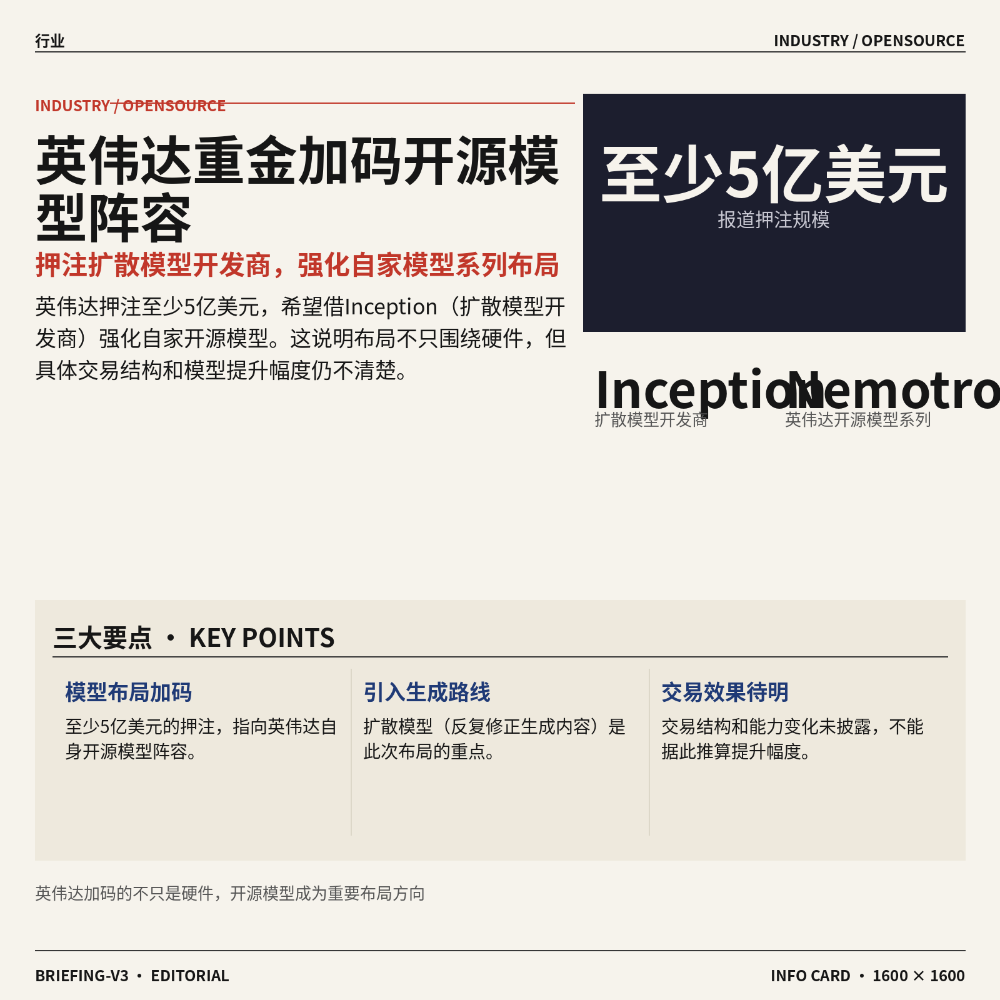

1. **英伟达押注至少 5 亿美元，借 Inception（扩散模型开发商）强化自家开源模型阵容。**
据[英伟达模型布局报道(briefing)](https://the-decoder.com/nvidia-bets-at-least-500-million-on-inceptions-diffusion-models-to-strengthen-its-open-source-nemotron-lineup/)，英伟达正押注至少 **5 亿美元**，希望借助 Inception 的**扩散模型（通过反复修正逐步生成内容的一类模型）**，强化 Nemotron（英伟达旗下的开源模型系列）。🚀 这笔布局的重点不只是硬件，也包括英伟达自己的**开源模型阵容**。不过，现有材料未披露具体交易结构或模型能力变化，暂时不能据此判断产品效果会提升多少。


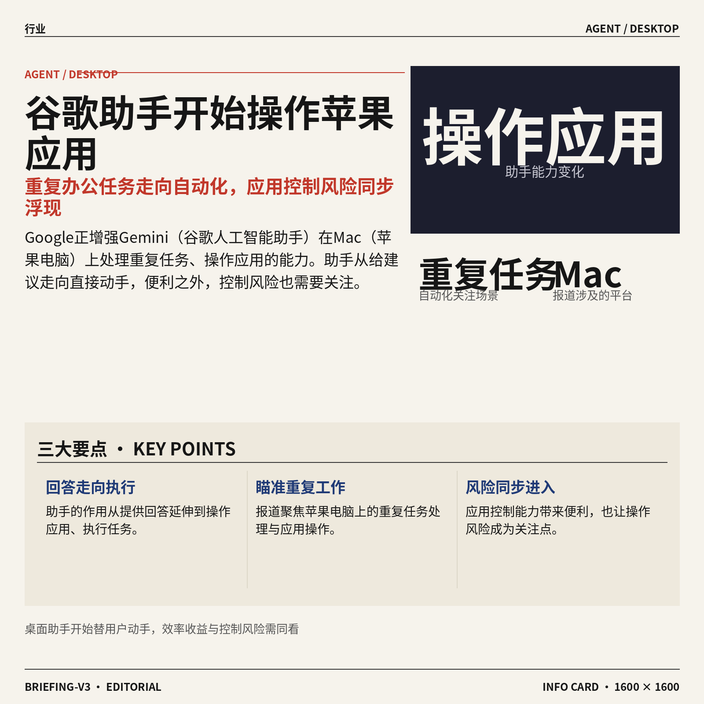

2. **Google 让 Gemini 操作苹果电脑应用，重复任务自动化与风险同步进入视野。**
两则报道分别指出，Google 正增强 Gemini（Google 旗下的人工智能助手）在 Mac（苹果电脑）上处理**重复任务**的能力，并赋予它操作应用的能力，见[桌面任务能力报道(briefing)](https://news.google.com/rss/articles/CBMiowFBVV95cUxNR1ozZ09oYlZUZmstWGlIUzY3VlplT2l0ak5semRuVHJZMzZxejJZaWRWYUtzYlhpa3JYckdQeHVTbUFOS0poUXFWY1BlaC1pZ0lnb0xOcTBSTGI1S3NCUHIxbHZnY1BGeG1XWVRkZW45bHhQVVJKVkZuZ2ppZExYQTNhRDVrSkJtQXpzR3B3eGpkUWpKalZRWjRsTWxKNzJIVkhF?oc=5)。💡 对办公用户而言，值得关注的变化是：助手的作用开始从“提供回答”延伸到**操作应用、执行任务**。但[应用控制风险报道(briefing)](https://news.google.com/rss/articles/CBMie0FVX3lxTFBxZVJ1NVM2bnpUZUFJaW9fR0tLbi05ZEQ0M2R0SWNwMmtYbzNlUG1RY292a2tEaHlSdkJwZzE5cEpGaHhxTWNDdXFSZ2pNTEc3NWZtcmd4YnRjOHVENW04ZHZZUHphTWdKYmZDNWUzVjVqMkk4al8xVEEzUQ?oc=5)也明确提示了风险，现有材料尚不足以确认支持哪些应用、开放哪些操作权限。


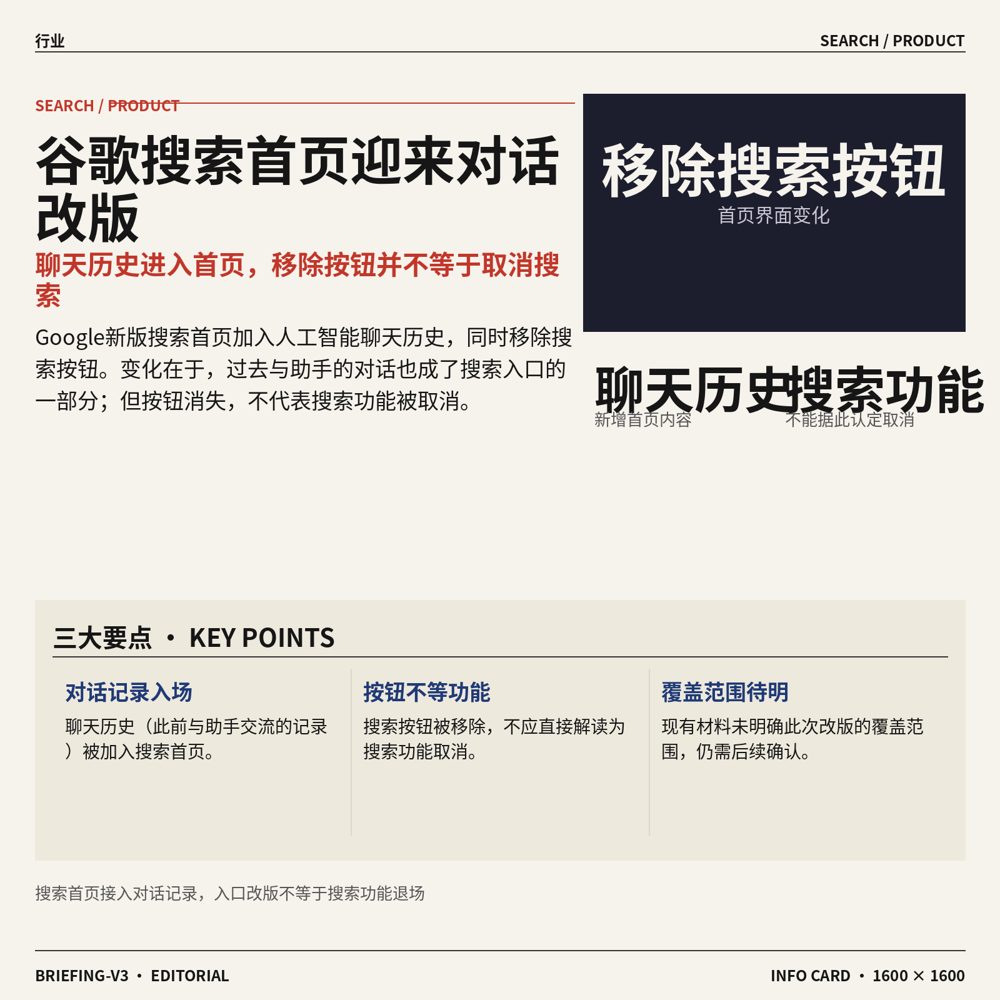

3. **Google 推出新版搜索首页：加入人工智能聊天历史，移除搜索按钮。**
据[谷歌搜索首页改版报道(briefing)](https://news.google.com/rss/articles/CBMisAFBVV95cUxOVDhwMzkzejNZQ1AtREVxR3l5d0lFS0phdjhnR002T1JjYmVQT2NULUdvd3Y2YnBTR2Nhb3BMZEt3VUdPSDk0Zzd5YmxtVTUxRGZoZ2Izeno4X3podnQ5c05SOEo0N3ZKQlB3ZWJqLU9USEFmMzhvWFYyTUhKZ1dvdS1UMlFXMHVhVWdyTXotbTRZWGtzMVU4SGRFbjVpb1Y5S0l1RkQwY0s0Q3ZHWTJZTg?oc=5)，Google 正推出新版搜索首页，加入 **AI（人工智能）聊天历史**，同时移除搜索按钮。💡 **聊天历史（此前与助手交流的记录）**进入搜索首页，让对话记录成为搜索入口的一部分，而不再只有一个搜索框。需要区分的是，**移除搜索按钮不等于取消搜索功能**；现有材料也没有交代此次改版的覆盖范围与完整操作方式。

![Google 推出新版搜索首页：加入人工智能聊天历史，移除搜索按钮](https://image.pollinations.ai/prompt/Google%20%E6%8E%A8%E5%87%BA%E6%96%B0%E7%89%88%E6%90%9C%E7%B4%A2%E9%A6%96%E9%A1%B5%EF%BC%9A%E5%8A%A0%E5%85%A5%E4%BA%BA%E5%B7%A5%E6%99%BA%E8%83%BD%E8%81%8A%E5%A4%A9%E5%8E%86%E5%8F%B2%EF%BC%8C%E7%A7%BB%E9%99%A4%E6%90%9C%E7%B4%A2%E6%8C%89%E9%92%AE.%20Google%20%E6%8E%A8%E5%87%BA%E6%96%B0%E7%89%88%E6%90%9C%E7%B4%A2%E9%A6%96%E9%A1%B5%EF%BC%9A%E5%8A%A0%E5%85%A5%E4%BA%BA%E5%B7%A5%E6%99%BA%E8%83%BD%E8%81%8A%E5%A4%A9%E5%8E%86%E5%8F%B2%EF%BC%8C%E7%A7%BB%E9%99%A4%E6%90%9C%E7%B4%A2%E6%8C%89%E9%92%AE%E3%80%82%20%E6%8D%AE%E8%B0%B7%E6%AD%8C%E6%90%9C%E7%B4%A2%E9%A6%96%E9%A1%B5%E6%94%B9%E7%89%88%E6%8A%A5%E9%81%93%28briefing%29%EF%BC%8CGoogle%20%E6%AD%A3%E6%8E%A8%E5%87%BA%E6%96%B0%E7%89%88%E6%90%9C%E7%B4%A2%E9%A6%96%E9%A1%B5%EF%BC%8C%E5%8A%A0%E5%85%A5%20AI%EF%BC%88%2C%20technical%20infographic%20diagram%2C%20architecture%20flowchart%2C%20clean%20vector%20illustration%2C%20educational%20style%2C%20no%20text%20overlay%2C%20modern%20minimal%2C%20wide%20aspect?width=1200&height=675&nologo=true&seed=10869)

4. **OpenAI 向部分付费用户测试 dots（新智能体项目），尚非全面开放。**
据[智能体小范围测试报道(briefing)](https://news.google.com/rss/articles/CBMigAFBVV95cUxQOGpsaEtteG1fS294VHlKelhHY3FjYmpjUnJEczI4S2l2U21XY18zXzROZmNoc3FybkIyc0FyQ0tHRzQtci1PSmROUWNBNjdxSTZrcUNETjctc2dZN0hGcHpwQkRjdHM2WURnTFprTDcxem9qRnIwSnBNRXVzTUNCNQ?oc=5)，OpenAI 已开始向部分 **ChatGPT Plus（ChatGPT 的付费订阅方案）**用户测试 dots（OpenAI 正在测试的智能体项目）。🚀 这里的**智能体（能够围绕目标执行任务的人工智能助手）**是此次测试的关注点，但现有材料没有说明它具体能完成哪些工作。对于期待新功能的同事，当前最重要的边界是：**仅部分用户参与测试**，不能将其理解为所有付费用户都已获得使用权限。


### 🟣 开源TOP项目

1. **Claude-BugHunter（面向漏洞排查与安全攻防测试的技能包）汇集 82 项技能与 681 个已披露报告模式。**
这套开源项目为 **Claude Code（能协助开发者处理编程任务的助手）**提供漏洞排查与**外部红队测试**（从外部攻击者视角检查系统安全弱点）的配套技能 🔍。它包含 **82 项技能、15 个斜杠命令**（以斜杠开头、用于触发特定操作的快捷指令），并整理了来自已披露漏洞报告的 **681 个模式**，覆盖 **24 类核心漏洞**。项目还提供企业身份与基础设施的**攻击矩阵**（按不同攻击方向组织的检查清单），内容不只涉及程序漏洞，也涵盖企业身份和基础设施安全。💡 对安全团队而言，它是一套围绕漏洞排查组织的专门资料与操作入口，具体内容可查看[漏洞排查技能仓库(briefing)](https://github.com/elementalsouls/Claude-BugHunter)。


### 🔴 社媒分享

1. **让模型适应任务运行框架：新适配方案瞄准性能与成本。**
🚀 Hugging Face（供开发者分享和使用模型的社区）介绍了 **harness adapters（让模型适应特定任务运行框架的适配组件）**，目标是改善模型表现和使用成本。这里的 **harness（组织模型执行任务的运行框架）**，可以理解为模型实际工作的“操作环境”；这项方案关注的，就是让选定的模型更适应这个环境。现有材料未提供具体效果数据，因此还不能判断能提升多少性能、降低多少成本，方案介绍见[模型框架适配介绍(briefing)](https://huggingface.co/blog/harness-adapters-at-scale)。


2. **手机智能助手的数据采集权限，应该受到哪些限制？**
🔒 Signal（注重通信隐私的即时通讯应用）的一篇文章，关注如何限制手机操作系统中的 **Agent（能代用户执行任务的智能助手）**采集数据。文章指向的是**操作系统平台（管理手机应用运行与权限的底层软件）**这一层面的限制，而不只是助手能完成什么任务。现有摘要没有说明具体限制方式或实施范围，不能据此认定已有相关功能上线，可查看[手机助手隐私保护讨论(briefing)](https://signal.org/blog/protecting-your-privacy/)。


3. **模型用量也有欺诈风险？一则视频分享发出警示。**
⚠️ Simon Willison（分享人工智能与软件开发话题的作者）转介了一则讨论 **token fraud（围绕模型处理文本用量的欺诈）**的视频，并在标题中强调问题的严重性。**Token（模型处理文字时使用的文本小单位）**是理解这类用量问题的基础，但当前摘要没有展开具体欺诈手法、受害对象或损失规模。因此，这条分享适合作为风险线索阅读，而不能仅凭标题判断哪些服务存在问题，相关内容见[模型用量欺诈视频介绍(briefing)](https://simonwillison.net/2026/Nov/20/token-fraud-is-here-and-its-bad/)。


---


### 📊 行业洞察（今日 3 条）

1. 据报道，苹果布局设备助手并限制对手进入，Google也让助手操作苹果电脑应用。
   【洞察】竞争不只拼能力，还拼谁允许你操作；第三方能否进入设备，会影响产品落地。

2. Google测试按需查找工具，模型共享社区也推出工作环境适配方案。
   【洞察】两件事都在减少执行任务的浪费；功能多未必更贵，但实际省多少仍缺数据。

3. OpenAI称，内部思考过程被提取的测试成功率从54%降至0.2%，并持续封禁相关账号。
   【洞察】能力保护已落实到使用限制；靠未经授权模仿来追赶，业务连续性风险更高。

### 💭 对我们的启发（今日 3 条）

1. 苹果收紧设备入口，提醒我们别把自动剪辑押在跨应用操作上；优先做好软件内流程，减少对外部权限的依赖。

2. Google测试按需找工具，我们可让剪辑助手按任务选择字幕、配音或抠图；先比较每条合格视频的总成本，再决定推广。

3. OpenAI加强能力保护，提醒我们用外部模型输出改进剪辑能力前先核对授权；品牌偏好应沉淀为客户可查看、修改的规则。

