## AI资讯日报 2026/11/22

> AI 早报 · 每日早读 · 全网深度聚合

## **今日摘要**

```
亚马逊接近斥资75亿美元收购Decart（人工智能初创企业），交易尚未敲定
英伟达仅用两万条样例纠错、提升编程成绩，研究者质疑一味扩大上下文
OpenAI加固模型防提取思考过程，新提示词瞄准回答过短与多余追问
```

### 🔵 产品与功能更新

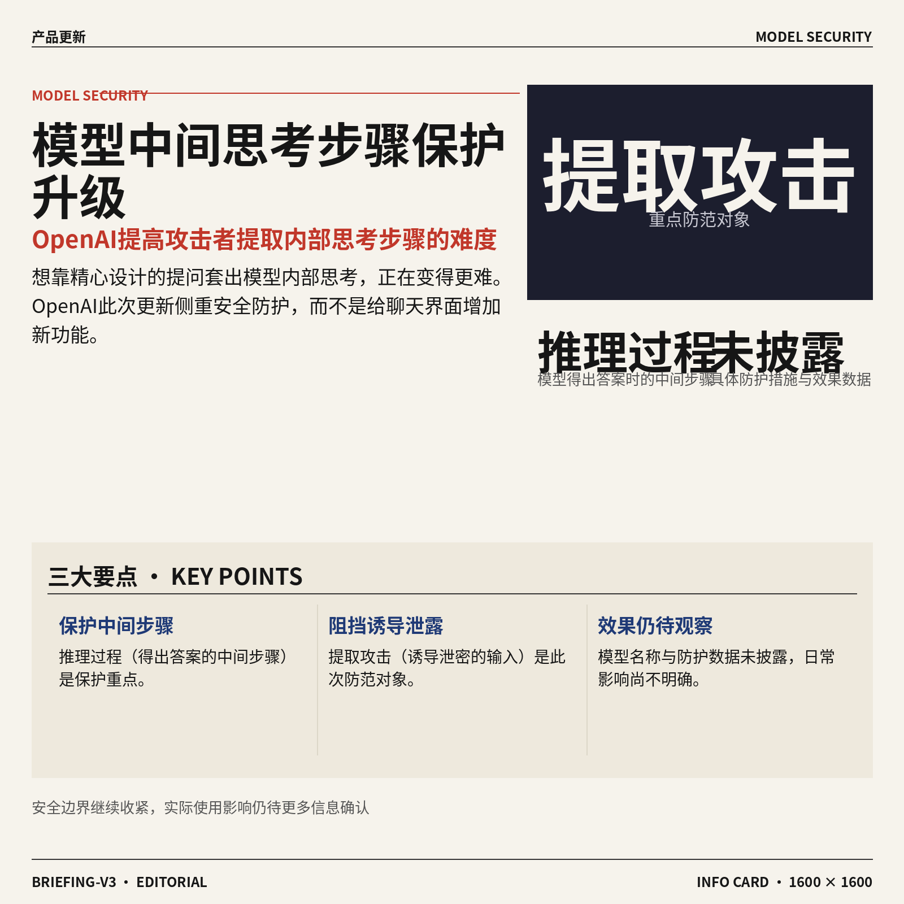

1. **OpenAI 加强模型保护，提高攻击者提取“思考过程”的难度。**
据[模型安全更新报道(briefing)](https://the-decoder.com/openai-makes-it-much-harder-for-attackers-to-extract-how-its-latest-ai-models-think/)，OpenAI 提高了攻击者提取其最新人工智能模型**推理过程**（模型得出答案时的中间思考步骤）的难度 🔒。这项变化聚焦于防范**提取攻击**（通过有意设计的输入，诱导模型泄露受保护信息），而不是新增面向用户的聊天功能。当前提供的摘要未披露具体防护措施、涉及的模型名称或效果数据，因此还不能判断它会如何影响日常使用。


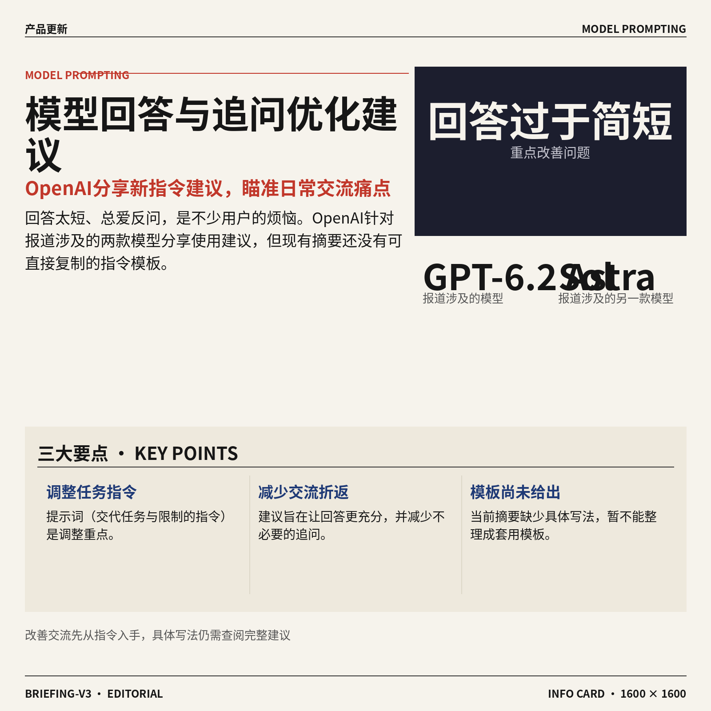

2. **OpenAI 发布新提示词建议，针对回答过短与多余追问。**
据[提示词调整建议报道(briefing)](https://the-decoder.com/openai-shares-new-prompting-tips-for-gpt-6-2-astra-and-sol-to-fix-brief-answers-and-unnecessary-questions/)，OpenAI 为 **GPT-6.2 Astra 和 Sol（报道涉及的两款模型）**分享了新的使用建议 💡。这些建议围绕**提示词**（你向模型交代任务、要求和限制的指令）展开，旨在改善回答过于简短、提出不必要问题的情况。对办公用户而言，这对应的是“希望回答更充分、少来回确认”的实际需求；不过，当前摘要没有给出具体提示词，尚无法整理成可直接套用的模板。


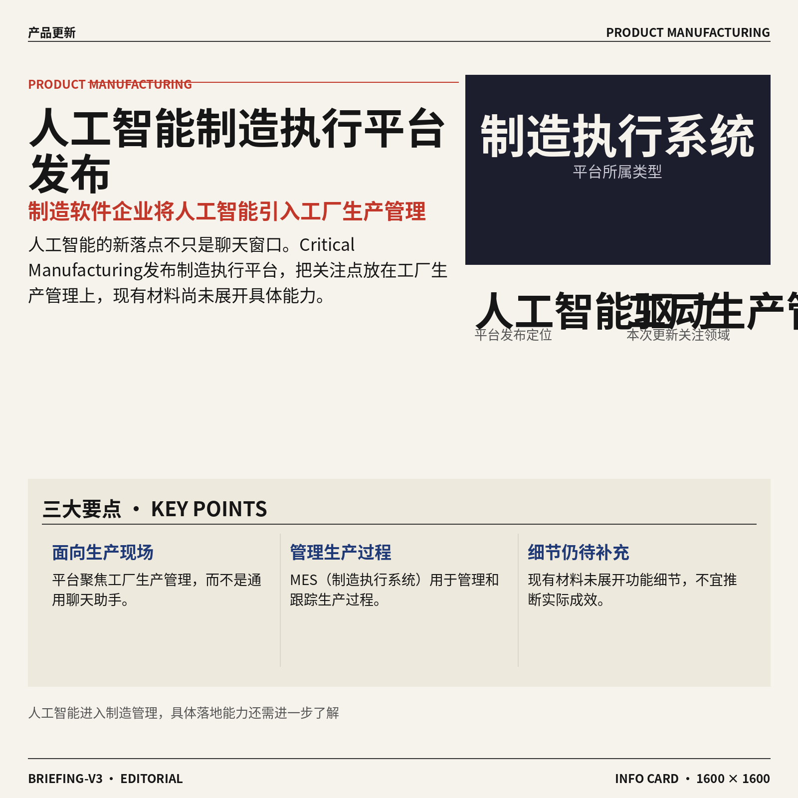

3. **Critical Manufacturing（制造软件企业）推出人工智能制造执行平台。**
据[制造执行平台发布报道(briefing)](https://news.google.com/rss/articles/CBMi2AFBVV95cUxQbmtodUh5NDFLakpRa1hmbVYzSTNEdFNoTmxYSnFsREZXaXd4b01sOUwwdzhlMVpWMmw1TnRrYlRJWDc1M2kySWE5T2ZHUlRGVjNXU2J4cTU3eFh6bHI2MjE3a1FJb2ZsaUZMOEhGY2dyWlo2STNZZm1PWnVGeGlIRDhLM3NuRUNJRjREVnpRQWFlR3hudENJdno0OV84RGh2cUJNY3NzXzBPWXB6cGFFemYyb1dXQlU1TUtOYmoyWjJxSWsxNm9vMFRaQTAwMC03WjNoOXgzOGE?oc=5)，该企业发布了由人工智能驱动的 **MES（制造执行系统，用于管理和跟踪工厂生产过程的软件）平台** 🏭。这条更新的关注点是**工厂生产管理软件**，而不是通用聊天助手。当前提供的摘要未列出具体人工智能功能、客户案例或上线范围，因此暂不能据此判断它能为生产效率带来多大改善。


### 🟢 前沿研究

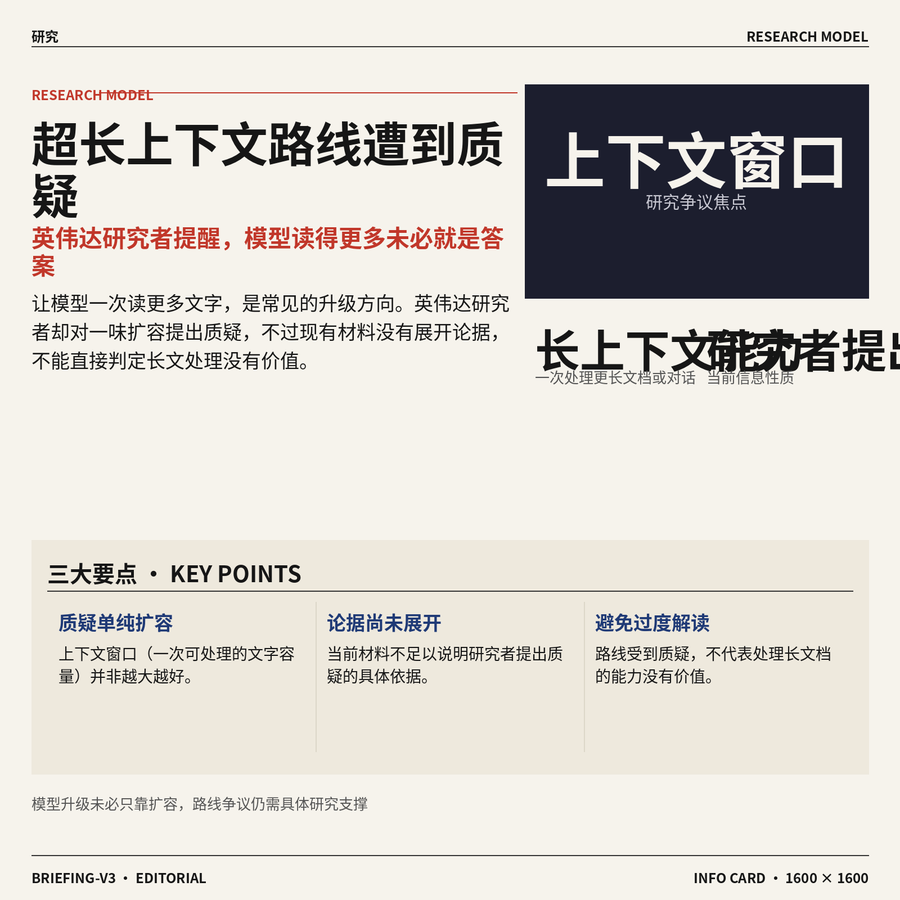

1. **英伟达研究者质疑：一味扩大上下文窗口，可能不是好方向。**
英伟达研究者提出，追求超大的**上下文窗口（模型一次能读取和处理的文字容量）**，可能是一条走不通的路线 🔍。这项讨论指向大模型的一种常见发展思路：通过扩充**长上下文能力（让模型一次处理更长的文档或对话）**，承接更复杂的任务。需要注意，这属于研究者提出的观点，当前材料不足以说明他们的具体论据，也不能据此认定“能读更多内容”没有价值。[上下文路线争议报道(briefing)](https://the-decoder.com/nvidia-researchers-argue-huge-ai-context-windows-are-a-dead-end/)


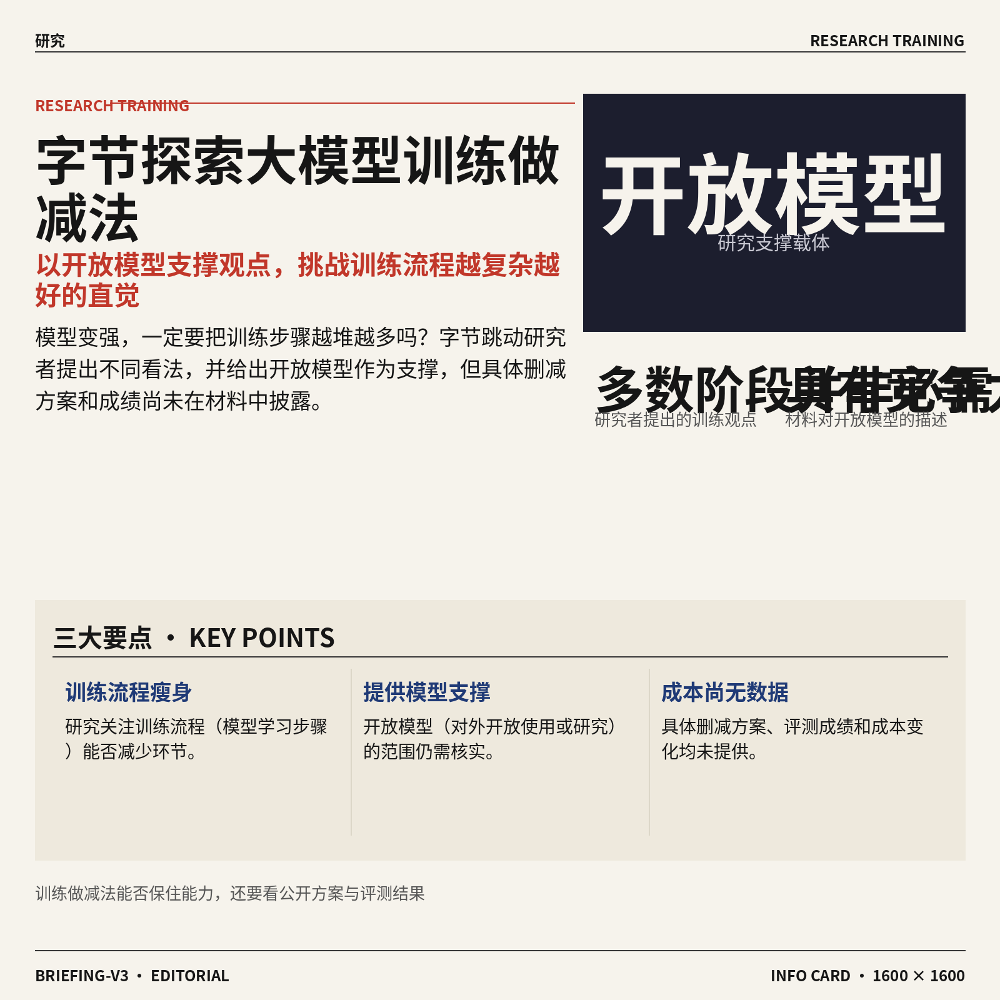

2. **字节跳动主张精简大模型训练阶段，并以开放模型支撑观点。**
字节跳动研究者认为，大模型训练中的多数阶段并非必需，并给出了一个具有竞争力的**开放模型（向外部开放使用或研究，但具体开放范围仍需看发布说明）**作为支撑 🚀。这项研究关注的是**训练流程（把数据转化为模型能力的一系列步骤）**能否做减法，而不只是继续叠加环节。它值得关注的核心问题是：模型能力是否一定要靠更复杂的训练过程来获得；不过，当前材料没有提供具体删减方案、评测成绩或成本变化。[字节训练精简研究报道(briefing)](https://the-decoder.com/bytedance-argues-most-ai-training-phases-are-unnecessary-and-backs-it-up-with-a-competitive-open-model/)


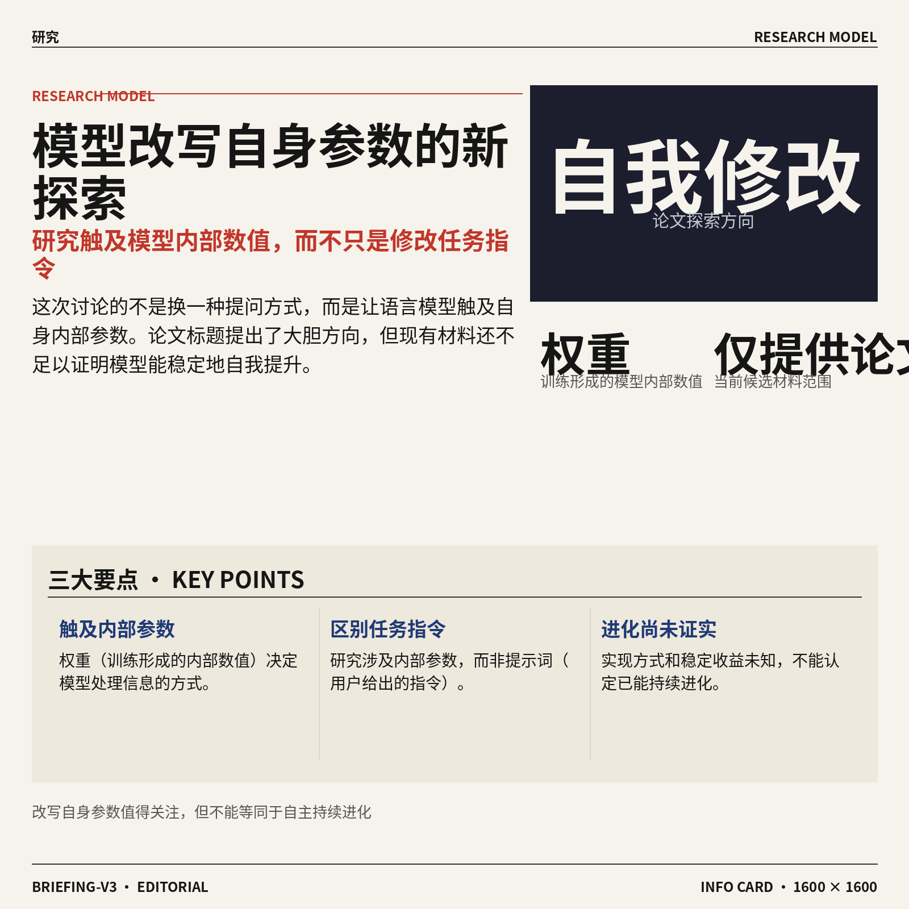

3. **语言模型能否改写自己的权重？新论文探索模型“自我修改”。**
一篇题为《语言模型可以改写自身权重》的论文，将研究焦点放在模型修改自身**权重（训练形成的内部数值，决定模型如何处理信息和生成回答）**的能力上 💡。这里讨论的不是修改**提示词（用户给模型的任务指令）**，而是触及模型内部参数本身。当前候选材料仅提供论文标题，尚不能确认修改如何实现、是否带来稳定提升，也不宜将其解读为模型已经能够自主持续进化。[模型自改权重论文(briefing)](https://huggingface.co/papers/2611.21885)

![语言模型能否改写自己的权重？新论文探索模型“自我修改”](https://image.pollinations.ai/prompt/%E8%AF%AD%E8%A8%80%E6%A8%A1%E5%9E%8B%E8%83%BD%E5%90%A6%E6%94%B9%E5%86%99%E8%87%AA%E5%B7%B1%E7%9A%84%E6%9D%83%E9%87%8D%EF%BC%9F%E6%96%B0%E8%AE%BA%E6%96%87%E6%8E%A2%E7%B4%A2%E6%A8%A1%E5%9E%8B%E2%80%9C%E8%87%AA%E6%88%91%E4%BF%AE%E6%94%B9%E2%80%9D.%20%E8%AF%AD%E8%A8%80%E6%A8%A1%E5%9E%8B%E8%83%BD%E5%90%A6%E6%94%B9%E5%86%99%E8%87%AA%E5%B7%B1%E7%9A%84%E6%9D%83%E9%87%8D%EF%BC%9F%E6%96%B0%E8%AE%BA%E6%96%87%E6%8E%A2%E7%B4%A2%E6%A8%A1%E5%9E%8B%E2%80%9C%E8%87%AA%E6%88%91%E4%BF%AE%E6%94%B9%E2%80%9D%E3%80%82%20%E4%B8%80%E7%AF%87%E9%A2%98%E4%B8%BA%E3%80%8A%E8%AF%AD%E8%A8%80%E6%A8%A1%E5%9E%8B%E5%8F%AF%E4%BB%A5%E6%94%B9%E5%86%99%E8%87%AA%E8%BA%AB%E6%9D%83%E9%87%8D%E3%80%8B%E7%9A%84%E8%AE%BA%E6%96%87%EF%BC%8C%E5%B0%86%E7%A0%94%E7%A9%B6%E7%84%A6%E7%82%B9%E6%94%BE%E5%9C%A8%E6%A8%A1%E5%9E%8B%E4%BF%AE%E6%94%B9%E8%87%AA%E8%BA%AB%E6%9D%83%E9%87%8D%EF%BC%88%E8%AE%AD%E7%BB%83%E5%BD%A2%E6%88%90%E7%9A%84%E5%86%85%E9%83%A8%E6%95%B0%E5%80%BC%EF%BC%8C%E5%86%B3%E5%AE%9A%E6%A8%A1%2C%20technical%20infographic%20diagram%2C%20architecture%20flowchart%2C%20clean%20vector%20illustration%2C%20educational%20style%2C%20no%20text%20overlay%2C%20modern%20minimal%2C%20wide%20aspect?width=1200&height=675&nologo=true&seed=10869)

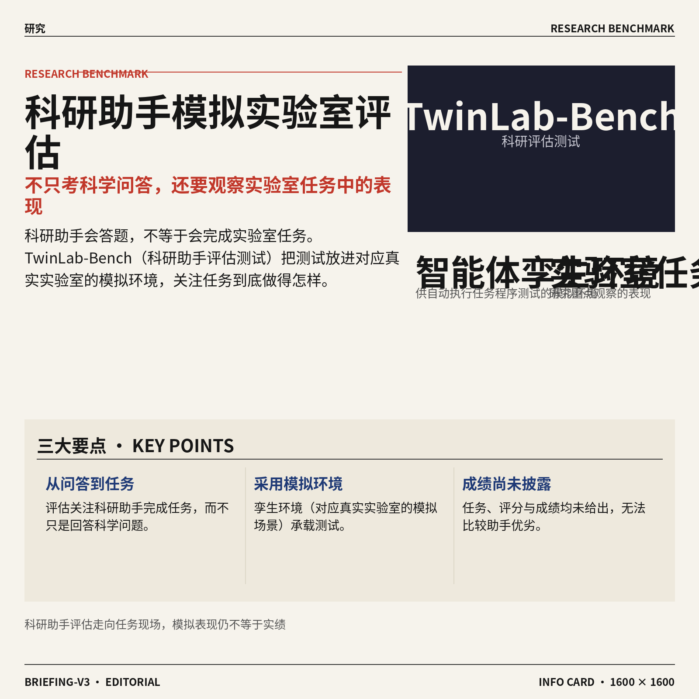

4. **TwinLab-Bench（在真实实验室对应的模拟环境中评估人工智能科研助手的测试）关注“科研任务做得怎么样”。**
这项研究提出 **TwinLab-Bench（面向人工智能科研助手的评估测试）**，将评估放在与真实实验室对应的**智能体孪生环境（供自动执行任务的程序开展测试的实验室模拟环境）**中 🧪。它关注的不只是模型能否回答科学问题，而是科研助手在实验室任务环境中的表现。当前材料没有给出测试任务、评分方式或模型成绩，因此还不能判断哪些助手表现更好，也不能把模拟环境中的表现直接等同于真实科研能力。[科研助手评估论文(briefing)](https://huggingface.co/papers/2611.26248)

![TwinLab-Bench（在真实实验室对应的模拟环境中评估人工智能科研助手的测试）关注“科研任务做得怎么样”](https://image.pollinations.ai/prompt/TwinLab-Bench%EF%BC%88%E5%9C%A8%E7%9C%9F%E5%AE%9E%E5%AE%9E%E9%AA%8C%E5%AE%A4%E5%AF%B9%E5%BA%94%E7%9A%84%E6%A8%A1%E6%8B%9F%E7%8E%AF%E5%A2%83%E4%B8%AD%E8%AF%84%E4%BC%B0%E4%BA%BA%E5%B7%A5%E6%99%BA%E8%83%BD%E7%A7%91%E7%A0%94%E5%8A%A9%E6%89%8B%E7%9A%84%E6%B5%8B%E8%AF%95%EF%BC%89%E5%85%B3%E6%B3%A8%E2%80%9C%E7%A7%91%E7%A0%94%E4%BB%BB%E5%8A%A1%E5%81%9A%E5%BE%97%E6%80%8E%E4%B9%88%E6%A0%B7%E2%80%9D.%20TwinLab-Bench%EF%BC%88%E5%9C%A8%E7%9C%9F%E5%AE%9E%E5%AE%9E%E9%AA%8C%E5%AE%A4%E5%AF%B9%E5%BA%94%E7%9A%84%E6%A8%A1%E6%8B%9F%E7%8E%AF%E5%A2%83%E4%B8%AD%E8%AF%84%E4%BC%B0%E4%BA%BA%E5%B7%A5%E6%99%BA%E8%83%BD%E7%A7%91%E7%A0%94%E5%8A%A9%E6%89%8B%E7%9A%84%E6%B5%8B%E8%AF%95%EF%BC%89%E5%85%B3%E6%B3%A8%E2%80%9C%E7%A7%91%E7%A0%94%E4%BB%BB%E5%8A%A1%E5%81%9A%E5%BE%97%E6%80%8E%E4%B9%88%E6%A0%B7%E2%80%9D%E3%80%82%20%E8%BF%99%E9%A1%B9%E7%A0%94%E7%A9%B6%E6%8F%90%E5%87%BA%20TwinLab-Bench%EF%BC%88%E9%9D%A2%E5%90%91%2C%20technical%20infographic%20diagram%2C%20architecture%20flowchart%2C%20clean%20vector%20illustration%2C%20educational%20style%2C%20no%20text%20overlay%2C%20modern%20minimal%2C%20wide%20aspect?width=1200&height=675&nologo=true&seed=10900)

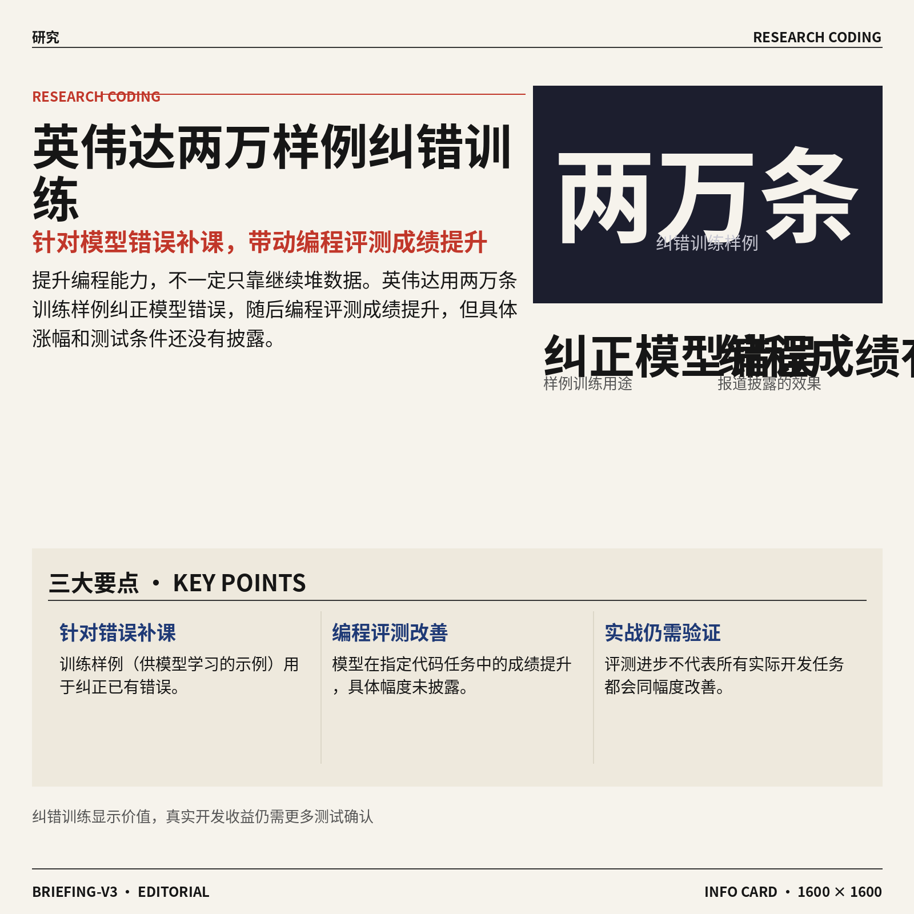

5. **英伟达用两万条训练样例纠正模型错误，编程评测成绩提升。**
据报道，英伟达使用 **两万条训练样例（供模型学习的示例材料）**来纠正模型错误，随后模型的编程成绩有所提升 🛠️。这条研究线索把注意力放在“针对错误补课”上，而不只是增加训练材料的数量。需要区分的是，**编程评测成绩（模型在指定代码任务中的测试表现）**提升，并不自动代表所有实际开发任务都同幅度改善；当前材料也没有给出具体涨幅和测试条件。[英伟达纠错训练报道(briefing)](https://news.google.com/rss/articles/CBMiY0FVX3lxTE9JazVNcDVHMFhoelphYjJNXzRKNUFWeFNfYVZpX01OSjdldUlFb0FEejY0ZmtHWHc0dWJ5VV9GYzhDdi1jZjkxcExLRWhUOFdQLTlTSUhKVHJsUExVaWNGUHAtOA?oc=5)

![英伟达用两万条训练样例纠正模型错误，编程评测成绩提升](https://image.pollinations.ai/prompt/%E8%8B%B1%E4%BC%9F%E8%BE%BE%E7%94%A8%E4%B8%A4%E4%B8%87%E6%9D%A1%E8%AE%AD%E7%BB%83%E6%A0%B7%E4%BE%8B%E7%BA%A0%E6%AD%A3%E6%A8%A1%E5%9E%8B%E9%94%99%E8%AF%AF%EF%BC%8C%E7%BC%96%E7%A8%8B%E8%AF%84%E6%B5%8B%E6%88%90%E7%BB%A9%E6%8F%90%E5%8D%87.%20%E8%8B%B1%E4%BC%9F%E8%BE%BE%E7%94%A8%E4%B8%A4%E4%B8%87%E6%9D%A1%E8%AE%AD%E7%BB%83%E6%A0%B7%E4%BE%8B%E7%BA%A0%E6%AD%A3%E6%A8%A1%E5%9E%8B%E9%94%99%E8%AF%AF%EF%BC%8C%E7%BC%96%E7%A8%8B%E8%AF%84%E6%B5%8B%E6%88%90%E7%BB%A9%E6%8F%90%E5%8D%87%E3%80%82%20%E6%8D%AE%E6%8A%A5%E9%81%93%EF%BC%8C%E8%8B%B1%E4%BC%9F%E8%BE%BE%E4%BD%BF%E7%94%A8%20%E4%B8%A4%E4%B8%87%E6%9D%A1%E8%AE%AD%E7%BB%83%E6%A0%B7%E4%BE%8B%EF%BC%88%E4%BE%9B%E6%A8%A1%E5%9E%8B%E5%AD%A6%E4%B9%A0%E7%9A%84%E7%A4%BA%E4%BE%8B%E6%9D%90%E6%96%99%EF%BC%89%E6%9D%A5%E7%BA%A0%E6%AD%A3%E6%A8%A1%E5%9E%8B%E9%94%99%E8%AF%AF%EF%BC%8C%E9%9A%8F%E5%90%8E%E6%A8%A1%E5%9E%8B%E7%9A%84%E7%BC%96%E7%A8%8B%E6%88%90%E7%BB%A9%E6%9C%89%E6%89%80%E6%8F%90%E5%8D%87%20%F0%9F%9B%A0%2C%20technical%20infographic%20diagram%2C%20architecture%20flowchart%2C%20clean%20vector%20illustration%2C%20educational%20style%2C%20no%20text%20overlay%2C%20modern%20minimal%2C%20wide%20aspect?width=1200&height=675&nologo=true&seed=10931)

### 🟡 行业展望与社会影响


1. **亚马逊接近以 75 亿美元收购 Decart（人工智能初创企业），交易尚未敲定。**
据《金融时报》报道，亚马逊正接近达成收购 **Decart（人工智能初创企业）**的交易，金额约为 **75 亿美元** 💰。这条消息的焦点是大型科技公司对 **AI（人工智能）初创企业**的收购动向，而非新产品发布。需要注意，报道使用的是“接近达成交易”，**不能理解为收购已经完成**。[亚马逊收购谈判报道(briefing)](https://news.google.com/rss/articles/CBMihAFBVV95cUxNTEFvVDlwcmNmNEl1WGpwZ3A3TzF3ZkNLSDFrUHA3XzY3REJxa3Jyc3pjUnVLdXdydFp3eTBYR1E1elQzVllDV1JQVzJENFNhV3RjVWl1eFB3dWFZS1BQWlRpTC1WZWZ1OV9CZmdhQnNtdmUxb25DWS16SEVodXVlRnBFUFQ?oc=5)


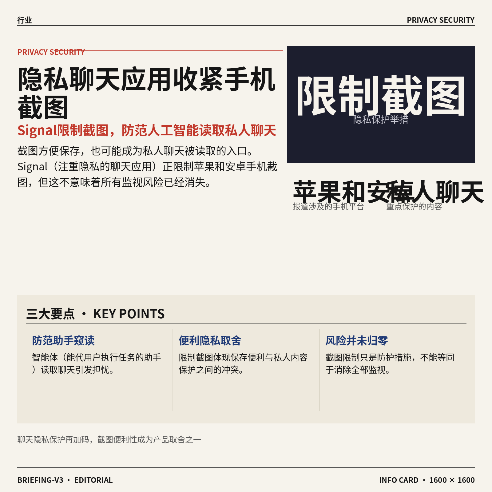

2. **Signal（注重隐私的聊天应用）限制手机截图，防范人工智能读取私人聊天。**
**Signal（注重隐私的聊天应用）**正在限制苹果和安卓手机应用中的截图功能，以应对人工智能监视风险 🔒。相关报道将这一举措与 **AI Agent（能代用户读取信息、执行任务的人工智能助手）**读取私人聊天的风险联系起来。这件事呈现了一个直接的产品取舍：**截图的便利性与聊天内容的隐私保护发生了冲突**，而限制截图并不等于已经消除所有监视风险。[聊天截图限制报道(briefing)](https://techcrunch.com/2026/11/21/signal-restricts-mobile-screenshots-as-it-confronts-existential-threat-of-ai-surveillance/) [人工智能监视风险报道(briefing)](https://the-decoder.com/signal-blocks-screenshots-on-ios-27-and-android-to-stop-ai-agents-from-reading-private-chats/)


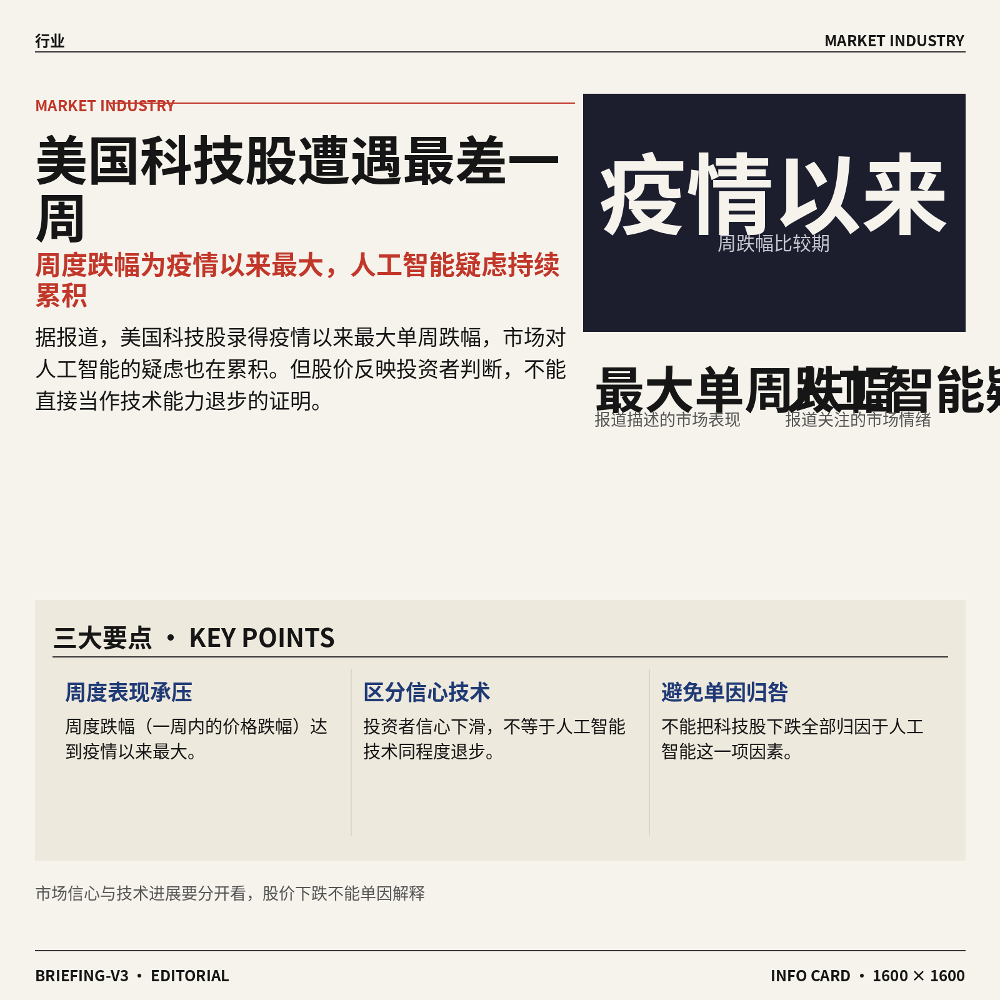

3. **美国科技股录得疫情以来最大单周跌幅，人工智能疑虑持续累积。**
据报道，随着市场对 **AI（人工智能）**的疑虑增加，美国科技股遭遇了疫情以来最差的一周 📉。这里的**周度跌幅（以一周为单位衡量的价格下跌幅度）**描述的是市场表现，不等于人工智能技术能力出现了同等程度的退步。阅读这条消息时，值得区分**投资者信心**与**技术进展**，也不宜把科技股下跌全部归因于人工智能这一项因素。[科技股周度下跌报道(briefing)](https://the-decoder.com/us-technology-stocks-suffer-their-worst-weekly-loss-since-the-pandemic-as-ai-doubts-pile-up/)

![美国科技股录得疫情以来最大单周跌幅，人工智能疑虑持续累积](https://image.pollinations.ai/prompt/%E7%BE%8E%E5%9B%BD%E7%A7%91%E6%8A%80%E8%82%A1%E5%BD%95%E5%BE%97%E7%96%AB%E6%83%85%E4%BB%A5%E6%9D%A5%E6%9C%80%E5%A4%A7%E5%8D%95%E5%91%A8%E8%B7%8C%E5%B9%85%EF%BC%8C%E4%BA%BA%E5%B7%A5%E6%99%BA%E8%83%BD%E7%96%91%E8%99%91%E6%8C%81%E7%BB%AD%E7%B4%AF%E7%A7%AF.%20%E7%BE%8E%E5%9B%BD%E7%A7%91%E6%8A%80%E8%82%A1%E5%BD%95%E5%BE%97%E7%96%AB%E6%83%85%E4%BB%A5%E6%9D%A5%E6%9C%80%E5%A4%A7%E5%8D%95%E5%91%A8%E8%B7%8C%E5%B9%85%EF%BC%8C%E4%BA%BA%E5%B7%A5%E6%99%BA%E8%83%BD%E7%96%91%E8%99%91%E6%8C%81%E7%BB%AD%E7%B4%AF%E7%A7%AF%E3%80%82%20%E6%8D%AE%E6%8A%A5%E9%81%93%EF%BC%8C%E9%9A%8F%E7%9D%80%E5%B8%82%E5%9C%BA%E5%AF%B9%20AI%EF%BC%88%E4%BA%BA%E5%B7%A5%E6%99%BA%E8%83%BD%EF%BC%89%E7%9A%84%E7%96%91%E8%99%91%E5%A2%9E%E5%8A%A0%EF%BC%8C%E7%BE%8E%E5%9B%BD%E7%A7%91%E6%8A%80%E8%82%A1%E9%81%AD%E9%81%87%E4%BA%86%E7%96%AB%E6%83%85%E4%BB%A5%E6%9D%A5%E6%9C%80%E5%B7%AE%E7%9A%84%E4%B8%80%E5%91%A8%20%F0%9F%93%89%E3%80%82%E8%BF%99%E9%87%8C%E7%9A%84%E5%91%A8%E5%BA%A6%E8%B7%8C%2C%20technical%20infographic%20diagram%2C%20architecture%20flowchart%2C%20clean%20vector%20illustration%2C%20educational%20style%2C%20no%20text%20overlay%2C%20modern%20minimal%2C%20wide%20aspect?width=1200&height=675&nologo=true&seed=10869)

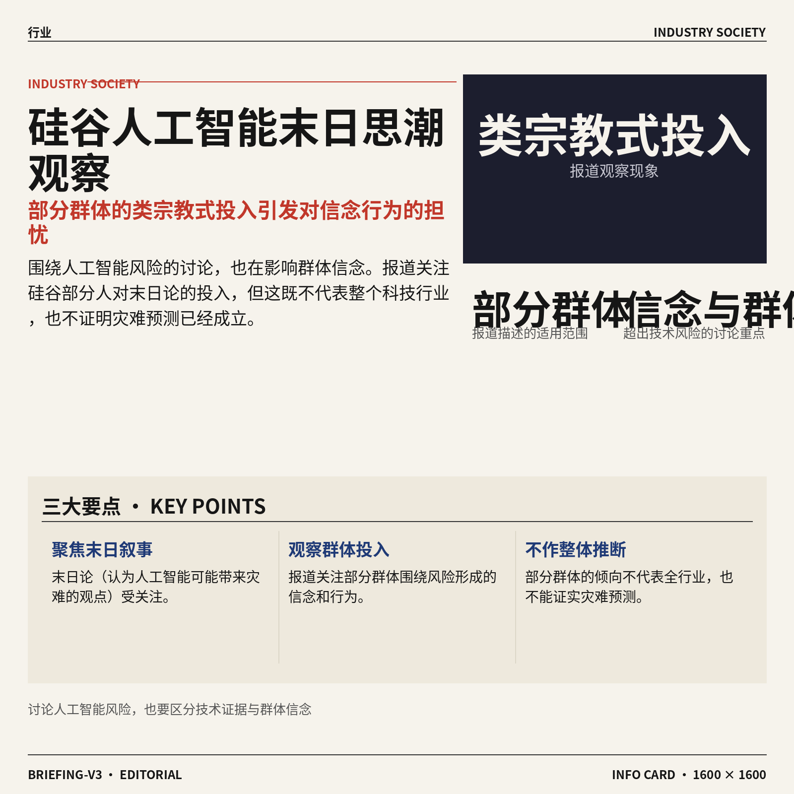

4. **硅谷对人工智能“末日论”的迷恋，正引发类宗教式投入的担忧。**
一篇报道关注到，硅谷对 **AI（人工智能）末日论（认为人工智能可能带来灾难性后果的观点）**日益着迷，科技行业的部分群体出现了近似宗教式的投入。它讨论的不只是技术风险，还包括人们围绕这些风险形成的**信念与群体行为** 💡。需要分清的是，报道描述的是部分行业群体的倾向，**既不代表整个科技行业，也不意味着“末日”预测已经得到证实**。[硅谷末日思潮报道(briefing)](https://the-decoder.com/silicon-valleys-growing-obsession-with-ai-doomsday-is-turning-parts-of-the-tech-industry-toward-cult-like-devotion/)

![硅谷对人工智能“末日论”的迷恋，正引发类宗教式投入的担忧](https://image.pollinations.ai/prompt/%E7%A1%85%E8%B0%B7%E5%AF%B9%E4%BA%BA%E5%B7%A5%E6%99%BA%E8%83%BD%E2%80%9C%E6%9C%AB%E6%97%A5%E8%AE%BA%E2%80%9D%E7%9A%84%E8%BF%B7%E6%81%8B%EF%BC%8C%E6%AD%A3%E5%BC%95%E5%8F%91%E7%B1%BB%E5%AE%97%E6%95%99%E5%BC%8F%E6%8A%95%E5%85%A5%E7%9A%84%E6%8B%85%E5%BF%A7.%20%E7%A1%85%E8%B0%B7%E5%AF%B9%E4%BA%BA%E5%B7%A5%E6%99%BA%E8%83%BD%E2%80%9C%E6%9C%AB%E6%97%A5%E8%AE%BA%E2%80%9D%E7%9A%84%E8%BF%B7%E6%81%8B%EF%BC%8C%E6%AD%A3%E5%BC%95%E5%8F%91%E7%B1%BB%E5%AE%97%E6%95%99%E5%BC%8F%E6%8A%95%E5%85%A5%E7%9A%84%E6%8B%85%E5%BF%A7%E3%80%82%20%E4%B8%80%E7%AF%87%E6%8A%A5%E9%81%93%E5%85%B3%E6%B3%A8%E5%88%B0%EF%BC%8C%E7%A1%85%E8%B0%B7%E5%AF%B9%20AI%EF%BC%88%E4%BA%BA%E5%B7%A5%E6%99%BA%E8%83%BD%EF%BC%89%E6%9C%AB%E6%97%A5%E8%AE%BA%EF%BC%88%E8%AE%A4%E4%B8%BA%E4%BA%BA%E5%B7%A5%E6%99%BA%E8%83%BD%E5%8F%AF%E8%83%BD%E5%B8%A6%E6%9D%A5%E7%81%BE%E9%9A%BE%E6%80%A7%E5%90%8E%E6%9E%9C%E7%9A%84%E8%A7%82%E7%82%B9%EF%BC%89%E6%97%A5%E7%9B%8A%E7%9D%80%E8%BF%B7%EF%BC%8C%E7%A7%91%E6%8A%80%2C%20technical%20infographic%20diagram%2C%20architecture%20flowchart%2C%20clean%20vector%20illustration%2C%20educational%20style%2C%20no%20text%20overlay%2C%20modern%20minimal%2C%20wide%20aspect?width=1200&height=675&nologo=true&seed=10900)

### 🟣 开源TOP项目

1. **Claude-BugHunter（面向 Claude Code 的漏洞排查技能包）汇集 82 项技能，聚焦安全测试。**
这套面向 Claude Code 的**技能包**（把特定任务的操作指引打包，让助手按要求执行）包含 **82 项技能、15 条斜杠命令**（以“/”开头、用于快捷调用功能的指令），服务于漏洞排查和外部安全红队测试 🔍。它整理了 **681 种已披露漏洞报告中的模式**，覆盖 **24 类核心漏洞**，为安全排查提供参考。项目还包含企业身份与基础设施的**攻击矩阵**（按类别梳理可能的攻击路径），帮助使用者系统查看相关风险；具体内容可见[漏洞排查项目仓库(briefing)](https://github.com/elementalsouls/Claude-BugHunter)。


2. **superpowers（面向软件开发的智能体技能框架）将技能组织与开发方法结合。**
这个开源项目将**智能体技能框架**（组织供自动执行任务的助手使用的能力与操作指引）和**软件开发方法论**（指导开发工作如何开展的一套做法）结合起来，定位于软件开发场景 🛠️。它关注的不只是提供某项能力，也包括如何组织开发工作的思路。当前提供的简介较为精简，尚未列出具体功能、使用条件或效果数据，感兴趣的同事可先查看[软件开发框架仓库(briefing)](https://github.com/obra/superpowers)，再判断是否适合团队需求。


### 🔴 社媒分享

1. **开发者被推上架构师岗位，却没人正式告知。**
这篇分享抛出一个值得关注的角色变化：**开发者（主要负责编写和维护软件的人）**被推到了**架构师（负责软件整体结构与方案设计的人）**的位置，却没有被明确告知。💡 标题的重点不只是“晋升”，更是**职责发生变化，当事人却未必得到清晰沟通**。目前提供的材料仅含标题，具体背景与作者的论证，还需参阅[开发者角色转变原文(briefing)](https://manidoraisamy.com/developer-to-architect.html)。

![开发者被推上架构师岗位，却没人正式告知](https://image.pollinations.ai/prompt/%E5%BC%80%E5%8F%91%E8%80%85%E8%A2%AB%E6%8E%A8%E4%B8%8A%E6%9E%B6%E6%9E%84%E5%B8%88%E5%B2%97%E4%BD%8D%EF%BC%8C%E5%8D%B4%E6%B2%A1%E4%BA%BA%E6%AD%A3%E5%BC%8F%E5%91%8A%E7%9F%A5.%20%E5%BC%80%E5%8F%91%E8%80%85%E8%A2%AB%E6%8E%A8%E4%B8%8A%E6%9E%B6%E6%9E%84%E5%B8%88%E5%B2%97%E4%BD%8D%EF%BC%8C%E5%8D%B4%E6%B2%A1%E4%BA%BA%E6%AD%A3%E5%BC%8F%E5%91%8A%E7%9F%A5%E3%80%82%20%E8%BF%99%E7%AF%87%E5%88%86%E4%BA%AB%E6%8A%9B%E5%87%BA%E4%B8%80%E4%B8%AA%E5%80%BC%E5%BE%97%E5%85%B3%E6%B3%A8%E7%9A%84%E8%A7%92%E8%89%B2%E5%8F%98%E5%8C%96%EF%BC%9A%E5%BC%80%E5%8F%91%E8%80%85%EF%BC%88%E4%B8%BB%E8%A6%81%E8%B4%9F%E8%B4%A3%E7%BC%96%E5%86%99%E5%92%8C%E7%BB%B4%E6%8A%A4%E8%BD%AF%E4%BB%B6%E7%9A%84%E4%BA%BA%EF%BC%89%E8%A2%AB%E6%8E%A8%E5%88%B0%E4%BA%86%E6%9E%B6%E6%9E%84%E5%B8%88%EF%BC%88%E8%B4%9F%E8%B4%A3%E8%BD%AF%E4%BB%B6%E6%95%B4%E4%BD%93%E7%BB%93%E6%9E%84%E4%B8%8E%E6%96%B9%E6%A1%88%E8%AE%BE%E8%AE%A1%E7%9A%84%E4%BA%BA%2C%20technical%20infographic%20diagram%2C%20architecture%20flowchart%2C%20clean%20vector%20illustration%2C%20educational%20style%2C%20no%20text%20overlay%2C%20modern%20minimal%2C%20wide%20aspect?width=1200&height=675&nologo=true&seed=10613)

---

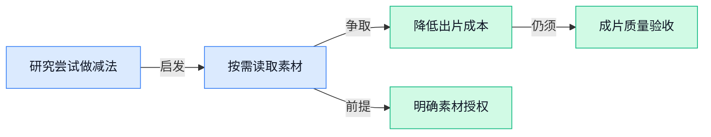

### 📊 行业洞察（今日 3 条）

1. 英伟达用摘要和搜索减少读取量，字节跳动靠精选材料减少训练步骤  
   【洞察】两项研究都在挑战“堆得多才更强”：省成本有新路，但测试成绩不等于实际任务效果。

2. OpenAI加强内部思考保护，Signal（隐私聊天应用）限制截图  
   【洞察】一个防泄露，一个防读取，共同提醒：助手能看到什么，不等于它就有权使用什么，自动化必须尊重边界。

3. 亚马逊洽谈75亿美元收购Decart（人工智能公司），同期美国科技股大跌  
   【洞察】巨头押注与市场降温并存，不能把收购报价当成行业普遍利好；技术投入和投资回报是两回事。

### 💭 对我们的启发（今日 3 条）

1. 英伟达用摘要和搜索节省开销，值得在长视频剪辑中验证：先找相关片段再处理，比较费用、漏选率和成片质量。

2. Signal（隐私聊天应用）限制截图提醒我们：品牌素材应按项目授权，客户上传不等于同意用于其他客户的创作。

3. 英伟达用两万条样例纠错，提示我们优先整理字幕、卖点和选镜错例；新版本先过这些测试，发布前仍由人确认。

