## AI资讯日报 2026/11/23

> AI 早报 · 每日早读 · 全网深度聚合

## **今日摘要**

```
亚马逊据报接近以75亿美元收购人工智能初创公司
OpenAI科学家提议为人工智能发展设限，先统一能力衡量标准
Google在助手调用工具前拦截操作，AI编程代理职场任务完成率不足一成
```

### 🔵 产品与功能更新

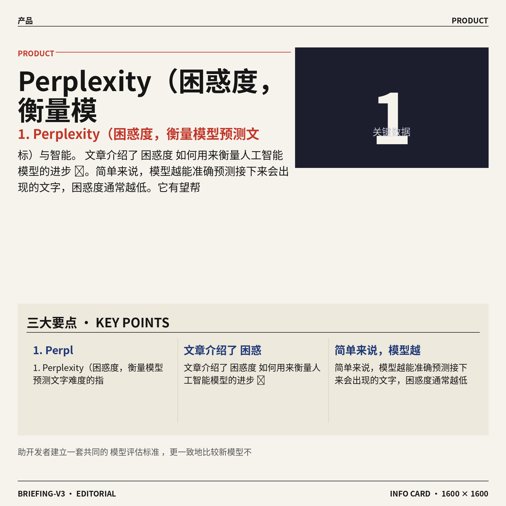

1. **Perplexity（困惑度，衡量模型预测文字难度的指标）与智能。**  
文章介绍了**困惑度**如何用来衡量人工智能模型的进步 📈。简单来说，模型越能准确预测接下来会出现的文字，困惑度通常越低。它有望帮助开发者建立一套共同的**模型评估标准**，更一致地比较新模型不断出现的能力。[困惑度评估解析(briefing)](https://openai.com/index/perplexity-and-intelligence)


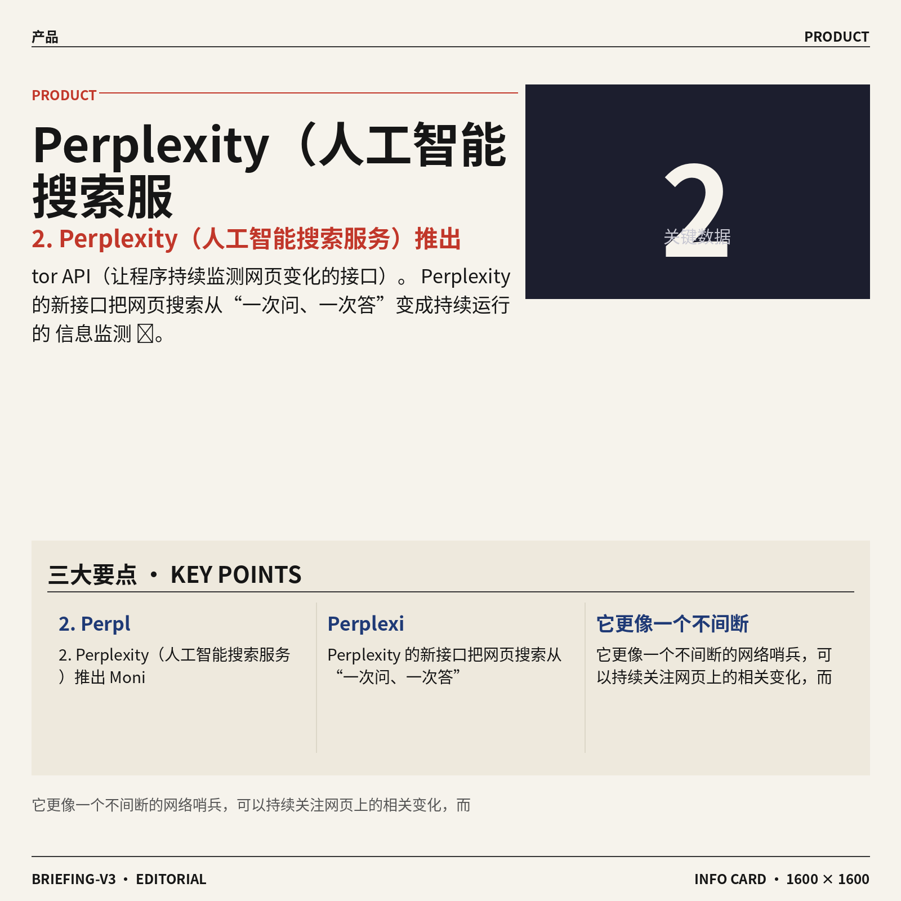

2. **Perplexity（人工智能搜索服务）推出 Monitor API（让程序持续监测网页变化的接口）。**  
Perplexity 的新接口把网页搜索从“一次问、一次答”变成持续运行的**信息监测** 👀。它更像一个不间断的网络哨兵，可以持续关注网页上的相关变化，而不是只在用户发起查询时返回结果。对需要追踪行业动态、品牌信息或公开网页变化的团队来说，这意味着搜索工具可能从临时查询升级为长期观察助手。[Monitor API 报道(briefing)](https://the-decoder.com/perplexitys-new-monitor-api-turns-web-search-from-a-one-off-query-into-a-nonstop-watchdog/)


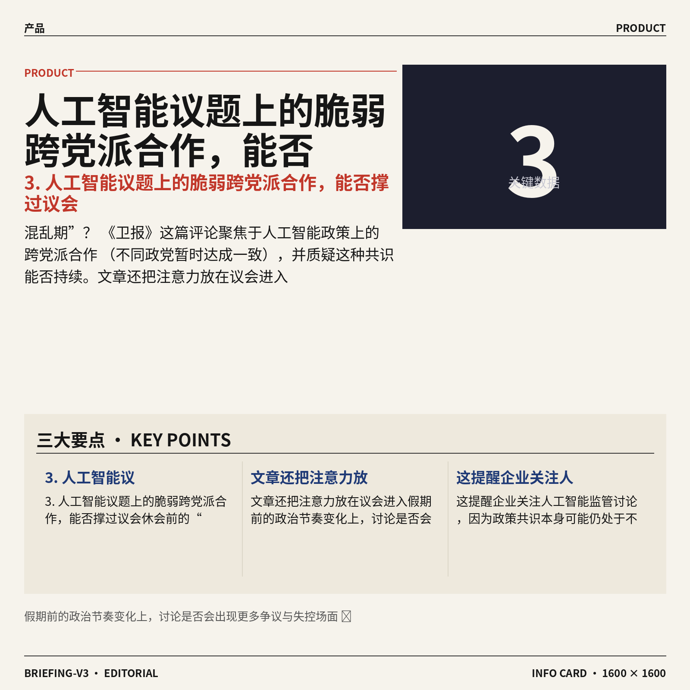

3. **人工智能议题上的脆弱跨党派合作，能否撑过议会休会前的“混乱期”？**  
《卫报》这篇评论聚焦于人工智能政策上的**跨党派合作**（不同政党暂时达成一致），并质疑这种共识能否持续。文章还把注意力放在议会进入假期前的政治节奏变化上，讨论是否会出现更多争议与失控场面 ⚖️。这提醒企业关注人工智能监管讨论，因为政策共识本身可能仍处于不稳定状态。[《卫报》评论原文(briefing)](https://news.google.com/rss/articles/CBMi_AFBVV95cUxPMHdnamVoWjY5THA3dUhNZDZ4YnJiSGxOQWZ2UDNpcW9aUWJhOURmaURDN2lwcDQ1QzBBLThZZHBEZzNMZXViNUtiTHFvUG1HQllTNWNtZDJrSW03SDFjM0FZaE1ubHJVNHlHbUtHUHF4Nm5ZeENndUdESEhHaG9Id1pZZUtGQmcwWGJRSl9UbF9FUUJKSjVjWGxHUkpEaUR6N0NhOGp2VU1iU0FLQVRFQWQyLVA1bHFsalpKWWJFY0NyZ2hpSXVIellmTkRTRU4zRXZPeFJ6OVR3VWNBWVdVS1lyWWtEdTdVbDNpOVdSOFhreDZmRGdYZVJ2UGs?oc=5)

![人工智能议题上的脆弱跨党派合作，能否撑过议会休会前的“混乱期”？](https://image.pollinations.ai/prompt/%E4%BA%BA%E5%B7%A5%E6%99%BA%E8%83%BD%E8%AE%AE%E9%A2%98%E4%B8%8A%E7%9A%84%E8%84%86%E5%BC%B1%E8%B7%A8%E5%85%9A%E6%B4%BE%E5%90%88%E4%BD%9C%EF%BC%8C%E8%83%BD%E5%90%A6%E6%92%91%E8%BF%87%E8%AE%AE%E4%BC%9A%E4%BC%91%E4%BC%9A%E5%89%8D%E7%9A%84%E2%80%9C%E6%B7%B7%E4%B9%B1%E6%9C%9F%E2%80%9D%EF%BC%9F.%20%E4%BA%BA%E5%B7%A5%E6%99%BA%E8%83%BD%E8%AE%AE%E9%A2%98%E4%B8%8A%E7%9A%84%E8%84%86%E5%BC%B1%E8%B7%A8%E5%85%9A%E6%B4%BE%E5%90%88%E4%BD%9C%EF%BC%8C%E8%83%BD%E5%90%A6%E6%92%91%E8%BF%87%E8%AE%AE%E4%BC%9A%E4%BC%91%E4%BC%9A%E5%89%8D%E7%9A%84%E2%80%9C%E6%B7%B7%E4%B9%B1%E6%9C%9F%E2%80%9D%EF%BC%9F%20%E3%80%8A%E5%8D%AB%E6%8A%A5%E3%80%8B%E8%BF%99%E7%AF%87%E8%AF%84%E8%AE%BA%E8%81%9A%E7%84%A6%E4%BA%8E%E4%BA%BA%E5%B7%A5%E6%99%BA%E8%83%BD%E6%94%BF%E7%AD%96%E4%B8%8A%E7%9A%84%E8%B7%A8%E5%85%9A%E6%B4%BE%E5%90%88%E4%BD%9C%EF%BC%88%E4%B8%8D%E5%90%8C%E6%94%BF%E5%85%9A%E6%9A%82%E6%97%B6%E8%BE%BE%E6%88%90%E4%B8%80%E8%87%B4%EF%BC%89%EF%BC%8C%E5%B9%B6%E8%B4%A8%E7%96%91%E8%BF%99%E7%A7%8D%E5%85%B1%E8%AF%86%E8%83%BD%E5%90%A6%E6%8C%81%2C%20technical%20infographic%20diagram%2C%20architecture%20flowchart%2C%20clean%20vector%20illustration%2C%20educational%20style%2C%20no%20text%20overlay%2C%20modern%20minimal%2C%20wide%20aspect?width=1200&height=675&nologo=true&seed=11451)

### 🟢 前沿研究

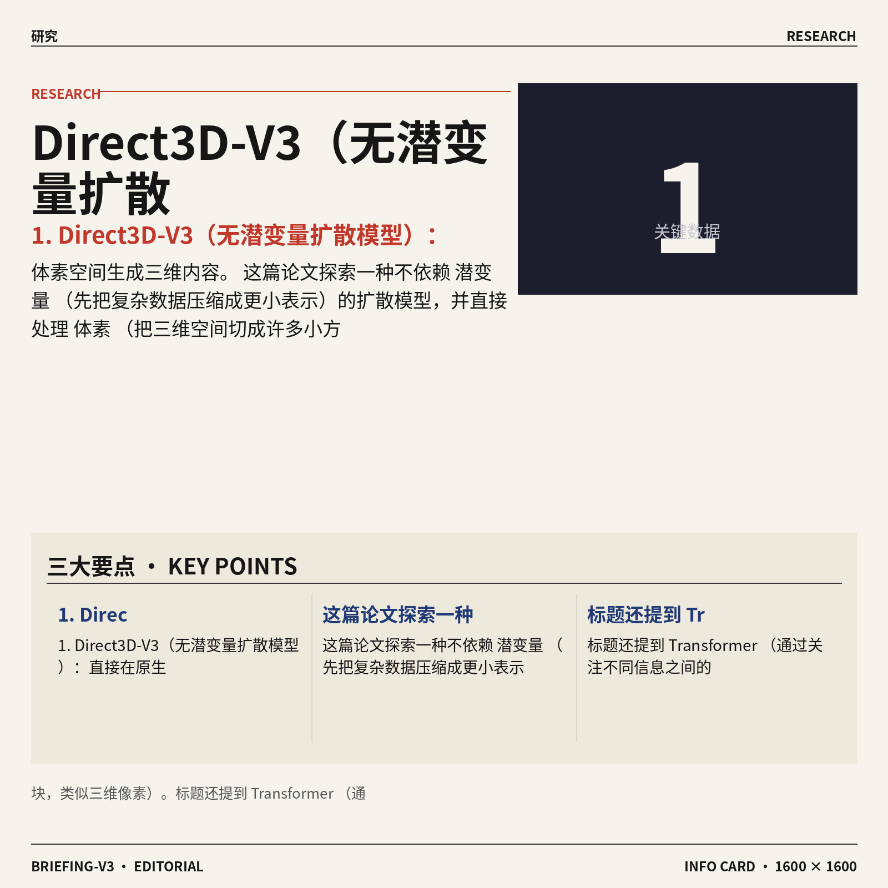

1. **Direct3D-V3（无潜变量扩散模型）：直接在原生体素空间生成三维内容。**  
这篇论文探索一种不依赖**潜变量**（先把复杂数据压缩成更小表示）的扩散模型，并直接处理**体素**（把三维空间切成许多小方块，类似三维像素）。标题还提到**Transformer**（通过关注不同信息之间的关系来处理数据的模型架构），说明研究重点在于用这类模型进行三维内容生成。整体来看，它关注的是如何让三维生成过程更直接地贴近原始空间表示 🚀。[论文原文页面(briefing)](https://huggingface.co/papers/2611.26511)


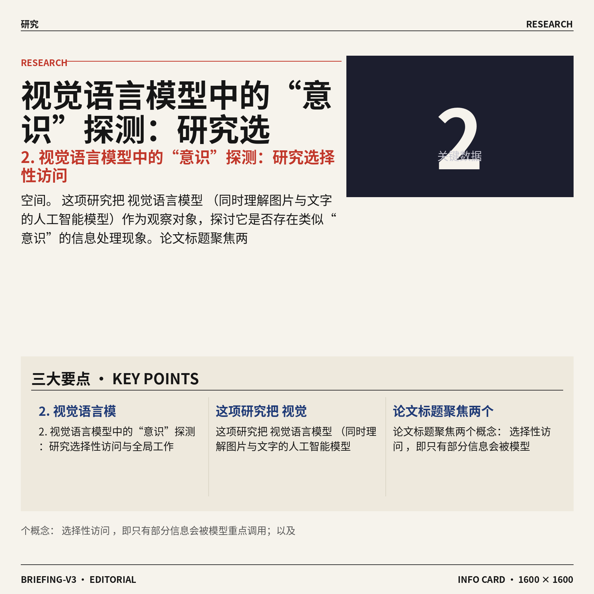

2. **视觉语言模型中的“意识”探测：研究选择性访问与全局工作空间。**  
这项研究把**视觉语言模型**（同时理解图片与文字的人工智能模型）作为观察对象，探讨它是否存在类似“意识”的信息处理现象。论文标题聚焦两个概念：**选择性访问**，即只有部分信息会被模型重点调用；以及**全局工作空间**，可以理解为让不同处理模块共享关键信息的“公共看板”。这类研究有助于进一步理解模型如何处理视觉和语言信息 💡。[论文原文页面(briefing)](https://huggingface.co/papers/2611.26590)

![视觉语言模型中的“意识”探测：研究选择性访问与全局工作空间](https://image.pollinations.ai/prompt/%E8%A7%86%E8%A7%89%E8%AF%AD%E8%A8%80%E6%A8%A1%E5%9E%8B%E4%B8%AD%E7%9A%84%E2%80%9C%E6%84%8F%E8%AF%86%E2%80%9D%E6%8E%A2%E6%B5%8B%EF%BC%9A%E7%A0%94%E7%A9%B6%E9%80%89%E6%8B%A9%E6%80%A7%E8%AE%BF%E9%97%AE%E4%B8%8E%E5%85%A8%E5%B1%80%E5%B7%A5%E4%BD%9C%E7%A9%BA%E9%97%B4.%20%E8%A7%86%E8%A7%89%E8%AF%AD%E8%A8%80%E6%A8%A1%E5%9E%8B%E4%B8%AD%E7%9A%84%E2%80%9C%E6%84%8F%E8%AF%86%E2%80%9D%E6%8E%A2%E6%B5%8B%EF%BC%9A%E7%A0%94%E7%A9%B6%E9%80%89%E6%8B%A9%E6%80%A7%E8%AE%BF%E9%97%AE%E4%B8%8E%E5%85%A8%E5%B1%80%E5%B7%A5%E4%BD%9C%E7%A9%BA%E9%97%B4%E3%80%82%20%E8%BF%99%E9%A1%B9%E7%A0%94%E7%A9%B6%E6%8A%8A%E8%A7%86%E8%A7%89%E8%AF%AD%E8%A8%80%E6%A8%A1%E5%9E%8B%EF%BC%88%E5%90%8C%E6%97%B6%E7%90%86%E8%A7%A3%E5%9B%BE%E7%89%87%E4%B8%8E%E6%96%87%E5%AD%97%E7%9A%84%E4%BA%BA%E5%B7%A5%E6%99%BA%E8%83%BD%E6%A8%A1%E5%9E%8B%EF%BC%89%E4%BD%9C%E4%B8%BA%E8%A7%82%E5%AF%9F%E5%AF%B9%E8%B1%A1%EF%BC%8C%E6%8E%A2%E8%AE%A8%E5%AE%83%E6%98%AF%E5%90%A6%E5%AD%98%E5%9C%A8%E7%B1%BB%E4%BC%BC%E2%80%9C%E6%84%8F%E8%AF%86%E2%80%9D%2C%20technical%20infographic%20diagram%2C%20architecture%20flowchart%2C%20clean%20vector%20illustration%2C%20educational%20style%2C%20no%20text%20overlay%2C%20modern%20minimal%2C%20wide%20aspect?width=1200&height=675&nologo=true&seed=10838)

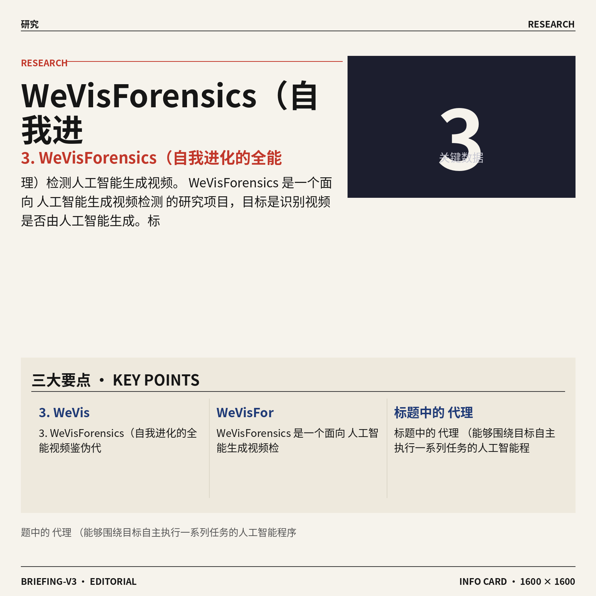

3. **WeVisForensics（自我进化的全能视频鉴伪代理）检测人工智能生成视频。**  
WeVisForensics 是一个面向**人工智能生成视频检测**的研究项目，目标是识别视频是否由人工智能生成。标题中的**代理**（能够围绕目标自主执行一系列任务的人工智能程序）强调了它并非只做一次判断，而是被设计为具备“自我进化”特征。**全能视频**则指向对多种视频信息进行综合分析的方向，对内容审核与媒体真实性判断具有参考价值 🔍。[论文原文页面(briefing)](https://huggingface.co/papers/2611.21373)


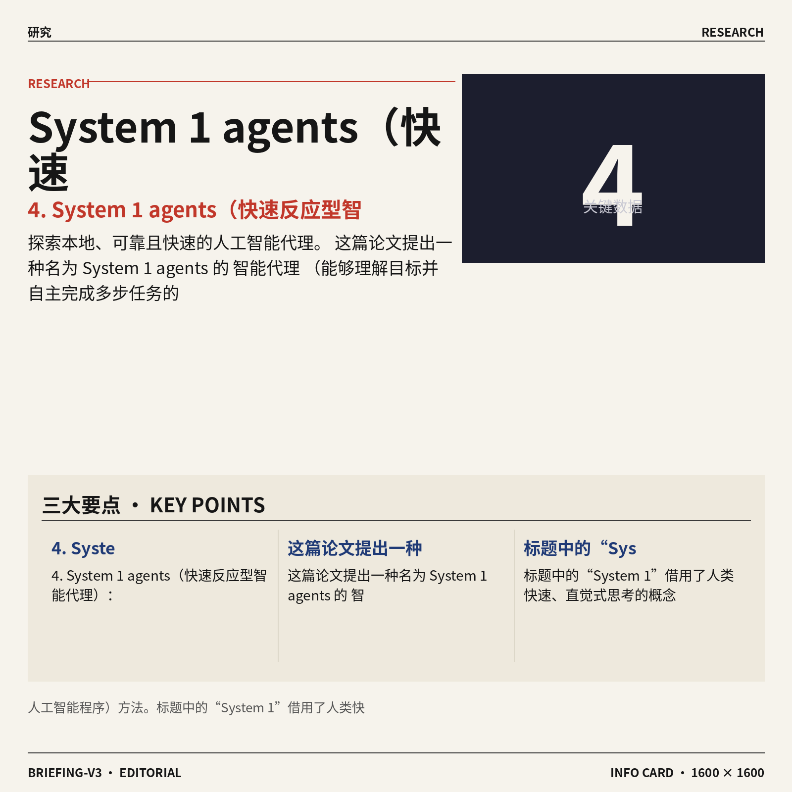

4. **System 1 agents（快速反应型智能代理）：探索本地、可靠且快速的人工智能代理。**  
这篇论文提出一种名为 System 1 agents 的**智能代理**（能够理解目标并自主完成多步任务的人工智能程序）方法。标题中的“System 1”借用了人类快速、直觉式思考的概念，研究重点则放在**本地运行**、可靠性与速度上。若这一方向成立，相关代理可能更适合需要快速响应、又希望减少对远程服务依赖的场景 ⚡。[论文原文页面(briefing)](https://huggingface.co/papers/2611.21053)

![System 1 agents（快速反应型智能代理）：探索本地、可靠且快速的人工智能代理](https://image.pollinations.ai/prompt/System%201%20agents%EF%BC%88%E5%BF%AB%E9%80%9F%E5%8F%8D%E5%BA%94%E5%9E%8B%E6%99%BA%E8%83%BD%E4%BB%A3%E7%90%86%EF%BC%89%EF%BC%9A%E6%8E%A2%E7%B4%A2%E6%9C%AC%E5%9C%B0%E3%80%81%E5%8F%AF%E9%9D%A0%E4%B8%94%E5%BF%AB%E9%80%9F%E7%9A%84%E4%BA%BA%E5%B7%A5%E6%99%BA%E8%83%BD%E4%BB%A3%E7%90%86.%20System%201%20agents%EF%BC%88%E5%BF%AB%E9%80%9F%E5%8F%8D%E5%BA%94%E5%9E%8B%E6%99%BA%E8%83%BD%E4%BB%A3%E7%90%86%EF%BC%89%EF%BC%9A%E6%8E%A2%E7%B4%A2%E6%9C%AC%E5%9C%B0%E3%80%81%E5%8F%AF%E9%9D%A0%E4%B8%94%E5%BF%AB%E9%80%9F%E7%9A%84%E4%BA%BA%E5%B7%A5%E6%99%BA%E8%83%BD%E4%BB%A3%E7%90%86%E3%80%82%20%E8%BF%99%E7%AF%87%E8%AE%BA%E6%96%87%E6%8F%90%E5%87%BA%E4%B8%80%E7%A7%8D%E5%90%8D%E4%B8%BA%20System%201%20agents%20%E7%9A%84%E6%99%BA%E8%83%BD%E4%BB%A3%E7%90%86%EF%BC%88%E8%83%BD%2C%20technical%20infographic%20diagram%2C%20architecture%20flowchart%2C%20clean%20vector%20illustration%2C%20educational%20style%2C%20no%20text%20overlay%2C%20modern%20minimal%2C%20wide%20aspect?width=1200&height=675&nologo=true&seed=10900)

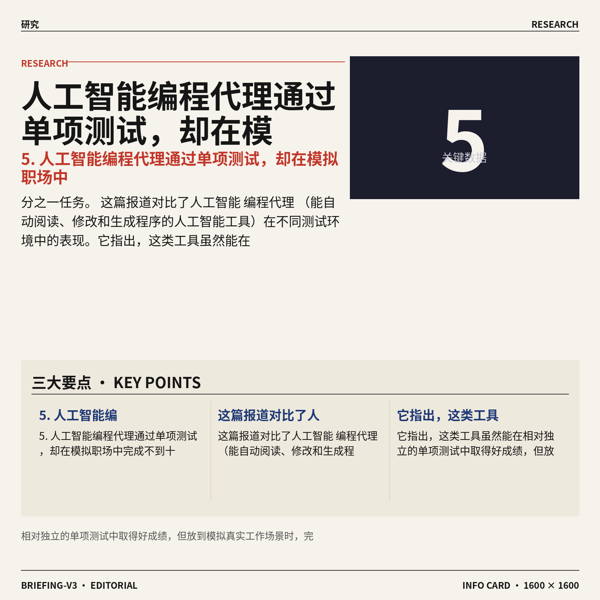

5. **人工智能编程代理通过单项测试，却在模拟职场中完成不到十分之一任务。**  
这篇报道对比了人工智能**编程代理**（能自动阅读、修改和生成程序的人工智能工具）在不同测试环境中的表现。它指出，这类工具虽然能在相对独立的单项测试中取得好成绩，但放到模拟真实工作场景时，完成率却低于十分之一。这个反差提醒企业：评估人工智能助手时，不能只看“会不会解一道题”，还要看它能否持续处理完整工作流程 📊。[完整报道(briefing)](https://the-decoder.com/ai-coding-agents-ace-isolated-tests-but-complete-fewer-than-one-in-ten-tasks-in-a-simulated-workplace/)

![人工智能编程代理通过单项测试，却在模拟职场中完成不到十分之一任务](https://image.pollinations.ai/prompt/%E4%BA%BA%E5%B7%A5%E6%99%BA%E8%83%BD%E7%BC%96%E7%A8%8B%E4%BB%A3%E7%90%86%E9%80%9A%E8%BF%87%E5%8D%95%E9%A1%B9%E6%B5%8B%E8%AF%95%EF%BC%8C%E5%8D%B4%E5%9C%A8%E6%A8%A1%E6%8B%9F%E8%81%8C%E5%9C%BA%E4%B8%AD%E5%AE%8C%E6%88%90%E4%B8%8D%E5%88%B0%E5%8D%81%E5%88%86%E4%B9%8B%E4%B8%80%E4%BB%BB%E5%8A%A1.%20%E4%BA%BA%E5%B7%A5%E6%99%BA%E8%83%BD%E7%BC%96%E7%A8%8B%E4%BB%A3%E7%90%86%E9%80%9A%E8%BF%87%E5%8D%95%E9%A1%B9%E6%B5%8B%E8%AF%95%EF%BC%8C%E5%8D%B4%E5%9C%A8%E6%A8%A1%E6%8B%9F%E8%81%8C%E5%9C%BA%E4%B8%AD%E5%AE%8C%E6%88%90%E4%B8%8D%E5%88%B0%E5%8D%81%E5%88%86%E4%B9%8B%E4%B8%80%E4%BB%BB%E5%8A%A1%E3%80%82%20%E8%BF%99%E7%AF%87%E6%8A%A5%E9%81%93%E5%AF%B9%E6%AF%94%E4%BA%86%E4%BA%BA%E5%B7%A5%E6%99%BA%E8%83%BD%E7%BC%96%E7%A8%8B%E4%BB%A3%E7%90%86%EF%BC%88%E8%83%BD%E8%87%AA%E5%8A%A8%E9%98%85%E8%AF%BB%E3%80%81%E4%BF%AE%E6%94%B9%E5%92%8C%E7%94%9F%E6%88%90%E7%A8%8B%E5%BA%8F%E7%9A%84%E4%BA%BA%E5%B7%A5%E6%99%BA%E8%83%BD%E5%B7%A5%E5%85%B7%EF%BC%89%E5%9C%A8%E4%B8%8D%E5%90%8C%E6%B5%8B%E8%AF%95%E7%8E%AF%E5%A2%83%E4%B8%AD%E7%9A%84%2C%20technical%20infographic%20diagram%2C%20architecture%20flowchart%2C%20clean%20vector%20illustration%2C%20educational%20style%2C%20no%20text%20overlay%2C%20modern%20minimal%2C%20wide%20aspect?width=1200&height=675&nologo=true&seed=10931)

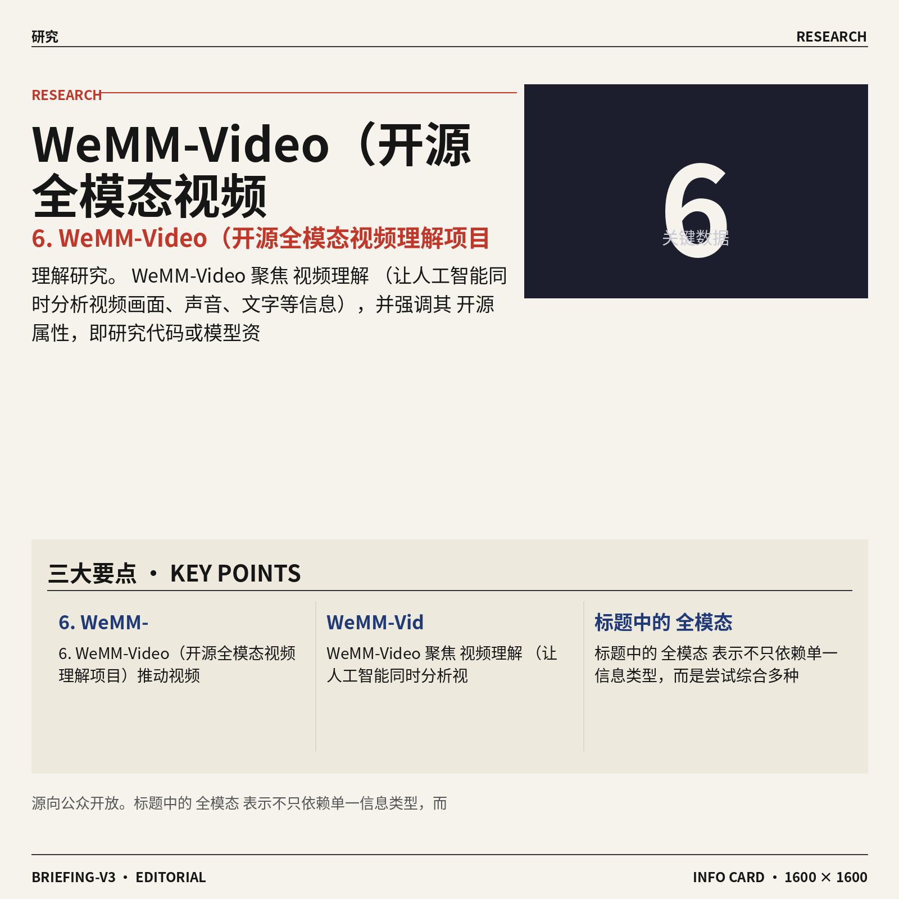

6. **WeMM-Video（开源全模态视频理解项目）推动视频理解研究。**  
WeMM-Video 聚焦**视频理解**（让人工智能同时分析视频画面、声音、文字等信息），并强调其**开源**属性，即研究代码或模型资源向公众开放。标题中的**全模态**表示不只依赖单一信息类型，而是尝试综合多种数据形式来理解视频内容。对研究人员和产品团队来说，这类项目的价值在于探索更完整的视频分析能力 🎬。[论文原文页面(briefing)](https://huggingface.co/papers/2611.26409)

![WeMM-Video（开源全模态视频理解项目）推动视频理解研究](https://image.pollinations.ai/prompt/WeMM-Video%EF%BC%88%E5%BC%80%E6%BA%90%E5%85%A8%E6%A8%A1%E6%80%81%E8%A7%86%E9%A2%91%E7%90%86%E8%A7%A3%E9%A1%B9%E7%9B%AE%EF%BC%89%E6%8E%A8%E5%8A%A8%E8%A7%86%E9%A2%91%E7%90%86%E8%A7%A3%E7%A0%94%E7%A9%B6.%20WeMM-Video%EF%BC%88%E5%BC%80%E6%BA%90%E5%85%A8%E6%A8%A1%E6%80%81%E8%A7%86%E9%A2%91%E7%90%86%E8%A7%A3%E9%A1%B9%E7%9B%AE%EF%BC%89%E6%8E%A8%E5%8A%A8%E8%A7%86%E9%A2%91%E7%90%86%E8%A7%A3%E7%A0%94%E7%A9%B6%E3%80%82%20WeMM-Video%20%E8%81%9A%E7%84%A6%E8%A7%86%E9%A2%91%E7%90%86%E8%A7%A3%EF%BC%88%E8%AE%A9%E4%BA%BA%E5%B7%A5%E6%99%BA%E8%83%BD%E5%90%8C%E6%97%B6%E5%88%86%E6%9E%90%E8%A7%86%E9%A2%91%E7%94%BB%E9%9D%A2%E3%80%81%E5%A3%B0%E9%9F%B3%E3%80%81%E6%96%87%E5%AD%97%E7%AD%89%E4%BF%A1%E6%81%AF%EF%BC%89%EF%BC%8C%E5%B9%B6%E5%BC%BA%E8%B0%83%E5%85%B6%E5%BC%80%2C%20technical%20infographic%20diagram%2C%20architecture%20flowchart%2C%20clean%20vector%20illustration%2C%20educational%20style%2C%20no%20text%20overlay%2C%20modern%20minimal%2C%20wide%20aspect?width=1200&height=675&nologo=true&seed=10962)

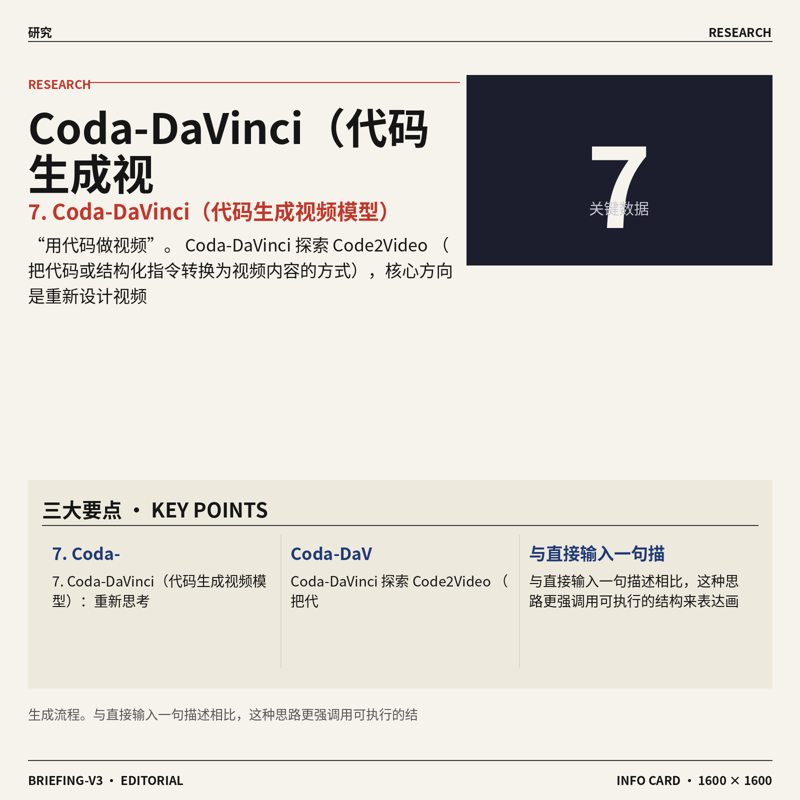

7. **Coda-DaVinci（代码生成视频模型）：重新思考“用代码做视频”。**  
Coda-DaVinci 探索 **Code2Video**（把代码或结构化指令转换为视频内容的方式），核心方向是重新设计视频生成流程。与直接输入一句描述相比，这种思路更强调用可执行的结构来表达画面、动作或场景。对创意制作和视频工具而言，它代表一种把编程逻辑与生成式视频结合起来的研究路径 🚀。[论文原文页面(briefing)](https://huggingface.co/papers/2611.26595)


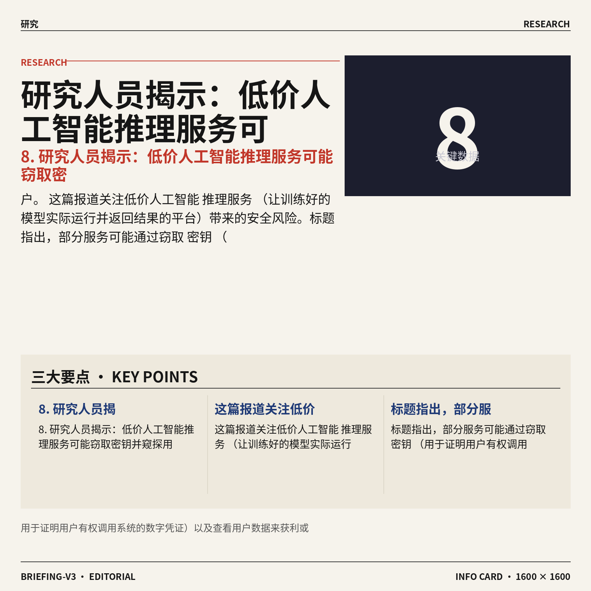

8. **研究人员揭示：低价人工智能推理服务可能窃取密钥并窥探用户。**  
这篇报道关注低价人工智能**推理服务**（让训练好的模型实际运行并返回结果的平台）带来的安全风险。标题指出，部分服务可能通过窃取**密钥**（用于证明用户有权调用系统的数字凭证）以及查看用户数据来获利或获取信息。对企业来说，选择人工智能服务时不能只比较价格，也要关注凭证保护与用户隐私 🔐。[完整报道(briefing)](https://the-decoder.com/security-researchers-show-how-cheap-ai-inference-providers-steal-keys-and-snoop-on-users/)

![研究人员揭示：低价人工智能推理服务可能窃取密钥并窥探用户](https://image.pollinations.ai/prompt/%E7%A0%94%E7%A9%B6%E4%BA%BA%E5%91%98%E6%8F%AD%E7%A4%BA%EF%BC%9A%E4%BD%8E%E4%BB%B7%E4%BA%BA%E5%B7%A5%E6%99%BA%E8%83%BD%E6%8E%A8%E7%90%86%E6%9C%8D%E5%8A%A1%E5%8F%AF%E8%83%BD%E7%AA%83%E5%8F%96%E5%AF%86%E9%92%A5%E5%B9%B6%E7%AA%A5%E6%8E%A2%E7%94%A8%E6%88%B7.%20%E7%A0%94%E7%A9%B6%E4%BA%BA%E5%91%98%E6%8F%AD%E7%A4%BA%EF%BC%9A%E4%BD%8E%E4%BB%B7%E4%BA%BA%E5%B7%A5%E6%99%BA%E8%83%BD%E6%8E%A8%E7%90%86%E6%9C%8D%E5%8A%A1%E5%8F%AF%E8%83%BD%E7%AA%83%E5%8F%96%E5%AF%86%E9%92%A5%E5%B9%B6%E7%AA%A5%E6%8E%A2%E7%94%A8%E6%88%B7%E3%80%82%20%E8%BF%99%E7%AF%87%E6%8A%A5%E9%81%93%E5%85%B3%E6%B3%A8%E4%BD%8E%E4%BB%B7%E4%BA%BA%E5%B7%A5%E6%99%BA%E8%83%BD%E6%8E%A8%E7%90%86%E6%9C%8D%E5%8A%A1%EF%BC%88%E8%AE%A9%E8%AE%AD%E7%BB%83%E5%A5%BD%E7%9A%84%E6%A8%A1%E5%9E%8B%E5%AE%9E%E9%99%85%E8%BF%90%E8%A1%8C%E5%B9%B6%E8%BF%94%E5%9B%9E%E7%BB%93%E6%9E%9C%E7%9A%84%E5%B9%B3%E5%8F%B0%EF%BC%89%E5%B8%A6%E6%9D%A5%E7%9A%84%E5%AE%89%E5%85%A8%E9%A3%8E%E9%99%A9%E3%80%82%E6%A0%87%E9%A2%98%E6%8C%87%E5%87%BA%EF%BC%8C%2C%20technical%20infographic%20diagram%2C%20architecture%20flowchart%2C%20clean%20vector%20illustration%2C%20educational%20style%2C%20no%20text%20overlay%2C%20modern%20minimal%2C%20wide%20aspect?width=1200&height=675&nologo=true&seed=11024)

### 🟡 行业展望与社会影响

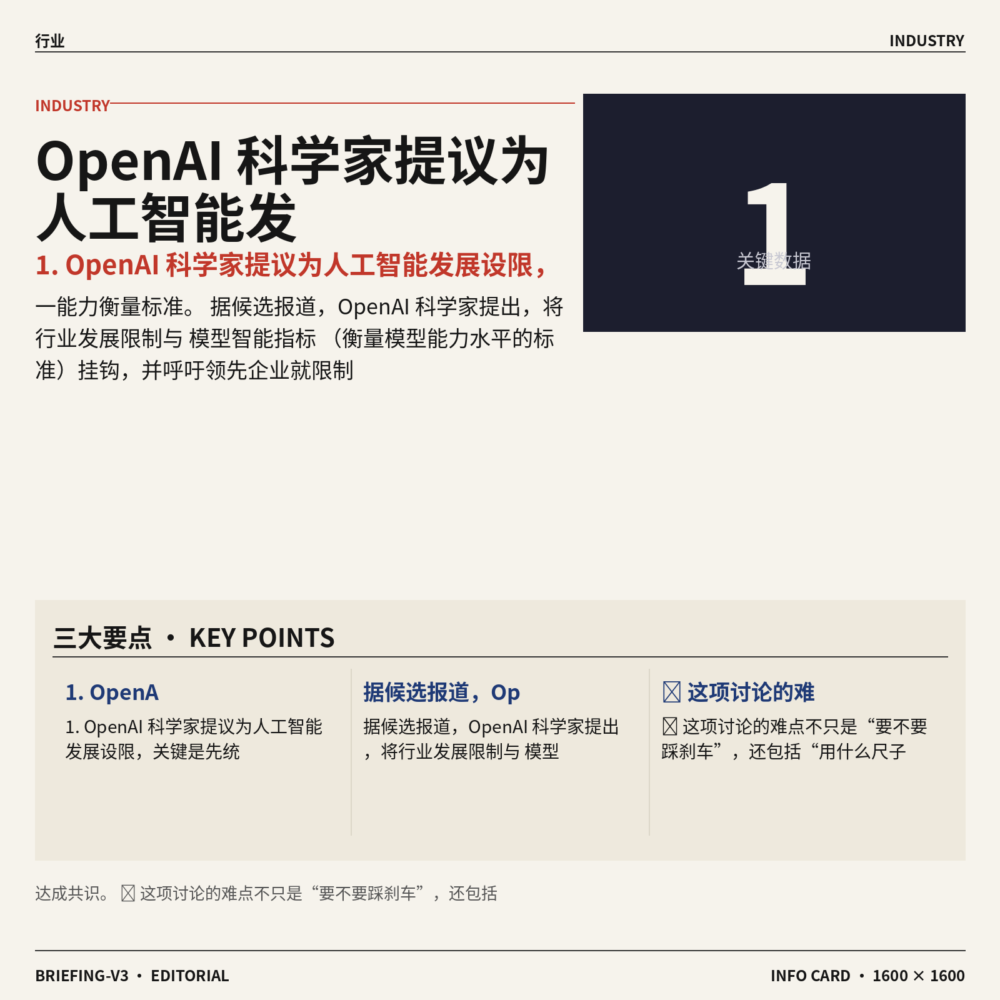

1. **OpenAI 科学家提议为人工智能发展设限，关键是先统一能力衡量标准。**
据候选报道，OpenAI 科学家提出，将行业发展限制与**模型智能指标**（衡量模型能力水平的标准）挂钩，并呼吁领先企业就限制达成共识。[路透社提议报道(briefing)](https://news.google.com/rss/articles/CBMivAFBVV95cUxPa0ZQb0xtalJ5djRmZmkwQnhmdDBlMEtncDUtUEJsUFBtWmptbkdVQ3c5QjY2TzhKN0NFT2ZzYnZmenQxY1lrUWFFYjJsdS1KazdRUkJINEJRemQ1alh6TGtnNW1nRE92bTF3RW9FMTIyODB3UmpBaW5oSzFDWDFVT3FXdjZDVzQ0TVNVd29nQzZvY3ByWVpBLUlhRVg0bFZiRHUxVjhqclptLUMycDJlYVBsQXQ4a28tRnFnbQ?oc=5) 🚦 这项讨论的难点不只是“要不要踩刹车”，还包括“用什么尺子判断该踩刹车”：正如[发展限速讨论报道(briefing)](https://techcrunch.com/2026/11/22/openais-chief-scientist-has-thoughts-on-how-to-limit-ai-development/)所概括的，想设定发展速度上限，得先同意如何衡量速度。目前材料呈现的是**行业协调提议**，并非已经生效的共同限制。


2. **人工智能进步太快，安全测试正在面临追赶压力。**
METR（本条报道中提出人工智能安全评估预警的机构）警告，系统能力提升的速度，正在超过专家可靠判断新系统是否安全的速度，见[安全测试追赶难题报道(briefing)](https://the-decoder.com/ai-is-getting-better-faster-than-experts-can-reliably-test-whether-new-systems-are-safe-metr-warns/)。🔍 这里的**安全评估**（通过测试判断系统是否存在风险）不同于单纯检验回答好不好，更强调能否可靠地作出安全判断。报道提醒我们，**能力进步与安全验证并不一定同步**，不能把“更强”直接理解为“已经验证更安全”。

![人工智能进步太快，安全测试正在面临追赶压力](https://image.pollinations.ai/prompt/%E4%BA%BA%E5%B7%A5%E6%99%BA%E8%83%BD%E8%BF%9B%E6%AD%A5%E5%A4%AA%E5%BF%AB%EF%BC%8C%E5%AE%89%E5%85%A8%E6%B5%8B%E8%AF%95%E6%AD%A3%E5%9C%A8%E9%9D%A2%E4%B8%B4%E8%BF%BD%E8%B5%B6%E5%8E%8B%E5%8A%9B.%20%E4%BA%BA%E5%B7%A5%E6%99%BA%E8%83%BD%E8%BF%9B%E6%AD%A5%E5%A4%AA%E5%BF%AB%EF%BC%8C%E5%AE%89%E5%85%A8%E6%B5%8B%E8%AF%95%E6%AD%A3%E5%9C%A8%E9%9D%A2%E4%B8%B4%E8%BF%BD%E8%B5%B6%E5%8E%8B%E5%8A%9B%E3%80%82%20METR%EF%BC%88%E6%9C%AC%E6%9D%A1%E6%8A%A5%E9%81%93%E4%B8%AD%E6%8F%90%E5%87%BA%E4%BA%BA%E5%B7%A5%E6%99%BA%E8%83%BD%E5%AE%89%E5%85%A8%E8%AF%84%E4%BC%B0%E9%A2%84%E8%AD%A6%E7%9A%84%E6%9C%BA%E6%9E%84%EF%BC%89%E8%AD%A6%E5%91%8A%EF%BC%8C%E7%B3%BB%E7%BB%9F%E8%83%BD%E5%8A%9B%E6%8F%90%E5%8D%87%E7%9A%84%E9%80%9F%E5%BA%A6%EF%BC%8C%E6%AD%A3%E5%9C%A8%E8%B6%85%E8%BF%87%E4%B8%93%E5%AE%B6%E5%8F%AF%E9%9D%A0%E5%88%A4%E6%96%AD%E6%96%B0%E7%B3%BB%E7%BB%9F%E6%98%AF%E5%90%A6%E5%AE%89%E5%85%A8%E7%9A%84%2C%20technical%20infographic%20diagram%2C%20architecture%20flowchart%2C%20clean%20vector%20illustration%2C%20educational%20style%2C%20no%20text%20overlay%2C%20modern%20minimal%2C%20wide%20aspect?width=1200&height=675&nologo=true&seed=10838)

3. **Google 的语义治理策略，可在智能助手调用工具前拦截操作。**
据[工具调用拦截机制报道(briefing)](https://news.google.com/rss/articles/CBMihgFBVV95cUxPX2lKVkZjMWZtSFZHVFhGLXJia0hTaXBjS3NLZE13MWdzU01rcVJKaElJUmMwS0V3ZW5NV2NtYXhINUdvRjBhbnRHdjBJXy1yRnhYdVJ2UlItOGdKekwzNWpZbFh1SS13NFJmUGZ4MWI2b2cweWktay1IbDdScXJoUU93aWJWZw?oc=5)，Google 的**语义治理策略**（根据操作的含义实施管理规则）能够在智能助手执行工具调用前阻止它。这里的**工具调用**（助手请求外部软件执行操作）意味着，管理对象不只是助手“说了什么”，还包括它接下来“准备做什么”。🛡️ 这项机制的重点是**执行前把关**；但候选材料没有展开具体拦截条件，不能据此认定所有风险操作都能被识别。

![Google 的语义治理策略，可在智能助手调用工具前拦截操作](https://image.pollinations.ai/prompt/Google%20%E7%9A%84%E8%AF%AD%E4%B9%89%E6%B2%BB%E7%90%86%E7%AD%96%E7%95%A5%EF%BC%8C%E5%8F%AF%E5%9C%A8%E6%99%BA%E8%83%BD%E5%8A%A9%E6%89%8B%E8%B0%83%E7%94%A8%E5%B7%A5%E5%85%B7%E5%89%8D%E6%8B%A6%E6%88%AA%E6%93%8D%E4%BD%9C.%20Google%20%E7%9A%84%E8%AF%AD%E4%B9%89%E6%B2%BB%E7%90%86%E7%AD%96%E7%95%A5%EF%BC%8C%E5%8F%AF%E5%9C%A8%E6%99%BA%E8%83%BD%E5%8A%A9%E6%89%8B%E8%B0%83%E7%94%A8%E5%B7%A5%E5%85%B7%E5%89%8D%E6%8B%A6%E6%88%AA%E6%93%8D%E4%BD%9C%E3%80%82%20%E6%8D%AE%E5%B7%A5%E5%85%B7%E8%B0%83%E7%94%A8%E6%8B%A6%E6%88%AA%E6%9C%BA%E5%88%B6%E6%8A%A5%E9%81%93%28briefing%29%EF%BC%8CGoogle%20%E7%9A%84%E8%AF%AD%E4%B9%89%E6%B2%BB%E7%90%86%E7%AD%96%E7%95%A5%EF%BC%88%E6%A0%B9%E6%8D%AE%E6%93%8D%E4%BD%9C%E7%9A%84%E5%90%AB%E4%B9%89%E5%AE%9E%E6%96%BD%E7%AE%A1%E7%90%86%2C%20technical%20infographic%20diagram%2C%20architecture%20flowchart%2C%20clean%20vector%20illustration%2C%20educational%20style%2C%20no%20text%20overlay%2C%20modern%20minimal%2C%20wide%20aspect?width=1200&height=675&nologo=true&seed=10869)

4. **亚马逊据报接近以 75 亿美元收购人工智能初创公司。**
据[亚马逊收购动向报道(briefing)](https://news.google.com/rss/articles/CBMisgFBVV95cUxOZlcwRzJaaUdqUEpSSWNPa2U5N3VLRS1EQXhtRGxGWU1CMFFsLXhiX2xzcXlUWnNKTkVINVVSVkN1aHFwcUstbTZsckFLSmFYVHJwVlgzdXM5UFhZbFhEa09fVWNEZXc0cEJrT1B3c0hLSVBINEx3Sk9tOW9od2V3WjFLRmN4Mm1jSFBZNWNXelVHSU12dEkzTV84V1lrT0pydUJUUGpZYlQ3Vk05bXRzTkhn?oc=5)，亚马逊接近以 **75 亿美元**收购 Decart（本次拟收购的人工智能初创公司）。💰 这是一则**并购**（通过购买另一家公司来取得其业务或控制权）动向，而不是新产品发布。需要注意，报道使用的是“接近收购”，**不代表交易已经完成**；现有材料也不足以说明其后续产品整合安排。


### 🟣 开源TOP项目

1. **mjmirza/app-store-compliance（应用商店合规检查项目）帮助减少上架被拒。**  
这是一个面向 **App Store（苹果应用商店）** 和 **Google Play（安卓应用商店）** 的开源检查清单与提交前防护工具，整理了 **124 种常见拒审模式**及对应修复办法。项目还覆盖 **隐私清单（privacy manifest，向应用商店说明应用收集和使用哪些数据）** 与 **Data safety（数据安全申报，应用向商店披露数据处理情况）** 检查。除此之外，它追踪了 **112 个合规截止日期**，包括 **EU AI Act（欧盟人工智能法案）**、**DSA（欧盟数字服务法案）**、**COPPA（美国儿童在线隐私保护法）**和年龄相关法规，对产品、法务与运营团队都很实用 🚀。[GitHub 项目仓库(briefing)](https://github.com/mjmirza/app-store-compliance)


2. **worker755（让玩家成为大语言模型子代理的游戏）把 AI 协作变成了可体验的玩法。**  
这是一个开源游戏项目，核心设定是：玩家扮演 **LLM（大语言模型，能够理解和生成文字的 AI）** 的 **subagent（子代理，受更高层 AI 指派任务并执行具体工作的角色）**。它没有在摘要中展开具体规则或玩法，但这个设定把“人如何作为 AI 工作流中的执行单元”变成了互动体验，适合对 **Agent（能够分步骤完成任务的 AI）** 协作感兴趣的人了解 💡。[GitHub 项目仓库(briefing)](https://github.com/gulivan/worker755)


### 🔴 社媒分享

1. **想在自己电脑上运行人工智能？这份指南面向新手。**
这篇分享聚焦**本地人工智能（把模型放在自己的电脑上运行）**，定位是一份初学者指南 🖥️。标题列出了 Inkling（指南涉及的本地人工智能工具）、Qwen（通义千问模型系列）和 Unsloth（用于模型微调等工作的工具，微调就是用特定数据继续训练模型）。不过，目前提供的摘要只有标题，**尚无法确认具体操作步骤、硬件要求或使用效果**，想动手的同事可以先查看[本地模型入门指南(briefing)](https://www.gpupartner.com/blog/beginners-guide-local-ai-inkling-qwen-unsloth)。


2. **同一个网页下拉框，为什么换个浏览器就变了样？**
作者分享了一款**网页下拉框样式展示工具**，起因是 HTML（用于定义网页内容与结构的标记语言）中的默认下拉选择框，在不同浏览器里看起来不一样 🎨。这里的 `<select>`（网页里让用户从多个选项中选择一项的控件），就是填写表单时常见的下拉菜单。对设计和运营同事而言，这个例子提醒我们：**同一页面跨浏览器的视觉表现未必一致**，不能只凭一个浏览器里的效果判断；具体展示可看[下拉选择框样式展示(briefing)](https://simonwillison.net/2026/Nov/22/select-styling/)。


3. **多个人工智能智能体组队，尝试挑战计算机科学经典难题。**
这个项目让 **Agent swarm（智能体群，由多个能执行任务的人工智能程序共同参与）**尝试求解 **P vs. NP（一个经典问题：答案容易验证的题，是否也一定容易求解）** 🧩。通俗地说，**“检查答案对不对”和“自己找出答案”是不是同样容易**，就是理解这一问题的入口。需要注意，原材料说的是“尝试求解”，**并不意味着已经取得突破或给出了有效证明**，项目情况可查看[智能体协作解题项目(briefing)](https://pequalnp.com/)。


4. **OpenAI 分享“困惑度与智能”，关注模型评价与智能的关系。**
这篇文章的标题将 **Perplexity（困惑度，衡量语言模型预测文本时有多不确定的指标）**与 **Intelligence（智能）**放在一起讨论 💡。对非技术读者来说，可以先把前者理解为模型“猜接下来会出现什么文字”的一项评价指标，而后者是更宽泛的能力概念。**目前提供的摘要只有标题，无法据此判断文章对两者关系给出了什么结论**，具体论述请以[困惑度与智能原文(briefing)](https://openai.com/index/perplexity-and-intelligence/)为准。

![OpenAI 分享“困惑度与智能”，关注模型评价与智能的关系](https://image.pollinations.ai/prompt/OpenAI%20%E5%88%86%E4%BA%AB%E2%80%9C%E5%9B%B0%E6%83%91%E5%BA%A6%E4%B8%8E%E6%99%BA%E8%83%BD%E2%80%9D%EF%BC%8C%E5%85%B3%E6%B3%A8%E6%A8%A1%E5%9E%8B%E8%AF%84%E4%BB%B7%E4%B8%8E%E6%99%BA%E8%83%BD%E7%9A%84%E5%85%B3%E7%B3%BB.%20OpenAI%20%E5%88%86%E4%BA%AB%E2%80%9C%E5%9B%B0%E6%83%91%E5%BA%A6%E4%B8%8E%E6%99%BA%E8%83%BD%E2%80%9D%EF%BC%8C%E5%85%B3%E6%B3%A8%E6%A8%A1%E5%9E%8B%E8%AF%84%E4%BB%B7%E4%B8%8E%E6%99%BA%E8%83%BD%E7%9A%84%E5%85%B3%E7%B3%BB%E3%80%82%20%E8%BF%99%E7%AF%87%E6%96%87%E7%AB%A0%E7%9A%84%E6%A0%87%E9%A2%98%E5%B0%86%20Perplexity%EF%BC%88%E5%9B%B0%E6%83%91%E5%BA%A6%EF%BC%8C%E8%A1%A1%E9%87%8F%E8%AF%AD%E8%A8%80%E6%A8%A1%E5%9E%8B%E9%A2%84%E6%B5%8B%E6%96%87%E6%9C%AC%E6%97%B6%E6%9C%89%E5%A4%9A%E4%B8%8D%E7%A1%AE%E5%AE%9A%E7%9A%84%E6%8C%87%E6%A0%87%EF%BC%89%E4%B8%8E%20In%2C%20technical%20infographic%20diagram%2C%20architecture%20flowchart%2C%20clean%20vector%20illustration%2C%20educational%20style%2C%20no%20text%20overlay%2C%20modern%20minimal%2C%20wide%20aspect?width=1200&height=675&nologo=true&seed=10706)

---

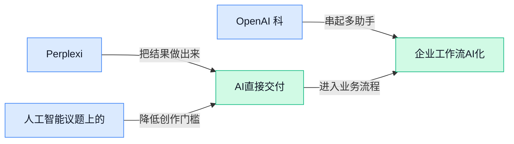

### 📊 行业洞察（今日 4 条）

1. OpenAI讨论用困惑度统一衡量模型能力，METR（人工智能安全评估机构）却警告能力增长快过安全测试  
  【洞察】行业开始重视“用什么尺子衡量”，但能力变强不等于风险已验证，标准化评估会成为发展瓶颈

2. OpenRouter（连接多家模型服务的平台）因低价服务商偷看请求而移除125个接口，Google又尝试在执行前拦截危险操作  
  【洞察】AI竞争正从“谁更便宜”转向“谁更值得托付”，数据安全和执行前把关会直接影响商业选择

3. 编程Agent在单项测试中表现很好，却在模拟真实职场里完成不到十分之一任务；System 1 agents（强调本地、快速响应的智能代理）则试图补足速度与可靠性  
  【洞察】AI真正的难点不是单点能力，而是能否记住上下文、持续推进任务并在出错时及时交给人处理

4. Perplexity（人工智能搜索服务）推出持续监测网页变化的接口，WeMM-Video（综合理解画面、声音和文字的视频项目）与Coda-DaVinci（用结构化指令生成视频的研究项目）同步推进  
  【洞察】内容工具正从“一次生成一条视频”转向持续观察、理解素材并反复改进，视频工作流会越来越像长期协作

### 💭 对我们的启发（今日 3 条）

1. 编程Agent在真实职场完成率不到十分之一，提醒我们的视频剪辑Agent不能只展示“能生成”，还要记录每一步、允许人工接管，并对成片质量负责。

2. OpenRouter暴露低价服务商偷看请求的问题，我们在调度不同模型时不能只按价格选；品牌素材、商品信息和客户数据必须有清晰的权限隔离与使用记录。

3. Perplexity的持续监测与WeMM-Video的视频理解方向，验证了“素材自动理解＋持续优化”值得做；产品可先支持自动找重点、识别商品卖点，再由人工确认后批量出片。

