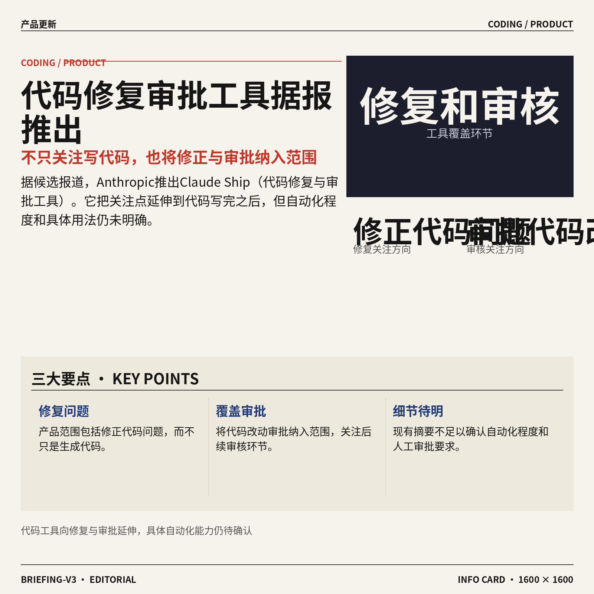
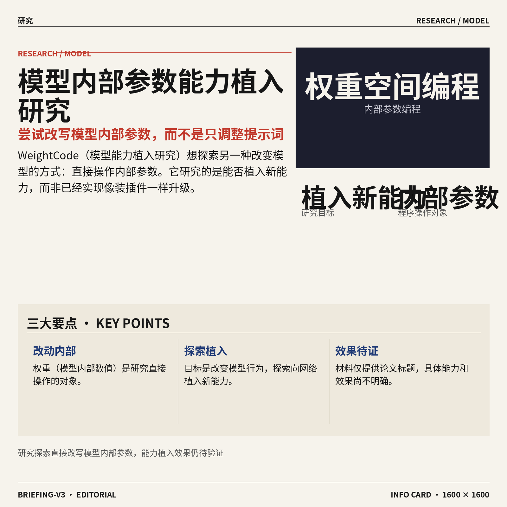
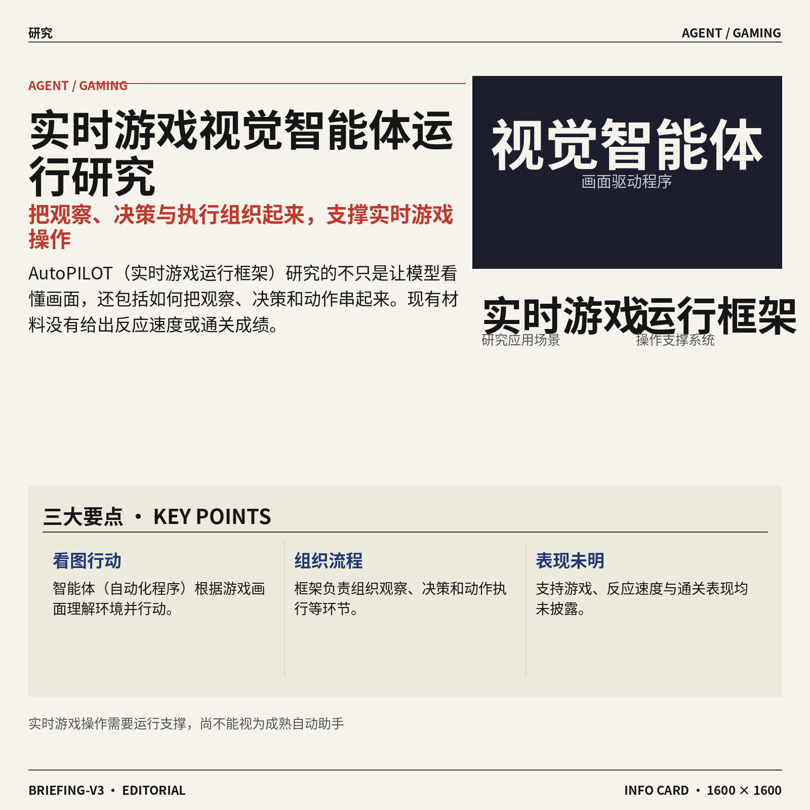
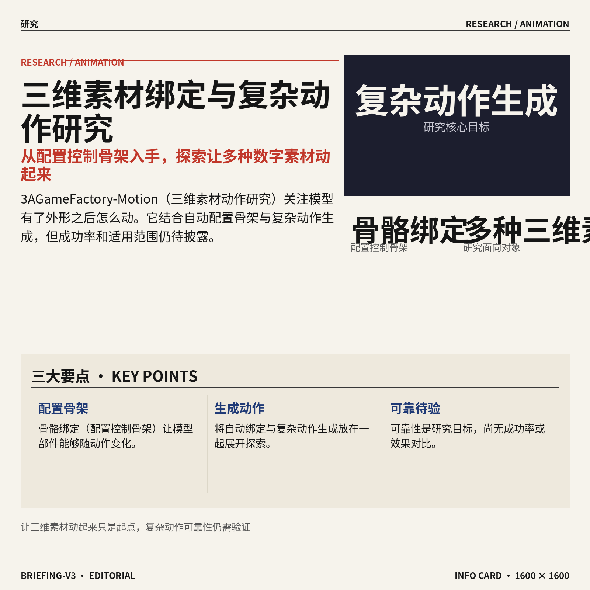
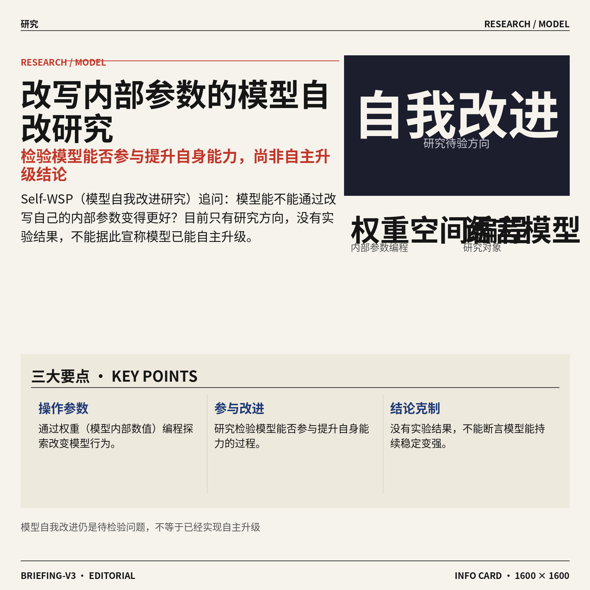
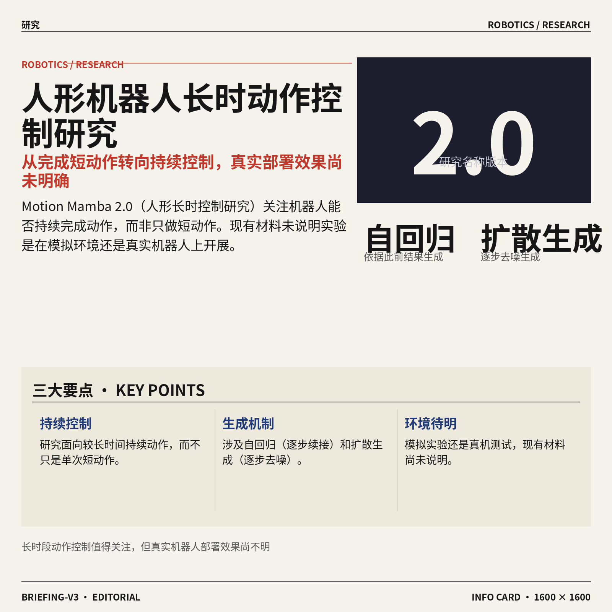
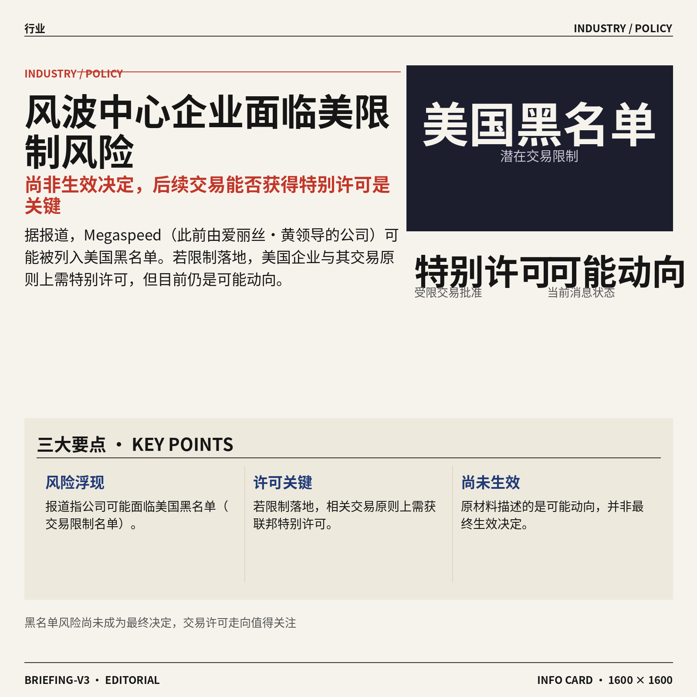
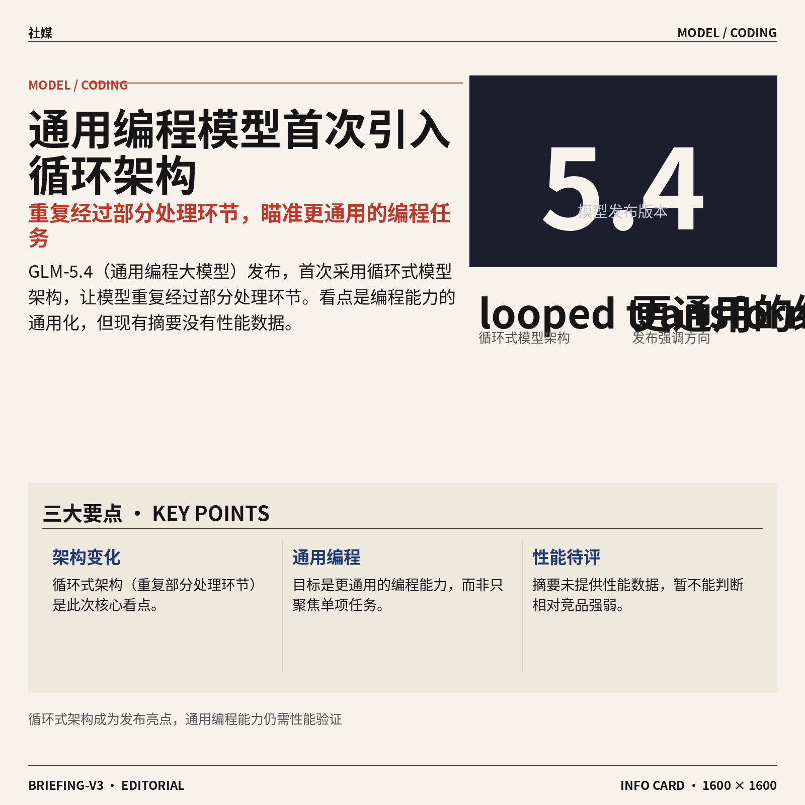
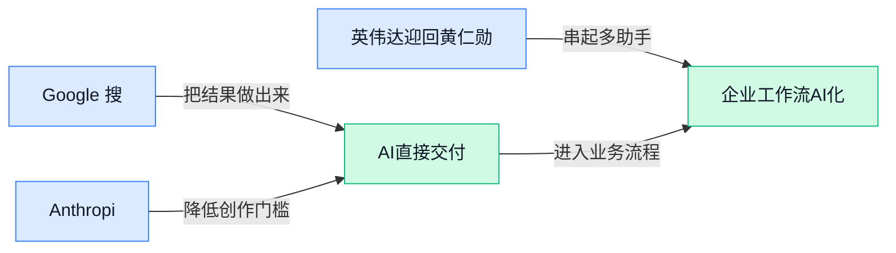

## AI资讯日报 2026/11/24

> AI 早报 · 每日早读 · 全网深度聚合

## **今日摘要**

```
Google搜索接入个人应用，你的应用信息开始影响搜索答案
Anthropic推出Claude Ship（代码修复审批工具），从修复到审核一并覆盖
GLM-5.4（通用编程大模型）发布，首次采用循环式架构，瞄准更通用编程任务
```

### 🔵 产品与功能更新


1. **Google 搜索支持连接个人应用，让回答更贴合你的需求。**
Google 正在让搜索回答更具**个性化**：用户可以自主选择连接个人应用，为搜索提供更多与自己相关的信息 💡。支持连接的应用包括 Google Wallet（谷歌的数字钱包应用）、Google Drive（谷歌的云端文件存储服务）和 Gemini（谷歌的人工智能助手）应用。此次更新的重点是**由用户选择是否连接**，通过安全接入这些应用，让搜索提供更有帮助的回答，具体可见[谷歌搜索更新说明(briefing)](https://blog.google/products-and-platforms/products/search/google-search-personal-intelligence-apps/)。




2. **Anthropic 推出 Claude Ship（代码修复与审批工具），覆盖修复和审核环节。**
据候选报道，Anthropic 推出了 **Claude Ship（帮助修复和审批代码的工具）**，将代码处理中的两个环节纳入产品范围 🛠️。通俗地说，它关注的不只是“把代码写出来”，还包括**修正代码问题**与**审批代码改动**。[代码工具发布报道(briefing)](https://news.google.com/rss/articles/CBMikgFBVV95cUxOWWlSWUo2eGlMaXZCdUdNYzBWZ0VLZWhxWDdPLWtnX3prVFZTY3o1X3JCemkzN1Z3NDVnM0l4RV9qZ0ZUWWVGcXZ1eHdIUzIwRzRnTUY0bnVBbWNfM2ZqNmxfTFBlYml5bXh3bkxKN3ltNXgtSWItNEQtZmZrc1dla0NqX0xob05NYjdsVGZvb0x3UQ?oc=5)目前提供的摘要信息有限，尚不足以确认其自动化程度、人工审批要求或具体使用方式。


### 🟢 前沿研究



1. **WeightCode（通过改写模型内部参数植入新能力的研究）探索给神经网络“安装”能力。**
这项研究把关注点放在**权重空间编程（以模型内部参数为操作对象，编写程序改变其行为）**，目标是向神经网络植入新能力 🔧。这里的**权重（模型在训练中形成、影响输出结果的内部数值）**，可以理解为模型内部的一组调节旋钮，而不是用户输入的提示词。候选材料仅提供论文标题，尚无法确认它能植入哪些能力、效果如何，不能直接理解为模型已经支持“像装插件一样升级”；可进一步查看[模型能力植入论文(briefing)](https://huggingface.co/papers/2611.25476)。


2. **GameAnything（将灵感转化为可玩游戏世界的研究）瞄准从创意到游戏的生成过程。**
这项研究提出的方向是**从灵感生成可玩的游戏世界**，关注的不只是画面，而是能够进入和游玩的游戏环境 🎮。其中，**游戏世界生成（根据输入构建供玩家探索和互动的虚拟环境）**是理解其目标的关键，但标题没有说明灵感以文字、图片还是其他形式输入。现有材料也未提供玩法复杂度、生成耗时或实际演示，因此还不能判断它距离日常游戏制作有多远，详见[可玩游戏世界研究(briefing)](https://huggingface.co/papers/2611.29238)。




3. **AutoPILOT（面向实时游戏的视觉智能体运行框架）研究如何支撑游戏操作。**
这项研究聚焦**视觉智能体（根据画面理解环境并采取行动的自动化程序）**在实时游戏中的运行问题 👀。标题中的**运行框架（组织智能体观察、决策和执行动作的配套系统）**，说明研究对象不仅是模型本身，也包括让它参与游戏的支撑机制。候选材料没有披露支持哪些游戏、反应速度或通关表现，暂时不宜把它描述为已经成熟的自动游戏助手，可查看[实时游戏智能体论文(briefing)](https://huggingface.co/papers/2611.28202)。

![AutoPILOT（面向实时游戏的视觉智能体运行框架）研究如何支撑游戏操作](https://image.pollinations.ai/prompt/AutoPILOT%EF%BC%88%E9%9D%A2%E5%90%91%E5%AE%9E%E6%97%B6%E6%B8%B8%E6%88%8F%E7%9A%84%E8%A7%86%E8%A7%89%E6%99%BA%E8%83%BD%E4%BD%93%E8%BF%90%E8%A1%8C%E6%A1%86%E6%9E%B6%EF%BC%89%E7%A0%94%E7%A9%B6%E5%A6%82%E4%BD%95%E6%94%AF%E6%92%91%E6%B8%B8%E6%88%8F%E6%93%8D%E4%BD%9C.%20AutoPILOT%EF%BC%88%E9%9D%A2%E5%90%91%E5%AE%9E%E6%97%B6%E6%B8%B8%E6%88%8F%E7%9A%84%E8%A7%86%E8%A7%89%E6%99%BA%E8%83%BD%E4%BD%93%E8%BF%90%E8%A1%8C%E6%A1%86%E6%9E%B6%EF%BC%89%E7%A0%94%E7%A9%B6%E5%A6%82%E4%BD%95%E6%94%AF%E6%92%91%E6%B8%B8%E6%88%8F%E6%93%8D%E4%BD%9C%E3%80%82%20%E8%BF%99%E9%A1%B9%E7%A0%94%E7%A9%B6%E8%81%9A%E7%84%A6%E8%A7%86%E8%A7%89%E6%99%BA%E8%83%BD%E4%BD%93%EF%BC%88%E6%A0%B9%E6%8D%AE%E7%94%BB%E9%9D%A2%E7%90%86%E8%A7%A3%E7%8E%AF%E5%A2%83%E5%B9%B6%E9%87%87%E5%8F%96%E8%A1%8C%E5%8A%A8%E7%9A%84%E8%87%AA%E5%8A%A8%E5%8C%96%E7%A8%8B%E5%BA%8F%EF%BC%89%E5%9C%A8%E5%AE%9E%E6%97%B6%E6%B8%B8%E6%88%8F%E4%B8%AD%E7%9A%84%E8%BF%90%E8%A1%8C%2C%20technical%20infographic%20diagram%2C%20architecture%20flowchart%2C%20clean%20vector%20illustration%2C%20educational%20style%2C%20no%20text%20overlay%2C%20modern%20minimal%2C%20wide%20aspect?width=1200&height=675&nologo=true&seed=10869)



4. **3AGameFactory-Motion（三维素材自动绑定与复杂动作生成研究）关注让数字素材动起来。**
这项研究把**智能体驱动的骨骼绑定**与**复杂动作生成**放在一起，面向多种三维素材展开探索 🦴。**骨骼绑定（为三维模型配置控制骨架，让身体或部件能够随动作变化）**，是理解这项工作的关键：有了模型外形，并不等于它已经能够自然活动。论文标题将“可靠的复杂动作生成”列为目标，但候选材料没有给出成功率、适用素材范围或效果对比，具体表现仍需查阅[三维素材动作生成论文(briefing)](https://huggingface.co/papers/2611.30013)。

![3AGameFactory-Motion（三维素材自动绑定与复杂动作生成研究）关注让数字素材动起来](https://image.pollinations.ai/prompt/3AGameFactory-Motion%EF%BC%88%E4%B8%89%E7%BB%B4%E7%B4%A0%E6%9D%90%E8%87%AA%E5%8A%A8%E7%BB%91%E5%AE%9A%E4%B8%8E%E5%A4%8D%E6%9D%82%E5%8A%A8%E4%BD%9C%E7%94%9F%E6%88%90%E7%A0%94%E7%A9%B6%EF%BC%89%E5%85%B3%E6%B3%A8%E8%AE%A9%E6%95%B0%E5%AD%97%E7%B4%A0%E6%9D%90%E5%8A%A8%E8%B5%B7%E6%9D%A5.%203AGameFactory-Motion%EF%BC%88%E4%B8%89%E7%BB%B4%E7%B4%A0%E6%9D%90%E8%87%AA%E5%8A%A8%E7%BB%91%E5%AE%9A%E4%B8%8E%E5%A4%8D%E6%9D%82%E5%8A%A8%E4%BD%9C%E7%94%9F%E6%88%90%E7%A0%94%E7%A9%B6%EF%BC%89%E5%85%B3%E6%B3%A8%E8%AE%A9%E6%95%B0%E5%AD%97%E7%B4%A0%E6%9D%90%E5%8A%A8%E8%B5%B7%E6%9D%A5%E3%80%82%20%E8%BF%99%E9%A1%B9%E7%A0%94%E7%A9%B6%E6%8A%8A%E6%99%BA%E8%83%BD%E4%BD%93%E9%A9%B1%E5%8A%A8%E7%9A%84%E9%AA%A8%E9%AA%BC%E7%BB%91%E5%AE%9A%E4%B8%8E%E5%A4%8D%E6%9D%82%E5%8A%A8%E4%BD%9C%E7%94%9F%E6%88%90%E6%94%BE%E5%9C%A8%E4%B8%80%E8%B5%B7%EF%BC%8C%E9%9D%A2%E5%90%91%2C%20technical%20infographic%20diagram%2C%20architecture%20flowchart%2C%20clean%20vector%20illustration%2C%20educational%20style%2C%20no%20text%20overlay%2C%20modern%20minimal%2C%20wide%20aspect?width=1200&height=675&nologo=true&seed=10900)



5. **Self-WSP（探索语言模型通过改写内部参数自我改进的研究）追问模型能否自己升级。**
这项研究提出一个问题：语言模型能否通过**权重空间编程（以模型内部参数为操作对象来改变模型行为）**改善自身能力 🔍。这里的**自我改进（让模型参与提升自身能力的过程）**是论文要检验的方向，而不是标题已经证实的结论。候选材料没有提供实验结果，因此不能据此认定模型已经能够自主升级，或能够持续、稳定地变强，详见[模型自我改进研究(briefing)](https://huggingface.co/papers/2611.28833)。

![Self-WSP（探索语言模型通过改写内部参数自我改进的研究）追问模型能否自己升级](https://image.pollinations.ai/prompt/Self-WSP%EF%BC%88%E6%8E%A2%E7%B4%A2%E8%AF%AD%E8%A8%80%E6%A8%A1%E5%9E%8B%E9%80%9A%E8%BF%87%E6%94%B9%E5%86%99%E5%86%85%E9%83%A8%E5%8F%82%E6%95%B0%E8%87%AA%E6%88%91%E6%94%B9%E8%BF%9B%E7%9A%84%E7%A0%94%E7%A9%B6%EF%BC%89%E8%BF%BD%E9%97%AE%E6%A8%A1%E5%9E%8B%E8%83%BD%E5%90%A6%E8%87%AA%E5%B7%B1%E5%8D%87%E7%BA%A7.%20Self-WSP%EF%BC%88%E6%8E%A2%E7%B4%A2%E8%AF%AD%E8%A8%80%E6%A8%A1%E5%9E%8B%E9%80%9A%E8%BF%87%E6%94%B9%E5%86%99%E5%86%85%E9%83%A8%E5%8F%82%E6%95%B0%E8%87%AA%E6%88%91%E6%94%B9%E8%BF%9B%E7%9A%84%E7%A0%94%E7%A9%B6%EF%BC%89%E8%BF%BD%E9%97%AE%E6%A8%A1%E5%9E%8B%E8%83%BD%E5%90%A6%E8%87%AA%E5%B7%B1%E5%8D%87%E7%BA%A7%E3%80%82%20%E8%BF%99%E9%A1%B9%E7%A0%94%E7%A9%B6%E6%8F%90%E5%87%BA%E4%B8%80%E4%B8%AA%E9%97%AE%E9%A2%98%EF%BC%9A%E8%AF%AD%E8%A8%80%E6%A8%A1%E5%9E%8B%E8%83%BD%E5%90%A6%E9%80%9A%E8%BF%87%E6%9D%83%E9%87%8D%E7%A9%BA%E9%97%B4%E7%BC%96%E7%A8%8B%EF%BC%88%E4%BB%A5%E6%A8%A1%E5%9E%8B%E5%86%85%E9%83%A8%E5%8F%82%E6%95%B0%E4%B8%BA%E6%93%8D%E4%BD%9C%E5%AF%B9%2C%20technical%20infographic%20diagram%2C%20architecture%20flowchart%2C%20clean%20vector%20illustration%2C%20educational%20style%2C%20no%20text%20overlay%2C%20modern%20minimal%2C%20wide%20aspect?width=1200&height=675&nologo=true&seed=10931)



6. **Motion Mamba 2.0（面向人形机器人长时段控制的研究）关注持续动作控制。**
这项研究面向**长时段人形控制（让人形机器人在较长时间内持续完成动作，而不只是做一个短动作）**展开探索 🤖。标题提到**自回归（根据此前的结果逐步生成后续内容）**与**扩散生成（通过逐步去除噪声形成生成结果）**，但没有交代这些机制具体如何用于控制。现有材料也未说明实验是在模拟环境还是真实机器人上进行，不能据此判断实际部署效果，可进一步查看[人形长时控制研究(briefing)](https://huggingface.co/papers/2611.29897)。

![Motion Mamba 2.0（面向人形机器人长时段控制的研究）关注持续动作控制](https://image.pollinations.ai/prompt/Motion%20Mamba%202.0%EF%BC%88%E9%9D%A2%E5%90%91%E4%BA%BA%E5%BD%A2%E6%9C%BA%E5%99%A8%E4%BA%BA%E9%95%BF%E6%97%B6%E6%AE%B5%E6%8E%A7%E5%88%B6%E7%9A%84%E7%A0%94%E7%A9%B6%EF%BC%89%E5%85%B3%E6%B3%A8%E6%8C%81%E7%BB%AD%E5%8A%A8%E4%BD%9C%E6%8E%A7%E5%88%B6.%20Motion%20Mamba%202.0%EF%BC%88%E9%9D%A2%E5%90%91%E4%BA%BA%E5%BD%A2%E6%9C%BA%E5%99%A8%E4%BA%BA%E9%95%BF%E6%97%B6%E6%AE%B5%E6%8E%A7%E5%88%B6%E7%9A%84%E7%A0%94%E7%A9%B6%EF%BC%89%E5%85%B3%E6%B3%A8%E6%8C%81%E7%BB%AD%E5%8A%A8%E4%BD%9C%E6%8E%A7%E5%88%B6%E3%80%82%20%E8%BF%99%E9%A1%B9%E7%A0%94%E7%A9%B6%E9%9D%A2%E5%90%91%E9%95%BF%E6%97%B6%E6%AE%B5%E4%BA%BA%E5%BD%A2%E6%8E%A7%E5%88%B6%EF%BC%88%E8%AE%A9%E4%BA%BA%E5%BD%A2%E6%9C%BA%E5%99%A8%E4%BA%BA%E5%9C%A8%E8%BE%83%E9%95%BF%E6%97%B6%E9%97%B4%E5%86%85%E6%8C%81%E7%BB%AD%E5%AE%8C%E6%88%90%E5%8A%A8%E4%BD%9C%EF%BC%8C%E8%80%8C%E4%B8%8D%E5%8F%AA%E6%98%AF%2C%20technical%20infographic%20diagram%2C%20architecture%20flowchart%2C%20clean%20vector%20illustration%2C%20educational%20style%2C%20no%20text%20overlay%2C%20modern%20minimal%2C%20wide%20aspect?width=1200&height=675&nologo=true&seed=10962)

### 🟡 行业展望与社会影响


1. **英伟达迎回黄仁勋，人工智能相关交易情绪有所缓和。**
英伟达改变此前决定，让黄仁勋重新担任 **CEO（首席执行官，负责公司的整体经营管理）**，这次人事逆转获得了美国政府高级官员的支持，见[黄仁勋回归报道(briefing)](https://techcrunch.com/2026/11/23/nvidia-reverses-course-and-brings-jensen-huang-back-as-ceo/)。📈 路透社的报道则指出，黄仁勋回归让此前承压的**人工智能相关交易**松了一口气，见[市场情绪变化报道(briefing)](https://news.google.com/rss/articles/CBMiuAFBVV95cUxOdllUY1JjNjA0T3ZBYjdac2FIVFZWQlF1dUhuclNlcDRfU2gxQzFoQ0kzUk9rcXMxbTJvRXdpZUNVM2ZJTXljQ1B6bjQ3NmxqSmxXTmhqV2JIMFphcGhwQ2dlSGI1Vm56ZUhBcGZMSDdmOVM2eXMyVjMtS19DbWJIVm40U044V0dxR3hPU1NmeldKdGl6VHh0UDVVcnlqUEVudEVrV0MxS1A2UnV6M2U3QldjQjV1OGpV?oc=5)。两篇报道分别呈现了这件事的**管理层变动**与**市场反应**，但现有材料并未说明这种情绪改善能持续多久。




2. **Megaspeed（此前由爱丽丝·黄领导的公司）或被列入美国黑名单。**
据[美国黑名单动向报道(briefing)](https://techcrunch.com/2026/11/23/megaspeed-the-company-at-the-center-of-the-jensen-huang-scandal-appears-headed-for-a-u-s-blacklist/)，处于黄仁勋相关风波中心的这家公司，似乎正面临被列入**美国黑名单（对企业交易施加限制的名单）**的风险。⚠️ 如果这一限制落地，美国企业原则上将不能与其开展业务，除非取得联邦政府的**特别许可（允许受限交易继续进行的专门批准）**。对业务合作而言，关键不只是公司是否“上榜”，更是后续交易能否获得许可；不过，原材料描述的仍是可能动向，并非已经生效的最终决定。


### 🟣 开源TOP项目


1. **Claude-BugHunter（面向 Claude Code 的漏洞排查技能包）汇集 84 项技能，辅助安全测试。**
这套开源项目为 Claude Code（能协助编写代码、执行开发任务的编程助手）提供 **84 项技能、15 个斜杠命令**（输入以“/”开头的指令即可调用对应功能），面向漏洞挖掘与**外部红队测试**（从外部攻击者视角检验系统防护）🔍。它整理了 **681 种已披露漏洞报告中的模式**，覆盖 **24 类核心漏洞**，把既有案例归纳成可供排查参考的线索。项目还收录了**企业身份与基础设施攻击矩阵**（按类别梳理账号身份、基础设施可能遭遇的攻击路径），关注范围不只限于代码本身。💡 对安全团队而言，它的参考价值在于把排查技能、操作入口和案例模式集中到一个工具包中，具体内容可查看[漏洞排查项目仓库(briefing)](https://github.com/elementalsouls/Claude-BugHunter)。


### 🔴 社媒分享



1. **GLM-5.4（面向更通用编程任务的大模型）发布，首次采用循环式架构。**
这次发布的核心看点，是模型首次采用 **looped transformer（循环式模型架构，让模型重复经过部分处理环节）**，并以更通用的编程能力为目标 🚀。Z.ai（推出该模型的中国人工智能实验室）在发布标题中强调的是**编程能力的通用化**，而不只是某一项具体编码任务。现有摘要没有给出性能数据，因此还不能据此判断它比其他编程模型强多少，具体设计可查看[模型官方发布说明(briefing)](https://z.ai/blog/glm-5.4)。


2. **NariQ（降低模型存储体积的压缩方案）主打用约 10 吉字节文件保留接近原版的效果。**
团队介绍，NariQ 对 Qwen3.8-27B（拥有约 270 亿参数的大模型）进行了 **3 比特及以下量化（用更少的数字位数保存模型参数，缩小文件体积）**，将模型装进约 **10 吉字节**的文件中 📦。其声称，在自动执行任务、数学、多语言推理和图像理解等方面，压缩后的表现仍接近 **BF16（使用 16 位数字格式保存模型参数的精度基准）**版本。对使用者来说，关键看点是**缩小体积后能保留多少能力**；这里的“接近原版”属于团队自述，具体适用范围还需结合测试结果判断。相关介绍见[模型压缩方案说明(briefing)](https://huggingface.co/nari-labs/Qwen3.8-27B-NariQ-GGUF)。


3. **Amazon 强调算力业务差异化，也释放为前沿模型让出利润空间的信号。**
这篇围绕 Amazon 财报的分析指出，公司正试图证明自己不同于其他**算力服务商（向客户提供运行和训练模型所需计算资源的企业）** 💡。与此同时，它也释放出愿意牺牲部分**利润率（收入中最终能留下多少利润的比例）**、以服务前沿模型需求的信号。文章把“强调差异化”与“愿意让利”放在一起讨论，关注的是大模型背后的计算服务如何做生意，而非一次模型能力发布，详见[亚马逊算力业务分析(briefing)](https://stratechery.com/2026/amazon-earnings-the-chip-question-about-agents/)。


---



### 📊 行业洞察（今日 3 条）

1. Google搜索新增由用户自主选择连接个人应用的功能。
   【洞察】个性化竞争更依赖用户资料，因为关联信息能改善回答，但授权边界影响信任。

2. 据报道，Claude Ship（代码修复与审批工具）推出。
   【洞察】产品正向审核环节延伸，因为代码生成后的检查仍耗人力，但可靠性尚待验证。

3. GameAnything研究探索从灵感生成可玩游戏世界。
   【洞察】创作工具有望扩展至互动内容，因为目标包含游玩体验，但缺乏演示，成熟度难判。

### 💭 对我们的启发（今日 2 条）

1. Google搜索连接个人应用，启发我们让用户自主关联视频素材，减少查找步骤；但须清晰说明资料用途，避免隐私顾虑。

2. Claude Ship覆盖修复与审批，启发剪辑软件加入自动纠错和人工确认，减少返工；但须支持撤销，避免误改创作意图。

