## AI资讯日报 2026/11/25

> AI 早报 · 每日早读 · 全网深度聚合

## **今日摘要**

```
OpenAI GPT-6跨界蛋白质设计，实验发现五个靶点的结合证据
亚马逊收购Decart（软件开发公司），押注软件缩小与英伟达的芯片差距
Tidal（在线音乐平台）清理曲库，将下架数百万首完全由AI生成的歌曲
```

### 🔵 产品与功能更新

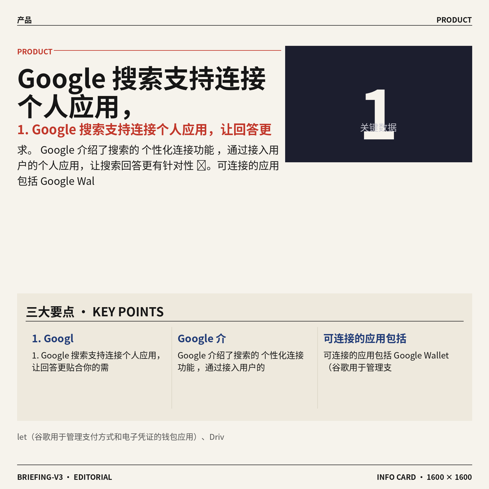

1. **Google 搜索支持连接个人应用，让回答更贴合你的需求。**
Google 介绍了搜索的**个性化连接功能**，通过接入用户的个人应用，让搜索回答更有针对性 🔎。可连接的应用包括 Google Wallet（谷歌用于管理支付方式和电子凭证的钱包应用）、Drive（谷歌用于存储和管理文件的云盘），以及 Gemini（谷歌的智能助手）应用。连接需要用户**主动选择授权**，官方摘要也强调了安全接入，而不是默认读取个人应用信息 💡。[搜索个性化功能介绍(briefing)](https://blog.google/products-and-platforms/products/search/google-search-personal-intelligence-apps/)


### 🟢 前沿研究

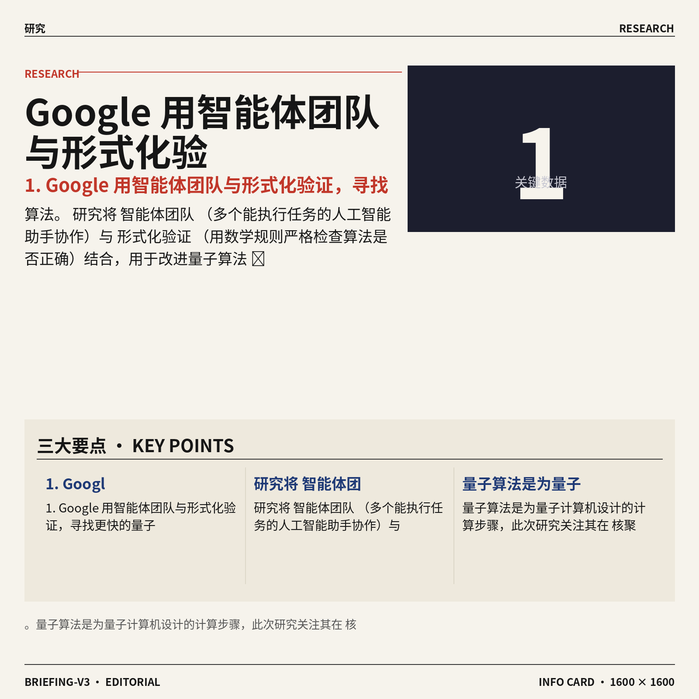

1. **Google 用智能体团队与形式化验证，寻找更快的量子算法。**
研究将**智能体团队**（多个能执行任务的人工智能助手协作）与**形式化验证**（用数学规则严格检查算法是否正确）结合，用于改进量子算法 🚀。量子算法是为量子计算机设计的计算步骤，此次研究关注其在**核聚变与化学**问题中的应用。重点不只是找到更快的计算办法，也要通过严格检查确认改进后的算法正确；候选摘要未给出具体提速幅度。[量子算法研究介绍(briefing)](https://deepmind.google/blog/finding-faster-quantum-algorithms-with-agents-and-formal-verification/)


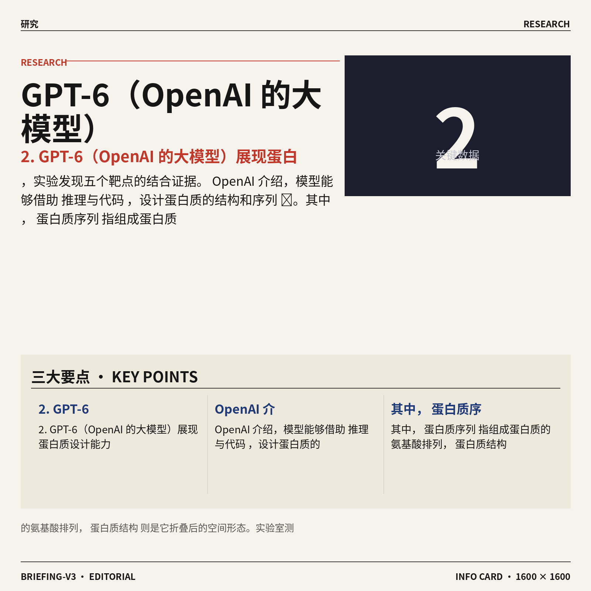

2. **GPT-6（OpenAI 的大模型）展现蛋白质设计能力，实验发现五个靶点的结合证据。**
OpenAI 介绍，模型能够借助**推理与代码**，设计蛋白质的结构和序列 🧬。其中，**蛋白质序列**指组成蛋白质的氨基酸排列，**蛋白质结构**则是它折叠后的空间形态。实验室测试发现，设计结果在**五个靶点**（希望蛋白质与之结合的目标分子）上出现了结合证据。这里值得区分的是：原文报告的是“结合证据”，不能直接将其理解为已经获得有效药物。[蛋白质设计研究介绍(briefing)](https://openai.com/index/gpt-6-models-demonstrate-intrinsic-protein-design-capabilities)

![GPT-6（OpenAI 的大模型）展现蛋白质设计能力，实验发现五个靶点的结合证据](https://image.pollinations.ai/prompt/GPT-6%EF%BC%88OpenAI%20%E7%9A%84%E5%A4%A7%E6%A8%A1%E5%9E%8B%EF%BC%89%E5%B1%95%E7%8E%B0%E8%9B%8B%E7%99%BD%E8%B4%A8%E8%AE%BE%E8%AE%A1%E8%83%BD%E5%8A%9B%EF%BC%8C%E5%AE%9E%E9%AA%8C%E5%8F%91%E7%8E%B0%E4%BA%94%E4%B8%AA%E9%9D%B6%E7%82%B9%E7%9A%84%E7%BB%93%E5%90%88%E8%AF%81%E6%8D%AE.%20GPT-6%EF%BC%88OpenAI%20%E7%9A%84%E5%A4%A7%E6%A8%A1%E5%9E%8B%EF%BC%89%E5%B1%95%E7%8E%B0%E8%9B%8B%E7%99%BD%E8%B4%A8%E8%AE%BE%E8%AE%A1%E8%83%BD%E5%8A%9B%EF%BC%8C%E5%AE%9E%E9%AA%8C%E5%8F%91%E7%8E%B0%E4%BA%94%E4%B8%AA%E9%9D%B6%E7%82%B9%E7%9A%84%E7%BB%93%E5%90%88%E8%AF%81%E6%8D%AE%E3%80%82%20OpenAI%20%E4%BB%8B%E7%BB%8D%EF%BC%8C%E6%A8%A1%E5%9E%8B%E8%83%BD%E5%A4%9F%E5%80%9F%E5%8A%A9%E6%8E%A8%E7%90%86%E4%B8%8E%E4%BB%A3%E7%A0%81%EF%BC%8C%E8%AE%BE%E8%AE%A1%E8%9B%8B%E7%99%BD%E8%B4%A8%E7%9A%84%E7%BB%93%E6%9E%84%E5%92%8C%E5%BA%8F%E5%88%97%20%F0%9F%A7%AC%E3%80%82%E5%85%B6%2C%20technical%20infographic%20diagram%2C%20architecture%20flowchart%2C%20clean%20vector%20illustration%2C%20educational%20style%2C%20no%20text%20overlay%2C%20modern%20minimal%2C%20wide%20aspect?width=1200&height=675&nologo=true&seed=10838)

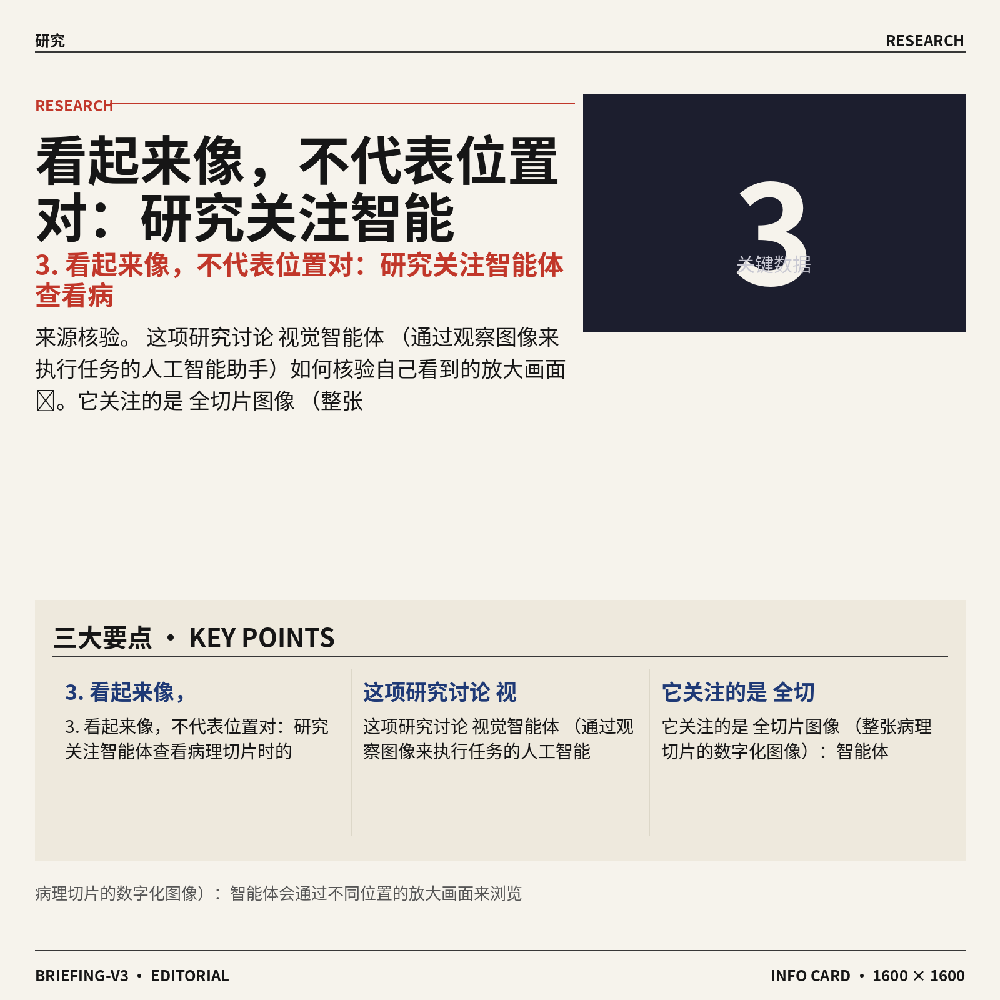

3. **看起来像，不代表位置对：研究关注智能体查看病理切片时的来源核验。**
这项研究讨论**视觉智能体**（通过观察图像来执行任务的人工智能助手）如何核验自己看到的放大画面 🔍。它关注的是**全切片图像**（整张病理切片的数字化图像）：智能体会通过不同位置的放大画面来浏览，但画面看起来合理，并不代表它真的来自所标注的位置。论文提出的研究方向是**跨放大倍率来源核验**（在不同放大倍数之间，检查画面是否确实对应所声称的位置），把“图像像不像”和“来源对不对”区分开来。[切片图像核验论文(briefing)](https://arxiv.org/abs/2611.29150)

![看起来像，不代表位置对：研究关注智能体查看病理切片时的来源核验](https://image.pollinations.ai/prompt/%E7%9C%8B%E8%B5%B7%E6%9D%A5%E5%83%8F%EF%BC%8C%E4%B8%8D%E4%BB%A3%E8%A1%A8%E4%BD%8D%E7%BD%AE%E5%AF%B9%EF%BC%9A%E7%A0%94%E7%A9%B6%E5%85%B3%E6%B3%A8%E6%99%BA%E8%83%BD%E4%BD%93%E6%9F%A5%E7%9C%8B%E7%97%85%E7%90%86%E5%88%87%E7%89%87%E6%97%B6%E7%9A%84%E6%9D%A5%E6%BA%90%E6%A0%B8%E9%AA%8C.%20%E7%9C%8B%E8%B5%B7%E6%9D%A5%E5%83%8F%EF%BC%8C%E4%B8%8D%E4%BB%A3%E8%A1%A8%E4%BD%8D%E7%BD%AE%E5%AF%B9%EF%BC%9A%E7%A0%94%E7%A9%B6%E5%85%B3%E6%B3%A8%E6%99%BA%E8%83%BD%E4%BD%93%E6%9F%A5%E7%9C%8B%E7%97%85%E7%90%86%E5%88%87%E7%89%87%E6%97%B6%E7%9A%84%E6%9D%A5%E6%BA%90%E6%A0%B8%E9%AA%8C%E3%80%82%20%E8%BF%99%E9%A1%B9%E7%A0%94%E7%A9%B6%E8%AE%A8%E8%AE%BA%E8%A7%86%E8%A7%89%E6%99%BA%E8%83%BD%E4%BD%93%EF%BC%88%E9%80%9A%E8%BF%87%E8%A7%82%E5%AF%9F%E5%9B%BE%E5%83%8F%E6%9D%A5%E6%89%A7%E8%A1%8C%E4%BB%BB%E5%8A%A1%E7%9A%84%E4%BA%BA%E5%B7%A5%E6%99%BA%E8%83%BD%E5%8A%A9%E6%89%8B%EF%BC%89%E5%A6%82%E4%BD%95%E6%A0%B8%E9%AA%8C%E8%87%AA%E5%B7%B1%E7%9C%8B%E5%88%B0%E7%9A%84%E6%94%BE%E5%A4%A7%E7%94%BB%E9%9D%A2%20%F0%9F%94%8D%E3%80%82%2C%20technical%20infographic%20diagram%2C%20architecture%20flowchart%2C%20clean%20vector%20illustration%2C%20educational%20style%2C%20no%20text%20overlay%2C%20modern%20minimal%2C%20wide%20aspect?width=1200&height=675&nologo=true&seed=10869)

### 🟡 行业展望与社会影响

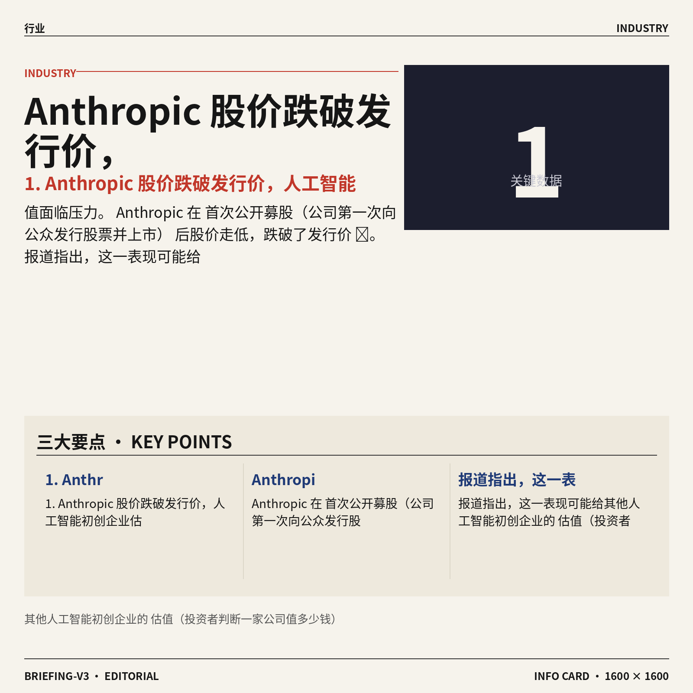

1. **Anthropic 股价跌破发行价，人工智能初创企业估值面临压力。**
Anthropic 在**首次公开募股（公司第一次向公众发行股票并上市）**后股价走低，跌破了发行价 📉。报道指出，这一表现可能给其他人工智能初创企业的**估值（投资者判断一家公司值多少钱）**带来压力。值得关注的不只是单家公司的股价波动，还有这种压力是否会传导至更多初创企业；目前原材料给出的是风险信号，而非行业估值已经全面下跌的结论。[上市表现与估值影响(briefing)](https://techcrunch.com/2026/11/24/anthropic-shares-fall-below-ipo-price-a-worrying-sign-for-ai-startups/)


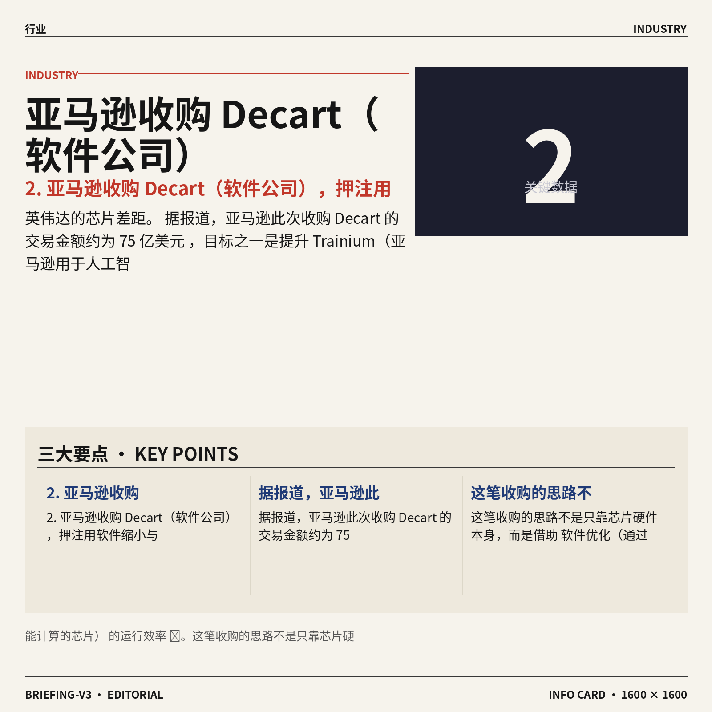

2. **亚马逊收购 Decart（软件公司），押注用软件缩小与英伟达的芯片差距。**
据报道，亚马逊此次收购 Decart 的交易金额约为 **75 亿美元**，目标之一是提升 **Trainium（亚马逊用于人工智能计算的芯片）**的运行效率 🚀。这笔收购的思路不是只靠芯片硬件本身，而是借助**软件优化（通过改进程序，让现有芯片更高效地工作）**来缩小与英伟达的差距。这也让人工智能芯片竞争多了一个观察角度：除了硬件能力，如何用软件把芯片能力发挥出来，同样是亚马逊正在下注的方向。[亚马逊芯片收购报道(briefing)](https://techcrunch.com/2026/11/24/amazons-decart-acquisition-is-a-bet-on-using-software-to-narrow-the-gap-with-nvidia-in-the-ai-chip-race/)


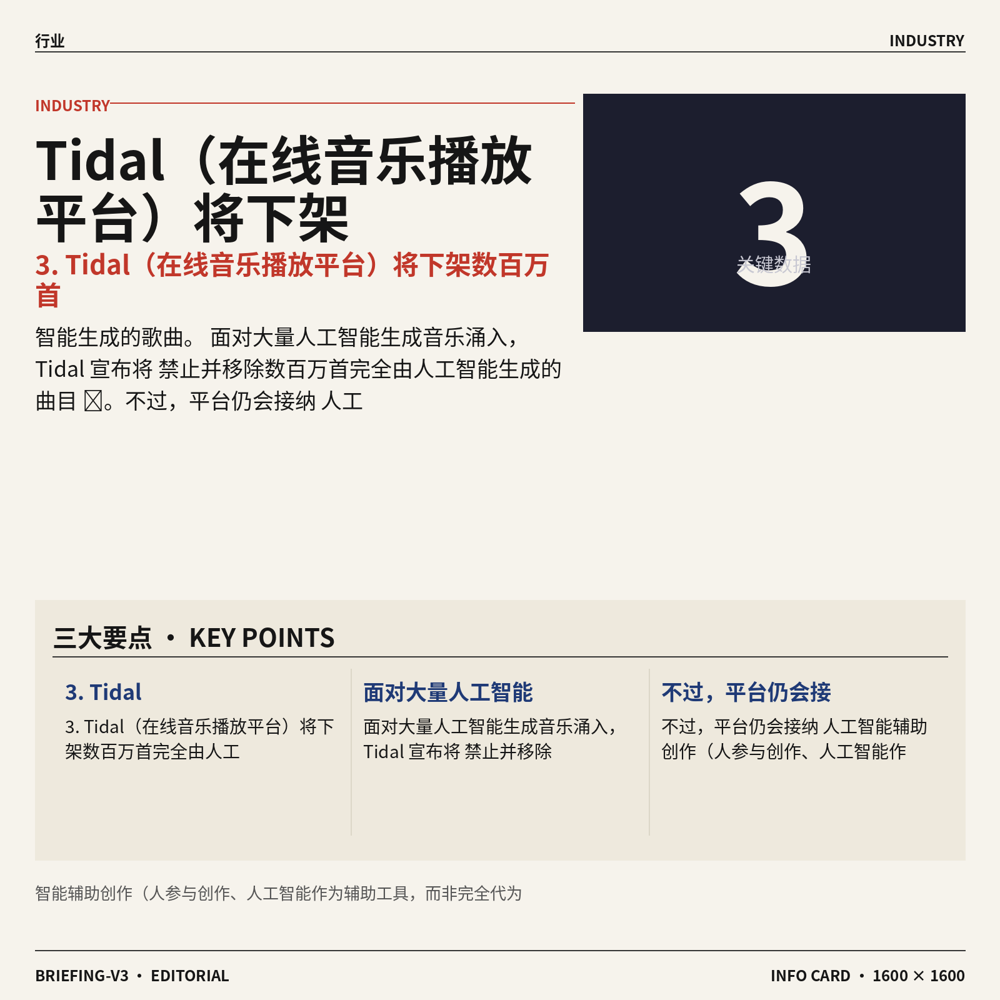

3. **Tidal（在线音乐播放平台）将下架数百万首完全由人工智能生成的歌曲。**
面对大量人工智能生成音乐涌入，Tidal 宣布将**禁止并移除数百万首完全由人工智能生成的曲目** 🎵。不过，平台仍会接纳**人工智能辅助创作（人参与创作、人工智能作为辅助工具，而非完全代为生成）**的歌曲，并非一概拒绝使用人工智能的作品。这项政策划出的关键边界是**“辅助创作”与“完全生成”**，而不只是歌曲制作过程中有没有用过人工智能。[音乐平台内容政策(briefing)](https://techcrunch.com/2026/11/24/tidal-to-ban-and-remove-millions-of-ai-generated-tracks-as-ai-slop-inundates-music-streaming/)

![Tidal（在线音乐播放平台）将下架数百万首完全由人工智能生成的歌曲](https://image.pollinations.ai/prompt/Tidal%EF%BC%88%E5%9C%A8%E7%BA%BF%E9%9F%B3%E4%B9%90%E6%92%AD%E6%94%BE%E5%B9%B3%E5%8F%B0%EF%BC%89%E5%B0%86%E4%B8%8B%E6%9E%B6%E6%95%B0%E7%99%BE%E4%B8%87%E9%A6%96%E5%AE%8C%E5%85%A8%E7%94%B1%E4%BA%BA%E5%B7%A5%E6%99%BA%E8%83%BD%E7%94%9F%E6%88%90%E7%9A%84%E6%AD%8C%E6%9B%B2.%20Tidal%EF%BC%88%E5%9C%A8%E7%BA%BF%E9%9F%B3%E4%B9%90%E6%92%AD%E6%94%BE%E5%B9%B3%E5%8F%B0%EF%BC%89%E5%B0%86%E4%B8%8B%E6%9E%B6%E6%95%B0%E7%99%BE%E4%B8%87%E9%A6%96%E5%AE%8C%E5%85%A8%E7%94%B1%E4%BA%BA%E5%B7%A5%E6%99%BA%E8%83%BD%E7%94%9F%E6%88%90%E7%9A%84%E6%AD%8C%E6%9B%B2%E3%80%82%20%E9%9D%A2%E5%AF%B9%E5%A4%A7%E9%87%8F%E4%BA%BA%E5%B7%A5%E6%99%BA%E8%83%BD%E7%94%9F%E6%88%90%E9%9F%B3%E4%B9%90%E6%B6%8C%E5%85%A5%EF%BC%8CTidal%20%E5%AE%A3%E5%B8%83%E5%B0%86%E7%A6%81%E6%AD%A2%E5%B9%B6%E7%A7%BB%E9%99%A4%E6%95%B0%E7%99%BE%E4%B8%87%E9%A6%96%E5%AE%8C%E5%85%A8%E7%94%B1%E4%BA%BA%E5%B7%A5%E6%99%BA%E8%83%BD%E7%94%9F%E6%88%90%E7%9A%84%E6%9B%B2%2C%20technical%20infographic%20diagram%2C%20architecture%20flowchart%2C%20clean%20vector%20illustration%2C%20educational%20style%2C%20no%20text%20overlay%2C%20modern%20minimal%2C%20wide%20aspect?width=1200&height=675&nologo=true&seed=10869)

### 🟣 开源TOP项目

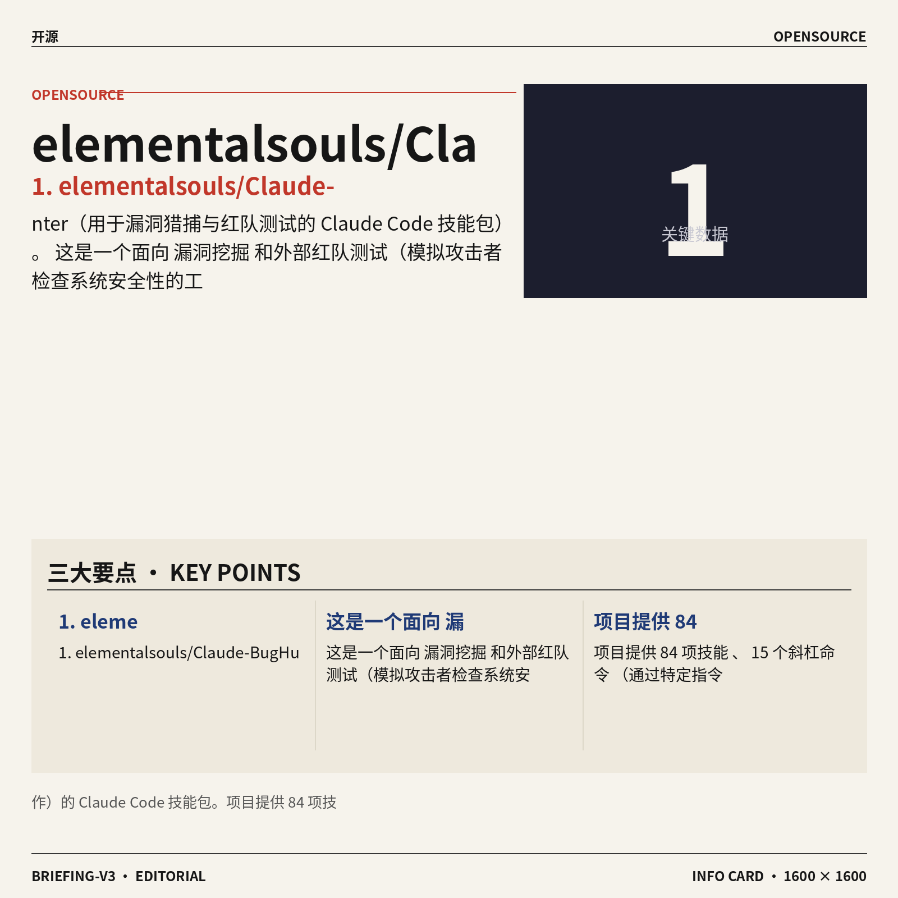

1. **elementalsouls/Claude-BugHunter（用于漏洞猎捕与红队测试的 Claude Code 技能包）。**  
这是一个面向 **漏洞挖掘** 和外部红队测试（模拟攻击者检查系统安全性的工作）的 Claude Code 技能包。项目提供 **84 项技能**、**15 个斜杠命令**（通过特定指令快速调用预设任务），并整理了覆盖 24 类核心漏洞的 681 种已披露报告模式。它还包含企业身份与基础设施攻击矩阵（按不同系统环节梳理潜在攻击路径），可帮助安全团队更系统地开展排查与演练 🚀。[GitHub 项目仓库(briefing)](https://github.com/elementalsouls/Claude-BugHunter)


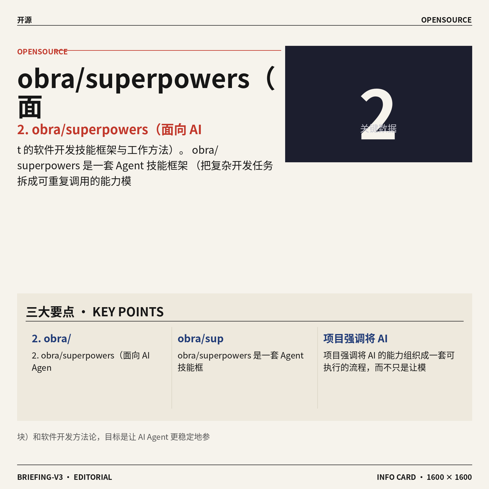

2. **obra/superpowers（面向 AI Agent 的软件开发技能框架与工作方法）。**  
obra/superpowers 是一套 **Agent 技能框架**（把复杂开发任务拆成可重复调用的能力模块）和软件开发方法论，目标是让 AI Agent 更稳定地参与实际开发。项目强调将 AI 的能力组织成一套可执行的流程，而不只是让模型临时生成代码。对团队来说，它更像一份让 AI 参与软件研发时“按步骤办事”的工作手册，有助于统一开发协作方式 💡。[GitHub 项目仓库(briefing)](https://github.com/obra/superpowers)


### 🔴 社媒分享

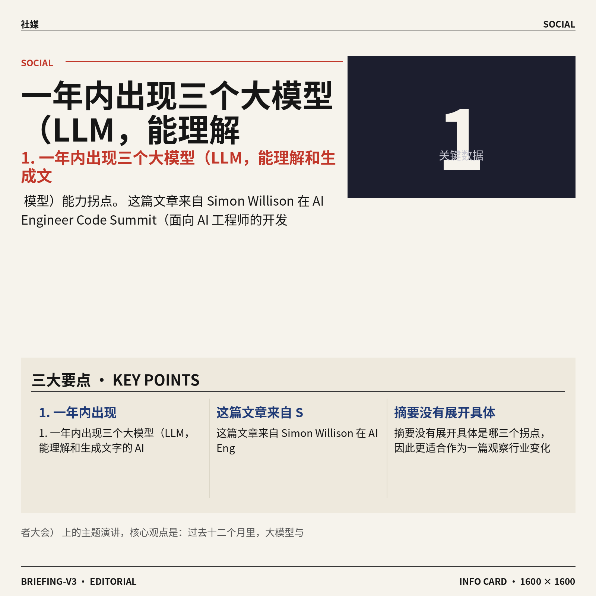

1. **一年内出现三个大模型（LLM，能理解和生成文字的 AI 模型）能力拐点。**  
这篇文章来自 Simon Willison 在 **AI Engineer Code Summit（面向 AI 工程师的开发者大会）**上的主题演讲，核心观点是：过去十二个月里，大模型与**编程智能体（能自主执行编程任务的 AI）**出现了三个重要能力转折点。摘要没有展开具体是哪三个拐点，因此更适合作为一篇观察行业变化的长文线索，而不是直接下结论。对非技术岗位来说，它的价值在于帮助理解：AI 正从“回答问题”逐渐走向“完成一连串工作”🚀 [完整文章(briefing)](https://simonwillison.net/2026/Nov/24/llm-inflection-points/)


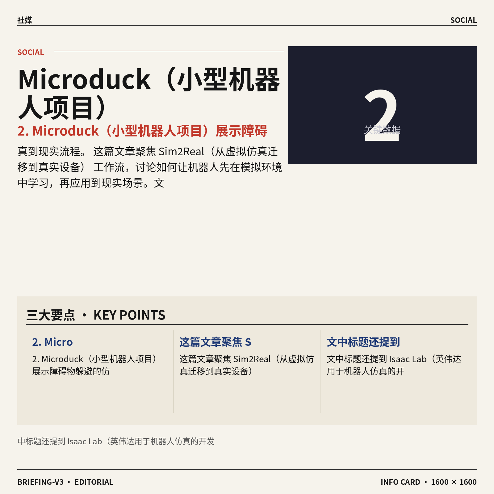

2. **Microduck（小型机器人项目）展示障碍物躲避的仿真到现实流程。**  
这篇文章聚焦 **Sim2Real（从虚拟仿真迁移到真实设备）**工作流，讨论如何让机器人先在模拟环境中学习，再应用到现实场景。文中标题还提到 **Isaac Lab（英伟达用于机器人仿真的开发平台）**与 **Newton（用于物理仿真的工具或系统）**，说明内容重点在机器人训练和落地之间的衔接。简单说，就是先让机器人在“数字练习场”里学会避障，再看能否在真实世界中完成同样动作 🤖 [项目实践文章(briefing)](https://huggingface.co/blog/nvidia/microduck-obstacle-avoidance)


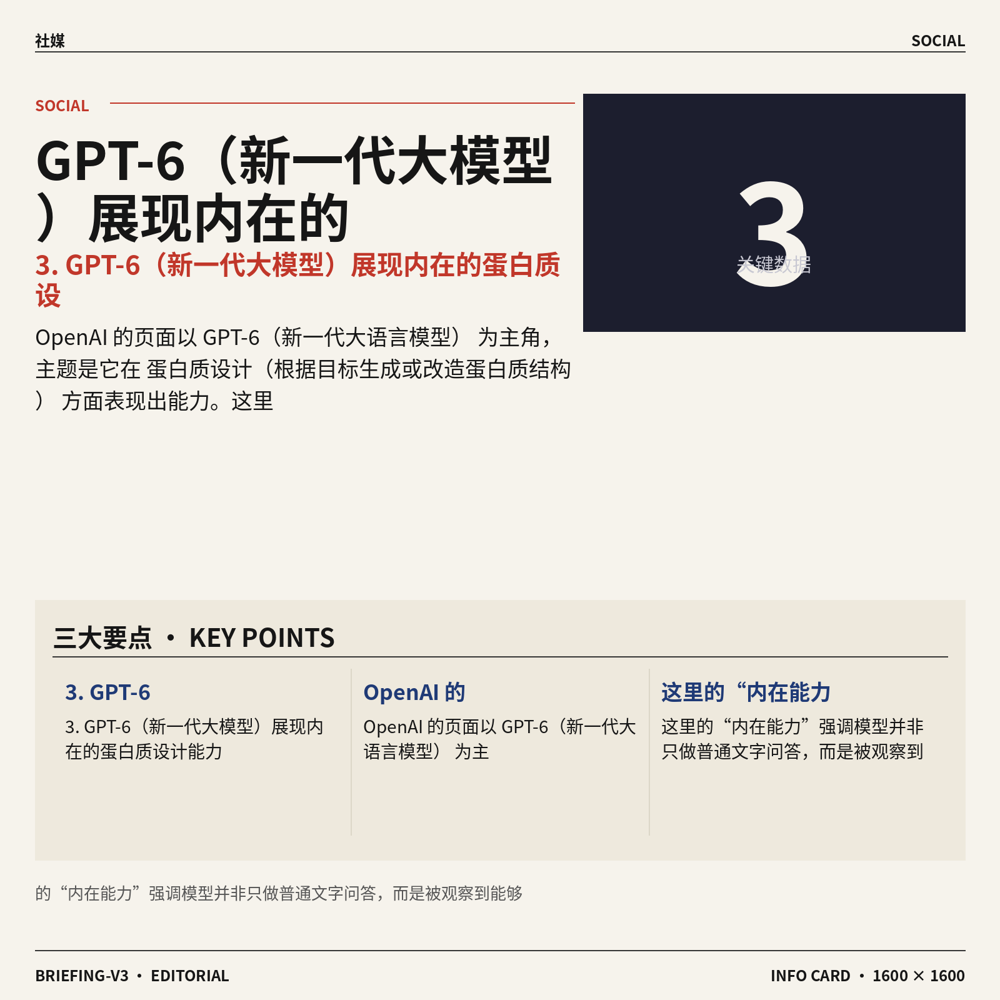

3. **GPT-6（新一代大模型）展现内在的蛋白质设计能力。**  
OpenAI 的页面以 **GPT-6（新一代大语言模型）**为主角，主题是它在**蛋白质设计（根据目标生成或改造蛋白质结构）**方面表现出能力。这里的“内在能力”强调模型并非只做普通文字问答，而是被观察到能够处理与生命科学设计有关的任务。对行业而言，这类进展意味着大模型的应用边界可能从办公与编程，进一步延伸到科研场景 🧬 [官方研究页面(briefing)](https://openai.com/index/gpt-6-models-demonstrate-intrinsic-protein-design-capabilities/)

![GPT-6（新一代大模型）展现内在的蛋白质设计能力](https://image.pollinations.ai/prompt/GPT-6%EF%BC%88%E6%96%B0%E4%B8%80%E4%BB%A3%E5%A4%A7%E6%A8%A1%E5%9E%8B%EF%BC%89%E5%B1%95%E7%8E%B0%E5%86%85%E5%9C%A8%E7%9A%84%E8%9B%8B%E7%99%BD%E8%B4%A8%E8%AE%BE%E8%AE%A1%E8%83%BD%E5%8A%9B.%20GPT-6%EF%BC%88%E6%96%B0%E4%B8%80%E4%BB%A3%E5%A4%A7%E6%A8%A1%E5%9E%8B%EF%BC%89%E5%B1%95%E7%8E%B0%E5%86%85%E5%9C%A8%E7%9A%84%E8%9B%8B%E7%99%BD%E8%B4%A8%E8%AE%BE%E8%AE%A1%E8%83%BD%E5%8A%9B%E3%80%82%20OpenAI%20%E7%9A%84%E9%A1%B5%E9%9D%A2%E4%BB%A5%20GPT-6%EF%BC%88%E6%96%B0%E4%B8%80%E4%BB%A3%E5%A4%A7%E8%AF%AD%E8%A8%80%E6%A8%A1%E5%9E%8B%EF%BC%89%E4%B8%BA%E4%B8%BB%E8%A7%92%EF%BC%8C%E4%B8%BB%E9%A2%98%E6%98%AF%E5%AE%83%E5%9C%A8%E8%9B%8B%E7%99%BD%E8%B4%A8%E8%AE%BE%E8%AE%A1%EF%BC%88%E6%A0%B9%E6%8D%AE%E7%9B%AE%E6%A0%87%E7%94%9F%E6%88%90%E6%88%96%E6%94%B9%E9%80%A0%E8%9B%8B%E7%99%BD%2C%20technical%20infographic%20diagram%2C%20architecture%20flowchart%2C%20clean%20vector%20illustration%2C%20educational%20style%2C%20no%20text%20overlay%2C%20modern%20minimal%2C%20wide%20aspect?width=1200&height=675&nologo=true&seed=10675)

4. **“Jensen is back”（黄仁勋回来了）成为英伟达相关报道标题。**  
这篇报道围绕 **Jensen Huang（黄仁勋，英伟达创始人兼 CEO）**展开，标题用“回归”制造了明显的新闻感。现有摘要没有提供具体事件、观点或业务变化，因此目前只能确认它是一篇关于黄仁勋与英伟达的报道，不能据此延伸出更多结论。对社媒分享来说，它更像一个值得点开的行业人物动态线索 👀 [完整报道(briefing)](https://www.platformer.news/jensen-huang-returns-nvidia/)


5. **Ternary Bonsai 2.5（采用三值权重的模型）发布 27B（约 270 亿参数）版本。**  
条目标题显示，**Ternary Bonsai 2.5（模型名称）**推出了 **27B（约 270 亿参数，用来衡量模型规模的指标）**版本。**Ternary（​​三值化，让模型参数主要取三种数值）**通常指一种压缩模型的思路，目标是减少模型存储和运行时的负担；不过候选材料没有进一步说明该版本的性能、用途或发布时间。想了解它究竟面向开发者、企业还是普通用户，需要继续查看原始发布页 💡 [模型发布页面(briefing)](https://prismml.com/news/bonsai-2-5-27b)


6. **GPT-6.2 Astra（GPT-6.2 的模型版本）破解历史谜案。**  
这是一则关于 **GPT-6.2 Astra（GPT-6.2 的一个模型版本）**参与历史研究的案例，标题称其解决了一个历史谜题。摘要明确将它描述为 **historical research（历史研究，即整理资料并分析过去发生的事件）**案例，说明大模型正在被尝试用于不只是写作，也包括材料梳理与推理。具体使用了哪些史料、得出了什么结论，仍需阅读原文才能判断 📚 [历史研究案例(briefing)](https://simonwillison.net/2026/Nov/24/astra-historical-mystery/)


---


### 📊 行业洞察（今日 4 条）

1. Anthropic（人工智能公司）一边扩大MCP（让AI连接外部工具的通用接口）并把Claude Artifacts（把聊天成果做成小应用的功能）变成桌面应用，Meta也把Muse（Meta的AI助手）塞进Instagram私信  
  【洞察】这些动作放一起看，AI竞争正从“回答得好”转向“直接嵌进用户已有工作流”，谁离用户更近，谁更容易形成使用习惯。

2. Anthropic上市后股价跌破发行价，同时其高额算力需求推高xAI（马斯克旗下AI公司）的租用算力支出，SpaceXSI（报道中的相关公司）反而减少自建AI项目  
  【洞察】能力越强，成本和估值压力越大，AI行业开始从“拼模型想象力”转向“能否用合理成本持续交付”。

3. Google用Agent团队和形式化验证（用严格规则检查结果是否正确）寻找量子算法，OpenAI又被曝内部担心新模型难以控制  
  【洞察】AI越能自主完成复杂任务，越不能只看结果像不像，必须同时检查过程、依据和边界；可靠性会成为商业落地的硬门槛。

4. GPT-6（OpenAI的大模型）在五个蛋白质目标上发现结合证据，而Tidal（在线音乐平台）却准备下架完全由AI生成的歌曲  
  【洞察】AI能力突破不等于内容自动获得市场认可，高价值场景会要求实验验证， массов量内容平台则会优先治理低质量和泛滥问题。

### 💭 对我们的启发（今日 3 条）

1. Anthropic把Claude Artifacts做成桌面应用、Meta把Muse放进Instagram私信，说明剪辑功能不能只停留在独立页面，应尽量嵌入品牌商已有的素材、沟通和发布流程，减少来回切换。

2. 病理图像研究强调“看起来像”不等于“来源正确”，Tidal又区分人工智能辅助和完全生成；我们应给视频素材、字幕和画面来源留痕，并保留人工确认和一键撤回边界。

3. Anthropic的算力支出与上市后估值压力提醒我们，不能默认每个任务都调用最贵模型；剪辑软件应按任务难度分配能力，把简单改字幕、裁切交给低成本处理，复杂创意再升级。

