## AI资讯日报 2026/11/27

> AI 早报 · 每日早读 · 全网深度聚合

## **今日摘要**

```
美国收紧出口管制，英伟达暂停向东南亚四国发运服务器
SAP（企业管理软件商）据报考虑裁减至少一万个岗位，推进人工智能重组
微软披露ARTEX（自动化网络攻击框架）被国家支持的黑客使用
```

### 🔵 产品与功能更新

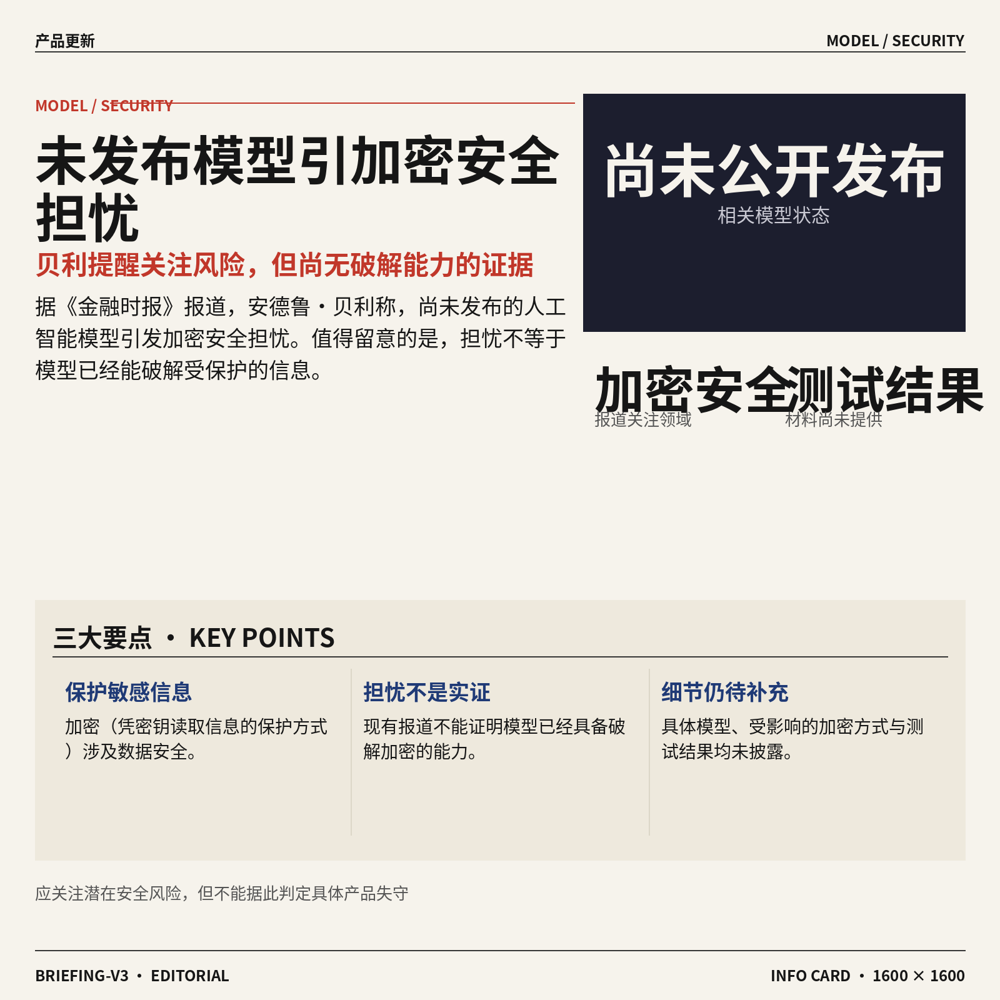

1. **安德鲁·贝利：尚未发布的人工智能模型引发加密安全担忧。**
据《金融时报》报道，安德鲁·贝利表示，**尚未公开发布的人工智能模型**已引发对加密安全的担忧 🔐。这里的**加密**（将信息转换成只有持有相应密钥才能读取的内容）涉及敏感信息的保护，但“引发担忧”并不等于模型已经能够破解加密。当前提供的材料未说明具体模型、受影响的加密方式或测试结果，因此不能据此判断哪些产品存在风险，参见[加密安全担忧报道(briefing)](https://news.google.com/rss/articles/CBMihAFBVV95cUxPbWxtSWdkclhVM25LM250eXk0V3AyWHl5VU82OHdETGpVOHBNeHVwR0tKM1JiVUlmNnpRZHZuX2o5bFctVU16OVctaDVFM0RUTWxLZXladmFDSjdjMUpkLVhiX3dRYVhrTVRDTUpud0R6RU1NYWx3TElCWmlkSndmTjdwTEQ?oc=5)。

![安德鲁·贝利：尚未发布的人工智能模型引发加密安全担忧](https://image.pollinations.ai/prompt/%E5%AE%89%E5%BE%B7%E9%B2%81%C2%B7%E8%B4%9D%E5%88%A9%EF%BC%9A%E5%B0%9A%E6%9C%AA%E5%8F%91%E5%B8%83%E7%9A%84%E4%BA%BA%E5%B7%A5%E6%99%BA%E8%83%BD%E6%A8%A1%E5%9E%8B%E5%BC%95%E5%8F%91%E5%8A%A0%E5%AF%86%E5%AE%89%E5%85%A8%E6%8B%85%E5%BF%A7.%20%E5%AE%89%E5%BE%B7%E9%B2%81%C2%B7%E8%B4%9D%E5%88%A9%EF%BC%9A%E5%B0%9A%E6%9C%AA%E5%8F%91%E5%B8%83%E7%9A%84%E4%BA%BA%E5%B7%A5%E6%99%BA%E8%83%BD%E6%A8%A1%E5%9E%8B%E5%BC%95%E5%8F%91%E5%8A%A0%E5%AF%86%E5%AE%89%E5%85%A8%E6%8B%85%E5%BF%A7%E3%80%82%20%E6%8D%AE%E3%80%8A%E9%87%91%E8%9E%8D%E6%97%B6%E6%8A%A5%E3%80%8B%E6%8A%A5%E9%81%93%EF%BC%8C%E5%AE%89%E5%BE%B7%E9%B2%81%C2%B7%E8%B4%9D%E5%88%A9%E8%A1%A8%E7%A4%BA%EF%BC%8C%E5%B0%9A%E6%9C%AA%E5%85%AC%E5%BC%80%E5%8F%91%E5%B8%83%E7%9A%84%E4%BA%BA%E5%B7%A5%E6%99%BA%E8%83%BD%E6%A8%A1%E5%9E%8B%E5%B7%B2%E5%BC%95%E5%8F%91%E5%AF%B9%E5%8A%A0%E5%AF%86%E5%AE%89%E5%85%A8%E7%9A%84%E6%8B%85%E5%BF%A7%20%F0%9F%94%90%E3%80%82%E8%BF%99%E9%87%8C%E7%9A%84%E5%8A%A0%E5%AF%86%EF%BC%88%2C%20technical%20infographic%20diagram%2C%20architecture%20flowchart%2C%20clean%20vector%20illustration%2C%20educational%20style%2C%20no%20text%20overlay%2C%20modern%20minimal%2C%20wide%20aspect?width=1200&height=675&nologo=true&seed=11389)

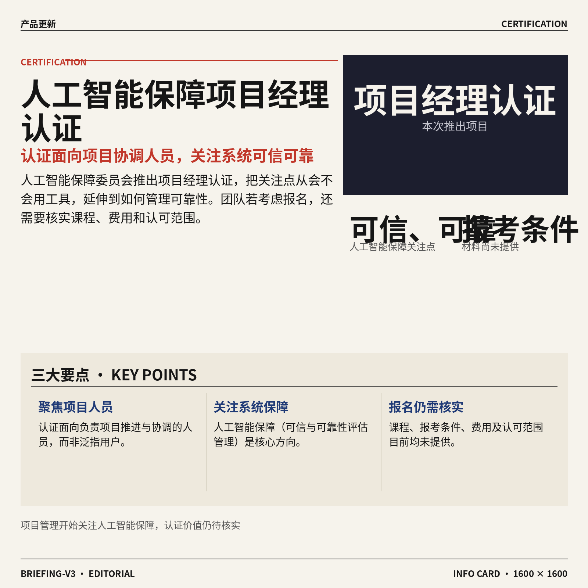

2. **人工智能保障委员会推出项目经理认证。**
据报道，人工智能保障委员会推出了**项目经理认证**，将认证对象聚焦到负责项目推进与协调的人员 📋。其中，**人工智能保障**（围绕人工智能系统是否可信、可靠开展评估与管理）强调的不只是“会不会使用工具”，也包括如何看待系统的可靠性。当前材料没有提供课程内容、报考条件、费用或认可范围，人事与培训同事若要评估是否适合团队，还需进一步查阅[项目经理认证报道(briefing)](https://news.google.com/rss/articles/CBMijwFBVV95cUxQLV9seDVWdHE1Y2VmYjhGdFlGYWd5b0VyZ0pHcklldFlpVnJfZm5XWlY2Vmk1TFRkYlhOV3dWLUNHZDBzeVBCSlJ5dkRlQVVnOFBZNlVVOG9xR0pyQWxwa1FoVlc5ZTdoeGRTSDJJZUxkcUFBMnBCNXJ4TDFnbDJGaUZyNTRoakZjT2xESjBSdw?oc=5)。

![人工智能保障委员会推出项目经理认证](https://image.pollinations.ai/prompt/%E4%BA%BA%E5%B7%A5%E6%99%BA%E8%83%BD%E4%BF%9D%E9%9A%9C%E5%A7%94%E5%91%98%E4%BC%9A%E6%8E%A8%E5%87%BA%E9%A1%B9%E7%9B%AE%E7%BB%8F%E7%90%86%E8%AE%A4%E8%AF%81.%20%E4%BA%BA%E5%B7%A5%E6%99%BA%E8%83%BD%E4%BF%9D%E9%9A%9C%E5%A7%94%E5%91%98%E4%BC%9A%E6%8E%A8%E5%87%BA%E9%A1%B9%E7%9B%AE%E7%BB%8F%E7%90%86%E8%AE%A4%E8%AF%81%E3%80%82%20%E6%8D%AE%E6%8A%A5%E9%81%93%EF%BC%8C%E4%BA%BA%E5%B7%A5%E6%99%BA%E8%83%BD%E4%BF%9D%E9%9A%9C%E5%A7%94%E5%91%98%E4%BC%9A%E6%8E%A8%E5%87%BA%E4%BA%86%E9%A1%B9%E7%9B%AE%E7%BB%8F%E7%90%86%E8%AE%A4%E8%AF%81%EF%BC%8C%E5%B0%86%E8%AE%A4%E8%AF%81%E5%AF%B9%E8%B1%A1%E8%81%9A%E7%84%A6%E5%88%B0%E8%B4%9F%E8%B4%A3%E9%A1%B9%E7%9B%AE%E6%8E%A8%E8%BF%9B%E4%B8%8E%E5%8D%8F%E8%B0%83%E7%9A%84%E4%BA%BA%E5%91%98%20%F0%9F%93%8B%E3%80%82%E5%85%B6%E4%B8%AD%EF%BC%8C%E4%BA%BA%E5%B7%A5%E6%99%BA%E8%83%BD%E4%BF%9D%E9%9A%9C%EF%BC%88%E5%9B%B4%E7%BB%95%E4%BA%BA%E5%B7%A5%E6%99%BA%2C%20technical%20infographic%20diagram%2C%20architecture%20flowchart%2C%20clean%20vector%20illustration%2C%20educational%20style%2C%20no%20text%20overlay%2C%20modern%20minimal%2C%20wide%20aspect?width=1200&height=675&nologo=true&seed=11420)

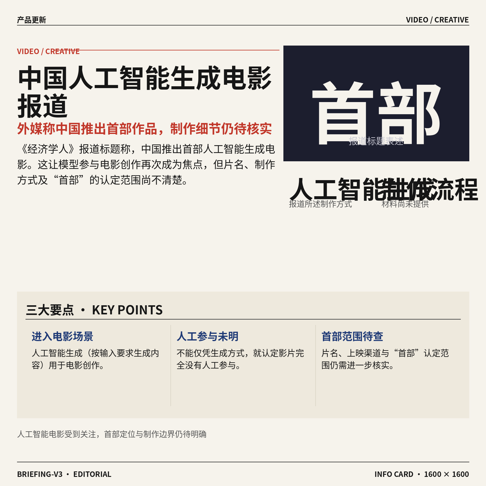

3. **《经济学人》报道：中国推出首部人工智能生成电影。**
《经济学人》的报道标题称，中国推出了**首部人工智能生成电影**，将关注点放在人工智能生成内容进入电影创作这一场景 🎬。**人工智能生成**（由模型依据输入要求生成内容）说明了内容的制作方式，但仅凭这一表述，不能认定影片完全没有人工参与。当前材料未提供片名、上映渠道、制作流程，也没有交代“首部”的认定范围，具体情况仍需结合[人工智能电影报道(briefing)](https://news.google.com/rss/articles/CBMilgFBVV95cUxOSm9KQ0JTZUZ3V2hXdmFjMEg1YlljRTVHZmFHZW1TbmtTUklfQktiU1gySFFRdHo1N0hRandwNllyaHMtcW1nbThZanluODl4TV9saVlRcVdwVVlvYW1mSnc5TjVrc1p6NDNySXZPcW0zaUdORXdsajJUVVc1UFpIaHg4QW9GcmlNZk9zQzFnbUxDN2JnTWc?oc=5)核实。

![《经济学人》报道：中国推出首部人工智能生成电影](https://image.pollinations.ai/prompt/%E3%80%8A%E7%BB%8F%E6%B5%8E%E5%AD%A6%E4%BA%BA%E3%80%8B%E6%8A%A5%E9%81%93%EF%BC%9A%E4%B8%AD%E5%9B%BD%E6%8E%A8%E5%87%BA%E9%A6%96%E9%83%A8%E4%BA%BA%E5%B7%A5%E6%99%BA%E8%83%BD%E7%94%9F%E6%88%90%E7%94%B5%E5%BD%B1.%20%E3%80%8A%E7%BB%8F%E6%B5%8E%E5%AD%A6%E4%BA%BA%E3%80%8B%E6%8A%A5%E9%81%93%EF%BC%9A%E4%B8%AD%E5%9B%BD%E6%8E%A8%E5%87%BA%E9%A6%96%E9%83%A8%E4%BA%BA%E5%B7%A5%E6%99%BA%E8%83%BD%E7%94%9F%E6%88%90%E7%94%B5%E5%BD%B1%E3%80%82%20%E3%80%8A%E7%BB%8F%E6%B5%8E%E5%AD%A6%E4%BA%BA%E3%80%8B%E7%9A%84%E6%8A%A5%E9%81%93%E6%A0%87%E9%A2%98%E7%A7%B0%EF%BC%8C%E4%B8%AD%E5%9B%BD%E6%8E%A8%E5%87%BA%E4%BA%86%E9%A6%96%E9%83%A8%E4%BA%BA%E5%B7%A5%E6%99%BA%E8%83%BD%E7%94%9F%E6%88%90%E7%94%B5%E5%BD%B1%EF%BC%8C%E5%B0%86%E5%85%B3%E6%B3%A8%E7%82%B9%E6%94%BE%E5%9C%A8%E4%BA%BA%E5%B7%A5%E6%99%BA%E8%83%BD%E7%94%9F%E6%88%90%E5%86%85%E5%AE%B9%E8%BF%9B%E5%85%A5%E7%94%B5%E5%BD%B1%E5%88%9B%E4%BD%9C%E8%BF%99%E4%B8%80%E5%9C%BA%E6%99%AF%20%F0%9F%8E%AC%2C%20technical%20infographic%20diagram%2C%20architecture%20flowchart%2C%20clean%20vector%20illustration%2C%20educational%20style%2C%20no%20text%20overlay%2C%20modern%20minimal%2C%20wide%20aspect?width=1200&height=675&nologo=true&seed=11451)

### 🟢 前沿研究

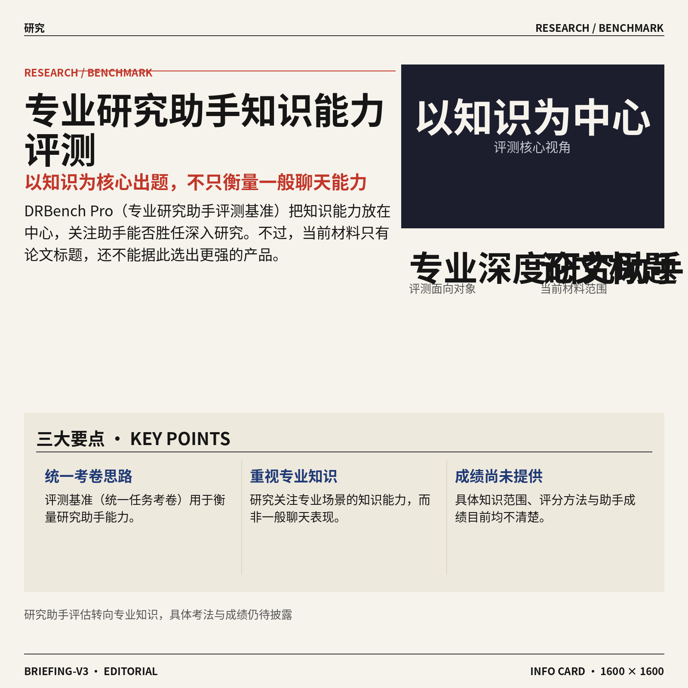

1. **DRBench Pro（面向专业深度研究助手的评测基准）以知识为核心衡量研究能力。**
这项研究提出一套**以知识为中心**的评测基准（用统一任务衡量系统能力的“考卷”），评估对象是专业深度研究助手（围绕问题开展深入研究的人工智能助手）🔎。从标题看，它关注的不是一般聊天能力，而是**专业研究场景中的知识能力**。目前提供的材料仅含论文标题，尚不足以判断具体考查哪些知识、如何评分，以及哪些助手表现更好。[专业研究评测论文(briefing)](https://huggingface.co/papers/2611.34852)

![DRBench Pro（面向专业深度研究助手的评测基准）以知识为核心衡量研究能力](https://image.pollinations.ai/prompt/DRBench%20Pro%EF%BC%88%E9%9D%A2%E5%90%91%E4%B8%93%E4%B8%9A%E6%B7%B1%E5%BA%A6%E7%A0%94%E7%A9%B6%E5%8A%A9%E6%89%8B%E7%9A%84%E8%AF%84%E6%B5%8B%E5%9F%BA%E5%87%86%EF%BC%89%E4%BB%A5%E7%9F%A5%E8%AF%86%E4%B8%BA%E6%A0%B8%E5%BF%83%E8%A1%A1%E9%87%8F%E7%A0%94%E7%A9%B6%E8%83%BD%E5%8A%9B.%20DRBench%20Pro%EF%BC%88%E9%9D%A2%E5%90%91%E4%B8%93%E4%B8%9A%E6%B7%B1%E5%BA%A6%E7%A0%94%E7%A9%B6%E5%8A%A9%E6%89%8B%E7%9A%84%E8%AF%84%E6%B5%8B%E5%9F%BA%E5%87%86%EF%BC%89%E4%BB%A5%E7%9F%A5%E8%AF%86%E4%B8%BA%E6%A0%B8%E5%BF%83%E8%A1%A1%E9%87%8F%E7%A0%94%E7%A9%B6%E8%83%BD%E5%8A%9B%E3%80%82%20%E8%BF%99%E9%A1%B9%E7%A0%94%E7%A9%B6%E6%8F%90%E5%87%BA%E4%B8%80%E5%A5%97%E4%BB%A5%E7%9F%A5%E8%AF%86%E4%B8%BA%E4%B8%AD%E5%BF%83%E7%9A%84%E8%AF%84%E6%B5%8B%E5%9F%BA%E5%87%86%EF%BC%88%E7%94%A8%E7%BB%9F%E4%B8%80%E4%BB%BB%E5%8A%A1%E8%A1%A1%E9%87%8F%E7%B3%BB%E7%BB%9F%E8%83%BD%E5%8A%9B%E7%9A%84%E2%80%9C%E8%80%83%E5%8D%B7%E2%80%9D%EF%BC%89%EF%BC%8C%2C%20technical%20infographic%20diagram%2C%20architecture%20flowchart%2C%20clean%20vector%20illustration%2C%20educational%20style%2C%20no%20text%20overlay%2C%20modern%20minimal%2C%20wide%20aspect?width=1200&height=675&nologo=true&seed=10807)

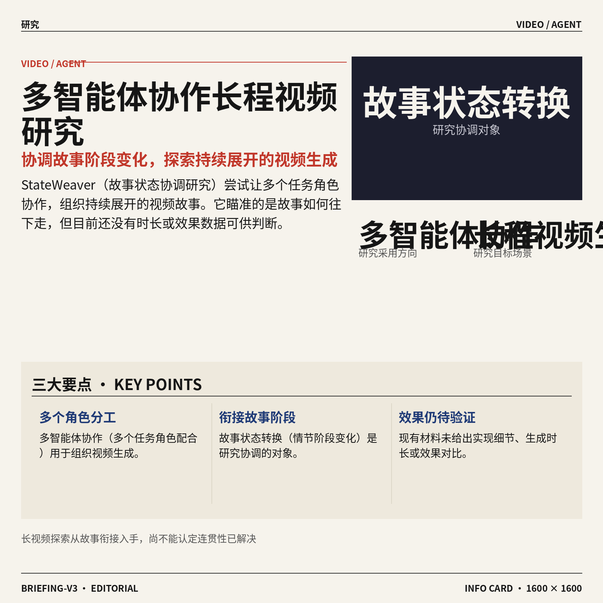

2. **StateWeaver（通过多智能体协作协调故事状态的视频生成研究）关注长程视频生成。**
这项研究把**多智能体协作**（让多个能够执行任务的人工智能角色分工配合）用于长程视频生成（生成需要持续推进、而非只有短暂片段的视频）🎬。标题明确指出，其协调对象是**故事状态转换**，也就是故事从一个阶段走向下一个阶段时的变化。研究方向聚焦于如何组织持续展开的视频内容，但现有材料未提供具体实现、生成时长或效果对比，不能据此认定它已经解决长视频连贯性问题。[长程视频生成论文(briefing)](https://huggingface.co/papers/2611.34290)

![StateWeaver（通过多智能体协作协调故事状态的视频生成研究）关注长程视频生成](https://image.pollinations.ai/prompt/StateWeaver%EF%BC%88%E9%80%9A%E8%BF%87%E5%A4%9A%E6%99%BA%E8%83%BD%E4%BD%93%E5%8D%8F%E4%BD%9C%E5%8D%8F%E8%B0%83%E6%95%85%E4%BA%8B%E7%8A%B6%E6%80%81%E7%9A%84%E8%A7%86%E9%A2%91%E7%94%9F%E6%88%90%E7%A0%94%E7%A9%B6%EF%BC%89%E5%85%B3%E6%B3%A8%E9%95%BF%E7%A8%8B%E8%A7%86%E9%A2%91%E7%94%9F%E6%88%90.%20StateWeaver%EF%BC%88%E9%80%9A%E8%BF%87%E5%A4%9A%E6%99%BA%E8%83%BD%E4%BD%93%E5%8D%8F%E4%BD%9C%E5%8D%8F%E8%B0%83%E6%95%85%E4%BA%8B%E7%8A%B6%E6%80%81%E7%9A%84%E8%A7%86%E9%A2%91%E7%94%9F%E6%88%90%E7%A0%94%E7%A9%B6%EF%BC%89%E5%85%B3%E6%B3%A8%E9%95%BF%E7%A8%8B%E8%A7%86%E9%A2%91%E7%94%9F%E6%88%90%E3%80%82%20%E8%BF%99%E9%A1%B9%E7%A0%94%E7%A9%B6%E6%8A%8A%E5%A4%9A%E6%99%BA%E8%83%BD%E4%BD%93%E5%8D%8F%E4%BD%9C%EF%BC%88%E8%AE%A9%E5%A4%9A%E4%B8%AA%E8%83%BD%E5%A4%9F%E6%89%A7%E8%A1%8C%E4%BB%BB%E5%8A%A1%E7%9A%84%E4%BA%BA%E5%B7%A5%E6%99%BA%E8%83%BD%E8%A7%92%E8%89%B2%E5%88%86%E5%B7%A5%E9%85%8D%E5%90%88%EF%BC%89%E7%94%A8%E4%BA%8E%E9%95%BF%2C%20technical%20infographic%20diagram%2C%20architecture%20flowchart%2C%20clean%20vector%20illustration%2C%20educational%20style%2C%20no%20text%20overlay%2C%20modern%20minimal%2C%20wide%20aspect?width=1200&height=675&nologo=true&seed=10838)

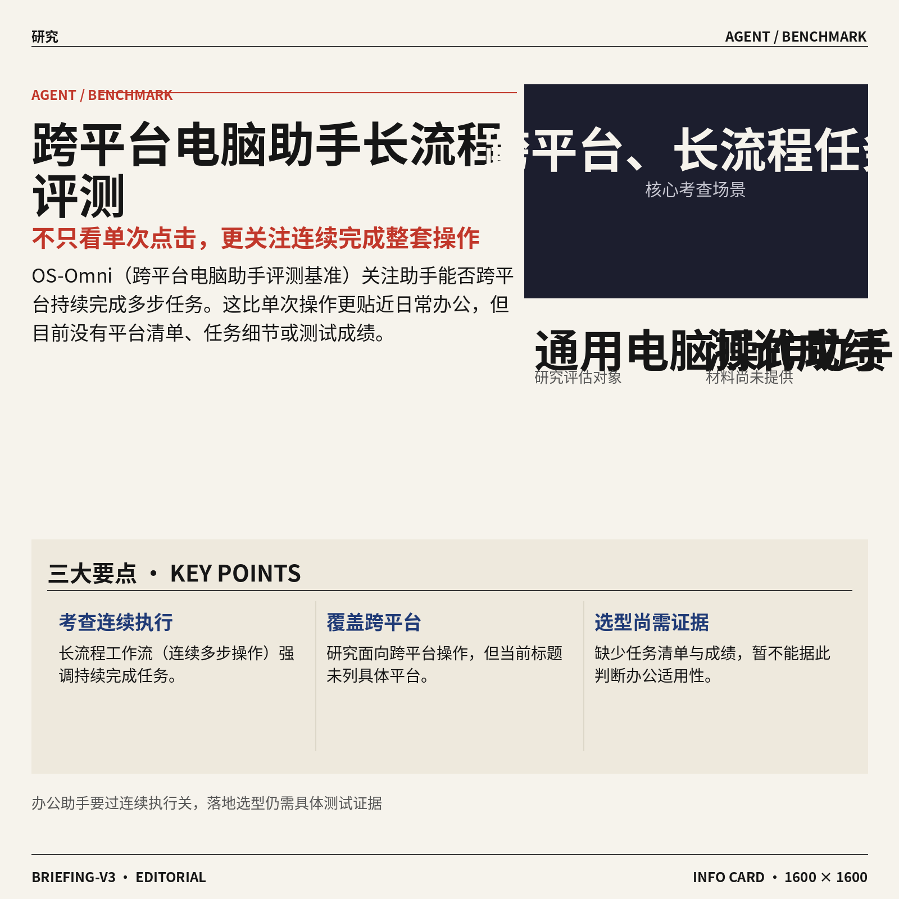

3. **OS-Omni（跨平台电脑操作助手评测基准）考查长流程工作能力。**
这项研究面向通用电脑操作助手（能够在电脑上执行不同类型操作的人工智能助手），评估它们在**跨平台、长流程任务**中的表现 💻。其中，长流程工作流（需要连续完成多个步骤的一整套操作）强调的不是某一次操作是否成功，而是对持续执行任务的能力进行考查。对于关注办公自动化的同事，这类评测值得留意；不过，目前标题没有列出具体平台、任务清单或测试成绩，尚不能据此判断哪些助手更适合实际办公。[跨平台操作评测论文(briefing)](https://huggingface.co/papers/2611.34232)

![OS-Omni（跨平台电脑操作助手评测基准）考查长流程工作能力](https://image.pollinations.ai/prompt/OS-Omni%EF%BC%88%E8%B7%A8%E5%B9%B3%E5%8F%B0%E7%94%B5%E8%84%91%E6%93%8D%E4%BD%9C%E5%8A%A9%E6%89%8B%E8%AF%84%E6%B5%8B%E5%9F%BA%E5%87%86%EF%BC%89%E8%80%83%E6%9F%A5%E9%95%BF%E6%B5%81%E7%A8%8B%E5%B7%A5%E4%BD%9C%E8%83%BD%E5%8A%9B.%20OS-Omni%EF%BC%88%E8%B7%A8%E5%B9%B3%E5%8F%B0%E7%94%B5%E8%84%91%E6%93%8D%E4%BD%9C%E5%8A%A9%E6%89%8B%E8%AF%84%E6%B5%8B%E5%9F%BA%E5%87%86%EF%BC%89%E8%80%83%E6%9F%A5%E9%95%BF%E6%B5%81%E7%A8%8B%E5%B7%A5%E4%BD%9C%E8%83%BD%E5%8A%9B%E3%80%82%20%E8%BF%99%E9%A1%B9%E7%A0%94%E7%A9%B6%E9%9D%A2%E5%90%91%E9%80%9A%E7%94%A8%E7%94%B5%E8%84%91%E6%93%8D%E4%BD%9C%E5%8A%A9%E6%89%8B%EF%BC%88%E8%83%BD%E5%A4%9F%E5%9C%A8%E7%94%B5%E8%84%91%E4%B8%8A%E6%89%A7%E8%A1%8C%E4%B8%8D%E5%90%8C%E7%B1%BB%E5%9E%8B%E6%93%8D%E4%BD%9C%E7%9A%84%E4%BA%BA%E5%B7%A5%E6%99%BA%E8%83%BD%E5%8A%A9%E6%89%8B%EF%BC%89%EF%BC%8C%E8%AF%84%E4%BC%B0%E5%AE%83%E4%BB%AC%E5%9C%A8%E8%B7%A8%E5%B9%B3%E5%8F%B0%E3%80%81%2C%20technical%20infographic%20diagram%2C%20architecture%20flowchart%2C%20clean%20vector%20illustration%2C%20educational%20style%2C%20no%20text%20overlay%2C%20modern%20minimal%2C%20wide%20aspect?width=1200&height=675&nologo=true&seed=10869)

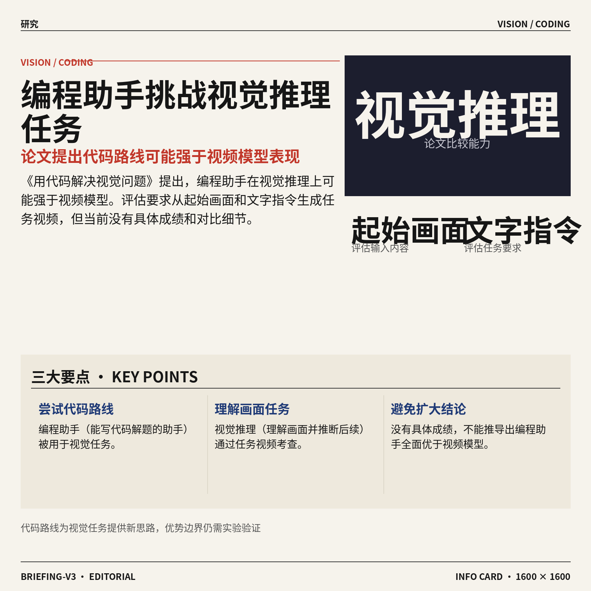

4. **《用代码解决视觉问题》提出：编程助手的视觉推理能力可强于视频模型。**
这篇论文提出一个值得关注的判断：**编程助手**（能够编写代码来解决问题的人工智能助手）的视觉推理能力，可能强于视频模型（能够生成视频内容的人工智能模型）💡。摘要片段介绍了一种评估方式：给模型一张起始画面和一段文字指令，看它能否生成执行指定任务的视频，以此考查**视觉推理**（理解画面中的任务要求，并推断接下来应发生什么）。这提示我们，研究者正在探索用不同路线解决视觉任务；但现有材料没有给出具体成绩、对比对象或实验细节，不宜把标题结论扩大为“编程助手全面优于视频模型”。[代码视觉推理论文(briefing)](https://arxiv.org/abs/2611.34813)

![《用代码解决视觉问题》提出：编程助手的视觉推理能力可强于视频模型](https://image.pollinations.ai/prompt/%E3%80%8A%E7%94%A8%E4%BB%A3%E7%A0%81%E8%A7%A3%E5%86%B3%E8%A7%86%E8%A7%89%E9%97%AE%E9%A2%98%E3%80%8B%E6%8F%90%E5%87%BA%EF%BC%9A%E7%BC%96%E7%A8%8B%E5%8A%A9%E6%89%8B%E7%9A%84%E8%A7%86%E8%A7%89%E6%8E%A8%E7%90%86%E8%83%BD%E5%8A%9B%E5%8F%AF%E5%BC%BA%E4%BA%8E%E8%A7%86%E9%A2%91%E6%A8%A1%E5%9E%8B.%20%E3%80%8A%E7%94%A8%E4%BB%A3%E7%A0%81%E8%A7%A3%E5%86%B3%E8%A7%86%E8%A7%89%E9%97%AE%E9%A2%98%E3%80%8B%E6%8F%90%E5%87%BA%EF%BC%9A%E7%BC%96%E7%A8%8B%E5%8A%A9%E6%89%8B%E7%9A%84%E8%A7%86%E8%A7%89%E6%8E%A8%E7%90%86%E8%83%BD%E5%8A%9B%E5%8F%AF%E5%BC%BA%E4%BA%8E%E8%A7%86%E9%A2%91%E6%A8%A1%E5%9E%8B%E3%80%82%20%E8%BF%99%E7%AF%87%E8%AE%BA%E6%96%87%E6%8F%90%E5%87%BA%E4%B8%80%E4%B8%AA%E5%80%BC%E5%BE%97%E5%85%B3%E6%B3%A8%E7%9A%84%E5%88%A4%E6%96%AD%EF%BC%9A%E7%BC%96%E7%A8%8B%E5%8A%A9%E6%89%8B%EF%BC%88%E8%83%BD%E5%A4%9F%E7%BC%96%E5%86%99%E4%BB%A3%E7%A0%81%E6%9D%A5%E8%A7%A3%E5%86%B3%E9%97%AE%E9%A2%98%E7%9A%84%E4%BA%BA%E5%B7%A5%E6%99%BA%E8%83%BD%E5%8A%A9%E6%89%8B%EF%BC%89%E7%9A%84%E8%A7%86%E8%A7%89%E6%8E%A8%E7%90%86%E8%83%BD%2C%20technical%20infographic%20diagram%2C%20architecture%20flowchart%2C%20clean%20vector%20illustration%2C%20educational%20style%2C%20no%20text%20overlay%2C%20modern%20minimal%2C%20wide%20aspect?width=1200&height=675&nologo=true&seed=10900)

### 🟡 行业展望与社会影响

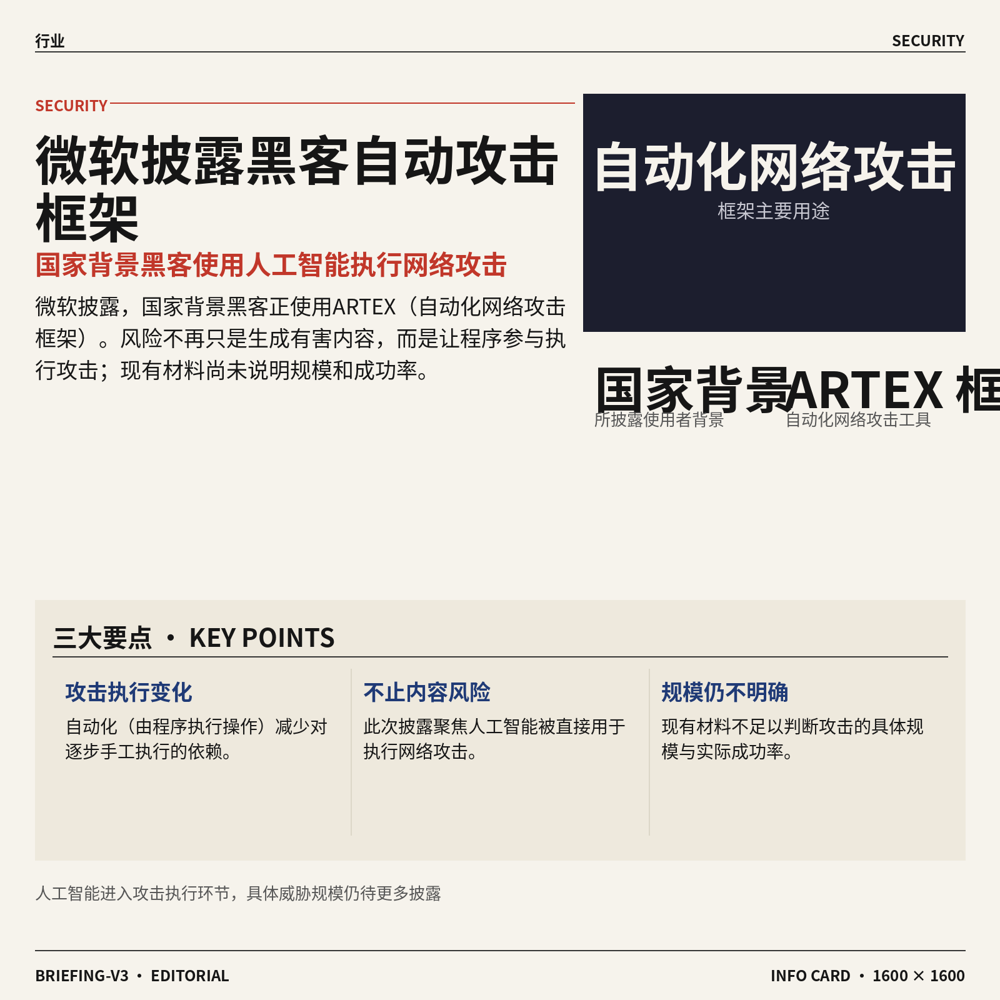

1. **微软披露 ARTEX（用于自动化网络攻击的人工智能框架）被国家支持的黑客使用。**
微软披露，有国家背景的黑客正利用 **ARTEX 框架**，将 AI（人工智能）用于自动化网络攻击 🔒。这里的**自动化**，是指让程序执行攻击操作，而不完全依赖人员逐步手动完成。报道关注的风险不只是人工智能生成有害内容，而是它被直接用于执行网络攻击；不过，现有材料不足以判断攻击的具体规模与成功率。[黑客攻击框架报道(briefing)](https://the-decoder.com/microsoft-details-how-state-backed-hackers-use-the-artex-ai-framework-to-automate-cyberattacks/)


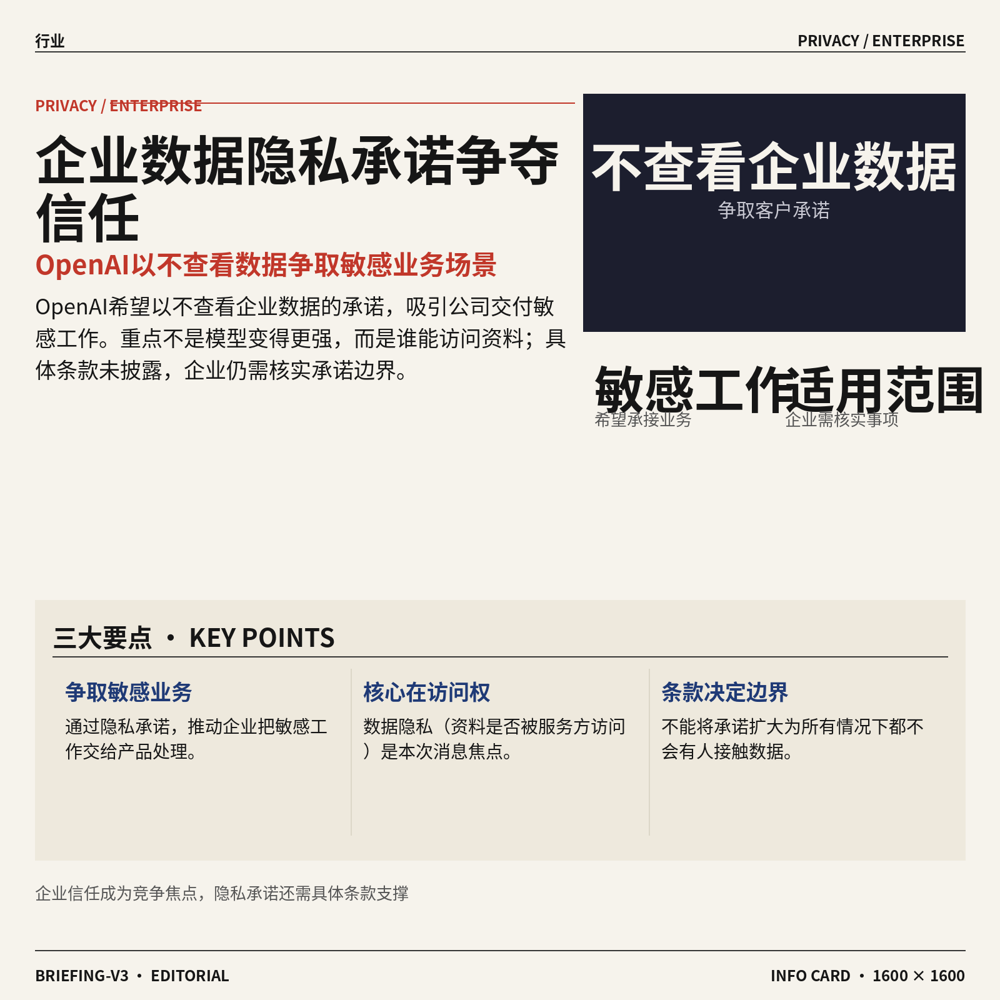

2. **OpenAI 以“不查看企业数据”的承诺，争取敏感业务场景。**
OpenAI 希望通过承诺**不查看企业数据**，让公司愿意把敏感工作交给其产品处理 🔐。这条消息的核心是**数据隐私**（企业资料是否会被服务提供方访问），而非 AI（人工智能）能力本身的提升。对于考虑将敏感资料用于人工智能工作的企业，承诺的适用范围尤为关键；但所给材料未披露具体条款，不能将其扩大理解为所有情况下都不会有人接触数据。[企业数据隐私报道(briefing)](https://the-decoder.com/openai-wants-companies-to-trust-it-with-sensitive-work-by-promising-not-to-look-at-their-data/)

![OpenAI 以“不查看企业数据”的承诺，争取敏感业务场景](https://image.pollinations.ai/prompt/OpenAI%20%E4%BB%A5%E2%80%9C%E4%B8%8D%E6%9F%A5%E7%9C%8B%E4%BC%81%E4%B8%9A%E6%95%B0%E6%8D%AE%E2%80%9D%E7%9A%84%E6%89%BF%E8%AF%BA%EF%BC%8C%E4%BA%89%E5%8F%96%E6%95%8F%E6%84%9F%E4%B8%9A%E5%8A%A1%E5%9C%BA%E6%99%AF.%20OpenAI%20%E4%BB%A5%E2%80%9C%E4%B8%8D%E6%9F%A5%E7%9C%8B%E4%BC%81%E4%B8%9A%E6%95%B0%E6%8D%AE%E2%80%9D%E7%9A%84%E6%89%BF%E8%AF%BA%EF%BC%8C%E4%BA%89%E5%8F%96%E6%95%8F%E6%84%9F%E4%B8%9A%E5%8A%A1%E5%9C%BA%E6%99%AF%E3%80%82%20OpenAI%20%E5%B8%8C%E6%9C%9B%E9%80%9A%E8%BF%87%E6%89%BF%E8%AF%BA%E4%B8%8D%E6%9F%A5%E7%9C%8B%E4%BC%81%E4%B8%9A%E6%95%B0%E6%8D%AE%EF%BC%8C%E8%AE%A9%E5%85%AC%E5%8F%B8%E6%84%BF%E6%84%8F%E6%8A%8A%E6%95%8F%E6%84%9F%E5%B7%A5%E4%BD%9C%E4%BA%A4%E7%BB%99%E5%85%B6%E4%BA%A7%E5%93%81%E5%A4%84%E7%90%86%20%F0%9F%94%90%E3%80%82%E8%BF%99%E6%9D%A1%E6%B6%88%E6%81%AF%E7%9A%84%E6%A0%B8%E5%BF%83%E6%98%AF%2C%20technical%20infographic%20diagram%2C%20architecture%20flowchart%2C%20clean%20vector%20illustration%2C%20educational%20style%2C%20no%20text%20overlay%2C%20modern%20minimal%2C%20wide%20aspect?width=1200&height=675&nologo=true&seed=10838)

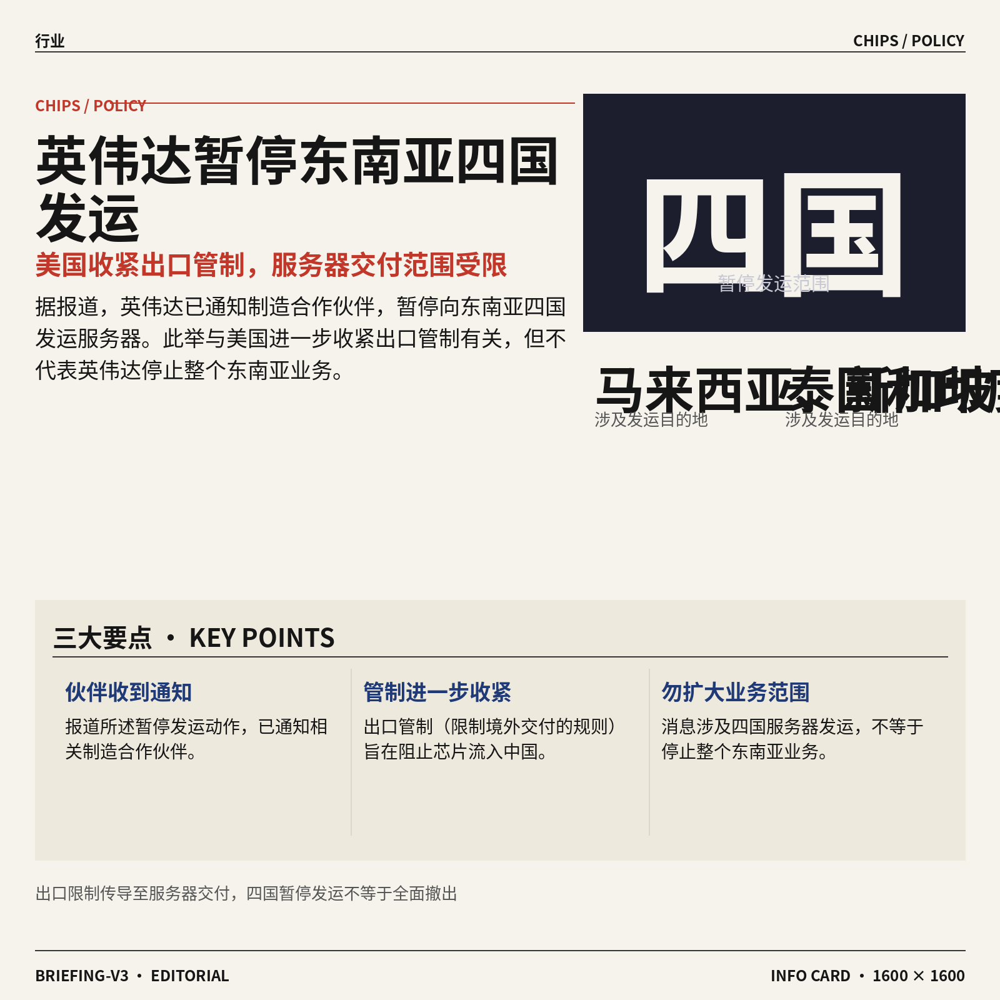

3. **美国收紧出口管制，英伟达暂停向东南亚四国发运服务器。**
据报道，英伟达已通知制造合作伙伴，暂停向**马来西亚、新加坡、泰国和印度尼西亚**发运服务器 📦。这一动作与美国进一步收紧**出口管制**（限制特定产品向境外销售或交付的规则）有关，目的是阻止 AI（人工智能）芯片流入中国。需要注意，报道明确涉及的是上述四国的服务器发运，不能据此理解为英伟达停止在整个东南亚开展业务。[东南亚暂停发货报道(briefing)](https://techcrunch.com/2026/11/26/nvidia-hits-pause-on-chip-shipments-to-southeast-asia/)

![美国收紧出口管制，英伟达暂停向东南亚四国发运服务器](https://image.pollinations.ai/prompt/%E7%BE%8E%E5%9B%BD%E6%94%B6%E7%B4%A7%E5%87%BA%E5%8F%A3%E7%AE%A1%E5%88%B6%EF%BC%8C%E8%8B%B1%E4%BC%9F%E8%BE%BE%E6%9A%82%E5%81%9C%E5%90%91%E4%B8%9C%E5%8D%97%E4%BA%9A%E5%9B%9B%E5%9B%BD%E5%8F%91%E8%BF%90%E6%9C%8D%E5%8A%A1%E5%99%A8.%20%E7%BE%8E%E5%9B%BD%E6%94%B6%E7%B4%A7%E5%87%BA%E5%8F%A3%E7%AE%A1%E5%88%B6%EF%BC%8C%E8%8B%B1%E4%BC%9F%E8%BE%BE%E6%9A%82%E5%81%9C%E5%90%91%E4%B8%9C%E5%8D%97%E4%BA%9A%E5%9B%9B%E5%9B%BD%E5%8F%91%E8%BF%90%E6%9C%8D%E5%8A%A1%E5%99%A8%E3%80%82%20%E6%8D%AE%E6%8A%A5%E9%81%93%EF%BC%8C%E8%8B%B1%E4%BC%9F%E8%BE%BE%E5%B7%B2%E9%80%9A%E7%9F%A5%E5%88%B6%E9%80%A0%E5%90%88%E4%BD%9C%E4%BC%99%E4%BC%B4%EF%BC%8C%E6%9A%82%E5%81%9C%E5%90%91%E9%A9%AC%E6%9D%A5%E8%A5%BF%E4%BA%9A%E3%80%81%E6%96%B0%E5%8A%A0%E5%9D%A1%E3%80%81%E6%B3%B0%E5%9B%BD%E5%92%8C%E5%8D%B0%E5%BA%A6%E5%B0%BC%E8%A5%BF%E4%BA%9A%E5%8F%91%E8%BF%90%E6%9C%8D%E5%8A%A1%E5%99%A8%20%F0%9F%93%A6%E3%80%82%E8%BF%99%E4%B8%80%E5%8A%A8%E4%BD%9C%E4%B8%8E%E7%BE%8E%E5%9B%BD%E8%BF%9B%2C%20technical%20infographic%20diagram%2C%20architecture%20flowchart%2C%20clean%20vector%20illustration%2C%20educational%20style%2C%20no%20text%20overlay%2C%20modern%20minimal%2C%20wide%20aspect?width=1200&height=675&nologo=true&seed=10869)

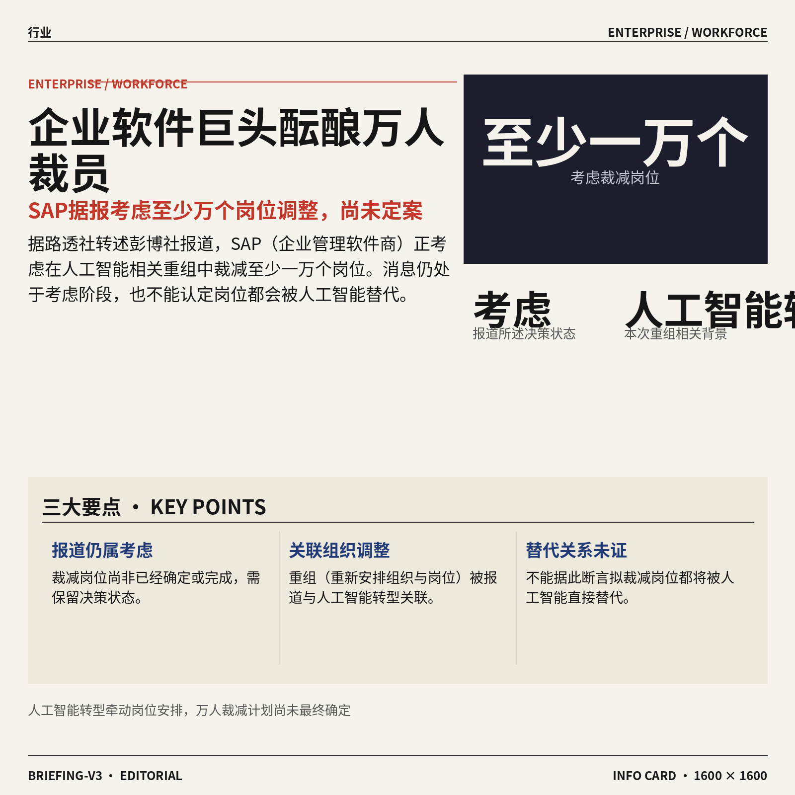

4. **SAP（企业管理软件公司）据报考虑在人工智能重组中裁减至少一万个岗位。**
据路透社转述彭博社报道，SAP（提供企业管理软件的公司）正考虑在 AI（人工智能）相关重组中，裁减**至少一万个岗位**。这里的**重组**，指企业重新调整组织和岗位安排；本次消息将其与人工智能转型联系在一起 🧭。不过，报道使用的是“考虑”，并非已经确定或完成裁员，也不能据此断言这些岗位都会被人工智能直接替代。[企业重组裁员报道(briefing)](https://news.google.com/rss/articles/CBMitwFBVV95cUxNUUhZaXItb2lOYVhHRHBoUkpGZFM2Y0ZpQ1dSN3QwUnEyQlBKdmlRVG9fdFM5WS1UNm41dGZnRVhyY1FIbjBvOUNFWEREN1F4S1l1amVSUGFheGl4N1NNbk1ieF9HU3N0azQ1djN1bjA2RWhIc1VhVWVWb0RVbG1HMVlPbFQyb0N5N1ZLTUVZeXlxMDk4d3d0UHh1ajdZeWd3ekx5TU52Z3BDaXdhOU9uN3dtd1lLMXM?oc=5)

![SAP（企业管理软件公司）据报考虑在人工智能重组中裁减至少一万个岗位](https://image.pollinations.ai/prompt/SAP%EF%BC%88%E4%BC%81%E4%B8%9A%E7%AE%A1%E7%90%86%E8%BD%AF%E4%BB%B6%E5%85%AC%E5%8F%B8%EF%BC%89%E6%8D%AE%E6%8A%A5%E8%80%83%E8%99%91%E5%9C%A8%E4%BA%BA%E5%B7%A5%E6%99%BA%E8%83%BD%E9%87%8D%E7%BB%84%E4%B8%AD%E8%A3%81%E5%87%8F%E8%87%B3%E5%B0%91%E4%B8%80%E4%B8%87%E4%B8%AA%E5%B2%97%E4%BD%8D.%20SAP%EF%BC%88%E4%BC%81%E4%B8%9A%E7%AE%A1%E7%90%86%E8%BD%AF%E4%BB%B6%E5%85%AC%E5%8F%B8%EF%BC%89%E6%8D%AE%E6%8A%A5%E8%80%83%E8%99%91%E5%9C%A8%E4%BA%BA%E5%B7%A5%E6%99%BA%E8%83%BD%E9%87%8D%E7%BB%84%E4%B8%AD%E8%A3%81%E5%87%8F%E8%87%B3%E5%B0%91%E4%B8%80%E4%B8%87%E4%B8%AA%E5%B2%97%E4%BD%8D%E3%80%82%20%E6%8D%AE%E8%B7%AF%E9%80%8F%E7%A4%BE%E8%BD%AC%E8%BF%B0%E5%BD%AD%E5%8D%9A%E7%A4%BE%E6%8A%A5%E9%81%93%EF%BC%8CSAP%EF%BC%88%E6%8F%90%E4%BE%9B%E4%BC%81%E4%B8%9A%E7%AE%A1%E7%90%86%E8%BD%AF%E4%BB%B6%E7%9A%84%E5%85%AC%E5%8F%B8%EF%BC%89%E6%AD%A3%E8%80%83%E8%99%91%E5%9C%A8%20AI%EF%BC%88%E4%BA%BA%E5%B7%A5%E6%99%BA%E8%83%BD%EF%BC%89%E7%9B%B8%E5%85%B3%E9%87%8D%2C%20technical%20infographic%20diagram%2C%20architecture%20flowchart%2C%20clean%20vector%20illustration%2C%20educational%20style%2C%20no%20text%20overlay%2C%20modern%20minimal%2C%20wide%20aspect?width=1200&height=675&nologo=true&seed=10900)

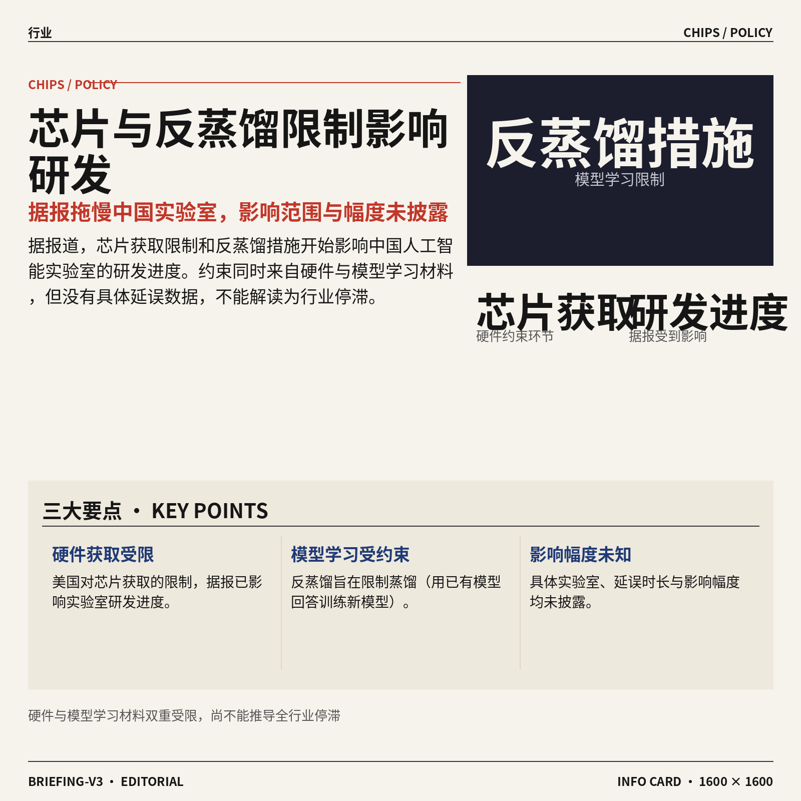

5. **美国芯片限制与模型“反蒸馏”措施，据报已拖慢中国人工智能实验室。**
据报道，美国对芯片获取的限制，以及**反蒸馏措施**，已经开始影响中国 AI（人工智能）实验室的研发进度。**模型蒸馏**（利用已有模型的回答来训练另一个模型），可以理解为让新模型学习其他模型的答题方式；反蒸馏则旨在限制这种做法 💡。这条消息涉及硬件获取和模型学习材料两方面的约束，但所给材料未披露具体实验室、延误时长或影响幅度，不宜将其解读为整个行业研发停滞。[芯片与模型限制报道(briefing)](https://the-decoder.com/us-chip-access-curbs-and-anti-distillation-measures-are-reportedly-already-slowing-chinese-ai-labs/)

![美国芯片限制与模型“反蒸馏”措施，据报已拖慢中国人工智能实验室](https://image.pollinations.ai/prompt/%E7%BE%8E%E5%9B%BD%E8%8A%AF%E7%89%87%E9%99%90%E5%88%B6%E4%B8%8E%E6%A8%A1%E5%9E%8B%E2%80%9C%E5%8F%8D%E8%92%B8%E9%A6%8F%E2%80%9D%E6%8E%AA%E6%96%BD%EF%BC%8C%E6%8D%AE%E6%8A%A5%E5%B7%B2%E6%8B%96%E6%85%A2%E4%B8%AD%E5%9B%BD%E4%BA%BA%E5%B7%A5%E6%99%BA%E8%83%BD%E5%AE%9E%E9%AA%8C%E5%AE%A4.%20%E7%BE%8E%E5%9B%BD%E8%8A%AF%E7%89%87%E9%99%90%E5%88%B6%E4%B8%8E%E6%A8%A1%E5%9E%8B%E2%80%9C%E5%8F%8D%E8%92%B8%E9%A6%8F%E2%80%9D%E6%8E%AA%E6%96%BD%EF%BC%8C%E6%8D%AE%E6%8A%A5%E5%B7%B2%E6%8B%96%E6%85%A2%E4%B8%AD%E5%9B%BD%E4%BA%BA%E5%B7%A5%E6%99%BA%E8%83%BD%E5%AE%9E%E9%AA%8C%E5%AE%A4%E3%80%82%20%E6%8D%AE%E6%8A%A5%E9%81%93%EF%BC%8C%E7%BE%8E%E5%9B%BD%E5%AF%B9%E8%8A%AF%E7%89%87%E8%8E%B7%E5%8F%96%E7%9A%84%E9%99%90%E5%88%B6%EF%BC%8C%E4%BB%A5%E5%8F%8A%E5%8F%8D%E8%92%B8%E9%A6%8F%E6%8E%AA%E6%96%BD%EF%BC%8C%E5%B7%B2%E7%BB%8F%E5%BC%80%E5%A7%8B%E5%BD%B1%E5%93%8D%E4%B8%AD%E5%9B%BD%20AI%EF%BC%88%E4%BA%BA%E5%B7%A5%E6%99%BA%E8%83%BD%EF%BC%89%E5%AE%9E%E9%AA%8C%E5%AE%A4%E7%9A%84%E7%A0%94%E5%8F%91%E8%BF%9B%2C%20technical%20infographic%20diagram%2C%20architecture%20flowchart%2C%20clean%20vector%20illustration%2C%20educational%20style%2C%20no%20text%20overlay%2C%20modern%20minimal%2C%20wide%20aspect?width=1200&height=675&nologo=true&seed=10931)

6. **OpenAI 与 Anthropic 限制数据获取后，一家中国开发商转向 Google 和 Meta。**
据报道，在 OpenAI 和 Anthropic 收紧数据获取后，一家中国 AI（人工智能）开发商正转向 Google 和 Meta，寻找替代来源 🔄。这里涉及的**数据获取限制**，是指开发商能否取得其他公司的模型相关数据，并不等同于普通用户无法使用这些公司的产品。消息呈现的是一家开发商的数据来源调整；现有材料没有说明其具体获取方式、授权条件或最终效果。[开发商数据来源调整(briefing)](https://the-decoder.com/after-openai-and-anthropic-shut-the-door-on-their-data-a-chinese-ai-developer-is-turning-to-google-and-meta-instead/)


### 🟣 开源TOP项目

1. **elementalsouls/Claude-BugHunter（面向漏洞挖掘与红队测试的 Claude Code 技能包）。**  
这是一个为 Claude Code 打造的**漏洞挖掘技能包**，集合了 85 项技能和 16 个斜杠命令（输入特定指令即可调用预设任务）。项目整理了 24 类核心安全漏洞中的 681 种公开报告模式，帮助安全人员更系统地发现问题 🛡️。它还覆盖企业身份系统与基础设施的攻击矩阵（按不同环节梳理潜在攻击路径），适合用于外部红队测试（模拟真实攻击来检验防护能力）。[GitHub 项目仓库(briefing)](https://github.com/elementalsouls/Claude-BugHunter)


2. **obra/superpowers（面向软件开发的 Agent 技能框架与工作方法）。**  
这是一个 Agent（能替人执行多步任务的 AI 助手）技能框架（把不同任务能力组织起来的一套工具）与软件开发方法论，目标是让 AI 更稳定地参与开发流程 🚀。它不只是提供单个功能，而是尝试把 AI 的任务执行能力与开发团队的工作方式结合起来。对希望让 AI 协助处理软件开发任务、同时保持流程规范的团队来说，这类项目值得关注。[GitHub 项目仓库(briefing)](https://github.com/obra/superpowers)


### 🔴 社媒分享

1. **AMD（芯片制造商）专属 llama.cpp（让大模型在本地运行的开源工具）分支。**  
这篇分享聚焦一个面向 **AMD** 硬件的专属版本，基础项目是 llama.cpp（让大模型在个人电脑上运行的开源工具）。所谓“分支”，可以理解为在原项目基础上单独维护的一条开发路线。对希望使用 AMD 设备运行 AI 模型的人来说，这个方向值得留意 🚀。[项目介绍原文(briefing)](https://devnull.land/amd-specific-llama-cpp)


2. **Swarms、Flocks、Gangs（多智能体协作群体的不同称呼）：如何构建、训练与评估多智能体系统。**  
文章讨论如何构建、训练和评估**多智能体系统**（让多个 AI 分工协作完成任务的系统）。Swarms、Flocks、Gangs 都是在描述这类“AI 协作群体”的不同说法，重点不只是让一个 Agent 工作，而是研究多个 Agent 如何配合。对关注自动化流程和团队协作型 AI 的同事来说，这是一篇偏方法论的分享 💡。[HuggingFace文章(briefing)](https://huggingface.co/blog/training-swarms)


3. **基于 Nemotron 3.5 Parse（面向文档解析的模型）继续开发：开放数据、微调与更快推理。**  
这篇文章围绕 Nemotron 3.5 Parse（用于理解和解析文档内容的 AI 模型）展开，提到开放数据、微调和更快推理几个方向。**微调**（用特定领域的数据继续训练模型，让它更适合某类任务）可以帮助模型适应实际业务场景；**推理**（训练好的模型正式回答问题或处理任务的过程）则直接影响使用速度。整体主题聚焦如何把模型从基础能力进一步推进到更高效的应用阶段 ⚡。[Nemotron文章原文(briefing)](https://huggingface.co/blog/nvidia/building-on-nemotron-35-parse-open-data-fine-tunin)


4. **Google 将让 AI Agent（能自主执行任务的人工智能助手）使用 MCP（模型连接外部工具的协议）服务器，但 Gmail（谷歌邮箱）暂时不能发邮件。**  
文章关注 Google 让 AI Agent 接入其 MCP 服务器（让 AI 按统一规则调用外部服务的连接协议）。其中 Gmail 的 MCP 连接目前不能执行“发送邮件”这一动作，说明 AI 能否完成任务，不只取决于模型能力，也取决于具体服务开放了哪些权限。对办公自动化来说，这提醒我们：能“读信息”和能“代表用户发出信息”是两种不同级别的授权 🔐。[完整报道原文(briefing)](https://techstackups.com/articles/google-workspace-ai-agents-mcp/)

![Google 将让 AI Agent（能自主执行任务的人工智能助手）使用 MCP（模型连接外部工具的协议）服务器，但 Gmail（谷歌邮箱）暂时不能发邮件](https://image.pollinations.ai/prompt/Google%20%E5%B0%86%E8%AE%A9%20AI%20Agent%EF%BC%88%E8%83%BD%E8%87%AA%E4%B8%BB%E6%89%A7%E8%A1%8C%E4%BB%BB%E5%8A%A1%E7%9A%84%E4%BA%BA%E5%B7%A5%E6%99%BA%E8%83%BD%E5%8A%A9%E6%89%8B%EF%BC%89%E4%BD%BF%E7%94%A8%20MCP%EF%BC%88%E6%A8%A1%E5%9E%8B%E8%BF%9E%E6%8E%A5%E5%A4%96%E9%83%A8%E5%B7%A5%E5%85%B7%E7%9A%84%E5%8D%8F%E8%AE%AE%EF%BC%89%E6%9C%8D%E5%8A%A1%E5%99%A8%EF%BC%8C%E4%BD%86%20Gmail%EF%BC%88%E8%B0%B7%E6%AD%8C%E9%82%AE%E7%AE%B1%EF%BC%89%E6%9A%82%E6%97%B6%E4%B8%8D%E8%83%BD%E5%8F%91%E9%82%AE%E4%BB%B6.%20Google%20%E5%B0%86%E8%AE%A9%20AI%20Agent%EF%BC%88%E8%83%BD%E8%87%AA%E4%B8%BB%E6%89%A7%E8%A1%8C%E4%BB%BB%E5%8A%A1%E7%9A%84%E4%BA%BA%E5%B7%A5%E6%99%BA%E8%83%BD%E5%8A%A9%E6%89%8B%EF%BC%89%E4%BD%BF%E7%94%A8%20MCP%EF%BC%88%E6%A8%A1%E5%9E%8B%E8%BF%9E%E6%8E%A5%E5%A4%96%E9%83%A8%E5%B7%A5%E5%85%B7%E7%9A%84%E5%8D%8F%E8%AE%AE%EF%BC%89%E6%9C%8D%E5%8A%A1%E5%99%A8%EF%BC%8C%E4%BD%86%20Gmail%EF%BC%88%E8%B0%B7%E6%AD%8C%E9%82%AE%E7%AE%B1%EF%BC%89%E6%9A%82%E6%97%B6%E4%B8%8D%E8%83%BD%E5%8F%91%E9%82%AE%E4%BB%B6%E3%80%82%20%E6%96%87%2C%20technical%20infographic%20diagram%2C%20architecture%20flowchart%2C%20clean%20vector%20illustration%2C%20educational%20style%2C%20no%20text%20overlay%2C%20modern%20minimal%2C%20wide%20aspect?width=1200&height=675&nologo=true&seed=10706)

5. **《纽约时报》提醒摄影师谨慎更新 Photoshop（Adobe 的图像编辑软件），以免启用 AI（人工智能）功能。**  
这条分享转述了《纽约时报》对摄影师的提醒，核心争议围绕 Photoshop 中新增或更新的 AI 功能。对摄影工作者而言，软件升级不再只是修复问题或增加普通工具，也可能改变图片处理流程。文章标题本身传递出一个值得关注的信号：专业创作软件里的 AI 功能，可能需要用户先了解再决定是否更新 🖼️。[相关讨论原文(briefing)](https://simonwillison.net/2026/Nov/26/hn-50651685/)

![《纽约时报》提醒摄影师谨慎更新 Photoshop（Adobe 的图像编辑软件），以免启用 AI（人工智能）功能](https://image.pollinations.ai/prompt/%E3%80%8A%E7%BA%BD%E7%BA%A6%E6%97%B6%E6%8A%A5%E3%80%8B%E6%8F%90%E9%86%92%E6%91%84%E5%BD%B1%E5%B8%88%E8%B0%A8%E6%85%8E%E6%9B%B4%E6%96%B0%20Photoshop%EF%BC%88Adobe%20%E7%9A%84%E5%9B%BE%E5%83%8F%E7%BC%96%E8%BE%91%E8%BD%AF%E4%BB%B6%EF%BC%89%EF%BC%8C%E4%BB%A5%E5%85%8D%E5%90%AF%E7%94%A8%20AI%EF%BC%88%E4%BA%BA%E5%B7%A5%E6%99%BA%E8%83%BD%EF%BC%89%E5%8A%9F%E8%83%BD.%20%E3%80%8A%E7%BA%BD%E7%BA%A6%E6%97%B6%E6%8A%A5%E3%80%8B%E6%8F%90%E9%86%92%E6%91%84%E5%BD%B1%E5%B8%88%E8%B0%A8%E6%85%8E%E6%9B%B4%E6%96%B0%20Photoshop%EF%BC%88Adobe%20%E7%9A%84%E5%9B%BE%E5%83%8F%E7%BC%96%E8%BE%91%E8%BD%AF%E4%BB%B6%EF%BC%89%EF%BC%8C%E4%BB%A5%E5%85%8D%E5%90%AF%E7%94%A8%20AI%EF%BC%88%E4%BA%BA%E5%B7%A5%E6%99%BA%E8%83%BD%EF%BC%89%E5%8A%9F%E8%83%BD%E3%80%82%20%E8%BF%99%E6%9D%A1%E5%88%86%E4%BA%AB%E8%BD%AC%E8%BF%B0%E4%BA%86%E3%80%8A%E7%BA%BD%E7%BA%A6%E6%97%B6%E6%8A%A5%E3%80%8B%E5%AF%B9%E6%91%84%E5%BD%B1%E5%B8%88%E7%9A%84%E6%8F%90%E9%86%92%EF%BC%8C%E6%A0%B8%2C%20technical%20infographic%20diagram%2C%20architecture%20flowchart%2C%20clean%20vector%20illustration%2C%20educational%20style%2C%20no%20text%20overlay%2C%20modern%20minimal%2C%20wide%20aspect?width=1200&height=675&nologo=true&seed=10737)

6. **AI（人工智能）让 self-hosting（自行托管软件与服务）重新变得有趣。**  
这篇文章把 AI 与 self-hosting（把软件和服务部署在自己的电脑或服务器上，而不是完全依赖第三方平台）联系起来。标题表达的观点是，AI 让自行管理个人服务这件事重新产生了吸引力。对非技术同事来说，可以把它理解为：不只使用现成的在线工具，也尝试在自己的设备上搭建和掌控服务，获得更多自主性 🛠️。[文章原文(briefing)](https://janlukas.blog/posts/ai-self-hosting)


---

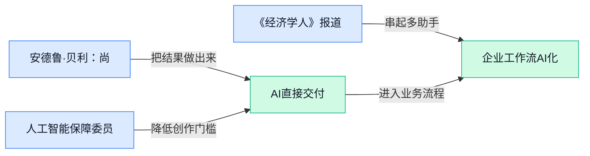

### 📊 行业洞察（今日 3 条）

1. OpenAI测试隐私处理功能，旨在使其无法读取企业数据。
   【洞察】隐私正成为企业采用的重要条件，但功能仍在测试，保护范围有待核实。
2. 英伟达通知合作伙伴暂停向东南亚四国交付服务器。
   【洞察】区域供应不确定性上升，因为美国限制进一步收紧，但不能据此判断全球供应短缺。
3. 《纽约时报》提醒摄影师谨慎更新Photoshop（图像编辑软件）。
   【洞察】人工智能功能并非越多越好，因为改变既有创作方式可能增加用户顾虑。

### 💭 对我们的启发（今日 2 条）

1. OpenAI隐私功能测试提示我们：视频工具可增加素材授权选项，降低企业使用顾虑；但须核实保护范围，避免过度承诺。
2. Photoshop更新争议提示我们：剪辑软件应允许自主启用人工智能，以兼顾效率与体验，避免自动修改损害创作意图。

